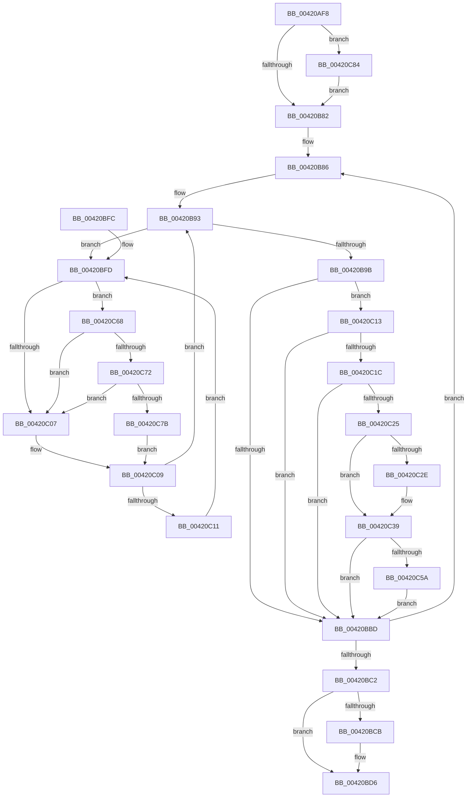

# MiConvertActiveLargePageToSmall

- RVA: `0x00420AF8`–`0x00420C92` (길이 `410` bytes)
- VA: `0x0000000140420AF8`
- 실행 섹션: `.text`
- PDB 이름 있음: `예`; PDB Function 태그: `아니요`
- unwind 정보 RVA: `0x000A020C`
- 디코드: `111`개 명령, `410/410` bytes 표시
- 미해석 바이트: `0` (있으면 어셈블리에 `.byte`로 보존)

> 이 문서는 커널 이미지의 기계어와 PDB 기호를 분석해 생성했습니다. 4번과 5번은 함수 원형과 자료형을 바이너리 사용 방식에서 추정한 C 해석이며 원본 소스 복구 결과는 아닙니다.

## 1. Dependencies

- 직접 호출 지점: **9**; 고유 호출 대상: **7**
- 직접 호출자로 확인된 함수: **5**
- RIP 상대 이미지 참조: **4**

### Outgoing calls
- `0x00420B1A` → [MiGetPfnPageSizeIndex](../31/MiGetPfnPageSizeIndex_function_0031C710.md) (function, `0x0031C710`)
- `0x00420BA4` → [MiConvertLargePfnToSmall](MiConvertLargePfnToSmall_function_00420CA0.md) (function, `0x00420CA0`)
- `0x00420BD1` → [KiLowerIrqlProcessIrqlFlags](../4F/KiLowerIrqlProcessIrqlFlags_function_004F5698.md) (function, `0x004F5698`)
- `0x00420C1C` → [KeShouldYieldProcessor](../27/KeShouldYieldProcessor_function_002773E0.md) (function, `0x002773E0`)
- `0x00420C34` → [KiLowerIrqlProcessIrqlFlags](../4F/KiLowerIrqlProcessIrqlFlags_function_004F5698.md) (function, `0x004F5698`)
- `0x00420C5E` → [KiRaiseIrqlProcessIrqlFlags](../4F/KiRaiseIrqlProcessIrqlFlags_function_004F56FC.md) (function, `0x004F56FC`)
- `0x00420C72` → [KiCheckVpBackingLongSpinWaitHypercall](../30/KiCheckVpBackingLongSpinWaitHypercall_function_0030F490.md) (function, `0x0030F490`)
- `0x00420C7D` → [HvlNotifyLongSpinWait](../30/HvlNotifyLongSpinWait_function_0030F460.md) (function, `0x0030F460`)
- `0x00420C88` → [KiRaiseIrqlProcessIrqlFlags](../4F/KiRaiseIrqlProcessIrqlFlags_function_004F56FC.md) (function, `0x004F56FC`)

### Direct callers
- [MiCreateSlabEntry](../37/MiCreateSlabEntry_function_00374DEC.md) at `0x0037501D`
- [MiInitializeFoundLargeNodePage](../4F/MiInitializeFoundLargeNodePage_function_004F97E8.md) at `0x004F981B`
- [MiUpdateLargePageSectionPfns](../67/MiUpdateLargePageSectionPfns_function_00678F8C.md) at `0x00679015`
- [MiInitializeNonPagedPool](../../init/C6/MiInitializeNonPagedPool_function_00C64A24.md) at `0x00C64BFD`
- [MiCreateKernelHalSlabRange](../../init/C6/MiCreateKernelHalSlabRange_function_00C69C80.md) at `0x00C69D11`

### Static image references
- `0x00420B22` → RVA `0x00011C60` (`.rdata`; read)
- `0x00420B75` → RVA `0x00FC6D20` (`ALMOSTRO`; read)
- `0x00420BFF` → RVA `0x00FC52AC` (`ALMOSTRO`; reference)
- `0x00420C68` → RVA `0x00FC6AB8` (`ALMOSTRO`; read)

## 2. Other-region calls and transfers

- 다른 실행 섹션으로 향하는 call: **0**
- 별도 외부 분기/꼬리 이동을 확인하지 못했습니다.

## 3. Assembly (complete function range)

```asm
00420AF8  48 8B C4                        mov rax, rsp
00420AFB  48 89 58 08                     mov qword ptr [rax + 8], rbx
00420AFF  48 89 68 10                     mov qword ptr [rax + 0x10], rbp
00420B03  48 89 70 18                     mov qword ptr [rax + 0x18], rsi
00420B07  48 89 78 20                     mov qword ptr [rax + 0x20], rdi
00420B0B  41 54                           push r12
00420B0D  41 56                           push r14
00420B0F  41 57                           push r15
00420B11  48 83 EC 20                     sub rsp, 0x20
00420B15  8B DA                           mov ebx, edx
00420B17  4C 8B F9                        mov r15, rcx
00420B1A  E8 F1 BB EF FF                  call 0x14031c710
00420B1F  44 8B C0                        mov r8d, eax
00420B22  48 8D 05 37 11 BF FF            lea rax, [rip - 0x40eec9]
00420B29  4A 8B 04 C0                     mov rax, qword ptr [rax + r8*8]
00420B2D  48 B9 00 00 00 00 00 DE FF FF   movabs rcx, 0xffffde0000000000
00420B37  48 8D 34 40                     lea rsi, [rax + rax*2]
00420B3B  4D 8B F7                        mov r14, r15
00420B3E  4C 2B F1                        sub r14, rcx
00420B41  48 C1 E6 04                     shl rsi, 4
00420B45  49 C1 FE 04                     sar r14, 4
00420B49  49 03 F7                        add rsi, r15
00420B4C  48 B9 AB AA AA AA AA AA AA AA   movabs rcx, 0xaaaaaaaaaaaaaaab
00420B56  4C 0F AF F1                     imul r14, rcx
00420B5A  4C 03 F0                        add r14, rax
00420B5D  B8 02 00 00 00                  mov eax, 2
00420B62  F7 DB                           neg ebx
00420B64  45 1B E4                        sbb r12d, r12d
00420B67  41 F7 DC                        neg r12d
00420B6A  44 03 E0                        add r12d, eax
00420B6D  44 0F 20 C3                     mov rbx, cr8
00420B71  44 0F 22 C0                     mov cr8, rax
00420B75  83 3D A4 61 BA 00 00            cmp dword ptr [rip + 0xba61a4], 0
00420B7C  0F 85 02 01 00 00               jne 0x140420c84
00420B82  48 8D 7E 18                     lea rdi, [rsi + 0x18]
00420B86  48 83 EE 30                     sub rsi, 0x30
00420B8A  48 8D 7F D0                     lea rdi, [rdi - 0x30]
00420B8E  49 FF CE                        dec r14
00420B91  33 ED                           xor ebp, ebp
00420B93  F0 48 0F BA 2F 3F               lock bts qword ptr [rdi], 0x3f
00420B99  72 62                           jb 0x140420bfd
00420B9B  45 8B C4                        mov r8d, r12d
00420B9E  48 8B D6                        mov rdx, rsi
00420BA1  49 8B CF                        mov rcx, r15
00420BA4  E8 F7 00 00 00                  call 0x140420ca0
00420BA9  48 B8 FF FF FF FF FF FF FF 7F   movabs rax, 0x7fffffffffffffff
00420BB3  F0 48 21 07                     lock and qword ptr [rdi], rax
00420BB7  41 F6 C6 0F                     test r14b, 0xf
00420BBB  74 56                           je 0x140420c13
00420BBD  49 3B F7                        cmp rsi, r15
00420BC0  75 C4                           jne 0x140420b86
00420BC2  83 3D 57 61 BA 00 00            cmp dword ptr [rip + 0xba6157], 0
00420BC9  74 0B                           je 0x140420bd6
00420BCB  44 0F 20 C1                     mov rcx, cr8
00420BCF  8A D3                           mov dl, bl
00420BD1  E8 C2 4A 0D 00                  call 0x1404f5698
00420BD6  0F B6 C3                        movzx eax, bl
00420BD9  44 0F 22 C0                     mov cr8, rax
00420BDD  48 8B 5C 24 40                  mov rbx, qword ptr [rsp + 0x40]
00420BE2  48 8B 6C 24 48                  mov rbp, qword ptr [rsp + 0x48]
00420BE7  48 8B 74 24 50                  mov rsi, qword ptr [rsp + 0x50]
00420BEC  48 8B 7C 24 58                  mov rdi, qword ptr [rsp + 0x58]
00420BF1  48 83 C4 20                     add rsp, 0x20
00420BF5  41 5F                           pop r15
00420BF7  41 5E                           pop r14
00420BF9  41 5C                           pop r12
00420BFB  C3                              ret
00420BFC  CC                              int3
00420BFD  FF C5                           inc ebp
00420BFF  85 2D A7 46 BA 00               test dword ptr [rip + 0xba46a7], ebp
00420C05  74 61                           je 0x140420c68
00420C07  F3 90                           pause
00420C09  48 8B 07                        mov rax, qword ptr [rdi]
00420C0C  48 85 C0                        test rax, rax
00420C0F  79 82                           jns 0x140420b93
00420C11  EB EA                           jmp 0x140420bfd
00420C13  B8 02 00 00 00                  mov eax, 2
00420C18  3A D8                           cmp bl, al
00420C1A  73 A1                           jae 0x140420bbd
00420C1C  E8 BF 67 E5 FF                  call 0x1402773e0
00420C21  85 C0                           test eax, eax
00420C23  74 98                           je 0x140420bbd
00420C25  83 3D F4 60 BA 00 00            cmp dword ptr [rip + 0xba60f4], 0
00420C2C  74 0B                           je 0x140420c39
00420C2E  44 0F 20 C1                     mov rcx, cr8
00420C32  8A D3                           mov dl, bl
00420C34  E8 5F 4A 0D 00                  call 0x1404f5698
00420C39  0F B6 C3                        movzx eax, bl
00420C3C  44 0F 22 C0                     mov cr8, rax
00420C40  44 0F 20 C3                     mov rbx, cr8
00420C44  B8 02 00 00 00                  mov eax, 2
00420C49  44 0F 22 C0                     mov cr8, rax
00420C4D  83 3D CC 60 BA 00 00            cmp dword ptr [rip + 0xba60cc], 0
00420C54  0F 84 63 FF FF FF               je 0x140420bbd
00420C5A  8A D0                           mov dl, al
00420C5C  8A CB                           mov cl, bl
00420C5E  E8 99 4A 0D 00                  call 0x1404f56fc
00420C63  E9 55 FF FF FF                  jmp 0x140420bbd
00420C68  8B 05 4A 5E BA 00               mov eax, dword ptr [rip + 0xba5e4a]
00420C6E  A8 40                           test al, 0x40
00420C70  74 95                           je 0x140420c07
00420C72  E8 19 E8 EE FF                  call 0x14030f490
00420C77  84 C0                           test al, al
00420C79  74 8C                           je 0x140420c07
00420C7B  8B CD                           mov ecx, ebp
00420C7D  E8 DE E7 EE FF                  call 0x14030f460
00420C82  EB 85                           jmp 0x140420c09
00420C84  8A D0                           mov dl, al
00420C86  8A CB                           mov cl, bl
00420C88  E8 6F 4A 0D 00                  call 0x1404f56fc
00420C8D  E9 F0 FE FF FF                  jmp 0x140420b82
```

## 4. C-style interpretation (structured pseudocode)

```c
__int64 __fastcall MiConvertActiveLargePageToSmall(__int64 a1, int a2)
{
    __int64 result;
    __int64 v_r12;
    __int64 v_r14;
    __int64 v_rbp;
    __int64 v_rbx;
    __int64 v_rsi;
    __int64 v_rsp;
    unsigned __int64 v_stack_p10;
    unsigned __int64 v_stack_p18;
    unsigned __int64 v_stack_p20;
    unsigned __int64 v_stack_p8;

    *(unsigned __int64 *)(v_rsp + 8) = v_rbx;
    *(unsigned __int64 *)(v_rsp + 16) = v_rbp;
    *(unsigned __int64 *)(v_rsp + 24) = v_rsi;
    *(unsigned __int64 *)(v_rsp + 32) = v_rdi;
    v_rsp = (v_rsp) - (32);
    result = MiGetPfnPageSizeIndex(a1, a2, a3, a4);
    v_r14 = (a1) - (a1);
    v_rsi = (*(unsigned __int64 *)(v_rip - 4255433 + (unsigned int)((unsigned int)(result)) * 8) + *(unsigned __int64 *)(v_rip - 4255433 + (unsigned int)((unsigned int)(result)) * 8) * 2) << (4);
    v_r14 = (v_r14) >> (4);
    v_rsi = (v_rsi) + (a1);
    v_r14 = (v_r14) * (a1);
    v_r14 = (v_r14) + (*(unsigned __int64 *)(v_rip - 4255433 + (unsigned int)((unsigned int)(result)) * 8));
    v_rbx = (unsigned int)(-((unsigned int)(a2)));
    v_r12 = (unsigned int)(-(v_r12));
    v_r12 = (unsigned int)((v_r12) + (2));
    if ((*(unsigned int *)(v_rip + 12214692)) != 0) goto loc_00420C84;
loc_00420B82:
loc_00420B86:
    v_rsi = (v_rsi) - (48);
    v_r14 = (v_r14) - 1;
    v_rbp = 0;
loc_00420B93:
    if (condition_is_below) goto loc_00420BFD;
    result = MiConvertLargePfnToSmall(a1, v_rsi, (unsigned int)((unsigned int)(v_r12)), a4);
    if ((((unsigned __int8)(v_r14)) & (15)) == 0) goto loc_00420C13;
loc_00420BBD:
    if (v_rsi != a1) goto loc_00420B86;
    if ((*(unsigned int *)(v_rip + 12214615)) != 0) {
        a1 = 2;
        a2 = (unsigned __int8)(v_cr8);
        result = KiLowerIrqlProcessIrqlFlags(a1, a2, (unsigned int)((unsigned int)(v_r12)), a4);
    }
    v_rsp = (v_rsp) + (32);
    return (unsigned __int8)(v_cr8);
loc_00420BFD:
    v_rbp = (unsigned int)((v_stack_p10) + 1);
    if (((*(unsigned int *)(v_rip + 12207783)) & ((unsigned int)(v_rbp))) == 0) goto loc_00420C68;
loc_00420C07:
loc_00420C09:
    if (!sign_flag) goto loc_00420B93;
    goto loc_00420BFD;
loc_00420C13:
    if (((unsigned __int8)(v_stack_p8)) >= 2) goto loc_00420BBD;
    result = KeShouldYieldProcessor(a1, a2, (unsigned int)((unsigned int)(v_r12)), a4);
    if ((unsigned int)(result) == 0) goto loc_00420BBD;
    if ((*(unsigned int *)(v_rip + 12214516)) != 0) {
        a1 = (unsigned __int8)(v_cr8);
        a2 = (unsigned __int8)(v_stack_p8);
        result = KiLowerIrqlProcessIrqlFlags(a1, a2, (unsigned int)((unsigned int)(v_r12)), a4);
    }
    if ((*(unsigned int *)(v_rip + 12214476)) == 0) goto loc_00420BBD;
    result = KiRaiseIrqlProcessIrqlFlags((unsigned __int8)((unsigned __int8)(v_stack_p8)), 2, (unsigned int)((unsigned int)(v_r12)), a4);
    goto loc_00420BBD;
loc_00420C68:
    if ((((unsigned __int8)((unsigned int)(*(unsigned int *)(v_rip + 12213834)))) & (64)) == 0) goto loc_00420C07;
    result = KiCheckVpBackingLongSpinWaitHypercall((unsigned __int8)((unsigned __int8)(v_stack_p8)), 2, (unsigned int)((unsigned int)(v_r12)), a4);
    if ((unsigned __int8)(result) == 0) goto loc_00420C07;
    result = HvlNotifyLongSpinWait((unsigned int)((unsigned int)(v_rbp)), 2, (unsigned int)((unsigned int)(v_r12)), a4);
    goto loc_00420C09;
loc_00420C84:
    result = KiRaiseIrqlProcessIrqlFlags((unsigned __int8)((unsigned __int8)(v_stack_p8)), (unsigned __int8)(result), (unsigned int)((unsigned int)(v_r12)), a4);
    goto loc_00420B82;
}
```

## 5. (Beta) C Style

```c
int64_t MiConvertActiveLargePageToSmall(int64_t Arg1, int32_t Arg2)
{
    int64_t result;
    int64_t local_r12;
    int64_t local_r14;
    int64_t local_rbp;
    int64_t local_rbx;
    int64_t local_rsi;
    int64_t local_rsp;
    uint64_t v_stack_p10;
    uint64_t v_stack_p18;
    uint64_t v_stack_p20;
    uint64_t v_stack_p8;

    *(uint64_t *)(local_rsp + 0x8) = local_rbx;
    *(uint64_t *)(local_rsp + 0x10) = local_rbp;
    *(uint64_t *)(local_rsp + 0x18) = local_rsi;
    *(uint64_t *)(local_rsp + 0x20) = local_rdi;
    local_rsp = (local_rsp) - (32);
    result = MiGetPfnPageSizeIndex(Arg1, Arg2, a3, a4);
    local_r14 = (Arg1) - (Arg1);
    local_rsi = (*(uint64_t *)(v_rip - 0x40EEC9 + (uint32_t)((uint32_t)(result)) * 8) + *(uint64_t *)(v_rip - 0x40EEC9 + (uint32_t)((uint32_t)(result)) * 8) * 2) << (4);
    local_r14 = (local_r14) >> (4);
    local_rsi = (local_rsi) + (Arg1);
    local_r14 = (local_r14) * (Arg1);
    local_r14 = (local_r14) + (*(uint64_t *)(v_rip - 0x40EEC9 + (uint32_t)((uint32_t)(result)) * 8));
    local_rbx = (uint32_t)(-((uint32_t)(Arg2)));
    local_r12 = (uint32_t)(-(local_r12));
    local_r12 = (uint32_t)((local_r12) + (2));
    if ((*(uint32_t *)(v_rip + 0xBA61A4)) != 0) goto loc_00420C84;
loc_00420B82:
loc_00420B86:
    local_rsi = (local_rsi) - (48);
    local_r14 = (local_r14) - 1;
    local_rbp = 0;
loc_00420B93:
    if (condition_is_below) goto loc_00420BFD;
    result = MiConvertLargePfnToSmall(Arg1, local_rsi, (uint32_t)((uint32_t)(local_r12)), a4);
    if ((((uint8_t)(local_r14)) & (15)) == 0) goto loc_00420C13;
loc_00420BBD:
    if (local_rsi != Arg1) goto loc_00420B86;
    if ((*(uint32_t *)(v_rip + 0xBA6157)) != 0) {
        Arg1 = 2;
        Arg2 = (uint8_t)(v_cr8);
        result = KiLowerIrqlProcessIrqlFlags(Arg1, Arg2, (uint32_t)((uint32_t)(local_r12)), a4);
    }
    local_rsp = (local_rsp) + (32);
    return (uint8_t)(v_cr8);
loc_00420BFD:
    local_rbp = (uint32_t)((v_stack_p10) + 1);
    if (((*(uint32_t *)(v_rip + 0xBA46A7)) & ((uint32_t)(local_rbp))) == 0) goto loc_00420C68;
loc_00420C07:
loc_00420C09:
    if (!sign_flag) goto loc_00420B93;
    goto loc_00420BFD;
loc_00420C13:
    if (((uint8_t)(v_stack_p8)) >= 2) goto loc_00420BBD;
    result = KeShouldYieldProcessor(Arg1, Arg2, (uint32_t)((uint32_t)(local_r12)), a4);
    if ((uint32_t)(result) == 0) goto loc_00420BBD;
    if ((*(uint32_t *)(v_rip + 0xBA60F4)) != 0) {
        Arg1 = (uint8_t)(v_cr8);
        Arg2 = (uint8_t)(v_stack_p8);
        result = KiLowerIrqlProcessIrqlFlags(Arg1, Arg2, (uint32_t)((uint32_t)(local_r12)), a4);
    }
    if ((*(uint32_t *)(v_rip + 0xBA60CC)) == 0) goto loc_00420BBD;
    result = KiRaiseIrqlProcessIrqlFlags((uint8_t)((uint8_t)(v_stack_p8)), 2, (uint32_t)((uint32_t)(local_r12)), a4);
    goto loc_00420BBD;
loc_00420C68:
    if ((((uint8_t)((uint32_t)(*(uint32_t *)(v_rip + 0xBA5E4A)))) & (64)) == 0) goto loc_00420C07;
    result = KiCheckVpBackingLongSpinWaitHypercall((uint8_t)((uint8_t)(v_stack_p8)), 2, (uint32_t)((uint32_t)(local_r12)), a4);
    if ((uint8_t)(result) == 0) goto loc_00420C07;
    result = HvlNotifyLongSpinWait((uint32_t)((uint32_t)(local_rbp)), 2, (uint32_t)((uint32_t)(local_r12)), a4);
    goto loc_00420C09;
loc_00420C84:
    result = KiRaiseIrqlProcessIrqlFlags((uint8_t)((uint8_t)(v_stack_p8)), (uint8_t)(result), (uint32_t)((uint32_t)(local_r12)), a4);
    goto loc_00420B82;
}
```

## 6. Execution-region graph

[열기: 2D/3D 그래프와 함수 탐색 컨트롤 패널](../../../control-panel.html?section=text&rva=0x00420AF8&view=graph)

- 2D 그래프는 위에서 아래로 흐르고, 3D 그래프는 빈 공간을 드래그해 회전합니다. Shift+드래그는 이동, 휠은 확대·축소, 함수 노드 선택은 대상 보고서 이동입니다.

### Static fallback


