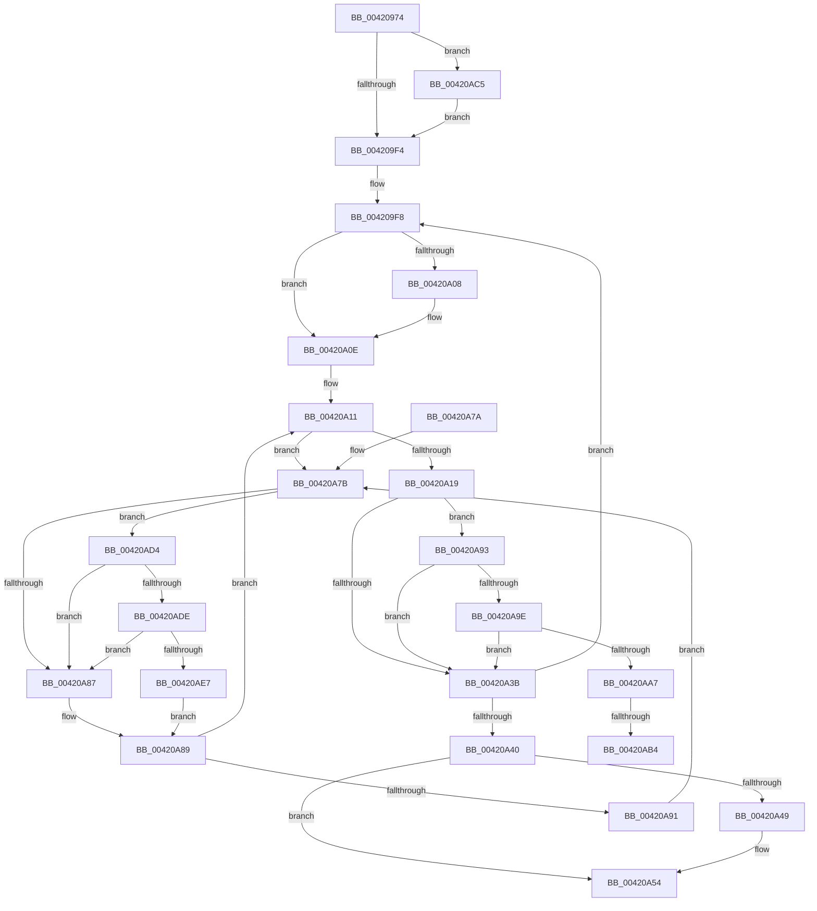

# MiConvertLargeFreePageToActive

- RVA: `0x00420974`–`0x00420AF1` (길이 `381` bytes)
- VA: `0x0000000140420974`
- 실행 섹션: `.text`
- PDB 이름 있음: `예`; PDB Function 태그: `예`
- unwind 정보 RVA: `0x000A01DC`
- 디코드: `102`개 명령, `381/381` bytes 표시
- 미해석 바이트: `0` (있으면 어셈블리에 `.byte`로 보존)

> 이 문서는 커널 이미지의 기계어와 PDB 기호를 분석해 생성했습니다. 4번과 5번은 함수 원형과 자료형을 바이너리 사용 방식에서 추정한 C 해석이며 원본 소스 복구 결과는 아닙니다.

## 1. Dependencies

- 직접 호출 지점: **8**; 고유 호출 대상: **7**
- 직접 호출자로 확인된 함수: **1**
- RIP 상대 이미지 참조: **4**

### Outgoing calls
- `0x00420994` → [MiGetPfnPageSizeIndex](../31/MiGetPfnPageSizeIndex_function_0031C710.md) (function, `0x0031C710`)
- `0x00420A22` → [MiConvertLargePfnToSmall](MiConvertLargePfnToSmall_function_00420CA0.md) (function, `0x00420CA0`)
- `0x00420A4F` → [KiLowerIrqlProcessIrqlFlags](../4F/KiLowerIrqlProcessIrqlFlags_function_004F5698.md) (function, `0x004F5698`)
- `0x00420A9E` → [KeShouldYieldProcessor](../27/KeShouldYieldProcessor_function_002773E0.md) (function, `0x002773E0`)
- `0x00420ABA` → [KiLowerIrqlProcessIrqlFlags](../4F/KiLowerIrqlProcessIrqlFlags_function_004F5698.md) (function, `0x004F5698`)
- `0x00420ACA` → [KiRaiseIrqlProcessIrqlFlags](../4F/KiRaiseIrqlProcessIrqlFlags_function_004F56FC.md) (function, `0x004F56FC`)
- `0x00420ADE` → [KiCheckVpBackingLongSpinWaitHypercall](../30/KiCheckVpBackingLongSpinWaitHypercall_function_0030F490.md) (function, `0x0030F490`)
- `0x00420AEA` → [HvlNotifyLongSpinWait](../30/HvlNotifyLongSpinWait_function_0030F460.md) (function, `0x0030F460`)

### Direct callers
- [MiLargeFreePageToMdl](MiLargeFreePageToMdl_function_00420880.md) at `0x004208EA`

### Static image references
- `0x0042099B` → RVA `0x00011C60` (`.rdata`; read)
- `0x004209E7` → RVA `0x00FC6D20` (`ALMOSTRO`; read)
- `0x00420A7E` → RVA `0x00FC52AC` (`ALMOSTRO`; reference)
- `0x00420AD4` → RVA `0x00FC6AB8` (`ALMOSTRO`; read)

## 2. Other-region calls and transfers

- 다른 실행 섹션으로 향하는 call: **0**
- call이 아닌 외부 분기/꼬리 이동: **2**
  - `0x00420AAE` → [sub_006EDB4A](../6E/Unknown_function_006EDB4A.md) (`tail-transfer`)
  - `0x00420AC0` → [sub_006EDB4A](../6E/Unknown_function_006EDB4A.md) (`tail-transfer`)

## 3. Assembly (complete function range)

```asm
00420974  48 8B C4                        mov rax, rsp
00420977  48 89 58 08                     mov qword ptr [rax + 8], rbx
0042097B  48 89 68 10                     mov qword ptr [rax + 0x10], rbp
0042097F  48 89 70 18                     mov qword ptr [rax + 0x18], rsi
00420983  48 89 78 20                     mov qword ptr [rax + 0x20], rdi
00420987  41 54                           push r12
00420989  41 56                           push r14
0042098B  41 57                           push r15
0042098D  48 83 EC 20                     sub rsp, 0x20
00420991  4C 8B E1                        mov r12, rcx
00420994  E8 77 BD EF FF                  call 0x14031c710
00420999  8B D0                           mov edx, eax
0042099B  48 8D 05 BE 12 BF FF            lea rax, [rip - 0x40ed42]
004209A2  48 8B 04 D0                     mov rax, qword ptr [rax + rdx*8]
004209A6  48 B9 00 00 00 00 00 DE FF FF   movabs rcx, 0xffffde0000000000
004209B0  4D 8B FC                        mov r15, r12
004209B3  48 8D 34 40                     lea rsi, [rax + rax*2]
004209B7  4C 2B F9                        sub r15, rcx
004209BA  48 C1 E6 04                     shl rsi, 4
004209BE  49 C1 FF 04                     sar r15, 4
004209C2  48 B9 AB AA AA AA AA AA AA AA   movabs rcx, 0xaaaaaaaaaaaaaaab
004209CC  4C 0F AF F9                     imul r15, rcx
004209D0  BD 03 00 00 00                  mov ebp, 3
004209D5  4C 03 F8                        add r15, rax
004209D8  49 03 F4                        add rsi, r12
004209DB  44 0F 20 C3                     mov rbx, cr8
004209DF  44 8D 75 FF                     lea r14d, [rbp - 1]
004209E3  45 0F 22 C6                     mov cr8, r14
004209E7  83 3D 32 63 BA 00 00            cmp dword ptr [rip + 0xba6332], 0
004209EE  0F 85 D1 00 00 00               jne 0x140420ac5
004209F4  48 8D 7E 18                     lea rdi, [rsi + 0x18]
004209F8  48 83 EE 30                     sub rsi, 0x30
004209FC  48 8D 7F D0                     lea rdi, [rdi - 0x30]
00420A00  49 FF CF                        dec r15
00420A03  49 3B F4                        cmp rsi, r12
00420A06  75 06                           jne 0x140420a0e
00420A08  83 E5 FE                        and ebp, 0xfffffffe
00420A0B  83 CD 04                        or ebp, 4
00420A0E  45 33 F6                        xor r14d, r14d
00420A11  F0 48 0F BA 2F 3F               lock bts qword ptr [rdi], 0x3f
00420A17  72 62                           jb 0x140420a7b
00420A19  44 8B C5                        mov r8d, ebp
00420A1C  48 8B D6                        mov rdx, rsi
00420A1F  49 8B CC                        mov rcx, r12
00420A22  E8 79 02 00 00                  call 0x140420ca0
00420A27  48 B8 FF FF FF FF FF FF FF 7F   movabs rax, 0x7fffffffffffffff
00420A31  F0 48 21 07                     lock and qword ptr [rdi], rax
00420A35  41 F6 C7 0F                     test r15b, 0xf
00420A39  74 58                           je 0x140420a93
00420A3B  49 3B F4                        cmp rsi, r12
00420A3E  75 B8                           jne 0x1404209f8
00420A40  83 3D D9 62 BA 00 00            cmp dword ptr [rip + 0xba62d9], 0
00420A47  74 0B                           je 0x140420a54
00420A49  44 0F 20 C1                     mov rcx, cr8
00420A4D  8A D3                           mov dl, bl
00420A4F  E8 44 4C 0D 00                  call 0x1404f5698
00420A54  0F B6 C3                        movzx eax, bl
00420A57  44 0F 22 C0                     mov cr8, rax
00420A5B  48 8B 5C 24 40                  mov rbx, qword ptr [rsp + 0x40]
00420A60  48 8B 6C 24 48                  mov rbp, qword ptr [rsp + 0x48]
00420A65  48 8B 74 24 50                  mov rsi, qword ptr [rsp + 0x50]
00420A6A  48 8B 7C 24 58                  mov rdi, qword ptr [rsp + 0x58]
00420A6F  48 83 C4 20                     add rsp, 0x20
00420A73  41 5F                           pop r15
00420A75  41 5E                           pop r14
00420A77  41 5C                           pop r12
00420A79  C3                              ret
00420A7A  CC                              int3
00420A7B  41 FF C6                        inc r14d
00420A7E  44 85 35 27 48 BA 00            test dword ptr [rip + 0xba4827], r14d
00420A85  74 4D                           je 0x140420ad4
00420A87  F3 90                           pause
00420A89  48 8B 07                        mov rax, qword ptr [rdi]
00420A8C  48 85 C0                        test rax, rax
00420A8F  79 80                           jns 0x140420a11
00420A91  EB E8                           jmp 0x140420a7b
00420A93  41 BE 02 00 00 00               mov r14d, 2
00420A99  41 3A DE                        cmp bl, r14b
00420A9C  73 9D                           jae 0x140420a3b
00420A9E  E8 3D 69 E5 FF                  call 0x1402773e0
00420AA3  85 C0                           test eax, eax
00420AA5  74 94                           je 0x140420a3b
00420AA7  83 3D 72 62 BA 00 00            cmp dword ptr [rip + 0xba6272], 0
00420AAE  0F 84 96 D0 2C 00               je 0x1406edb4a
00420AB4  44 0F 20 C1                     mov rcx, cr8
00420AB8  8A D3                           mov dl, bl
00420ABA  E8 D9 4B 0D 00                  call 0x1404f5698
00420ABF  90                              nop
00420AC0  E9 85 D0 2C 00                  jmp 0x1406edb4a
00420AC5  41 8A D6                        mov dl, r14b
00420AC8  8A CB                           mov cl, bl
00420ACA  E8 2D 4C 0D 00                  call 0x1404f56fc
00420ACF  E9 20 FF FF FF                  jmp 0x1404209f4
00420AD4  8B 05 DE 5F BA 00               mov eax, dword ptr [rip + 0xba5fde]
00420ADA  A8 40                           test al, 0x40
00420ADC  74 A9                           je 0x140420a87
00420ADE  E8 AD E9 EE FF                  call 0x14030f490
00420AE3  84 C0                           test al, al
00420AE5  74 A0                           je 0x140420a87
00420AE7  41 8B CE                        mov ecx, r14d
00420AEA  E8 71 E9 EE FF                  call 0x14030f460
00420AEF  EB 98                           jmp 0x140420a89
```

## 4. C-style interpretation (structured pseudocode)

```c
__int64 __fastcall MiConvertLargeFreePageToActive(__int64 a1)
{
    __int64 result;
    __int64 v_r14;
    __int64 v_r15;
    __int64 v_rbp;
    __int64 v_rsi;
    __int64 v_rsp;
    unsigned __int64 v_stack_p10;
    unsigned __int64 v_stack_p18;
    unsigned __int64 v_stack_p20;
    unsigned __int64 v_stack_p8;

    *(unsigned __int64 *)(v_rsp + 8) = v_rbx;
    *(unsigned __int64 *)(v_rsp + 16) = v_rbp;
    *(unsigned __int64 *)(v_rsp + 24) = v_rsi;
    *(unsigned __int64 *)(v_rsp + 32) = v_rdi;
    v_rsp = (v_rsp) - (32);
    result = MiGetPfnPageSizeIndex(a1, a2, a3, a4);
    v_r15 = (a1) - (a1);
    v_rsi = (*(unsigned __int64 *)(v_rip - 4255042 + (unsigned int)((unsigned int)(result)) * 8) + *(unsigned __int64 *)(v_rip - 4255042 + (unsigned int)((unsigned int)(result)) * 8) * 2) << (4);
    v_r15 = (v_r15) >> (4);
    v_r15 = (v_r15) * (a1);
    v_r15 = (v_r15) + (*(unsigned __int64 *)(v_rip - 4255042 + (unsigned int)((unsigned int)(result)) * 8));
    v_rsi = (v_rsi) + (a1);
    if ((*(unsigned int *)(v_rip + 12215090)) != 0) goto loc_00420AC5;
loc_004209F4:
loc_004209F8:
    v_rsi = (v_rsi) - (48);
    v_r15 = (v_r15) - 1;
    v_rbp = 3;
    if (v_rsi == a1) {
        v_rbp = (unsigned int)((3) & (0xFFFFFFFEULL));
        v_rbp = (unsigned int)((v_rbp) | (4));
    }
    v_r14 = 0;
loc_00420A11:
    if (condition_is_below) goto loc_00420A7B;
    result = MiConvertLargePfnToSmall(a1, v_rsi, (unsigned int)((unsigned int)(v_rbp)), a4);
    if ((((unsigned __int8)(v_r15)) & (15)) == 0) goto loc_00420A93;
loc_00420A3B:
    if (v_rsi != a1) goto loc_004209F8;
    if ((*(unsigned int *)(v_rip + 12215001)) != 0) {
        a1 = 3 - 1;
        a2 = (unsigned __int8)(v_cr8);
        result = KiLowerIrqlProcessIrqlFlags(a1, a2, (unsigned int)((unsigned int)(v_rbp)), a4);
    }
    v_rsp = (v_rsp) + (32);
    return (unsigned __int8)(v_cr8);
loc_00420A7B:
    v_r14 = (unsigned int)((v_r14) + 1);
    if (((*(unsigned int *)(v_rip + 12208167)) & ((unsigned int)(v_r14))) == 0) goto loc_00420AD4;
loc_00420A87:
loc_00420A89:
    if (!sign_flag) goto loc_00420A11;
    goto loc_00420A7B;
loc_00420A93:
    if (((unsigned __int8)(v_stack_p8)) >= 2) goto loc_00420A3B;
    result = KeShouldYieldProcessor(a1, a2, (unsigned int)((unsigned int)(v_rbp)), a4);
    if ((unsigned int)(result) == 0) goto loc_00420A3B;
    result = KiLowerIrqlProcessIrqlFlags((unsigned __int8)(v_cr8), (unsigned __int8)(v_stack_p8), (unsigned int)((unsigned int)(v_rbp)), a4);
loc_00420AC5:
    result = KiRaiseIrqlProcessIrqlFlags((unsigned __int8)(v_stack_p8), 2, (unsigned int)((unsigned int)(v_rbp)), a4);
    goto loc_004209F4;
loc_00420AD4:
    if ((((unsigned __int8)((unsigned int)(*(unsigned int *)(v_rip + 12214238)))) & (64)) == 0) goto loc_00420A87;
    result = KiCheckVpBackingLongSpinWaitHypercall((unsigned __int8)(v_stack_p8), 2, (unsigned int)((unsigned int)(v_rbp)), a4);
    if ((unsigned __int8)(result) == 0) goto loc_00420A87;
    result = HvlNotifyLongSpinWait(2, 2, (unsigned int)((unsigned int)(v_rbp)), a4);
    goto loc_00420A89;
}
```

## 5. (Beta) C Style

```c
int64_t MiConvertLargeFreePageToActive(int64_t Arg1)
{
    int64_t result;
    int64_t local_r14;
    int64_t local_r15;
    int64_t local_rbp;
    int64_t local_rsi;
    int64_t local_rsp;
    uint64_t v_stack_p10;
    uint64_t v_stack_p18;
    uint64_t v_stack_p20;
    uint64_t v_stack_p8;

    *(uint64_t *)(local_rsp + 0x8) = local_rbx;
    *(uint64_t *)(local_rsp + 0x10) = local_rbp;
    *(uint64_t *)(local_rsp + 0x18) = local_rsi;
    *(uint64_t *)(local_rsp + 0x20) = local_rdi;
    local_rsp = (local_rsp) - (32);
    result = MiGetPfnPageSizeIndex(Arg1, a2, a3, a4);
    local_r15 = (Arg1) - (Arg1);
    local_rsi = (*(uint64_t *)(v_rip - 0x40ED42 + (uint32_t)((uint32_t)(result)) * 8) + *(uint64_t *)(v_rip - 0x40ED42 + (uint32_t)((uint32_t)(result)) * 8) * 2) << (4);
    local_r15 = (local_r15) >> (4);
    local_r15 = (local_r15) * (Arg1);
    local_r15 = (local_r15) + (*(uint64_t *)(v_rip - 0x40ED42 + (uint32_t)((uint32_t)(result)) * 8));
    local_rsi = (local_rsi) + (Arg1);
    if ((*(uint32_t *)(v_rip + 0xBA6332)) != 0) goto loc_00420AC5;
loc_004209F4:
loc_004209F8:
    local_rsi = (local_rsi) - (48);
    local_r15 = (local_r15) - 1;
    local_rbp = 3;
    if (local_rsi == Arg1) {
        local_rbp = (uint32_t)((3) & (0xFFFFFFFEULL));
        local_rbp = (uint32_t)((local_rbp) | (4));
    }
    local_r14 = 0;
loc_00420A11:
    if (condition_is_below) goto loc_00420A7B;
    result = MiConvertLargePfnToSmall(Arg1, local_rsi, (uint32_t)((uint32_t)(local_rbp)), a4);
    if ((((uint8_t)(local_r15)) & (15)) == 0) goto loc_00420A93;
loc_00420A3B:
    if (local_rsi != Arg1) goto loc_004209F8;
    if ((*(uint32_t *)(v_rip + 0xBA62D9)) != 0) {
        Arg1 = 3 - 1;
        a2 = (uint8_t)(v_cr8);
        result = KiLowerIrqlProcessIrqlFlags(Arg1, a2, (uint32_t)((uint32_t)(local_rbp)), a4);
    }
    local_rsp = (local_rsp) + (32);
    return (uint8_t)(v_cr8);
loc_00420A7B:
    local_r14 = (uint32_t)((local_r14) + 1);
    if (((*(uint32_t *)(v_rip + 0xBA4827)) & ((uint32_t)(local_r14))) == 0) goto loc_00420AD4;
loc_00420A87:
loc_00420A89:
    if (!sign_flag) goto loc_00420A11;
    goto loc_00420A7B;
loc_00420A93:
    if (((uint8_t)(v_stack_p8)) >= 2) goto loc_00420A3B;
    result = KeShouldYieldProcessor(Arg1, a2, (uint32_t)((uint32_t)(local_rbp)), a4);
    if ((uint32_t)(result) == 0) goto loc_00420A3B;
    result = KiLowerIrqlProcessIrqlFlags((uint8_t)(v_cr8), (uint8_t)(v_stack_p8), (uint32_t)((uint32_t)(local_rbp)), a4);
loc_00420AC5:
    result = KiRaiseIrqlProcessIrqlFlags((uint8_t)(v_stack_p8), 2, (uint32_t)((uint32_t)(local_rbp)), a4);
    goto loc_004209F4;
loc_00420AD4:
    if ((((uint8_t)((uint32_t)(*(uint32_t *)(v_rip + 0xBA5FDE)))) & (64)) == 0) goto loc_00420A87;
    result = KiCheckVpBackingLongSpinWaitHypercall((uint8_t)(v_stack_p8), 2, (uint32_t)((uint32_t)(local_rbp)), a4);
    if ((uint8_t)(result) == 0) goto loc_00420A87;
    result = HvlNotifyLongSpinWait(2, 2, (uint32_t)((uint32_t)(local_rbp)), a4);
    goto loc_00420A89;
}
```

## 6. Execution-region graph

[열기: 2D/3D 그래프와 함수 탐색 컨트롤 패널](../../../control-panel.html?section=text&rva=0x00420974&view=graph)

- 2D 그래프는 위에서 아래로 흐르고, 3D 그래프는 빈 공간을 드래그해 회전합니다. Shift+드래그는 이동, 휠은 확대·축소, 함수 노드 선택은 대상 보고서 이동입니다.

### Static fallback


