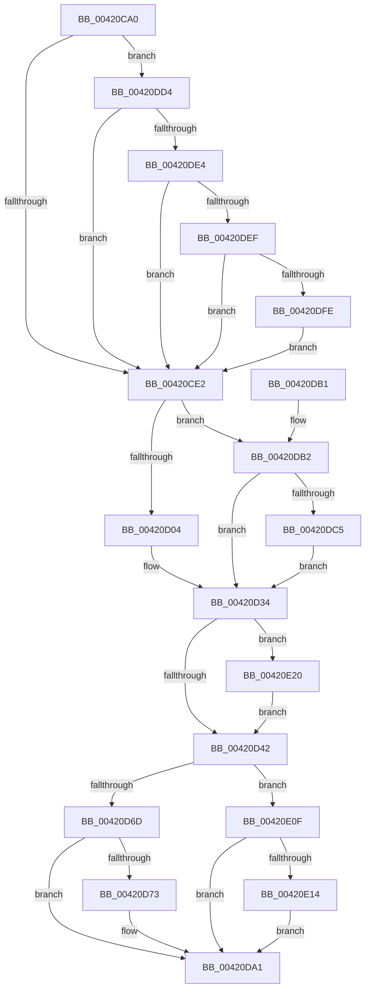

# MiConvertLargePfnToSmall

- RVA: `0x00420CA0`–`0x00420E2F` (길이 `399` bytes)
- VA: `0x0000000140420CA0`
- 실행 섹션: `.text`
- PDB 이름 있음: `예`; PDB Function 태그: `아니요`
- unwind 정보 RVA: `0x000A022C`
- 디코드: `102`개 명령, `399/399` bytes 표시
- 미해석 바이트: `0` (있으면 어셈블리에 `.byte`로 보존)

> 이 문서는 커널 이미지의 기계어와 PDB 기호를 분석해 생성했습니다. 4번과 5번은 함수 원형과 자료형을 바이너리 사용 방식에서 추정한 C 해석이며 원본 소스 복구 결과는 아닙니다.

## 1. Dependencies

- 직접 호출 지점: **2**; 고유 호출 대상: **2**
- 직접 호출자로 확인된 함수: **4**
- RIP 상대 이미지 참조: **0**

### Outgoing calls
- `0x00420DD7` → [MiCanPfnOriginalPteBeLost](../37/MiCanPfnOriginalPteBeLost_function_00373D3C.md) (function, `0x00373D3C`)
- `0x00420E19` → [MiConvertBaseLargePage](../46/MiConvertBaseLargePage_function_00462294.md) (function, `0x00462294`)

### Direct callers
- [MiInitializeMdlSinglePage](../2C/MiInitializeMdlSinglePage_function_002C939C.md) at `0x002C946D`
- [MiConvertLargeFreePageToActive](MiConvertLargeFreePageToActive_function_00420974.md) at `0x00420A22`
- [MiConvertActiveLargePageToSmall](MiConvertActiveLargePageToSmall_function_00420AF8.md) at `0x00420BA4`
- [MiDemoteValidLargePageOneLevel](../68/MiDemoteValidLargePageOneLevel_function_0068A3F4.md) at `0x0068A8BF`

### Static image references
- 디코드된 RIP-relative 메모리 참조가 없습니다.

## 2. Other-region calls and transfers

- 다른 실행 섹션으로 향하는 call: **0**
- 별도 외부 분기/꼬리 이동을 확인하지 못했습니다.

## 3. Assembly (complete function range)

```asm
00420CA0  48 89 5C 24 08                  mov qword ptr [rsp + 8], rbx
00420CA5  48 89 74 24 10                  mov qword ptr [rsp + 0x10], rsi
00420CAA  57                              push rdi
00420CAB  48 83 EC 20                     sub rsp, 0x20
00420CAF  8B 42 20                        mov eax, dword ptr [rdx + 0x20]
00420CB2  41 8B F8                        mov edi, r8d
00420CB5  89 44 24 40                     mov dword ptr [rsp + 0x40], eax
00420CB9  4C 8B DA                        mov r11, rdx
00420CBC  C1 E8 18                        shr eax, 0x18
00420CBF  48 8B F1                        mov rsi, rcx
00420CC2  24 F8                           and al, 0xf8
00420CC4  88 44 24 43                     mov byte ptr [rsp + 0x43], al
00420CC8  8B 44 24 40                     mov eax, dword ptr [rsp + 0x40]
00420CCC  89 42 20                        mov dword ptr [rdx + 0x20], eax
00420CCF  8B 5A 20                        mov ebx, dword ptr [rdx + 0x20]
00420CD2  89 5C 24 40                     mov dword ptr [rsp + 0x40], ebx
00420CD6  C1 EB 10                        shr ebx, 0x10
00420CD9  F6 C3 08                        test bl, 8
00420CDC  0F 85 F2 00 00 00               jne 0x140420dd4
00420CE2  80 E3 EF                        and bl, 0xef
00420CE5  49 B9 FF FF FF FF FF FD FF FF   movabs r9, 0xfffffdffffffffff
00420CEF  88 5C 24 42                     mov byte ptr [rsp + 0x42], bl
00420CF3  8B 44 24 40                     mov eax, dword ptr [rsp + 0x40]
00420CF7  41 89 43 20                     mov dword ptr [r11 + 0x20], eax
00420CFB  4C 3B DE                        cmp r11, rsi
00420CFE  0F 84 AE 00 00 00               je 0x140420db2
00420D04  41 8B 53 20                     mov edx, dword ptr [r11 + 0x20]
00420D08  0F B6 4E 22                     movzx ecx, byte ptr [rsi + 0x22]
00420D0C  89 54 24 40                     mov dword ptr [rsp + 0x40], edx
00420D10  C1 EA 10                        shr edx, 0x10
00420D13  0F B6 C2                        movzx eax, dl
00420D16  32 C1                           xor al, cl
00420D18  49 8D 4B 28                     lea rcx, [r11 + 0x28]
00420D1C  24 07                           and al, 7
00420D1E  32 C2                           xor al, dl
00420D20  88 44 24 42                     mov byte ptr [rsp + 0x42], al
00420D24  8B 44 24 40                     mov eax, dword ptr [rsp + 0x40]
00420D28  41 89 43 20                     mov dword ptr [r11 + 0x20], eax
00420D2C  48 8B 46 10                     mov rax, qword ptr [rsi + 0x10]
00420D30  49 89 43 10                     mov qword ptr [r11 + 0x10], rax
00420D34  48 8B 01                        mov rax, qword ptr [rcx]
00420D37  48 0F BA E0 29                  bt rax, 0x29
00420D3C  0F 82 DE 00 00 00               jb 0x140420e20
00420D42  48 8B 01                        mov rax, qword ptr [rcx]
00420D45  48 B9 FF FF FF FF FF FE FF FF   movabs rcx, 0xfffffeffffffffff
00420D4F  48 23 C1                        and rax, rcx
00420D52  49 89 43 28                     mov qword ptr [r11 + 0x28], rax
00420D56  41 8B 43 24                     mov eax, dword ptr [r11 + 0x24]
00420D5A  25 FF FF FF E7                  and eax, 0xe7ffffff
00420D5F  41 89 43 24                     mov dword ptr [r11 + 0x24], eax
00420D63  40 F6 C7 04                     test dil, 4
00420D67  0F 85 A2 00 00 00               jne 0x140420e0f
00420D6D  40 F6 C7 01                     test dil, 1
00420D71  74 2E                           je 0x140420da1
00420D73  49 8B 43 18                     mov rax, qword ptr [r11 + 0x18]
00420D77  48 B9 00 00 00 00 00 00 00 C0   movabs rcx, 0xc000000000000000
00420D81  48 23 C1                        and rax, rcx
00420D84  49 89 43 18                     mov qword ptr [r11 + 0x18], rax
00420D88  41 8B 43 20                     mov eax, dword ptr [r11 + 0x20]
00420D8C  89 44 24 40                     mov dword ptr [rsp + 0x40], eax
00420D90  66 83 E8 02                     sub ax, 2
00420D94  66 89 44 24 40                  mov word ptr [rsp + 0x40], ax
00420D99  8B 44 24 40                     mov eax, dword ptr [rsp + 0x40]
00420D9D  41 89 43 20                     mov dword ptr [r11 + 0x20], eax
00420DA1  48 8B 5C 24 30                  mov rbx, qword ptr [rsp + 0x30]
00420DA6  48 8B 74 24 38                  mov rsi, qword ptr [rsp + 0x38]
00420DAB  48 83 C4 20                     add rsp, 0x20
00420DAF  5F                              pop rdi
00420DB0  C3                              ret
00420DB1  CC                              int3
00420DB2  49 8B 43 28                     mov rax, qword ptr [r11 + 0x28]
00420DB6  49 8D 4B 28                     lea rcx, [r11 + 0x28]
00420DBA  48 0F BA E0 29                  bt rax, 0x29
00420DBF  0F 83 6F FF FF FF               jae 0x140420d34
00420DC5  48 8B 01                        mov rax, qword ptr [rcx]
00420DC8  49 23 C1                        and rax, r9
00420DCB  49 89 43 28                     mov qword ptr [r11 + 0x28], rax
00420DCF  E9 60 FF FF FF                  jmp 0x140420d34
00420DD4  49 8B CB                        mov rcx, r11
00420DD7  E8 60 2F F5 FF                  call 0x140373d3c
00420DDC  85 C0                           test eax, eax
00420DDE  0F 84 FE FE FF FF               je 0x140420ce2
00420DE4  41 F6 43 22 10                  test byte ptr [r11 + 0x22], 0x10
00420DE9  0F 85 F3 FE FF FF               jne 0x140420ce2
00420DEF  41 8B 43 10                     mov eax, dword ptr [r11 + 0x10]
00420DF3  C0 E8 02                        shr al, 2
00420DF6  A8 01                           test al, 1
00420DF8  0F 84 E4 FE FF FF               je 0x140420ce2
00420DFE  49 8B 43 10                     mov rax, qword ptr [r11 + 0x10]
00420E02  48 83 E0 FB                     and rax, 0xfffffffffffffffb
00420E06  49 89 43 10                     mov qword ptr [r11 + 0x10], rax
00420E0A  E9 D3 FE FF FF                  jmp 0x140420ce2
00420E0F  4C 3B DE                        cmp r11, rsi
00420E12  74 8D                           je 0x140420da1
00420E14  33 D2                           xor edx, edx
00420E16  49 8B CB                        mov rcx, r11
00420E19  E8 76 14 04 00                  call 0x140462294
00420E1E  EB 81                           jmp 0x140420da1
00420E20  48 8B 01                        mov rax, qword ptr [rcx]
00420E23  49 23 C1                        and rax, r9
00420E26  49 89 43 28                     mov qword ptr [r11 + 0x28], rax
00420E2A  E9 13 FF FF FF                  jmp 0x140420d42
```

## 4. C-style interpretation (structured pseudocode)

```c
__int64 __fastcall MiConvertLargePfnToSmall(__int64 a1, __int64 a2, int a3)
{
    __int64 result;
    __int64 v_rbx;
    __int64 v_rsp;
    unsigned __int64 v_stack_p10;
    unsigned int v_stack_p18;
    unsigned __int8 v_stack_p1A;
    unsigned __int8 v_stack_p1B;
    unsigned __int64 v_stack_p8;

    v_stack_p8 = v_rbx;
    v_stack_p10 = v_rsi;
    v_rsp = (v_rsp) - (32);
    v_stack_p18 = (unsigned int)((unsigned int)(*(unsigned int *)(a2 + 32)));
    result = (unsigned int)(((unsigned int)(*(unsigned int *)(a2 + 32))) >> (24));
    result = (unsigned __int8)((result) & (248));
    v_stack_p1B = (unsigned __int8)(result);
    *(unsigned int *)(a2 + 32) = (unsigned int)((unsigned int)(v_stack_p18));
    v_stack_p18 = (unsigned int)((unsigned int)(*(unsigned int *)(a2 + 32)));
    v_rbx = (unsigned int)(((unsigned int)(*(unsigned int *)(a2 + 32))) >> (16));
    if ((((unsigned __int8)(v_rbx)) & (8)) != 0) goto loc_00420DD4;
loc_00420CE2:
    v_rbx = (unsigned __int8)((v_rbx) & (239));
    v_stack_p1A = (unsigned __int8)(v_rbx);
    *(unsigned int *)(a2 + 32) = (unsigned int)((unsigned int)(v_stack_p18));
    if (a2 == a1) goto loc_00420DB2;
    v_stack_p18 = (unsigned int)((unsigned int)(*(unsigned int *)(a2 + 32)));
    a2 = (unsigned int)(((unsigned int)(*(unsigned int *)(a2 + 32))) >> (16));
    result = (unsigned __int8)(((unsigned __int8)(a2)) ^ ((unsigned __int8)(*(unsigned __int8 *)(a1 + 34))));
    result = (unsigned __int8)((result) & (7));
    result = (unsigned __int8)((result) ^ ((unsigned __int8)(a2)));
    v_stack_p1A = (unsigned __int8)(result);
    *(unsigned int *)(a2 + 32) = (unsigned int)((unsigned int)(v_stack_p18));
    *(unsigned __int64 *)(a2 + 16) = *(unsigned __int64 *)(a1 + 16);
loc_00420D34:
    if (condition_is_below) goto loc_00420E20;
loc_00420D42:
    result = (*(unsigned __int64 *)(a2 + 40)) & (a2 + 40);
    *(unsigned __int64 *)(a2 + 40) = result;
    result = (unsigned int)(((unsigned int)(*(unsigned int *)(a2 + 36))) & (0xE7FFFFFFULL));
    *(unsigned int *)(a2 + 36) = (unsigned int)(result);
    if ((((unsigned __int8)((unsigned int)(a3))) & (4)) != 0) goto loc_00420E0F;
    if ((((unsigned __int8)((unsigned int)(a3))) & (1)) != 0) {
        result = *(unsigned __int64 *)(a2 + 24);
        result = (result) & (a2 + 40);
        *(unsigned __int64 *)(a2 + 24) = result;
        result = *(unsigned int *)(a2 + 32);
        v_stack_p18 = (unsigned int)(result);
        result = (unsigned __int16)((result) - (2));
        v_stack_p18 = (unsigned __int16)(result);
        result = v_stack_p18;
        *(unsigned int *)(a2 + 32) = (unsigned int)(result);
    }
    v_rsp = (v_rsp) + (32);
    return result;
loc_00420DB2:
    if (condition_is_above_or_equal) goto loc_00420D34;
    result = (*(unsigned __int64 *)(a2 + 40)) & (a4);
    *(unsigned __int64 *)(a2 + 40) = result;
    goto loc_00420D34;
loc_00420DD4:
    result = MiCanPfnOriginalPteBeLost(a2, a2, a3, a4);
    if ((unsigned int)(result) == 0) goto loc_00420CE2;
    if (((*(unsigned __int8 *)(a2 + 34)) & (16)) != 0) goto loc_00420CE2;
    result = (unsigned __int8)(((unsigned int)(*(unsigned int *)(a2 + 16))) >> (2));
    if ((((unsigned __int8)(result)) & (1)) == 0) goto loc_00420CE2;
    result = (*(unsigned __int64 *)(a2 + 16)) & (-5);
    *(unsigned __int64 *)(a2 + 16) = result;
    goto loc_00420CE2;
loc_00420E0F:
    if (a2 == v_stack_p10) goto loc_00420DA1;
    a2 = 0;
    result = MiConvertBaseLargePage(0, a2, a3, a4);
    goto loc_00420DA1;
loc_00420E20:
    result = (*(unsigned __int64 *)(0)) & (a4);
    *(unsigned __int64 *)(a2 + 40) = result;
    goto loc_00420D42;
}
```

## 5. (Beta) C Style

```c
int64_t MiConvertLargePfnToSmall(void *Arg1, void *Arg2, int32_t Arg3)
{
    uint8_t *arg1 = (uint8_t *)Arg1;
    uint8_t *arg2 = (uint8_t *)Arg2;

    int64_t result;
    int64_t local_rbx;
    int64_t local_rsp;
    uint64_t v_stack_p10;
    uint32_t v_stack_p18;
    uint8_t v_stack_p1A;
    uint8_t v_stack_p1B;
    uint64_t v_stack_p8;

    v_stack_p8 = local_rbx;
    v_stack_p10 = local_rsi;
    local_rsp = (local_rsp) - (32);
    v_stack_p18 = (uint32_t)((uint32_t)(*(uint32_t *)(arg2 + 0x20)));
    result = (uint32_t)(((uint32_t)(*(uint32_t *)(arg2 + 0x20))) >> (24));
    result = (uint8_t)((result) & (248));
    v_stack_p1B = (uint8_t)(result);
    *(uint32_t *)(arg2 + 0x20) = (uint32_t)((uint32_t)(v_stack_p18));
    v_stack_p18 = (uint32_t)((uint32_t)(*(uint32_t *)(arg2 + 0x20)));
    local_rbx = (uint32_t)(((uint32_t)(*(uint32_t *)(arg2 + 0x20))) >> (16));
    if ((((uint8_t)(local_rbx)) & (8)) != 0) goto loc_00420DD4;
loc_00420CE2:
    local_rbx = (uint8_t)((local_rbx) & (239));
    v_stack_p1A = (uint8_t)(local_rbx);
    *(uint32_t *)(arg2 + 0x20) = (uint32_t)((uint32_t)(v_stack_p18));
    if (Arg2 == Arg1) goto loc_00420DB2;
    v_stack_p18 = (uint32_t)((uint32_t)(*(uint32_t *)(arg2 + 0x20)));
    Arg2 = (uint32_t)(((uint32_t)(*(uint32_t *)(arg2 + 0x20))) >> (16));
    result = (uint8_t)(((uint8_t)(Arg2)) ^ ((uint8_t)(*(uint8_t *)(arg1 + 0x22))));
    result = (uint8_t)((result) & (7));
    result = (uint8_t)((result) ^ ((uint8_t)(Arg2)));
    v_stack_p1A = (uint8_t)(result);
    *(uint32_t *)(arg2 + 0x20) = (uint32_t)((uint32_t)(v_stack_p18));
    *(uint64_t *)(arg2 + 0x10) = *(uint64_t *)(arg1 + 0x10);
loc_00420D34:
    if (condition_is_below) goto loc_00420E20;
loc_00420D42:
    result = (*(uint64_t *)(arg2 + 0x28)) & (Arg2 + 40);
    *(uint64_t *)(arg2 + 0x28) = result;
    result = (uint32_t)(((uint32_t)(*(uint32_t *)(arg2 + 0x24))) & (0xE7FFFFFFULL));
    *(uint32_t *)(arg2 + 0x24) = (uint32_t)(result);
    if ((((uint8_t)((uint32_t)(Arg3))) & (4)) != 0) goto loc_00420E0F;
    if ((((uint8_t)((uint32_t)(Arg3))) & (1)) != 0) {
        result = *(uint64_t *)(arg2 + 0x18);
        result = (result) & (Arg2 + 40);
        *(uint64_t *)(arg2 + 0x18) = result;
        result = *(uint32_t *)(arg2 + 0x20);
        v_stack_p18 = (uint32_t)(result);
        result = (uint16_t)((result) - (2));
        v_stack_p18 = (uint16_t)(result);
        result = v_stack_p18;
        *(uint32_t *)(arg2 + 0x20) = (uint32_t)(result);
    }
    local_rsp = (local_rsp) + (32);
    return result;
loc_00420DB2:
    if (condition_is_above_or_equal) goto loc_00420D34;
    result = (*(uint64_t *)(arg2 + 0x28)) & (a4);
    *(uint64_t *)(arg2 + 0x28) = result;
    goto loc_00420D34;
loc_00420DD4:
    result = MiCanPfnOriginalPteBeLost(Arg2, Arg2, Arg3, a4);
    if ((uint32_t)(result) == 0) goto loc_00420CE2;
    if (((*(uint8_t *)(arg2 + 0x22)) & (16)) != 0) goto loc_00420CE2;
    result = (uint8_t)(((uint32_t)(*(uint32_t *)(arg2 + 0x10))) >> (2));
    if ((((uint8_t)(result)) & (1)) == 0) goto loc_00420CE2;
    result = (*(uint64_t *)(arg2 + 0x10)) & (-5);
    *(uint64_t *)(arg2 + 0x10) = result;
    goto loc_00420CE2;
loc_00420E0F:
    if (Arg2 == v_stack_p10) goto loc_00420DA1;
    Arg2 = 0;
    result = MiConvertBaseLargePage(0, Arg2, Arg3, a4);
    goto loc_00420DA1;
loc_00420E20:
    result = (*(uint64_t *)(0)) & (a4);
    *(uint64_t *)(arg2 + 0x28) = result;
    goto loc_00420D42;
}
```

### 관측된 메모리 오프셋

구조체 형식이 확인되지 않은 접근은 인자 기준의 오프셋으로만 기록했습니다.

| 기준 인자 | 오프셋 표현 | 폭 (bit) | 접근 |
|---|---:|---:|---|
| `Arg1` | `+ 0x10` | `64` | `R` |
| `Arg1` | `+ 0x22` | `8` | `R` |
| `Arg2` | `+ 0x20` | `32` | `R` |
| `Arg2` | `+ 0x20` | `32` | `W` |

## 6. Execution-region graph

[열기: 2D/3D 그래프와 함수 탐색 컨트롤 패널](../../../control-panel.html?section=text&rva=0x00420CA0&view=graph)

- 2D 그래프는 위에서 아래로 흐르고, 3D 그래프는 빈 공간을 드래그해 회전합니다. Shift+드래그는 이동, 휠은 확대·축소, 함수 노드 선택은 대상 보고서 이동입니다.

### Static fallback


