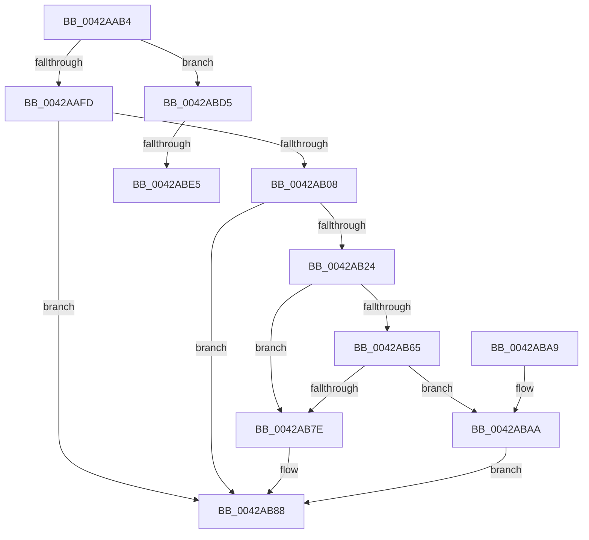

# MiDeprioritizeVad

- RVA: `0x0042AAB4`–`0x0042ABF5` (길이 `321` bytes)
- VA: `0x000000014042AAB4`
- 실행 섹션: `.text`
- PDB 이름 있음: `예`; PDB Function 태그: `예`
- unwind 정보 RVA: `0x00069B38`
- 디코드: `83`개 명령, `321/321` bytes 표시
- 미해석 바이트: `0` (있으면 어셈블리에 `.byte`로 보존)

> 이 문서는 커널 이미지의 기계어와 PDB 기호를 분석해 생성했습니다. 4번과 5번은 함수 원형과 자료형을 바이너리 사용 방식에서 추정한 C 해석이며 원본 소스 복구 결과는 아닙니다.

## 1. Dependencies

- 직접 호출 지점: **9**; 고유 호출 대상: **9**
- 직접 호출자로 확인된 함수: **1**
- RIP 상대 이미지 참조: **0**

### Outgoing calls
- `0x0042AAF0` → [MiTryLockVad](MiTryLockVad_function_0042ABFC.md) (function, `0x0042ABFC`)
- `0x0042AB36` → [MiReferenceControlAreaFileWithTag](../34/MiReferenceControlAreaFileWithTag_function_00348390.md) (function, `0x00348390`)
- `0x0042AB4C` → [ObFastDereferenceObjectDeferDelete](../23/ObFastDereferenceObjectDeferDelete_function_002378C0.md) (function, `0x002378C0`)
- `0x0042AB75` → [PfCheckDeprioritizeFile](../../page/88/PfCheckDeprioritizeFile_function_00887F6C.md) (function, `0x00887F6C`)
- `0x0042AB83` → [MiClearVadTrimBehind](MiClearVadTrimBehind_function_0042AC90.md) (function, `0x0042AC90`)
- `0x0042AB8B` → [MiUnlockAndDereferenceVad](../31/MiUnlockAndDereferenceVad_function_00316E60.md) (function, `0x00316E60`)
- `0x0042ABCE` → [MiDeprioritizeVirtualAddresses](MiDeprioritizeVirtualAddresses_function_0042AD1C.md) (function, `0x0042AD1C`)
- `0x0042ABD8` → [MiDereferenceVad](../29/MiDereferenceVad_function_00295EE0.md) (function, `0x00295EE0`)
- `0x0042ABEA` → [ExFreePoolWithTag](../../poolcode/B8/ExFreePoolWithTag_function_00B82870.md) (function, `0x00B82870`)

### Direct callers
- [sub_0027F340](../27/Unknown_function_0027F340.md) at `0x0027F349`

### Static image references
- 디코드된 RIP-relative 메모리 참조가 없습니다.

## 2. Other-region calls and transfers

- 다른 실행 섹션으로 향하는 call: **2**
  - `0x0042AB75` → [PfCheckDeprioritizeFile](../../page/88/PfCheckDeprioritizeFile_function_00887F6C.md) (`.text` → `PAGE`)
  - `0x0042ABEA` → [ExFreePoolWithTag](../../poolcode/B8/ExFreePoolWithTag_function_00B82870.md) (`.text` → `POOLCODE`)
- call이 아닌 외부 분기/꼬리 이동: **2**
  - `0x0042ABDF` → [sub_006EE2DA](../6E/Unknown_function_006EE2DA.md) (`tail-transfer`)
  - `0x0042ABF0` → [sub_006EE2DA](../6E/Unknown_function_006EE2DA.md) (`tail-transfer`)

## 3. Assembly (complete function range)

```asm
0042AAB4  48 89 5C 24 08                  mov qword ptr [rsp + 8], rbx
0042AAB9  48 89 6C 24 10                  mov qword ptr [rsp + 0x10], rbp
0042AABE  48 89 74 24 18                  mov qword ptr [rsp + 0x18], rsi
0042AAC3  57                              push rdi
0042AAC4  41 56                           push r14
0042AAC6  41 57                           push r15
0042AAC8  48 83 EC 20                     sub rsp, 0x20
0042AACC  65 48 8B 1C 25 88 01 00 00      mov rbx, qword ptr gs:[0x188]
0042AAD5  48 8B EA                        mov rbp, rdx
0042AAD8  48 8B F9                        mov rdi, rcx
0042AADB  48 8B D1                        mov rdx, rcx
0042AADE  48 8B CB                        mov rcx, rbx
0042AAE1  4C 8B B3 B8 00 00 00            mov r14, qword ptr [rbx + 0xb8]
0042AAE8  66 FF 8B E6 01 00 00            dec word ptr [rbx + 0x1e6]
0042AAEF  90                              nop
0042AAF0  E8 07 01 00 00                  call 0x14042abfc
0042AAF5  85 C0                           test eax, eax
0042AAF7  0F 84 D8 00 00 00               je 0x14042abd5
0042AAFD  8B 47 30                        mov eax, dword ptr [rdi + 0x30]
0042AB00  A8 04                           test al, 4
0042AB02  0F 85 80 00 00 00               jne 0x14042ab88
0042AB08  8B 47 18                        mov eax, dword ptr [rdi + 0x18]
0042AB0B  0F B6 77 20                     movzx esi, byte ptr [rdi + 0x20]
0042AB0F  48 C1 E6 20                     shl rsi, 0x20
0042AB13  48 0B F0                        or rsi, rax
0042AB16  48 C1 ED 0C                     shr rbp, 0xc
0042AB1A  8B 47 40                        mov eax, dword ptr [rdi + 0x40]
0042AB1D  48 2B EE                        sub rbp, rsi
0042AB20  A8 02                           test al, 2
0042AB22  74 64                           je 0x14042ab88
0042AB24  48 8B 47 48                     mov rax, qword ptr [rdi + 0x48]
0042AB28  45 33 C0                        xor r8d, r8d
0042AB2B  BA 4D 6D 53 63                  mov edx, 0x63536d4d
0042AB30  48 8B 18                        mov rbx, qword ptr [rax]
0042AB33  48 8B CB                        mov rcx, rbx
0042AB36  E8 55 D8 F1 FF                  call 0x140348390
0042AB3B  48 8D 4B 40                     lea rcx, [rbx + 0x40]
0042AB3F  41 B8 4D 6D 53 63               mov r8d, 0x63536d4d
0042AB45  48 8B D0                        mov rdx, rax
0042AB48  4C 8B 78 18                     mov r15, qword ptr [rax + 0x18]
0042AB4C  E8 6F CD E0 FF                  call 0x1402378c0
0042AB51  48 81 E5 00 FF FF FF            and rbp, 0xffffffffffffff00
0042AB58  41 F7 86 F4 01 00 00 00 40 00 00  test dword ptr [r14 + 0x1f4], 0x4000
0042AB63  74 19                           je 0x14042ab7e
0042AB65  41 8B 96 84 03 00 00            mov edx, dword ptr [r14 + 0x384]
0042AB6C  4C 8B CD                        mov r9, rbp
0042AB6F  4D 8B C7                        mov r8, r15
0042AB72  49 8B CE                        mov rcx, r14
0042AB75  E8 F2 D3 45 00                  call 0x140887f6c
0042AB7A  85 C0                           test eax, eax
0042AB7C  75 2C                           jne 0x14042abaa
0042AB7E  33 D2                           xor edx, edx
0042AB80  48 8B CF                        mov rcx, rdi
0042AB83  E8 08 01 00 00                  call 0x14042ac90
0042AB88  48 8B CF                        mov rcx, rdi
0042AB8B  E8 D0 C2 EE FF                  call 0x140316e60
0042AB90  48 8B 5C 24 40                  mov rbx, qword ptr [rsp + 0x40]
0042AB95  48 8B 6C 24 48                  mov rbp, qword ptr [rsp + 0x48]
0042AB9A  48 8B 74 24 50                  mov rsi, qword ptr [rsp + 0x50]
0042AB9F  48 83 C4 20                     add rsp, 0x20
0042ABA3  41 5F                           pop r15
0042ABA5  41 5E                           pop r14
0042ABA7  5F                              pop rdi
0042ABA8  C3                              ret
0042ABA9  CC                              int3
0042ABAA  48 C1 E6 0C                     shl rsi, 0xc
0042ABAE  48 8D 8D 00 FF FF FF            lea rcx, [rbp - 0x100]
0042ABB5  48 C1 E1 0C                     shl rcx, 0xc
0042ABB9  4D 8D 86 00 04 00 00            lea r8, [r14 + 0x400]
0042ABC0  48 03 CE                        add rcx, rsi
0042ABC3  BA 00 01 00 00                  mov edx, 0x100
0042ABC8  41 B9 12 00 00 00               mov r9d, 0x12
0042ABCE  E8 49 01 00 00                  call 0x14042ad1c
0042ABD3  EB B3                           jmp 0x14042ab88
0042ABD5  48 8B CF                        mov rcx, rdi
0042ABD8  E8 03 B3 E6 FF                  call 0x140295ee0
0042ABDD  85 C0                           test eax, eax
0042ABDF  0F 84 F5 36 2C 00               je 0x1406ee2da
0042ABE5  33 D2                           xor edx, edx
0042ABE7  48 8B CF                        mov rcx, rdi
0042ABEA  E8 81 7C 75 00                  call 0x140b82870
0042ABEF  90                              nop
0042ABF0  E9 E5 36 2C 00                  jmp 0x1406ee2da
```

## 4. C-style interpretation (structured pseudocode)

```c
__int64 __fastcall MiDeprioritizeVad(__int64 a1, __int64 a2, int a3)
{
    __int64 result;
    __int64 v_rbp;
    __int64 v_rsi;
    __int64 v_rsp;
    unsigned __int64 v_stack_p10;
    unsigned __int64 v_stack_p18;
    unsigned __int64 v_stack_p8;

    v_stack_p8 = v_rbx;
    v_stack_p10 = v_rbp;
    v_stack_p18 = v_rsi;
    v_rsp = (v_rsp) - (32);
    result = MiTryLockVad(*(unsigned __int64 *)(gs_base + (0 + 392)), a1, a3, a4);
    if ((unsigned int)(result) == 0) goto loc_0042ABD5;
    if ((((unsigned __int8)((unsigned int)(*(unsigned int *)(a1 + 48)))) & (4)) != 0) goto loc_0042AB88;
    v_rsi = (*(unsigned __int8 *)(a1 + 32)) << (32);
    v_rsi = (v_rsi) | ((unsigned int)(*(unsigned int *)(a1 + 24)));
    v_rbp = (a2) >> (12);
    v_rbp = (v_rbp) - (v_rsi);
    if ((((unsigned __int8)((unsigned int)(*(unsigned int *)(a1 + 64)))) & (2)) == 0) goto loc_0042AB88;
    a3 = 0;
    result = MiReferenceControlAreaFileWithTag(*(unsigned __int64 *)(*(unsigned __int64 *)(a1 + 72)), (unsigned int)(0x63536D4DULL), a3, a4);
    result = ObFastDereferenceObjectDeferDelete(*(unsigned __int64 *)(*(unsigned __int64 *)(a1 + 72)) + 64, result, (unsigned int)(0x63536D4DULL), a4);
    v_rbp = (v_rbp) & (-256);
    if (((*(unsigned int *)(*(unsigned __int64 *)(*(unsigned __int64 *)(gs_base + (0 + 392)) + 184) + 500)) & (0x4000ULL)) == 0) goto loc_0042AB7E;
    result = PfCheckDeprioritizeFile(*(unsigned __int64 *)(*(unsigned __int64 *)(gs_base + (0 + 392)) + 184), (unsigned int)(*(unsigned int *)(*(unsigned __int64 *)(*(unsigned __int64 *)(gs_base + (0 + 392)) + 184) + 900)), *(unsigned __int64 *)(result + 24), v_rbp);
    if ((unsigned int)(result) != 0) goto loc_0042ABAA;
loc_0042AB7E:
    a2 = 0;
    result = MiClearVadTrimBehind(a1, a2, *(unsigned __int64 *)(result + 24), v_rbp);
loc_0042AB88:
    result = MiUnlockAndDereferenceVad(a1, a2, *(unsigned __int64 *)(result + 24), v_rbp);
    v_rsp = (v_rsp) + (32);
    return result;
loc_0042ABAA:
    v_rsi = (v_stack_p18) << (12);
    a1 = (v_stack_p10 - 256) << (12);
    a1 = (a1) + (v_rsi);
    result = MiDeprioritizeVirtualAddresses(a1, 256, *(unsigned __int64 *)(*(unsigned __int64 *)(gs_base + (0 + 392)) + 184) + 1024, 18);
    goto loc_0042AB88;
loc_0042ABD5:
    result = MiDereferenceVad(a1, 256, *(unsigned __int64 *)(*(unsigned __int64 *)(gs_base + (0 + 392)) + 184) + 1024, 18);
    a2 = 0;
    result = ExFreePoolWithTag(a1, a2, *(unsigned __int64 *)(*(unsigned __int64 *)(gs_base + (0 + 392)) + 184) + 1024, 18);
}
```

## 5. (Beta) C Style

```c
int64_t MiDeprioritizeVad(void *Arg1, int64_t Arg2, int32_t Arg3)
{
    uint8_t *arg1 = (uint8_t *)Arg1;

    int64_t result;
    int64_t local_rbp;
    int64_t local_rsi;
    int64_t local_rsp;
    uint64_t v_stack_p10;
    uint64_t v_stack_p18;
    uint64_t v_stack_p8;

    v_stack_p8 = local_rbx;
    v_stack_p10 = local_rbp;
    v_stack_p18 = local_rsi;
    local_rsp = (local_rsp) - (32);
    result = MiTryLockVad(*(uint64_t *)(gs_base + (0 + 0x188)), Arg1, Arg3, a4);
    if ((uint32_t)(result) == 0) goto loc_0042ABD5;
    if ((((uint8_t)((uint32_t)(*(uint32_t *)(arg1 + 0x30)))) & (4)) != 0) goto loc_0042AB88;
    local_rsi = (*(uint8_t *)(arg1 + 0x20)) << (32);
    local_rsi = (local_rsi) | ((uint32_t)(*(uint32_t *)(arg1 + 0x18)));
    local_rbp = (Arg2) >> (12);
    local_rbp = (local_rbp) - (local_rsi);
    if ((((uint8_t)((uint32_t)(*(uint32_t *)(arg1 + 0x40)))) & (2)) == 0) goto loc_0042AB88;
    Arg3 = 0;
    result = MiReferenceControlAreaFileWithTag(*(uint64_t *)(*(uint64_t *)(arg1 + 0x48)), (uint32_t)(0x63536D4DULL), Arg3, a4);
    result = ObFastDereferenceObjectDeferDelete(*(uint64_t *)(*(uint64_t *)(arg1 + 0x48)) + 64, result, (uint32_t)(0x63536D4DULL), a4);
    local_rbp = (local_rbp) & (-256);
    if (((*(uint32_t *)(*(uint64_t *)(*(uint64_t *)(gs_base + (0 + 0x188)) + 0xB8) + 0x1F4)) & (0x4000ULL)) == 0) goto loc_0042AB7E;
    result = PfCheckDeprioritizeFile(*(uint64_t *)(*(uint64_t *)(gs_base + (0 + 0x188)) + 0xB8), (uint32_t)(*(uint32_t *)(*(uint64_t *)(*(uint64_t *)(gs_base + (0 + 0x188)) + 0xB8) + 0x384)), *(uint64_t *)(result + 0x18), local_rbp);
    if ((uint32_t)(result) != 0) goto loc_0042ABAA;
loc_0042AB7E:
    Arg2 = 0;
    result = MiClearVadTrimBehind(Arg1, Arg2, *(uint64_t *)(result + 0x18), local_rbp);
loc_0042AB88:
    result = MiUnlockAndDereferenceVad(Arg1, Arg2, *(uint64_t *)(result + 0x18), local_rbp);
    local_rsp = (local_rsp) + (32);
    return result;
loc_0042ABAA:
    local_rsi = (v_stack_p18) << (12);
    Arg1 = (v_stack_p10 - 256) << (12);
    Arg1 = (Arg1) + (local_rsi);
    result = MiDeprioritizeVirtualAddresses(Arg1, 256, *(uint64_t *)(*(uint64_t *)(gs_base + (0 + 0x188)) + 0xB8) + 1024, 18);
    goto loc_0042AB88;
loc_0042ABD5:
    result = MiDereferenceVad(Arg1, 256, *(uint64_t *)(*(uint64_t *)(gs_base + (0 + 0x188)) + 0xB8) + 1024, 18);
    Arg2 = 0;
    result = ExFreePoolWithTag(Arg1, Arg2, *(uint64_t *)(*(uint64_t *)(gs_base + (0 + 0x188)) + 0xB8) + 1024, 18);
}
```

### 관측된 메모리 오프셋

구조체 형식이 확인되지 않은 접근은 인자 기준의 오프셋으로만 기록했습니다.

| 기준 인자 | 오프셋 표현 | 폭 (bit) | 접근 |
|---|---:|---:|---|
| `Arg1` | `+ 0x18` | `32` | `R` |
| `Arg1` | `+ 0x20` | `8` | `R` |
| `Arg1` | `+ 0x30` | `32` | `R` |
| `Arg1` | `+ 0x40` | `32` | `R` |
| `Arg1` | `+ 0x48` | `64` | `R` |

## 6. Execution-region graph

[열기: 2D/3D 그래프와 함수 탐색 컨트롤 패널](../../../control-panel.html?section=text&rva=0x0042AAB4&view=graph)

- 2D 그래프는 위에서 아래로 흐르고, 3D 그래프는 빈 공간을 드래그해 회전합니다. Shift+드래그는 이동, 휠은 확대·축소, 함수 노드 선택은 대상 보고서 이동입니다.

### Static fallback


