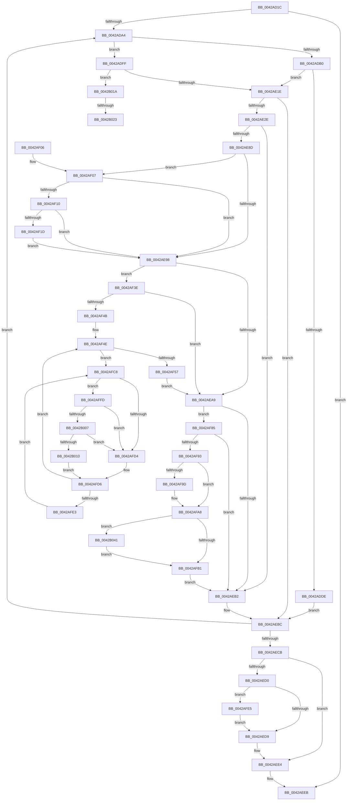

# MiDeprioritizeVirtualAddresses

- RVA: `0x0042AD1C`–`0x0042B072` (길이 `854` bytes)
- VA: `0x000000014042AD1C`
- 실행 섹션: `.text`
- PDB 이름 있음: `예`; PDB Function 태그: `예`
- unwind 정보 RVA: `0x000A12AC`
- 디코드: `209`개 명령, `854/854` bytes 표시
- 미해석 바이트: `0` (있으면 어셈블리에 `.byte`로 보존)

> 이 문서는 커널 이미지의 기계어와 PDB 기호를 분석해 생성했습니다. 4번과 5번은 함수 원형과 자료형을 바이너리 사용 방식에서 추정한 C 해석이며 원본 소스 복구 결과는 아닙니다.

## 1. Dependencies

- 직접 호출 지점: **21**; 고유 호출 대상: **18**
- 직접 호출자로 확인된 함수: **2**
- RIP 상대 이미지 참조: **2**

### Outgoing calls
- `0x0042AD53` → [MiVmAccessLoggingEnabled](../36/MiVmAccessLoggingEnabled_function_003629D4.md) (function, `0x003629D4`)
- `0x0042AD8F` → [MiLockWorkingSetShared](../27/MiLockWorkingSetShared_function_0027CBF0.md) (function, `0x0027CBF0`)
- `0x0042ADBE` → [MiLockLowestValidPageTableEx](../28/MiLockLowestValidPageTableEx_function_00280D10.md) (function, `0x00280D10`)
- `0x0042ADE4` → [MiUnlockPageTable](../21/MiUnlockPageTable_function_00216EC0.md) (function, `0x00216EC0`)
- `0x0042AE21` → [MI_READ_PTE_LOCK_FREE](../28/MI_READ_PTE_LOCK_FREE_function_002828A0.md) (function, `0x002828A0`)
- `0x0042AE7B` → [MiGetWsleContents](../31/MiGetWsleContents_function_00316540.md) (function, `0x00316540`)
- `0x0042AE9B` → [MiGetPfnPriority](../32/MiGetPfnPriority_function_003226F0.md) (function, `0x003226F0`)
- `0x0042AEDF` → [MiUnlockPageTable](../21/MiUnlockPageTable_function_00216EC0.md) (function, `0x00216EC0`)
- `0x0042AEF0` → [MiUnlockWorkingSetShared](../27/MiUnlockWorkingSetShared_function_0027D690.md) (function, `0x0027D690`)
- `0x0042AF34` → [MiDemoteCombinedPte](../22/MiDemoteCombinedPte_function_0022ABAC.md) (function, `0x0022ABAC`)
- `0x0042AF67` → [MiUpdatePfnPriority](../2B/MiUpdatePfnPriority_function_002B8570.md) (function, `0x002B8570`)
- `0x0042AFA3` → [MI_WSLE_LOG_ACCESS](../29/MI_WSLE_LOG_ACCESS_function_00294400.md) (function, `0x00294400`)
- `0x0042AFBE` → [MiInsertTbFlushEntry](../29/MiInsertTbFlushEntry_function_00293670.md) (function, `0x00293670`)
- `0x0042AFEE` → [MiFreeWsleList](../24/MiFreeWsleList_function_00241168.md) (function, `0x00241168`)
- `0x0042AFF3` → [MiReleaseProcessorFlushList](../31/MiReleaseProcessorFlushList_function_00313C70.md) (function, `0x00313C70`)
- `0x0042B007` → [KiCheckVpBackingLongSpinWaitHypercall](../30/KiCheckVpBackingLongSpinWaitHypercall_function_0030F490.md) (function, `0x0030F490`)
- `0x0042B013` → [HvlNotifyLongSpinWait](../30/HvlNotifyLongSpinWait_function_0030F460.md) (function, `0x0030F460`)
- `0x0042B02C` → [MiFreeWsleList](../24/MiFreeWsleList_function_00241168.md) (function, `0x00241168`)
- `0x0042B031` → [MiReleaseProcessorFlushList](../31/MiReleaseProcessorFlushList_function_00313C70.md) (function, `0x00313C70`)
- `0x0042B041` → [MiGetProcessorFlushList](../24/MiGetProcessorFlushList_function_00242C90.md) (function, `0x00242C90`)
- `0x0042B068` → [MiInitializeTbFlushList](../29/MiInitializeTbFlushList_function_00294F00.md) (function, `0x00294F00`)

### Direct callers
- [MiDeprioritizeVad](MiDeprioritizeVad_function_0042AAB4.md) at `0x0042ABCE`
- [HvTrimHive](../../page/A4/HvTrimHive_function_00A4F38C.md) at `0x00A4F41F`

### Static image references
- `0x0042AFCB` → RVA `0x00FC52AC` (`ALMOSTRO`; reference)
- `0x0042AFFD` → RVA `0x00FC6AB8` (`ALMOSTRO`; read)

## 2. Other-region calls and transfers

- 다른 실행 섹션으로 향하는 call: **0**
- call이 아닌 외부 분기/꼬리 이동: **2**
  - `0x0042B01D` → [sub_006EE306](../6E/Unknown_function_006EE306.md) (`tail-transfer`)
  - `0x0042B03C` → [sub_006EE306](../6E/Unknown_function_006EE306.md) (`tail-transfer`)

## 3. Assembly (complete function range)

```asm
0042AD1C  40 53                           push rbx
0042AD1E  55                              push rbp
0042AD1F  56                              push rsi
0042AD20  57                              push rdi
0042AD21  41 54                           push r12
0042AD23  41 55                           push r13
0042AD25  41 56                           push r14
0042AD27  41 57                           push r15
0042AD29  48 83 EC 58                     sub rsp, 0x58
0042AD2D  41 8B C1                        mov eax, r9d
0042AD30  48 8B F9                        mov rdi, rcx
0042AD33  83 E0 07                        and eax, 7
0042AD36  49 8B C8                        mov rcx, r8
0042AD39  89 84 24 A8 00 00 00            mov dword ptr [rsp + 0xa8], eax
0042AD40  41 8B D9                        mov ebx, r9d
0042AD43  41 8B 80 B8 00 00 00            mov eax, dword ptr [r8 + 0xb8]
0042AD4A  49 8B E8                        mov rbp, r8
0042AD4D  45 33 F6                        xor r14d, r14d
0042AD50  45 33 ED                        xor r13d, r13d
0042AD53  E8 7C 7C F3 FF                  call 0x1403629d4
0042AD58  89 84 24 B0 00 00 00            mov dword ptr [rsp + 0xb0], eax
0042AD5F  48 B8 F8 FF FF FF 7F 00 00 00   movabs rax, 0x7ffffffff8
0042AD69  48 C1 EF 09                     shr rdi, 9
0042AD6D  48 23 F8                        and rdi, rax
0042AD70  49 BC 00 00 00 00 80 F6 FF FF   movabs r12, 0xfffff68000000000
0042AD7A  49 8B C4                        mov rax, r12
0042AD7D  48 03 F8                        add rdi, rax
0042AD80  49 8B C8                        mov rcx, r8
0042AD83  45 33 FF                        xor r15d, r15d
0042AD86  48 8D 34 D7                     lea rsi, [rdi + rdx*8]
0042AD8A  48 89 74 24 38                  mov qword ptr [rsp + 0x38], rsi
0042AD8F  E8 5C 1E E5 FF                  call 0x14027cbf0
0042AD94  88 84 24 B8 00 00 00            mov byte ptr [rsp + 0xb8], al
0042AD9B  48 3B FE                        cmp rdi, rsi
0042AD9E  0F 83 47 01 00 00               jae 0x14042aeeb
0042ADA4  48 8B F7                        mov rsi, rdi
0042ADA7  48 C1 EE 09                     shr rsi, 9
0042ADAB  4D 85 FF                        test r15, r15
0042ADAE  75 4F                           jne 0x14042adff
0042ADB0  45 33 C9                        xor r9d, r9d
0042ADB3  4C 8D 44 24 40                  lea r8, [rsp + 0x40]
0042ADB8  48 8B D7                        mov rdx, rdi
0042ADBB  48 8B CD                        mov rcx, rbp
0042ADBE  E8 4D 5F E5 FF                  call 0x140280d10
0042ADC3  4C 8B F8                        mov r15, rax
0042ADC6  48 B8 F8 FF FF FF 7F 00 00 00   movabs rax, 0x7ffffffff8
0042ADD0  48 23 F0                        and rsi, rax
0042ADD3  49 8B C4                        mov rax, r12
0042ADD6  48 03 F0                        add rsi, rax
0042ADD9  4C 3B FE                        cmp r15, rsi
0042ADDC  74 40                           je 0x14042ae1e
0042ADDE  49 8B D7                        mov rdx, r15
0042ADE1  48 8B CD                        mov rcx, rbp
0042ADE4  E8 D7 C0 DE FF                  call 0x140216ec0
0042ADE9  45 33 FF                        xor r15d, r15d
0042ADEC  48 81 E7 00 F0 FF FF            and rdi, 0xfffffffffffff000
0042ADF3  48 81 C7 F8 0F 00 00            add rdi, 0xff8
0042ADFA  E9 BD 00 00 00                  jmp 0x14042aebc
0042ADFF  48 8B CE                        mov rcx, rsi
0042AE02  48 B8 F8 FF FF FF 7F 00 00 00   movabs rax, 0x7ffffffff8
0042AE0C  48 23 C8                        and rcx, rax
0042AE0F  49 8B C4                        mov rax, r12
0042AE12  48 03 C8                        add rcx, rax
0042AE15  4C 3B F9                        cmp r15, rcx
0042AE18  0F 85 FC 01 00 00               jne 0x14042b01a
0042AE1E  48 8B CF                        mov rcx, rdi
0042AE21  E8 7A 7A E5 FF                  call 0x1402828a0
0042AE26  A8 01                           test al, 1
0042AE28  0F 84 8E 00 00 00               je 0x14042aebc
0042AE2E  48 C1 E8 0C                     shr rax, 0xc
0042AE32  48 B9 FF FF FF FF FF 00 00 00   movabs rcx, 0xffffffffff
0042AE3C  48 23 C1                        and rax, rcx
0042AE3F  48 8D 34 40                     lea rsi, [rax + rax*2]
0042AE43  48 C1 E6 04                     shl rsi, 4
0042AE47  48 B8 00 00 00 00 00 DE FF FF   movabs rax, 0xffffde0000000000
0042AE51  4C 8B E7                        mov r12, rdi
0042AE54  48 03 F0                        add rsi, rax
0042AE57  49 C1 E4 19                     shl r12, 0x19
0042AE5B  48 B8 00 00 00 00 80 F6 FF FF   movabs rax, 0xfffff68000000000
0042AE65  48 8B C0                        mov rax, rax
0042AE68  48 C1 E0 19                     shl rax, 0x19
0042AE6C  4C 2B E0                        sub r12, rax
0042AE6F  49 C1 FC 10                     sar r12, 0x10
0042AE73  49 8B D4                        mov rdx, r12
0042AE76  4C 89 64 24 30                  mov qword ptr [rsp + 0x30], r12
0042AE7B  E8 C0 B6 EE FF                  call 0x140316540
0042AE80  24 0F                           and al, 0xf
0042AE82  88 84 24 A0 00 00 00            mov byte ptr [rsp + 0xa0], al
0042AE89  3C 09                           cmp al, 9
0042AE8B  74 25                           je 0x14042aeb2
0042AE8D  48 8B 46 28                     mov rax, qword ptr [rsi + 0x28]
0042AE91  48 0F BA E0 28                  bt rax, 0x28
0042AE96  73 6F                           jae 0x14042af07
0042AE98  48 8B CE                        mov rcx, rsi
0042AE9B  E8 50 78 EF FF                  call 0x1403226f0
0042AEA0  F6 C3 08                        test bl, 8
0042AEA3  0F 84 95 00 00 00               je 0x14042af3e
0042AEA9  F6 C3 10                        test bl, 0x10
0042AEAC  0F 85 D3 00 00 00               jne 0x14042af85
0042AEB2  49 BC 00 00 00 00 80 F6 FF FF   movabs r12, 0xfffff68000000000
0042AEBC  48 83 C7 08                     add rdi, 8
0042AEC0  48 3B 7C 24 38                  cmp rdi, qword ptr [rsp + 0x38]
0042AEC5  0F 82 D9 FE FF FF               jb 0x14042ada4
0042AECB  4D 85 FF                        test r15, r15
0042AECE  74 14                           je 0x14042aee4
0042AED0  4D 85 F6                        test r14, r14
0042AED3  0F 85 0C 01 00 00               jne 0x14042afe5
0042AED9  49 8B D7                        mov rdx, r15
0042AEDC  48 8B CD                        mov rcx, rbp
0042AEDF  E8 DC BF DE FF                  call 0x140216ec0
0042AEE4  8A 84 24 B8 00 00 00            mov al, byte ptr [rsp + 0xb8]
0042AEEB  8A D0                           mov dl, al
0042AEED  48 8B CD                        mov rcx, rbp
0042AEF0  E8 9B 27 E5 FF                  call 0x14027d690
0042AEF5  48 83 C4 58                     add rsp, 0x58
0042AEF9  41 5F                           pop r15
0042AEFB  41 5E                           pop r14
0042AEFD  41 5D                           pop r13
0042AEFF  41 5C                           pop r12
0042AF01  5F                              pop rdi
0042AF02  5E                              pop rsi
0042AF03  5D                              pop rbp
0042AF04  5B                              pop rbx
0042AF05  C3                              ret
0042AF06  CC                              int3
0042AF07  48 8B 46 08                     mov rax, qword ptr [rsi + 8]
0042AF0B  48 85 C0                        test rax, rax
0042AF0E  78 88                           js 0x14042ae98
0042AF10  48 8B 46 08                     mov rax, qword ptr [rsi + 8]
0042AF14  48 85 C0                        test rax, rax
0042AF17  0F 84 7B FF FF FF               je 0x14042ae98
0042AF1D  4C 8B 46 08                     mov r8, qword ptr [rsi + 8]
0042AF21  48 B8 00 00 00 00 00 00 00 80   movabs rax, 0x8000000000000000
0042AF2B  4C 0B C0                        or r8, rax
0042AF2E  48 8B D7                        mov rdx, rdi
0042AF31  48 8B CD                        mov rcx, rbp
0042AF34  E8 73 FC DF FF                  call 0x14022abac
0042AF39  E9 5A FF FF FF                  jmp 0x14042ae98
0042AF3E  39 84 24 A8 00 00 00            cmp dword ptr [rsp + 0xa8], eax
0042AF45  0F 84 5E FF FF FF               je 0x14042aea9
0042AF4B  45 33 E4                        xor r12d, r12d
0042AF4E  F0 48 0F BA 6E 18 3F            lock bts qword ptr [rsi + 0x18], 0x3f
0042AF55  72 71                           jb 0x14042afc8
0042AF57  8B 94 24 A8 00 00 00            mov edx, dword ptr [rsp + 0xa8]
0042AF5E  41 B8 01 00 00 00               mov r8d, 1
0042AF64  48 8B CE                        mov rcx, rsi
0042AF67  E8 04 D6 E8 FF                  call 0x1402b8570
0042AF6C  48 B8 FF FF FF FF FF FF FF 7F   movabs rax, 0x7fffffffffffffff
0042AF76  F0 48 21 46 18                  lock and qword ptr [rsi + 0x18], rax
0042AF7B  4C 8B 64 24 30                  mov r12, qword ptr [rsp + 0x30]
0042AF80  E9 24 FF FF FF                  jmp 0x14042aea9
0042AF85  80 BC 24 A0 00 00 00 08         cmp byte ptr [rsp + 0xa0], 8
0042AF8D  0F 84 1F FF FF FF               je 0x14042aeb2
0042AF93  83 BC 24 B0 00 00 00 00         cmp dword ptr [rsp + 0xb0], 0
0042AF9B  74 0B                           je 0x14042afa8
0042AF9D  48 8B D7                        mov rdx, rdi
0042AFA0  48 8B CD                        mov rcx, rbp
0042AFA3  E8 58 94 E6 FF                  call 0x140294400
0042AFA8  4D 85 ED                        test r13, r13
0042AFAB  0F 84 90 00 00 00               je 0x14042b041
0042AFB1  45 33 C9                        xor r9d, r9d
0042AFB4  49 8B D4                        mov rdx, r12
0042AFB7  49 8B CE                        mov rcx, r14
0042AFBA  45 8D 41 01                     lea r8d, [r9 + 1]
0042AFBE  E8 AD 86 E6 FF                  call 0x140293670
0042AFC3  E9 EA FE FF FF                  jmp 0x14042aeb2
0042AFC8  41 FF C4                        inc r12d
0042AFCB  44 85 25 DA A2 B9 00            test dword ptr [rip + 0xb9a2da], r12d
0042AFD2  74 29                           je 0x14042affd
0042AFD4  F3 90                           pause
0042AFD6  48 8B 46 18                     mov rax, qword ptr [rsi + 0x18]
0042AFDA  48 85 C0                        test rax, rax
0042AFDD  0F 89 6B FF FF FF               jns 0x14042af4e
0042AFE3  EB E3                           jmp 0x14042afc8
0042AFE5  45 33 C0                        xor r8d, r8d
0042AFE8  49 8B D6                        mov rdx, r14
0042AFEB  48 8B CD                        mov rcx, rbp
0042AFEE  E8 75 61 E1 FF                  call 0x140241168
0042AFF3  E8 78 8C EE FF                  call 0x140313c70
0042AFF8  E9 DC FE FF FF                  jmp 0x14042aed9
0042AFFD  8B 05 B5 BA B9 00               mov eax, dword ptr [rip + 0xb9bab5]
0042B003  A8 40                           test al, 0x40
0042B005  74 CD                           je 0x14042afd4
0042B007  E8 84 44 EE FF                  call 0x14030f490
0042B00C  84 C0                           test al, al
0042B00E  74 C4                           je 0x14042afd4
0042B010  41 8B CC                        mov ecx, r12d
0042B013  E8 48 44 EE FF                  call 0x14030f460
0042B018  EB BC                           jmp 0x14042afd6
0042B01A  4D 85 F6                        test r14, r14
0042B01D  0F 84 E3 32 2C 00               je 0x1406ee306
0042B023  45 33 C0                        xor r8d, r8d
0042B026  49 8B D6                        mov rdx, r14
0042B029  48 8B CD                        mov rcx, rbp
0042B02C  E8 37 61 E1 FF                  call 0x140241168
0042B031  E8 3A 8C EE FF                  call 0x140313c70
0042B036  45 33 F6                        xor r14d, r14d
0042B039  45 33 ED                        xor r13d, r13d
0042B03C  E9 C5 32 2C 00                  jmp 0x1406ee306
0042B041  E8 4A 7C E1 FF                  call 0x140242c90
0042B046  41 B9 02 00 00 00               mov r9d, 2
0042B04C  C7 44 24 20 01 00 00 00         mov dword ptr [rsp + 0x20], 1
0042B054  48 8B D5                        mov rdx, rbp
0042B057  4C 8B E8                        mov r13, rax
0042B05A  4C 8D B0 28 10 00 00            lea r14, [rax + 0x1028]
0042B061  45 8B 46 0C                     mov r8d, dword ptr [r14 + 0xc]
0042B065  49 8B CE                        mov rcx, r14
0042B068  E8 93 9E E6 FF                  call 0x140294f00
0042B06D  E9 3F FF FF FF                  jmp 0x14042afb1
```

## 4. C-style interpretation (structured pseudocode)

```c
__int64 __fastcall MiDeprioritizeVirtualAddresses(__int64 a1, __int64 a2, __int64 a3, int a4)
{
    __int64 result;
    __int64 v_r12;
    __int64 v_r13;
    __int64 v_r14;
    __int64 v_r15;
    __int64 v_rdi;
    __int64 v_rsi;
    __int64 v_rsp;
    unsigned __int64 v_stack_m58;
    unsigned __int64 v_stack_m60;
    unsigned __int64 v_stack_m68;
    unsigned int v_stack_p10;
    unsigned int v_stack_p18;
    unsigned __int8 v_stack_p20;
    unsigned __int64 v_stack_p30;
    unsigned __int8 v_stack_p8;
    unsigned __int8 v_stack_pA0;
    unsigned int v_stack_pA8;
    unsigned int v_stack_pB0;

    v_rsp = (v_rsp) - (88);
    result = (unsigned int)(((unsigned int)(a4)) & (7));
    v_stack_p10 = (unsigned int)(result);
    v_r14 = 0;
    v_r13 = 0;
    result = MiVmAccessLoggingEnabled(a3, a2, a3, a4);
    v_stack_p18 = (unsigned int)(result);
    v_rdi = (a1) >> (9);
    v_rdi = (v_rdi) & (result);
    v_rdi = (v_rdi) + (v_r12);
    v_r15 = 0;
    v_stack_m60 = v_rdi + a2 * 8;
    result = MiLockWorkingSetShared(a3, a2, a3, a4);
    v_stack_p20 = (unsigned __int8)(result);
    if (v_rdi >= (v_rdi + a2 * 8)) goto loc_0042AEEB;
loc_0042ADA4:
    v_rsi = (v_rdi) >> (9);
    if (0 != 0) goto loc_0042ADFF;
    a4 = 0;
    result = MiLockLowestValidPageTableEx(a3, v_rdi, v_stack_m58, a4);
    v_rsi = (v_rsi) & (result);
    v_rsi = (v_rsi) + (v_r12);
    if (result == v_rsi) goto loc_0042AE1E;
    result = MiUnlockPageTable(a3, result, v_stack_m58, a4);
    v_r15 = 0;
    v_rdi = (v_rdi) & (0xFFFFFFFFFFFFF000ULL);
    v_rdi = (v_rdi) + (0xFF8ULL);
    goto loc_0042AEBC;
loc_0042ADFF:
    a1 = (v_rsi) & (result);
    a1 = (a1) + (v_r12);
    if (0 != a1) goto loc_0042B01A;
loc_0042AE1E:
    result = MI_READ_PTE_LOCK_FREE(v_rdi, result, v_stack_m58, a4);
    if ((((unsigned __int8)(result)) & (1)) == 0) goto loc_0042AEBC;
    result = (result) >> (12);
    result = (result) & (v_rdi);
    v_rsi = (result + result * 2) << (4);
    v_rsi = (v_rsi) + (result);
    v_r12 = (v_rdi) << (25);
    result = (result) << (25);
    v_r12 = (v_r12) - (result);
    v_r12 = (v_r12) >> (16);
    v_stack_m68 = v_r12;
    result = MiGetWsleContents(v_rdi, v_r12, v_stack_m58, a4);
    result = (unsigned __int8)((result) & (15));
    v_stack_p8 = (unsigned __int8)(result);
    if (((unsigned __int8)(result)) == 9) goto loc_0042AEB2;
    if (((unsigned __int8)(result)) >= 9) goto loc_0042AF07;
loc_0042AE98:
    result = MiGetPfnPriority(v_rsi, v_r12, v_stack_m58, a4);
    if ((((unsigned __int8)((unsigned int)(a4))) & (8)) == 0) goto loc_0042AF3E;
loc_0042AEA9:
    if ((((unsigned __int8)((unsigned int)(a4))) & (16)) != 0) goto loc_0042AF85;
loc_0042AEB2:
loc_0042AEBC:
    v_rdi = (v_rdi) + (8);
    if (v_rdi < v_stack_m60) goto loc_0042ADA4;
    if (0 == 0) goto loc_0042AEE4;
    if (0 != 0) goto loc_0042AFE5;
loc_0042AED9:
    result = MiUnlockPageTable(a3, 0, v_stack_m58, a4);
loc_0042AEE4:
loc_0042AEEB:
    result = MiUnlockWorkingSetShared(a3, (unsigned __int8)(v_stack_p20), v_stack_m58, a4);
    v_rsp = (v_rsp) + (88);
    return result;
loc_0042AF07:
    if (sign_flag) goto loc_0042AE98;
    if (*(unsigned __int64 *)(v_rsi + 8) == 0) goto loc_0042AE98;
    a3 = (*(unsigned __int64 *)(v_rsi + 8)) | (*(unsigned __int64 *)(v_rsi + 8));
    result = MiDemoteCombinedPte(a3, v_rdi, a3, a4);
    goto loc_0042AE98;
loc_0042AF3E:
    if (v_stack_pA8 == ((unsigned int)(result))) goto loc_0042AEA9;
    v_r12 = 0;
loc_0042AF4E:
    if (condition_is_below) goto loc_0042AFC8;
    result = MiUpdatePfnPriority(v_rsi, (unsigned int)(v_stack_pA8), 1, a4);
    goto loc_0042AEA9;
loc_0042AF85:
    if (v_stack_pA0 == 8) goto loc_0042AEB2;
    if (v_stack_pB0 != 0) {
        a2 = v_rdi;
        a1 = a3;
        result = MI_WSLE_LOG_ACCESS(a1, a2, 1, a4);
    }
    if (0 == 0) goto loc_0042B041;
loc_0042AFB1:
    a4 = 0;
    result = MiInsertTbFlushEntry(0, v_stack_p30, a4 + 1, a4);
    goto loc_0042AEB2;
loc_0042AFC8:
    v_r12 = (unsigned int)((v_stack_p30) + 1);
    if (((*(unsigned int *)(v_rip + 12165850)) & ((unsigned int)(v_r12))) == 0) goto loc_0042AFFD;
loc_0042AFD4:
loc_0042AFD6:
    if (!sign_flag) goto loc_0042AF4E;
    goto loc_0042AFC8;
loc_0042AFE5:
    a3 = 0;
    result = MiFreeWsleList(0, 0, a3, a4);
    result = MiReleaseProcessorFlushList(0, 0, a3, a4);
    goto loc_0042AED9;
loc_0042AFFD:
    if ((((unsigned __int8)((unsigned int)(*(unsigned int *)(v_rip + 12171957)))) & (64)) == 0) goto loc_0042AFD4;
    result = KiCheckVpBackingLongSpinWaitHypercall(0, 0, a3, a4);
    if ((unsigned __int8)(result) == 0) goto loc_0042AFD4;
    result = HvlNotifyLongSpinWait((unsigned int)((unsigned int)(v_r12)), 0, a3, a4);
    goto loc_0042AFD6;
loc_0042B01A:
    a3 = 0;
    result = MiFreeWsleList(0, 0, a3, a4);
    result = MiReleaseProcessorFlushList(0, 0, a3, a4);
    v_r14 = 0;
    v_r13 = 0;
loc_0042B041:
    result = MiGetProcessorFlushList(0, 0, a3, a4);
    v_stack_p20 = 1;
    result = MiInitializeTbFlushList(result + 4136, 0, (unsigned int)(*(unsigned int *)(result + 4136 + 12)), 2);
    goto loc_0042AFB1;
}
```

## 5. (Beta) C Style

```c
int64_t MiDeprioritizeVirtualAddresses(int64_t Arg1, int64_t Arg2, void *Arg3, int32_t Arg4)
{
    uint8_t *arg3 = (uint8_t *)Arg3;

    int64_t result;
    int64_t local_r12;
    int64_t local_r13;
    int64_t local_r14;
    int64_t local_r15;
    int64_t local_rdi;
    int64_t local_rsi;
    int64_t local_rsp;
    uint64_t v_stack_m58;
    uint64_t v_stack_m60;
    uint64_t v_stack_m68;
    uint32_t v_stack_p10;
    uint32_t v_stack_p18;
    uint8_t v_stack_p20;
    uint64_t v_stack_p30;
    uint8_t v_stack_p8;
    uint8_t v_stack_pA0;
    uint32_t v_stack_pA8;
    uint32_t v_stack_pB0;

    local_rsp = (local_rsp) - (88);
    result = (uint32_t)(((uint32_t)(Arg4)) & (7));
    v_stack_p10 = (uint32_t)(result);
    local_r14 = 0;
    local_r13 = 0;
    result = MiVmAccessLoggingEnabled(Arg3, Arg2, Arg3, Arg4);
    v_stack_p18 = (uint32_t)(result);
    local_rdi = (Arg1) >> (9);
    local_rdi = (local_rdi) & (result);
    local_rdi = (local_rdi) + (local_r12);
    local_r15 = 0;
    v_stack_m60 = local_rdi + Arg2 * 8;
    result = MiLockWorkingSetShared(Arg3, Arg2, Arg3, Arg4);
    v_stack_p20 = (uint8_t)(result);
    if (local_rdi >= (local_rdi + Arg2 * 8)) goto loc_0042AEEB;
loc_0042ADA4:
    local_rsi = (local_rdi) >> (9);
    if (0 != 0) goto loc_0042ADFF;
    Arg4 = 0;
    result = MiLockLowestValidPageTableEx(Arg3, local_rdi, v_stack_m58, Arg4);
    local_rsi = (local_rsi) & (result);
    local_rsi = (local_rsi) + (local_r12);
    if (result == local_rsi) goto loc_0042AE1E;
    result = MiUnlockPageTable(Arg3, result, v_stack_m58, Arg4);
    local_r15 = 0;
    local_rdi = (local_rdi) & (0xFFFFFFFFFFFFF000ULL);
    local_rdi = (local_rdi) + (0xFF8ULL);
    goto loc_0042AEBC;
loc_0042ADFF:
    Arg1 = (local_rsi) & (result);
    Arg1 = (Arg1) + (local_r12);
    if (0 != Arg1) goto loc_0042B01A;
loc_0042AE1E:
    result = MI_READ_PTE_LOCK_FREE(local_rdi, result, v_stack_m58, Arg4);
    if ((((uint8_t)(result)) & (1)) == 0) goto loc_0042AEBC;
    result = (result) >> (12);
    result = (result) & (local_rdi);
    local_rsi = (result + result * 2) << (4);
    local_rsi = (local_rsi) + (result);
    local_r12 = (local_rdi) << (25);
    result = (result) << (25);
    local_r12 = (local_r12) - (result);
    local_r12 = (local_r12) >> (16);
    v_stack_m68 = local_r12;
    result = MiGetWsleContents(local_rdi, local_r12, v_stack_m58, Arg4);
    result = (uint8_t)((result) & (15));
    v_stack_p8 = (uint8_t)(result);
    if (((uint8_t)(result)) == 9) goto loc_0042AEB2;
    if (((uint8_t)(result)) >= 9) goto loc_0042AF07;
loc_0042AE98:
    result = MiGetPfnPriority(local_rsi, local_r12, v_stack_m58, Arg4);
    if ((((uint8_t)((uint32_t)(Arg4))) & (8)) == 0) goto loc_0042AF3E;
loc_0042AEA9:
    if ((((uint8_t)((uint32_t)(Arg4))) & (16)) != 0) goto loc_0042AF85;
loc_0042AEB2:
loc_0042AEBC:
    local_rdi = (local_rdi) + (8);
    if (local_rdi < v_stack_m60) goto loc_0042ADA4;
    if (0 == 0) goto loc_0042AEE4;
    if (0 != 0) goto loc_0042AFE5;
loc_0042AED9:
    result = MiUnlockPageTable(Arg3, 0, v_stack_m58, Arg4);
loc_0042AEE4:
loc_0042AEEB:
    result = MiUnlockWorkingSetShared(Arg3, (uint8_t)(v_stack_p20), v_stack_m58, Arg4);
    local_rsp = (local_rsp) + (88);
    return result;
loc_0042AF07:
    if (sign_flag) goto loc_0042AE98;
    if (*(uint64_t *)(local_rsi + 0x8) == 0) goto loc_0042AE98;
    Arg3 = (*(uint64_t *)(local_rsi + 0x8)) | (*(uint64_t *)(local_rsi + 0x8));
    result = MiDemoteCombinedPte(Arg3, local_rdi, Arg3, Arg4);
    goto loc_0042AE98;
loc_0042AF3E:
    if (v_stack_pA8 == ((uint32_t)(result))) goto loc_0042AEA9;
    local_r12 = 0;
loc_0042AF4E:
    if (condition_is_below) goto loc_0042AFC8;
    result = MiUpdatePfnPriority(local_rsi, (uint32_t)(v_stack_pA8), 1, Arg4);
    goto loc_0042AEA9;
loc_0042AF85:
    if (v_stack_pA0 == 8) goto loc_0042AEB2;
    if (v_stack_pB0 != 0) {
        Arg2 = local_rdi;
        Arg1 = Arg3;
        result = MI_WSLE_LOG_ACCESS(Arg1, Arg2, 1, Arg4);
    }
    if (0 == 0) goto loc_0042B041;
loc_0042AFB1:
    Arg4 = 0;
    result = MiInsertTbFlushEntry(0, v_stack_p30, Arg4 + 1, Arg4);
    goto loc_0042AEB2;
loc_0042AFC8:
    local_r12 = (uint32_t)((v_stack_p30) + 1);
    if (((*(uint32_t *)(v_rip + 0xB9A2DA)) & ((uint32_t)(local_r12))) == 0) goto loc_0042AFFD;
loc_0042AFD4:
loc_0042AFD6:
    if (!sign_flag) goto loc_0042AF4E;
    goto loc_0042AFC8;
loc_0042AFE5:
    Arg3 = 0;
    result = MiFreeWsleList(0, 0, Arg3, Arg4);
    result = MiReleaseProcessorFlushList(0, 0, Arg3, Arg4);
    goto loc_0042AED9;
loc_0042AFFD:
    if ((((uint8_t)((uint32_t)(*(uint32_t *)(v_rip + 0xB9BAB5)))) & (64)) == 0) goto loc_0042AFD4;
    result = KiCheckVpBackingLongSpinWaitHypercall(0, 0, Arg3, Arg4);
    if ((uint8_t)(result) == 0) goto loc_0042AFD4;
    result = HvlNotifyLongSpinWait((uint32_t)((uint32_t)(local_r12)), 0, Arg3, Arg4);
    goto loc_0042AFD6;
loc_0042B01A:
    Arg3 = 0;
    result = MiFreeWsleList(0, 0, Arg3, Arg4);
    result = MiReleaseProcessorFlushList(0, 0, Arg3, Arg4);
    local_r14 = 0;
    local_r13 = 0;
loc_0042B041:
    result = MiGetProcessorFlushList(0, 0, Arg3, Arg4);
    v_stack_p20 = 1;
    result = MiInitializeTbFlushList(result + 4136, 0, (uint32_t)(*(uint32_t *)(result + 0x1028 + 0xC)), 2);
    goto loc_0042AFB1;
}
```

### 관측된 메모리 오프셋

구조체 형식이 확인되지 않은 접근은 인자 기준의 오프셋으로만 기록했습니다.

| 기준 인자 | 오프셋 표현 | 폭 (bit) | 접근 |
|---|---:|---:|---|
| `Arg3` | `+ 0xB8` | `32` | `R` |

## 6. Execution-region graph

[열기: 2D/3D 그래프와 함수 탐색 컨트롤 패널](../../../control-panel.html?section=text&rva=0x0042AD1C&view=graph)

- 2D 그래프는 위에서 아래로 흐르고, 3D 그래프는 빈 공간을 드래그해 회전합니다. Shift+드래그는 이동, 휠은 확대·축소, 함수 노드 선택은 대상 보고서 이동입니다.

### Static fallback


