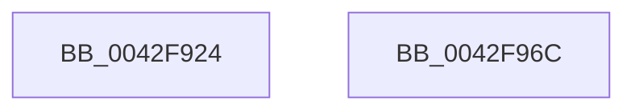

# MiGetSharedProtosAtDpc

- RVA: `0x0042F924`–`0x0042F96D` (길이 `73` bytes)
- VA: `0x000000014042F924`
- 실행 섹션: `.text`
- PDB 이름 있음: `예`; PDB Function 태그: `아니요`
- unwind 정보 RVA: `0x00060BC4`
- 디코드: `22`개 명령, `73/73` bytes 표시
- 미해석 바이트: `0` (있으면 어셈블리에 `.byte`로 보존)

> 이 문서는 커널 이미지의 기계어와 PDB 기호를 분석해 생성했습니다. 4번과 5번은 함수 원형과 자료형을 바이너리 사용 방식에서 추정한 C 해석이며 원본 소스 복구 결과는 아닙니다.

## 1. Dependencies

- 직접 호출 지점: **3**; 고유 호출 대상: **3**
- 직접 호출자로 확인된 함수: **2**
- RIP 상대 이미지 참조: **0**

### Outgoing calls
- `0x0042F93F` → [ExAcquireSpinLockSharedAtDpcLevel](../24/ExAcquireSpinLockSharedAtDpcLevel_function_00248E30.md) (function, `0x00248E30`)
- `0x0042F949` → [MiLocateSessionProtosInSubsection](../24/MiLocateSessionProtosInSubsection_function_0024A5D0.md) (function, `0x0024A5D0`)
- `0x0042F954` → [ExReleaseSpinLockSharedFromDpcLevel](../24/ExReleaseSpinLockSharedFromDpcLevel_function_0024A590.md) (function, `0x0024A590`)

### Direct callers
- [MiGetSharedProtos](../34/MiGetSharedProtos_function_00348D58.md) at `0x00348D92`
- [sub_0042F8E4](Unknown_function_0042F8E4.md) at `0x0042F8F6`

### Static image references
- 디코드된 RIP-relative 메모리 참조가 없습니다.

## 2. Other-region calls and transfers

- 다른 실행 섹션으로 향하는 call: **0**
- 별도 외부 분기/꼬리 이동을 확인하지 못했습니다.

## 3. Assembly (complete function range)

```asm
0042F924  48 89 5C 24 08                  mov qword ptr [rsp + 8], rbx
0042F929  48 89 74 24 10                  mov qword ptr [rsp + 0x10], rsi
0042F92E  57                              push rdi
0042F92F  48 83 EC 20                     sub rsp, 0x20
0042F933  48 8D 79 48                     lea rdi, [rcx + 0x48]
0042F937  49 8B F0                        mov rsi, r8
0042F93A  48 8B CF                        mov rcx, rdi
0042F93D  8B DA                           mov ebx, edx
0042F93F  E8 EC 94 E1 FF                  call 0x140248e30
0042F944  8B D3                           mov edx, ebx
0042F946  48 8B CE                        mov rcx, rsi
0042F949  E8 82 AC E1 FF                  call 0x14024a5d0
0042F94E  48 8B CF                        mov rcx, rdi
0042F951  48 8B D8                        mov rbx, rax
0042F954  E8 37 AC E1 FF                  call 0x14024a590
0042F959  48 8B 74 24 38                  mov rsi, qword ptr [rsp + 0x38]
0042F95E  48 8B C3                        mov rax, rbx
0042F961  48 8B 5C 24 30                  mov rbx, qword ptr [rsp + 0x30]
0042F966  48 83 C4 20                     add rsp, 0x20
0042F96A  5F                              pop rdi
0042F96B  C3                              ret
0042F96C  CC                              int3
```

## 4. C-style interpretation (structured pseudocode)

```c
__int64 __fastcall MiGetSharedProtosAtDpc(__int64 a1, int a2, __int64 a3)
{
    __int64 result;
    __int64 v_rsp;
    unsigned __int64 v_stack_p10;
    unsigned __int64 v_stack_p8;

    v_stack_p8 = v_rbx;
    v_stack_p10 = v_rsi;
    v_rsp = (v_rsp) - (32);
    result = ExAcquireSpinLockSharedAtDpcLevel(a1 + 72, a2, a3, a4);
    result = MiLocateSessionProtosInSubsection(a3, (unsigned int)((unsigned int)((unsigned int)(a2))), a3, a4);
    result = ExReleaseSpinLockSharedFromDpcLevel(a1 + 72, (unsigned int)((unsigned int)((unsigned int)(a2))), a3, a4);
    v_rsp = (v_rsp) + (32);
    return result;
}
```

## 5. (Beta) C Style

```c
int64_t MiGetSharedProtosAtDpc(void *Arg1, int32_t Arg2, int64_t Arg3)
{
    uint8_t *arg1 = (uint8_t *)Arg1;

    int64_t result;
    int64_t local_rsp;
    uint64_t v_stack_p10;
    uint64_t v_stack_p8;

    v_stack_p8 = local_rbx;
    v_stack_p10 = local_rsi;
    local_rsp = (local_rsp) - (32);
    result = ExAcquireSpinLockSharedAtDpcLevel(Arg1 + 72, Arg2, Arg3, a4);
    result = MiLocateSessionProtosInSubsection(Arg3, (uint32_t)((uint32_t)((uint32_t)(Arg2))), Arg3, a4);
    result = ExReleaseSpinLockSharedFromDpcLevel(Arg1 + 72, (uint32_t)((uint32_t)((uint32_t)(Arg2))), Arg3, a4);
    local_rsp = (local_rsp) + (32);
    return result;
}
```

### 관측된 메모리 오프셋

구조체 형식이 확인되지 않은 접근은 인자 기준의 오프셋으로만 기록했습니다.

| 기준 인자 | 오프셋 표현 | 폭 (bit) | 접근 |
|---|---:|---:|---|
| `Arg1` | `+ 0x48` | `64` | `R` |

## 6. Execution-region graph

[열기: 2D/3D 그래프와 함수 탐색 컨트롤 패널](../../../control-panel.html?section=text&rva=0x0042F924&view=graph)

- 2D 그래프는 위에서 아래로 흐르고, 3D 그래프는 빈 공간을 드래그해 회전합니다. Shift+드래그는 이동, 휠은 확대·축소, 함수 노드 선택은 대상 보고서 이동입니다.

### Static fallback


