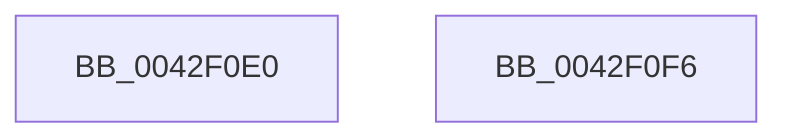

# MiGetVadPageSize

- RVA: `0x0042F0E0`–`0x0042F0F7` (길이 `23` bytes)
- VA: `0x000000014042F0E0`
- 실행 섹션: `.text`
- PDB 이름 있음: `예`; PDB Function 태그: `아니요`
- unwind 정보 RVA: `0x000DB714`
- 디코드: `7`개 명령, `23/23` bytes 표시
- 미해석 바이트: `0` (있으면 어셈블리에 `.byte`로 보존)

> 이 문서는 커널 이미지의 기계어와 PDB 기호를 분석해 생성했습니다. 4번과 5번은 함수 원형과 자료형을 바이너리 사용 방식에서 추정한 C 해석이며 원본 소스 복구 결과는 아닙니다.

## 1. Dependencies

- 직접 호출 지점: **0**; 고유 호출 대상: **0**
- 직접 호출자로 확인된 함수: **6**
- RIP 상대 이미지 참조: **1**

### Outgoing calls
- 직접 디코드된 call 명령이 없습니다.

### Direct callers
- [MmSetGraphicsPtes](../../page/7F/MmSetGraphicsPtes_function_007FC8B0.md) at `0x007FCA01`
- [MiFreeVirtualMemory](../../page/88/MiFreeVirtualMemory_function_00880268.md) at `0x008805AF`
- [MmProtectVirtualMemory](../../page/88/MmProtectVirtualMemory_function_00881050.md) at `0x00881413`
- [MiCheckSecuredVad](../../page/88/MiCheckSecuredVad_function_00881FB4.md) at `0x008821E7`
- [MmQueryVirtualMemory](../../page/9D/MmQueryVirtualMemory_function_009D9280.md) at `0x009D9F79`
- [sub_00B18E9A](../../page/B1/Unknown_function_00B18E9A.md) at `0x00B18EF6`

### Static image references
- `0x0042F0E3` → RVA `0x00014578` (`.rdata`; read)

## 2. Other-region calls and transfers

- 다른 실행 섹션으로 향하는 call: **0**
- 별도 외부 분기/꼬리 이동을 확인하지 못했습니다.

## 3. Assembly (complete function range)

```asm
0042F0E0  8B 41 30                        mov eax, dword ptr [rcx + 0x30]
0042F0E3  48 8D 0D 8E 54 BE FF            lea rcx, [rip - 0x41ab72]
0042F0EA  48 C1 E8 13                     shr rax, 0x13
0042F0EE  83 E0 03                        and eax, 3
0042F0F1  48 8B 04 C1                     mov rax, qword ptr [rcx + rax*8]
0042F0F5  C3                              ret
0042F0F6  CC                              int3
```

## 4. C-style interpretation (structured pseudocode)

```c
__int64 __fastcall MiGetVadPageSize(__int64 a1)
{
    __int64 result;

    result = ((unsigned int)(*(unsigned int *)(a1 + 48))) >> (19);
    result = (unsigned int)((result) & (3));
    return *(unsigned __int64 *)(v_rip - 4303730 + result * 8);
}
```

## 5. (Beta) C Style

```c
int64_t MiGetVadPageSize(void *Arg1)
{
    uint8_t *arg1 = (uint8_t *)Arg1;

    int64_t result;

    result = ((uint32_t)(*(uint32_t *)(arg1 + 0x30))) >> (19);
    result = (uint32_t)((result) & (3));
    return *(uint64_t *)(v_rip - 0x41AB72 + result * 8);
}
```

### 관측된 메모리 오프셋

구조체 형식이 확인되지 않은 접근은 인자 기준의 오프셋으로만 기록했습니다.

| 기준 인자 | 오프셋 표현 | 폭 (bit) | 접근 |
|---|---:|---:|---|
| `Arg1` | `+ 0x30` | `32` | `R` |

## 6. Execution-region graph

[열기: 2D/3D 그래프와 함수 탐색 컨트롤 패널](../../../control-panel.html?section=text&rva=0x0042F0E0&view=graph)

- 2D 그래프는 위에서 아래로 흐르고, 3D 그래프는 빈 공간을 드래그해 회전합니다. Shift+드래그는 이동, 휠은 확대·축소, 함수 노드 선택은 대상 보고서 이동입니다.

### Static fallback


