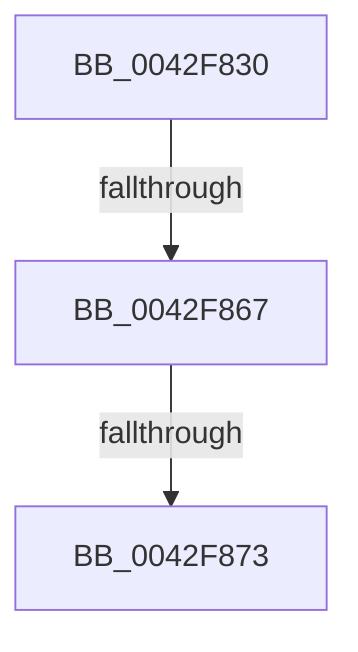

# MiImageProtoChargedCommit

- RVA: `0x0042F830`–`0x0042F87E` (길이 `78` bytes)
- VA: `0x000000014042F830`
- 실행 섹션: `.text`
- PDB 이름 있음: `예`; PDB Function 태그: `아니요`
- unwind 정보 RVA: `0x000A1EF4`
- 디코드: `16`개 명령, `78/78` bytes 표시
- 미해석 바이트: `0` (있으면 어셈블리에 `.byte`로 보존)

> 이 문서는 커널 이미지의 기계어와 PDB 기호를 분석해 생성했습니다. 4번과 5번은 함수 원형과 자료형을 바이너리 사용 방식에서 추정한 C 해석이며 원본 소스 복구 결과는 아닙니다.

## 1. Dependencies

- 직접 호출 지점: **0**; 고유 호출 대상: **0**
- 직접 호출자로 확인된 함수: **1**
- RIP 상대 이미지 참조: **0**

### Outgoing calls
- 직접 디코드된 call 명령이 없습니다.

### Direct callers
- [MiDecommitHandleProtoFormatPte](../24/MiDecommitHandleProtoFormatPte_function_00242D54.md) at `0x00242E4C`

### Static image references
- 디코드된 RIP-relative 메모리 참조가 없습니다.

## 2. Other-region calls and transfers

- 다른 실행 섹션으로 향하는 call: **0**
- call이 아닌 외부 분기/꼬리 이동: **2**
  - `0x0042F865` → [sub_0042F8DC](Unknown_function_0042F8DC.md) (`tail-transfer`)
  - `0x0042F871` → [sub_0042F8DC](Unknown_function_0042F8DC.md) (`tail-transfer`)

## 3. Assembly (complete function range)

```asm
0042F830  48 89 5C 24 10                  mov qword ptr [rsp + 0x10], rbx
0042F835  48 89 6C 24 18                  mov qword ptr [rsp + 0x18], rbp
0042F83A  48 89 74 24 20                  mov qword ptr [rsp + 0x20], rsi
0042F83F  41 56                           push r14
0042F841  48 83 EC 20                     sub rsp, 0x20
0042F845  65 48 8B 04 25 88 01 00 00      mov rax, qword ptr gs:[0x188]
0042F84E  48 8B F2                        mov rsi, rdx
0042F851  48 8B E9                        mov rbp, rcx
0042F854  48 8B 80 B8 00 00 00            mov rax, qword ptr [rax + 0xb8]
0042F85B  48 8B 90 E8 02 00 00            mov rdx, qword ptr [rax + 0x2e8]
0042F862  48 85 D2                        test rdx, rdx
0042F865  74 75                           je 0x14042f8dc
0042F867  F7 80 FC 05 00 00 00 10 00 00   test dword ptr [rax + 0x5fc], 0x1000
0042F871  75 69                           jne 0x14042f8dc
0042F873  44 8B 72 08                     mov r14d, dword ptr [rdx + 8]
0042F877  48 8D 99 80 00 00 00            lea rbx, [rcx + 0x80]
```

## 4. C-style interpretation (structured pseudocode)

```c
__int64 __fastcall MiImageProtoChargedCommit(__int64 a1, __int64 a2)
{
    __int64 v_rsp;
    unsigned __int64 v_stack_p10;
    unsigned __int64 v_stack_p18;
    unsigned __int64 v_stack_p20;

    v_stack_p10 = v_rbx;
    v_stack_p18 = v_rbp;
    v_stack_p20 = v_rsi;
    v_rsp = (v_rsp) - (32);
    return *(unsigned __int64 *)(*(unsigned __int64 *)(gs_base + (0 + 392)) + 184);
}
```

## 5. (Beta) C Style

```c
int64_t MiImageProtoChargedCommit(void *Arg1, int64_t Arg2)
{
    uint8_t *arg1 = (uint8_t *)Arg1;

    int64_t local_rsp;
    uint64_t v_stack_p10;
    uint64_t v_stack_p18;
    uint64_t v_stack_p20;

    v_stack_p10 = local_rbx;
    v_stack_p18 = local_rbp;
    v_stack_p20 = local_rsi;
    local_rsp = (local_rsp) - (32);
    return *(uint64_t *)(*(uint64_t *)(gs_base + (0 + 0x188)) + 0xB8);
}
```

### 관측된 메모리 오프셋

구조체 형식이 확인되지 않은 접근은 인자 기준의 오프셋으로만 기록했습니다.

| 기준 인자 | 오프셋 표현 | 폭 (bit) | 접근 |
|---|---:|---:|---|
| `Arg1` | `+ 0x80` | `64` | `R` |

## 6. Execution-region graph

[열기: 2D/3D 그래프와 함수 탐색 컨트롤 패널](../../../control-panel.html?section=text&rva=0x0042F830&view=graph)

- 2D 그래프는 위에서 아래로 흐르고, 3D 그래프는 빈 공간을 드래그해 회전합니다. Shift+드래그는 이동, 휠은 확대·축소, 함수 노드 선택은 대상 보고서 이동입니다.

### Static fallback


