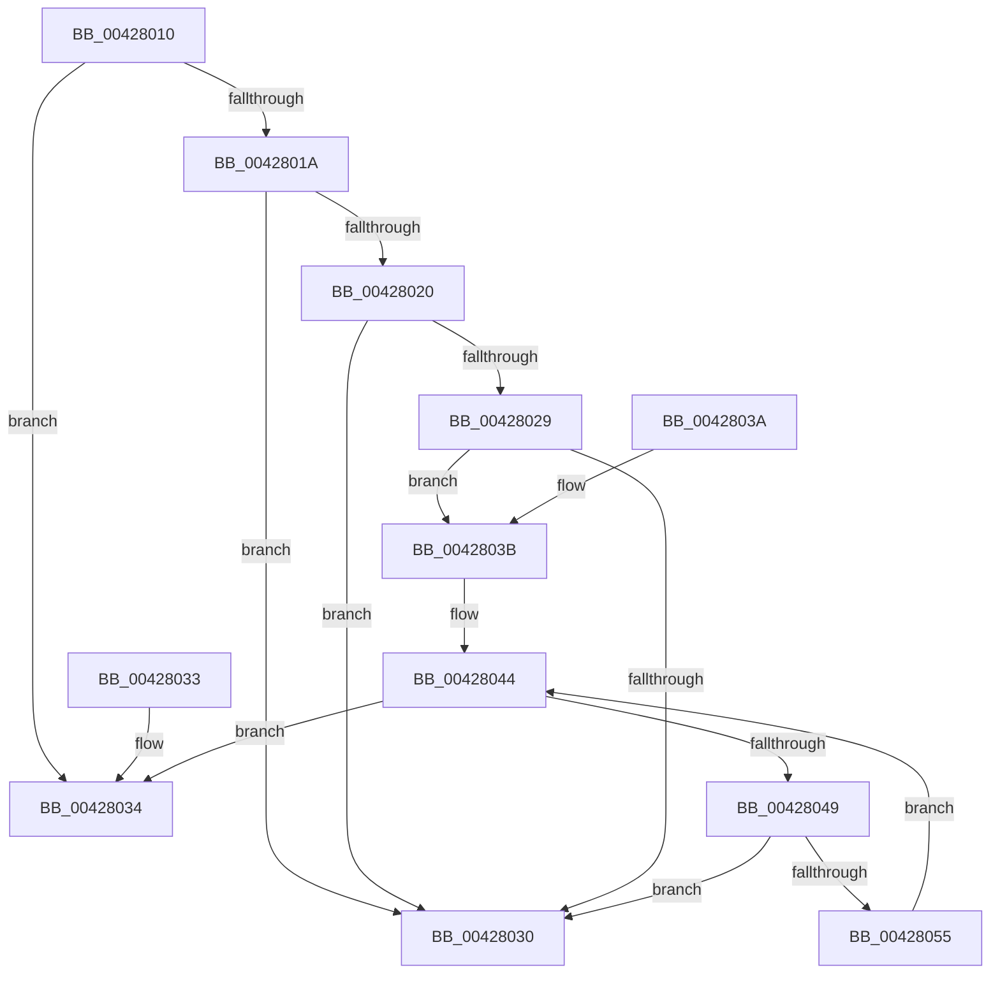

# MiIncludeSharedCommit

- RVA: `0x00428010`–`0x00428059` (길이 `73` bytes)
- VA: `0x0000000140428010`
- 실행 섹션: `.text`
- PDB 이름 있음: `예`; PDB Function 태그: `아니요`
- unwind 정보 RVA: `0x000DB714`
- 디코드: `26`개 명령, `73/73` bytes 표시
- 미해석 바이트: `0` (있으면 어셈블리에 `.byte`로 보존)

> 이 문서는 커널 이미지의 기계어와 PDB 기호를 분석해 생성했습니다. 4번과 5번은 함수 원형과 자료형을 바이너리 사용 방식에서 추정한 C 해석이며 원본 소스 복구 결과는 아닙니다.

## 1. Dependencies

- 직접 호출 지점: **0**; 고유 호출 대상: **0**
- 직접 호출자로 확인된 함수: **4**
- RIP 상대 이미지 참조: **2**

### Outgoing calls
- 직접 디코드된 call 명령이 없습니다.

### Direct callers
- [MiInsertSharedCommitNode](../../page/88/MiInsertSharedCommitNode_function_00887210.md) at `0x00887223`
- [MiRemoveSharedCommitNode](../../page/88/MiRemoveSharedCommitNode_function_008889A0.md) at `0x008889C2`
- [MiUpdateProcessSharedCommit](../../page/8C/MiUpdateProcessSharedCommit_function_008CF10C.md) at `0x008CF116`
- [MiVadHasSharedCommit](../../page/97/MiVadHasSharedCommit_function_0097E7F4.md) at `0x0097E821`

### Static image references
- `0x00428020` → RVA `0x00E2D808` (`.data`; read)
- `0x0042803D` → RVA `0x00E2D7A0` (`.data`; read)

## 2. Other-region calls and transfers

- 다른 실행 섹션으로 향하는 call: **0**
- 별도 외부 분기/꼬리 이동을 확인하지 못했습니다.

## 3. Assembly (complete function range)

```asm
00428010  8B 41 38                        mov eax, dword ptr [rcx + 0x38]
00428013  48 8B D1                        mov rdx, rcx
00428016  A8 20                           test al, 0x20
00428018  75 1A                           jne 0x140428034
0042801A  0F BA E0 0A                     bt eax, 0xa
0042801E  72 10                           jb 0x140428030
00428020  48 3B 0D E1 57 A0 00            cmp rcx, qword ptr [rip + 0xa057e1]
00428027  74 07                           je 0x140428030
00428029  48 83 79 40 00                  cmp qword ptr [rcx + 0x40], 0
0042802E  74 0B                           je 0x14042803b
00428030  33 C0                           xor eax, eax
00428032  C3                              ret
00428033  CC                              int3
00428034  B8 01 00 00 00                  mov eax, 1
00428039  C3                              ret
0042803A  CC                              int3
0042803B  33 C0                           xor eax, eax
0042803D  4C 8D 05 5C 57 A0 00            lea r8, [rip + 0xa0575c]
00428044  83 F8 01                        cmp eax, 1
00428047  73 EB                           jae 0x140428034
00428049  8B C8                           mov ecx, eax
0042804B  48 C1 E1 06                     shl rcx, 6
0042804F  4A 3B 14 01                     cmp rdx, qword ptr [rcx + r8]
00428053  74 DB                           je 0x140428030
00428055  FF C0                           inc eax
00428057  EB EB                           jmp 0x140428044
```

## 4. C-style interpretation (structured pseudocode)

```c
__int64 __fastcall MiIncludeSharedCommit(__int64 a1)
{
    __int64 result;

    if ((((unsigned __int8)((unsigned int)(*(unsigned int *)(a1 + 56)))) & (32)) != 0) goto loc_00428034;
    if (condition_is_below) goto loc_00428030;
    if (a1 == (*(unsigned __int64 *)(v_rip + 10508257))) goto loc_00428030;
    if ((*(unsigned __int64 *)(a1 + 64)) == 0) goto loc_0042803B;
loc_00428030:
    result = 0;
    return result;
loc_00428034:
    return 1;
loc_0042803B:
    result = 0;
loc_00428044:
    if (0 >= 1) goto loc_00428034;
    a1 = (0) << (6);
    if (a1 == (*(unsigned __int64 *)(a1 + v_rip + 10508124 * 1))) goto loc_00428030;
    result = (unsigned int)((result) + 1);
    goto loc_00428044;
}
```

## 5. (Beta) C Style

```c
int64_t MiIncludeSharedCommit(void *Arg1)
{
    uint8_t *arg1 = (uint8_t *)Arg1;

    int64_t result;

    if ((((uint8_t)((uint32_t)(*(uint32_t *)(arg1 + 0x38)))) & (32)) != 0) goto loc_00428034;
    if (condition_is_below) goto loc_00428030;
    if (Arg1 == (*(uint64_t *)(v_rip + 0xA057E1))) goto loc_00428030;
    if ((*(uint64_t *)(arg1 + 0x40)) == 0) goto loc_0042803B;
loc_00428030:
    result = 0;
    return result;
loc_00428034:
    return 1;
loc_0042803B:
    result = 0;
loc_00428044:
    if (0 >= 1) goto loc_00428034;
    Arg1 = (0) << (6);
    if (Arg1 == (*(uint64_t *)(arg1 + v_rip + 0xA0575C * 1))) goto loc_00428030;
    result = (uint32_t)((result) + 1);
    goto loc_00428044;
}
```

### 관측된 메모리 오프셋

구조체 형식이 확인되지 않은 접근은 인자 기준의 오프셋으로만 기록했습니다.

| 기준 인자 | 오프셋 표현 | 폭 (bit) | 접근 |
|---|---:|---:|---|
| `Arg1` | `+ 0x38` | `32` | `R` |

## 6. Execution-region graph

[열기: 2D/3D 그래프와 함수 탐색 컨트롤 패널](../../../control-panel.html?section=text&rva=0x00428010&view=graph)

- 2D 그래프는 위에서 아래로 흐르고, 3D 그래프는 빈 공간을 드래그해 회전합니다. Shift+드래그는 이동, 휠은 확대·축소, 함수 노드 선택은 대상 보고서 이동입니다.

### Static fallback


