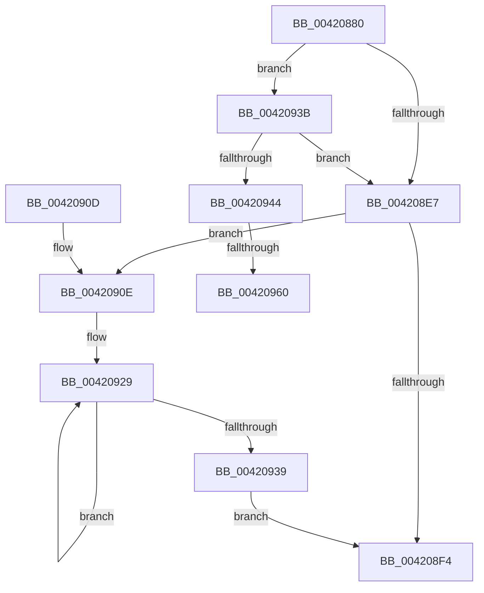

# MiLargeFreePageToMdl

- RVA: `0x00420880`–`0x0042096D` (길이 `237` bytes)
- VA: `0x0000000140420880`
- 실행 섹션: `.text`
- PDB 이름 있음: `예`; PDB Function 태그: `예`
- unwind 정보 RVA: `0x000A01B0`
- 디코드: `66`개 명령, `237/237` bytes 표시
- 미해석 바이트: `0` (있으면 어셈블리에 `.byte`로 보존)

> 이 문서는 커널 이미지의 기계어와 PDB 기호를 분석해 생성했습니다. 4번과 5번은 함수 원형과 자료형을 바이너리 사용 방식에서 추정한 C 해석이며 원본 소스 복구 결과는 아닙니다.

## 1. Dependencies

- 직접 호출 지점: **5**; 고유 호출 대상: **5**
- 직접 호출자로 확인된 함수: **1**
- RIP 상대 이미지 참조: **1**

### Outgoing calls
- `0x004208CA` → [MiUnlinkFreeOrZeroedPage](../33/MiUnlinkFreeOrZeroedPage_function_00336C40.md) (function, `0x00336C40`)
- `0x004208D6` → [MiUnlockPage](../31/MiUnlockPage_function_0031A3E0.md) (function, `0x0031A3E0`)
- `0x004208DE` → [MiIsFreeZeroPfnCold](../31/MiIsFreeZeroPfnCold_function_0031E5E4.md) (function, `0x0031E5E4`)
- `0x004208EA` → [MiConvertLargeFreePageToActive](MiConvertLargeFreePageToActive_function_00420974.md) (function, `0x00420974`)
- `0x00420950` → [MiChangePageHeatImmediate](../44/MiChangePageHeatImmediate_function_00445F5C.md) (function, `0x00445F5C`)

### Direct callers
- [MiTradePage](../28/MiTradePage_function_0028D160.md) at `0x0028DA16`

### Static image references
- `0x004208B6` → RVA `0x00011C60` (`.rdata`; read)

## 2. Other-region calls and transfers

- 다른 실행 섹션으로 향하는 call: **0**
- call이 아닌 외부 분기/꼬리 이동: **2**
  - `0x0042095A` → [sub_006EDB06 + 0x1E](../6E/Unknown_function_006EDB06.md) (`tail-transfer`)
  - `0x00420968` → [sub_006EDB06](../6E/Unknown_function_006EDB06.md) (`tail-transfer`)

## 3. Assembly (complete function range)

```asm
00420880  48 89 5C 24 08                  mov qword ptr [rsp + 8], rbx
00420885  48 89 6C 24 18                  mov qword ptr [rsp + 0x18], rbp
0042088A  48 89 74 24 20                  mov qword ptr [rsp + 0x20], rsi
0042088F  57                              push rdi
00420890  41 56                           push r14
00420892  41 57                           push r15
00420894  48 83 EC 20                     sub rsp, 0x20
00420898  48 8D 1C 49                     lea rbx, [rcx + rcx*2]
0042089C  44 8B F2                        mov r14d, edx
0042089F  48 C1 E3 04                     shl rbx, 4
004208A3  45 8B F9                        mov r15d, r9d
004208A6  49 8B F0                        mov rsi, r8
004208A9  48 8B F9                        mov rdi, rcx
004208AC  48 B8 00 00 00 00 00 DE FF FF   movabs rax, 0xffffde0000000000
004208B6  48 8D 2D A3 13 BF FF            lea rbp, [rip - 0x40ec5d]
004208BD  45 33 C0                        xor r8d, r8d
004208C0  4A 8B 6C F5 00                  mov rbp, qword ptr [rbp + r14*8]
004208C5  33 D2                           xor edx, edx
004208C7  48 03 D8                        add rbx, rax
004208CA  E8 71 63 F1 FF                  call 0x140336c40
004208CF  8A 54 24 60                     mov dl, byte ptr [rsp + 0x60]
004208D3  48 8B CB                        mov rcx, rbx
004208D6  E8 05 9B EF FF                  call 0x14031a3e0
004208DB  48 8B CB                        mov rcx, rbx
004208DE  E8 01 DD EF FF                  call 0x14031e5e4
004208E3  85 C0                           test eax, eax
004208E5  75 54                           jne 0x14042093b
004208E7  48 8B CB                        mov rcx, rbx
004208EA  E8 85 00 00 00                  call 0x140420974
004208EF  48 85 F6                        test rsi, rsi
004208F2  75 1A                           jne 0x14042090e
004208F4  48 8B 5C 24 40                  mov rbx, qword ptr [rsp + 0x40]
004208F9  48 8B 6C 24 50                  mov rbp, qword ptr [rsp + 0x50]
004208FE  48 8B 74 24 58                  mov rsi, qword ptr [rsp + 0x58]
00420903  48 83 C4 20                     add rsp, 0x20
00420907  41 5F                           pop r15
00420909  41 5E                           pop r14
0042090B  5F                              pop rdi
0042090C  C3                              ret
0042090D  CC                              int3
0042090E  8B 4E 28                        mov ecx, dword ptr [rsi + 0x28]
00420911  8B C5                           mov eax, ebp
00420913  8B D1                           mov edx, ecx
00420915  C1 E0 0C                        shl eax, 0xc
00420918  48 C1 EA 0C                     shr rdx, 0xc
0042091C  48 83 C2 06                     add rdx, 6
00420920  03 C1                           add eax, ecx
00420922  89 46 28                        mov dword ptr [rsi + 0x28], eax
00420925  48 8D 14 D6                     lea rdx, [rsi + rdx*8]
00420929  48 89 3A                        mov qword ptr [rdx], rdi
0042092C  48 FF C7                        inc rdi
0042092F  48 8D 52 08                     lea rdx, [rdx + 8]
00420933  48 83 ED 01                     sub rbp, 1
00420937  75 F0                           jne 0x140420929
00420939  EB B9                           jmp 0x1404208f4
0042093B  41 F7 C7 00 00 00 03            test r15d, 0x3000000
00420942  75 A3                           jne 0x1404208e7
00420944  41 B8 01 00 00 00               mov r8d, 1
0042094A  41 8B D6                        mov edx, r14d
0042094D  48 8B CF                        mov rcx, rdi
00420950  E8 07 56 02 00                  call 0x140445f5c
00420955  80 7C 24 60 02                  cmp byte ptr [rsp + 0x60], 2
0042095A  0F 82 C4 D1 2C 00               jb 0x1406edb24
00420960  83 64 24 48 00                  and dword ptr [rsp + 0x48], 0
00420965  41 B6 11                        mov r14b, 0x11
00420968  E9 99 D1 2C 00                  jmp 0x1406edb06
```

## 4. C-style interpretation (structured pseudocode)

```c
__int64 __fastcall MiLargeFreePageToMdl(__int64 a1, int a2, __int64 a3, int a4, unsigned __int8 a5)
{
    __int64 result;
    __int64 v_rbp;
    __int64 v_rbx;
    __int64 v_rdi;
    __int64 v_rsp;
    unsigned __int64 v_stack_p18;
    unsigned __int64 v_stack_p20;
    unsigned int v_stack_p48;
    unsigned __int64 v_stack_p8;

    v_stack_p8 = v_rbx;
    v_stack_p18 = v_rbp;
    v_stack_p20 = v_rsi;
    v_rsp = (v_rsp) - (32);
    v_rbx = (a1 + a1 * 2) << (4);
    a3 = 0;
    a2 = 0;
    v_rbx = (v_rbx) + (result);
    result = MiUnlinkFreeOrZeroedPage(a1, a2, a3, a4);
    result = MiUnlockPage(v_rbx, a5, a3, a4);
    result = MiIsFreeZeroPfnCold(v_rbx, a5, a3, a4);
    if ((unsigned int)(result) != 0) goto loc_0042093B;
loc_004208E7:
    result = MiConvertLargeFreePageToActive(v_rbx, a5, a3, a4);
    if (0 != 0) goto loc_0042090E;
loc_004208F4:
    v_rsp = (v_rsp) + (32);
    return result;
loc_0042090E:
    result = (unsigned int)(((unsigned int)((unsigned int)(v_stack_p18))) << (12));
    a2 = ((unsigned int)((unsigned int)((unsigned int)(*(unsigned int *)(v_stack_p20 + 40))))) >> (12);
    a2 = (a2) + (6);
    result = (unsigned int)((result) + ((unsigned int)((unsigned int)(*(unsigned int *)(v_stack_p20 + 40)))));
    *(unsigned int *)(v_stack_p20 + 40) = (unsigned int)(result);
loc_00420929:
    *(unsigned __int64 *)(v_stack_p20 + a2 * 8) = a1;
    v_rdi = (a1) + 1;
    v_rbp = (v_stack_p18) - (1);
    if (condition_is_not_equal) goto loc_00420929;
    goto loc_004208F4;
loc_0042093B:
    if ((((unsigned int)((unsigned int)(a4))) & (0x3000000ULL)) != 0) goto loc_004208E7;
    result = MiChangePageHeatImmediate(v_rdi, (unsigned int)((unsigned int)((unsigned int)(a2))), 1, a4);
}
```

## 5. (Beta) C Style

```c
int64_t MiLargeFreePageToMdl(void *Arg1, int32_t Arg2, int64_t Arg3, int32_t Arg4, uint8_t Arg5)
{
    uint8_t *arg1 = (uint8_t *)Arg1;

    int64_t result;
    int64_t local_rbp;
    int64_t local_rbx;
    int64_t local_rdi;
    int64_t local_rsp;
    uint64_t v_stack_p18;
    uint64_t v_stack_p20;
    uint32_t v_stack_p48;
    uint64_t v_stack_p8;

    v_stack_p8 = local_rbx;
    v_stack_p18 = local_rbp;
    v_stack_p20 = local_rsi;
    local_rsp = (local_rsp) - (32);
    local_rbx = (Arg1 + Arg1 * 2) << (4);
    Arg3 = 0;
    Arg2 = 0;
    local_rbx = (local_rbx) + (result);
    result = MiUnlinkFreeOrZeroedPage(Arg1, Arg2, Arg3, Arg4);
    result = MiUnlockPage(local_rbx, Arg5, Arg3, Arg4);
    result = MiIsFreeZeroPfnCold(local_rbx, Arg5, Arg3, Arg4);
    if ((uint32_t)(result) != 0) goto loc_0042093B;
loc_004208E7:
    result = MiConvertLargeFreePageToActive(local_rbx, Arg5, Arg3, Arg4);
    if (0 != 0) goto loc_0042090E;
loc_004208F4:
    local_rsp = (local_rsp) + (32);
    return result;
loc_0042090E:
    result = (uint32_t)(((uint32_t)((uint32_t)(v_stack_p18))) << (12));
    Arg2 = ((uint32_t)((uint32_t)((uint32_t)(*(uint32_t *)(v_stack_p20 + 0x28))))) >> (12);
    Arg2 = (Arg2) + (6);
    result = (uint32_t)((result) + ((uint32_t)((uint32_t)(*(uint32_t *)(v_stack_p20 + 0x28)))));
    *(uint32_t *)(v_stack_p20 + 0x28) = (uint32_t)(result);
loc_00420929:
    *(void **)(v_stack_p20 + Arg2 * 8) = Arg1;
    local_rdi = (Arg1) + 1;
    local_rbp = (v_stack_p18) - (1);
    if (condition_is_not_equal) goto loc_00420929;
    goto loc_004208F4;
loc_0042093B:
    if ((((uint32_t)((uint32_t)(Arg4))) & (0x3000000ULL)) != 0) goto loc_004208E7;
    result = MiChangePageHeatImmediate(local_rdi, (uint32_t)((uint32_t)((uint32_t)(Arg2))), 1, Arg4);
}
```

### 관측된 메모리 오프셋

구조체 형식이 확인되지 않은 접근은 인자 기준의 오프셋으로만 기록했습니다.

| 기준 인자 | 오프셋 표현 | 폭 (bit) | 접근 |
|---|---:|---:|---|
| `Arg1` | `+ 0x0 + rcx*2` | `64` | `R` |

## 6. Execution-region graph

[열기: 2D/3D 그래프와 함수 탐색 컨트롤 패널](../../../control-panel.html?section=text&rva=0x00420880&view=graph)

- 2D 그래프는 위에서 아래로 흐르고, 3D 그래프는 빈 공간을 드래그해 회전합니다. Shift+드래그는 이동, 휠은 확대·축소, 함수 노드 선택은 대상 보고서 이동입니다.

### Static fallback


