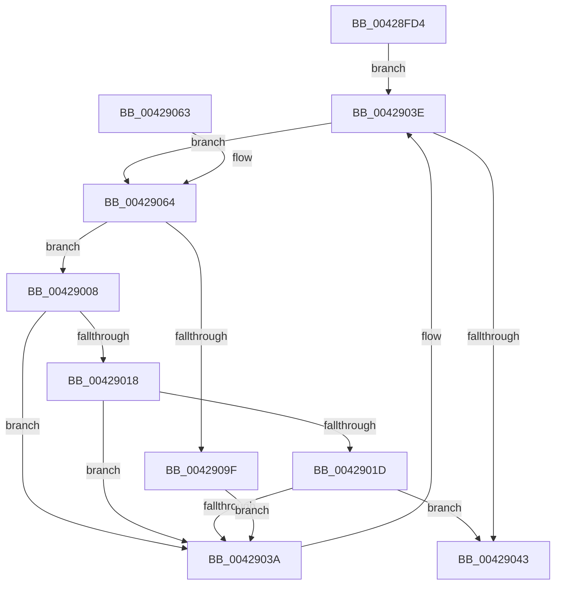

# MiProcessVpabAccessedInfo

- RVA: `0x00428FD4`–`0x004290A1` (길이 `205` bytes)
- VA: `0x0000000140428FD4`
- 실행 섹션: `.text`
- PDB 이름 있음: `예`; PDB Function 태그: `아니요`
- unwind 정보 RVA: `0x0009F84C`
- 디코드: `62`개 명령, `205/205` bytes 표시
- 미해석 바이트: `0` (있으면 어셈블리에 `.byte`로 보존)

> 이 문서는 커널 이미지의 기계어와 PDB 기호를 분석해 생성했습니다. 4번과 5번은 함수 원형과 자료형을 바이너리 사용 방식에서 추정한 C 해석이며 원본 소스 복구 결과는 아닙니다.

## 1. Dependencies

- 직접 호출 지점: **3**; 고유 호출 대상: **3**
- 직접 호출자로 확인된 함수: **3**
- RIP 상대 이미지 참조: **0**

### Outgoing calls
- `0x0042900B` → [MiGetWsleContents](../31/MiGetWsleContents_function_00316540.md) (function, `0x00316540`)
- `0x00429031` → [guard_dispatch_icall](../6B/guard_dispatch_icall_function_006BAAD0.md) (function, `0x006BAAD0`)
- `0x00429092` → [MI_READ_PTE_LOCK_FREE](../28/MI_READ_PTE_LOCK_FREE_function_002828A0.md) (function, `0x002828A0`)

### Direct callers
- [MiAgeTrimListsTail](../23/MiAgeTrimListsTail_function_00239E90.md) at `0x00239FB1`
- [MiUpdateOldWorkingSetPagesTail](MiUpdateOldWorkingSetPagesTail_function_00428C00.md) at `0x00428CF7`
- [sub_00428E14](Unknown_function_00428E14.md) at `0x00428E5E`

### Static image references
- 디코드된 RIP-relative 메모리 참조가 없습니다.

## 2. Other-region calls and transfers

- 다른 실행 섹션으로 향하는 call: **0**
- 별도 외부 분기/꼬리 이동을 확인하지 못했습니다.

## 3. Assembly (complete function range)

```asm
00428FD4  48 89 5C 24 08                  mov qword ptr [rsp + 8], rbx
00428FD9  48 89 6C 24 10                  mov qword ptr [rsp + 0x10], rbp
00428FDE  48 89 74 24 18                  mov qword ptr [rsp + 0x18], rsi
00428FE3  57                              push rdi
00428FE4  41 54                           push r12
00428FE6  41 55                           push r13
00428FE8  41 56                           push r14
00428FEA  41 57                           push r15
00428FEC  48 83 EC 30                     sub rsp, 0x30
00428FF0  8B 02                           mov eax, dword ptr [rdx]
00428FF2  48 8D 5A 08                     lea rbx, [rdx + 8]
00428FF6  4D 8B F9                        mov r15, r9
00428FF9  4D 8B E0                        mov r12, r8
00428FFC  48 8B F2                        mov rsi, rdx
00428FFF  4C 8B E9                        mov r13, rcx
00429002  4C 8D 34 C3                     lea r14, [rbx + rax*8]
00429006  EB 36                           jmp 0x14042903e
00429008  48 8B D5                        mov rdx, rbp
0042900B  E8 30 D5 EE FF                  call 0x140316540
00429010  24 0F                           and al, 0xf
00429012  2C 08                           sub al, 8
00429014  3C 02                           cmp al, 2
00429016  76 22                           jbe 0x14042903a
00429018  48 85 FF                        test rdi, rdi
0042901B  74 1D                           je 0x14042903a
0042901D  4C 8B CD                        mov r9, rbp
00429020  4C 89 7C 24 20                  mov qword ptr [rsp + 0x20], r15
00429025  4C 8B C7                        mov r8, rdi
00429028  48 8B D3                        mov rdx, rbx
0042902B  49 8B CD                        mov rcx, r13
0042902E  49 8B C4                        mov rax, r12
00429031  E8 9A 1A 29 00                  call 0x1406baad0
00429036  85 C0                           test eax, eax
00429038  75 09                           jne 0x140429043
0042903A  48 83 C3 08                     add rbx, 8
0042903E  49 3B DE                        cmp rbx, r14
00429041  72 21                           jb 0x140429064
00429043  83 26 00                        and dword ptr [rsi], 0
00429046  48 8B 74 24 70                  mov rsi, qword ptr [rsp + 0x70]
0042904B  48 8B 5C 24 60                  mov rbx, qword ptr [rsp + 0x60]
00429050  48 8B 6C 24 68                  mov rbp, qword ptr [rsp + 0x68]
00429055  48 83 C4 30                     add rsp, 0x30
00429059  41 5F                           pop r15
0042905B  41 5E                           pop r14
0042905D  41 5D                           pop r13
0042905F  41 5C                           pop r12
00429061  5F                              pop rdi
00429062  C3                              ret
00429063  CC                              int3
00429064  48 8B 2B                        mov rbp, qword ptr [rbx]
00429067  48 B8 F8 FF FF FF 7F 00 00 00   movabs rax, 0x7ffffffff8
00429071  48 81 E5 00 F0 FF FF            and rbp, 0xfffffffffffff000
00429078  48 8B FD                        mov rdi, rbp
0042907B  48 C1 EF 09                     shr rdi, 9
0042907F  48 23 F8                        and rdi, rax
00429082  48 B8 00 00 00 00 80 F6 FF FF   movabs rax, 0xfffff68000000000
0042908C  48 03 F8                        add rdi, rax
0042908F  48 8B CF                        mov rcx, rdi
00429092  E8 09 98 E5 FF                  call 0x1402828a0
00429097  A8 01                           test al, 1
00429099  0F 85 69 FF FF FF               jne 0x140429008
0042909F  EB 99                           jmp 0x14042903a
```

## 4. C-style interpretation (structured pseudocode)

```c
__int64 __fastcall MiProcessVpabAccessedInfo(__int64 a1, __int64 a2, __int64 a3, __int64 a4)
{
    __int64 result;
    __int64 v_rbp;
    __int64 v_rbx;
    __int64 v_rdi;
    __int64 v_rsp;
    unsigned __int64 v_stack_m38;
    unsigned __int64 v_stack_p10;
    unsigned __int64 v_stack_p18;
    unsigned __int64 v_stack_p8;

    v_stack_p8 = v_rbx;
    v_stack_p10 = v_rbp;
    v_stack_p18 = v_rsi;
    v_rsp = (v_rsp) - (48);
    goto loc_0042903E;
loc_00429008:
    result = MiGetWsleContents(a1, v_rbp, a3, a4);
    result = (unsigned __int8)((result) & (15));
    result = (unsigned __int8)((result) - (8));
    if (((unsigned __int8)(result)) <= 2) goto loc_0042903A;
    if (v_rdi == 0) goto loc_0042903A;
    v_stack_m38 = a4;
    result = guard_dispatch_icall(a1, a2 + 8, v_rdi, v_rbp);
    if ((unsigned int)(result) != 0) goto loc_00429043;
loc_0042903A:
    v_rbx = (a2 + 8) + (8);
loc_0042903E:
    if (v_rbx < (a2 + 8 + (unsigned int)(*(unsigned int *)(a2)) * 8)) goto loc_00429064;
loc_00429043:
    v_rsp = (v_rsp) + (48);
    return result;
loc_00429064:
    v_rbp = (*(unsigned __int64 *)(v_stack_p8)) & (0xFFFFFFFFFFFFF000ULL);
    v_rdi = (v_rbp) >> (9);
    v_rdi = (v_rdi) & (result);
    v_rdi = (v_rdi) + (result);
    result = MI_READ_PTE_LOCK_FREE(v_rdi, a2 + 8, v_rdi, v_rbp);
    if ((((unsigned __int8)(result)) & (1)) != 0) goto loc_00429008;
    goto loc_0042903A;
}
```

## 5. (Beta) C Style

```c
int64_t MiProcessVpabAccessedInfo(int64_t Arg1, void *Arg2, int64_t Arg3, int64_t Arg4)
{
    uint8_t *arg2 = (uint8_t *)Arg2;

    int64_t result;
    int64_t local_rbp;
    int64_t local_rbx;
    int64_t local_rdi;
    int64_t local_rsp;
    uint64_t v_stack_m38;
    uint64_t v_stack_p10;
    uint64_t v_stack_p18;
    uint64_t v_stack_p8;

    v_stack_p8 = local_rbx;
    v_stack_p10 = local_rbp;
    v_stack_p18 = local_rsi;
    local_rsp = (local_rsp) - (48);
    goto loc_0042903E;
loc_00429008:
    result = MiGetWsleContents(Arg1, local_rbp, Arg3, Arg4);
    result = (uint8_t)((result) & (15));
    result = (uint8_t)((result) - (8));
    if (((uint8_t)(result)) <= 2) goto loc_0042903A;
    if (local_rdi == 0) goto loc_0042903A;
    v_stack_m38 = Arg4;
    result = guard_dispatch_icall(Arg1, Arg2 + 8, local_rdi, local_rbp);
    if ((uint32_t)(result) != 0) goto loc_00429043;
loc_0042903A:
    local_rbx = (Arg2 + 8) + (8);
loc_0042903E:
    if (local_rbx < (Arg2 + 8 + (uint32_t)(*(uint32_t *)(arg2)) * 8)) goto loc_00429064;
loc_00429043:
    local_rsp = (local_rsp) + (48);
    return result;
loc_00429064:
    local_rbp = (*(uint64_t *)(v_stack_p8)) & (0xFFFFFFFFFFFFF000ULL);
    local_rdi = (local_rbp) >> (9);
    local_rdi = (local_rdi) & (result);
    local_rdi = (local_rdi) + (result);
    result = MI_READ_PTE_LOCK_FREE(local_rdi, Arg2 + 8, local_rdi, local_rbp);
    if ((((uint8_t)(result)) & (1)) != 0) goto loc_00429008;
    goto loc_0042903A;
}
```

### 관측된 메모리 오프셋

구조체 형식이 확인되지 않은 접근은 인자 기준의 오프셋으로만 기록했습니다.

| 기준 인자 | 오프셋 표현 | 폭 (bit) | 접근 |
|---|---:|---:|---|
| `Arg2` | `+ 0x0` | `32` | `R` |
| `Arg2` | `+ 0x0` | `32` | `R/W` |
| `Arg2` | `+ 0x0 + rax*8` | `64` | `R` |
| `Arg2` | `+ 0x8` | `64` | `R` |

## 6. Execution-region graph

[열기: 2D/3D 그래프와 함수 탐색 컨트롤 패널](../../../control-panel.html?section=text&rva=0x00428FD4&view=graph)

- 2D 그래프는 위에서 아래로 흐르고, 3D 그래프는 빈 공간을 드래그해 회전합니다. Shift+드래그는 이동, 휠은 확대·축소, 함수 노드 선택은 대상 보고서 이동입니다.

### Static fallback


