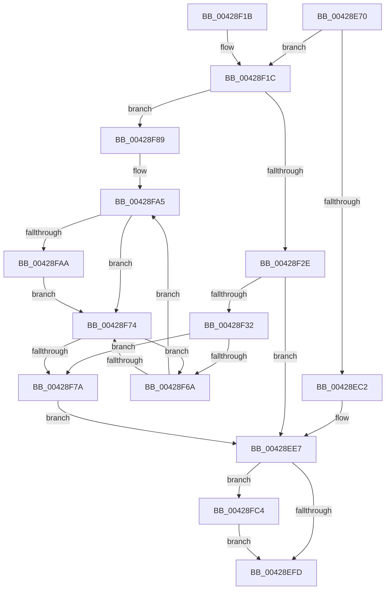

# MiQueryVpabAccessedState

- RVA: `0x00428E70`–`0x00428FCC` (길이 `348` bytes)
- VA: `0x0000000140428E70`
- 실행 섹션: `.text`
- PDB 이름 있음: `예`; PDB Function 태그: `아니요`
- unwind 정보 RVA: `0x000A0E54`
- 디코드: `91`개 명령, `348/348` bytes 표시
- 미해석 바이트: `0` (있으면 어셈블리에 `.byte`로 보존)

> 이 문서는 커널 이미지의 기계어와 PDB 기호를 분석해 생성했습니다. 4번과 5번은 함수 원형과 자료형을 바이너리 사용 방식에서 추정한 C 해석이며 원본 소스 복구 결과는 아닙니다.

## 1. Dependencies

- 직접 호출 지점: **10**; 고유 호출 대상: **10**
- 직접 호출자로 확인된 함수: **3**
- RIP 상대 이미지 참조: **1**

### Outgoing calls
- `0x00428E9D` → [MiReleaseWalkLocks](../23/MiReleaseWalkLocks_function_00239FD0.md) (function, `0x00239FD0`)
- `0x00428EE2` → [VmpQueryAccessedState](VmpQueryAccessedState_function_004290A8.md) (function, `0x004290A8`)
- `0x00428EF0` → [MiReacquireWalkLocks](../28/MiReacquireWalkLocks_function_002819A0.md) (function, `0x002819A0`)
- `0x00428F08` → [_security_check_cookie](../6A/_security_check_cookie_function_006AC640.md) (function, `0x006AC640`)
- `0x00428F25` → [VslQueryPrivilegedAccessedState](VslQueryPrivilegedAccessedState_function_004292CC.md) (function, `0x004292CC`)
- `0x00428F3F` → [memset](../6C/memset_function_006C6C40.md) (function, `0x006C6C40`)
- `0x00428F5F` → [MiInitializeTbFlushList](../29/MiInitializeTbFlushList_function_00294F00.md) (function, `0x00294F00`)
- `0x00428F7F` → [MiFlushTbList](../31/MiFlushTbList_function_00311FC0.md) (function, `0x00311FC0`)
- `0x00428F9F` → [KeBugCheckEx](../4F/KeBugCheckEx_function_004FD660.md) (function, `0x004FD660`)
- `0x00428FBD` → [MiInsertTbFlushEntry](../29/MiInsertTbFlushEntry_function_00293670.md) (function, `0x00293670`)

### Direct callers
- [MiAgeTrimListsTail](../23/MiAgeTrimListsTail_function_00239E90.md) at `0x00239F8F`
- [MiUpdateOldWorkingSetPagesTail](MiUpdateOldWorkingSetPagesTail_function_00428C00.md) at `0x00428CD4`
- [sub_00428E14](Unknown_function_00428E14.md) at `0x00428E35`

### Static image references
- `0x00428E7E` → RVA `0x00E0A740` (`.data`; read)

## 2. Other-region calls and transfers

- 다른 실행 섹션으로 향하는 call: **0**
- 별도 외부 분기/꼬리 이동을 확인하지 못했습니다.

## 3. Assembly (complete function range)

```asm
00428E70  40 53                           push rbx
00428E72  55                              push rbp
00428E73  56                              push rsi
00428E74  57                              push rdi
00428E75  41 56                           push r14
00428E77  48 81 EC 10 01 00 00            sub rsp, 0x110
00428E7E  48 8B 05 BB 18 9E 00            mov rax, qword ptr [rip + 0x9e18bb]
00428E85  48 33 C4                        xor rax, rsp
00428E88  48 89 84 24 00 01 00 00         mov qword ptr [rsp + 0x100], rax
00428E90  4C 8B 71 38                     mov r14, qword ptr [rcx + 0x38]
00428E94  41 8B F8                        mov edi, r8d
00428E97  48 8B DA                        mov rbx, rdx
00428E9A  48 8B E9                        mov rbp, rcx
00428E9D  E8 2E 11 E1 FF                  call 0x140239fd0
00428EA2  65 48 8B 04 25 88 01 00 00      mov rax, qword ptr gs:[0x188]
00428EAB  48 8D 73 08                     lea rsi, [rbx + 8]
00428EAF  8B 13                           mov edx, dword ptr [rbx]
00428EB1  48 8B 88 B8 00 00 00            mov rcx, qword ptr [rax + 0xb8]
00428EB8  48 83 B9 70 06 00 00 00         cmp qword ptr [rcx + 0x670], 0
00428EC0  74 5A                           je 0x140428f1c
00428EC2  65 48 8B 04 25 88 01 00 00      mov rax, qword ptr gs:[0x188]
00428ECB  44 8B C2                        mov r8d, edx
00428ECE  44 8B CF                        mov r9d, edi
00428ED1  48 8B D6                        mov rdx, rsi
00428ED4  48 8B 88 B8 00 00 00            mov rcx, qword ptr [rax + 0xb8]
00428EDB  48 8B 89 70 06 00 00            mov rcx, qword ptr [rcx + 0x670]
00428EE2  E8 C1 01 00 00                  call 0x1404290a8
00428EE7  45 33 C0                        xor r8d, r8d
00428EEA  49 8B D6                        mov rdx, r14
00428EED  48 8B CD                        mov rcx, rbp
00428EF0  E8 AB 8A E5 FF                  call 0x1402819a0
00428EF5  85 C0                           test eax, eax
00428EF7  0F 84 C7 00 00 00               je 0x140428fc4
00428EFD  48 8B 8C 24 00 01 00 00         mov rcx, qword ptr [rsp + 0x100]
00428F05  48 33 CC                        xor rcx, rsp
00428F08  E8 33 37 28 00                  call 0x1406ac640
00428F0D  48 81 C4 10 01 00 00            add rsp, 0x110
00428F14  41 5E                           pop r14
00428F16  5F                              pop rdi
00428F17  5E                              pop rsi
00428F18  5D                              pop rbp
00428F19  5B                              pop rbx
00428F1A  C3                              ret
00428F1B  CC                              int3
00428F1C  85 FF                           test edi, edi
00428F1E  48 8B CE                        mov rcx, rsi
00428F21  41 0F 95 C0                     setne r8b
00428F25  E8 A2 03 00 00                  call 0x1404292cc
00428F2A  85 C0                           test eax, eax
00428F2C  78 5B                           js 0x140428f89
00428F2E  85 FF                           test edi, edi
00428F30  74 B5                           je 0x140428ee7
00428F32  33 D2                           xor edx, edx
00428F34  48 8D 4C 24 30                  lea rcx, [rsp + 0x30]
00428F39  41 B8 C8 00 00 00               mov r8d, 0xc8
00428F3F  E8 FC DC 29 00                  call 0x1406c6c40
00428F44  48 8B 55 20                     mov rdx, qword ptr [rbp + 0x20]
00428F48  48 8D 4C 24 30                  lea rcx, [rsp + 0x30]
00428F4D  41 B9 08 00 00 00               mov r9d, 8
00428F53  C7 44 24 20 02 00 00 00         mov dword ptr [rsp + 0x20], 2
00428F5B  45 8D 41 0C                     lea r8d, [r9 + 0xc]
00428F5F  E8 9C BF E6 FF                  call 0x140294f00
00428F64  33 FF                           xor edi, edi
00428F66  39 3B                           cmp dword ptr [rbx], edi
00428F68  76 10                           jbe 0x140428f7a
00428F6A  48 8B 54 FB 08                  mov rdx, qword ptr [rbx + rdi*8 + 8]
00428F6F  F6 C2 02                        test dl, 2
00428F72  74 31                           je 0x140428fa5
00428F74  FF C7                           inc edi
00428F76  3B 3B                           cmp edi, dword ptr [rbx]
00428F78  72 F0                           jb 0x140428f6a
00428F7A  48 8D 4C 24 30                  lea rcx, [rsp + 0x30]
00428F7F  E8 3C 90 EE FF                  call 0x140311fc0
00428F84  E9 5E FF FF FF                  jmp 0x140428ee7
00428F89  44 8B 0B                        mov r9d, dword ptr [rbx]
00428F8C  4C 8B C6                        mov r8, rsi
00428F8F  48 83 64 24 20 00               and qword ptr [rsp + 0x20], 0
00428F95  BA 15 15 05 00                  mov edx, 0x51515
00428F9A  B9 1A 00 00 00                  mov ecx, 0x1a
00428F9F  E8 BC 46 0D 00                  call 0x1404fd660
00428FA4  CC                              int3
00428FA5  F6 C2 01                        test dl, 1
00428FA8  74 CA                           je 0x140428f74
00428FAA  45 33 C9                        xor r9d, r9d
00428FAD  48 8D 4C 24 30                  lea rcx, [rsp + 0x30]
00428FB2  48 81 E2 00 F0 FF FF            and rdx, 0xfffffffffffff000
00428FB9  45 8D 41 01                     lea r8d, [r9 + 1]
00428FBD  E8 AE A6 E6 FF                  call 0x140293670
00428FC2  EB B0                           jmp 0x140428f74
00428FC4  83 23 00                        and dword ptr [rbx], 0
00428FC7  E9 31 FF FF FF                  jmp 0x140428efd
```

## 4. C-style interpretation (structured pseudocode)

```c
__int64 __fastcall MiQueryVpabAccessedState(__int64 a1, __int64 a2, int a3)
{
    __int64 result;
    __int64 v_rdi;
    __int64 v_rsp;
    unsigned __int64 v_stack_m38;
    unsigned int v_stack_p20;
    unsigned __int64 v_stack_p30;

    v_rsp = (v_rsp) - (272);
    result = (*(unsigned __int64 *)(v_rip + 10361019)) ^ (v_rsp);
    v_stack_m38 = result;
    result = MiReleaseWalkLocks(a1, a2, a3, a4);
    if ((*(unsigned __int64 *)(*(unsigned __int64 *)(*(unsigned __int64 *)(gs_base + (0 + 392)) + 184) + 1648)) == 0) goto loc_00428F1C;
    result = VmpQueryAccessedState(*(unsigned __int64 *)(*(unsigned __int64 *)(*(unsigned __int64 *)(gs_base + (0 + 392)) + 184) + 1648), a2 + 8, (unsigned int)((unsigned int)((unsigned int)(*(unsigned int *)(a2)))), (unsigned int)((unsigned int)((unsigned int)(a3))));
loc_00428EE7:
    a3 = 0;
    result = MiReacquireWalkLocks(a1, *(unsigned __int64 *)(a1 + 56), a3, (unsigned int)((unsigned int)((unsigned int)(a3))));
    if ((unsigned int)(result) == 0) goto loc_00428FC4;
loc_00428EFD:
    a1 = (v_stack_m38) ^ (v_rsp);
    result = _security_check_cookie(a1, *(unsigned __int64 *)(a1 + 56), a3, (unsigned int)((unsigned int)((unsigned int)(a3))));
    v_rsp = (v_rsp) + (272);
    return result;
loc_00428F1C:
    a3 = ((unsigned int)((unsigned int)(a3)) != 0) ? 1 : 0;
    result = VslQueryPrivilegedAccessedState(a2 + 8, *(unsigned __int64 *)(a1 + 56), a3, (unsigned int)((unsigned int)((unsigned int)(a3))));
    if (sign_flag) goto loc_00428F89;
    if ((unsigned int)((unsigned int)(a3)) == 0) goto loc_00428EE7;
    a2 = 0;
    result = memset(v_stack_p30, a2, 200, (unsigned int)((unsigned int)((unsigned int)(a3))));
    v_stack_p20 = 2;
    result = MiInitializeTbFlushList(v_stack_p30, *(unsigned __int64 *)(a1 + 32), 8 + 12, 8);
    v_rdi = 0;
    if ((*(unsigned int *)(a2)) <= 0) goto loc_00428F7A;
loc_00428F6A:
    if ((((unsigned __int8)(*(unsigned __int64 *)(a2 + v_rdi * 8 + 8))) & (2)) == 0) goto loc_00428FA5;
loc_00428F74:
    v_rdi = (unsigned int)((v_rdi) + 1);
    if (((unsigned int)(v_rdi)) < (*(unsigned int *)(a2))) goto loc_00428F6A;
loc_00428F7A:
    result = MiFlushTbList(v_stack_p30, *(unsigned __int64 *)(a2 + v_rdi * 8 + 8), 8 + 12, 8);
    goto loc_00428EE7;
loc_00428F89:
    result = KeBugCheckEx(26, (unsigned int)(0x51515ULL), a2 + 8, (unsigned int)(*(unsigned int *)(a2)));
loc_00428FA5:
    if ((((unsigned __int8)((unsigned int)(0x51515ULL))) & (1)) == 0) goto loc_00428F74;
    a4 = 0;
    a2 = ((unsigned int)(0x51515ULL)) & (0xFFFFFFFFFFFFF000ULL);
    result = MiInsertTbFlushEntry(v_stack_p30, a2, a4 + 1, a4);
    goto loc_00428F74;
loc_00428FC4:
    goto loc_00428EFD;
}
```

## 5. (Beta) C Style

```c
int64_t MiQueryVpabAccessedState(void *Arg1, void *Arg2, int32_t Arg3)
{
    uint8_t *arg1 = (uint8_t *)Arg1;
    uint8_t *arg2 = (uint8_t *)Arg2;

    int64_t result;
    int64_t local_rdi;
    int64_t local_rsp;
    uint64_t v_stack_m38;
    uint32_t v_stack_p20;
    uint64_t v_stack_p30;

    local_rsp = (local_rsp) - (272);
    result = (*(uint64_t *)(v_rip + 0x9E18BB)) ^ (local_rsp);
    v_stack_m38 = result;
    result = MiReleaseWalkLocks(Arg1, Arg2, Arg3, a4);
    if ((*(uint64_t *)(*(uint64_t *)(*(uint64_t *)(gs_base + (0 + 0x188)) + 0xB8) + 0x670)) == 0) goto loc_00428F1C;
    result = VmpQueryAccessedState(*(uint64_t *)(*(uint64_t *)(*(uint64_t *)(gs_base + (0 + 0x188)) + 0xB8) + 0x670), Arg2 + 8, (uint32_t)((uint32_t)((uint32_t)(*(uint32_t *)(arg2)))), (uint32_t)((uint32_t)((uint32_t)(Arg3))));
loc_00428EE7:
    Arg3 = 0;
    result = MiReacquireWalkLocks(Arg1, *(uint64_t *)(arg1 + 0x38), Arg3, (uint32_t)((uint32_t)((uint32_t)(Arg3))));
    if ((uint32_t)(result) == 0) goto loc_00428FC4;
loc_00428EFD:
    Arg1 = (v_stack_m38) ^ (local_rsp);
    result = _security_check_cookie(Arg1, *(uint64_t *)(arg1 + 0x38), Arg3, (uint32_t)((uint32_t)((uint32_t)(Arg3))));
    local_rsp = (local_rsp) + (272);
    return result;
loc_00428F1C:
    Arg3 = ((uint32_t)((uint32_t)(Arg3)) != 0) ? 1 : 0;
    result = VslQueryPrivilegedAccessedState(Arg2 + 8, *(uint64_t *)(arg1 + 0x38), Arg3, (uint32_t)((uint32_t)((uint32_t)(Arg3))));
    if (sign_flag) goto loc_00428F89;
    if ((uint32_t)((uint32_t)(Arg3)) == 0) goto loc_00428EE7;
    Arg2 = 0;
    result = memset(v_stack_p30, Arg2, 200, (uint32_t)((uint32_t)((uint32_t)(Arg3))));
    v_stack_p20 = 2;
    result = MiInitializeTbFlushList(v_stack_p30, *(uint64_t *)(arg1 + 0x20), 8 + 12, 8);
    local_rdi = 0;
    if ((*(uint32_t *)(arg2)) <= 0) goto loc_00428F7A;
loc_00428F6A:
    if ((((uint8_t)(*(uint64_t *)(arg2 + local_rdi * 8 + 0x8))) & (2)) == 0) goto loc_00428FA5;
loc_00428F74:
    local_rdi = (uint32_t)((local_rdi) + 1);
    if (((uint32_t)(local_rdi)) < (*(uint32_t *)(arg2))) goto loc_00428F6A;
loc_00428F7A:
    result = MiFlushTbList(v_stack_p30, *(uint64_t *)(arg2 + local_rdi * 8 + 0x8), 8 + 12, 8);
    goto loc_00428EE7;
loc_00428F89:
    result = KeBugCheckEx(26, (uint32_t)(0x51515ULL), Arg2 + 8, (uint32_t)(*(uint32_t *)(arg2)));
loc_00428FA5:
    if ((((uint8_t)((uint32_t)(0x51515ULL))) & (1)) == 0) goto loc_00428F74;
    a4 = 0;
    Arg2 = ((uint32_t)(0x51515ULL)) & (0xFFFFFFFFFFFFF000ULL);
    result = MiInsertTbFlushEntry(v_stack_p30, Arg2, a4 + 1, a4);
    goto loc_00428F74;
loc_00428FC4:
    goto loc_00428EFD;
}
```

### 관측된 메모리 오프셋

구조체 형식이 확인되지 않은 접근은 인자 기준의 오프셋으로만 기록했습니다.

| 기준 인자 | 오프셋 표현 | 폭 (bit) | 접근 |
|---|---:|---:|---|
| `Arg1` | `+ 0x20` | `64` | `R` |
| `Arg1` | `+ 0x38` | `64` | `R` |
| `Arg2` | `+ 0x0` | `32` | `R` |
| `Arg2` | `+ 0x0` | `32` | `R/W` |
| `Arg2` | `+ 0x8` | `64` | `R` |
| `Arg2` | `+ 0x8 + rdi*8` | `64` | `R` |

## 6. Execution-region graph

[열기: 2D/3D 그래프와 함수 탐색 컨트롤 패널](../../../control-panel.html?section=text&rva=0x00428E70&view=graph)

- 2D 그래프는 위에서 아래로 흐르고, 3D 그래프는 빈 공간을 드래그해 회전합니다. Shift+드래그는 이동, 휠은 확대·축소, 함수 노드 선택은 대상 보고서 이동입니다.

### Static fallback


