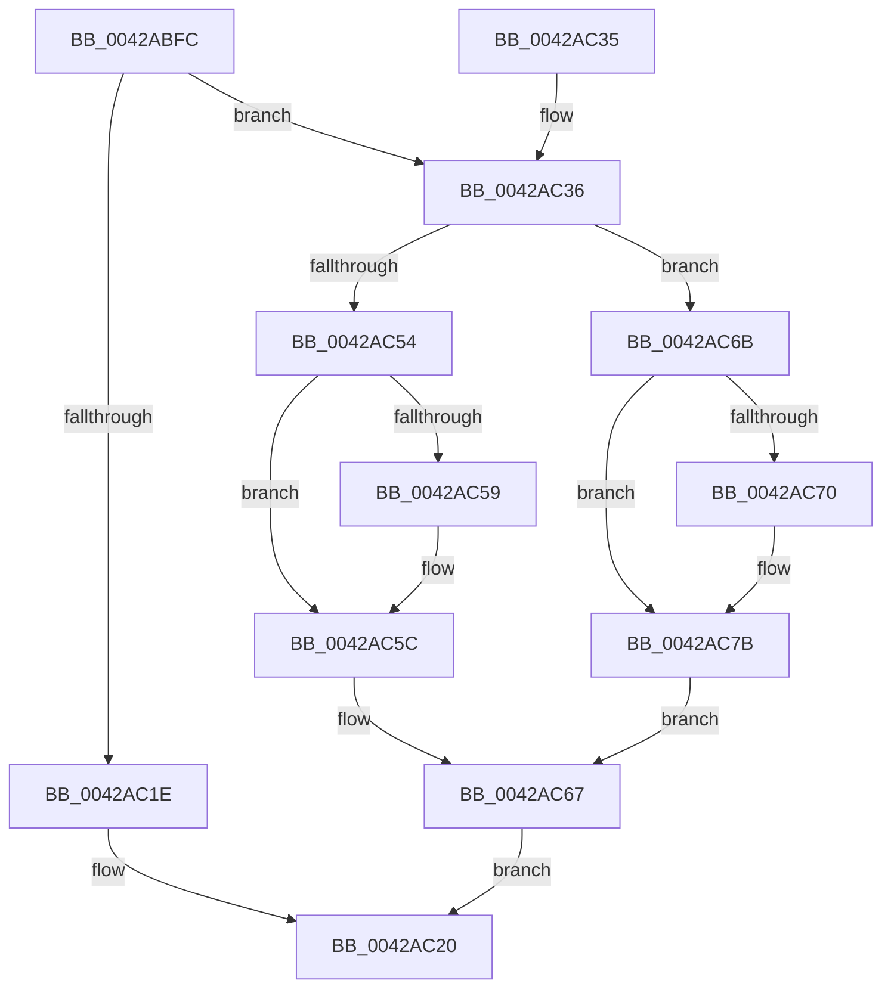

# MiTryLockVad

- RVA: `0x0042ABFC`–`0x0042AC7F` (길이 `131` bytes)
- VA: `0x000000014042ABFC`
- 실행 섹션: `.text`
- PDB 이름 있음: `예`; PDB Function 태그: `아니요`
- unwind 정보 RVA: `0x0008F8B4`
- 디코드: `40`개 명령, `131/131` bytes 표시
- 미해석 바이트: `0` (있으면 어셈블리에 `.byte`로 보존)

> 이 문서는 커널 이미지의 기계어와 PDB 기호를 분석해 생성했습니다. 4번과 5번은 함수 원형과 자료형을 바이너리 사용 방식에서 추정한 C 해석이며 원본 소스 복구 결과는 아닙니다.

## 1. Dependencies

- 직접 호출 지점: **2**; 고유 호출 대상: **2**
- 직접 호출자로 확인된 함수: **2**
- RIP 상대 이미지 참조: **0**

### Outgoing calls
- `0x0042AC47` → [KeAbPreAcquire](../21/KeAbPreAcquire_function_00210230.md) (function, `0x00210230`)
- `0x0042AC76` → [KeAbPostReleaseEx](../26/KeAbPostReleaseEx_function_00262210.md) (function, `0x00262210`)

### Direct callers
- [MiDeprioritizeVad](MiDeprioritizeVad_function_0042AAB4.md) at `0x0042AAF0`
- [MiStoreDiscardPoisonedPage](../69/MiStoreDiscardPoisonedPage_function_00692858.md) at `0x00692A17`

### Static image references
- 디코드된 RIP-relative 메모리 참조가 없습니다.

## 2. Other-region calls and transfers

- 다른 실행 섹션으로 향하는 call: **0**
- 별도 외부 분기/꼬리 이동을 확인하지 못했습니다.

## 3. Assembly (complete function range)

```asm
0042ABFC  48 89 5C 24 08                  mov qword ptr [rsp + 8], rbx
0042AC01  48 89 6C 24 10                  mov qword ptr [rsp + 0x10], rbp
0042AC06  48 89 74 24 18                  mov qword ptr [rsp + 0x18], rsi
0042AC0B  57                              push rdi
0042AC0C  48 83 EC 20                     sub rsp, 0x20
0042AC10  8B B9 A8 05 00 00               mov edi, dword ptr [rcx + 0x5a8]
0042AC16  48 8B E9                        mov rbp, rcx
0042AC19  40 84 FF                        test dil, dil
0042AC1C  79 18                           jns 0x14042ac36
0042AC1E  33 C0                           xor eax, eax
0042AC20  48 8B 5C 24 30                  mov rbx, qword ptr [rsp + 0x30]
0042AC25  48 8B 6C 24 38                  mov rbp, qword ptr [rsp + 0x38]
0042AC2A  48 8B 74 24 40                  mov rsi, qword ptr [rsp + 0x40]
0042AC2F  48 83 C4 20                     add rsp, 0x20
0042AC33  5F                              pop rdi
0042AC34  C3                              ret
0042AC35  CC                              int3
0042AC36  48 8D 72 28                     lea rsi, [rdx + 0x28]
0042AC3A  BB 01 00 00 00                  mov ebx, 1
0042AC3F  44 8B C3                        mov r8d, ebx
0042AC42  48 8B CE                        mov rcx, rsi
0042AC45  33 D2                           xor edx, edx
0042AC47  E8 E4 55 DE FF                  call 0x140210230
0042AC4C  F0 48 0F BA 2E 00               lock bts qword ptr [rsi], 0
0042AC52  72 17                           jb 0x14042ac6b
0042AC54  48 85 C0                        test rax, rax
0042AC57  74 03                           je 0x14042ac5c
0042AC59  88 58 0A                        mov byte ptr [rax + 0xa], bl
0042AC5C  0F BA EF 07                     bts edi, 7
0042AC60  89 BD A8 05 00 00               mov dword ptr [rbp + 0x5a8], edi
0042AC66  90                              nop
0042AC67  8B C3                           mov eax, ebx
0042AC69  EB B5                           jmp 0x14042ac20
0042AC6B  48 85 C0                        test rax, rax
0042AC6E  74 0B                           je 0x14042ac7b
0042AC70  48 8B D0                        mov rdx, rax
0042AC73  48 8B CE                        mov rcx, rsi
0042AC76  E8 95 75 E3 FF                  call 0x140262210
0042AC7B  33 DB                           xor ebx, ebx
0042AC7D  EB E8                           jmp 0x14042ac67
```

## 4. C-style interpretation (structured pseudocode)

```c
__int64 __fastcall MiTryLockVad(__int64 a1, __int64 a2)
{
    __int64 result;
    __int64 v_rbx;
    __int64 v_rsp;
    unsigned __int64 v_stack_p10;
    unsigned __int64 v_stack_p18;
    unsigned __int64 v_stack_p8;

    v_stack_p8 = v_rbx;
    v_stack_p10 = v_rbp;
    v_stack_p18 = v_rsi;
    v_rsp = (v_rsp) - (32);
    if (!sign_flag) goto loc_0042AC36;
    result = 0;
loc_0042AC20:
    v_rsp = (v_rsp) + (32);
    return result;
loc_0042AC36:
    a2 = 0;
    result = KeAbPreAcquire(a2 + 40, a2, 1, a4);
    if (condition_is_below) goto loc_0042AC6B;
    if (result != 0) {
        *(unsigned __int8 *)(result + 10) = 1;
    }
    *(unsigned int *)(v_stack_p10 + 1448) = (unsigned int)((unsigned int)(*(unsigned int *)(a1 + 1448)));
loc_0042AC67:
    goto loc_0042AC20;
loc_0042AC6B:
    result = 1;
    if (1 != 0) {
        a2 = 1;
        a1 = a2 + 40;
        result = KeAbPostReleaseEx(a1, a2, 1, a4);
    }
    v_rbx = 0;
    goto loc_0042AC67;
}
```

## 5. (Beta) C Style

```c
int64_t MiTryLockVad(void *Arg1, void *Arg2)
{
    uint8_t *arg1 = (uint8_t *)Arg1;
    uint8_t *arg2 = (uint8_t *)Arg2;

    int64_t result;
    int64_t local_rbx;
    int64_t local_rsp;
    uint64_t v_stack_p10;
    uint64_t v_stack_p18;
    uint64_t v_stack_p8;

    v_stack_p8 = local_rbx;
    v_stack_p10 = local_rbp;
    v_stack_p18 = local_rsi;
    local_rsp = (local_rsp) - (32);
    if (!sign_flag) goto loc_0042AC36;
    result = 0;
loc_0042AC20:
    local_rsp = (local_rsp) + (32);
    return result;
loc_0042AC36:
    Arg2 = 0;
    result = KeAbPreAcquire(Arg2 + 40, Arg2, 1, a4);
    if (condition_is_below) goto loc_0042AC6B;
    if (result != 0) {
        *(uint8_t *)(result + 0xA) = 1;
    }
    *(uint32_t *)(v_stack_p10 + 0x5A8) = (uint32_t)((uint32_t)(*(uint32_t *)(arg1 + 0x5A8)));
loc_0042AC67:
    goto loc_0042AC20;
loc_0042AC6B:
    result = 1;
    if (1 != 0) {
        Arg2 = 1;
        Arg1 = Arg2 + 40;
        result = KeAbPostReleaseEx(Arg1, Arg2, 1, a4);
    }
    local_rbx = 0;
    goto loc_0042AC67;
}
```

### 관측된 메모리 오프셋

구조체 형식이 확인되지 않은 접근은 인자 기준의 오프셋으로만 기록했습니다.

| 기준 인자 | 오프셋 표현 | 폭 (bit) | 접근 |
|---|---:|---:|---|
| `Arg1` | `+ 0x5A8` | `32` | `R` |
| `Arg1` | `+ 0x5A8` | `32` | `W` |
| `Arg2` | `+ 0x0` | `64` | `R/W` |
| `Arg2` | `+ 0x28` | `64` | `R` |

## 6. Execution-region graph

[열기: 2D/3D 그래프와 함수 탐색 컨트롤 패널](../../../control-panel.html?section=text&rva=0x0042ABFC&view=graph)

- 2D 그래프는 위에서 아래로 흐르고, 3D 그래프는 빈 공간을 드래그해 회전합니다. Shift+드래그는 이동, 휠은 확대·축소, 함수 노드 선택은 대상 보고서 이동입니다.

### Static fallback


