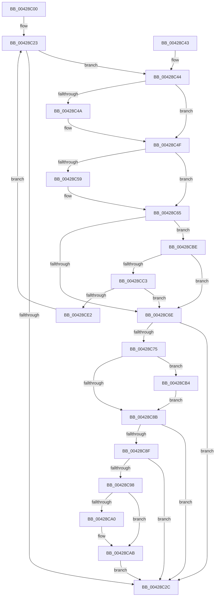

# MiUpdateOldWorkingSetPagesTail

- RVA: `0x00428C00`–`0x00428D01` (길이 `257` bytes)
- VA: `0x0000000140428C00`
- 실행 섹션: `.text`
- PDB 이름 있음: `예`; PDB Function 태그: `아니요`
- unwind 정보 RVA: `0x00079F64`
- 디코드: `70`개 명령, `257/257` bytes 표시
- 미해석 바이트: `0` (있으면 어셈블리에 `.byte`로 보존)

> 이 문서는 커널 이미지의 기계어와 PDB 기호를 분석해 생성했습니다. 4번과 5번은 함수 원형과 자료형을 바이너리 사용 방식에서 추정한 C 해석이며 원본 소스 복구 결과는 아닙니다.

## 1. Dependencies

- 직접 호출 지점: **6**; 고유 호출 대상: **6**
- 직접 호출자로 확인된 함수: **0**
- RIP 상대 이미지 참조: **2**

### Outgoing calls
- `0x00428C4A` → [MiFlushTbList](../31/MiFlushTbList_function_00311FC0.md) (function, `0x00311FC0`)
- `0x00428C60` → [MiFreeWsleList](../24/MiFreeWsleList_function_00241168.md) (function, `0x00241168`)
- `0x00428C75` → [MiReleaseProcessorFlushList](../31/MiReleaseProcessorFlushList_function_00313C70.md) (function, `0x00313C70`)
- `0x00428CA6` → [KiLowerIrqlProcessIrqlFlags](../4F/KiLowerIrqlProcessIrqlFlags_function_004F5698.md) (function, `0x004F5698`)
- `0x00428CD4` → [MiQueryVpabAccessedState](MiQueryVpabAccessedState_function_00428E70.md) (function, `0x00428E70`)
- `0x00428CF7` → [MiProcessVpabAccessedInfo](MiProcessVpabAccessedInfo_function_00428FD4.md) (function, `0x00428FD4`)

### Direct callers
- 이 함수 시작 RVA로 연결되는 직접 call은 확인되지 않았습니다. 간접 호출은 완전히 역산할 수 없습니다.

### Static image references
- `0x00428C98` → RVA `0x00FC6D20` (`ALMOSTRO`; read)
- `0x00428CE9` → RVA `0x0049CF50` (`MiUpdateOldPagesVpabCallback`; read)

## 2. Other-region calls and transfers

- 다른 실행 섹션으로 향하는 call: **0**
- 별도 외부 분기/꼬리 이동을 확인하지 못했습니다.

## 3. Assembly (complete function range)

```asm
00428C00  48 89 5C 24 08                  mov qword ptr [rsp + 8], rbx
00428C05  48 89 6C 24 10                  mov qword ptr [rsp + 0x10], rbp
00428C0A  48 89 74 24 18                  mov qword ptr [rsp + 0x18], rsi
00428C0F  57                              push rdi
00428C10  48 83 EC 20                     sub rsp, 0x20
00428C14  48 8B B9 B8 00 00 00            mov rdi, qword ptr [rcx + 0xb8]
00428C1B  48 8B F1                        mov rsi, rcx
00428C1E  BD 01 00 00 00                  mov ebp, 1
00428C23  48 8B 4F 30                     mov rcx, qword ptr [rdi + 0x30]
00428C27  48 85 C9                        test rcx, rcx
00428C2A  75 18                           jne 0x140428c44
00428C2C  48 8B 5C 24 30                  mov rbx, qword ptr [rsp + 0x30]
00428C31  33 C0                           xor eax, eax
00428C33  48 8B 6C 24 38                  mov rbp, qword ptr [rsp + 0x38]
00428C38  48 8B 74 24 40                  mov rsi, qword ptr [rsp + 0x40]
00428C3D  48 83 C4 20                     add rsp, 0x20
00428C41  5F                              pop rdi
00428C42  C3                              ret
00428C43  CC                              int3
00428C44  83 79 1C 00                     cmp dword ptr [rcx + 0x1c], 0
00428C48  74 05                           je 0x140428c4f
00428C4A  E8 71 93 EE FF                  call 0x140311fc0
00428C4F  48 8B 57 38                     mov rdx, qword ptr [rdi + 0x38]
00428C53  83 7A 1C 00                     cmp dword ptr [rdx + 0x1c], 0
00428C57  74 0C                           je 0x140428c65
00428C59  48 8B 4E 20                     mov rcx, qword ptr [rsi + 0x20]
00428C5D  45 33 C0                        xor r8d, r8d
00428C60  E8 03 85 E1 FF                  call 0x140241168
00428C65  48 8B 47 40                     mov rax, qword ptr [rdi + 0x40]
00428C69  48 85 C0                        test rax, rax
00428C6C  75 50                           jne 0x140428cbe
00428C6E  48 83 7F 30 00                  cmp qword ptr [rdi + 0x30], 0
00428C73  74 B7                           je 0x140428c2c
00428C75  E8 F6 AF EE FF                  call 0x140313c70
00428C7A  48 83 67 30 00                  and qword ptr [rdi + 0x30], 0
00428C7F  48 83 67 38 00                  and qword ptr [rdi + 0x38], 0
00428C84  48 83 7F 40 00                  cmp qword ptr [rdi + 0x40], 0
00428C89  75 29                           jne 0x140428cb4
00428C8B  85 ED                           test ebp, ebp
00428C8D  75 9D                           jne 0x140428c2c
00428C8F  0F B6 5E 09                     movzx ebx, byte ptr [rsi + 9]
00428C93  80 FB 11                        cmp bl, 0x11
00428C96  74 94                           je 0x140428c2c
00428C98  39 2D 82 E0 B9 00               cmp dword ptr [rip + 0xb9e082], ebp
00428C9E  74 0B                           je 0x140428cab
00428CA0  44 0F 20 C1                     mov rcx, cr8
00428CA4  8A D3                           mov dl, bl
00428CA6  E8 ED C9 0C 00                  call 0x1404f5698
00428CAB  44 0F 22 C3                     mov cr8, rbx
00428CAF  E9 78 FF FF FF                  jmp 0x140428c2c
00428CB4  48 C7 47 40 01 00 00 00         mov qword ptr [rdi + 0x40], 1
00428CBC  EB CD                           jmp 0x140428c8b
00428CBE  83 38 00                        cmp dword ptr [rax], 0
00428CC1  74 AB                           je 0x140428c6e
00428CC3  8A 5E 09                        mov bl, byte ptr [rsi + 9]
00428CC6  45 33 C0                        xor r8d, r8d
00428CC9  C6 46 09 11                     mov byte ptr [rsi + 9], 0x11
00428CCD  48 8B CE                        mov rcx, rsi
00428CD0  48 8B 57 40                     mov rdx, qword ptr [rdi + 0x40]
00428CD4  E8 97 01 00 00                  call 0x140428e70
00428CD9  88 5E 09                        mov byte ptr [rsi + 9], bl
00428CDC  8B E8                           mov ebp, eax
00428CDE  85 C0                           test eax, eax
00428CE0  74 8C                           je 0x140428c6e
00428CE2  4C 8B 8E B8 00 00 00            mov r9, qword ptr [rsi + 0xb8]
00428CE9  4C 8D 05 60 42 07 00            lea r8, [rip + 0x74260]
00428CF0  48 8B 57 40                     mov rdx, qword ptr [rdi + 0x40]
00428CF4  48 8B CE                        mov rcx, rsi
00428CF7  E8 D8 02 00 00                  call 0x140428fd4
00428CFC  E9 22 FF FF FF                  jmp 0x140428c23
```

## 4. C-style interpretation (structured pseudocode)

```c
__int64 __fastcall MiUpdateOldWorkingSetPagesTail(__int64 a1, __int64 a2, int a3)
{
    __int64 result;
    __int64 v_rsp;
    unsigned __int64 v_stack_p10;
    unsigned __int64 v_stack_p18;
    unsigned __int64 v_stack_p8;

    v_stack_p8 = v_rbx;
    v_stack_p10 = v_rbp;
    v_stack_p18 = v_rsi;
    v_rsp = (v_rsp) - (32);
loc_00428C23:
    if (*(unsigned __int64 *)(*(unsigned __int64 *)(a1 + 184) + 48) != 0) goto loc_00428C44;
loc_00428C2C:
    result = 0;
    v_rsp = (v_rsp) + (32);
    return result;
loc_00428C44:
    if ((*(unsigned int *)(*(unsigned __int64 *)(*(unsigned __int64 *)(a1 + 184) + 48) + 28)) != 0) {
        result = MiFlushTbList(*(unsigned __int64 *)(*(unsigned __int64 *)(a1 + 184) + 48), a2, a3, a4);
    }
    if ((*(unsigned int *)(*(unsigned __int64 *)(*(unsigned __int64 *)(a1 + 184) + 56) + 28)) != 0) {
        a1 = *(unsigned __int64 *)(v_stack_p18 + 32);
        a3 = 0;
        result = MiFreeWsleList(a1, *(unsigned __int64 *)(*(unsigned __int64 *)(a1 + 184) + 56), a3, a4);
    }
    if (*(unsigned __int64 *)(*(unsigned __int64 *)(a1 + 184) + 64) != 0) goto loc_00428CBE;
loc_00428C6E:
    if ((*(unsigned __int64 *)(*(unsigned __int64 *)(a1 + 184) + 48)) == 0) goto loc_00428C2C;
    result = MiReleaseProcessorFlushList(a1, *(unsigned __int64 *)(*(unsigned __int64 *)(a1 + 184) + 56), a3, a4);
    if ((*(unsigned __int64 *)(*(unsigned __int64 *)(a1 + 184) + 64)) != 0) goto loc_00428CB4;
loc_00428C8B:
    if ((unsigned int)(v_stack_p10) != 0) goto loc_00428C2C;
    if (((unsigned __int8)(*(unsigned __int8 *)(v_stack_p18 + 9))) == 17) goto loc_00428C2C;
    if ((*(unsigned int *)(v_rip + 12181634)) != ((unsigned int)(v_stack_p10))) {
        a1 = v_cr8;
        a2 = (unsigned __int8)(*(unsigned __int8 *)(v_stack_p18 + 9));
        result = KiLowerIrqlProcessIrqlFlags(a1, a2, a3, a4);
    }
    goto loc_00428C2C;
loc_00428CB4:
    *(unsigned __int64 *)(*(unsigned __int64 *)(a1 + 184) + 64) = 1;
    goto loc_00428C8B;
loc_00428CBE:
    if ((*(unsigned int *)(result)) == 0) goto loc_00428C6E;
    a3 = 0;
    *(unsigned __int8 *)(v_stack_p18 + 9) = 17;
    result = MiQueryVpabAccessedState(v_stack_p18, *(unsigned __int64 *)(*(unsigned __int64 *)(a1 + 184) + 64), a3, a4);
    *(unsigned __int8 *)(v_stack_p18 + 9) = (unsigned __int8)(*(unsigned __int8 *)(v_stack_p18 + 9));
    if ((unsigned int)(result) == 0) goto loc_00428C6E;
    result = MiProcessVpabAccessedInfo(v_stack_p18, *(unsigned __int64 *)(*(unsigned __int64 *)(a1 + 184) + 64), v_rip + 475744, *(unsigned __int64 *)(v_stack_p18 + 184));
    goto loc_00428C23;
}
```

## 5. (Beta) C Style

```c
int64_t MiUpdateOldWorkingSetPagesTail(void *Arg1, int64_t Arg2, int32_t Arg3)
{
    uint8_t *arg1 = (uint8_t *)Arg1;

    int64_t result;
    int64_t local_rsp;
    uint64_t v_stack_p10;
    uint64_t v_stack_p18;
    uint64_t v_stack_p8;

    v_stack_p8 = local_rbx;
    v_stack_p10 = local_rbp;
    v_stack_p18 = local_rsi;
    local_rsp = (local_rsp) - (32);
loc_00428C23:
    if (*(uint64_t *)(*(uint64_t *)(arg1 + 0xB8) + 0x30) != 0) goto loc_00428C44;
loc_00428C2C:
    result = 0;
    local_rsp = (local_rsp) + (32);
    return result;
loc_00428C44:
    if ((*(uint32_t *)(*(uint64_t *)(*(uint64_t *)(arg1 + 0xB8) + 0x30) + 0x1C)) != 0) {
        result = MiFlushTbList(*(uint64_t *)(*(uint64_t *)(arg1 + 0xB8) + 0x30), Arg2, Arg3, a4);
    }
    if ((*(uint32_t *)(*(uint64_t *)(*(uint64_t *)(arg1 + 0xB8) + 0x38) + 0x1C)) != 0) {
        Arg1 = *(uint64_t *)(v_stack_p18 + 0x20);
        Arg3 = 0;
        result = MiFreeWsleList(Arg1, *(uint64_t *)(*(uint64_t *)(arg1 + 0xB8) + 0x38), Arg3, a4);
    }
    if (*(uint64_t *)(*(uint64_t *)(arg1 + 0xB8) + 0x40) != 0) goto loc_00428CBE;
loc_00428C6E:
    if ((*(uint64_t *)(*(uint64_t *)(arg1 + 0xB8) + 0x30)) == 0) goto loc_00428C2C;
    result = MiReleaseProcessorFlushList(Arg1, *(uint64_t *)(*(uint64_t *)(arg1 + 0xB8) + 0x38), Arg3, a4);
    if ((*(uint64_t *)(*(uint64_t *)(arg1 + 0xB8) + 0x40)) != 0) goto loc_00428CB4;
loc_00428C8B:
    if ((uint32_t)(v_stack_p10) != 0) goto loc_00428C2C;
    if (((uint8_t)(*(uint8_t *)(v_stack_p18 + 0x9))) == 17) goto loc_00428C2C;
    if ((*(uint32_t *)(v_rip + 0xB9E082)) != ((uint32_t)(v_stack_p10))) {
        Arg1 = v_cr8;
        Arg2 = (uint8_t)(*(uint8_t *)(v_stack_p18 + 0x9));
        result = KiLowerIrqlProcessIrqlFlags(Arg1, Arg2, Arg3, a4);
    }
    goto loc_00428C2C;
loc_00428CB4:
    *(uint64_t *)(*(uint64_t *)(arg1 + 0xB8) + 0x40) = 1;
    goto loc_00428C8B;
loc_00428CBE:
    if ((*(uint32_t *)(result)) == 0) goto loc_00428C6E;
    Arg3 = 0;
    *(uint8_t *)(v_stack_p18 + 0x9) = 17;
    result = MiQueryVpabAccessedState(v_stack_p18, *(uint64_t *)(*(uint64_t *)(arg1 + 0xB8) + 0x40), Arg3, a4);
    *(uint8_t *)(v_stack_p18 + 0x9) = (uint8_t)(*(uint8_t *)(v_stack_p18 + 0x9));
    if ((uint32_t)(result) == 0) goto loc_00428C6E;
    result = MiProcessVpabAccessedInfo(v_stack_p18, *(uint64_t *)(*(uint64_t *)(arg1 + 0xB8) + 0x40), v_rip + 475744, *(uint64_t *)(v_stack_p18 + 0xB8));
    goto loc_00428C23;
}
```

### 관측된 메모리 오프셋

구조체 형식이 확인되지 않은 접근은 인자 기준의 오프셋으로만 기록했습니다.

| 기준 인자 | 오프셋 표현 | 폭 (bit) | 접근 |
|---|---:|---:|---|
| `Arg1` | `+ 0x9` | `8` | `R` |
| `Arg1` | `+ 0x9` | `8` | `W` |
| `Arg1` | `+ 0x20` | `64` | `R` |
| `Arg1` | `+ 0xB8` | `64` | `R` |

## 6. Execution-region graph

[열기: 2D/3D 그래프와 함수 탐색 컨트롤 패널](../../../control-panel.html?section=text&rva=0x00428C00&view=graph)

- 2D 그래프는 위에서 아래로 흐르고, 3D 그래프는 빈 공간을 드래그해 회전합니다. Shift+드래그는 이동, 휠은 확대·축소, 함수 노드 선택은 대상 보고서 이동입니다.

### Static fallback


