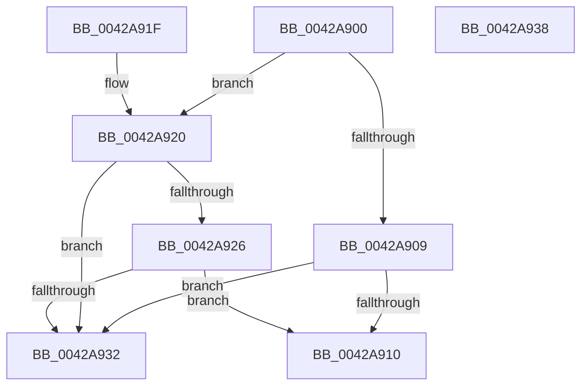

# MiVadLeafPagesPrecharged

- RVA: `0x0042A900`–`0x0042A939` (길이 `57` bytes)
- VA: `0x000000014042A900`
- 실행 섹션: `.text`
- PDB 이름 있음: `예`; PDB Function 태그: `아니요`
- unwind 정보 RVA: `0x000DB714`
- 디코드: `21`개 명령, `57/57` bytes 표시
- 미해석 바이트: `0` (있으면 어셈블리에 `.byte`로 보존)

> 이 문서는 커널 이미지의 기계어와 PDB 기호를 분석해 생성했습니다. 4번과 5번은 함수 원형과 자료형을 바이너리 사용 방식에서 추정한 C 해석이며 원본 소스 복구 결과는 아닙니다.

## 1. Dependencies

- 직접 호출 지점: **0**; 고유 호출 대상: **0**
- 직접 호출자로 확인된 함수: **1**
- RIP 상대 이미지 참조: **0**

### Outgoing calls
- 직접 디코드된 call 명령이 없습니다.

### Direct callers
- [MiCommitPageTablesForVad](../../page/88/MiCommitPageTablesForVad_function_00886D50.md) at `0x00886E5E`

### Static image references
- 디코드된 RIP-relative 메모리 참조가 없습니다.

## 2. Other-region calls and transfers

- 다른 실행 섹션으로 향하는 call: **0**
- 별도 외부 분기/꼬리 이동을 확인하지 못했습니다.

## 3. Assembly (complete function range)

```asm
0042A900  8B 41 30                        mov eax, dword ptr [rcx + 0x30]
0042A903  0F BA E0 15                     bt eax, 0x15
0042A907  72 17                           jb 0x14042a920
0042A909  8B 41 40                        mov eax, dword ptr [rcx + 0x40]
0042A90C  A8 01                           test al, 1
0042A90E  75 22                           jne 0x14042a932
0042A910  8B 51 30                        mov edx, dword ptr [rcx + 0x30]
0042A913  33 C0                           xor eax, eax
0042A915  83 E2 70                        and edx, 0x70
0042A918  80 FA 30                        cmp dl, 0x30
0042A91B  0F 94 C0                        sete al
0042A91E  C3                              ret
0042A91F  CC                              int3
0042A920  0F BA E0 17                     bt eax, 0x17
0042A924  72 0C                           jb 0x14042a932
0042A926  25 00 00 18 00                  and eax, 0x180000
0042A92B  3D 00 00 10 00                  cmp eax, 0x100000
0042A930  72 DE                           jb 0x14042a910
0042A932  B8 01 00 00 00                  mov eax, 1
0042A937  C3                              ret
0042A938  CC                              int3
```

## 4. C-style interpretation (structured pseudocode)

```c
__int64 __fastcall MiVadLeafPagesPrecharged(__int64 a1)
{
    __int64 result;

    if (condition_is_below) goto loc_0042A920;
    if ((((unsigned __int8)((unsigned int)(*(unsigned int *)(a1 + 64)))) & (1)) != 0) goto loc_0042A932;
loc_0042A910:
    result = 0;
    a2 = (unsigned int)(((unsigned int)(*(unsigned int *)(a1 + 48))) & (112));
    result = (((unsigned __int8)(a2)) == 48) ? 1 : 0;
    return result;
loc_0042A920:
    if (((unsigned __int8)(a2)) < 48) goto loc_0042A932;
    result = (unsigned int)((result) & (0x180000ULL));
    if (((unsigned int)(result)) < 0x100000ULL) goto loc_0042A910;
loc_0042A932:
    return 1;
}
```

## 5. (Beta) C Style

```c
int64_t MiVadLeafPagesPrecharged(void *Arg1)
{
    uint8_t *arg1 = (uint8_t *)Arg1;

    int64_t result;

    if (condition_is_below) goto loc_0042A920;
    if ((((uint8_t)((uint32_t)(*(uint32_t *)(arg1 + 0x40)))) & (1)) != 0) goto loc_0042A932;
loc_0042A910:
    result = 0;
    a2 = (uint32_t)(((uint32_t)(*(uint32_t *)(arg1 + 0x30))) & (112));
    result = (((uint8_t)(a2)) == 48) ? 1 : 0;
    return result;
loc_0042A920:
    if (((uint8_t)(a2)) < 48) goto loc_0042A932;
    result = (uint32_t)((result) & (0x180000ULL));
    if (((uint32_t)(result)) < 0x100000ULL) goto loc_0042A910;
loc_0042A932:
    return 1;
}
```

### 관측된 메모리 오프셋

구조체 형식이 확인되지 않은 접근은 인자 기준의 오프셋으로만 기록했습니다.

| 기준 인자 | 오프셋 표현 | 폭 (bit) | 접근 |
|---|---:|---:|---|
| `Arg1` | `+ 0x30` | `32` | `R` |
| `Arg1` | `+ 0x40` | `32` | `R` |

## 6. Execution-region graph

[열기: 2D/3D 그래프와 함수 탐색 컨트롤 패널](../../../control-panel.html?section=text&rva=0x0042A900&view=graph)

- 2D 그래프는 위에서 아래로 흐르고, 3D 그래프는 빈 공간을 드래그해 회전합니다. Shift+드래그는 이동, 휠은 확대·축소, 함수 노드 선택은 대상 보고서 이동입니다.

### Static fallback


