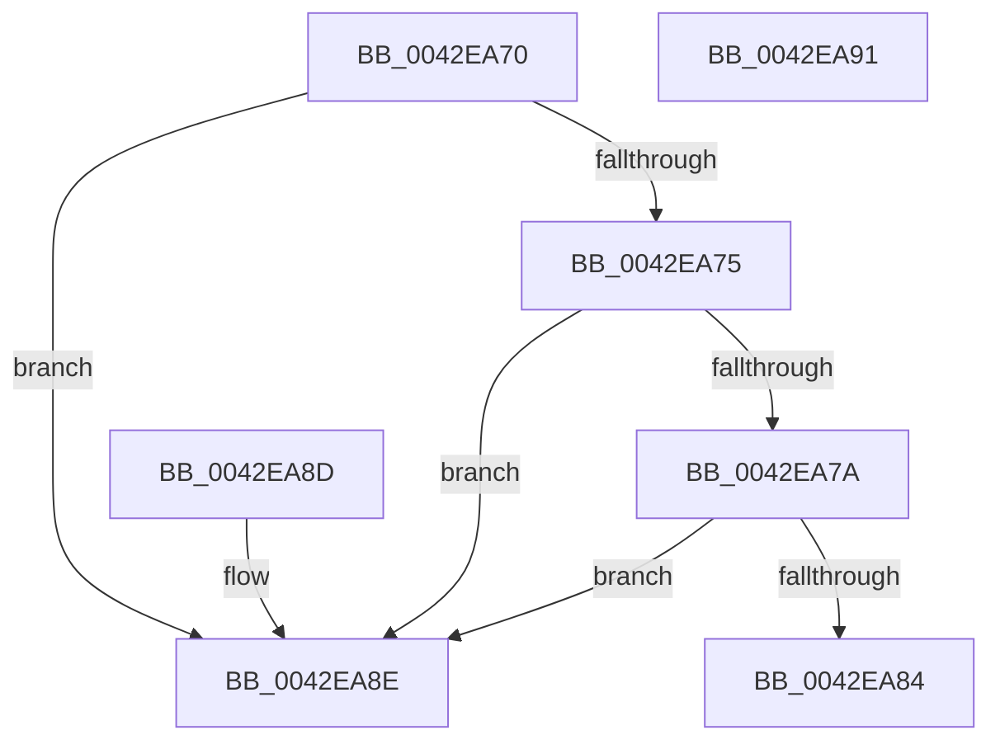

# MiValidCombineProtection

- RVA: `0x0042EA70`–`0x0042EA92` (길이 `34` bytes)
- VA: `0x000000014042EA70`
- 실행 섹션: `.text`
- PDB 이름 있음: `예`; PDB Function 태그: `아니요`
- unwind 정보 RVA: `0x000DB714`
- 디코드: `16`개 명령, `34/34` bytes 표시
- 미해석 바이트: `0` (있으면 어셈블리에 `.byte`로 보존)

> 이 문서는 커널 이미지의 기계어와 PDB 기호를 분석해 생성했습니다. 4번과 5번은 함수 원형과 자료형을 바이너리 사용 방식에서 추정한 C 해석이며 원본 소스 복구 결과는 아닙니다.

## 1. Dependencies

- 직접 호출 지점: **0**; 고유 호출 대상: **0**
- 직접 호출자로 확인된 함수: **2**
- RIP 상대 이미지 참조: **0**

### Outgoing calls
- 직접 디코드된 call 명령이 없습니다.

### Direct callers
- [MiCombineCandidate](../31/MiCombineCandidate_function_00316290.md) at `0x003163CE`
- [MiProcessCrcList](../../page/9F/MiProcessCrcList_function_009F6F94.md) at `0x009F70AC`

### Static image references
- 디코드된 RIP-relative 메모리 참조가 없습니다.

## 2. Other-region calls and transfers

- 다른 실행 섹션으로 향하는 call: **0**
- 별도 외부 분기/꼬리 이동을 확인하지 못했습니다.

## 3. Assembly (complete function range)

```asm
0042EA70  83 F9 1F                        cmp ecx, 0x1f
0042EA73  74 19                           je 0x14042ea8e
0042EA75  83 F9 18                        cmp ecx, 0x18
0042EA78  74 14                           je 0x14042ea8e
0042EA7A  8B C1                           mov eax, ecx
0042EA7C  83 E0 F8                        and eax, 0xfffffff8
0042EA7F  83 F8 10                        cmp eax, 0x10
0042EA82  74 0A                           je 0x14042ea8e
0042EA84  33 C0                           xor eax, eax
0042EA86  83 F9 1E                        cmp ecx, 0x1e
0042EA89  0F 92 C0                        setb al
0042EA8C  C3                              ret
0042EA8D  CC                              int3
0042EA8E  33 C0                           xor eax, eax
0042EA90  C3                              ret
0042EA91  CC                              int3
```

## 4. C-style interpretation (structured pseudocode)

```c
__int64 __fastcall MiValidCombineProtection(int a1)
{
    __int64 result;

    if (a1 == 31) goto loc_0042EA8E;
    if (a1 == 24) goto loc_0042EA8E;
    result = (unsigned int)(((unsigned int)(a1)) & (0xFFFFFFF8ULL));
    if (((unsigned int)(result)) == 16) goto loc_0042EA8E;
    result = 0;
    result = (a1 < 30) ? 1 : 0;
    return result;
loc_0042EA8E:
    result = 0;
    return result;
}
```

## 5. (Beta) C Style

```c
int64_t MiValidCombineProtection(int32_t Arg1)
{
    int64_t result;

    if (Arg1 == 31) goto loc_0042EA8E;
    if (Arg1 == 24) goto loc_0042EA8E;
    result = (uint32_t)(((uint32_t)(Arg1)) & (0xFFFFFFF8ULL));
    if (((uint32_t)(result)) == 16) goto loc_0042EA8E;
    result = 0;
    result = (Arg1 < 30) ? 1 : 0;
    return result;
loc_0042EA8E:
    result = 0;
    return result;
}
```

## 6. Execution-region graph

[열기: 2D/3D 그래프와 함수 탐색 컨트롤 패널](../../../control-panel.html?section=text&rva=0x0042EA70&view=graph)

- 2D 그래프는 위에서 아래로 흐르고, 3D 그래프는 빈 공간을 드래그해 회전합니다. Shift+드래그는 이동, 휠은 확대·축소, 함수 노드 선택은 대상 보고서 이동입니다.

### Static fallback


