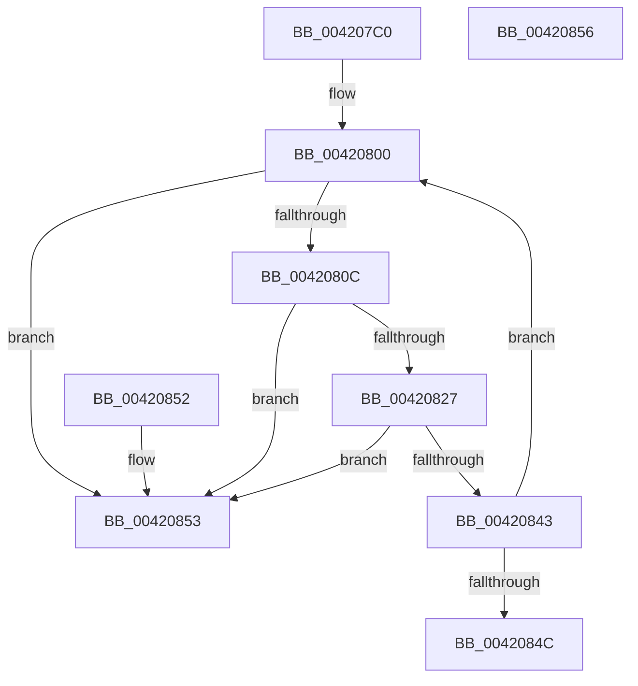

# MmAreMdlPagesCached

- RVA: `0x004207C0`–`0x00420857` (길이 `151` bytes)
- VA: `0x00000001404207C0`
- 실행 섹션: `.text`
- PDB 이름 있음: `예`; PDB Function 태그: `아니요`
- unwind 정보 RVA: `0x000DB714`
- 디코드: `40`개 명령, `151/151` bytes 표시
- 미해석 바이트: `0` (있으면 어셈블리에 `.byte`로 보존)

> 이 문서는 커널 이미지의 기계어와 PDB 기호를 분석해 생성했습니다. 4번과 5번은 함수 원형과 자료형을 바이너리 사용 방식에서 추정한 C 해석이며 원본 소스 복구 결과는 아닙니다.

## 1. Dependencies

- 직접 호출 지점: **0**; 고유 호출 대상: **0**
- 직접 호출자로 확인된 함수: **1**
- RIP 상대 이미지 참조: **1**

### Outgoing calls
- 직접 디코드된 call 명령이 없습니다.

### Direct callers
- [ST_STORE&lt;SM_TRAITS&gt;::StDmPageRetrieve](../41/ST_STORE_SM_TRAITS_StDmPageRetrieve_function_0041FE20.md) at `0x0041FE9B`

### Static image references
- `0x00420803` → RVA `0x00E2DCE0` (`.data`; read)

## 2. Other-region calls and transfers

- 다른 실행 섹션으로 향하는 call: **0**
- 별도 외부 분기/꼬리 이동을 확인하지 못했습니다.

## 3. Assembly (complete function range)

```asm
004207C0  44 8B 41 2C                     mov r8d, dword ptr [rcx + 0x2c]
004207C4  48 8D 51 30                     lea rdx, [rcx + 0x30]
004207C8  44 03 41 20                     add r8d, dword ptr [rcx + 0x20]
004207CC  8B 49 28                        mov ecx, dword ptr [rcx + 0x28]
004207CF  41 81 E0 FF 0F 00 00            and r8d, 0xfff
004207D6  48 81 C1 FF 0F 00 00            add rcx, 0xfff
004207DD  49 BB 28 00 00 00 00 DE FF FF   movabs r11, 0xffffde0000000028
004207E7  49 03 C8                        add rcx, r8
004207EA  49 BA 20 00 00 00 00 DE FF FF   movabs r10, 0xffffde0000000020
004207F4  48 C1 E9 0C                     shr rcx, 0xc
004207F8  4C 8D 0C CA                     lea r9, [rdx + rcx*8]
004207FC  0F 1F 40 00                     nop dword ptr [rax]
00420800  48 8B 02                        mov rax, qword ptr [rdx]
00420803  48 3B 05 D6 D4 A0 00            cmp rax, qword ptr [rip + 0xa0d4d6]
0042080A  77 47                           ja 0x140420853
0042080C  48 8D 0C 40                     lea rcx, [rax + rax*2]
00420810  48 03 C9                        add rcx, rcx
00420813  49 8B C3                        mov rax, r11
00420816  48 8B 04 C8                     mov rax, qword ptr [rax + rcx*8]
0042081A  48 C1 E8 36                     shr rax, 0x36
0042081E  0F BA E0 00                     bt eax, 0
00420822  48 8B 02                        mov rax, qword ptr [rdx]
00420825  73 2C                           jae 0x140420853
00420827  48 8D 0C 40                     lea rcx, [rax + rax*2]
0042082B  48 03 C9                        add rcx, rcx
0042082E  49 8B C2                        mov rax, r10
00420831  44 8B 04 C8                     mov r8d, dword ptr [rax + rcx*8]
00420835  41 C1 E8 10                     shr r8d, 0x10
00420839  41 80 E0 C0                     and r8b, 0xc0
0042083D  41 80 F8 40                     cmp r8b, 0x40
00420841  75 10                           jne 0x140420853
00420843  48 83 C2 08                     add rdx, 8
00420847  49 3B D1                        cmp rdx, r9
0042084A  72 B4                           jb 0x140420800
0042084C  B8 01 00 00 00                  mov eax, 1
00420851  C3                              ret
00420852  CC                              int3
00420853  33 C0                           xor eax, eax
00420855  C3                              ret
00420856  CC                              int3
```

## 4. C-style interpretation (structured pseudocode)

```c
__int64 __fastcall MmAreMdlPagesCached(__int64 a1)
{
    __int64 result;

    a3 = (unsigned int)(((unsigned int)(*(unsigned int *)(a1 + 44))) + (*(unsigned int *)(a1 + 32)));
    a3 = (unsigned int)((a3) & (0xFFFULL));
    a1 = ((unsigned int)(*(unsigned int *)(a1 + 40))) + (0xFFFULL);
    a1 = (a1) + (a3);
    a1 = (a1) >> (12);
loc_00420800:
    if ((*(unsigned __int64 *)(a1 + 48)) > (*(unsigned __int64 *)(v_rip + 10540246))) goto loc_00420853;
    a1 = (*(unsigned __int64 *)(a1 + 48) + *(unsigned __int64 *)(a1 + 48) * 2) + (*(unsigned __int64 *)(a1 + 48) + *(unsigned __int64 *)(a1 + 48) * 2);
    result = (*(unsigned __int64 *)(v_r11 + a1 * 8)) >> (54);
    if (condition_is_above_or_equal) goto loc_00420853;
    a1 = (*(unsigned __int64 *)(a1 + 48) + *(unsigned __int64 *)(a1 + 48) * 2) + (*(unsigned __int64 *)(a1 + 48) + *(unsigned __int64 *)(a1 + 48) * 2);
    a3 = (unsigned int)(((unsigned int)(*(unsigned int *)(v_r10 + a1 * 8))) >> (16));
    a3 = (unsigned __int8)((a3) & (192));
    if (((unsigned __int8)(a3)) != 64) goto loc_00420853;
    a2 = (a1 + 48) + (8);
    if (a2 < (a1 + 48 + a1 * 8)) goto loc_00420800;
    return 1;
loc_00420853:
    result = 0;
    return result;
}
```

## 5. (Beta) C Style

```c
int64_t MmAreMdlPagesCached(void *Arg1)
{
    uint8_t *arg1 = (uint8_t *)Arg1;

    int64_t result;

    a3 = (uint32_t)(((uint32_t)(*(uint32_t *)(arg1 + 0x2C))) + (*(uint32_t *)(arg1 + 0x20)));
    a3 = (uint32_t)((a3) & (0xFFFULL));
    Arg1 = ((uint32_t)(*(uint32_t *)(arg1 + 0x28))) + (0xFFFULL);
    Arg1 = (Arg1) + (a3);
    Arg1 = (Arg1) >> (12);
loc_00420800:
    if ((*(uint64_t *)(arg1 + 0x30)) > (*(uint64_t *)(v_rip + 0xA0D4D6))) goto loc_00420853;
    Arg1 = (*(uint64_t *)(arg1 + 0x30) + *(uint64_t *)(arg1 + 0x30) * 2) + (*(uint64_t *)(arg1 + 0x30) + *(uint64_t *)(arg1 + 0x30) * 2);
    result = (*(uint64_t *)(local_r11 + arg1 * 8)) >> (54);
    if (condition_is_above_or_equal) goto loc_00420853;
    Arg1 = (*(uint64_t *)(arg1 + 0x30) + *(uint64_t *)(arg1 + 0x30) * 2) + (*(uint64_t *)(arg1 + 0x30) + *(uint64_t *)(arg1 + 0x30) * 2);
    a3 = (uint32_t)(((uint32_t)(*(uint32_t *)(local_r10 + arg1 * 8))) >> (16));
    a3 = (uint8_t)((a3) & (192));
    if (((uint8_t)(a3)) != 64) goto loc_00420853;
    a2 = (Arg1 + 48) + (8);
    if (a2 < (Arg1 + 48 + Arg1 * 8)) goto loc_00420800;
    return 1;
loc_00420853:
    result = 0;
    return result;
}
```

### 관측된 메모리 오프셋

구조체 형식이 확인되지 않은 접근은 인자 기준의 오프셋으로만 기록했습니다.

| 기준 인자 | 오프셋 표현 | 폭 (bit) | 접근 |
|---|---:|---:|---|
| `Arg1` | `+ 0x0 + rcx*8` | `64` | `R` |
| `Arg1` | `+ 0x20` | `32` | `R` |
| `Arg1` | `+ 0x28` | `32` | `R` |
| `Arg1` | `+ 0x2C` | `32` | `R` |
| `Arg1` | `+ 0x30` | `64` | `R` |

## 6. Execution-region graph

[열기: 2D/3D 그래프와 함수 탐색 컨트롤 패널](../../../control-panel.html?section=text&rva=0x004207C0&view=graph)

- 2D 그래프는 위에서 아래로 흐르고, 3D 그래프는 빈 공간을 드래그해 회전합니다. Shift+드래그는 이동, 휠은 확대·축소, 함수 노드 선택은 대상 보고서 이동입니다.

### Static fallback


