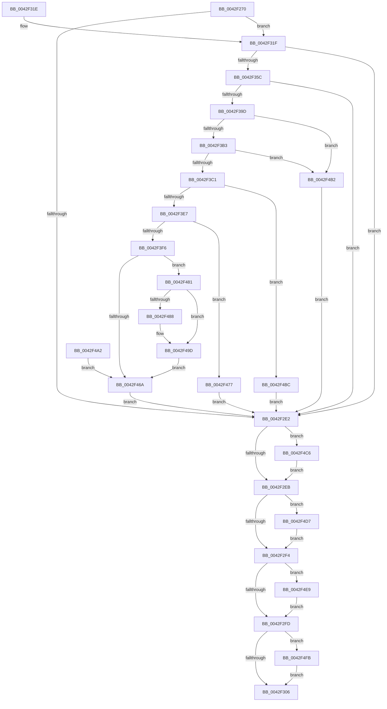

# NtAssociateWaitCompletionPacket

- RVA: `0x0042F270`–`0x0042F50D` (길이 `669` bytes)
- VA: `0x000000014042F270`
- 실행 섹션: `.text`
- PDB 이름 있음: `예`; PDB Function 태그: `아니요`
- unwind 정보 RVA: `0x000A1EA0`
- 디코드: `162`개 명령, `669/669` bytes 표시
- 미해석 바이트: `0` (있으면 어셈블리에 `.byte`로 보존)

> 이 문서는 커널 이미지의 기계어와 PDB 기호를 분석해 생성했습니다. 4번과 5번은 함수 원형과 자료형을 바이너리 사용 방식에서 추정한 C 해석이며 원본 소스 복구 결과는 아닙니다.

## 1. Dependencies

- 직접 호출 지점: **11**; 고유 호출 대상: **6**
- 직접 호출자로 확인된 함수: **0**
- RIP 상대 이미지 참조: **2**

### Outgoing calls
- `0x0042F2D2` → [ObReferenceObjectByHandle](../../page/86/ObReferenceObjectByHandle_function_00868DB0.md) (function, `0x00868DB0`)
- `0x0042F34C` → [ObReferenceObjectByHandle](../../page/86/ObReferenceObjectByHandle_function_00868DB0.md) (function, `0x00868DB0`)
- `0x0042F385` → [ObReferenceObjectByHandle](../../page/86/ObReferenceObjectByHandle_function_00868DB0.md) (function, `0x00868DB0`)
- `0x0042F3A0` → [ObGetAssociatedWaitObject](ObGetAssociatedWaitObject_function_0042F6E0.md) (function, `0x0042F6E0`)
- `0x0042F3D0` → [KeAcquireSpinLockRaiseToDpc](../20/KeAcquireSpinLockRaiseToDpc_function_00208470.md) (function, `0x00208470`)
- `0x0042F440` → [KeRegisterObjectNotification](../39/KeRegisterObjectNotification_function_00393454.md) (function, `0x00393454`)
- `0x0042F450` → [KeReleaseSpinLock](../39/KeReleaseSpinLock_function_00392BA0.md) (function, `0x00392BA0`)
- `0x0042F4CD` → [KeReleaseSpinLock](../39/KeReleaseSpinLock_function_00392BA0.md) (function, `0x00392BA0`)
- `0x0042F4DF` → [ObfDereferenceObjectWithTag](../2F/ObfDereferenceObjectWithTag_function_002F78E0.md) (function, `0x002F78E0`)
- `0x0042F4F1` → [ObfDereferenceObjectWithTag](../2F/ObfDereferenceObjectWithTag_function_002F78E0.md) (function, `0x002F78E0`)
- `0x0042F503` → [ObfDereferenceObjectWithTag](../2F/ObfDereferenceObjectWithTag_function_002F78E0.md) (function, `0x002F78E0`)

### Direct callers
- 이 함수 시작 RVA로 연결되는 직접 call은 확인되지 않았습니다. 간접 호출은 완전히 역산할 수 없습니다.

### Static image references
- `0x0042F2B3` → RVA `0x00FC7080` (`ALMOSTRO`; read)
- `0x0042F31F` → RVA `0x00FC6CC0` (`ALMOSTRO`; read)

## 2. Other-region calls and transfers

- 다른 실행 섹션으로 향하는 call: **3**
  - `0x0042F2D2` → [ObReferenceObjectByHandle](../../page/86/ObReferenceObjectByHandle_function_00868DB0.md) (`.text` → `PAGE`)
  - `0x0042F34C` → [ObReferenceObjectByHandle](../../page/86/ObReferenceObjectByHandle_function_00868DB0.md) (`.text` → `PAGE`)
  - `0x0042F385` → [ObReferenceObjectByHandle](../../page/86/ObReferenceObjectByHandle_function_00868DB0.md) (`.text` → `PAGE`)
- 별도 외부 분기/꼬리 이동을 확인하지 못했습니다.

## 3. Assembly (complete function range)

```asm
0042F270  4C 8B DC                        mov r11, rsp
0042F273  49 89 73 08                     mov qword ptr [r11 + 8], rsi
0042F277  4D 89 4B 20                     mov qword ptr [r11 + 0x20], r9
0042F27B  4D 89 43 18                     mov qword ptr [r11 + 0x18], r8
0042F27F  49 89 53 10                     mov qword ptr [r11 + 0x10], rdx
0042F283  57                              push rdi
0042F284  41 54                           push r12
0042F286  41 55                           push r13
0042F288  41 56                           push r14
0042F28A  41 57                           push r15
0042F28C  48 83 EC 60                     sub rsp, 0x60
0042F290  45 32 FF                        xor r15b, r15b
0042F293  45 32 ED                        xor r13b, r13b
0042F296  45 33 E4                        xor r12d, r12d
0042F299  45 33 F6                        xor r14d, r14d
0042F29C  65 48 8B 04 25 88 01 00 00      mov rax, qword ptr gs:[0x188]
0042F2A5  8A 80 32 02 00 00               mov al, byte ptr [rax + 0x232]
0042F2AB  88 44 24 30                     mov byte ptr [rsp + 0x30], al
0042F2AF  88 44 24 31                     mov byte ptr [rsp + 0x31], al
0042F2B3  4C 8B 05 C6 7D B9 00            mov r8, qword ptr [rip + 0xb97dc6]
0042F2BA  4D 21 63 B0                     and qword ptr [r11 - 0x50], r12
0042F2BE  4D 21 63 A0                     and qword ptr [r11 - 0x60], r12
0042F2C2  49 8D 53 B0                     lea rdx, [r11 - 0x50]
0042F2C6  49 89 53 98                     mov qword ptr [r11 - 0x68], rdx
0042F2CA  44 8A C8                        mov r9b, al
0042F2CD  41 8D 54 24 01                  lea edx, [r12 + 1]
0042F2D2  E8 D9 9A 43 00                  call 0x140868db0
0042F2D7  8B F8                           mov edi, eax
0042F2D9  48 8B 74 24 38                  mov rsi, qword ptr [rsp + 0x38]
0042F2DE  85 C0                           test eax, eax
0042F2E0  79 3D                           jns 0x14042f31f
0042F2E2  45 84 ED                        test r13b, r13b
0042F2E5  0F 85 DB 01 00 00               jne 0x14042f4c6
0042F2EB  4D 85 E4                        test r12, r12
0042F2EE  0F 85 E3 01 00 00               jne 0x14042f4d7
0042F2F4  4D 85 F6                        test r14, r14
0042F2F7  0F 85 EC 01 00 00               jne 0x14042f4e9
0042F2FD  48 85 F6                        test rsi, rsi
0042F300  0F 85 F5 01 00 00               jne 0x14042f4fb
0042F306  8B C7                           mov eax, edi
0042F308  48 8B B4 24 90 00 00 00         mov rsi, qword ptr [rsp + 0x90]
0042F310  48 83 C4 60                     add rsp, 0x60
0042F314  41 5F                           pop r15
0042F316  41 5E                           pop r14
0042F318  41 5D                           pop r13
0042F31A  41 5C                           pop r12
0042F31C  5F                              pop rdi
0042F31D  C3                              ret
0042F31E  CC                              int3
0042F31F  4C 8B 05 9A 79 B9 00            mov r8, qword ptr [rip + 0xb9799a]
0042F326  4C 21 64 24 48                  and qword ptr [rsp + 0x48], r12
0042F32B  4C 21 64 24 28                  and qword ptr [rsp + 0x28], r12
0042F330  48 8D 44 24 48                  lea rax, [rsp + 0x48]
0042F335  48 89 44 24 20                  mov qword ptr [rsp + 0x20], rax
0042F33A  44 8A 4C 24 30                  mov r9b, byte ptr [rsp + 0x30]
0042F33F  BA 02 00 00 00                  mov edx, 2
0042F344  48 8B 8C 24 98 00 00 00         mov rcx, qword ptr [rsp + 0x98]
0042F34C  E8 5F 9A 43 00                  call 0x140868db0
0042F351  8B F8                           mov edi, eax
0042F353  4C 8B 64 24 48                  mov r12, qword ptr [rsp + 0x48]
0042F358  85 C0                           test eax, eax
0042F35A  78 86                           js 0x14042f2e2
0042F35C  4C 21 74 24 40                  and qword ptr [rsp + 0x40], r14
0042F361  4C 21 74 24 28                  and qword ptr [rsp + 0x28], r14
0042F366  48 8D 44 24 40                  lea rax, [rsp + 0x40]
0042F36B  48 89 44 24 20                  mov qword ptr [rsp + 0x20], rax
0042F370  44 8A 4C 24 30                  mov r9b, byte ptr [rsp + 0x30]
0042F375  45 33 C0                        xor r8d, r8d
0042F378  BA 00 00 10 00                  mov edx, 0x100000
0042F37D  48 8B 8C 24 A0 00 00 00         mov rcx, qword ptr [rsp + 0xa0]
0042F385  E8 26 9A 43 00                  call 0x140868db0
0042F38A  8B F8                           mov edi, eax
0042F38C  4C 8B 74 24 40                  mov r14, qword ptr [rsp + 0x40]
0042F391  89 44 24 34                     mov dword ptr [rsp + 0x34], eax
0042F395  85 C0                           test eax, eax
0042F397  0F 88 45 FF FF FF               js 0x14042f2e2
0042F39D  49 8B CE                        mov rcx, r14
0042F3A0  E8 3B 03 00 00                  call 0x14042f6e0
0042F3A5  48 89 44 24 50                  mov qword ptr [rsp + 0x50], rax
0042F3AA  48 85 C0                        test rax, rax
0042F3AD  0F 84 FF 00 00 00               je 0x14042f4b2
0042F3B3  8A 00                           mov al, byte ptr [rax]
0042F3B5  24 7F                           and al, 0x7f
0042F3B7  2C 02                           sub al, 2
0042F3B9  A8 FD                           test al, 0xfd
0042F3BB  0F 84 F1 00 00 00               je 0x14042f4b2
0042F3C1  41 B5 01                        mov r13b, 1
0042F3C4  48 8D 46 60                     lea rax, [rsi + 0x60]
0042F3C8  48 89 44 24 58                  mov qword ptr [rsp + 0x58], rax
0042F3CD  48 8B C8                        mov rcx, rax
0042F3D0  E8 9B 90 DD FF                  call 0x140208470
0042F3D5  44 8A F8                        mov r15b, al
0042F3D8  88 44 24 33                     mov byte ptr [rsp + 0x33], al
0042F3DC  8A 4E 68                        mov cl, byte ptr [rsi + 0x68]
0042F3DF  84 C9                           test cl, cl
0042F3E1  0F 85 D5 00 00 00               jne 0x14042f4bc
0042F3E7  4C 8B 44 24 38                  mov r8, qword ptr [rsp + 0x38]
0042F3EC  41 38 48 69                     cmp byte ptr [r8 + 0x69], cl
0042F3F0  0F 85 81 00 00 00               jne 0x14042f477
0042F3F6  45 88 68 68                     mov byte ptr [r8 + 0x68], r13b
0042F3FA  48 8B 84 24 A8 00 00 00         mov rax, qword ptr [rsp + 0xa8]
0042F402  49 89 40 30                     mov qword ptr [r8 + 0x30], rax
0042F406  48 8B 84 24 B0 00 00 00         mov rax, qword ptr [rsp + 0xb0]
0042F40E  49 89 40 38                     mov qword ptr [r8 + 0x38], rax
0042F412  8B 84 24 B8 00 00 00            mov eax, dword ptr [rsp + 0xb8]
0042F419  41 89 40 48                     mov dword ptr [r8 + 0x48], eax
0042F41D  48 8B 84 24 C0 00 00 00         mov rax, qword ptr [rsp + 0xc0]
0042F425  49 89 40 40                     mov qword ptr [r8 + 0x40], rax
0042F429  48 8B 44 24 40                  mov rax, qword ptr [rsp + 0x40]
0042F42E  49 89 40 50                     mov qword ptr [r8 + 0x50], rax
0042F432  48 8B 54 24 48                  mov rdx, qword ptr [rsp + 0x48]
0042F437  49 89 50 58                     mov qword ptr [r8 + 0x58], rdx
0042F43B  48 8B 4C 24 50                  mov rcx, qword ptr [rsp + 0x50]
0042F440  E8 0F 40 F6 FF                  call 0x140393454
0042F445  40 8A F0                        mov sil, al
0042F448  41 8A D7                        mov dl, r15b
0042F44B  48 8B 4C 24 58                  mov rcx, qword ptr [rsp + 0x58]
0042F450  E8 4B 37 F6 FF                  call 0x140392ba0
0042F455  45 32 ED                        xor r13b, r13b
0042F458  44 88 6C 24 32                  mov byte ptr [rsp + 0x32], r13b
0042F45D  48 8B 94 24 C8 00 00 00         mov rdx, qword ptr [rsp + 0xc8]
0042F465  48 85 D2                        test rdx, rdx
0042F468  75 17                           jne 0x14042f481
0042F46A  45 33 E4                        xor r12d, r12d
0042F46D  45 33 F6                        xor r14d, r14d
0042F470  33 F6                           xor esi, esi
0042F472  E9 6B FE FF FF                  jmp 0x14042f2e2
0042F477  BF 03 A0 00 C0                  mov edi, 0xc000a003
0042F47C  E9 61 FE FF FF                  jmp 0x14042f2e2
0042F481  80 7C 24 30 00                  cmp byte ptr [rsp + 0x30], 0
0042F486  74 15                           je 0x14042f49d
0042F488  48 B9 00 00 FF FF FF 7F 00 00   movabs rcx, 0x7fffffff0000
0042F492  48 3B D1                        cmp rdx, rcx
0042F495  48 0F 42 CA                     cmovb rcx, rdx
0042F499  8A 01                           mov al, byte ptr [rcx]
0042F49B  88 01                           mov byte ptr [rcx], al
0042F49D  40 88 32                        mov byte ptr [rdx], sil
0042F4A0  EB C8                           jmp 0x14042f46a
0042F4A2  44 8A 6C 24 32                  mov r13b, byte ptr [rsp + 0x32]
0042F4A7  44 8A 7C 24 33                  mov r15b, byte ptr [rsp + 0x33]
0042F4AC  8B 7C 24 34                     mov edi, dword ptr [rsp + 0x34]
0042F4B0  EB B8                           jmp 0x14042f46a
0042F4B2  BF F1 00 00 C0                  mov edi, 0xc00000f1
0042F4B7  E9 26 FE FF FF                  jmp 0x14042f2e2
0042F4BC  BF EF 00 00 C0                  mov edi, 0xc00000ef
0042F4C1  E9 1C FE FF FF                  jmp 0x14042f2e2
0042F4C6  48 8D 4E 60                     lea rcx, [rsi + 0x60]
0042F4CA  41 8A D7                        mov dl, r15b
0042F4CD  E8 CE 36 F6 FF                  call 0x140392ba0
0042F4D2  E9 14 FE FF FF                  jmp 0x14042f2eb
0042F4D7  BA 44 66 6C 74                  mov edx, 0x746c6644
0042F4DC  49 8B CC                        mov rcx, r12
0042F4DF  E8 FC 83 EC FF                  call 0x1402f78e0
0042F4E4  E9 0B FE FF FF                  jmp 0x14042f2f4
0042F4E9  BA 44 66 6C 74                  mov edx, 0x746c6644
0042F4EE  49 8B CE                        mov rcx, r14
0042F4F1  E8 EA 83 EC FF                  call 0x1402f78e0
0042F4F6  E9 02 FE FF FF                  jmp 0x14042f2fd
0042F4FB  BA 44 66 6C 74                  mov edx, 0x746c6644
0042F500  48 8B CE                        mov rcx, rsi
0042F503  E8 D8 83 EC FF                  call 0x1402f78e0
0042F508  E9 F9 FD FF FF                  jmp 0x14042f306
```

## 4. C-style interpretation (structured pseudocode)

```c
__int64 __fastcall NtAssociateWaitCompletionPacket(__int64 a1, __int64 a2, __int64 a3, __int64 a4, __int64 a5, unsigned int a6, __int64 a7, __int64 a8)
{
    __int64 result;
    __int64 v_r12;
    __int64 v_r13;
    __int64 v_r14;
    __int64 v_r15;
    __int64 v_rsi;
    __int64 v_rsp;
    unsigned __int64 v_stack_m50;
    unsigned __int8 v_stack_m57;
    unsigned __int8 v_stack_m58;
    unsigned __int64 v_stack_p20;
    unsigned __int64 v_stack_p28;
    unsigned __int8 v_stack_p30;
    unsigned __int8 v_stack_p32;
    unsigned __int8 v_stack_p33;
    unsigned int v_stack_p34;
    unsigned __int64 v_stack_p38;
    unsigned __int64 v_stack_p40;
    unsigned __int64 v_stack_p48;
    unsigned __int64 v_stack_p50;
    unsigned __int64 v_stack_p58;
    unsigned __int64 v_stack_p8;
    unsigned __int64 v_stack_p98;
    unsigned __int64 v_stack_pA0;
    unsigned __int64 v_stack_pA8;

    *(unsigned __int64 *)(v_rsp + 8) = v_rsi;
    *(unsigned __int64 *)(v_rsp + 32) = a4;
    *(unsigned __int64 *)(v_rsp + 24) = a3;
    *(unsigned __int64 *)(v_rsp + 16) = a2;
    v_rsp = (v_rsp) - (96);
    v_r15 = 0;
    v_r13 = 0;
    v_r12 = 0;
    v_r14 = 0;
    v_stack_m58 = (unsigned __int8)(*(unsigned __int8 *)(*(unsigned __int64 *)(gs_base + (0 + 392)) + 562));
    v_stack_m57 = (unsigned __int8)(*(unsigned __int8 *)(*(unsigned __int64 *)(gs_base + (0 + 392)) + 562));
    *(unsigned __int64 *)(v_rsp - 104) = v_rsp - 80;
    result = ObReferenceObjectByHandle(a1, v_r12 + 1, *(unsigned __int64 *)(v_rip + 12156358), (unsigned __int8)(*(unsigned __int8 *)(*(unsigned __int64 *)(gs_base + (0 + 392)) + 562)));
    if (!sign_flag) goto loc_0042F31F;
loc_0042F2E2:
    if (0 != 0) goto loc_0042F4C6;
loc_0042F2EB:
    if (0 != 0) goto loc_0042F4D7;
loc_0042F2F4:
    if (0 != 0) goto loc_0042F4E9;
loc_0042F2FD:
    if (v_stack_m50 != 0) goto loc_0042F4FB;
loc_0042F306:
    v_rsp = (v_rsp) + (96);
    return (unsigned int)((unsigned int)((unsigned int)((unsigned int)(result))));
loc_0042F31F:
    v_stack_p20 = v_stack_p48;
    result = ObReferenceObjectByHandle(v_stack_p98, 2, *(unsigned __int64 *)(v_rip + 12155290), v_stack_p30);
    if (sign_flag) goto loc_0042F2E2;
    v_stack_p20 = v_stack_p40;
    a3 = 0;
    result = ObReferenceObjectByHandle(v_stack_pA0, (unsigned int)(0x100000ULL), a3, v_stack_p30);
    v_stack_p34 = (unsigned int)(result);
    if (sign_flag) goto loc_0042F2E2;
    result = ObGetAssociatedWaitObject(v_stack_p40, (unsigned int)(0x100000ULL), a3, v_stack_p30);
    v_stack_p50 = result;
    if (result == 0) goto loc_0042F4B2;
    result = (unsigned __int8)((*(unsigned __int8 *)(result)) & (127));
    result = (unsigned __int8)((result) - (2));
    if ((((unsigned __int8)(result)) & (253)) == 0) goto loc_0042F4B2;
    v_stack_p58 = v_stack_p8 + 96;
    result = KeAcquireSpinLockRaiseToDpc(v_stack_p8 + 96, (unsigned int)(0x100000ULL), a3, v_stack_p30);
    v_stack_p33 = (unsigned __int8)(result);
    if ((unsigned __int8)(*(unsigned __int8 *)(v_stack_p8 + 104)) != 0) goto loc_0042F4BC;
    if ((*(unsigned __int8 *)(v_stack_p38 + 105)) != ((unsigned __int8)(*(unsigned __int8 *)(v_stack_p8 + 104)))) goto loc_0042F477;
    *(unsigned __int8 *)(v_stack_p38 + 104) = 1;
    *(unsigned __int64 *)(v_stack_p38 + 48) = v_stack_pA8;
    *(unsigned __int64 *)(v_stack_p38 + 56) = a5;
    *(unsigned int *)(v_stack_p38 + 72) = (unsigned int)((unsigned int)(a6));
    *(unsigned __int64 *)(v_stack_p38 + 64) = a7;
    *(unsigned __int64 *)(v_stack_p38 + 80) = v_stack_p40;
    *(unsigned __int64 *)(v_stack_p38 + 88) = v_stack_p48;
    result = KeRegisterObjectNotification(v_stack_p50, v_stack_p48, v_stack_p38, v_stack_p30);
    result = KeReleaseSpinLock(v_stack_p58, (unsigned __int8)((unsigned __int8)(result)), v_stack_p38, v_stack_p30);
    v_r13 = 0;
    v_stack_p32 = 0;
    if (a8 != 0) goto loc_0042F481;
loc_0042F46A:
    v_r12 = 0;
    v_r14 = 0;
    v_rsi = 0;
    goto loc_0042F2E2;
loc_0042F477:
    goto loc_0042F2E2;
loc_0042F481:
    if (v_stack_p30 != 0) {
        a1 = v_stack_p58;
        if (a8 < v_stack_p58) { a1 = a8; }
        result = *(unsigned __int8 *)(a1);
        *(unsigned __int8 *)(a1) = (unsigned __int8)(result);
    }
    *(unsigned __int8 *)(a8) = 0;
    goto loc_0042F46A;
loc_0042F4B2:
    goto loc_0042F2E2;
loc_0042F4BC:
    goto loc_0042F2E2;
loc_0042F4C6:
    result = KeReleaseSpinLock(v_rsi + 96, (unsigned __int8)((unsigned __int8)(result)), v_stack_p38, v_stack_p30);
    goto loc_0042F2EB;
loc_0042F4D7:
    result = ObfDereferenceObjectWithTag(0, (unsigned int)(0x746C6644ULL), v_stack_p38, v_stack_p30);
    goto loc_0042F2F4;
loc_0042F4E9:
    result = ObfDereferenceObjectWithTag(0, (unsigned int)(0x746C6644ULL), v_stack_p38, v_stack_p30);
    goto loc_0042F2FD;
loc_0042F4FB:
    result = ObfDereferenceObjectWithTag(0, (unsigned int)(0x746C6644ULL), v_stack_p38, v_stack_p30);
    goto loc_0042F306;
}
```

## 5. (Beta) C Style

```c
int64_t NtAssociateWaitCompletionPacket(int64_t Arg1, int64_t Arg2, int64_t Arg3, int64_t Arg4, int64_t Arg5, uint32_t Arg6, int64_t Arg7, int64_t Arg8)
{
    int64_t result;
    int64_t local_r12;
    int64_t local_r13;
    int64_t local_r14;
    int64_t local_r15;
    int64_t local_rsi;
    int64_t local_rsp;
    uint64_t v_stack_m50;
    uint8_t v_stack_m57;
    uint8_t v_stack_m58;
    uint64_t v_stack_p20;
    uint64_t v_stack_p28;
    uint8_t v_stack_p30;
    uint8_t v_stack_p32;
    uint8_t v_stack_p33;
    uint32_t v_stack_p34;
    uint64_t v_stack_p38;
    uint64_t v_stack_p40;
    uint64_t v_stack_p48;
    uint64_t v_stack_p50;
    uint64_t v_stack_p58;
    uint64_t v_stack_p8;
    uint64_t v_stack_p98;
    uint64_t v_stack_pA0;
    uint64_t v_stack_pA8;

    *(uint64_t *)(local_rsp + 0x8) = local_rsi;
    *(uint64_t *)(local_rsp + 0x20) = Arg4;
    *(uint64_t *)(local_rsp + 0x18) = Arg3;
    *(uint64_t *)(local_rsp + 0x10) = Arg2;
    local_rsp = (local_rsp) - (96);
    local_r15 = 0;
    local_r13 = 0;
    local_r12 = 0;
    local_r14 = 0;
    v_stack_m58 = (uint8_t)(*(uint8_t *)(*(uint64_t *)(gs_base + (0 + 0x188)) + 0x232));
    v_stack_m57 = (uint8_t)(*(uint8_t *)(*(uint64_t *)(gs_base + (0 + 0x188)) + 0x232));
    *(uint64_t *)(local_rsp - 0x68) = local_rsp - 80;
    result = ObReferenceObjectByHandle(Arg1, local_r12 + 1, *(uint64_t *)(v_rip + 0xB97DC6), (uint8_t)(*(uint8_t *)(*(uint64_t *)(gs_base + (0 + 0x188)) + 0x232)));
    if (!sign_flag) goto loc_0042F31F;
loc_0042F2E2:
    if (0 != 0) goto loc_0042F4C6;
loc_0042F2EB:
    if (0 != 0) goto loc_0042F4D7;
loc_0042F2F4:
    if (0 != 0) goto loc_0042F4E9;
loc_0042F2FD:
    if (v_stack_m50 != 0) goto loc_0042F4FB;
loc_0042F306:
    local_rsp = (local_rsp) + (96);
    return (uint32_t)((uint32_t)((uint32_t)((uint32_t)(result))));
loc_0042F31F:
    v_stack_p20 = v_stack_p48;
    result = ObReferenceObjectByHandle(v_stack_p98, 2, *(uint64_t *)(v_rip + 0xB9799A), v_stack_p30);
    if (sign_flag) goto loc_0042F2E2;
    v_stack_p20 = v_stack_p40;
    Arg3 = 0;
    result = ObReferenceObjectByHandle(v_stack_pA0, (uint32_t)(0x100000ULL), Arg3, v_stack_p30);
    v_stack_p34 = (uint32_t)(result);
    if (sign_flag) goto loc_0042F2E2;
    result = ObGetAssociatedWaitObject(v_stack_p40, (uint32_t)(0x100000ULL), Arg3, v_stack_p30);
    v_stack_p50 = result;
    if (result == 0) goto loc_0042F4B2;
    result = (uint8_t)((*(uint8_t *)(result)) & (127));
    result = (uint8_t)((result) - (2));
    if ((((uint8_t)(result)) & (253)) == 0) goto loc_0042F4B2;
    v_stack_p58 = v_stack_p8 + 96;
    result = KeAcquireSpinLockRaiseToDpc(v_stack_p8 + 96, (uint32_t)(0x100000ULL), Arg3, v_stack_p30);
    v_stack_p33 = (uint8_t)(result);
    if ((uint8_t)(*(uint8_t *)(v_stack_p8 + 0x68)) != 0) goto loc_0042F4BC;
    if ((*(uint8_t *)(v_stack_p38 + 0x69)) != ((uint8_t)(*(uint8_t *)(v_stack_p8 + 0x68)))) goto loc_0042F477;
    *(uint8_t *)(v_stack_p38 + 0x68) = 1;
    *(uint64_t *)(v_stack_p38 + 0x30) = v_stack_pA8;
    *(uint64_t *)(v_stack_p38 + 0x38) = Arg5;
    *(uint32_t *)(v_stack_p38 + 0x48) = (uint32_t)((uint32_t)(Arg6));
    *(uint64_t *)(v_stack_p38 + 0x40) = Arg7;
    *(uint64_t *)(v_stack_p38 + 0x50) = v_stack_p40;
    *(uint64_t *)(v_stack_p38 + 0x58) = v_stack_p48;
    result = KeRegisterObjectNotification(v_stack_p50, v_stack_p48, v_stack_p38, v_stack_p30);
    result = KeReleaseSpinLock(v_stack_p58, (uint8_t)((uint8_t)(result)), v_stack_p38, v_stack_p30);
    local_r13 = 0;
    v_stack_p32 = 0;
    if (Arg8 != 0) goto loc_0042F481;
loc_0042F46A:
    local_r12 = 0;
    local_r14 = 0;
    local_rsi = 0;
    goto loc_0042F2E2;
loc_0042F477:
    goto loc_0042F2E2;
loc_0042F481:
    if (v_stack_p30 != 0) {
        Arg1 = v_stack_p58;
        if (Arg8 < v_stack_p58) { Arg1 = Arg8; }
        result = *(uint8_t *)(Arg1);
        *(uint8_t *)(Arg1) = (uint8_t)(result);
    }
    *(uint8_t *)(Arg8) = 0;
    goto loc_0042F46A;
loc_0042F4B2:
    goto loc_0042F2E2;
loc_0042F4BC:
    goto loc_0042F2E2;
loc_0042F4C6:
    result = KeReleaseSpinLock(local_rsi + 96, (uint8_t)((uint8_t)(result)), v_stack_p38, v_stack_p30);
    goto loc_0042F2EB;
loc_0042F4D7:
    result = ObfDereferenceObjectWithTag(0, (uint32_t)(0x746C6644ULL), v_stack_p38, v_stack_p30);
    goto loc_0042F2F4;
loc_0042F4E9:
    result = ObfDereferenceObjectWithTag(0, (uint32_t)(0x746C6644ULL), v_stack_p38, v_stack_p30);
    goto loc_0042F2FD;
loc_0042F4FB:
    result = ObfDereferenceObjectWithTag(0, (uint32_t)(0x746C6644ULL), v_stack_p38, v_stack_p30);
    goto loc_0042F306;
}
```

## 6. Execution-region graph

[열기: 2D/3D 그래프와 함수 탐색 컨트롤 패널](../../../control-panel.html?section=text&rva=0x0042F270&view=graph)

- 2D 그래프는 위에서 아래로 흐르고, 3D 그래프는 빈 공간을 드래그해 회전합니다. Shift+드래그는 이동, 휠은 확대·축소, 함수 노드 선택은 대상 보고서 이동입니다.

### Static fallback


