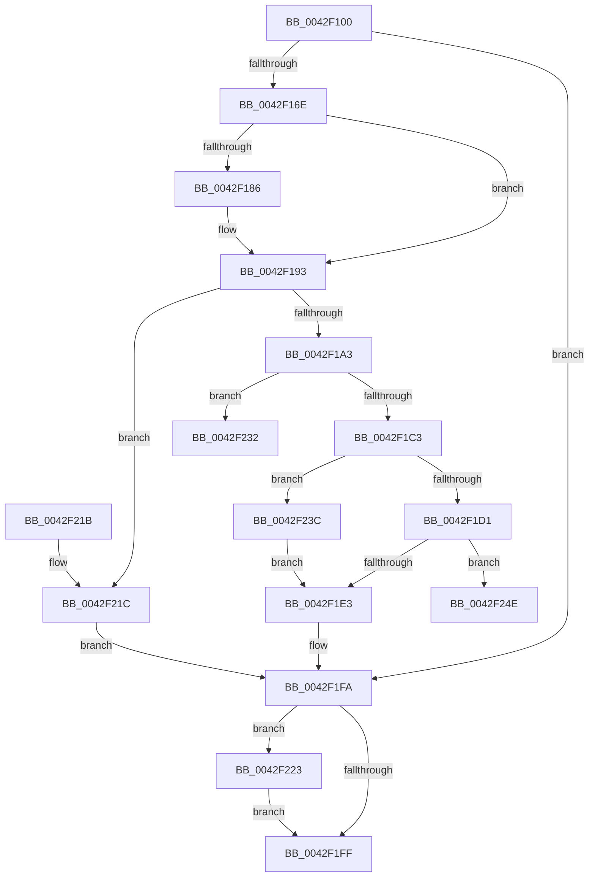

# NtCancelWaitCompletionPacket

- RVA: `0x0042F100`–`0x0042F260` (길이 `352` bytes)
- VA: `0x000000014042F100`
- 실행 섹션: `.text`
- PDB 이름 있음: `예`; PDB Function 태그: `예`
- unwind 정보 RVA: `0x000A1E74`
- 디코드: `95`개 명령, `352/352` bytes 표시
- 미해석 바이트: `0` (있으면 어셈블리에 `.byte`로 보존)

> 이 문서는 커널 이미지의 기계어와 PDB 기호를 분석해 생성했습니다. 4번과 5번은 함수 원형과 자료형을 바이너리 사용 방식에서 추정한 C 해석이며 원본 소스 복구 결과는 아닙니다.

## 1. Dependencies

- 직접 호출 지점: **11**; 고유 호출 대상: **8**
- 직접 호출자로 확인된 함수: **0**
- RIP 상대 이미지 참조: **1**

### Outgoing calls
- `0x0042F157` → [ObReferenceObjectByHandle](../../page/86/ObReferenceObjectByHandle_function_00868DB0.md) (function, `0x00868DB0`)
- `0x0042F175` → [KeAcquireSpinLockRaiseToDpc](../20/KeAcquireSpinLockRaiseToDpc_function_00208470.md) (function, `0x00208470`)
- `0x0042F18E` → [ObfReferenceObjectWithTag](../21/ObfReferenceObjectWithTag_function_00210710.md) (function, `0x00210710`)
- `0x0042F199` → [KeReleaseSpinLock](../39/KeReleaseSpinLock_function_00392BA0.md) (function, `0x00392BA0`)
- `0x0042F1AC` → [KeAcquireInStackQueuedSpinLock](../27/KeAcquireInStackQueuedSpinLock_function_002757A0.md) (function, `0x002757A0`)
- `0x0042F1B4` → [KeAcquireSpinLockRaiseToDpc](../20/KeAcquireSpinLockRaiseToDpc_function_00208470.md) (function, `0x00208470`)
- `0x0042F1DA` → [IopCancelWaitCompletionPacket](IopCancelWaitCompletionPacket_function_0042F614.md) (function, `0x0042F614`)
- `0x0042F1E8` → [KeReleaseInStackQueuedSpinLock](../34/KeReleaseInStackQueuedSpinLock_function_00342CE0.md) (function, `0x00342CE0`)
- `0x0042F1F5` → [ObfDereferenceObjectWithTag](../2F/ObfDereferenceObjectWithTag_function_002F78E0.md) (function, `0x002F78E0`)
- `0x0042F22B` → [ObfDereferenceObjectWithTag](../2F/ObfDereferenceObjectWithTag_function_002F78E0.md) (function, `0x002F78E0`)
- `0x0042F247` → [KeReleaseSpinLock](../39/KeReleaseSpinLock_function_00392BA0.md) (function, `0x00392BA0`)

### Direct callers
- 이 함수 시작 RVA로 연결되는 직접 call은 확인되지 않았습니다. 간접 호출은 완전히 역산할 수 없습니다.

### Static image references
- `0x0042F13C` → RVA `0x00FC7080` (`ALMOSTRO`; read)

## 2. Other-region calls and transfers

- 다른 실행 섹션으로 향하는 call: **1**
  - `0x0042F157` → [ObReferenceObjectByHandle](../../page/86/ObReferenceObjectByHandle_function_00868DB0.md) (`.text` → `PAGE`)
- call이 아닌 외부 분기/꼬리 이동: **2**
  - `0x0042F237` → [sub_006EE810](../6E/Unknown_function_006EE810.md) (`tail-transfer`)
  - `0x0042F25B` → [sub_006EE810](../6E/Unknown_function_006EE810.md) (`tail-transfer`)

## 3. Assembly (complete function range)

```asm
0042F100  4C 8B DC                        mov r11, rsp
0042F103  49 89 5B 08                     mov qword ptr [r11 + 8], rbx
0042F107  49 89 6B 10                     mov qword ptr [r11 + 0x10], rbp
0042F10B  49 89 73 20                     mov qword ptr [r11 + 0x20], rsi
0042F10F  57                              push rdi
0042F110  41 56                           push r14
0042F112  41 57                           push r15
0042F114  48 83 EC 50                     sub rsp, 0x50
0042F118  49 83 63 C0 00                  and qword ptr [r11 - 0x40], 0
0042F11D  33 C0                           xor eax, eax
0042F11F  0F 57 C0                        xorps xmm0, xmm0
0042F122  44 8A FA                        mov r15b, dl
0042F125  0F 11 44 24 30                  movups xmmword ptr [rsp + 0x30], xmm0
0042F12A  49 89 43 D8                     mov qword ptr [r11 - 0x28], rax
0042F12E  BA 01 00 00 00                  mov edx, 1
0042F133  65 48 8B 04 25 88 01 00 00      mov rax, qword ptr gs:[0x188]
0042F13C  4C 8B 05 3D 7F B9 00            mov r8, qword ptr [rip + 0xb97f3d]
0042F143  49 83 63 18 00                  and qword ptr [r11 + 0x18], 0
0042F148  44 8A 88 32 02 00 00            mov r9b, byte ptr [rax + 0x232]
0042F14F  49 8D 43 18                     lea rax, [r11 + 0x18]
0042F153  49 89 43 B8                     mov qword ptr [r11 - 0x48], rax
0042F157  E8 54 9C 43 00                  call 0x140868db0
0042F15C  48 8B 9C 24 80 00 00 00         mov rbx, qword ptr [rsp + 0x80]
0042F164  8B F8                           mov edi, eax
0042F166  85 C0                           test eax, eax
0042F168  0F 88 8C 00 00 00               js 0x14042f1fa
0042F16E  48 8D 6B 60                     lea rbp, [rbx + 0x60]
0042F172  48 8B CD                        mov rcx, rbp
0042F175  E8 F6 92 DD FF                  call 0x140208470
0042F17A  48 8B 73 58                     mov rsi, qword ptr [rbx + 0x58]
0042F17E  44 8A F0                        mov r14b, al
0042F181  48 85 F6                        test rsi, rsi
0042F184  74 0D                           je 0x14042f193
0042F186  BA 44 66 6C 74                  mov edx, 0x746c6644
0042F18B  48 8B CE                        mov rcx, rsi
0042F18E  E8 7D 15 DE FF                  call 0x140210710
0042F193  41 8A D6                        mov dl, r14b
0042F196  48 8B CD                        mov rcx, rbp
0042F199  E8 02 3A F6 FF                  call 0x140392ba0
0042F19E  48 85 F6                        test rsi, rsi
0042F1A1  74 79                           je 0x14042f21c
0042F1A3  48 8D 4E 40                     lea rcx, [rsi + 0x40]
0042F1A7  48 8D 54 24 30                  lea rdx, [rsp + 0x30]
0042F1AC  E8 EF 65 E4 FF                  call 0x1402757a0
0042F1B1  48 8B CD                        mov rcx, rbp
0042F1B4  E8 B7 92 DD FF                  call 0x140208470
0042F1B9  44 8A F0                        mov r14b, al
0042F1BC  8A 43 68                        mov al, byte ptr [rbx + 0x68]
0042F1BF  84 C0                           test al, al
0042F1C1  74 6F                           je 0x14042f232
0042F1C3  48 8B 9C 24 80 00 00 00         mov rbx, qword ptr [rsp + 0x80]
0042F1CB  48 39 73 58                     cmp qword ptr [rbx + 0x58], rsi
0042F1CF  75 6B                           jne 0x14042f23c
0042F1D1  45 8A C6                        mov r8b, r14b
0042F1D4  41 8A D7                        mov dl, r15b
0042F1D7  48 8B CB                        mov rcx, rbx
0042F1DA  E8 35 04 00 00                  call 0x14042f614
0042F1DF  84 C0                           test al, al
0042F1E1  74 6B                           je 0x14042f24e
0042F1E3  48 8D 4C 24 30                  lea rcx, [rsp + 0x30]
0042F1E8  E8 F3 3A F1 FF                  call 0x140342ce0
0042F1ED  BA 44 66 6C 74                  mov edx, 0x746c6644
0042F1F2  48 8B CE                        mov rcx, rsi
0042F1F5  E8 E6 86 EC FF                  call 0x1402f78e0
0042F1FA  48 85 DB                        test rbx, rbx
0042F1FD  75 24                           jne 0x14042f223
0042F1FF  4C 8D 5C 24 50                  lea r11, [rsp + 0x50]
0042F204  8B C7                           mov eax, edi
0042F206  49 8B 5B 20                     mov rbx, qword ptr [r11 + 0x20]
0042F20A  49 8B 6B 28                     mov rbp, qword ptr [r11 + 0x28]
0042F20E  49 8B 73 38                     mov rsi, qword ptr [r11 + 0x38]
0042F212  49 8B E3                        mov rsp, r11
0042F215  41 5F                           pop r15
0042F217  41 5E                           pop r14
0042F219  5F                              pop rdi
0042F21A  C3                              ret
0042F21B  CC                              int3
0042F21C  BF 20 01 00 C0                  mov edi, 0xc0000120
0042F221  EB D7                           jmp 0x14042f1fa
0042F223  BA 44 66 6C 74                  mov edx, 0x746c6644
0042F228  48 8B CB                        mov rcx, rbx
0042F22B  E8 B0 86 EC FF                  call 0x1402f78e0
0042F230  EB CD                           jmp 0x14042f1ff
0042F232  BF 20 01 00 C0                  mov edi, 0xc0000120
0042F237  E9 D4 F5 2B 00                  jmp 0x1406ee810
0042F23C  41 8A D6                        mov dl, r14b
0042F23F  48 8B CD                        mov rcx, rbp
0042F242  BF 03 A0 00 C0                  mov edi, 0xc000a003
0042F247  E8 54 39 F6 FF                  call 0x140392ba0
0042F24C  EB 95                           jmp 0x14042f1e3
0042F24E  8A 43 68                        mov al, byte ptr [rbx + 0x68]
0042F251  B9 03 01 00 00                  mov ecx, 0x103
0042F256  84 C0                           test al, al
0042F258  0F 45 F9                        cmovne edi, ecx
0042F25B  E9 B0 F5 2B 00                  jmp 0x1406ee810
```

## 4. C-style interpretation (structured pseudocode)

```c
__int64 __fastcall NtCancelWaitCompletionPacket(__int64 a1, unsigned __int8 a2)
{
    __int64 result;
    __int64 v_rdi;
    __int64 v_rsp;
    unsigned __int64 v_stack_m18;
    unsigned __int64 v_stack_m38;
    unsigned __int64 v_stack_p18;

    *(unsigned __int64 *)(v_rsp + 8) = v_rbx;
    *(unsigned __int64 *)(v_rsp + 16) = v_rbp;
    *(unsigned __int64 *)(v_rsp + 32) = v_rsi;
    v_rsp = (v_rsp) - (80);
    result = 0;
    v_stack_m38 = v_xmm0;
    *(unsigned __int64 *)(v_rsp - 40) = 0;
    *(unsigned __int64 *)(v_rsp - 72) = v_rsp + 24;
    result = ObReferenceObjectByHandle(a1, 1, *(unsigned __int64 *)(v_rip + 12156733), *(unsigned __int8 *)(*(unsigned __int64 *)(gs_base + (0 + 392)) + 562));
    if (sign_flag) goto loc_0042F1FA;
    result = KeAcquireSpinLockRaiseToDpc(v_stack_p18 + 96, 1, *(unsigned __int64 *)(v_rip + 12156733), *(unsigned __int8 *)(*(unsigned __int64 *)(gs_base + (0 + 392)) + 562));
    if (*(unsigned __int64 *)(v_stack_p18 + 88) != 0) {
        a2 = 0x746C6644ULL;
        a1 = *(unsigned __int64 *)(v_stack_p18 + 88);
        result = ObfReferenceObjectWithTag(a1, a2, *(unsigned __int64 *)(v_rip + 12156733), *(unsigned __int8 *)(*(unsigned __int64 *)(gs_base + (0 + 392)) + 562));
    }
    result = KeReleaseSpinLock(v_stack_p18 + 96, (unsigned __int8)((unsigned __int8)(result)), *(unsigned __int64 *)(v_rip + 12156733), *(unsigned __int8 *)(*(unsigned __int64 *)(gs_base + (0 + 392)) + 562));
    if (*(unsigned __int64 *)(v_stack_p18 + 88) == 0) goto loc_0042F21C;
    result = KeAcquireInStackQueuedSpinLock(*(unsigned __int64 *)(v_stack_p18 + 88) + 64, v_stack_m38, *(unsigned __int64 *)(v_rip + 12156733), *(unsigned __int8 *)(*(unsigned __int64 *)(gs_base + (0 + 392)) + 562));
    result = KeAcquireSpinLockRaiseToDpc(v_stack_p18 + 96, v_stack_m38, *(unsigned __int64 *)(v_rip + 12156733), *(unsigned __int8 *)(*(unsigned __int64 *)(gs_base + (0 + 392)) + 562));
    if ((unsigned __int8)(*(unsigned __int8 *)(v_stack_p18 + 104)) == 0) goto loc_0042F232;
    if ((*(unsigned __int64 *)(v_stack_p18 + 88)) != (*(unsigned __int64 *)(v_stack_p18 + 88))) goto loc_0042F23C;
    result = IopCancelWaitCompletionPacket(v_stack_p18, a2, (unsigned __int8)((unsigned __int8)(result)), *(unsigned __int8 *)(*(unsigned __int64 *)(gs_base + (0 + 392)) + 562));
    if ((unsigned __int8)(result) == 0) goto loc_0042F24E;
loc_0042F1E3:
    result = KeReleaseInStackQueuedSpinLock(v_stack_m38, a2, (unsigned __int8)((unsigned __int8)(result)), *(unsigned __int8 *)(*(unsigned __int64 *)(gs_base + (0 + 392)) + 562));
    result = ObfDereferenceObjectWithTag(*(unsigned __int64 *)(v_stack_p18 + 88), (unsigned int)(0x746C6644ULL), (unsigned __int8)((unsigned __int8)(result)), *(unsigned __int8 *)(*(unsigned __int64 *)(gs_base + (0 + 392)) + 562));
loc_0042F1FA:
    if (v_stack_p18 != 0) goto loc_0042F223;
loc_0042F1FF:
    return (unsigned int)((unsigned int)((unsigned int)((unsigned int)(result))));
loc_0042F21C:
    goto loc_0042F1FA;
loc_0042F223:
    result = ObfDereferenceObjectWithTag(*(unsigned __int64 *)(v_stack_m18 + 32), (unsigned int)(0x746C6644ULL), (unsigned __int8)((unsigned __int8)(result)), *(unsigned __int8 *)(*(unsigned __int64 *)(gs_base + (0 + 392)) + 562));
    goto loc_0042F1FF;
loc_0042F232:
loc_0042F23C:
    result = KeReleaseSpinLock(*(unsigned __int64 *)(v_stack_m18 + 40), (unsigned __int8)((unsigned __int8)(result)), (unsigned __int8)((unsigned __int8)(result)), *(unsigned __int8 *)(*(unsigned __int64 *)(gs_base + (0 + 392)) + 562));
    goto loc_0042F1E3;
loc_0042F24E:
    v_rdi = (unsigned int)(0xC000A003ULL);
    if ((unsigned __int8)(*(unsigned __int8 *)(*(unsigned __int64 *)(v_stack_m18 + 32) + 104)) != 0) { v_rdi = 259; }
}
```

## 5. (Beta) C Style

```c
int64_t NtCancelWaitCompletionPacket(int64_t Arg1, uint8_t Arg2)
{
    int64_t result;
    int64_t local_rdi;
    int64_t local_rsp;
    uint64_t v_stack_m18;
    uint64_t v_stack_m38;
    uint64_t v_stack_p18;

    *(uint64_t *)(local_rsp + 0x8) = local_rbx;
    *(uint64_t *)(local_rsp + 0x10) = local_rbp;
    *(uint64_t *)(local_rsp + 0x20) = local_rsi;
    local_rsp = (local_rsp) - (80);
    result = 0;
    v_stack_m38 = v_xmm0;
    *(uint64_t *)(local_rsp - 0x28) = 0;
    *(uint64_t *)(local_rsp - 0x48) = local_rsp + 24;
    result = ObReferenceObjectByHandle(Arg1, 1, *(uint64_t *)(v_rip + 0xB97F3D), *(uint8_t *)(*(uint64_t *)(gs_base + (0 + 0x188)) + 0x232));
    if (sign_flag) goto loc_0042F1FA;
    result = KeAcquireSpinLockRaiseToDpc(v_stack_p18 + 96, 1, *(uint64_t *)(v_rip + 0xB97F3D), *(uint8_t *)(*(uint64_t *)(gs_base + (0 + 0x188)) + 0x232));
    if (*(uint64_t *)(v_stack_p18 + 0x58) != 0) {
        Arg2 = 0x746C6644ULL;
        Arg1 = *(uint64_t *)(v_stack_p18 + 0x58);
        result = ObfReferenceObjectWithTag(Arg1, Arg2, *(uint64_t *)(v_rip + 0xB97F3D), *(uint8_t *)(*(uint64_t *)(gs_base + (0 + 0x188)) + 0x232));
    }
    result = KeReleaseSpinLock(v_stack_p18 + 96, (uint8_t)((uint8_t)(result)), *(uint64_t *)(v_rip + 0xB97F3D), *(uint8_t *)(*(uint64_t *)(gs_base + (0 + 0x188)) + 0x232));
    if (*(uint64_t *)(v_stack_p18 + 0x58) == 0) goto loc_0042F21C;
    result = KeAcquireInStackQueuedSpinLock(*(uint64_t *)(v_stack_p18 + 0x58) + 64, v_stack_m38, *(uint64_t *)(v_rip + 0xB97F3D), *(uint8_t *)(*(uint64_t *)(gs_base + (0 + 0x188)) + 0x232));
    result = KeAcquireSpinLockRaiseToDpc(v_stack_p18 + 96, v_stack_m38, *(uint64_t *)(v_rip + 0xB97F3D), *(uint8_t *)(*(uint64_t *)(gs_base + (0 + 0x188)) + 0x232));
    if ((uint8_t)(*(uint8_t *)(v_stack_p18 + 0x68)) == 0) goto loc_0042F232;
    if ((*(uint64_t *)(v_stack_p18 + 0x58)) != (*(uint64_t *)(v_stack_p18 + 0x58))) goto loc_0042F23C;
    result = IopCancelWaitCompletionPacket(v_stack_p18, Arg2, (uint8_t)((uint8_t)(result)), *(uint8_t *)(*(uint64_t *)(gs_base + (0 + 0x188)) + 0x232));
    if ((uint8_t)(result) == 0) goto loc_0042F24E;
loc_0042F1E3:
    result = KeReleaseInStackQueuedSpinLock(v_stack_m38, Arg2, (uint8_t)((uint8_t)(result)), *(uint8_t *)(*(uint64_t *)(gs_base + (0 + 0x188)) + 0x232));
    result = ObfDereferenceObjectWithTag(*(uint64_t *)(v_stack_p18 + 0x58), (uint32_t)(0x746C6644ULL), (uint8_t)((uint8_t)(result)), *(uint8_t *)(*(uint64_t *)(gs_base + (0 + 0x188)) + 0x232));
loc_0042F1FA:
    if (v_stack_p18 != 0) goto loc_0042F223;
loc_0042F1FF:
    return (uint32_t)((uint32_t)((uint32_t)((uint32_t)(result))));
loc_0042F21C:
    goto loc_0042F1FA;
loc_0042F223:
    result = ObfDereferenceObjectWithTag(*(uint64_t *)(v_stack_m18 + 0x20), (uint32_t)(0x746C6644ULL), (uint8_t)((uint8_t)(result)), *(uint8_t *)(*(uint64_t *)(gs_base + (0 + 0x188)) + 0x232));
    goto loc_0042F1FF;
loc_0042F232:
loc_0042F23C:
    result = KeReleaseSpinLock(*(uint64_t *)(v_stack_m18 + 0x28), (uint8_t)((uint8_t)(result)), (uint8_t)((uint8_t)(result)), *(uint8_t *)(*(uint64_t *)(gs_base + (0 + 0x188)) + 0x232));
    goto loc_0042F1E3;
loc_0042F24E:
    local_rdi = (uint32_t)(0xC000A003ULL);
    if ((uint8_t)(*(uint8_t *)(*(uint64_t *)(v_stack_m18 + 0x20) + 0x68)) != 0) { local_rdi = 259; }
}
```

## 6. Execution-region graph

[열기: 2D/3D 그래프와 함수 탐색 컨트롤 패널](../../../control-panel.html?section=text&rva=0x0042F100&view=graph)

- 2D 그래프는 위에서 아래로 흐르고, 3D 그래프는 빈 공간을 드래그해 회전합니다. Shift+드래그는 이동, 휠은 확대·축소, 함수 노드 선택은 대상 보고서 이동입니다.

### Static fallback


