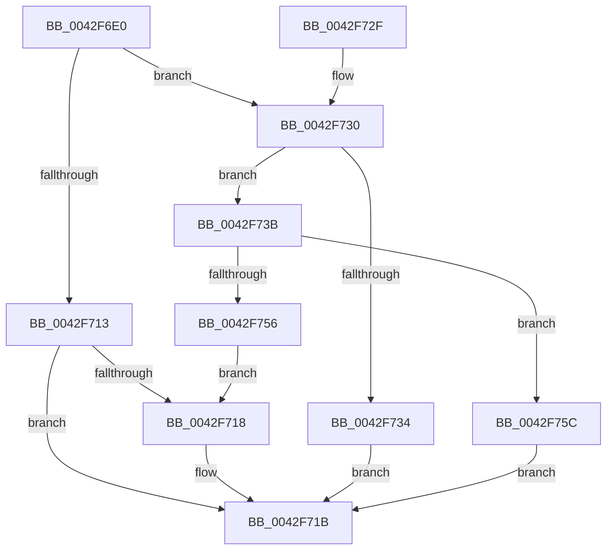

# ObGetAssociatedWaitObject

- RVA: `0x0042F6E0`–`0x0042F76A` (길이 `138` bytes)
- VA: `0x000000014042F6E0`
- 실행 섹션: `.text`
- PDB 이름 있음: `예`; PDB Function 태그: `아니요`
- unwind 정보 RVA: `0x000DB714`
- 디코드: `38`개 명령, `138/138` bytes 표시
- 미해석 바이트: `0` (있으면 어셈블리에 `.byte`로 보존)

> 이 문서는 커널 이미지의 기계어와 PDB 기호를 분석해 생성했습니다. 4번과 5번은 함수 원형과 자료형을 바이너리 사용 방식에서 추정한 C 해석이며 원본 소스 복구 결과는 아닙니다.

## 1. Dependencies

- 직접 호출 지점: **0**; 고유 호출 대상: **0**
- 직접 호출자로 확인된 함수: **2**
- RIP 상대 이미지 참조: **3**

### Outgoing calls
- 직접 디코드된 call 명령이 없습니다.

### Direct callers
- [NtAssociateWaitCompletionPacket](NtAssociateWaitCompletionPacket_function_0042F270.md) at `0x0042F3A0`
- [IopCancelWaitCompletionPacket](IopCancelWaitCompletionPacket_function_0042F614.md) at `0x0042F63E`

### Static image references
- `0x0042F6EB` → RVA `0x00FC7800` (`ALMOSTRO`; read)
- `0x0042F6FD` → RVA `0x00FC6E4C` (`ALMOSTRO`; read)
- `0x0042F71D` → RVA `0x00F0F5A0` (`.data`; read)

## 2. Other-region calls and transfers

- 다른 실행 섹션으로 향하는 call: **0**
- 별도 외부 분기/꼬리 이동을 확인하지 못했습니다.

## 3. Assembly (complete function range)

```asm
0042F6E0  48 8D 41 D0                     lea rax, [rcx - 0x30]
0042F6E4  4C 8B C9                        mov r9, rcx
0042F6E7  48 C1 E8 08                     shr rax, 8
0042F6EB  4C 8D 15 0E 81 B9 00            lea r10, [rip + 0xb9810e]
0042F6F2  44 0F B6 C0                     movzx r8d, al
0042F6F6  0F B6 41 E8                     movzx eax, byte ptr [rcx - 0x18]
0042F6FA  4C 33 C0                        xor r8, rax
0042F6FD  0F B6 05 48 77 B9 00            movzx eax, byte ptr [rip + 0xb97748]
0042F704  4C 33 C0                        xor r8, rax
0042F707  4F 8B 14 C2                     mov r10, qword ptr [r10 + r8*8]
0042F70B  49 8B 42 20                     mov rax, qword ptr [r10 + 0x20]
0042F70F  A8 01                           test al, 1
0042F711  75 1D                           jne 0x14042f730
0042F713  48 85 C0                        test rax, rax
0042F716  78 03                           js 0x14042f71b
0042F718  49 03 C1                        add rax, r9
0042F71B  33 C9                           xor ecx, ecx
0042F71D  48 8D 15 7C FE AD 00            lea rdx, [rip + 0xadfe7c]
0042F724  48 3B C2                        cmp rax, rdx
0042F727  48 0F 45 C8                     cmovne rcx, rax
0042F72B  48 8B C1                        mov rax, rcx
0042F72E  C3                              ret
0042F72F  CC                              int3
0042F730  A8 02                           test al, 2
0042F732  75 07                           jne 0x14042f73b
0042F734  48 8B 44 08 FF                  mov rax, qword ptr [rax + rcx - 1]
0042F739  EB E0                           jmp 0x14042f71b
0042F73B  45 8B 82 B0 00 00 00            mov r8d, dword ptr [r10 + 0xb0]
0042F742  41 0F B7 8A B4 00 00 00         movzx ecx, word ptr [r10 + 0xb4]
0042F74A  42 8B 14 09                     mov edx, dword ptr [rcx + r9]
0042F74E  41 23 D0                        and edx, r8d
0042F751  41 3B D0                        cmp edx, r8d
0042F754  74 06                           je 0x14042f75c
0042F756  48 83 C0 FD                     add rax, -3
0042F75A  EB BC                           jmp 0x14042f718
0042F75C  41 0F B7 82 B6 00 00 00         movzx eax, word ptr [r10 + 0xb6]
0042F764  4A 8B 04 08                     mov rax, qword ptr [rax + r9]
0042F768  EB B1                           jmp 0x14042f71b
```

## 4. C-style interpretation (structured pseudocode)

```c
__int64 __fastcall ObGetAssociatedWaitObject(__int64 a1)
{
    __int64 result;

    result = (a1 - 48) >> (8);
    a3 = ((unsigned __int8)(result)) ^ (*(unsigned __int8 *)(a1 - 24));
    a3 = (a3) ^ (*(unsigned __int8 *)(v_rip + 12154696));
    if ((((unsigned __int8)(*(unsigned __int64 *)(*(unsigned __int64 *)(v_rip + 12157198 + a3 * 8) + 32))) & (1)) != 0) goto loc_0042F730;
    result = *(unsigned __int64 *)(*(unsigned __int64 *)(v_rip + 12157198 + a3 * 8) + 32);
    if (!(sign_flag)) {
        result = (*(unsigned __int64 *)(*(unsigned __int64 *)(v_rip + 12157198 + a3 * 8) + 32)) + (a1);
    }
    a1 = 0;
    if (result != (v_rip + 11402876)) { a1 = result; }
    return a1;
loc_0042F730:
    if ((((unsigned __int8)(a1)) & (2)) != 0) goto loc_0042F73B;
    goto loc_0042F71B;
loc_0042F73B:
    a2 = (unsigned int)(((unsigned int)(*(unsigned int *)(*(unsigned __int16 *)(*(unsigned __int64 *)(v_rip + 12157198 + a3 * 8) + 180) + a1 * 1))) & ((unsigned int)((unsigned int)(*(unsigned int *)(*(unsigned __int64 *)(v_rip + 12157198 + a3 * 8) + 176)))));
    if (((unsigned int)(a2)) == ((unsigned int)((unsigned int)(*(unsigned int *)(*(unsigned __int64 *)(v_rip + 12157198 + a3 * 8) + 176))))) goto loc_0042F75C;
    result = (*(unsigned __int64 *)(a1 + a1 * 1 - 1)) + (-3);
    goto loc_0042F718;
loc_0042F75C:
    goto loc_0042F71B;
}
```

## 5. (Beta) C Style

```c
void *ObGetAssociatedWaitObject(void *Arg1)
{
    uint8_t *arg1 = (uint8_t *)Arg1;

    int64_t result;

    result = (Arg1 - 48) >> (8);
    a3 = ((uint8_t)(result)) ^ (*(uint8_t *)(arg1 - 0x18));
    a3 = (a3) ^ (*(uint8_t *)(v_rip + 0xB97748));
    if ((((uint8_t)(*(uint64_t *)(*(uint64_t *)(v_rip + 0xB9810E + a3 * 8) + 0x20))) & (1)) != 0) goto loc_0042F730;
    result = *(uint64_t *)(*(uint64_t *)(v_rip + 0xB9810E + a3 * 8) + 0x20);
    if (!(sign_flag)) {
        result = (*(uint64_t *)(*(uint64_t *)(v_rip + 0xB9810E + a3 * 8) + 0x20)) + (Arg1);
    }
    Arg1 = 0;
    if (result != (v_rip + 11402876)) { Arg1 = result; }
    return Arg1;
loc_0042F730:
    if ((((uint8_t)(Arg1)) & (2)) != 0) goto loc_0042F73B;
    goto loc_0042F71B;
loc_0042F73B:
    a2 = (uint32_t)(((uint32_t)(*(uint32_t *)(*(uint16_t *)(*(uint64_t *)(v_rip + 0xB9810E + a3 * 8) + 0xB4) + arg1 * 1))) & ((uint32_t)((uint32_t)(*(uint32_t *)(*(uint64_t *)(v_rip + 0xB9810E + a3 * 8) + 0xB0)))));
    if (((uint32_t)(a2)) == ((uint32_t)((uint32_t)(*(uint32_t *)(*(uint64_t *)(v_rip + 0xB9810E + a3 * 8) + 0xB0))))) goto loc_0042F75C;
    result = (*(uint64_t *)(arg1 + arg1 * 1 - 0x1)) + (-3);
    goto loc_0042F718;
loc_0042F75C:
    goto loc_0042F71B;
}
```

### 관측된 메모리 오프셋

구조체 형식이 확인되지 않은 접근은 인자 기준의 오프셋으로만 기록했습니다.

| 기준 인자 | 오프셋 표현 | 폭 (bit) | 접근 |
|---|---:|---:|---|
| `Arg1` | `- 0x30` | `64` | `R` |
| `Arg1` | `- 0x18` | `8` | `R` |

## 6. Execution-region graph

[열기: 2D/3D 그래프와 함수 탐색 컨트롤 패널](../../../control-panel.html?section=text&rva=0x0042F6E0&view=graph)

- 2D 그래프는 위에서 아래로 흐르고, 3D 그래프는 빈 공간을 드래그해 회전합니다. Shift+드래그는 이동, 휠은 확대·축소, 함수 노드 선택은 대상 보고서 이동입니다.

### Static fallback


