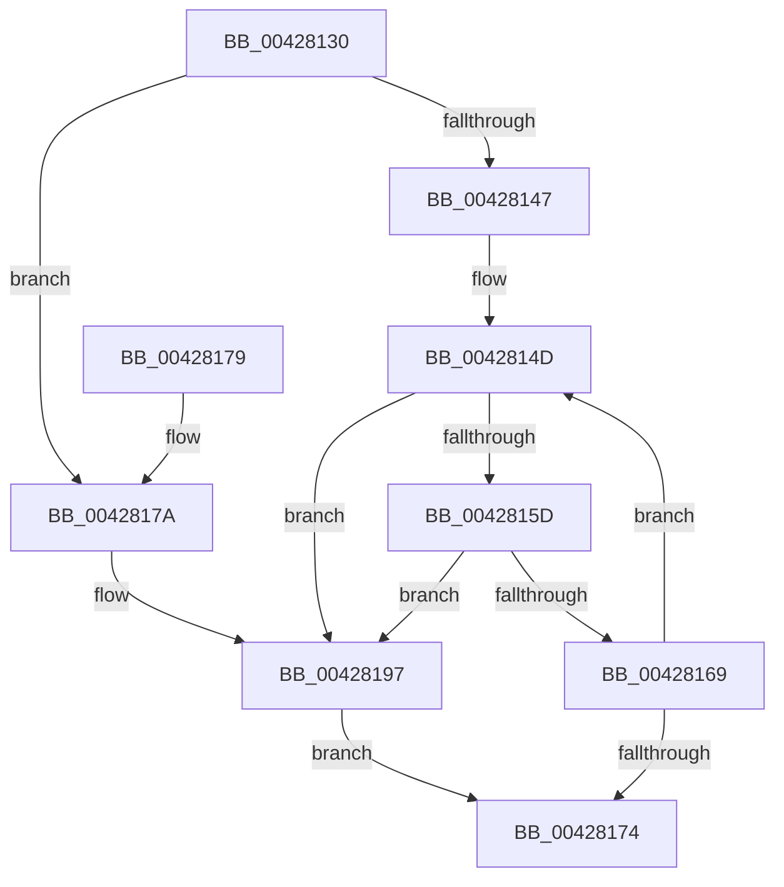

# ObpFastReplenishReference

- RVA: `0x00428130`–`0x0042819F` (길이 `111` bytes)
- VA: `0x0000000140428130`
- 실행 섹션: `.text`
- PDB 이름 있음: `예`; PDB Function 태그: `아니요`
- unwind 정보 RVA: `0x000687C0`
- 디코드: `33`개 명령, `111/111` bytes 표시
- 미해석 바이트: `0` (있으면 어셈블리에 `.byte`로 보존)

> 이 문서는 커널 이미지의 기계어와 PDB 기호를 분석해 생성했습니다. 4번과 5번은 함수 원형과 자료형을 바이너리 사용 방식에서 추정한 C 해석이며 원본 소스 복구 결과는 아닙니다.

## 1. Dependencies

- 직접 호출 지점: **1**; 고유 호출 대상: **1**
- 직접 호출자로 확인된 함수: **1**
- RIP 상대 이미지 참조: **0**

### Outgoing calls
- `0x00428191` → [KeBugCheckEx](../4F/KeBugCheckEx_function_004FD660.md) (function, `0x004FD660`)

### Direct callers
- [ObpLookupObjectName](../../page/89/ObpLookupObjectName_function_0089BE90.md) at `0x0089CAA2`

### Static image references
- 디코드된 RIP-relative 메모리 참조가 없습니다.

## 2. Other-region calls and transfers

- 다른 실행 섹션으로 향하는 call: **0**
- 별도 외부 분기/꼬리 이동을 확인하지 못했습니다.

## 3. Assembly (complete function range)

```asm
00428130  48 83 EC 38                     sub rsp, 0x38
00428134  4C 8B C1                        mov r8, rcx
00428137  B8 0F 00 00 00                  mov eax, 0xf
0042813C  F0 48 0F C1 42 D0               lock xadd qword ptr [rdx - 0x30], rax
00428142  48 85 C0                        test rax, rax
00428145  7E 33                           jle 0x14042817a
00428147  0F 0D 09                        prefetchw byte ptr [rcx]
0042814A  48 8B 01                        mov rax, qword ptr [rcx]
0042814D  48 8B C8                        mov rcx, rax
00428150  83 E1 0F                        and ecx, 0xf
00428153  48 83 C1 0F                     add rcx, 0xf
00428157  48 83 F9 0F                     cmp rcx, 0xf
0042815B  77 3A                           ja 0x140428197
0042815D  48 8B C8                        mov rcx, rax
00428160  48 83 E1 F0                     and rcx, 0xfffffffffffffff0
00428164  48 3B D1                        cmp rdx, rcx
00428167  75 2E                           jne 0x140428197
00428169  48 8D 48 0F                     lea rcx, [rax + 0xf]
0042816D  F0 49 0F B1 08                  lock cmpxchg qword ptr [r8], rcx
00428172  75 D9                           jne 0x14042814d
00428174  48 83 C4 38                     add rsp, 0x38
00428178  C3                              ret
00428179  CC                              int3
0042817A  4C 8B C2                        mov r8, rdx
0042817D  48 83 C0 0F                     add rax, 0xf
00428181  33 D2                           xor edx, edx
00428183  48 89 44 24 20                  mov qword ptr [rsp + 0x20], rax
00428188  41 B9 10 00 00 00               mov r9d, 0x10
0042818E  8D 4A 18                        lea ecx, [rdx + 0x18]
00428191  E8 CA 54 0D 00                  call 0x1404fd660
00428196  CC                              int3
00428197  F0 48 83 42 D0 F1               lock add qword ptr [rdx - 0x30], -0xf
0042819D  EB D5                           jmp 0x140428174
```

## 4. C-style interpretation (structured pseudocode)

```c
__int64 __fastcall ObpFastReplenishReference(__int64 a1, __int64 a2)
{
    __int64 result;
    __int64 v_rsp;
    unsigned __int64 v_stack_p20;

    v_rsp = (v_rsp) - (56);
    if (condition_is_less_or_equal) goto loc_0042817A;
loc_0042814D:
    a1 = (unsigned int)((*(unsigned __int64 *)(a1)) & (15));
    a1 = (a1) + (15);
    if (a1 > 15) goto loc_00428197;
    a1 = (*(unsigned __int64 *)(a1)) & (-16);
    if (a2 != a1) goto loc_00428197;
    if (a2 != a1) goto loc_0042814D;
loc_00428174:
    v_rsp = (v_rsp) + (56);
    return *(unsigned __int64 *)(a1);
loc_0042817A:
    result = (*(unsigned __int64 *)(a1)) + (15);
    a2 = 0;
    v_stack_p20 = result;
    result = KeBugCheckEx(a2 + 24, a2, a2, 16);
loc_00428197:
    goto loc_00428174;
}
```

## 5. (Beta) C Style

```c
int64_t ObpFastReplenishReference(void *Arg1, void *Arg2)
{
    uint8_t *arg1 = (uint8_t *)Arg1;
    uint8_t *arg2 = (uint8_t *)Arg2;

    int64_t result;
    int64_t local_rsp;
    uint64_t v_stack_p20;

    local_rsp = (local_rsp) - (56);
    if (condition_is_less_or_equal) goto loc_0042817A;
loc_0042814D:
    Arg1 = (uint32_t)((*(uint64_t *)(arg1)) & (15));
    Arg1 = (Arg1) + (15);
    if (Arg1 > 15) goto loc_00428197;
    Arg1 = (*(uint64_t *)(arg1)) & (-16);
    if (Arg2 != Arg1) goto loc_00428197;
    if (Arg2 != Arg1) goto loc_0042814D;
loc_00428174:
    local_rsp = (local_rsp) + (56);
    return *(uint64_t *)(arg1);
loc_0042817A:
    result = (*(uint64_t *)(arg1)) + (15);
    Arg2 = 0;
    v_stack_p20 = result;
    result = KeBugCheckEx(Arg2 + 24, Arg2, Arg2, 16);
loc_00428197:
    goto loc_00428174;
}
```

### 관측된 메모리 오프셋

구조체 형식이 확인되지 않은 접근은 인자 기준의 오프셋으로만 기록했습니다.

| 기준 인자 | 오프셋 표현 | 폭 (bit) | 접근 |
|---|---:|---:|---|
| `Arg1` | `+ 0x0` | `8` | `R` |
| `Arg1` | `+ 0x0` | `64` | `R` |
| `Arg2` | `- 0x30` | `64` | `R/W` |

## 6. Execution-region graph

[열기: 2D/3D 그래프와 함수 탐색 컨트롤 패널](../../../control-panel.html?section=text&rva=0x00428130&view=graph)

- 2D 그래프는 위에서 아래로 흐르고, 3D 그래프는 빈 공간을 드래그해 회전합니다. Shift+드래그는 이동, 휠은 확대·축소, 함수 노드 선택은 대상 보고서 이동입니다.

### Static fallback


