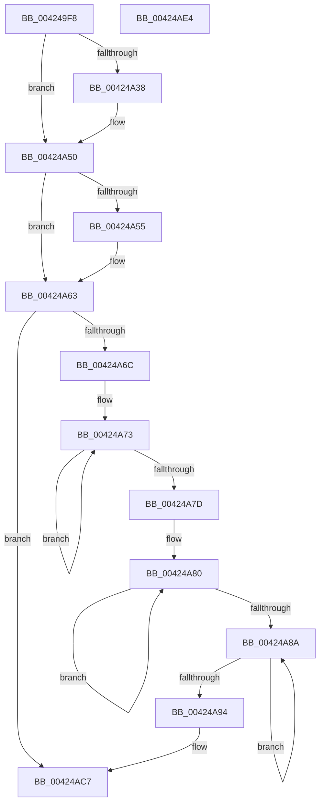

# Pdcv2EventWrite_ACTIVATION_CLIENT_ACTIVATE

- RVA: `0x004249F8`–`0x00424AE5` (길이 `237` bytes)
- VA: `0x00000001404249F8`
- 실행 섹션: `.text`
- PDB 이름 있음: `예`; PDB Function 태그: `아니요`
- unwind 정보 RVA: `0x0008A26C`
- 디코드: `62`개 명령, `237/237` bytes 표시
- 미해석 바이트: `0` (있으면 어셈블리에 `.byte`로 보존)

> 이 문서는 커널 이미지의 기계어와 PDB 기호를 분석해 생성했습니다. 4번과 5번은 함수 원형과 자료형을 바이너리 사용 방식에서 추정한 C 해석이며 원본 소스 복구 결과는 아닙니다.

## 1. Dependencies

- 직접 호출 지점: **1**; 고유 호출 대상: **1**
- 직접 호출자로 확인된 함수: **1**
- RIP 상대 이미지 참조: **2**

### Outgoing calls
- `0x00424AC2` → [McTemplateU0qqzr1qzr3qqqqpqqzr11_EtwWriteTransfer](McTemplateU0qqzr1qzr3qqqqpqqzr11_EtwWriteTransfer_function_00424AEC.md) (function, `0x00424AEC`)

### Direct callers
- [Pdcv2ActivationClientActivate](../../page/95/Pdcv2ActivationClientActivate_function_00953C70.md) at `0x00953EE3`

### Static image references
- `0x00424A17` → RVA `0x00013F90` (`.rdata`; read)
- `0x00424A63` → RVA `0x00F05882` (`.data`; read)

## 2. Other-region calls and transfers

- 다른 실행 섹션으로 향하는 call: **0**
- 별도 외부 분기/꼬리 이동을 확인하지 못했습니다.

## 3. Assembly (complete function range)

```asm
004249F8  48 89 5C 24 08                  mov qword ptr [rsp + 8], rbx
004249FD  48 89 6C 24 10                  mov qword ptr [rsp + 0x10], rbp
00424A02  48 89 74 24 18                  mov qword ptr [rsp + 0x18], rsi
00424A07  57                              push rdi
00424A08  41 56                           push r14
00424A0A  41 57                           push r15
00424A0C  48 81 EC 80 00 00 00            sub rsp, 0x80
00424A13  41 83 CB FF                     or r11d, 0xffffffff
00424A17  4C 8D 15 72 F5 BE FF            lea r10, [rip - 0x410a8e]
00424A1E  45 33 FF                        xor r15d, r15d
00424A21  45 8B F0                        mov r14d, r8d
00424A24  41 8B EB                        mov ebp, r11d
00424A27  45 8B C3                        mov r8d, r11d
00424A2A  41 8B F3                        mov esi, r11d
00424A2D  49 8B DA                        mov rbx, r10
00424A30  49 8B FA                        mov rdi, r10
00424A33  48 85 D2                        test rdx, rdx
00424A36  74 18                           je 0x140424a50
00424A38  44 8B 42 20                     mov r8d, dword ptr [rdx + 0x20]
00424A3C  4C 8D 92 80 00 00 00            lea r10, [rdx + 0x80]
00424A43  8B AA 00 01 00 00               mov ebp, dword ptr [rdx + 0x100]
00424A49  44 8B 9A 04 01 00 00            mov r11d, dword ptr [rdx + 0x104]
00424A50  48 85 C9                        test rcx, rcx
00424A53  74 0E                           je 0x140424a63
00424A55  8B 71 3C                        mov esi, dword ptr [rcx + 0x3c]
00424A58  48 8D 79 50                     lea rdi, [rcx + 0x50]
00424A5C  48 8D 99 50 01 00 00            lea rbx, [rcx + 0x150]
00424A63  F6 05 18 0E AE 00 40            test byte ptr [rip + 0xae0e18], 0x40
00424A6A  74 5B                           je 0x140424ac7
00424A6C  49 83 C9 FF                     or r9, 0xffffffffffffffff
00424A70  49 8B D1                        mov rdx, r9
00424A73  48 FF C2                        inc rdx
00424A76  66 45 39 3C 52                  cmp word ptr [r10 + rdx*2], r15w
00424A7B  75 F6                           jne 0x140424a73
00424A7D  49 8B C1                        mov rax, r9
00424A80  48 FF C0                        inc rax
00424A83  66 44 39 3C 43                  cmp word ptr [rbx + rax*2], r15w
00424A88  75 F6                           jne 0x140424a80
00424A8A  49 FF C1                        inc r9
00424A8D  66 46 39 3C 4F                  cmp word ptr [rdi + r9*2], r15w
00424A92  75 F6                           jne 0x140424a8a
00424A94  4C 89 54 24 70                  mov qword ptr [rsp + 0x70], r10
00424A99  89 54 24 68                     mov dword ptr [rsp + 0x68], edx
00424A9D  48 89 4C 24 58                  mov qword ptr [rsp + 0x58], rcx
00424AA2  44 89 74 24 50                  mov dword ptr [rsp + 0x50], r14d
00424AA7  89 74 24 48                     mov dword ptr [rsp + 0x48], esi
00424AAB  89 6C 24 40                     mov dword ptr [rsp + 0x40], ebp
00424AAF  44 89 5C 24 38                  mov dword ptr [rsp + 0x38], r11d
00424AB4  48 89 5C 24 30                  mov qword ptr [rsp + 0x30], rbx
00424AB9  89 44 24 28                     mov dword ptr [rsp + 0x28], eax
00424ABD  48 89 7C 24 20                  mov qword ptr [rsp + 0x20], rdi
00424AC2  E8 25 00 00 00                  call 0x140424aec
00424AC7  4C 8D 9C 24 80 00 00 00         lea r11, [rsp + 0x80]
00424ACF  49 8B 5B 20                     mov rbx, qword ptr [r11 + 0x20]
00424AD3  49 8B 6B 28                     mov rbp, qword ptr [r11 + 0x28]
00424AD7  49 8B 73 30                     mov rsi, qword ptr [r11 + 0x30]
00424ADB  49 8B E3                        mov rsp, r11
00424ADE  41 5F                           pop r15
00424AE0  41 5E                           pop r14
00424AE2  5F                              pop rdi
00424AE3  C3                              ret
00424AE4  CC                              int3
```

## 4. C-style interpretation (structured pseudocode)

```c
__int64 __fastcall Pdcv2EventWrite_ACTIVATION_CLIENT_ACTIVATE(__int64 a1, __int64 a2, int a3, __int64 a4)
{
    __int64 result;
    __int64 v_r10;
    __int64 v_r11;
    __int64 v_r15;
    __int64 v_rbp;
    __int64 v_rbx;
    __int64 v_rdi;
    __int64 v_rsi;
    __int64 v_rsp;
    unsigned __int64 v_stack_m18;
    unsigned __int64 v_stack_m28;
    unsigned int v_stack_m30;
    unsigned __int64 v_stack_m40;
    unsigned int v_stack_m48;
    unsigned int v_stack_m50;
    unsigned int v_stack_m58;
    unsigned int v_stack_m60;
    unsigned __int64 v_stack_m68;
    unsigned int v_stack_m70;
    unsigned __int64 v_stack_m78;
    unsigned __int64 v_stack_p10;
    unsigned __int64 v_stack_p18;
    unsigned __int64 v_stack_p8;

    v_stack_p8 = v_rbx;
    v_stack_p10 = v_rbp;
    v_stack_p18 = v_rsi;
    v_rsp = (v_rsp) - (128);
    v_r11 = (unsigned int)((v_r11) | (0xFFFFFFFFULL));
    v_r15 = 0;
    v_rbp = (unsigned int)((unsigned int)(v_r11));
    v_r10 = v_rip - 4262542;
    if (a2 != 0) {
        a3 = *(unsigned int *)(a2 + 32);
        v_r10 = a2 + 128;
        v_rbp = *(unsigned int *)(a2 + 256);
        v_r11 = *(unsigned int *)(a2 + 260);
    }
    v_rbx = v_rip - 4262542;
    v_rsi = (unsigned int)((unsigned int)(v_r11));
    v_rdi = v_rip - 4262542;
    if (a1 != 0) {
        v_rsi = *(unsigned int *)(a1 + 60);
        v_rdi = a1 + 80;
        v_rbx = a1 + 336;
    }
    if (((*(unsigned __int8 *)(v_rip + 11406872)) & (64)) == 0) goto loc_00424AC7;
    a4 = (a4) | (-1);
loc_00424A73:
    a2 = (a4) + 1;
    if ((*(unsigned __int16 *)(v_r10 + a2 * 2)) != 0) goto loc_00424A73;
loc_00424A80:
    result = (a4) + 1;
    if ((*(unsigned __int16 *)(v_rbx + result * 2)) != 0) goto loc_00424A80;
loc_00424A8A:
    a4 = (a4) + 1;
    if ((*(unsigned __int16 *)(v_rdi + a4 * 2)) != 0) goto loc_00424A8A;
    v_stack_m28 = v_r10;
    v_stack_m30 = (unsigned int)(a2);
    v_stack_m40 = a1;
    v_stack_m48 = (unsigned int)((unsigned int)(a3));
    v_stack_m50 = (unsigned int)(v_rsi);
    v_stack_m58 = (unsigned int)(v_rbp);
    v_stack_m60 = (unsigned int)(v_r11);
    v_stack_m68 = v_rbx;
    v_stack_m70 = (unsigned int)(result);
    v_stack_m78 = v_rdi;
    result = McTemplateU0qqzr1qzr3qqqqpqqzr11_EtwWriteTransfer(a1, a2, a3, a4);
loc_00424AC7:
    return result;
}
```

## 5. (Beta) C Style

```c
int64_t Pdcv2EventWrite_ACTIVATION_CLIENT_ACTIVATE(int64_t Arg1, int64_t Arg2, int32_t Arg3, int64_t Arg4)
{
    int64_t result;
    int64_t local_r10;
    int64_t local_r11;
    int64_t local_r15;
    int64_t local_rbp;
    int64_t local_rbx;
    int64_t local_rdi;
    int64_t local_rsi;
    int64_t local_rsp;
    uint64_t v_stack_m18;
    uint64_t v_stack_m28;
    uint32_t v_stack_m30;
    uint64_t v_stack_m40;
    uint32_t v_stack_m48;
    uint32_t v_stack_m50;
    uint32_t v_stack_m58;
    uint32_t v_stack_m60;
    uint64_t v_stack_m68;
    uint32_t v_stack_m70;
    uint64_t v_stack_m78;
    uint64_t v_stack_p10;
    uint64_t v_stack_p18;
    uint64_t v_stack_p8;

    v_stack_p8 = local_rbx;
    v_stack_p10 = local_rbp;
    v_stack_p18 = local_rsi;
    local_rsp = (local_rsp) - (128);
    local_r11 = (uint32_t)((local_r11) | (0xFFFFFFFFULL));
    local_r15 = 0;
    local_rbp = (uint32_t)((uint32_t)(local_r11));
    local_r10 = v_rip - 4262542;
    if (Arg2 != 0) {
        Arg3 = *(uint32_t *)(Arg2 + 0x20);
        local_r10 = Arg2 + 128;
        local_rbp = *(uint32_t *)(Arg2 + 0x100);
        local_r11 = *(uint32_t *)(Arg2 + 0x104);
    }
    local_rbx = v_rip - 4262542;
    local_rsi = (uint32_t)((uint32_t)(local_r11));
    local_rdi = v_rip - 4262542;
    if (Arg1 != 0) {
        local_rsi = *(uint32_t *)(Arg1 + 0x3C);
        local_rdi = Arg1 + 80;
        local_rbx = Arg1 + 336;
    }
    if (((*(uint8_t *)(v_rip + 0xAE0E18)) & (64)) == 0) goto loc_00424AC7;
    Arg4 = (Arg4) | (-1);
loc_00424A73:
    Arg2 = (Arg4) + 1;
    if ((*(uint16_t *)(local_r10 + Arg2 * 2)) != 0) goto loc_00424A73;
loc_00424A80:
    result = (Arg4) + 1;
    if ((*(uint16_t *)(local_rbx + result * 2)) != 0) goto loc_00424A80;
loc_00424A8A:
    Arg4 = (Arg4) + 1;
    if ((*(uint16_t *)(local_rdi + Arg4 * 2)) != 0) goto loc_00424A8A;
    v_stack_m28 = local_r10;
    v_stack_m30 = (uint32_t)(Arg2);
    v_stack_m40 = Arg1;
    v_stack_m48 = (uint32_t)((uint32_t)(Arg3));
    v_stack_m50 = (uint32_t)(local_rsi);
    v_stack_m58 = (uint32_t)(local_rbp);
    v_stack_m60 = (uint32_t)(local_r11);
    v_stack_m68 = local_rbx;
    v_stack_m70 = (uint32_t)(result);
    v_stack_m78 = local_rdi;
    result = McTemplateU0qqzr1qzr3qqqqpqqzr11_EtwWriteTransfer(Arg1, Arg2, Arg3, Arg4);
loc_00424AC7:
    return result;
}
```

## 6. Execution-region graph

[열기: 2D/3D 그래프와 함수 탐색 컨트롤 패널](../../../control-panel.html?section=text&rva=0x004249F8&view=graph)

- 2D 그래프는 위에서 아래로 흐르고, 3D 그래프는 빈 공간을 드래그해 회전합니다. Shift+드래그는 이동, 휠은 확대·축소, 함수 노드 선택은 대상 보고서 이동입니다.

### Static fallback


