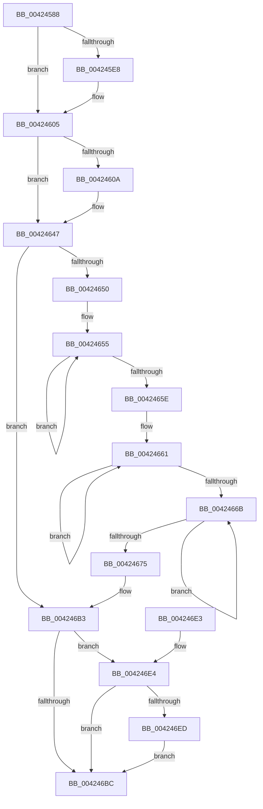

# Pdcv2EventWrite_ACTIVATION_CLIENT_DEACTIVATE

- RVA: `0x00424588`–`0x004247D1` (길이 `585` bytes)
- VA: `0x0000000140424588`
- 실행 섹션: `.text`
- PDB 이름 있음: `예`; PDB Function 태그: `아니요`
- unwind 정보 RVA: `0x000A03E0`
- 디코드: `140`개 명령, `585/585` bytes 표시
- 미해석 바이트: `0` (있으면 어셈블리에 `.byte`로 보존)

> 이 문서는 커널 이미지의 기계어와 PDB 기호를 분석해 생성했습니다. 4번과 5번은 함수 원형과 자료형을 바이너리 사용 방식에서 추정한 C 해석이며 원본 소스 복구 결과는 아닙니다.

## 1. Dependencies

- 직접 호출 지점: **6**; 고유 호출 대상: **4**
- 직접 호출자로 확인된 함수: **1**
- RIP 상대 이미지 참조: **5**

### Outgoing calls
- `0x004246AA` → [McTemplateU0qqzr1qzr3qqxqpqqzr11q_EtwWriteTransfer](McTemplateU0qqzr1qzr3qqxqpqqzr11q_EtwWriteTransfer_function_004247D8.md) (function, `0x004247D8`)
- `0x004246C3` → [_security_check_cookie](../6A/_security_check_cookie_function_006AC640.md) (function, `0x006AC640`)
- `0x0042470A` → [tlgCreate1Sz_wchar_t](tlgCreate1Sz_wchar_t_function_00426198.md) (function, `0x00426198`)
- `0x00424716` → [tlgCreate1Sz_wchar_t](tlgCreate1Sz_wchar_t_function_00426198.md) (function, `0x00426198`)
- `0x0042479D` → [tlgCreate1Sz_wchar_t](tlgCreate1Sz_wchar_t_function_00426198.md) (function, `0x00426198`)
- `0x004247C7` → [tlgWriteTransfer_EtwWriteTransfer](tlgWriteTransfer_EtwWriteTransfer_function_004260E0.md) (function, `0x004260E0`)

### Direct callers
- [Pdcv2ActivationClientDeactivate](../../page/95/Pdcv2ActivationClientDeactivate_function_009552E0.md) at `0x00955413`
- [Pdcv2ActivationClientDeactivate](../../page/95/Pdcv2ActivationClientDeactivate_function_009552E0.md) at `0x0095546D`

### Static image references
- `0x004245A4` → RVA `0x00E0A740` (`.data`; read)
- `0x004245C4` → RVA `0x00013F90` (`.rdata`; read)
- `0x00424647` → RVA `0x00F05882` (`.data`; read)
- `0x004246E4` → RVA `0x00E088B8` (`.data`; read)
- `0x004247AE` → RVA `0x00052D9F` (`.rdata`; read)

## 2. Other-region calls and transfers

- 다른 실행 섹션으로 향하는 call: **0**
- 별도 외부 분기/꼬리 이동을 확인하지 못했습니다.

## 3. Assembly (complete function range)

```asm
00424588  48 89 5C 24 18                  mov qword ptr [rsp + 0x18], rbx
0042458D  55                              push rbp
0042458E  56                              push rsi
0042458F  57                              push rdi
00424590  41 54                           push r12
00424592  41 55                           push r13
00424594  41 56                           push r14
00424596  41 57                           push r15
00424598  48 8D 6C 24 80                  lea rbp, [rsp - 0x80]
0042459D  48 81 EC 80 01 00 00            sub rsp, 0x180
004245A4  48 8B 05 95 61 9E 00            mov rax, qword ptr [rip + 0x9e6195]
004245AB  48 33 C4                        xor rax, rsp
004245AE  48 89 45 70                     mov qword ptr [rbp + 0x70], rax
004245B2  41 83 CE FF                     or r14d, 0xffffffff
004245B6  44 89 45 84                     mov dword ptr [rbp - 0x7c], r8d
004245BA  49 83 C9 FF                     or r9, 0xffffffffffffffff
004245BE  44 89 75 80                     mov dword ptr [rbp - 0x80], r14d
004245C2  33 C0                           xor eax, eax
004245C4  48 8D 3D C5 F9 BE FF            lea rdi, [rip - 0x41063b]
004245CB  45 8B D8                        mov r11d, r8d
004245CE  48 8B D9                        mov rbx, rcx
004245D1  49 8B F1                        mov rsi, r9
004245D4  45 8B EE                        mov r13d, r14d
004245D7  44 8B D0                        mov r10d, eax
004245DA  45 8B C6                        mov r8d, r14d
004245DD  4C 8B FF                        mov r15, rdi
004245E0  4C 8B E7                        mov r12, rdi
004245E3  48 85 D2                        test rdx, rdx
004245E6  74 1D                           je 0x140424605
004245E8  44 8B 42 20                     mov r8d, dword ptr [rdx + 0x20]
004245EC  48 8D BA 80 00 00 00            lea rdi, [rdx + 0x80]
004245F3  44 8B AA 00 01 00 00            mov r13d, dword ptr [rdx + 0x100]
004245FA  44 8B B2 04 01 00 00            mov r14d, dword ptr [rdx + 0x104]
00424601  44 89 45 80                     mov dword ptr [rbp - 0x80], r8d
00424605  48 85 DB                        test rbx, rbx
00424608  74 3D                           je 0x140424647
0042460A  48 B8 04 00 00 00 80 F7 FF FF   movabs rax, 0xfffff78000000004
00424614  4C 8D 61 50                     lea r12, [rcx + 0x50]
00424618  4C 8D B9 50 01 00 00            lea r15, [rcx + 0x150]
0042461F  8B 08                           mov ecx, dword ptr [rax]
00424621  48 B8 20 03 00 00 80 F7 FF FF   movabs rax, 0xfffff78000000320
0042462B  48 C1 E1 20                     shl rcx, 0x20
0042462F  48 8B 00                        mov rax, qword ptr [rax]
00424632  44 8B 93 50 02 00 00            mov r10d, dword ptr [rbx + 0x250]
00424639  48 C1 E0 08                     shl rax, 8
0042463D  48 F7 E1                        mul rcx
00424640  48 8B F2                        mov rsi, rdx
00424643  48 2B 73 30                     sub rsi, qword ptr [rbx + 0x30]
00424647  F6 05 34 12 AE 00 40            test byte ptr [rip + 0xae1234], 0x40
0042464E  74 63                           je 0x1404246b3
00424650  49 8B C9                        mov rcx, r9
00424653  33 D2                           xor edx, edx
00424655  48 FF C1                        inc rcx
00424658  66 39 14 4F                     cmp word ptr [rdi + rcx*2], dx
0042465C  75 F7                           jne 0x140424655
0042465E  49 8B C1                        mov rax, r9
00424661  48 FF C0                        inc rax
00424664  66 41 39 14 47                  cmp word ptr [r15 + rax*2], dx
00424669  75 F6                           jne 0x140424661
0042466B  49 FF C1                        inc r9
0042466E  66 43 39 14 4C                  cmp word ptr [r12 + r9*2], dx
00424673  75 F6                           jne 0x14042466b
00424675  44 89 54 24 78                  mov dword ptr [rsp + 0x78], r10d
0042467A  48 89 7C 24 70                  mov qword ptr [rsp + 0x70], rdi
0042467F  89 4C 24 68                     mov dword ptr [rsp + 0x68], ecx
00424683  48 89 5C 24 58                  mov qword ptr [rsp + 0x58], rbx
00424688  44 89 5C 24 50                  mov dword ptr [rsp + 0x50], r11d
0042468D  48 89 74 24 48                  mov qword ptr [rsp + 0x48], rsi
00424692  44 89 6C 24 40                  mov dword ptr [rsp + 0x40], r13d
00424697  44 89 74 24 38                  mov dword ptr [rsp + 0x38], r14d
0042469C  4C 89 7C 24 30                  mov qword ptr [rsp + 0x30], r15
004246A1  89 44 24 28                     mov dword ptr [rsp + 0x28], eax
004246A5  4C 89 64 24 20                  mov qword ptr [rsp + 0x20], r12
004246AA  E8 29 01 00 00                  call 0x1404247d8
004246AF  44 8B 5D 84                     mov r11d, dword ptr [rbp - 0x7c]
004246B3  48 81 FE E8 03 00 00            cmp rsi, 0x3e8
004246BA  73 28                           jae 0x1404246e4
004246BC  48 8B 4D 70                     mov rcx, qword ptr [rbp + 0x70]
004246C0  48 33 CC                        xor rcx, rsp
004246C3  E8 78 7F 28 00                  call 0x1406ac640
004246C8  48 8B 9C 24 D0 01 00 00         mov rbx, qword ptr [rsp + 0x1d0]
004246D0  48 81 C4 80 01 00 00            add rsp, 0x180
004246D7  41 5F                           pop r15
004246D9  41 5E                           pop r14
004246DB  41 5D                           pop r13
004246DD  41 5C                           pop r12
004246DF  5F                              pop rdi
004246E0  5E                              pop rsi
004246E1  5D                              pop rbp
004246E2  C3                              ret
004246E3  CC                              int3
004246E4  83 3D CD 41 9E 00 05            cmp dword ptr [rip + 0x9e41cd], 5
004246EB  76 CF                           jbe 0x1404246bc
004246ED  8B 45 80                        mov eax, dword ptr [rbp - 0x80]
004246F0  48 8D 4D E0                     lea rcx, [rbp - 0x20]
004246F4  89 45 84                        mov dword ptr [rbp - 0x7c], eax
004246F7  49 8B D4                        mov rdx, r12
004246FA  48 8D 45 84                     lea rax, [rbp - 0x7c]
004246FE  48 C7 45 D8 04 00 00 00         mov qword ptr [rbp - 0x28], 4
00424706  48 89 45 D0                     mov qword ptr [rbp - 0x30], rax
0042470A  E8 89 1A 00 00                  call 0x140426198
0042470F  49 8B D7                        mov rdx, r15
00424712  48 8D 4D F0                     lea rcx, [rbp - 0x10]
00424716  E8 7D 1A 00 00                  call 0x140426198
0042471B  48 8D 45 80                     lea rax, [rbp - 0x80]
0042471F  44 89 75 80                     mov dword ptr [rbp - 0x80], r14d
00424723  48 89 45 00                     mov qword ptr [rbp], rax
00424727  48 8D 4D 60                     lea rcx, [rbp + 0x60]
0042472B  48 8D 45 88                     lea rax, [rbp - 0x78]
0042472F  48 C7 45 08 04 00 00 00         mov qword ptr [rbp + 8], 4
00424737  48 89 45 10                     mov qword ptr [rbp + 0x10], rax
0042473B  48 8B D7                        mov rdx, rdi
0042473E  48 8D 45 98                     lea rax, [rbp - 0x68]
00424742  44 89 6D 88                     mov dword ptr [rbp - 0x78], r13d
00424746  48 89 45 20                     mov qword ptr [rbp + 0x20], rax
0042474A  48 8D 45 A0                     lea rax, [rbp - 0x60]
0042474E  48 89 45 30                     mov qword ptr [rbp + 0x30], rax
00424752  48 8D 45 8C                     lea rax, [rbp - 0x74]
00424756  48 89 45 40                     mov qword ptr [rbp + 0x40], rax
0042475A  48 8D 45 90                     lea rax, [rbp - 0x70]
0042475E  48 89 45 50                     mov qword ptr [rbp + 0x50], rax
00424762  48 C7 45 18 04 00 00 00         mov qword ptr [rbp + 0x18], 4
0042476A  48 89 75 98                     mov qword ptr [rbp - 0x68], rsi
0042476E  48 C7 45 28 08 00 00 00         mov qword ptr [rbp + 0x28], 8
00424776  48 89 5D A0                     mov qword ptr [rbp - 0x60], rbx
0042477A  48 C7 45 38 08 00 00 00         mov qword ptr [rbp + 0x38], 8
00424782  44 89 5D 8C                     mov dword ptr [rbp - 0x74], r11d
00424786  48 C7 45 48 04 00 00 00         mov qword ptr [rbp + 0x48], 4
0042478E  C7 45 90 02 00 00 00            mov dword ptr [rbp - 0x70], 2
00424795  48 C7 45 58 04 00 00 00         mov qword ptr [rbp + 0x58], 4
0042479D  E8 F6 19 00 00                  call 0x140426198
004247A2  48 8D 4D B0                     lea rcx, [rbp - 0x50]
004247A6  45 33 C9                        xor r9d, r9d
004247A9  48 89 4C 24 28                  mov qword ptr [rsp + 0x28], rcx
004247AE  48 8D 15 EA E5 C2 FF            lea rdx, [rip - 0x3d1a16]
004247B5  48 8D 0D FC 40 9E 00            lea rcx, [rip + 0x9e40fc]
004247BC  C7 44 24 20 0C 00 00 00         mov dword ptr [rsp + 0x20], 0xc
004247C4  45 33 C0                        xor r8d, r8d
004247C7  E8 14 19 00 00                  call 0x1404260e0
004247CC  E9 EB FE FF FF                  jmp 0x1404246bc
```

## 4. C-style interpretation (structured pseudocode)

```c
__int64 __fastcall Pdcv2EventWrite_ACTIVATION_CLIENT_DEACTIVATE(__int64 a1, __int64 a2, int a3, __int64 a4)
{
    __int64 result;
    __int64 v_r10;
    __int64 v_r12;
    __int64 v_r13;
    __int64 v_r14;
    __int64 v_r15;
    __int64 v_rdi;
    __int64 v_rsi;
    __int64 v_rsp;
    unsigned __int64 v_stack_m108;
    unsigned __int64 v_stack_m118;
    unsigned __int64 v_stack_m120;
    unsigned __int64 v_stack_m128;
    unsigned __int64 v_stack_m12C;
    unsigned __int64 v_stack_m130;
    unsigned int v_stack_m134;
    unsigned int v_stack_m138;
    unsigned int v_stack_m140;
    unsigned __int64 v_stack_m148;
    unsigned int v_stack_m150;
    unsigned __int64 v_stack_m160;
    unsigned int v_stack_m168;
    unsigned __int64 v_stack_m170;
    unsigned int v_stack_m178;
    unsigned int v_stack_m180;
    unsigned __int64 v_stack_m188;
    unsigned int v_stack_m190;
    unsigned __int64 v_stack_m198;
    unsigned __int64 v_stack_m48;
    unsigned __int64 v_stack_m58;
    unsigned __int64 v_stack_m60;
    unsigned __int64 v_stack_m68;
    unsigned __int64 v_stack_m70;
    unsigned __int64 v_stack_m78;
    unsigned __int64 v_stack_m80;
    unsigned __int64 v_stack_m88;
    unsigned __int64 v_stack_m90;
    unsigned __int64 v_stack_m98;
    unsigned __int64 v_stack_mA0;
    unsigned __int64 v_stack_mA8;
    unsigned __int64 v_stack_mB0;
    unsigned __int64 v_stack_mB8;
    unsigned __int64 v_stack_mC8;
    unsigned __int64 v_stack_mD8;
    unsigned __int64 v_stack_mE0;
    unsigned __int64 v_stack_mE8;
    unsigned __int64 v_stack_p18;
    unsigned int v_stack_p20;
    unsigned __int64 v_stack_p28;

    v_stack_p18 = v_rbx;
    v_rsp = (v_rsp) - (384);
    result = (*(unsigned __int64 *)(v_rip + 10379669)) ^ (v_rsp);
    v_stack_m48 = result;
    v_r14 = (unsigned int)((v_r14) | (0xFFFFFFFFULL));
    v_stack_m134 = a3;
    a4 = (a4) | (-1);
    v_stack_m138 = (unsigned int)(v_r14);
    result = 0;
    v_rdi = v_rip - 4261435;
    v_r13 = (unsigned int)((unsigned int)(v_r14));
    if (a2 != 0) {
        a3 = *(unsigned int *)(a2 + 32);
        v_rdi = a2 + 128;
        v_r13 = *(unsigned int *)(a2 + 256);
        v_r14 = *(unsigned int *)(a2 + 260);
        v_stack_m138 = a3;
    }
    v_rsi = a4;
    v_r10 = 0;
    v_r12 = v_rip - 4261435;
    v_r15 = v_rip - 4261435;
    if (a1 != 0) {
        v_r12 = a1 + 80;
        v_r15 = a1 + 336;
        a1 = *(unsigned int *)(result);
        a1 = (a1) << (32);
        result = *(unsigned __int64 *)(result);
        v_r10 = *(unsigned int *)(a1 + 592);
        result = (result) << (8);
        v_rsi = a2;
        v_rsi = (v_rsi) - (*(unsigned __int64 *)(a1 + 48));
    }
    if (((*(unsigned __int8 *)(v_rip + 11407924)) & (64)) == 0) goto loc_004246B3;
    a2 = 0;
loc_00424655:
    a1 = (a4) + 1;
    if ((*(unsigned __int16 *)(v_rdi + a1 * 2)) != 0) goto loc_00424655;
loc_00424661:
    result = (a4) + 1;
    if ((*(unsigned __int16 *)(v_r15 + result * 2)) != 0) goto loc_00424661;
loc_0042466B:
    a4 = (a4) + 1;
    if ((*(unsigned __int16 *)(v_r12 + a4 * 2)) != 0) goto loc_0042466B;
    v_stack_m140 = (unsigned int)(v_r10);
    v_stack_m148 = v_rdi;
    v_stack_m150 = (unsigned int)(a1);
    v_stack_m160 = a1;
    v_stack_m168 = (unsigned int)((unsigned int)(a3));
    v_stack_m170 = v_rsi;
    v_stack_m178 = (unsigned int)(v_r13);
    v_stack_m180 = (unsigned int)(v_r14);
    v_stack_m188 = v_r15;
    v_stack_m190 = (unsigned int)(result);
    v_stack_m198 = v_r12;
    result = McTemplateU0qqzr1qzr3qqxqpqqzr11q_EtwWriteTransfer(a1, a2, a3, a4);
loc_004246B3:
    if (v_rsi >= 1000) goto loc_004246E4;
loc_004246BC:
    a1 = (v_stack_m48) ^ (v_rsp);
    result = _security_check_cookie(a1, a2, a3, a4);
    v_rsp = (v_rsp) + (384);
    return result;
loc_004246E4:
    if ((*(unsigned int *)(v_rip + 10371533)) <= 5) goto loc_004246BC;
    v_stack_m134 = (unsigned int)((unsigned int)(v_stack_m138));
    v_stack_mE0 = 4;
    v_stack_mE8 = v_stack_m134;
    result = tlgCreate1Sz_wchar_t(v_stack_mD8, v_r12, a3, a4);
    result = tlgCreate1Sz_wchar_t(v_stack_mC8, v_r15, a3, a4);
    v_stack_m138 = (unsigned int)(v_r14);
    v_stack_mB8 = v_stack_m138;
    v_stack_mB0 = 4;
    v_stack_mA8 = v_stack_m130;
    v_stack_m130 = (unsigned int)(v_r13);
    v_stack_m98 = v_stack_m120;
    v_stack_m88 = v_stack_m118;
    v_stack_m78 = v_stack_m12C;
    v_stack_m68 = v_stack_m128;
    v_stack_mA0 = 4;
    v_stack_m120 = v_rsi;
    v_stack_m90 = 8;
    v_stack_m118 = v_stack_p18;
    v_stack_m80 = 8;
    v_stack_m12C = (unsigned int)((unsigned int)(v_stack_m134));
    v_stack_m70 = 4;
    v_stack_m128 = 2;
    v_stack_m60 = 4;
    result = tlgCreate1Sz_wchar_t(v_stack_m58, v_rdi, a3, a4);
    a4 = 0;
    v_stack_p28 = v_stack_m108;
    v_stack_p20 = 12;
    a3 = 0;
    result = tlgWriteTransfer_EtwWriteTransfer(v_rip + 10371324, v_rip - 4004374, a3, a4);
    goto loc_004246BC;
}
```

## 5. (Beta) C Style

```c
int64_t Pdcv2EventWrite_ACTIVATION_CLIENT_DEACTIVATE(void *Arg1, int64_t Arg2, int32_t Arg3, int64_t Arg4)
{
    uint8_t *arg1 = (uint8_t *)Arg1;

    int64_t result;
    int64_t local_r10;
    int64_t local_r12;
    int64_t local_r13;
    int64_t local_r14;
    int64_t local_r15;
    int64_t local_rdi;
    int64_t local_rsi;
    int64_t local_rsp;
    uint64_t v_stack_m108;
    uint64_t v_stack_m118;
    uint64_t v_stack_m120;
    uint64_t v_stack_m128;
    uint64_t v_stack_m12C;
    uint64_t v_stack_m130;
    uint32_t v_stack_m134;
    uint32_t v_stack_m138;
    uint32_t v_stack_m140;
    uint64_t v_stack_m148;
    uint32_t v_stack_m150;
    uint64_t v_stack_m160;
    uint32_t v_stack_m168;
    uint64_t v_stack_m170;
    uint32_t v_stack_m178;
    uint32_t v_stack_m180;
    uint64_t v_stack_m188;
    uint32_t v_stack_m190;
    uint64_t v_stack_m198;
    uint64_t v_stack_m48;
    uint64_t v_stack_m58;
    uint64_t v_stack_m60;
    uint64_t v_stack_m68;
    uint64_t v_stack_m70;
    uint64_t v_stack_m78;
    uint64_t v_stack_m80;
    uint64_t v_stack_m88;
    uint64_t v_stack_m90;
    uint64_t v_stack_m98;
    uint64_t v_stack_mA0;
    uint64_t v_stack_mA8;
    uint64_t v_stack_mB0;
    uint64_t v_stack_mB8;
    uint64_t v_stack_mC8;
    uint64_t v_stack_mD8;
    uint64_t v_stack_mE0;
    uint64_t v_stack_mE8;
    uint64_t v_stack_p18;
    uint32_t v_stack_p20;
    uint64_t v_stack_p28;

    v_stack_p18 = local_rbx;
    local_rsp = (local_rsp) - (384);
    result = (*(uint64_t *)(v_rip + 0x9E6195)) ^ (local_rsp);
    v_stack_m48 = result;
    local_r14 = (uint32_t)((local_r14) | (0xFFFFFFFFULL));
    v_stack_m134 = Arg3;
    Arg4 = (Arg4) | (-1);
    v_stack_m138 = (uint32_t)(local_r14);
    result = 0;
    local_rdi = v_rip - 4261435;
    local_r13 = (uint32_t)((uint32_t)(local_r14));
    if (Arg2 != 0) {
        Arg3 = *(uint32_t *)(Arg2 + 0x20);
        local_rdi = Arg2 + 128;
        local_r13 = *(uint32_t *)(Arg2 + 0x100);
        local_r14 = *(uint32_t *)(Arg2 + 0x104);
        v_stack_m138 = Arg3;
    }
    local_rsi = Arg4;
    local_r10 = 0;
    local_r12 = v_rip - 4261435;
    local_r15 = v_rip - 4261435;
    if (Arg1 != NULL) {
        local_r12 = Arg1 + 80;
        local_r15 = Arg1 + 336;
        Arg1 = *(uint32_t *)(result);
        Arg1 = (Arg1) << (32);
        result = *(uint64_t *)(result);
        local_r10 = *(uint32_t *)(arg1 + 0x250);
        result = (result) << (8);
        local_rsi = Arg2;
        local_rsi = (local_rsi) - (*(uint64_t *)(arg1 + 0x30));
    }
    if (((*(uint8_t *)(v_rip + 0xAE1234)) & (64)) == 0) goto loc_004246B3;
    Arg2 = 0;
loc_00424655:
    Arg1 = (Arg4) + 1;
    if ((*(uint16_t *)(local_rdi + arg1 * 2)) != 0) goto loc_00424655;
loc_00424661:
    result = (Arg4) + 1;
    if ((*(uint16_t *)(local_r15 + result * 2)) != 0) goto loc_00424661;
loc_0042466B:
    Arg4 = (Arg4) + 1;
    if ((*(uint16_t *)(local_r12 + Arg4 * 2)) != 0) goto loc_0042466B;
    v_stack_m140 = (uint32_t)(local_r10);
    v_stack_m148 = local_rdi;
    v_stack_m150 = (uint32_t)(Arg1);
    v_stack_m160 = Arg1;
    v_stack_m168 = (uint32_t)((uint32_t)(Arg3));
    v_stack_m170 = local_rsi;
    v_stack_m178 = (uint32_t)(local_r13);
    v_stack_m180 = (uint32_t)(local_r14);
    v_stack_m188 = local_r15;
    v_stack_m190 = (uint32_t)(result);
    v_stack_m198 = local_r12;
    result = McTemplateU0qqzr1qzr3qqxqpqqzr11q_EtwWriteTransfer(Arg1, Arg2, Arg3, Arg4);
loc_004246B3:
    if (local_rsi >= 1000) goto loc_004246E4;
loc_004246BC:
    Arg1 = (v_stack_m48) ^ (local_rsp);
    result = _security_check_cookie(Arg1, Arg2, Arg3, Arg4);
    local_rsp = (local_rsp) + (384);
    return result;
loc_004246E4:
    if ((*(uint32_t *)(v_rip + 0x9E41CD)) <= 5) goto loc_004246BC;
    v_stack_m134 = (uint32_t)((uint32_t)(v_stack_m138));
    v_stack_mE0 = 4;
    v_stack_mE8 = v_stack_m134;
    result = tlgCreate1Sz_wchar_t(v_stack_mD8, local_r12, Arg3, Arg4);
    result = tlgCreate1Sz_wchar_t(v_stack_mC8, local_r15, Arg3, Arg4);
    v_stack_m138 = (uint32_t)(local_r14);
    v_stack_mB8 = v_stack_m138;
    v_stack_mB0 = 4;
    v_stack_mA8 = v_stack_m130;
    v_stack_m130 = (uint32_t)(local_r13);
    v_stack_m98 = v_stack_m120;
    v_stack_m88 = v_stack_m118;
    v_stack_m78 = v_stack_m12C;
    v_stack_m68 = v_stack_m128;
    v_stack_mA0 = 4;
    v_stack_m120 = local_rsi;
    v_stack_m90 = 8;
    v_stack_m118 = v_stack_p18;
    v_stack_m80 = 8;
    v_stack_m12C = (uint32_t)((uint32_t)(v_stack_m134));
    v_stack_m70 = 4;
    v_stack_m128 = 2;
    v_stack_m60 = 4;
    result = tlgCreate1Sz_wchar_t(v_stack_m58, local_rdi, Arg3, Arg4);
    Arg4 = 0;
    v_stack_p28 = v_stack_m108;
    v_stack_p20 = 12;
    Arg3 = 0;
    result = tlgWriteTransfer_EtwWriteTransfer(v_rip + 10371324, v_rip - 4004374, Arg3, Arg4);
    goto loc_004246BC;
}
```

### 관측된 메모리 오프셋

구조체 형식이 확인되지 않은 접근은 인자 기준의 오프셋으로만 기록했습니다.

| 기준 인자 | 오프셋 표현 | 폭 (bit) | 접근 |
|---|---:|---:|---|
| `Arg1` | `+ 0x50` | `64` | `R` |
| `Arg1` | `+ 0x150` | `64` | `R` |

## 6. Execution-region graph

[열기: 2D/3D 그래프와 함수 탐색 컨트롤 패널](../../../control-panel.html?section=text&rva=0x00424588&view=graph)

- 2D 그래프는 위에서 아래로 흐르고, 3D 그래프는 빈 공간을 드래그해 회전합니다. Shift+드래그는 이동, 휠은 확대·축소, 함수 노드 선택은 대상 보고서 이동입니다.

### Static fallback


