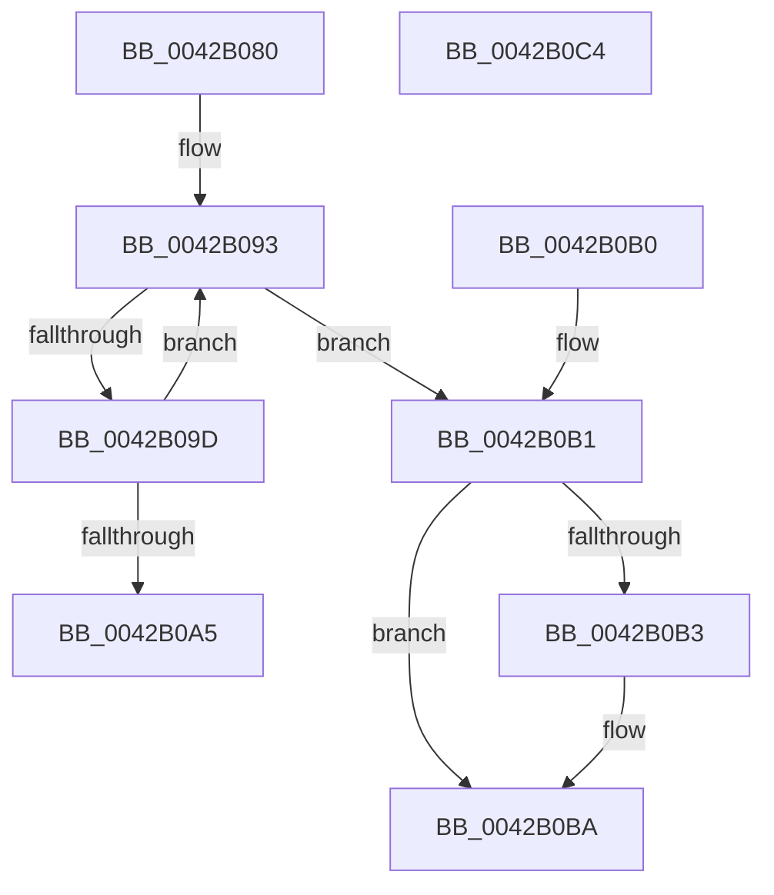

# PfpPartitionReferenceParentSafeByProcess

- RVA: `0x0042B080`–`0x0042B0C5` (길이 `69` bytes)
- VA: `0x000000014042B080`
- 실행 섹션: `.text`
- PDB 이름 있음: `예`; PDB Function 태그: `아니요`
- unwind 정보 RVA: `0x000DB714`
- 디코드: `21`개 명령, `69/69` bytes 표시
- 미해석 바이트: `0` (있으면 어셈블리에 `.byte`로 보존)

> 이 문서는 커널 이미지의 기계어와 PDB 기호를 분석해 생성했습니다. 4번과 5번은 함수 원형과 자료형을 바이너리 사용 방식에서 추정한 C 해석이며 원본 소스 복구 결과는 아닙니다.

## 1. Dependencies

- 직접 호출 지점: **0**; 고유 호출 대상: **0**
- 직접 호출자로 확인된 함수: **2**
- RIP 상대 이미지 참조: **0**

### Outgoing calls
- 직접 디코드된 call 명령이 없습니다.

### Direct callers
- [PfCheckDeprioritizeFile](../../page/88/PfCheckDeprioritizeFile_function_00887F6C.md) at `0x00888030`
- [PfSnEndTrace](../../page/8B/PfSnEndTrace_function_008B04A8.md) at `0x008B05C3`

### Static image references
- 디코드된 RIP-relative 메모리 참조가 없습니다.

## 2. Other-region calls and transfers

- 다른 실행 섹션으로 향하는 call: **0**
- 별도 외부 분기/꼬리 이동을 확인하지 못했습니다.

## 3. Assembly (complete function range)

```asm
0042B080  4C 8B 82 58 07 00 00            mov r8, qword ptr [rdx + 0x758]
0042B087  4C 8B C9                        mov r9, rcx
0042B08A  41 0F 0D 48 28                  prefetchw byte ptr [r8 + 0x28]
0042B08F  49 8B 40 28                     mov rax, qword ptr [r8 + 0x28]
0042B093  48 8D 50 01                     lea rdx, [rax + 1]
0042B097  48 83 FA 01                     cmp rdx, 1
0042B09B  76 14                           jbe 0x14042b0b1
0042B09D  F0 49 0F B1 50 28               lock cmpxchg qword ptr [r8 + 0x28], rdx
0042B0A3  75 EE                           jne 0x14042b093
0042B0A5  49 8B 48 20                     mov rcx, qword ptr [r8 + 0x20]
0042B0A9  49 8B C0                        mov rax, r8
0042B0AC  49 89 09                        mov qword ptr [r9], rcx
0042B0AF  C3                              ret
0042B0B0  CC                              int3
0042B0B1  74 07                           je 0x14042b0ba
0042B0B3  B9 0E 00 00 00                  mov ecx, 0xe
0042B0B8  CD 29                           int 0x29
0042B0BA  49 C7 01 00 00 00 00            mov qword ptr [r9], 0
0042B0C1  33 C0                           xor eax, eax
0042B0C3  C3                              ret
0042B0C4  CC                              int3
```

## 4. C-style interpretation (structured pseudocode)

```c
__int64 __fastcall PfpPartitionReferenceParentSafeByProcess(__int64 a1, __int64 a2)
{
    __int64 result;

loc_0042B093:
    if ((*(unsigned __int64 *)(*(unsigned __int64 *)(a2 + 1880) + 40) + 1) <= 1) goto loc_0042B0B1;
    if ((*(unsigned __int64 *)(*(unsigned __int64 *)(a2 + 1880) + 40) + 1) != 1) goto loc_0042B093;
    *(unsigned __int64 *)(a1) = *(unsigned __int64 *)(*(unsigned __int64 *)(a2 + 1880) + 32);
    return *(unsigned __int64 *)(a2 + 1880);
loc_0042B0B1:
    if ((*(unsigned __int64 *)(*(unsigned __int64 *)(a2 + 1880) + 40) + 1) != 1) {
        a1 = 14;
    }
    *(unsigned __int64 *)(a1) = 0;
    result = 0;
    return result;
}
```

## 5. (Beta) C Style

```c
int64_t PfpPartitionReferenceParentSafeByProcess(void *Arg1, void *Arg2)
{
    uint8_t *arg1 = (uint8_t *)Arg1;
    uint8_t *arg2 = (uint8_t *)Arg2;

    int64_t result;

loc_0042B093:
    if ((*(uint64_t *)(*(uint64_t *)(arg2 + 0x758) + 0x28) + 1) <= 1) goto loc_0042B0B1;
    if ((*(uint64_t *)(*(uint64_t *)(arg2 + 0x758) + 0x28) + 1) != 1) goto loc_0042B093;
    *(uint64_t *)(arg1) = *(uint64_t *)(*(uint64_t *)(arg2 + 0x758) + 0x20);
    return *(uint64_t *)(arg2 + 0x758);
loc_0042B0B1:
    if ((*(uint64_t *)(*(uint64_t *)(arg2 + 0x758) + 0x28) + 1) != 1) {
        Arg1 = 14;
    }
    *(uint64_t *)(arg1) = 0;
    result = 0;
    return result;
}
```

### 관측된 메모리 오프셋

구조체 형식이 확인되지 않은 접근은 인자 기준의 오프셋으로만 기록했습니다.

| 기준 인자 | 오프셋 표현 | 폭 (bit) | 접근 |
|---|---:|---:|---|
| `Arg1` | `+ 0x0` | `64` | `W` |
| `Arg2` | `+ 0x758` | `64` | `R` |

## 6. Execution-region graph

[열기: 2D/3D 그래프와 함수 탐색 컨트롤 패널](../../../control-panel.html?section=text&rva=0x0042B080&view=graph)

- 2D 그래프는 위에서 아래로 흐르고, 3D 그래프는 빈 공간을 드래그해 회전합니다. Shift+드래그는 이동, 휠은 확대·축소, 함수 노드 선택은 대상 보고서 이동입니다.

### Static fallback


