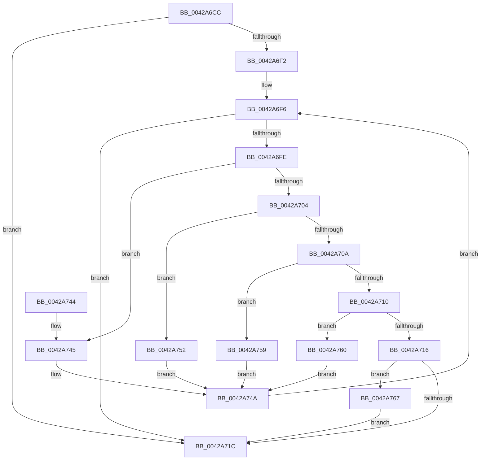

# PiDevCfgParseVariableName

- RVA: `0x0042A6CC`–`0x0042A76D` (길이 `161` bytes)
- VA: `0x000000014042A6CC`
- 실행 섹션: `.text`
- PDB 이름 있음: `예`; PDB Function 태그: `아니요`
- unwind 정보 RVA: `0x000A1038`
- 디코드: `51`개 명령, `161/161` bytes 표시
- 미해석 바이트: `0` (있으면 어셈블리에 `.byte`로 보존)

> 이 문서는 커널 이미지의 기계어와 PDB 기호를 분석해 생성했습니다. 4번과 5번은 함수 원형과 자료형을 바이너리 사용 방식에서 추정한 C 해석이며 원본 소스 복구 결과는 아닙니다.

## 1. Dependencies

- 직접 호출 지점: **1**; 고유 호출 대상: **1**
- 직접 호출자로 확인된 함수: **3**
- RIP 상대 이미지 참조: **0**

### Outgoing calls
- `0x0042A722` → [RtlInitUnicodeString](RtlInitUnicodeString_function_0042A780.md) (function, `0x0042A780`)

### Direct callers
- [PiDevCfgQueryResolveValue](../5A/PiDevCfgQueryResolveValue_function_005A801C.md) at `0x005A80B8`
- [sub_00B2C5F4](../../page/B2/Unknown_function_00B2C5F4.md) at `0x00B2C600`
- [sub_00B2C5F4](../../page/B2/Unknown_function_00B2C5F4.md) at `0x00B2C74E`
- [sub_00B2C5F4](../../page/B2/Unknown_function_00B2C5F4.md) at `0x00B2C96A`
- [sub_00B467A6](../../page/B4/Unknown_function_00B467A6.md) at `0x00B46833`

### Static image references
- 디코드된 RIP-relative 메모리 참조가 없습니다.

## 2. Other-region calls and transfers

- 다른 실행 섹션으로 향하는 call: **0**
- 별도 외부 분기/꼬리 이동을 확인하지 못했습니다.

## 3. Assembly (complete function range)

```asm
0042A6CC  48 89 5C 24 08                  mov qword ptr [rsp + 8], rbx
0042A6D1  48 89 6C 24 10                  mov qword ptr [rsp + 0x10], rbp
0042A6D6  48 89 74 24 18                  mov qword ptr [rsp + 0x18], rsi
0042A6DB  57                              push rdi
0042A6DC  48 83 EC 20                     sub rsp, 0x20
0042A6E0  33 ED                           xor ebp, ebp
0042A6E2  49 8B F0                        mov rsi, r8
0042A6E5  66 83 39 24                     cmp word ptr [rcx], 0x24
0042A6E9  4C 8B C2                        mov r8, rdx
0042A6EC  8B DD                           mov ebx, ebp
0042A6EE  8B FD                           mov edi, ebp
0042A6F0  75 2A                           jne 0x14042a71c
0042A6F2  48 8D 59 02                     lea rbx, [rcx + 2]
0042A6F6  0F B7 03                        movzx eax, word ptr [rbx]
0042A6F9  66 85 C0                        test ax, ax
0042A6FC  74 1E                           je 0x14042a71c
0042A6FE  66 83 F8 3F                     cmp ax, 0x3f
0042A702  74 41                           je 0x14042a745
0042A704  66 83 F8 21                     cmp ax, 0x21
0042A708  74 48                           je 0x14042a752
0042A70A  66 83 F8 2B                     cmp ax, 0x2b
0042A70E  74 49                           je 0x14042a759
0042A710  66 83 F8 2D                     cmp ax, 0x2d
0042A714  74 4A                           je 0x14042a760
0042A716  66 83 F8 24                     cmp ax, 0x24
0042A71A  74 4B                           je 0x14042a767
0042A71C  48 8B D3                        mov rdx, rbx
0042A71F  49 8B C8                        mov rcx, r8
0042A722  E8 59 00 00 00                  call 0x14042a780
0042A727  48 8B 6C 24 38                  mov rbp, qword ptr [rsp + 0x38]
0042A72C  48 85 DB                        test rbx, rbx
0042A72F  48 8B 5C 24 30                  mov rbx, qword ptr [rsp + 0x30]
0042A734  89 3E                           mov dword ptr [rsi], edi
0042A736  0F 95 C0                        setne al
0042A739  48 8B 74 24 40                  mov rsi, qword ptr [rsp + 0x40]
0042A73E  48 83 C4 20                     add rsp, 0x20
0042A742  5F                              pop rdi
0042A743  C3                              ret
0042A744  CC                              int3
0042A745  B8 00 00 01 00                  mov eax, 0x10000
0042A74A  48 83 C3 02                     add rbx, 2
0042A74E  0B F8                           or edi, eax
0042A750  EB A4                           jmp 0x14042a6f6
0042A752  B8 00 00 02 00                  mov eax, 0x20000
0042A757  EB F1                           jmp 0x14042a74a
0042A759  B8 00 00 04 00                  mov eax, 0x40000
0042A75E  EB EA                           jmp 0x14042a74a
0042A760  B8 00 00 08 00                  mov eax, 0x80000
0042A765  EB E3                           jmp 0x14042a74a
0042A767  48 83 C3 02                     add rbx, 2
0042A76B  EB AF                           jmp 0x14042a71c
```

## 4. C-style interpretation (structured pseudocode)

```c
__int64 __fastcall PiDevCfgParseVariableName(__int64 a1, __int64 a2, __int64 a3)
{
    __int64 result;
    __int64 v_rbp;
    __int64 v_rbx;
    __int64 v_rdi;
    __int64 v_rsp;
    unsigned __int64 v_stack_p10;
    unsigned __int64 v_stack_p18;
    unsigned __int64 v_stack_p8;

    v_stack_p8 = v_rbx;
    v_stack_p10 = v_rbp;
    v_stack_p18 = v_rsi;
    v_rsp = (v_rsp) - (32);
    v_rbp = 0;
    if ((*(unsigned __int16 *)(a1)) != 36) goto loc_0042A71C;
loc_0042A6F6:
    if ((unsigned __int16)(*(unsigned __int16 *)(a1 + 2)) == 0) goto loc_0042A71C;
    if (((unsigned __int16)(*(unsigned __int16 *)(a1 + 2))) == 63) goto loc_0042A745;
    if (((unsigned __int16)(*(unsigned __int16 *)(a1 + 2))) == 33) goto loc_0042A752;
    if (((unsigned __int16)(*(unsigned __int16 *)(a1 + 2))) == 43) goto loc_0042A759;
    if (((unsigned __int16)(*(unsigned __int16 *)(a1 + 2))) == 45) goto loc_0042A760;
    if (((unsigned __int16)(*(unsigned __int16 *)(a1 + 2))) == 36) goto loc_0042A767;
loc_0042A71C:
    result = RtlInitUnicodeString(a2, a1 + 2, a2, a4);
    *(unsigned int *)(a3) = 0;
    result = (a1 + 2 != 0) ? 1 : 0;
    v_rsp = (v_rsp) + (32);
    return result;
loc_0042A745:
loc_0042A74A:
    v_rbx = (v_stack_p8) + (2);
    v_rdi = (unsigned int)((0) | ((unsigned int)((unsigned int)(0x10000ULL))));
    goto loc_0042A6F6;
loc_0042A752:
    goto loc_0042A74A;
loc_0042A759:
    goto loc_0042A74A;
loc_0042A760:
    goto loc_0042A74A;
loc_0042A767:
    v_rbx = (v_rbx) + (2);
    goto loc_0042A71C;
}
```

## 5. (Beta) C Style

```c
int64_t PiDevCfgParseVariableName(void *Arg1, int64_t Arg2, void *Arg3)
{
    uint8_t *arg1 = (uint8_t *)Arg1;
    uint8_t *arg3 = (uint8_t *)Arg3;

    int64_t result;
    int64_t local_rbp;
    int64_t local_rbx;
    int64_t local_rdi;
    int64_t local_rsp;
    uint64_t v_stack_p10;
    uint64_t v_stack_p18;
    uint64_t v_stack_p8;

    v_stack_p8 = local_rbx;
    v_stack_p10 = local_rbp;
    v_stack_p18 = local_rsi;
    local_rsp = (local_rsp) - (32);
    local_rbp = 0;
    if ((*(uint16_t *)(arg1)) != 36) goto loc_0042A71C;
loc_0042A6F6:
    if ((uint16_t)(*(uint16_t *)(arg1 + 0x2)) == 0) goto loc_0042A71C;
    if (((uint16_t)(*(uint16_t *)(arg1 + 0x2))) == 63) goto loc_0042A745;
    if (((uint16_t)(*(uint16_t *)(arg1 + 0x2))) == 33) goto loc_0042A752;
    if (((uint16_t)(*(uint16_t *)(arg1 + 0x2))) == 43) goto loc_0042A759;
    if (((uint16_t)(*(uint16_t *)(arg1 + 0x2))) == 45) goto loc_0042A760;
    if (((uint16_t)(*(uint16_t *)(arg1 + 0x2))) == 36) goto loc_0042A767;
loc_0042A71C:
    result = RtlInitUnicodeString(Arg2, Arg1 + 2, Arg2, a4);
    *(uint32_t *)(arg3) = 0;
    result = (Arg1 + 2 != 0) ? 1 : 0;
    local_rsp = (local_rsp) + (32);
    return result;
loc_0042A745:
loc_0042A74A:
    local_rbx = (v_stack_p8) + (2);
    local_rdi = (uint32_t)((0) | ((uint32_t)((uint32_t)(0x10000ULL))));
    goto loc_0042A6F6;
loc_0042A752:
    goto loc_0042A74A;
loc_0042A759:
    goto loc_0042A74A;
loc_0042A760:
    goto loc_0042A74A;
loc_0042A767:
    local_rbx = (local_rbx) + (2);
    goto loc_0042A71C;
}
```

### 관측된 메모리 오프셋

구조체 형식이 확인되지 않은 접근은 인자 기준의 오프셋으로만 기록했습니다.

| 기준 인자 | 오프셋 표현 | 폭 (bit) | 접근 |
|---|---:|---:|---|
| `Arg1` | `+ 0x0` | `16` | `R` |
| `Arg1` | `+ 0x2` | `64` | `R` |
| `Arg3` | `+ 0x0` | `32` | `W` |

## 6. Execution-region graph

[열기: 2D/3D 그래프와 함수 탐색 컨트롤 패널](../../../control-panel.html?section=text&rva=0x0042A6CC&view=graph)

- 2D 그래프는 위에서 아래로 흐르고, 3D 그래프는 빈 공간을 드래그해 회전합니다. Shift+드래그는 이동, 휠은 확대·축소, 함수 노드 선택은 대상 보고서 이동입니다.

### Static fallback


