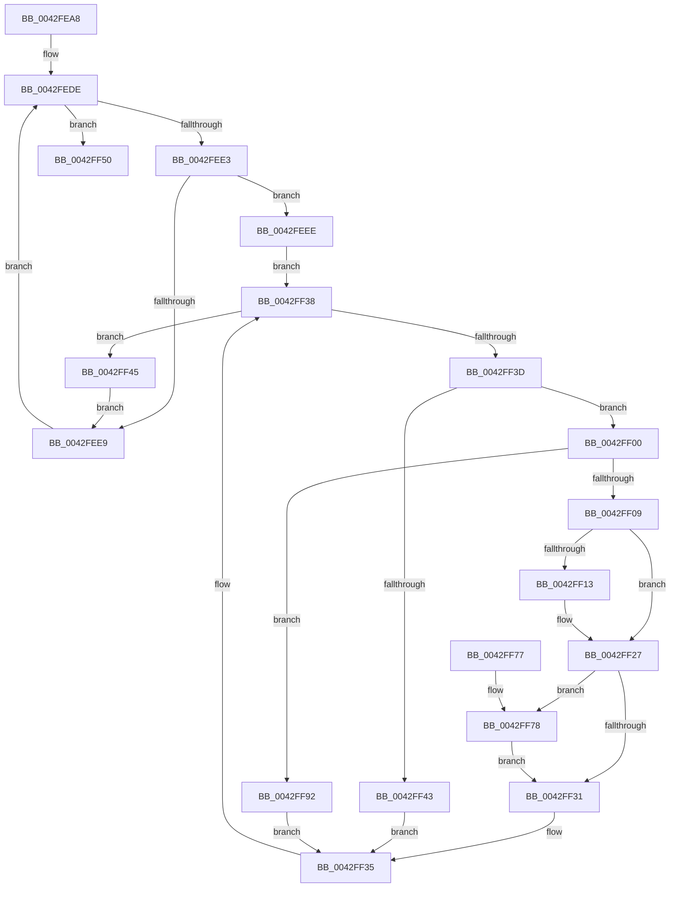

# PopCoolingSxTransition

- RVA: `0x0042FEA8`–`0x0042FFAD` (길이 `261` bytes)
- VA: `0x000000014042FEA8`
- 실행 섹션: `.text`
- PDB 이름 있음: `예`; PDB Function 태그: `아니요`
- unwind 정보 RVA: `0x000A2014`
- 디코드: `67`개 명령, `261/261` bytes 표시
- 미해석 바이트: `0` (있으면 어셈블리에 `.byte`로 보존)

> 이 문서는 커널 이미지의 기계어와 PDB 기호를 분석해 생성했습니다. 4번과 5번은 함수 원형과 자료형을 바이너리 사용 방식에서 추정한 C 해석이며 원본 소스 복구 결과는 아닙니다.

## 1. Dependencies

- 직접 호출 지점: **8**; 고유 호출 대상: **6**
- 직접 호출자로 확인된 함수: **2**
- RIP 상대 이미지 참조: **2**

### Outgoing calls
- `0x0042FECB` → [PopAcquireRwLockExclusive](../43/PopAcquireRwLockExclusive_function_00430B44.md) (function, `0x00430B44`)
- `0x0042FEF2` → [PopAcquireRwLockExclusive](../43/PopAcquireRwLockExclusive_function_00430B44.md) (function, `0x00430B44`)
- `0x0042FF1A` → [PopThermalUpdatePassiveTimeTracking](../../page/AA/PopThermalUpdatePassiveTimeTracking_function_00AA15EC.md) (function, `0x00AA15EC`)
- `0x0042FF22` → [PopTraceThermalRequestPassiveHistogram](PopTraceThermalRequestPassiveHistogram_function_0042FFB4.md) (function, `0x0042FFB4`)
- `0x0042FF49` → [PopReleaseRwLock](../2D/PopReleaseRwLock_function_002DFBBC.md) (function, `0x002DFBBC`)
- `0x0042FF57` → [PopReleaseRwLock](../2D/PopReleaseRwLock_function_002DFBBC.md) (function, `0x002DFBBC`)
- `0x0042FF83` → [PopThermalUpdateActiveTimeTracking](../../page/AB/PopThermalUpdateActiveTimeTracking_function_00ABA79C.md) (function, `0x00ABA79C`)
- `0x0042FF8B` → [PopTraceThermalRequestActiveActivity](../4E/PopTraceThermalRequestActiveActivity_function_004E9104.md) (function, `0x004E9104`)

### Direct callers
- [PopThermalSxEntry](../4E/PopThermalSxEntry_function_004E3D20.md) at `0x004E3DF5`
- [PopThermalSxExit](../5D/PopThermalSxExit_function_005D55F8.md) at `0x005D5746`

### Static image references
- `0x0042FEC4` → RVA `0x00F0BB30` (`.data`; read)
- `0x0042FED0` → RVA `0x00F0BB40` (`.data`; read)

## 2. Other-region calls and transfers

- 다른 실행 섹션으로 향하는 call: **2**
  - `0x0042FF1A` → [PopThermalUpdatePassiveTimeTracking](../../page/AA/PopThermalUpdatePassiveTimeTracking_function_00AA15EC.md) (`.text` → `PAGE`)
  - `0x0042FF83` → [PopThermalUpdateActiveTimeTracking](../../page/AB/PopThermalUpdateActiveTimeTracking_function_00ABA79C.md) (`.text` → `PAGE`)
- 별도 외부 분기/꼬리 이동을 확인하지 못했습니다.

## 3. Assembly (complete function range)

```asm
0042FEA8  48 8B C4                        mov rax, rsp
0042FEAB  48 89 58 08                     mov qword ptr [rax + 8], rbx
0042FEAF  48 89 68 10                     mov qword ptr [rax + 0x10], rbp
0042FEB3  48 89 70 18                     mov qword ptr [rax + 0x18], rsi
0042FEB7  48 89 78 20                     mov qword ptr [rax + 0x20], rdi
0042FEBB  41 57                           push r15
0042FEBD  48 83 EC 20                     sub rsp, 0x20
0042FEC1  40 8A E9                        mov bpl, cl
0042FEC4  48 8D 0D 65 BC AD 00            lea rcx, [rip + 0xadbc65]
0042FECB  E8 74 0C 00 00                  call 0x140430b44
0042FED0  48 8B 3D 69 BC AD 00            mov rdi, qword ptr [rip + 0xadbc69]
0042FED7  4C 8D 3D 62 BC AD 00            lea r15, [rip + 0xadbc62]
0042FEDE  49 3B FF                        cmp rdi, r15
0042FEE1  74 6D                           je 0x14042ff50
0042FEE3  80 7F 50 00                     cmp byte ptr [rdi + 0x50], 0
0042FEE7  75 05                           jne 0x14042feee
0042FEE9  48 8B 3F                        mov rdi, qword ptr [rdi]
0042FEEC  EB F0                           jmp 0x14042fede
0042FEEE  48 8D 4F 20                     lea rcx, [rdi + 0x20]
0042FEF2  E8 4D 0C 00 00                  call 0x140430b44
0042FEF7  48 8D 77 10                     lea rsi, [rdi + 0x10]
0042FEFB  48 8B 1E                        mov rbx, qword ptr [rsi]
0042FEFE  EB 38                           jmp 0x14042ff38
0042FF00  40 84 ED                        test bpl, bpl
0042FF03  0F 84 89 00 00 00               je 0x14042ff92
0042FF09  48 83 BF 98 00 00 00 00         cmp qword ptr [rdi + 0x98], 0
0042FF11  74 14                           je 0x14042ff27
0042FF13  8A 53 10                        mov dl, byte ptr [rbx + 0x10]
0042FF16  48 8D 4B 28                     lea rcx, [rbx + 0x28]
0042FF1A  E8 CD 16 67 00                  call 0x140aa15ec
0042FF1F  48 8B CB                        mov rcx, rbx
0042FF22  E8 8D 00 00 00                  call 0x14042ffb4
0042FF27  48 83 BF 90 00 00 00 00         cmp qword ptr [rdi + 0x90], 0
0042FF2F  75 47                           jne 0x14042ff78
0042FF31  C6 43 28 01                     mov byte ptr [rbx + 0x28], 1
0042FF35  48 8B 1B                        mov rbx, qword ptr [rbx]
0042FF38  48 3B DE                        cmp rbx, rsi
0042FF3B  74 08                           je 0x14042ff45
0042FF3D  80 7B 12 00                     cmp byte ptr [rbx + 0x12], 0
0042FF41  75 BD                           jne 0x14042ff00
0042FF43  EB F0                           jmp 0x14042ff35
0042FF45  48 8D 4F 20                     lea rcx, [rdi + 0x20]
0042FF49  E8 6E FC EA FF                  call 0x1402dfbbc
0042FF4E  EB 99                           jmp 0x14042fee9
0042FF50  48 8D 0D D9 BB AD 00            lea rcx, [rip + 0xadbbd9]
0042FF57  E8 60 FC EA FF                  call 0x1402dfbbc
0042FF5C  48 8B 5C 24 30                  mov rbx, qword ptr [rsp + 0x30]
0042FF61  48 8B 6C 24 38                  mov rbp, qword ptr [rsp + 0x38]
0042FF66  48 8B 74 24 40                  mov rsi, qword ptr [rsp + 0x40]
0042FF6B  48 8B 7C 24 48                  mov rdi, qword ptr [rsp + 0x48]
0042FF70  48 83 C4 20                     add rsp, 0x20
0042FF74  41 5F                           pop r15
0042FF76  C3                              ret
0042FF77  CC                              int3
0042FF78  80 7B 11 00                     cmp byte ptr [rbx + 0x11], 0
0042FF7C  48 8D 4B 28                     lea rcx, [rbx + 0x28]
0042FF80  0F 94 C2                        sete dl
0042FF83  E8 14 A8 68 00                  call 0x140aba79c
0042FF88  48 8B CB                        mov rcx, rbx
0042FF8B  E8 74 91 0B 00                  call 0x1404e9104
0042FF90  EB 9F                           jmp 0x14042ff31
0042FF92  48 B8 08 00 00 00 80 F7 FF FF   movabs rax, 0xfffff78000000008
0042FF9C  48 8B 00                        mov rax, qword ptr [rax]
0042FF9F  48 89 43 30                     mov qword ptr [rbx + 0x30], rax
0042FFA3  48 89 43 38                     mov qword ptr [rbx + 0x38], rax
0042FFA7  C6 43 28 00                     mov byte ptr [rbx + 0x28], 0
0042FFAB  EB 88                           jmp 0x14042ff35
```

## 4. C-style interpretation (structured pseudocode)

```c
__int64 __fastcall PopCoolingSxTransition(unsigned __int8 a1)
{
    __int64 result;
    __int64 v_rsp;
    unsigned __int64 v_stack_p10;
    unsigned __int64 v_stack_p18;
    unsigned __int64 v_stack_p20;
    unsigned __int64 v_stack_p8;

    *(unsigned __int64 *)(v_rsp + 8) = v_rbx;
    *(unsigned __int64 *)(v_rsp + 16) = v_rbp;
    *(unsigned __int64 *)(v_rsp + 24) = v_rsi;
    *(unsigned __int64 *)(v_rsp + 32) = v_rdi;
    v_rsp = (v_rsp) - (32);
    result = PopAcquireRwLockExclusive(v_rip + 11385957, a2, a3, a4);
loc_0042FEDE:
    if ((*(unsigned __int64 *)(v_rip + 11385961)) == (v_rip + 11385954)) goto loc_0042FF50;
    if ((*(unsigned __int8 *)(*(unsigned __int64 *)(v_rip + 11385961) + 80)) != 0) goto loc_0042FEEE;
loc_0042FEE9:
    goto loc_0042FEDE;
loc_0042FEEE:
    result = PopAcquireRwLockExclusive(*(unsigned __int64 *)(*(unsigned __int64 *)(v_rip + 11385961)) + 32, a2, a3, a4);
    goto loc_0042FF38;
loc_0042FF00:
    if (a1 == 0) goto loc_0042FF92;
    if ((*(unsigned __int64 *)(*(unsigned __int64 *)(*(unsigned __int64 *)(v_rip + 11385961)) + 152)) != 0) {
        a2 = *(unsigned __int8 *)(*(unsigned __int64 *)(*(unsigned __int64 *)(*(unsigned __int64 *)(v_rip + 11385961)) + 16) + 16);
        a1 = *(unsigned __int64 *)(*(unsigned __int64 *)(*(unsigned __int64 *)(v_rip + 11385961)) + 16) + 40;
        result = PopThermalUpdatePassiveTimeTracking(a1, a2, a3, a4);
        a1 = *(unsigned __int64 *)(*(unsigned __int64 *)(*(unsigned __int64 *)(v_rip + 11385961)) + 16);
        result = PopTraceThermalRequestPassiveHistogram(a1, a2, a3, a4);
    }
    if ((*(unsigned __int64 *)(*(unsigned __int64 *)(*(unsigned __int64 *)(v_rip + 11385961)) + 144)) != 0) goto loc_0042FF78;
loc_0042FF31:
    *(unsigned __int8 *)(*(unsigned __int64 *)(*(unsigned __int64 *)(*(unsigned __int64 *)(v_rip + 11385961)) + 16) + 40) = 1;
loc_0042FF35:
loc_0042FF38:
    if ((*(unsigned __int64 *)(*(unsigned __int64 *)(*(unsigned __int64 *)(*(unsigned __int64 *)(v_rip + 11385961)) + 16))) == (*(unsigned __int64 *)(*(unsigned __int64 *)(v_rip + 11385961)) + 16)) goto loc_0042FF45;
    if ((*(unsigned __int8 *)(*(unsigned __int64 *)(*(unsigned __int64 *)(*(unsigned __int64 *)(*(unsigned __int64 *)(v_rip + 11385961)) + 16)) + 18)) != 0) goto loc_0042FF00;
    goto loc_0042FF35;
loc_0042FF45:
    result = PopReleaseRwLock(*(unsigned __int64 *)(*(unsigned __int64 *)(v_rip + 11385961)) + 32, a2, a3, a4);
    goto loc_0042FEE9;
loc_0042FF50:
    result = PopReleaseRwLock(v_rip + 11385817, a2, a3, a4);
    v_rsp = (v_rsp) + (32);
    return result;
loc_0042FF78:
    a2 = ((*(unsigned __int8 *)(v_stack_p8 + 17)) == 0) ? 1 : 0;
    result = PopThermalUpdateActiveTimeTracking(v_stack_p8 + 40, a2, a3, a4);
    result = PopTraceThermalRequestActiveActivity(v_stack_p8, a2, a3, a4);
    goto loc_0042FF31;
loc_0042FF92:
    *(unsigned __int64 *)(v_stack_p8 + 48) = *(unsigned __int64 *)(result);
    *(unsigned __int64 *)(v_stack_p8 + 56) = *(unsigned __int64 *)(result);
    *(unsigned __int8 *)(v_stack_p8 + 40) = 0;
    goto loc_0042FF35;
}
```

## 5. (Beta) C Style

```c
int64_t PopCoolingSxTransition(uint8_t Arg1)
{
    int64_t result;
    int64_t local_rsp;
    uint64_t v_stack_p10;
    uint64_t v_stack_p18;
    uint64_t v_stack_p20;
    uint64_t v_stack_p8;

    *(uint64_t *)(local_rsp + 0x8) = local_rbx;
    *(uint64_t *)(local_rsp + 0x10) = local_rbp;
    *(uint64_t *)(local_rsp + 0x18) = local_rsi;
    *(uint64_t *)(local_rsp + 0x20) = local_rdi;
    local_rsp = (local_rsp) - (32);
    result = PopAcquireRwLockExclusive(v_rip + 11385957, a2, a3, a4);
loc_0042FEDE:
    if ((*(uint64_t *)(v_rip + 0xADBC69)) == (v_rip + 11385954)) goto loc_0042FF50;
    if ((*(uint8_t *)(*(uint64_t *)(v_rip + 0xADBC69) + 0x50)) != 0) goto loc_0042FEEE;
loc_0042FEE9:
    goto loc_0042FEDE;
loc_0042FEEE:
    result = PopAcquireRwLockExclusive(*(uint64_t *)(*(uint64_t *)(v_rip + 0xADBC69)) + 32, a2, a3, a4);
    goto loc_0042FF38;
loc_0042FF00:
    if (Arg1 == 0) goto loc_0042FF92;
    if ((*(uint64_t *)(*(uint64_t *)(*(uint64_t *)(v_rip + 0xADBC69)) + 0x98)) != 0) {
        a2 = *(uint8_t *)(*(uint64_t *)(*(uint64_t *)(*(uint64_t *)(v_rip + 0xADBC69)) + 0x10) + 0x10);
        Arg1 = *(uint64_t *)(*(uint64_t *)(*(uint64_t *)(v_rip + 0xADBC69)) + 0x10) + 40;
        result = PopThermalUpdatePassiveTimeTracking(Arg1, a2, a3, a4);
        Arg1 = *(uint64_t *)(*(uint64_t *)(*(uint64_t *)(v_rip + 0xADBC69)) + 0x10);
        result = PopTraceThermalRequestPassiveHistogram(Arg1, a2, a3, a4);
    }
    if ((*(uint64_t *)(*(uint64_t *)(*(uint64_t *)(v_rip + 0xADBC69)) + 0x90)) != 0) goto loc_0042FF78;
loc_0042FF31:
    *(uint8_t *)(*(uint64_t *)(*(uint64_t *)(*(uint64_t *)(v_rip + 0xADBC69)) + 0x10) + 0x28) = 1;
loc_0042FF35:
loc_0042FF38:
    if ((*(uint64_t *)(*(uint64_t *)(*(uint64_t *)(*(uint64_t *)(v_rip + 0xADBC69)) + 0x10))) == (*(uint64_t *)(*(uint64_t *)(v_rip + 0xADBC69)) + 16)) goto loc_0042FF45;
    if ((*(uint8_t *)(*(uint64_t *)(*(uint64_t *)(*(uint64_t *)(*(uint64_t *)(v_rip + 0xADBC69)) + 0x10)) + 0x12)) != 0) goto loc_0042FF00;
    goto loc_0042FF35;
loc_0042FF45:
    result = PopReleaseRwLock(*(uint64_t *)(*(uint64_t *)(v_rip + 0xADBC69)) + 32, a2, a3, a4);
    goto loc_0042FEE9;
loc_0042FF50:
    result = PopReleaseRwLock(v_rip + 11385817, a2, a3, a4);
    local_rsp = (local_rsp) + (32);
    return result;
loc_0042FF78:
    a2 = ((*(uint8_t *)(v_stack_p8 + 0x11)) == 0) ? 1 : 0;
    result = PopThermalUpdateActiveTimeTracking(v_stack_p8 + 40, a2, a3, a4);
    result = PopTraceThermalRequestActiveActivity(v_stack_p8, a2, a3, a4);
    goto loc_0042FF31;
loc_0042FF92:
    *(uint64_t *)(v_stack_p8 + 0x30) = *(uint64_t *)(result);
    *(uint64_t *)(v_stack_p8 + 0x38) = *(uint64_t *)(result);
    *(uint8_t *)(v_stack_p8 + 0x28) = 0;
    goto loc_0042FF35;
}
```

## 6. Execution-region graph

[열기: 2D/3D 그래프와 함수 탐색 컨트롤 패널](../../../control-panel.html?section=text&rva=0x0042FEA8&view=graph)

- 2D 그래프는 위에서 아래로 흐르고, 3D 그래프는 빈 공간을 드래그해 회전합니다. Shift+드래그는 이동, 휠은 확대·축소, 함수 노드 선택은 대상 보고서 이동입니다.

### Static fallback


