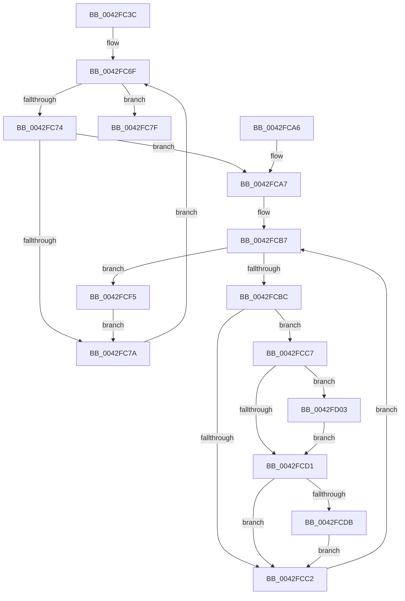

# PopCoolingTelemetryWorker

- RVA: `0x0042FC3C`–`0x0042FD19` (길이 `221` bytes)
- VA: `0x000000014042FC3C`
- 실행 섹션: `.text`
- PDB 이름 있음: `예`; PDB Function 태그: `아니요`
- unwind 정보 RVA: `0x000A1FDC`
- 디코드: `57`개 명령, `221/221` bytes 표시
- 미해석 바이트: `0` (있으면 어셈블리에 `.byte`로 보존)

> 이 문서는 커널 이미지의 기계어와 PDB 기호를 분석해 생성했습니다. 4번과 5번은 함수 원형과 자료형을 바이너리 사용 방식에서 추정한 C 해석이며 원본 소스 복구 결과는 아닙니다.

## 1. Dependencies

- 직접 호출 지점: **8**; 고유 호출 대상: **6**
- 직접 호출자로 확인된 함수: **1**
- RIP 상대 이미지 참조: **2**

### Outgoing calls
- `0x0042FC5C` → [PopAcquireRwLockExclusive](../43/PopAcquireRwLockExclusive_function_00430B44.md) (function, `0x00430B44`)
- `0x0042FC86` → [PopReleaseRwLock](../2D/PopReleaseRwLock_function_002DFBBC.md) (function, `0x002DFBBC`)
- `0x0042FCAB` → [PopAcquireRwLockExclusive](../43/PopAcquireRwLockExclusive_function_00430B44.md) (function, `0x00430B44`)
- `0x0042FCE6` → [PopThermalUpdateActiveTimeTracking](../../page/AB/PopThermalUpdateActiveTimeTracking_function_00ABA79C.md) (function, `0x00ABA79C`)
- `0x0042FCEE` → [PopTraceThermalRequestActiveActivity](../4E/PopTraceThermalRequestActiveActivity_function_004E9104.md) (function, `0x004E9104`)
- `0x0042FCF9` → [PopReleaseRwLock](../2D/PopReleaseRwLock_function_002DFBBC.md) (function, `0x002DFBBC`)
- `0x0042FD0A` → [PopThermalUpdatePassiveTimeTracking](../../page/AA/PopThermalUpdatePassiveTimeTracking_function_00AA15EC.md) (function, `0x00AA15EC`)
- `0x0042FD12` → [PopTraceThermalRequestPassiveHistogram](PopTraceThermalRequestPassiveHistogram_function_0042FFB4.md) (function, `0x0042FFB4`)

### Direct callers
- [PopThermalTelemetryWorker](../5D/PopThermalTelemetryWorker_function_005D57F0.md) at `0x005D5891`

### Static image references
- `0x0042FC55` → RVA `0x00F0BB30` (`.data`; read)
- `0x0042FC61` → RVA `0x00F0BB40` (`.data`; read)

## 2. Other-region calls and transfers

- 다른 실행 섹션으로 향하는 call: **2**
  - `0x0042FCE6` → [PopThermalUpdateActiveTimeTracking](../../page/AB/PopThermalUpdateActiveTimeTracking_function_00ABA79C.md) (`.text` → `PAGE`)
  - `0x0042FD0A` → [PopThermalUpdatePassiveTimeTracking](../../page/AA/PopThermalUpdatePassiveTimeTracking_function_00AA15EC.md) (`.text` → `PAGE`)
- 별도 외부 분기/꼬리 이동을 확인하지 못했습니다.

## 3. Assembly (complete function range)

```asm
0042FC3C  48 8B C4                        mov rax, rsp
0042FC3F  48 89 58 08                     mov qword ptr [rax + 8], rbx
0042FC43  48 89 70 10                     mov qword ptr [rax + 0x10], rsi
0042FC47  48 89 78 18                     mov qword ptr [rax + 0x18], rdi
0042FC4B  4C 89 70 20                     mov qword ptr [rax + 0x20], r14
0042FC4F  41 57                           push r15
0042FC51  48 83 EC 20                     sub rsp, 0x20
0042FC55  48 8D 0D D4 BE AD 00            lea rcx, [rip + 0xadbed4]
0042FC5C  E8 E3 0E 00 00                  call 0x140430b44
0042FC61  48 8B 1D D8 BE AD 00            mov rbx, qword ptr [rip + 0xadbed8]
0042FC68  4C 8D 3D D1 BE AD 00            lea r15, [rip + 0xadbed1]
0042FC6F  49 3B DF                        cmp rbx, r15
0042FC72  74 0B                           je 0x14042fc7f
0042FC74  80 7B 50 00                     cmp byte ptr [rbx + 0x50], 0
0042FC78  75 2D                           jne 0x14042fca7
0042FC7A  48 8B 1B                        mov rbx, qword ptr [rbx]
0042FC7D  EB F0                           jmp 0x14042fc6f
0042FC7F  48 8D 0D AA BE AD 00            lea rcx, [rip + 0xadbeaa]
0042FC86  E8 31 FF EA FF                  call 0x1402dfbbc
0042FC8B  48 8B 5C 24 30                  mov rbx, qword ptr [rsp + 0x30]
0042FC90  48 8B 74 24 38                  mov rsi, qword ptr [rsp + 0x38]
0042FC95  48 8B 7C 24 40                  mov rdi, qword ptr [rsp + 0x40]
0042FC9A  4C 8B 74 24 48                  mov r14, qword ptr [rsp + 0x48]
0042FC9F  48 83 C4 20                     add rsp, 0x20
0042FCA3  41 5F                           pop r15
0042FCA5  C3                              ret
0042FCA6  CC                              int3
0042FCA7  48 8D 4B 20                     lea rcx, [rbx + 0x20]
0042FCAB  E8 94 0E 00 00                  call 0x140430b44
0042FCB0  4C 8D 73 10                     lea r14, [rbx + 0x10]
0042FCB4  49 8B 3E                        mov rdi, qword ptr [r14]
0042FCB7  49 3B FE                        cmp rdi, r14
0042FCBA  74 39                           je 0x14042fcf5
0042FCBC  80 7F 12 00                     cmp byte ptr [rdi + 0x12], 0
0042FCC0  75 05                           jne 0x14042fcc7
0042FCC2  48 8B 3F                        mov rdi, qword ptr [rdi]
0042FCC5  EB F0                           jmp 0x14042fcb7
0042FCC7  48 83 BB 98 00 00 00 00         cmp qword ptr [rbx + 0x98], 0
0042FCCF  75 32                           jne 0x14042fd03
0042FCD1  48 83 BB 90 00 00 00 00         cmp qword ptr [rbx + 0x90], 0
0042FCD9  74 E7                           je 0x14042fcc2
0042FCDB  80 7F 11 00                     cmp byte ptr [rdi + 0x11], 0
0042FCDF  48 8D 4F 28                     lea rcx, [rdi + 0x28]
0042FCE3  0F 94 C2                        sete dl
0042FCE6  E8 B1 AA 68 00                  call 0x140aba79c
0042FCEB  48 8B CF                        mov rcx, rdi
0042FCEE  E8 11 94 0B 00                  call 0x1404e9104
0042FCF3  EB CD                           jmp 0x14042fcc2
0042FCF5  48 8D 4B 20                     lea rcx, [rbx + 0x20]
0042FCF9  E8 BE FE EA FF                  call 0x1402dfbbc
0042FCFE  E9 77 FF FF FF                  jmp 0x14042fc7a
0042FD03  8A 57 10                        mov dl, byte ptr [rdi + 0x10]
0042FD06  48 8D 4F 28                     lea rcx, [rdi + 0x28]
0042FD0A  E8 DD 18 67 00                  call 0x140aa15ec
0042FD0F  48 8B CF                        mov rcx, rdi
0042FD12  E8 9D 02 00 00                  call 0x14042ffb4
0042FD17  EB B8                           jmp 0x14042fcd1
```

## 4. C-style interpretation (structured pseudocode)

```c
__int64 __fastcall PopCoolingTelemetryWorker(void)
{
    __int64 result;
    __int64 v_rsp;
    unsigned __int64 v_stack_p10;
    unsigned __int64 v_stack_p18;
    unsigned __int64 v_stack_p20;
    unsigned __int64 v_stack_p8;

    *(unsigned __int64 *)(v_rsp + 8) = v_rbx;
    *(unsigned __int64 *)(v_rsp + 16) = v_rsi;
    *(unsigned __int64 *)(v_rsp + 24) = v_rdi;
    *(unsigned __int64 *)(v_rsp + 32) = v_r14;
    v_rsp = (v_rsp) - (32);
    result = PopAcquireRwLockExclusive(v_rip + 11386580, a2, a3, a4);
loc_0042FC6F:
    if ((*(unsigned __int64 *)(v_rip + 11386584)) == (v_rip + 11386577)) goto loc_0042FC7F;
    if ((*(unsigned __int8 *)(*(unsigned __int64 *)(v_rip + 11386584) + 80)) != 0) goto loc_0042FCA7;
loc_0042FC7A:
    goto loc_0042FC6F;
loc_0042FC7F:
    result = PopReleaseRwLock(v_rip + 11386538, a2, a3, a4);
    v_rsp = (v_rsp) + (32);
    return result;
loc_0042FCA7:
    result = PopAcquireRwLockExclusive(v_stack_p8 + 32, a2, a3, a4);
loc_0042FCB7:
    if ((*(unsigned __int64 *)(v_stack_p8 + 16)) == (v_stack_p8 + 16)) goto loc_0042FCF5;
    if ((*(unsigned __int8 *)(*(unsigned __int64 *)(v_stack_p8 + 16) + 18)) != 0) goto loc_0042FCC7;
loc_0042FCC2:
    goto loc_0042FCB7;
loc_0042FCC7:
    if ((*(unsigned __int64 *)(v_stack_p8 + 152)) != 0) goto loc_0042FD03;
loc_0042FCD1:
    if ((*(unsigned __int64 *)(v_stack_p8 + 144)) == 0) goto loc_0042FCC2;
    a2 = ((*(unsigned __int8 *)(*(unsigned __int64 *)(*(unsigned __int64 *)(v_stack_p8 + 16)) + 17)) == 0) ? 1 : 0;
    result = PopThermalUpdateActiveTimeTracking(*(unsigned __int64 *)(*(unsigned __int64 *)(v_stack_p8 + 16)) + 40, a2, a3, a4);
    result = PopTraceThermalRequestActiveActivity(*(unsigned __int64 *)(*(unsigned __int64 *)(v_stack_p8 + 16)), a2, a3, a4);
    goto loc_0042FCC2;
loc_0042FCF5:
    result = PopReleaseRwLock(v_stack_p8 + 32, a2, a3, a4);
    goto loc_0042FC7A;
loc_0042FD03:
    result = PopThermalUpdatePassiveTimeTracking(*(unsigned __int64 *)(*(unsigned __int64 *)(v_stack_p8 + 16)) + 40, *(unsigned __int8 *)(*(unsigned __int64 *)(*(unsigned __int64 *)(v_stack_p8 + 16)) + 16), a3, a4);
    result = PopTraceThermalRequestPassiveHistogram(*(unsigned __int64 *)(*(unsigned __int64 *)(v_stack_p8 + 16)), *(unsigned __int8 *)(*(unsigned __int64 *)(*(unsigned __int64 *)(v_stack_p8 + 16)) + 16), a3, a4);
    goto loc_0042FCD1;
}
```

## 5. (Beta) C Style

```c
void PopCoolingTelemetryWorker(void)
{
    int64_t result;
    int64_t local_rsp;
    uint64_t v_stack_p10;
    uint64_t v_stack_p18;
    uint64_t v_stack_p20;
    uint64_t v_stack_p8;

    *(uint64_t *)(local_rsp + 0x8) = local_rbx;
    *(uint64_t *)(local_rsp + 0x10) = local_rsi;
    *(uint64_t *)(local_rsp + 0x18) = local_rdi;
    *(uint64_t *)(local_rsp + 0x20) = local_r14;
    local_rsp = (local_rsp) - (32);
    result = PopAcquireRwLockExclusive(v_rip + 11386580, a2, a3, a4);
loc_0042FC6F:
    if ((*(uint64_t *)(v_rip + 0xADBED8)) == (v_rip + 11386577)) goto loc_0042FC7F;
    if ((*(uint8_t *)(*(uint64_t *)(v_rip + 0xADBED8) + 0x50)) != 0) goto loc_0042FCA7;
loc_0042FC7A:
    goto loc_0042FC6F;
loc_0042FC7F:
    result = PopReleaseRwLock(v_rip + 11386538, a2, a3, a4);
    local_rsp = (local_rsp) + (32);
    return result;
loc_0042FCA7:
    result = PopAcquireRwLockExclusive(v_stack_p8 + 32, a2, a3, a4);
loc_0042FCB7:
    if ((*(uint64_t *)(v_stack_p8 + 0x10)) == (v_stack_p8 + 16)) goto loc_0042FCF5;
    if ((*(uint8_t *)(*(uint64_t *)(v_stack_p8 + 0x10) + 0x12)) != 0) goto loc_0042FCC7;
loc_0042FCC2:
    goto loc_0042FCB7;
loc_0042FCC7:
    if ((*(uint64_t *)(v_stack_p8 + 0x98)) != 0) goto loc_0042FD03;
loc_0042FCD1:
    if ((*(uint64_t *)(v_stack_p8 + 0x90)) == 0) goto loc_0042FCC2;
    a2 = ((*(uint8_t *)(*(uint64_t *)(*(uint64_t *)(v_stack_p8 + 0x10)) + 0x11)) == 0) ? 1 : 0;
    result = PopThermalUpdateActiveTimeTracking(*(uint64_t *)(*(uint64_t *)(v_stack_p8 + 0x10)) + 40, a2, a3, a4);
    result = PopTraceThermalRequestActiveActivity(*(uint64_t *)(*(uint64_t *)(v_stack_p8 + 0x10)), a2, a3, a4);
    goto loc_0042FCC2;
loc_0042FCF5:
    result = PopReleaseRwLock(v_stack_p8 + 32, a2, a3, a4);
    goto loc_0042FC7A;
loc_0042FD03:
    result = PopThermalUpdatePassiveTimeTracking(*(uint64_t *)(*(uint64_t *)(v_stack_p8 + 0x10)) + 40, *(uint8_t *)(*(uint64_t *)(*(uint64_t *)(v_stack_p8 + 0x10)) + 0x10), a3, a4);
    result = PopTraceThermalRequestPassiveHistogram(*(uint64_t *)(*(uint64_t *)(v_stack_p8 + 0x10)), *(uint8_t *)(*(uint64_t *)(*(uint64_t *)(v_stack_p8 + 0x10)) + 0x10), a3, a4);
    goto loc_0042FCD1;
}
```

## 6. Execution-region graph

[열기: 2D/3D 그래프와 함수 탐색 컨트롤 패널](../../../control-panel.html?section=text&rva=0x0042FC3C&view=graph)

- 2D 그래프는 위에서 아래로 흐르고, 3D 그래프는 빈 공간을 드래그해 회전합니다. Shift+드래그는 이동, 휠은 확대·축소, 함수 노드 선택은 대상 보고서 이동입니다.

### Static fallback


