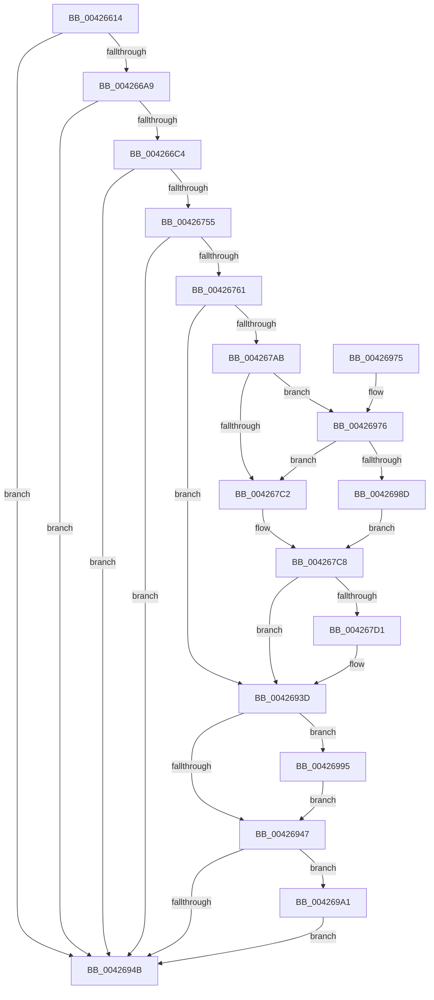

# PopDiagTraceFxDeviceAccounting

- RVA: `0x00426614`–`0x004269AD` (길이 `921` bytes)
- VA: `0x0000000140426614`
- 실행 섹션: `.text`
- PDB 이름 있음: `예`; PDB Function 태그: `아니요`
- unwind 정보 RVA: `0x000A05C8`
- 디코드: `193`개 명령, `921/921` bytes 표시
- 미해석 바이트: `0` (있으면 어셈블리에 `.byte`로 보존)

> 이 문서는 커널 이미지의 기계어와 PDB 기호를 분석해 생성했습니다. 4번과 5번은 함수 원형과 자료형을 바이너리 사용 방식에서 추정한 C 해석이며 원본 소스 복구 결과는 아닙니다.

## 1. Dependencies

- 직접 호출 지점: **10**; 고유 호출 대상: **7**
- 직접 호출자로 확인된 함수: **1**
- RIP 상대 이미지 참조: **11**

### Outgoing calls
- `0x00426663` → [wcslen](../50/wcslen_function_00501BA0.md) (function, `0x00501BA0`)
- `0x00426687` → [wcslen](../50/wcslen_function_00501BA0.md) (function, `0x00501BA0`)
- `0x004266B7` → [EtwEventEnabled](../39/EtwEventEnabled_function_00392450.md) (function, `0x00392450`)
- `0x00426744` → [EtwWriteEx](../25/EtwWriteEx_function_0025F0D0.md) (function, `0x0025F0D0`)
- `0x00426775` → [PopDiagQueryDevicePropertyString](../../page/AA/PopDiagQueryDevicePropertyString_function_00AA2014.md) (function, `0x00AA2014`)
- `0x0042678A` → [PopDiagQueryDevicePropertyString](../../page/AA/PopDiagQueryDevicePropertyString_function_00AA2014.md) (function, `0x00AA2014`)
- `0x00426938` → [tlgWriteTransfer_EtwWriteTransfer](tlgWriteTransfer_EtwWriteTransfer_function_004260E0.md) (function, `0x004260E0`)
- `0x00426955` → [_security_check_cookie](../6A/_security_check_cookie_function_006AC640.md) (function, `0x006AC640`)
- `0x0042699A` → [ExFreePoolWithTag](../../poolcode/B8/ExFreePoolWithTag_function_00B82870.md) (function, `0x00B82870`)
- `0x004269A6` → [ExFreePoolWithTag](../../poolcode/B8/ExFreePoolWithTag_function_00B82870.md) (function, `0x00B82870`)

### Direct callers
- [PopFxStopDeviceAccounting](PopFxStopDeviceAccounting_function_004261D8.md) at `0x00426591`

### Static image references
- `0x00426638` → RVA `0x00E0A740` (`.data`; read)
- `0x00426649` → RVA `0x006C8EC0` (` ?? ::FNODOBFM::`string'`; read)
- `0x00426698` → RVA `0x00E67859` (`.data`; read)
- `0x004266A9` → RVA `0x00F0B6B8` (`.data`; read)
- `0x004266B0` → RVA `0x00013FA8` (`.rdata`; read)
- `0x004266C4` → RVA `0x00F0B6B0` (`.data`; read)
- `0x00426755` → RVA `0x00E67868` (`.data`; read)
- `0x0042679E` → RVA `0x00E076D8` (`.data`; read)
- `0x004267B5` → RVA `0x00E076E8` (`.data`; read)
- `0x004268A6` → RVA `0x0004A3D8` (`.rdata`; read)
- `0x00426976` → RVA `0x00E076F0` (`.data`; read)

## 2. Other-region calls and transfers

- 다른 실행 섹션으로 향하는 call: **4**
  - `0x00426775` → [PopDiagQueryDevicePropertyString](../../page/AA/PopDiagQueryDevicePropertyString_function_00AA2014.md) (`.text` → `PAGE`)
  - `0x0042678A` → [PopDiagQueryDevicePropertyString](../../page/AA/PopDiagQueryDevicePropertyString_function_00AA2014.md) (`.text` → `PAGE`)
  - `0x0042699A` → [ExFreePoolWithTag](../../poolcode/B8/ExFreePoolWithTag_function_00B82870.md) (`.text` → `POOLCODE`)
  - `0x004269A6` → [ExFreePoolWithTag](../../poolcode/B8/ExFreePoolWithTag_function_00B82870.md) (`.text` → `POOLCODE`)
- 별도 외부 분기/꼬리 이동을 확인하지 못했습니다.

## 3. Assembly (complete function range)

```asm
00426614  48 89 5C 24 10                  mov qword ptr [rsp + 0x10], rbx
00426619  4C 89 4C 24 20                  mov qword ptr [rsp + 0x20], r9
0042661E  55                              push rbp
0042661F  56                              push rsi
00426620  57                              push rdi
00426621  41 54                           push r12
00426623  41 55                           push r13
00426625  41 56                           push r14
00426627  41 57                           push r15
00426629  48 8D AC 24 20 FF FF FF         lea rbp, [rsp - 0xe0]
00426631  48 81 EC E0 01 00 00            sub rsp, 0x1e0
00426638  48 8B 05 01 41 9E 00            mov rax, qword ptr [rip + 0x9e4101]
0042663F  48 33 C4                        xor rax, rsp
00426642  48 89 85 D0 00 00 00            mov qword ptr [rbp + 0xd0], rax
00426649  48 8D 3D 70 28 2A 00            lea rdi, [rip + 0x2a2870]
00426650  48 89 4C 24 48                  mov qword ptr [rsp + 0x48], rcx
00426655  48 8B CF                        mov rcx, rdi
00426658  48 89 7C 24 58                  mov qword ptr [rsp + 0x58], rdi
0042665D  4D 8B E8                        mov r13, r8
00426660  4C 8B E2                        mov r12, rdx
00426663  E8 38 B5 0D 00                  call 0x140501ba0
00426668  48 03 C0                        add rax, rax
0042666B  48 89 7C 24 68                  mov qword ptr [rsp + 0x68], rdi
00426670  BE FC FF 00 00                  mov esi, 0xfffc
00426675  48 8B CF                        mov rcx, rdi
00426678  8D 5E 02                        lea ebx, [rsi + 2]
0042667B  48 3B C3                        cmp rax, rbx
0042667E  48 0F 43 C6                     cmovae rax, rsi
00426682  66 89 44 24 50                  mov word ptr [rsp + 0x50], ax
00426687  E8 14 B5 0D 00                  call 0x140501ba0
0042668C  48 03 C0                        add rax, rax
0042668F  48 3B C3                        cmp rax, rbx
00426692  48 0F 43 C6                     cmovae rax, rsi
00426696  33 DB                           xor ebx, ebx
00426698  38 1D BB 11 A4 00               cmp byte ptr [rip + 0xa411bb], bl
0042669E  66 89 44 24 60                  mov word ptr [rsp + 0x60], ax
004266A3  0F 84 A2 02 00 00               je 0x14042694b
004266A9  48 8B 0D 08 50 AE 00            mov rcx, qword ptr [rip + 0xae5008]
004266B0  48 8D 15 F1 D8 BE FF            lea rdx, [rip - 0x41270f]
004266B7  E8 94 BD F6 FF                  call 0x140392450
004266BC  84 C0                           test al, al
004266BE  0F 84 87 02 00 00               je 0x14042694b
004266C4  8A 05 E6 4F AE 00               mov al, byte ptr [rip + 0xae4fe6]
004266CA  8D 7B 01                        lea edi, [rbx + 1]
004266CD  48 8B 0D E4 4F AE 00            mov rcx, qword ptr [rip + 0xae4fe4]
004266D4  48 8D 15 CD D8 BE FF            lea rdx, [rip - 0x412733]
004266DB  88 44 24 40                     mov byte ptr [rsp + 0x40], al
004266DF  45 33 C9                        xor r9d, r9d
004266E2  48 8D 44 24 40                  lea rax, [rsp + 0x40]
004266E7  48 89 7D 98                     mov qword ptr [rbp - 0x68], rdi
004266EB  48 89 45 90                     mov qword ptr [rbp - 0x70], rax
004266EF  45 33 C0                        xor r8d, r8d
004266F2  48 8D 44 24 48                  lea rax, [rsp + 0x48]
004266F7  48 C7 45 A8 08 00 00 00         mov qword ptr [rbp - 0x58], 8
004266FF  48 89 45 A0                     mov qword ptr [rbp - 0x60], rax
00426703  48 8D 85 38 01 00 00            lea rax, [rbp + 0x138]
0042670A  48 89 45 B0                     mov qword ptr [rbp - 0x50], rax
0042670E  48 8D 05 9B 4F AE 00            lea rax, [rip + 0xae4f9b]
00426715  48 89 45 C0                     mov qword ptr [rbp - 0x40], rax
00426719  48 8D 45 90                     lea rax, [rbp - 0x70]
0042671D  48 89 44 24 38                  mov qword ptr [rsp + 0x38], rax
00426722  C7 44 24 30 04 00 00 00         mov dword ptr [rsp + 0x30], 4
0042672A  48 89 5C 24 28                  mov qword ptr [rsp + 0x28], rbx
0042672F  48 89 5C 24 20                  mov qword ptr [rsp + 0x20], rbx
00426734  48 C7 45 B8 08 00 00 00         mov qword ptr [rbp - 0x48], 8
0042673C  48 C7 45 C8 08 00 00 00         mov qword ptr [rbp - 0x38], 8
00426744  E8 87 89 E3 FF                  call 0x14025f0d0
00426749  38 9D 40 01 00 00               cmp byte ptr [rbp + 0x140], bl
0042674F  0F 84 F6 01 00 00               je 0x14042694b
00426755  39 1D 0D 11 A4 00               cmp dword ptr [rip + 0xa4110d], ebx
0042675B  0F 85 EA 01 00 00               jne 0x14042694b
00426761  48 8B 44 24 48                  mov rax, qword ptr [rsp + 0x48]
00426766  4C 8D 44 24 50                  lea r8, [rsp + 0x50]
0042676B  8D 57 04                        lea edx, [rdi + 4]
0042676E  48 8B 58 20                     mov rbx, qword ptr [rax + 0x20]
00426772  48 8B CB                        mov rcx, rbx
00426775  E8 9A B8 67 00                  call 0x140aa2014
0042677A  8B F0                           mov esi, eax
0042677C  4C 8D 44 24 60                  lea r8, [rsp + 0x60]
00426781  8D 57 05                        lea edx, [rdi + 5]
00426784  C1 EE 1F                        shr esi, 0x1f
00426787  48 8B CB                        mov rcx, rbx
0042678A  E8 85 B8 67 00                  call 0x140aa2014
0042678F  4C 8B 7C 24 58                  mov r15, qword ptr [rsp + 0x58]
00426794  8B D8                           mov ebx, eax
00426796  4C 8B 74 24 68                  mov r14, qword ptr [rsp + 0x68]
0042679B  C1 EB 1F                        shr ebx, 0x1f
0042679E  83 3D 33 0F 9E 00 05            cmp dword ptr [rip + 0x9e0f33], 5
004267A5  0F 86 92 01 00 00               jbe 0x14042693d
004267AB  48 BA 00 00 00 00 00 40 00 00   movabs rdx, 0x400000000000
004267B5  48 85 15 2C 0F 9E 00            test qword ptr [rip + 0x9e0f2c], rdx
004267BC  0F 85 B4 01 00 00               jne 0x140426976
004267C2  45 33 C9                        xor r9d, r9d
004267C5  41 8A F9                        mov dil, r9b
004267C8  40 84 FF                        test dil, dil
004267CB  0F 84 6C 01 00 00               je 0x14042693d
004267D1  48 8B 05 D8 4E AE 00            mov rax, qword ptr [rip + 0xae4ed8]
004267D8  45 33 C0                        xor r8d, r8d
004267DB  48 89 44 24 70                  mov qword ptr [rsp + 0x70], rax
004267E0  48 8D 44 24 70                  lea rax, [rsp + 0x70]
004267E5  48 89 45 F0                     mov qword ptr [rbp - 0x10], rax
004267E9  48 8B 44 24 48                  mov rax, qword ptr [rsp + 0x48]
004267EE  48 C7 45 F8 08 00 00 00         mov qword ptr [rbp - 8], 8
004267F6  0F B7 50 28                     movzx edx, word ptr [rax + 0x28]
004267FA  48 8B 48 30                     mov rcx, qword ptr [rax + 0x30]
004267FE  48 8D 45 18                     lea rax, [rbp + 0x18]
00426802  48 89 45 00                     mov qword ptr [rbp], rax
00426806  49 8B 04 24                     mov rax, qword ptr [r12]
0042680A  48 89 44 24 78                  mov qword ptr [rsp + 0x78], rax
0042680F  48 8D 44 24 78                  lea rax, [rsp + 0x78]
00426814  48 89 45 20                     mov qword ptr [rbp + 0x20], rax
00426818  49 8D 44 24 10                  lea rax, [r12 + 0x10]
0042681D  48 89 45 30                     mov qword ptr [rbp + 0x30], rax
00426821  49 8D 44 24 38                  lea rax, [r12 + 0x38]
00426826  48 89 45 40                     mov qword ptr [rbp + 0x40], rax
0042682A  49 8B 44 24 08                  mov rax, qword ptr [r12 + 8]
0042682F  48 89 45 80                     mov qword ptr [rbp - 0x80], rax
00426833  48 8D 45 80                     lea rax, [rbp - 0x80]
00426837  48 89 45 50                     mov qword ptr [rbp + 0x50], rax
0042683B  48 8D 45 78                     lea rax, [rbp + 0x78]
0042683F  48 89 45 60                     mov qword ptr [rbp + 0x60], rax
00426843  0F B7 44 24 50                  movzx eax, word ptr [rsp + 0x50]
00426848  89 45 78                        mov dword ptr [rbp + 0x78], eax
0042684B  48 8D 85 98 00 00 00            lea rax, [rbp + 0x98]
00426852  48 89 85 80 00 00 00            mov qword ptr [rbp + 0x80], rax
00426859  0F B7 44 24 60                  movzx eax, word ptr [rsp + 0x60]
0042685E  89 85 98 00 00 00               mov dword ptr [rbp + 0x98], eax
00426864  48 8D 85 B8 00 00 00            lea rax, [rbp + 0xb8]
0042686B  48 89 85 A0 00 00 00            mov qword ptr [rbp + 0xa0], rax
00426872  49 8B 45 08                     mov rax, qword ptr [r13 + 8]
00426876  48 89 85 B0 00 00 00            mov qword ptr [rbp + 0xb0], rax
0042687D  41 0F B7 45 00                  movzx eax, word ptr [r13]
00426882  89 85 B8 00 00 00               mov dword ptr [rbp + 0xb8], eax
00426888  48 8D 44 24 50                  lea rax, [rsp + 0x50]
0042688D  48 89 85 C0 00 00 00            mov qword ptr [rbp + 0xc0], rax
00426894  48 8D 45 D0                     lea rax, [rbp - 0x30]
00426898  48 89 4D 10                     mov qword ptr [rbp + 0x10], rcx
0042689C  48 8D 0D 35 0E 9E 00            lea rcx, [rip + 0x9e0e35]
004268A3  89 55 18                        mov dword ptr [rbp + 0x18], edx
004268A6  48 8D 15 2B 3B C2 FF            lea rdx, [rip - 0x3dc4d5]
004268AD  44 89 4D 1C                     mov dword ptr [rbp + 0x1c], r9d
004268B1  44 89 4D 7C                     mov dword ptr [rbp + 0x7c], r9d
004268B5  44 89 8D 9C 00 00 00            mov dword ptr [rbp + 0x9c], r9d
004268BC  44 89 8D BC 00 00 00            mov dword ptr [rbp + 0xbc], r9d
004268C3  45 33 C9                        xor r9d, r9d
004268C6  48 89 44 24 28                  mov qword ptr [rsp + 0x28], rax
004268CB  C7 44 24 20 10 00 00 00         mov dword ptr [rsp + 0x20], 0x10
004268D3  48 C7 45 08 02 00 00 00         mov qword ptr [rbp + 8], 2
004268DB  48 C7 45 28 08 00 00 00         mov qword ptr [rbp + 0x28], 8
004268E3  48 C7 45 38 28 00 00 00         mov qword ptr [rbp + 0x38], 0x28
004268EB  48 C7 45 48 28 00 00 00         mov qword ptr [rbp + 0x48], 0x28
004268F3  48 C7 45 58 08 00 00 00         mov qword ptr [rbp + 0x58], 8
004268FB  48 C7 45 68 02 00 00 00         mov qword ptr [rbp + 0x68], 2
00426903  4C 89 7D 70                     mov qword ptr [rbp + 0x70], r15
00426907  48 C7 85 88 00 00 00 02 00 00 00  mov qword ptr [rbp + 0x88], 2
00426912  4C 89 B5 90 00 00 00            mov qword ptr [rbp + 0x90], r14
00426919  48 C7 85 A8 00 00 00 02 00 00 00  mov qword ptr [rbp + 0xa8], 2
00426924  48 C7 44 24 50 00 00 00 01      mov qword ptr [rsp + 0x50], 0x1000000
0042692D  48 C7 85 C8 00 00 00 08 00 00 00  mov qword ptr [rbp + 0xc8], 8
00426938  E8 A3 F7 FF FF                  call 0x1404260e0
0042693D  BF 50 64 69 67                  mov edi, 0x67696450
00426942  40 84 F6                        test sil, sil
00426945  74 4E                           je 0x140426995
00426947  84 DB                           test bl, bl
00426949  74 56                           je 0x1404269a1
0042694B  48 8B 8D D0 00 00 00            mov rcx, qword ptr [rbp + 0xd0]
00426952  48 33 CC                        xor rcx, rsp
00426955  E8 E6 5C 28 00                  call 0x1406ac640
0042695A  48 8B 9C 24 28 02 00 00         mov rbx, qword ptr [rsp + 0x228]
00426962  48 81 C4 E0 01 00 00            add rsp, 0x1e0
00426969  41 5F                           pop r15
0042696B  41 5E                           pop r14
0042696D  41 5D                           pop r13
0042696F  41 5C                           pop r12
00426971  5F                              pop rdi
00426972  5E                              pop rsi
00426973  5D                              pop rbp
00426974  C3                              ret
00426975  CC                              int3
00426976  48 8B 05 73 0D 9E 00            mov rax, qword ptr [rip + 0x9e0d73]
0042697D  48 23 C2                        and rax, rdx
00426980  48 3B 05 69 0D 9E 00            cmp rax, qword ptr [rip + 0x9e0d69]
00426987  0F 85 35 FE FF FF               jne 0x1404267c2
0042698D  45 33 C9                        xor r9d, r9d
00426990  E9 33 FE FF FF                  jmp 0x1404267c8
00426995  8B D7                           mov edx, edi
00426997  49 8B CF                        mov rcx, r15
0042699A  E8 D1 BE 75 00                  call 0x140b82870
0042699F  EB A6                           jmp 0x140426947
004269A1  8B D7                           mov edx, edi
004269A3  49 8B CE                        mov rcx, r14
004269A6  E8 C5 BE 75 00                  call 0x140b82870
004269AB  EB 9E                           jmp 0x14042694b
```

## 4. C-style interpretation (structured pseudocode)

```c
__int64 __fastcall PopDiagTraceFxDeviceAccounting(__int64 a1, __int64 a2, __int64 a3, __int64 a4, unsigned __int8 a5)
{
    __int64 result;
    __int64 v_rbx;
    __int64 v_rsi;
    __int64 v_rsp;
    unsigned __int64 v_stack_m100;
    unsigned __int64 v_stack_m108;
    unsigned __int64 v_stack_m110;
    unsigned __int64 v_stack_m118;
    unsigned __int64 v_stack_m120;
    unsigned __int64 v_stack_m128;
    unsigned __int64 v_stack_m148;
    unsigned __int64 v_stack_m150;
    unsigned __int64 v_stack_m158;
    unsigned __int64 v_stack_m160;
    unsigned __int64 v_stack_m168;
    unsigned __int64 v_stack_m170;
    unsigned __int64 v_stack_m178;
    unsigned __int64 v_stack_m180;
    unsigned __int64 v_stack_m188;
    unsigned __int64 v_stack_m198;
    unsigned __int64 v_stack_m1A0;
    unsigned __int64 v_stack_m1A8;
    unsigned __int64 v_stack_m1B0;
    unsigned __int16 v_stack_m1B8;
    unsigned __int64 v_stack_m1C0;
    unsigned __int16 v_stack_m1C8;
    unsigned __int64 v_stack_m1D0;
    unsigned __int8 v_stack_m1D8;
    unsigned __int64 v_stack_m1E0;
    unsigned int v_stack_m1E8;
    unsigned __int64 v_stack_m1F0;
    unsigned __int64 v_stack_m1F8;
    unsigned __int64 v_stack_m48;
    unsigned __int64 v_stack_m50;
    unsigned __int64 v_stack_m58;
    unsigned int v_stack_m5C;
    unsigned __int64 v_stack_m60;
    unsigned __int64 v_stack_m68;
    unsigned __int64 v_stack_m70;
    unsigned __int64 v_stack_m78;
    unsigned int v_stack_m7C;
    unsigned __int64 v_stack_m80;
    unsigned __int64 v_stack_m88;
    unsigned __int64 v_stack_m90;
    unsigned __int64 v_stack_m98;
    unsigned int v_stack_m9C;
    unsigned __int64 v_stack_mA0;
    unsigned __int64 v_stack_mA8;
    unsigned __int64 v_stack_mB0;
    unsigned __int64 v_stack_mB8;
    unsigned __int64 v_stack_mC0;
    unsigned __int64 v_stack_mC8;
    unsigned __int64 v_stack_mD0;
    unsigned __int64 v_stack_mD8;
    unsigned __int64 v_stack_mE0;
    unsigned __int64 v_stack_mE8;
    unsigned __int64 v_stack_mF0;
    unsigned __int64 v_stack_mF8;
    unsigned int v_stack_mFC;
    unsigned __int64 v_stack_p10;
    unsigned __int64 v_stack_p20;

    v_stack_p10 = v_rbx;
    v_stack_p20 = a4;
    v_rsp = (v_rsp) - (480);
    result = (*(unsigned __int64 *)(v_rip + 10371329)) ^ (v_rsp);
    v_stack_m48 = result;
    v_stack_m1D0 = a1;
    v_stack_m1C0 = v_rip + 2762864;
    result = wcslen(v_rip + 2762864, a2, a3, a4);
    result = (result) + (result);
    v_stack_m1B0 = v_rip + 2762864;
    if (result >= ((unsigned int)(0xFFFCULL) + 2)) { result = (unsigned int)(0xFFFCULL); }
    v_stack_m1C8 = (unsigned __int16)(result);
    result = wcslen(v_rip + 2762864, a2, a3, a4);
    result = (result) + (result);
    if (result >= ((unsigned int)(0xFFFCULL) + 2)) { result = (unsigned int)(0xFFFCULL); }
    v_rbx = 0;
    v_stack_m1B8 = (unsigned __int16)(result);
    if ((*(unsigned __int8 *)(v_rip + 10752443)) == 0) goto loc_0042694B;
    result = EtwEventEnabled(*(unsigned __int64 *)(v_rip + 11423752), v_rip - 4269839, a3, a4);
    if ((unsigned __int8)(result) == 0) goto loc_0042694B;
    v_stack_m1D8 = (unsigned __int8)(*(unsigned __int8 *)(v_rip + 11423718));
    a4 = 0;
    v_stack_m180 = v_rbx + 1;
    v_stack_m188 = v_stack_m1D8;
    a3 = 0;
    v_stack_m170 = 8;
    v_stack_m178 = v_stack_m1D0;
    v_stack_m168 = v_stack_p20;
    v_stack_m158 = v_rip + 11423643;
    v_stack_m1E0 = v_stack_m188;
    v_stack_m1E8 = 4;
    v_stack_m1F0 = 0;
    v_stack_m1F8 = 0;
    v_stack_m160 = 8;
    v_stack_m150 = 8;
    result = EtwWriteEx(*(unsigned __int64 *)(v_rip + 11423716), v_rip - 4269875, a3, a4);
    if (a5 == 0) goto loc_0042694B;
    if ((*(unsigned int *)(v_rip + 10752269)) != 0) goto loc_0042694B;
    result = PopDiagQueryDevicePropertyString(*(unsigned __int64 *)(v_stack_m1D0 + 32), v_rbx + 1 + 4, v_stack_m1C8, a4);
    v_rsi = (unsigned int)(((unsigned int)((unsigned int)(result))) >> (31));
    result = PopDiagQueryDevicePropertyString(*(unsigned __int64 *)(v_stack_m1D0 + 32), v_rbx + 1 + 5, v_stack_m1B8, a4);
    v_rbx = (unsigned int)(((unsigned int)((unsigned int)(result))) >> (31));
    if ((*(unsigned int *)(v_rip + 10358579)) <= 5) goto loc_0042693D;
    if (((*(unsigned __int64 *)(v_rip + 10358572)) & (v_rbx + 1 + 5)) != 0) goto loc_00426976;
loc_004267C2:
    a4 = 0;
loc_004267C8:
    if (0 != 0) {
        result = *(unsigned __int64 *)(v_rip + 11423448);
        a3 = 0;
        v_stack_m1A8 = result;
        result = v_stack_m1A8;
        v_stack_m128 = result;
        result = v_stack_m1D0;
        v_stack_m120 = 8;
        a2 = *(unsigned __int16 *)(result + 40);
        a1 = *(unsigned __int64 *)(result + 48);
        result = v_stack_m100;
        v_stack_m118 = result;
        result = *(unsigned __int64 *)(a2);
        v_stack_m1A0 = result;
        result = v_stack_m1A0;
        v_stack_mF8 = result;
        result = a2 + 16;
        v_stack_mE8 = result;
        result = a2 + 56;
        v_stack_mD8 = result;
        result = *(unsigned __int64 *)(a2 + 8);
        v_stack_m198 = result;
        result = v_stack_m198;
        v_stack_mC8 = result;
        result = v_stack_mA0;
        v_stack_mB8 = result;
        result = v_stack_m1C8;
        v_stack_mA0 = (unsigned int)(result);
        result = v_stack_m80;
        v_stack_m98 = result;
        result = v_stack_m1B8;
        v_stack_m80 = (unsigned int)(result);
        result = v_stack_m60;
        v_stack_m78 = result;
        result = *(unsigned __int64 *)(a3 + 8);
        v_stack_m68 = result;
        result = *(unsigned __int16 *)(a3);
        v_stack_m60 = (unsigned int)(result);
        result = v_stack_m1C8;
        v_stack_m58 = result;
        result = v_stack_m148;
        v_stack_m108 = a1;
        a1 = v_rip + 10358325;
        v_stack_m100 = (unsigned int)(a2);
        a2 = v_rip - 4048085;
        v_stack_mFC = 0;
        v_stack_m9C = 0;
        v_stack_m7C = 0;
        v_stack_m5C = 0;
        a4 = 0;
        v_stack_m1F0 = result;
        v_stack_m1F8 = 16;
        v_stack_m110 = 2;
        v_stack_mF0 = 8;
        v_stack_mE0 = 40;
        v_stack_mD0 = 40;
        v_stack_mC0 = 8;
        v_stack_mB0 = 2;
        v_stack_mA8 = v_stack_m1C0;
        v_stack_m90 = 2;
        v_stack_m88 = v_stack_m1B0;
        v_stack_m70 = 2;
        v_stack_m1C8 = 0x1000000ULL;
        v_stack_m50 = 8;
        result = tlgWriteTransfer_EtwWriteTransfer(a1, a2, a3, a4);
    }
    if ((unsigned __int8)(v_rsi) == 0) goto loc_00426995;
loc_00426947:
    if ((unsigned __int8)(v_rbx) == 0) goto loc_004269A1;
loc_0042694B:
    a1 = (v_stack_m48) ^ (v_rsp);
    result = _security_check_cookie(a1, a2, a3, a4);
    v_rsp = (v_rsp) + (480);
    return result;
loc_00426976:
    result = (*(unsigned __int64 *)(v_rip + 10358131)) & (a2);
    if (result != (*(unsigned __int64 *)(v_rip + 10358121))) goto loc_004267C2;
    a4 = 0;
    goto loc_004267C8;
loc_00426995:
    result = ExFreePoolWithTag(v_stack_m1C0, (unsigned int)((unsigned int)((unsigned int)(0x67696450ULL))), a3, a4);
    goto loc_00426947;
loc_004269A1:
    result = ExFreePoolWithTag(v_stack_m1B0, (unsigned int)((unsigned int)((unsigned int)(0x67696450ULL))), a3, a4);
    goto loc_0042694B;
}
```

## 5. (Beta) C Style

```c
int64_t PopDiagTraceFxDeviceAccounting(int64_t Arg1, void *Arg2, void *Arg3, int64_t Arg4, uint8_t Arg5)
{
    uint8_t *arg2 = (uint8_t *)Arg2;
    uint8_t *arg3 = (uint8_t *)Arg3;

    int64_t result;
    int64_t local_rbx;
    int64_t local_rsi;
    int64_t local_rsp;
    uint64_t v_stack_m100;
    uint64_t v_stack_m108;
    uint64_t v_stack_m110;
    uint64_t v_stack_m118;
    uint64_t v_stack_m120;
    uint64_t v_stack_m128;
    uint64_t v_stack_m148;
    uint64_t v_stack_m150;
    uint64_t v_stack_m158;
    uint64_t v_stack_m160;
    uint64_t v_stack_m168;
    uint64_t v_stack_m170;
    uint64_t v_stack_m178;
    uint64_t v_stack_m180;
    uint64_t v_stack_m188;
    uint64_t v_stack_m198;
    uint64_t v_stack_m1A0;
    uint64_t v_stack_m1A8;
    uint64_t v_stack_m1B0;
    uint16_t v_stack_m1B8;
    uint64_t v_stack_m1C0;
    uint16_t v_stack_m1C8;
    uint64_t v_stack_m1D0;
    uint8_t v_stack_m1D8;
    uint64_t v_stack_m1E0;
    uint32_t v_stack_m1E8;
    uint64_t v_stack_m1F0;
    uint64_t v_stack_m1F8;
    uint64_t v_stack_m48;
    uint64_t v_stack_m50;
    uint64_t v_stack_m58;
    uint32_t v_stack_m5C;
    uint64_t v_stack_m60;
    uint64_t v_stack_m68;
    uint64_t v_stack_m70;
    uint64_t v_stack_m78;
    uint32_t v_stack_m7C;
    uint64_t v_stack_m80;
    uint64_t v_stack_m88;
    uint64_t v_stack_m90;
    uint64_t v_stack_m98;
    uint32_t v_stack_m9C;
    uint64_t v_stack_mA0;
    uint64_t v_stack_mA8;
    uint64_t v_stack_mB0;
    uint64_t v_stack_mB8;
    uint64_t v_stack_mC0;
    uint64_t v_stack_mC8;
    uint64_t v_stack_mD0;
    uint64_t v_stack_mD8;
    uint64_t v_stack_mE0;
    uint64_t v_stack_mE8;
    uint64_t v_stack_mF0;
    uint64_t v_stack_mF8;
    uint32_t v_stack_mFC;
    uint64_t v_stack_p10;
    uint64_t v_stack_p20;

    v_stack_p10 = local_rbx;
    v_stack_p20 = Arg4;
    local_rsp = (local_rsp) - (480);
    result = (*(uint64_t *)(v_rip + 0x9E4101)) ^ (local_rsp);
    v_stack_m48 = result;
    v_stack_m1D0 = Arg1;
    v_stack_m1C0 = v_rip + 2762864;
    result = wcslen(v_rip + 2762864, Arg2, Arg3, Arg4);
    result = (result) + (result);
    v_stack_m1B0 = v_rip + 2762864;
    if (result >= ((uint32_t)(0xFFFCULL) + 2)) { result = (uint32_t)(0xFFFCULL); }
    v_stack_m1C8 = (uint16_t)(result);
    result = wcslen(v_rip + 2762864, Arg2, Arg3, Arg4);
    result = (result) + (result);
    if (result >= ((uint32_t)(0xFFFCULL) + 2)) { result = (uint32_t)(0xFFFCULL); }
    local_rbx = 0;
    v_stack_m1B8 = (uint16_t)(result);
    if ((*(uint8_t *)(v_rip + 0xA411BB)) == 0) goto loc_0042694B;
    result = EtwEventEnabled(*(uint64_t *)(v_rip + 0xAE5008), v_rip - 4269839, Arg3, Arg4);
    if ((uint8_t)(result) == 0) goto loc_0042694B;
    v_stack_m1D8 = (uint8_t)(*(uint8_t *)(v_rip + 0xAE4FE6));
    Arg4 = 0;
    v_stack_m180 = local_rbx + 1;
    v_stack_m188 = v_stack_m1D8;
    Arg3 = 0;
    v_stack_m170 = 8;
    v_stack_m178 = v_stack_m1D0;
    v_stack_m168 = v_stack_p20;
    v_stack_m158 = v_rip + 11423643;
    v_stack_m1E0 = v_stack_m188;
    v_stack_m1E8 = 4;
    v_stack_m1F0 = 0;
    v_stack_m1F8 = 0;
    v_stack_m160 = 8;
    v_stack_m150 = 8;
    result = EtwWriteEx(*(uint64_t *)(v_rip + 0xAE4FE4), v_rip - 4269875, Arg3, Arg4);
    if (Arg5 == 0) goto loc_0042694B;
    if ((*(uint32_t *)(v_rip + 0xA4110D)) != 0) goto loc_0042694B;
    result = PopDiagQueryDevicePropertyString(*(uint64_t *)(v_stack_m1D0 + 0x20), local_rbx + 1 + 4, v_stack_m1C8, Arg4);
    local_rsi = (uint32_t)(((uint32_t)((uint32_t)(result))) >> (31));
    result = PopDiagQueryDevicePropertyString(*(uint64_t *)(v_stack_m1D0 + 0x20), local_rbx + 1 + 5, v_stack_m1B8, Arg4);
    local_rbx = (uint32_t)(((uint32_t)((uint32_t)(result))) >> (31));
    if ((*(uint32_t *)(v_rip + 0x9E0F33)) <= 5) goto loc_0042693D;
    if (((*(uint64_t *)(v_rip + 0x9E0F2C)) & (local_rbx + 1 + 5)) != 0) goto loc_00426976;
loc_004267C2:
    Arg4 = 0;
loc_004267C8:
    if (0 != 0) {
        result = *(uint64_t *)(v_rip + 0xAE4ED8);
        Arg3 = 0;
        v_stack_m1A8 = result;
        result = v_stack_m1A8;
        v_stack_m128 = result;
        result = v_stack_m1D0;
        v_stack_m120 = 8;
        Arg2 = *(uint16_t *)(result + 0x28);
        Arg1 = *(uint64_t *)(result + 0x30);
        result = v_stack_m100;
        v_stack_m118 = result;
        result = *(uint64_t *)(arg2);
        v_stack_m1A0 = result;
        result = v_stack_m1A0;
        v_stack_mF8 = result;
        result = Arg2 + 16;
        v_stack_mE8 = result;
        result = Arg2 + 56;
        v_stack_mD8 = result;
        result = *(uint64_t *)(arg2 + 0x8);
        v_stack_m198 = result;
        result = v_stack_m198;
        v_stack_mC8 = result;
        result = v_stack_mA0;
        v_stack_mB8 = result;
        result = v_stack_m1C8;
        v_stack_mA0 = (uint32_t)(result);
        result = v_stack_m80;
        v_stack_m98 = result;
        result = v_stack_m1B8;
        v_stack_m80 = (uint32_t)(result);
        result = v_stack_m60;
        v_stack_m78 = result;
        result = *(uint64_t *)(arg3 + 0x8);
        v_stack_m68 = result;
        result = *(uint16_t *)(arg3);
        v_stack_m60 = (uint32_t)(result);
        result = v_stack_m1C8;
        v_stack_m58 = result;
        result = v_stack_m148;
        v_stack_m108 = Arg1;
        Arg1 = v_rip + 10358325;
        v_stack_m100 = (uint32_t)(Arg2);
        Arg2 = v_rip - 4048085;
        v_stack_mFC = 0;
        v_stack_m9C = 0;
        v_stack_m7C = 0;
        v_stack_m5C = 0;
        Arg4 = 0;
        v_stack_m1F0 = result;
        v_stack_m1F8 = 16;
        v_stack_m110 = 2;
        v_stack_mF0 = 8;
        v_stack_mE0 = 40;
        v_stack_mD0 = 40;
        v_stack_mC0 = 8;
        v_stack_mB0 = 2;
        v_stack_mA8 = v_stack_m1C0;
        v_stack_m90 = 2;
        v_stack_m88 = v_stack_m1B0;
        v_stack_m70 = 2;
        v_stack_m1C8 = 0x1000000ULL;
        v_stack_m50 = 8;
        result = tlgWriteTransfer_EtwWriteTransfer(Arg1, Arg2, Arg3, Arg4);
    }
    if ((uint8_t)(local_rsi) == 0) goto loc_00426995;
loc_00426947:
    if ((uint8_t)(local_rbx) == 0) goto loc_004269A1;
loc_0042694B:
    Arg1 = (v_stack_m48) ^ (local_rsp);
    result = _security_check_cookie(Arg1, Arg2, Arg3, Arg4);
    local_rsp = (local_rsp) + (480);
    return result;
loc_00426976:
    result = (*(uint64_t *)(v_rip + 0x9E0D73)) & (Arg2);
    if (result != (*(uint64_t *)(v_rip + 0x9E0D69))) goto loc_004267C2;
    Arg4 = 0;
    goto loc_004267C8;
loc_00426995:
    result = ExFreePoolWithTag(v_stack_m1C0, (uint32_t)((uint32_t)((uint32_t)(0x67696450ULL))), Arg3, Arg4);
    goto loc_00426947;
loc_004269A1:
    result = ExFreePoolWithTag(v_stack_m1B0, (uint32_t)((uint32_t)((uint32_t)(0x67696450ULL))), Arg3, Arg4);
    goto loc_0042694B;
}
```

### 관측된 메모리 오프셋

구조체 형식이 확인되지 않은 접근은 인자 기준의 오프셋으로만 기록했습니다.

| 기준 인자 | 오프셋 표현 | 폭 (bit) | 접근 |
|---|---:|---:|---|
| `Arg2` | `+ 0x0` | `64` | `R` |
| `Arg2` | `+ 0x8` | `64` | `R` |
| `Arg2` | `+ 0x10` | `64` | `R` |
| `Arg2` | `+ 0x38` | `64` | `R` |
| `Arg3` | `+ 0x0` | `16` | `R` |
| `Arg3` | `+ 0x8` | `64` | `R` |

## 6. Execution-region graph

[열기: 2D/3D 그래프와 함수 탐색 컨트롤 패널](../../../control-panel.html?section=text&rva=0x00426614&view=graph)

- 2D 그래프는 위에서 아래로 흐르고, 3D 그래프는 빈 공간을 드래그해 회전합니다. Shift+드래그는 이동, 휠은 확대·축소, 함수 노드 선택은 대상 보고서 이동입니다.

### Static fallback


