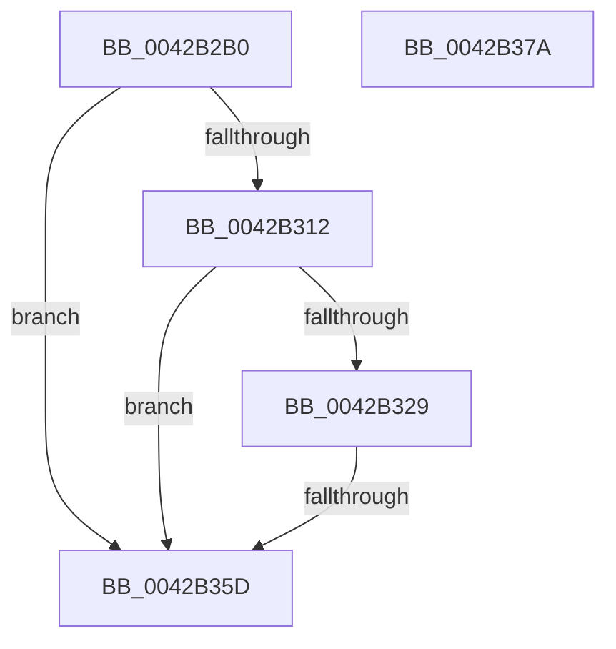

# PopDiagTraceProcessorThrottlePerfTrack

- RVA: `0x0042B2B0`–`0x0042B37B` (길이 `203` bytes)
- VA: `0x000000014042B2B0`
- 실행 섹션: `.text`
- PDB 이름 있음: `예`; PDB Function 태그: `예`
- unwind 정보 RVA: `0x000A16A8`
- 디코드: `45`개 명령, `203/203` bytes 표시
- 미해석 바이트: `0` (있으면 어셈블리에 `.byte`로 보존)

> 이 문서는 커널 이미지의 기계어와 PDB 기호를 분석해 생성했습니다. 4번과 5번은 함수 원형과 자료형을 바이너리 사용 방식에서 추정한 C 해석이며 원본 소스 복구 결과는 아닙니다.

## 1. Dependencies

- 직접 호출 지점: **3**; 고유 호출 대상: **3**
- 직접 호출자로 확인된 함수: **2**
- RIP 상대 이미지 참조: **9**

### Outgoing calls
- `0x0042B320` → [EtwEventEnabled](../39/EtwEventEnabled_function_00392450.md) (function, `0x00392450`)
- `0x0042B350` → [RtlStringCchPrintfExW](RtlStringCchPrintfExW_function_0042B390.md) (function, `0x0042B390`)
- `0x0042B364` → [_security_check_cookie](../6A/_security_check_cookie_function_006AC640.md) (function, `0x006AC640`)

### Direct callers
- [PpmRegisterPerfCap](PpmRegisterPerfCap_function_0042B0D0.md) at `0x0042B18B`
- [PpmRegisterPerfStates](../../page/75/PpmRegisterPerfStates_function_0075B084.md) at `0x0075B4B7`

### Static image references
- `0x0042B2C6` → RVA `0x00E0A740` (`.data`; read)
- `0x0042B2D4` → RVA `0x006CC110` (` ?? ::FNODOBFM::`string'`; read)
- `0x0042B2E2` → RVA `0x00E67858` (`.data`; read)
- `0x0042B2E9` → RVA `0x006CC120` (`.text`; read)
- `0x0042B2F0` → RVA `0x006CC138` (`.text`; read)
- `0x0042B2FF` → RVA `0x006CC130` (`.text`; read)
- `0x0042B312` → RVA `0x00F0B408` (`.data`; read)
- `0x0042B319` → RVA `0x00014488` (`.rdata`; read)
- `0x0042B32D` → RVA `0x006CC140` (` ?? ::FNODOBFM::`string'`; read)

## 2. Other-region calls and transfers

- 다른 실행 섹션으로 향하는 call: **0**
- call이 아닌 외부 분기/꼬리 이동: **1**
  - `0x0042B357` → [sub_006EE368](../6E/Unknown_function_006EE368.md) (`tail-transfer`)

## 3. Assembly (complete function range)

```asm
0042B2B0  48 89 5C 24 18                  mov qword ptr [rsp + 0x18], rbx
0042B2B5  89 4C 24 08                     mov dword ptr [rsp + 8], ecx
0042B2B9  55                              push rbp
0042B2BA  48 8D 6C 24 A9                  lea rbp, [rsp - 0x57]
0042B2BF  48 81 EC D0 00 00 00            sub rsp, 0xd0
0042B2C6  48 8B 05 73 F4 9D 00            mov rax, qword ptr [rip + 0x9df473]
0042B2CD  48 33 C4                        xor rax, rsp
0042B2D0  48 89 45 47                     mov qword ptr [rbp + 0x47], rax
0042B2D4  0F 10 05 35 0E 2A 00            movups xmm0, xmmword ptr [rip + 0x2a0e35]
0042B2DB  48 83 65 CF 00                  and qword ptr [rbp - 0x31], 0
0042B2E0  8B DA                           mov ebx, edx
0042B2E2  80 3D 6F C5 A3 00 00            cmp byte ptr [rip + 0xa3c56f], 0
0042B2E9  0F 10 0D 30 0E 2A 00            movups xmm1, xmmword ptr [rip + 0x2a0e30]
0042B2F0  0F B7 05 41 0E 2A 00            movzx eax, word ptr [rip + 0x2a0e41]
0042B2F7  0F 11 45 17                     movups xmmword ptr [rbp + 0x17], xmm0
0042B2FB  66 89 45 3F                     mov word ptr [rbp + 0x3f], ax
0042B2FF  F2 0F 10 05 29 0E 2A 00         movsd xmm0, qword ptr [rip + 0x2a0e29]
0042B307  F2 0F 11 45 37                  movsd qword ptr [rbp + 0x37], xmm0
0042B30C  0F 11 4D 27                     movups xmmword ptr [rbp + 0x27], xmm1
0042B310  74 4B                           je 0x14042b35d
0042B312  48 8B 0D EF 00 AE 00            mov rcx, qword ptr [rip + 0xae00ef]
0042B319  48 8D 15 68 91 BE FF            lea rdx, [rip - 0x416e98]
0042B320  E8 2B 71 F6 FF                  call 0x140392450
0042B325  84 C0                           test al, al
0042B327  74 34                           je 0x14042b35d
0042B329  89 5C 24 30                     mov dword ptr [rsp + 0x30], ebx
0042B32D  48 8D 05 0C 0E 2A 00            lea rax, [rip + 0x2a0e0c]
0042B334  45 33 C0                        xor r8d, r8d
0042B337  48 89 44 24 28                  mov qword ptr [rsp + 0x28], rax
0042B33C  48 83 64 24 20 00               and qword ptr [rsp + 0x20], 0
0042B342  4C 8D 4D CF                     lea r9, [rbp - 0x31]
0042B346  48 8D 4D 17                     lea rcx, [rbp + 0x17]
0042B34A  41 8D 58 15                     lea ebx, [r8 + 0x15]
0042B34E  8B D3                           mov edx, ebx
0042B350  E8 3B 00 00 00                  call 0x14042b390
0042B355  85 C0                           test eax, eax
0042B357  0F 89 0B 30 2C 00               jns 0x1406ee368
0042B35D  48 8B 4D 47                     mov rcx, qword ptr [rbp + 0x47]
0042B361  48 33 CC                        xor rcx, rsp
0042B364  E8 D7 12 28 00                  call 0x1406ac640
0042B369  48 8B 9C 24 F0 00 00 00         mov rbx, qword ptr [rsp + 0xf0]
0042B371  48 81 C4 D0 00 00 00            add rsp, 0xd0
0042B378  5D                              pop rbp
0042B379  C3                              ret
0042B37A  CC                              int3
```

## 4. C-style interpretation (structured pseudocode)

```c
__int64 __fastcall PopDiagTraceProcessorThrottlePerfTrack(int a1, int a2, int a3)
{
    __int64 result;
    __int64 v_rsp;
    unsigned __int64 v_stack_m18;
    unsigned __int16 v_stack_m20;
    unsigned __int64 v_stack_m28;
    unsigned __int64 v_stack_m38;
    unsigned __int64 v_stack_m48;
    unsigned __int64 v_stack_m5F;
    unsigned __int64 v_stack_m90;
    unsigned int v_stack_mA8;
    unsigned __int64 v_stack_mB0;
    unsigned __int64 v_stack_mB8;
    unsigned __int64 v_stack_p18;
    unsigned int v_stack_p8;

    v_stack_p18 = v_rbx;
    v_stack_p8 = a1;
    v_rsp = (v_rsp) - (208);
    result = (*(unsigned __int64 *)(v_rip + 10351731)) ^ (v_rsp);
    v_stack_m18 = result;
    v_stack_m48 = v_xmm0;
    v_stack_m20 = (unsigned __int16)(*(unsigned __int16 *)(v_rip + 2756161));
    v_stack_m28 = v_xmm0;
    v_stack_m38 = v_xmm1;
    if ((*(unsigned __int8 *)(v_rip + 10732911)) == 0) goto loc_0042B35D;
    result = EtwEventEnabled(*(unsigned __int64 *)(v_rip + 11403503), v_rip - 4288152, a3, a4);
    if ((unsigned __int8)(result) == 0) goto loc_0042B35D;
    v_stack_mA8 = (unsigned int)((unsigned int)(a2));
    a3 = 0;
    v_stack_mB0 = v_rip + 2756108;
    result = RtlStringCchPrintfExW(v_stack_m48, (unsigned int)((unsigned int)(a3 + 21)), a3, v_stack_m90);
loc_0042B35D:
    a1 = (v_stack_m18) ^ (v_rsp);
    result = _security_check_cookie(a1, (unsigned int)((unsigned int)(a3 + 21)), a3, v_stack_m90);
    v_rsp = (v_rsp) + (208);
    return result;
}
```

## 5. (Beta) C Style

```c
int64_t PopDiagTraceProcessorThrottlePerfTrack(int32_t Arg1, int32_t Arg2, int32_t Arg3)
{
    int64_t result;
    int64_t local_rsp;
    uint64_t v_stack_m18;
    uint16_t v_stack_m20;
    uint64_t v_stack_m28;
    uint64_t v_stack_m38;
    uint64_t v_stack_m48;
    uint64_t v_stack_m5F;
    uint64_t v_stack_m90;
    uint32_t v_stack_mA8;
    uint64_t v_stack_mB0;
    uint64_t v_stack_mB8;
    uint64_t v_stack_p18;
    uint32_t v_stack_p8;

    v_stack_p18 = local_rbx;
    v_stack_p8 = Arg1;
    local_rsp = (local_rsp) - (208);
    result = (*(uint64_t *)(v_rip + 0x9DF473)) ^ (local_rsp);
    v_stack_m18 = result;
    v_stack_m48 = v_xmm0;
    v_stack_m20 = (uint16_t)(*(uint16_t *)(v_rip + 0x2A0E41));
    v_stack_m28 = v_xmm0;
    v_stack_m38 = v_xmm1;
    if ((*(uint8_t *)(v_rip + 0xA3C56F)) == 0) goto loc_0042B35D;
    result = EtwEventEnabled(*(uint64_t *)(v_rip + 0xAE00EF), v_rip - 4288152, Arg3, a4);
    if ((uint8_t)(result) == 0) goto loc_0042B35D;
    v_stack_mA8 = (uint32_t)((uint32_t)(Arg2));
    Arg3 = 0;
    v_stack_mB0 = v_rip + 2756108;
    result = RtlStringCchPrintfExW(v_stack_m48, (uint32_t)((uint32_t)(Arg3 + 21)), Arg3, v_stack_m90);
loc_0042B35D:
    Arg1 = (v_stack_m18) ^ (local_rsp);
    result = _security_check_cookie(Arg1, (uint32_t)((uint32_t)(Arg3 + 21)), Arg3, v_stack_m90);
    local_rsp = (local_rsp) + (208);
    return result;
}
```

## 6. Execution-region graph

[열기: 2D/3D 그래프와 함수 탐색 컨트롤 패널](../../../control-panel.html?section=text&rva=0x0042B2B0&view=graph)

- 2D 그래프는 위에서 아래로 흐르고, 3D 그래프는 빈 공간을 드래그해 회전합니다. Shift+드래그는 이동, 휠은 확대·축소, 함수 노드 선택은 대상 보고서 이동입니다.

### Static fallback


