# PopFxStopDeviceAccounting

- RVA: `0x004261D8`–`0x0042660B` (길이 `1,075` bytes)
- VA: `0x00000001404261D8`
- 실행 섹션: `.text`
- PDB 이름 있음: `예`; PDB Function 태그: `예`
- unwind 정보 RVA: `0x000A058C`
- 디코드: `234`개 명령, `1,075/1,075` bytes 표시
- 미해석 바이트: `0` (있으면 어셈블리에 `.byte`로 보존)

> 이 문서는 커널 이미지의 기계어와 PDB 기호를 분석해 생성했습니다. 4번과 5번은 함수 원형과 자료형을 바이너리 사용 방식에서 추정한 C 해석이며 원본 소스 복구 결과는 아닙니다.

## 1. Dependencies

- 직접 호출 지점: **17**; 고유 호출 대상: **13**
- 직접 호출자로 확인된 함수: **1**
- RIP 상대 이미지 참조: **18**

### Outgoing calls
- `0x0042621F` → [memset](../6C/memset_function_006C6C40.md) (function, `0x006C6C40`)
- `0x00426269` → [KeAbPreAcquire](../21/KeAbPreAcquire_function_00210230.md) (function, `0x00210230`)
- `0x0042628E` → [ExfAcquirePushLockSharedEx](../21/ExfAcquirePushLockSharedEx_function_0021044C.md) (function, `0x0021044C`)
- `0x004262FB` → [KeAcquireSpinLockRaiseToDpc](../20/KeAcquireSpinLockRaiseToDpc_function_00208470.md) (function, `0x00208470`)
- `0x00426312` → [KeReleaseSpinLock](../39/KeReleaseSpinLock_function_00392BA0.md) (function, `0x00392BA0`)
- `0x0042634C` → [KeAcquireSpinLockRaiseToDpc](../20/KeAcquireSpinLockRaiseToDpc_function_00208470.md) (function, `0x00208470`)
- `0x00426363` → [KeReleaseSpinLock](../39/KeReleaseSpinLock_function_00392BA0.md) (function, `0x00392BA0`)
- `0x004263B7` → [ExfReleasePushLockShared](../26/ExfReleasePushLockShared_function_00263440.md) (function, `0x00263440`)
- `0x004263BF` → [KeAbPostRelease](../2E/KeAbPostRelease_function_002E1600.md) (function, `0x002E1600`)
- `0x004263C4` → [KeLeaveCriticalRegion](../25/KeLeaveCriticalRegion_function_0025D8B0.md) (function, `0x0025D8B0`)
- `0x004263D0` → [KeAcquireSpinLockRaiseToDpc](../20/KeAcquireSpinLockRaiseToDpc_function_00208470.md) (function, `0x00208470`)
- `0x00426438` → [KeReleaseSpinLock](../39/KeReleaseSpinLock_function_00392BA0.md) (function, `0x00392BA0`)
- `0x0042647C` → [_security_check_cookie](../6A/_security_check_cookie_function_006AC640.md) (function, `0x006AC640`)
- `0x004264D9` → [PopDiagTraceFxComponentAccounting](../../page/A7/PopDiagTraceFxComponentAccounting_function_00A758D4.md) (function, `0x00A758D4`)
- `0x00426591` → [PopDiagTraceFxDeviceAccounting](PopDiagTraceFxDeviceAccounting_function_00426614.md) (function, `0x00426614`)
- `0x004265B6` → [wcslen](../50/wcslen_function_00501BA0.md) (function, `0x00501BA0`)
- `0x00426601` → [PopFxPauseDeviceAccounting](../43/PopFxPauseDeviceAccounting_function_0043D0C8.md) (function, `0x0043D0C8`)

### Direct callers
- [PopCaptureSleepStudyStatistics](../43/PopCaptureSleepStudyStatistics_function_004399F4.md) at `0x00439F45`

### Static image references
- `0x004261FE` → RVA `0x00E0A740` (`.data`; read)
- `0x00426224` → RVA `0x00E676B0` (`.data`; read)
- `0x00426252` → RVA `0x00F0E408` (`.data`; read)
- `0x004262A6` → RVA `0x00F0E3F0` (`.data`; read)
- `0x004262BD` → RVA `0x006C8EC0` (` ?? ::FNODOBFM::`string'`; read)
- `0x004263C9` → RVA `0x00F0E570` (`.data`; read)
- `0x004263D5` → RVA `0x00F0E6E0` (`.data`; read)
- `0x004263DC` → RVA `0x00F0E6D0` (`.data`; read)
- `0x004263E5` → RVA `0x00F0E6F0` (`.data`; read)
- `0x004263EC` → RVA `0x00F0E6D8` (`.data`; read)
- `0x004263FE` → RVA `0x00F0E700` (`.data`; read)
- `0x0042640A` → RVA `0x00F0E708` (`.data`; read)
- `0x00426416` → RVA `0x00F0E718` (`.data`; read)
- `0x00426421` → RVA `0x00F0E728` (`.data`; read)
- `0x0042643D` → RVA `0x00E076D8` (`.data`; read)
- `0x00426446` → RVA `0x00E67868` (`.data`; read)
- `0x00426459` → RVA `0x00E076E8` (`.data`; read)
- `0x004265E5` → RVA `0x00E076F0` (`.data`; read)

## 2. Other-region calls and transfers

- 다른 실행 섹션으로 향하는 call: **1**
  - `0x004264D9` → [PopDiagTraceFxComponentAccounting](../../page/A7/PopDiagTraceFxComponentAccounting_function_00A758D4.md) (`.text` → `PAGE`)
- call이 아닌 외부 분기/꼬리 이동: **1**
  - `0x0042646C` → [sub_006EDC8E](../6E/Unknown_function_006EDC8E.md) (`tail-transfer`)

## 3. Assembly (complete function range)

```asm
004261D8  48 8B C4                        mov rax, rsp
004261DB  48 89 58 08                     mov qword ptr [rax + 8], rbx
004261DF  48 89 70 10                     mov qword ptr [rax + 0x10], rsi
004261E3  48 89 78 18                     mov qword ptr [rax + 0x18], rdi
004261E7  55                              push rbp
004261E8  41 54                           push r12
004261EA  41 55                           push r13
004261EC  41 56                           push r14
004261EE  41 57                           push r15
004261F0  48 8D A8 28 FF FF FF            lea rbp, [rax - 0xd8]
004261F7  48 81 EC B0 01 00 00            sub rsp, 0x1b0
004261FE  48 8B 05 3B 45 9E 00            mov rax, qword ptr [rip + 0x9e453b]
00426205  48 33 C4                        xor rax, rsp
00426208  48 89 85 A0 00 00 00            mov qword ptr [rbp + 0xa0], rax
0042620F  33 D2                           xor edx, edx
00426211  48 89 4C 24 30                  mov qword ptr [rsp + 0x30], rcx
00426216  48 8D 4C 24 70                  lea rcx, [rsp + 0x70]
0042621B  44 8D 42 60                     lea r8d, [rdx + 0x60]
0042621F  E8 1C 0A 2A 00                  call 0x1406c6c40
00426224  8B 05 86 14 A4 00               mov eax, dword ptr [rip + 0xa41486]
0042622A  45 33 FF                        xor r15d, r15d
0042622D  0F 57 C0                        xorps xmm0, xmm0
00426230  0F 11 44 24 50                  movups xmmword ptr [rsp + 0x50], xmm0
00426235  85 C0                           test eax, eax
00426237  0F 84 35 02 00 00               je 0x140426472
0042623D  41 8D 77 01                     lea esi, [r15 + 1]
00426241  3B C6                           cmp eax, esi
00426243  0F 84 B8 03 00 00               je 0x140426601
00426249  65 48 8B 04 25 88 01 00 00      mov rax, qword ptr gs:[0x188]
00426252  48 8D 3D AF 81 AE 00            lea rdi, [rip + 0xae81af]
00426259  45 33 C0                        xor r8d, r8d
0042625C  33 D2                           xor edx, edx
0042625E  48 8B CF                        mov rcx, rdi
00426261  66 FF 88 E4 01 00 00            dec word ptr [rax + 0x1e4]
00426268  90                              nop
00426269  E8 C2 9F DE FF                  call 0x140210230
0042626E  48 8B D8                        mov rbx, rax
00426271  B9 11 00 00 00                  mov ecx, 0x11
00426276  33 C0                           xor eax, eax
00426278  F0 48 0F B1 0D 87 81 AE 00      lock cmpxchg qword ptr [rip + 0xae8187], rcx
00426281  74 10                           je 0x140426293
00426283  4C 8B CF                        mov r9, rdi
00426286  4C 8B C3                        mov r8, rbx
00426289  33 D2                           xor edx, edx
0042628B  48 8B CF                        mov rcx, rdi
0042628E  E8 B9 A1 DE FF                  call 0x14021044c
00426293  48 85 DB                        test rbx, rbx
00426296  74 04                           je 0x14042629c
00426298  40 88 73 0A                     mov byte ptr [rbx + 0xa], sil
0042629C  48 A1 08 00 00 00 80 F7 FF FF   movabs rax, qword ptr [0xfffff78000000008]
004262A6  4C 8D 2D 43 81 AE 00            lea r13, [rip + 0xae8143]
004262AD  48 8B 1D 3C 81 AE 00            mov rbx, qword ptr [rip + 0xae813c]
004262B4  49 3B DD                        cmp rbx, r13
004262B7  0F 84 E7 00 00 00               je 0x1404263a4
004262BD  48 8D 0D FC 2B 2A 00            lea rcx, [rip + 0x2a2bfc]
004262C4  48 8D 05 25 81 AE 00            lea rax, [rip + 0xae8125]
004262CB  4C 8B 6B 30                     mov r13, qword ptr [rbx + 0x30]
004262CF  4D 85 ED                        test r13, r13
004262D2  0F 84 B9 00 00 00               je 0x140426391
004262D8  4C 39 BB D8 04 00 00            cmp qword ptr [rbx + 0x4d8], r15
004262DF  0F 84 C7 02 00 00               je 0x1404265ac
004262E5  4C 8D A3 D0 04 00 00            lea r12, [rbx + 0x4d0]
004262EC  48 8D BB 80 02 00 00            lea rdi, [rbx + 0x280]
004262F3  4C 89 64 24 38                  mov qword ptr [rsp + 0x38], r12
004262F8  48 8B CF                        mov rcx, rdi
004262FB  E8 70 21 DE FF                  call 0x140208470
00426300  44 39 7F 10                     cmp dword ptr [rdi + 0x10], r15d
00426304  0F 85 1A 02 00 00               jne 0x140426524
0042630A  45 32 F6                        xor r14b, r14b
0042630D  8A D0                           mov dl, al
0042630F  48 8B CF                        mov rcx, rdi
00426312  E8 89 C8 F6 FF                  call 0x140392ba0
00426317  45 84 FF                        test r15b, r15b
0042631A  0F 85 45 02 00 00               jne 0x140426565
00426320  45 33 FF                        xor r15d, r15d
00426323  45 8B F7                        mov r14d, r15d
00426326  44 39 BB 64 03 00 00            cmp dword ptr [rbx + 0x364], r15d
0042632D  76 54                           jbe 0x140426383
0042632F  48 8B 83 68 03 00 00            mov rax, qword ptr [rbx + 0x368]
00426336  41 8B CE                        mov ecx, r14d
00426339  48 8B 04 C8                     mov rax, qword ptr [rax + rcx*8]
0042633D  48 89 44 24 40                  mov qword ptr [rsp + 0x40], rax
00426342  48 8D B8 C8 00 00 00            lea rdi, [rax + 0xc8]
00426349  48 8B CF                        mov rcx, rdi
0042634C  E8 1F 21 DE FF                  call 0x140208470
00426351  44 39 7F 10                     cmp dword ptr [rdi + 0x10], r15d
00426355  0F 85 88 01 00 00               jne 0x1404264e3
0042635B  45 8A E7                        mov r12b, r15b
0042635E  8A D0                           mov dl, al
00426360  48 8B CF                        mov rcx, rdi
00426363  E8 38 C8 F6 FF                  call 0x140392ba0
00426368  45 84 E4                        test r12b, r12b
0042636B  0F 85 32 01 00 00               jne 0x1404264a3
00426371  44 03 F6                        add r14d, esi
00426374  41 BF 00 00 00 00               mov r15d, 0
0042637A  44 3B B3 64 03 00 00            cmp r14d, dword ptr [rbx + 0x364]
00426381  72 AC                           jb 0x14042632f
00426383  48 8D 0D 36 2B 2A 00            lea rcx, [rip + 0x2a2b36]
0042638A  48 8D 05 5F 80 AE 00            lea rax, [rip + 0xae805f]
00426391  48 8B 1B                        mov rbx, qword ptr [rbx]
00426394  48 3B D8                        cmp rbx, rax
00426397  0F 85 2E FF FF FF               jne 0x1404262cb
0042639D  48 8D 3D 64 80 AE 00            lea rdi, [rip + 0xae8064]
004263A4  B8 11 00 00 00                  mov eax, 0x11
004263A9  F0 4C 0F B1 3D 56 80 AE 00      lock cmpxchg qword ptr [rip + 0xae8056], r15
004263B2  74 08                           je 0x1404263bc
004263B4  48 8B CF                        mov rcx, rdi
004263B7  E8 84 D0 E3 FF                  call 0x140263440
004263BC  48 8B CF                        mov rcx, rdi
004263BF  E8 3C B2 EB FF                  call 0x1402e1600
004263C4  E8 E7 74 E3 FF                  call 0x14025d8b0
004263C9  48 8D 0D A0 81 AE 00            lea rcx, [rip + 0xae81a0]
004263D0  E8 9B 20 DE FF                  call 0x140208470
004263D5  0F 10 05 04 83 AE 00            movups xmm0, xmmword ptr [rip + 0xae8304]
004263DC  48 8B 1D ED 82 AE 00            mov rbx, qword ptr [rip + 0xae82ed]
004263E3  8A D0                           mov dl, al
004263E5  0F 10 0D 04 83 AE 00            movups xmm1, xmmword ptr [rip + 0xae8304]
004263EC  48 8B 3D E5 82 AE 00            mov rdi, qword ptr [rip + 0xae82e5]
004263F3  48 8D 0D 76 81 AE 00            lea rcx, [rip + 0xae8176]
004263FA  0F 11 45 50                     movups xmmword ptr [rbp + 0x50], xmm0
004263FE  F2 0F 10 05 FA 82 AE 00         movsd xmm0, qword ptr [rip + 0xae82fa]
00426406  0F 11 4D 60                     movups xmmword ptr [rbp + 0x60], xmm1
0042640A  0F 10 0D F7 82 AE 00            movups xmm1, xmmword ptr [rip + 0xae82f7]
00426411  F2 0F 11 45 70                  movsd qword ptr [rbp + 0x70], xmm0
00426416  0F 10 05 FB 82 AE 00            movups xmm0, xmmword ptr [rip + 0xae82fb]
0042641D  0F 11 4D 78                     movups xmmword ptr [rbp + 0x78], xmm1
00426421  F2 0F 10 0D FF 82 AE 00         movsd xmm1, qword ptr [rip + 0xae82ff]
00426429  0F 11 85 88 00 00 00            movups xmmword ptr [rbp + 0x88], xmm0
00426430  F2 0F 11 8D 98 00 00 00         movsd qword ptr [rbp + 0x98], xmm1
00426438  E8 63 C7 F6 FF                  call 0x140392ba0
0042643D  83 3D 94 12 9E 00 05            cmp dword ptr [rip + 0x9e1294], 5
00426444  76 2C                           jbe 0x140426472
00426446  44 39 3D 1B 14 A4 00            cmp dword ptr [rip + 0xa4141b], r15d
0042644D  75 23                           jne 0x140426472
0042644F  48 BA 00 00 00 00 00 40 00 00   movabs rdx, 0x400000000000
00426459  48 85 15 88 12 9E 00            test qword ptr [rip + 0x9e1288], rdx
00426460  0F 85 7F 01 00 00               jne 0x1404265e5
00426466  41 8A F7                        mov sil, r15b
00426469  40 84 F6                        test sil, sil
0042646C  0F 85 1C 78 2C 00               jne 0x1406edc8e
00426472  48 8B 8D A0 00 00 00            mov rcx, qword ptr [rbp + 0xa0]
00426479  48 33 CC                        xor rcx, rsp
0042647C  E8 BF 61 28 00                  call 0x1406ac640
00426481  4C 8D 9C 24 B0 01 00 00         lea r11, [rsp + 0x1b0]
00426489  49 8B 5B 30                     mov rbx, qword ptr [r11 + 0x30]
0042648D  49 8B 73 38                     mov rsi, qword ptr [r11 + 0x38]
00426491  49 8B 7B 40                     mov rdi, qword ptr [r11 + 0x40]
00426495  49 8B E3                        mov rsp, r11
00426498  41 5F                           pop r15
0042649A  41 5E                           pop r14
0042649C  41 5D                           pop r13
0042649E  41 5C                           pop r12
004264A0  5D                              pop rbp
004264A1  C3                              ret
004264A2  CC                              int3
004264A3  48 81 7C 24 30 00 46 C3 23      cmp qword ptr [rsp + 0x30], 0x23c34600
004264AC  48 8B 44 24 70                  mov rax, qword ptr [rsp + 0x70]
004264B1  0F 83 E4 00 00 00               jae 0x14042659b
004264B7  45 32 FF                        xor r15b, r15b
004264BA  48 8B 54 24 40                  mov rdx, qword ptr [rsp + 0x40]
004264BF  4C 8D 44 24 70                  lea r8, [rsp + 0x70]
004264C4  4C 8B 4C 24 38                  mov r9, qword ptr [rsp + 0x38]
004264C9  49 8B CD                        mov rcx, r13
004264CC  44 88 7C 24 28                  mov byte ptr [rsp + 0x28], r15b
004264D1  48 89 44 24 20                  mov qword ptr [rsp + 0x20], rax
004264D6  8B 52 10                        mov edx, dword ptr [rdx + 0x10]
004264D9  E8 F6 F3 64 00                  call 0x140a758d4
004264DE  E9 8E FE FF FF                  jmp 0x140426371
004264E3  0F 10 47 20                     movups xmm0, xmmword ptr [rdi + 0x20]
004264E7  44 8A E6                        mov r12b, sil
004264EA  0F 29 44 24 70                  movaps xmmword ptr [rsp + 0x70], xmm0
004264EF  0F 10 4F 30                     movups xmm1, xmmword ptr [rdi + 0x30]
004264F3  0F 29 4D 80                     movaps xmmword ptr [rbp - 0x80], xmm1
004264F7  0F 10 47 40                     movups xmm0, xmmword ptr [rdi + 0x40]
004264FB  0F 29 45 90                     movaps xmmword ptr [rbp - 0x70], xmm0
004264FF  0F 10 4F 50                     movups xmm1, xmmword ptr [rdi + 0x50]
00426503  0F 29 4D A0                     movaps xmmword ptr [rbp - 0x60], xmm1
00426507  0F 10 47 60                     movups xmm0, xmmword ptr [rdi + 0x60]
0042650B  0F 29 45 B0                     movaps xmmword ptr [rbp - 0x50], xmm0
0042650F  0F 10 4F 70                     movups xmm1, xmmword ptr [rdi + 0x70]
00426513  0F 29 4D C0                     movaps xmmword ptr [rbp - 0x40], xmm1
00426517  83 7F 0C FF                     cmp dword ptr [rdi + 0xc], -1
0042651B  41 0F 95 C7                     setne r15b
0042651F  E9 3A FE FF FF                  jmp 0x14042635e
00426524  0F 10 47 20                     movups xmm0, xmmword ptr [rdi + 0x20]
00426528  44 8A FE                        mov r15b, sil
0042652B  0F 29 44 24 70                  movaps xmmword ptr [rsp + 0x70], xmm0
00426530  0F 10 4F 30                     movups xmm1, xmmword ptr [rdi + 0x30]
00426534  0F 29 4D 80                     movaps xmmword ptr [rbp - 0x80], xmm1
00426538  0F 10 47 40                     movups xmm0, xmmword ptr [rdi + 0x40]
0042653C  0F 29 45 90                     movaps xmmword ptr [rbp - 0x70], xmm0
00426540  0F 10 4F 50                     movups xmm1, xmmword ptr [rdi + 0x50]
00426544  0F 29 4D A0                     movaps xmmword ptr [rbp - 0x60], xmm1
00426548  0F 10 47 60                     movups xmm0, xmmword ptr [rdi + 0x60]
0042654C  0F 29 45 B0                     movaps xmmword ptr [rbp - 0x50], xmm0
00426550  0F 10 4F 70                     movups xmm1, xmmword ptr [rdi + 0x70]
00426554  0F 29 4D C0                     movaps xmmword ptr [rbp - 0x40], xmm1
00426558  83 7F 0C 05                     cmp dword ptr [rdi + 0xc], 5
0042655C  41 0F 92 C6                     setb r14b
00426560  E9 A8 FD FF FF                  jmp 0x14042630d
00426565  48 81 7C 24 30 00 46 C3 23      cmp qword ptr [rsp + 0x30], 0x23c34600
0042656E  4C 8B 4C 24 70                  mov r9, qword ptr [rsp + 0x70]
00426573  72 09                           jb 0x14042657e
00426575  49 81 F9 80 96 98 00            cmp r9, 0x989680
0042657C  73 03                           jae 0x140426581
0042657E  45 32 F6                        xor r14b, r14b
00426581  4D 8B C4                        mov r8, r12
00426584  44 88 74 24 20                  mov byte ptr [rsp + 0x20], r14b
00426589  48 8D 54 24 70                  lea rdx, [rsp + 0x70]
0042658E  49 8B CD                        mov rcx, r13
00426591  E8 7E 00 00 00                  call 0x140426614
00426596  E9 85 FD FF FF                  jmp 0x140426320
0042659B  48 3D 80 96 98 00               cmp rax, 0x989680
004265A1  0F 82 10 FF FF FF               jb 0x1404264b7
004265A7  E9 0E FF FF FF                  jmp 0x1404264ba
004265AC  44 89 7C 24 54                  mov dword ptr [rsp + 0x54], r15d
004265B1  48 89 4C 24 58                  mov qword ptr [rsp + 0x58], rcx
004265B6  E8 E5 B5 0D 00                  call 0x140501ba0
004265BB  48 03 C0                        add rax, rax
004265BE  4C 8D 64 24 50                  lea r12, [rsp + 0x50]
004265C3  48 3D FE FF 00 00               cmp rax, 0xfffe
004265C9  B9 FC FF 00 00                  mov ecx, 0xfffc
004265CE  48 0F 43 C1                     cmovae rax, rcx
004265D2  66 89 44 24 50                  mov word ptr [rsp + 0x50], ax
004265D7  66 83 C0 02                     add ax, 2
004265DB  66 89 44 24 52                  mov word ptr [rsp + 0x52], ax
004265E0  E9 07 FD FF FF                  jmp 0x1404262ec
004265E5  48 8B 05 04 11 9E 00            mov rax, qword ptr [rip + 0x9e1104]
004265EC  48 23 C2                        and rax, rdx
004265EF  48 3B 05 FA 10 9E 00            cmp rax, qword ptr [rip + 0x9e10fa]
004265F6  0F 85 6A FE FF FF               jne 0x140426466
004265FC  E9 68 FE FF FF                  jmp 0x140426469
00426601  E8 C2 6A 01 00                  call 0x14043d0c8
00426606  E9 3E FC FF FF                  jmp 0x140426249
```

## 4. C-style interpretation (structured pseudocode)

```c
__int64 __fastcall PopFxStopDeviceAccounting(__int64 a1, int a2)
{
    __int64 result;
    __int64 v_r14;
    __int64 v_r15;
    __int64 v_rsp;
    unsigned __int64 v_stack_m140;
    unsigned __int64 v_stack_m158;
    unsigned int v_stack_m15C;
    unsigned __int16 v_stack_m15E;
    unsigned __int64 v_stack_m160;
    unsigned __int64 v_stack_m168;
    unsigned __int64 v_stack_m170;
    unsigned __int64 v_stack_m178;
    unsigned __int64 v_stack_m180;
    unsigned __int64 v_stack_m188;
    unsigned __int64 v_stack_m190;
    unsigned __int64 v_stack_m198;
    unsigned __int64 v_stack_m1A0;
    unsigned __int64 v_stack_m1A8;
    unsigned __int64 v_stack_m28;

    *(unsigned __int64 *)(v_rsp + 8) = v_rbx;
    *(unsigned __int64 *)(v_rsp + 16) = v_rsi;
    *(unsigned __int64 *)(v_rsp + 24) = v_rdi;
    v_rsp = (v_rsp) - (432);
    result = (*(unsigned __int64 *)(v_rip + 10372411)) ^ (v_rsp);
    *(unsigned __int64 *)(v_rsp - 216 + 160) = result;
    a2 = 0;
    v_stack_m1A8 = a1;
    result = memset(v_stack_m168, a2, a2 + 96, a4);
    v_r15 = 0;
    v_stack_m188 = v_xmm0;
    if ((unsigned int)((unsigned int)(*(unsigned int *)(v_rip + 10753158))) == 0) goto loc_00426472;
    if (((unsigned int)((unsigned int)(*(unsigned int *)(v_rip + 10753158)))) == ((unsigned int)(v_r15 + 1))) goto loc_00426601;
loc_00426249:
    a3 = 0;
    a2 = 0;
    result = KeAbPreAcquire(v_rip + 11436463, a2, a3, a4);
    result = 0;
    if (!(condition_is_equal)) {
        a4 = v_rip + 11436463;
        a3 = 0;
        a2 = 0;
        a1 = v_rip + 11436463;
        result = ExfAcquirePushLockSharedEx(a1, a2, a3, a4);
    }
    if (result != 0) {
        *(unsigned __int8 *)(result + 10) = (unsigned __int8)(v_r15 + 1);
    }
    if ((*(unsigned __int64 *)(v_rip + 11436348)) == (v_rip + 11436355)) goto loc_004263A4;
loc_004262CB:
    if (*(unsigned __int64 *)(*(unsigned __int64 *)(v_rip + 11436348) + 48) == 0) goto loc_00426391;
    if ((*(unsigned __int64 *)(*(unsigned __int64 *)(v_rip + 11436348) + 1240)) == 0) goto loc_004265AC;
loc_004262EC:
    v_stack_m1A0 = *(unsigned __int64 *)(v_rip + 11436348) + 1232;
    result = KeAcquireSpinLockRaiseToDpc(*(unsigned __int64 *)(v_rip + 11436348) + 640, a2, a3, a4);
    if ((*(unsigned int *)(*(unsigned __int64 *)(v_rip + 11436348) + 640 + 16)) != 0) goto loc_00426524;
    v_r14 = 0;
loc_0042630D:
    result = KeReleaseSpinLock(*(unsigned __int64 *)(v_rip + 11436348) + 640, (unsigned __int8)(result), a3, a4);
    if (0 != 0) goto loc_00426565;
loc_00426320:
    v_r15 = 0;
    if ((*(unsigned int *)(*(unsigned __int64 *)(v_rip + 11436348) + 868)) <= 0) goto loc_00426383;
loc_0042632F:
    v_stack_m198 = *(unsigned __int64 *)(*(unsigned __int64 *)(*(unsigned __int64 *)(v_rip + 11436348) + 872) + 0 * 8);
    result = KeAcquireSpinLockRaiseToDpc(*(unsigned __int64 *)(*(unsigned __int64 *)(*(unsigned __int64 *)(v_rip + 11436348) + 872) + 0 * 8) + 200, (unsigned __int8)(result), a3, a4);
    if ((*(unsigned int *)(*(unsigned __int64 *)(*(unsigned __int64 *)(*(unsigned __int64 *)(v_rip + 11436348) + 872) + 0 * 8) + 200 + 16)) != 0) goto loc_004264E3;
loc_0042635E:
    result = KeReleaseSpinLock(*(unsigned __int64 *)(*(unsigned __int64 *)(*(unsigned __int64 *)(v_rip + 11436348) + 872) + 0 * 8) + 200, (unsigned __int8)(result), a3, a4);
    if (0 != 0) goto loc_004264A3;
loc_00426371:
    v_r14 = (unsigned int)((0) + ((unsigned int)(v_r15 + 1)));
    if (((unsigned int)(v_r14)) < (*(unsigned int *)(*(unsigned __int64 *)(v_rip + 11436348) + 868))) goto loc_0042632F;
loc_00426383:
loc_00426391:
    if ((*(unsigned __int64 *)(*(unsigned __int64 *)(v_rip + 11436348))) != (v_rip + 11436127)) goto loc_004262CB;
loc_004263A4:
    result = 17;
    if ((*(unsigned __int64 *)(*(unsigned __int64 *)(v_rip + 11436348))) != (v_rip + 11436127)) {
        a1 = v_rip + 11436132;
        result = ExfReleasePushLockShared(a1, (unsigned __int8)(result), a3, a4);
    }
    result = KeAbPostRelease(v_rip + 11436132, (unsigned __int8)(result), a3, a4);
    result = KeLeaveCriticalRegion(v_rip + 11436132, (unsigned __int8)(result), a3, a4);
    result = KeAcquireSpinLockRaiseToDpc(v_rip + 11436448, (unsigned __int8)(result), a3, a4);
    *(unsigned __int64 *)(v_rsp - 216 + 80) = v_xmm0;
    *(unsigned __int64 *)(v_rsp - 216 + 96) = v_xmm1;
    *(unsigned __int64 *)(v_rsp - 216 + 112) = v_xmm0;
    *(unsigned __int64 *)(v_rsp - 216 + 120) = v_xmm1;
    *(unsigned __int64 *)(v_rsp - 216 + 136) = v_xmm0;
    *(unsigned __int64 *)(v_rsp - 216 + 152) = v_xmm1;
    result = KeReleaseSpinLock(v_rip + 11436406, (unsigned __int8)(result), a3, a4);
    if ((*(unsigned int *)(v_rip + 10359444)) <= 5) goto loc_00426472;
    if ((*(unsigned int *)(v_rip + 10753051)) != 0) goto loc_00426472;
    if (((*(unsigned __int64 *)(v_rip + 10359432)) & ((unsigned __int8)(result))) != 0) goto loc_004265E5;
loc_00426466:
loc_00426469:
loc_00426472:
    a1 = (*(unsigned __int64 *)(v_rsp - 216 + 160)) ^ (v_rsp);
    result = _security_check_cookie(a1, (unsigned __int8)(result), a3, a4);
    return result;
loc_004264A3:
    if (v_stack_m180 >= 0x23C34600ULL) goto loc_0042659B;
loc_004264B7:
    v_r15 = 0;
loc_004264BA:
    v_stack_m188 = 0;
    v_stack_m190 = v_stack_m140;
    result = PopDiagTraceFxComponentAccounting(*(unsigned __int64 *)(*(unsigned __int64 *)(v_rip + 11436348) + 48), (unsigned int)(*(unsigned int *)(v_stack_m170 + 16)), v_stack_m140, v_stack_m178);
    goto loc_00426371;
loc_004264E3:
    v_stack_m140 = v_xmm0;
    *(unsigned __int64 *)(v_rsp - 216 - 128) = v_xmm1;
    *(unsigned __int64 *)(v_rsp - 216 - 112) = v_xmm0;
    *(unsigned __int64 *)(v_rsp - 216 - 96) = v_xmm1;
    *(unsigned __int64 *)(v_rsp - 216 - 80) = v_xmm0;
    *(unsigned __int64 *)(v_rsp - 216 - 64) = v_xmm1;
    v_r15 = ((*(unsigned int *)(*(unsigned __int64 *)(v_stack_m28 + 64) + 12)) != -1) ? 1 : 0;
    goto loc_0042635E;
loc_00426524:
    v_stack_m140 = v_xmm0;
    *(unsigned __int64 *)(v_rsp - 216 - 128) = v_xmm1;
    *(unsigned __int64 *)(v_rsp - 216 - 112) = v_xmm0;
    *(unsigned __int64 *)(v_rsp - 216 - 96) = v_xmm1;
    *(unsigned __int64 *)(v_rsp - 216 - 80) = v_xmm0;
    *(unsigned __int64 *)(v_rsp - 216 - 64) = v_xmm1;
    v_r14 = ((*(unsigned int *)(*(unsigned __int64 *)(v_stack_m28 + 64) + 12)) < 5) ? 1 : 0;
    goto loc_0042630D;
loc_00426565:
    if (v_stack_m180 < 0x23C34600ULL) goto loc_0042657E;
    if (v_stack_m140 < 0x989680ULL) {
        v_r14 = 0;
    }
    v_stack_m190 = 0;
    result = PopDiagTraceFxDeviceAccounting(*(unsigned __int64 *)(*(unsigned __int64 *)(v_rip + 11436348) + 48), v_stack_m140, (unsigned __int8)(*(unsigned __int64 *)(v_stack_m28 + 56)), v_stack_m140);
    goto loc_00426320;
loc_0042659B:
    if (result < 0x989680ULL) goto loc_004264B7;
    goto loc_004264BA;
loc_004265AC:
    v_stack_m15C = (unsigned int)((unsigned __int8)(*(unsigned __int64 *)(v_stack_m28 + 56)));
    v_stack_m158 = *(unsigned __int64 *)(*(unsigned __int64 *)(v_rip + 11436348) + 48);
    result = wcslen(*(unsigned __int64 *)(*(unsigned __int64 *)(v_rip + 11436348) + 48), v_stack_m140, (unsigned __int8)(*(unsigned __int64 *)(v_stack_m28 + 56)), v_stack_m140);
    result = (result) + (result);
    if (result >= 0xFFFEULL) { result = (unsigned int)(0xFFFCULL); }
    v_stack_m160 = (unsigned __int16)(result);
    result = (unsigned __int16)((result) + (2));
    v_stack_m15E = (unsigned __int16)(result);
    goto loc_004262EC;
loc_004265E5:
    result = (*(unsigned __int64 *)(v_rip + 10359044)) & (v_stack_m140);
    if (result != (*(unsigned __int64 *)(v_rip + 10359034))) goto loc_00426466;
    goto loc_00426469;
loc_00426601:
    result = PopFxPauseDeviceAccounting((unsigned int)(0xFFFCULL), v_stack_m140, (unsigned __int8)(*(unsigned __int64 *)(v_stack_m28 + 56)), v_stack_m140);
    goto loc_00426249;
}
```

## 5. (Beta) C Style

```c
int64_t PopFxStopDeviceAccounting(int64_t Arg1, int32_t Arg2)
{
    int64_t result;
    int64_t local_r14;
    int64_t local_r15;
    int64_t local_rsp;
    uint64_t v_stack_m140;
    uint64_t v_stack_m158;
    uint32_t v_stack_m15C;
    uint16_t v_stack_m15E;
    uint64_t v_stack_m160;
    uint64_t v_stack_m168;
    uint64_t v_stack_m170;
    uint64_t v_stack_m178;
    uint64_t v_stack_m180;
    uint64_t v_stack_m188;
    uint64_t v_stack_m190;
    uint64_t v_stack_m198;
    uint64_t v_stack_m1A0;
    uint64_t v_stack_m1A8;
    uint64_t v_stack_m28;

    *(uint64_t *)(local_rsp + 0x8) = local_rbx;
    *(uint64_t *)(local_rsp + 0x10) = local_rsi;
    *(uint64_t *)(local_rsp + 0x18) = local_rdi;
    local_rsp = (local_rsp) - (432);
    result = (*(uint64_t *)(v_rip + 0x9E453B)) ^ (local_rsp);
    *(uint64_t *)(local_rsp - 0xD8 + 0xA0) = result;
    Arg2 = 0;
    v_stack_m1A8 = Arg1;
    result = memset(v_stack_m168, Arg2, Arg2 + 96, a4);
    local_r15 = 0;
    v_stack_m188 = v_xmm0;
    if ((uint32_t)((uint32_t)(*(uint32_t *)(v_rip + 0xA41486))) == 0) goto loc_00426472;
    if (((uint32_t)((uint32_t)(*(uint32_t *)(v_rip + 0xA41486)))) == ((uint32_t)(local_r15 + 1))) goto loc_00426601;
loc_00426249:
    a3 = 0;
    Arg2 = 0;
    result = KeAbPreAcquire(v_rip + 11436463, Arg2, a3, a4);
    result = 0;
    if (!(condition_is_equal)) {
        a4 = v_rip + 11436463;
        a3 = 0;
        Arg2 = 0;
        Arg1 = v_rip + 11436463;
        result = ExfAcquirePushLockSharedEx(Arg1, Arg2, a3, a4);
    }
    if (result != 0) {
        *(uint8_t *)(result + 0xA) = (uint8_t)(local_r15 + 1);
    }
    if ((*(uint64_t *)(v_rip + 0xAE813C)) == (v_rip + 11436355)) goto loc_004263A4;
loc_004262CB:
    if (*(uint64_t *)(*(uint64_t *)(v_rip + 0xAE813C) + 0x30) == 0) goto loc_00426391;
    if ((*(uint64_t *)(*(uint64_t *)(v_rip + 0xAE813C) + 0x4D8)) == 0) goto loc_004265AC;
loc_004262EC:
    v_stack_m1A0 = *(uint64_t *)(v_rip + 0xAE813C) + 1232;
    result = KeAcquireSpinLockRaiseToDpc(*(uint64_t *)(v_rip + 0xAE813C) + 640, Arg2, a3, a4);
    if ((*(uint32_t *)(*(uint64_t *)(v_rip + 0xAE813C) + 0x280 + 0x10)) != 0) goto loc_00426524;
    local_r14 = 0;
loc_0042630D:
    result = KeReleaseSpinLock(*(uint64_t *)(v_rip + 0xAE813C) + 640, (uint8_t)(result), a3, a4);
    if (0 != 0) goto loc_00426565;
loc_00426320:
    local_r15 = 0;
    if ((*(uint32_t *)(*(uint64_t *)(v_rip + 0xAE813C) + 0x364)) <= 0) goto loc_00426383;
loc_0042632F:
    v_stack_m198 = *(uint64_t *)(*(uint64_t *)(*(uint64_t *)(v_rip + 0xAE813C) + 0x368) + 0x0 * 8);
    result = KeAcquireSpinLockRaiseToDpc(*(uint64_t *)(*(uint64_t *)(*(uint64_t *)(v_rip + 0xAE813C) + 0x368) + 0x0 * 8) + 200, (uint8_t)(result), a3, a4);
    if ((*(uint32_t *)(*(uint64_t *)(*(uint64_t *)(*(uint64_t *)(v_rip + 0xAE813C) + 0x368) + 0x0 * 8) + 0xC8 + 0x10)) != 0) goto loc_004264E3;
loc_0042635E:
    result = KeReleaseSpinLock(*(uint64_t *)(*(uint64_t *)(*(uint64_t *)(v_rip + 0xAE813C) + 0x368) + 0x0 * 8) + 200, (uint8_t)(result), a3, a4);
    if (0 != 0) goto loc_004264A3;
loc_00426371:
    local_r14 = (uint32_t)((0) + ((uint32_t)(local_r15 + 1)));
    if (((uint32_t)(local_r14)) < (*(uint32_t *)(*(uint64_t *)(v_rip + 0xAE813C) + 0x364))) goto loc_0042632F;
loc_00426383:
loc_00426391:
    if ((*(uint64_t *)(*(uint64_t *)(v_rip + 0xAE813C))) != (v_rip + 11436127)) goto loc_004262CB;
loc_004263A4:
    result = 17;
    if ((*(uint64_t *)(*(uint64_t *)(v_rip + 0xAE813C))) != (v_rip + 11436127)) {
        Arg1 = v_rip + 11436132;
        result = ExfReleasePushLockShared(Arg1, (uint8_t)(result), a3, a4);
    }
    result = KeAbPostRelease(v_rip + 11436132, (uint8_t)(result), a3, a4);
    result = KeLeaveCriticalRegion(v_rip + 11436132, (uint8_t)(result), a3, a4);
    result = KeAcquireSpinLockRaiseToDpc(v_rip + 11436448, (uint8_t)(result), a3, a4);
    *(uint64_t *)(local_rsp - 0xD8 + 0x50) = v_xmm0;
    *(uint64_t *)(local_rsp - 0xD8 + 0x60) = v_xmm1;
    *(uint64_t *)(local_rsp - 0xD8 + 0x70) = v_xmm0;
    *(uint64_t *)(local_rsp - 0xD8 + 0x78) = v_xmm1;
    *(uint64_t *)(local_rsp - 0xD8 + 0x88) = v_xmm0;
    *(uint64_t *)(local_rsp - 0xD8 + 0x98) = v_xmm1;
    result = KeReleaseSpinLock(v_rip + 11436406, (uint8_t)(result), a3, a4);
    if ((*(uint32_t *)(v_rip + 0x9E1294)) <= 5) goto loc_00426472;
    if ((*(uint32_t *)(v_rip + 0xA4141B)) != 0) goto loc_00426472;
    if (((*(uint64_t *)(v_rip + 0x9E1288)) & ((uint8_t)(result))) != 0) goto loc_004265E5;
loc_00426466:
loc_00426469:
loc_00426472:
    Arg1 = (*(uint64_t *)(local_rsp - 0xD8 + 0xA0)) ^ (local_rsp);
    result = _security_check_cookie(Arg1, (uint8_t)(result), a3, a4);
    return result;
loc_004264A3:
    if (v_stack_m180 >= 0x23C34600ULL) goto loc_0042659B;
loc_004264B7:
    local_r15 = 0;
loc_004264BA:
    v_stack_m188 = 0;
    v_stack_m190 = v_stack_m140;
    result = PopDiagTraceFxComponentAccounting(*(uint64_t *)(*(uint64_t *)(v_rip + 0xAE813C) + 0x30), (uint32_t)(*(uint32_t *)(v_stack_m170 + 0x10)), v_stack_m140, v_stack_m178);
    goto loc_00426371;
loc_004264E3:
    v_stack_m140 = v_xmm0;
    *(uint64_t *)(local_rsp - 0xD8 - 0x80) = v_xmm1;
    *(uint64_t *)(local_rsp - 0xD8 - 0x70) = v_xmm0;
    *(uint64_t *)(local_rsp - 0xD8 - 0x60) = v_xmm1;
    *(uint64_t *)(local_rsp - 0xD8 - 0x50) = v_xmm0;
    *(uint64_t *)(local_rsp - 0xD8 - 0x40) = v_xmm1;
    local_r15 = ((*(uint32_t *)(*(uint64_t *)(v_stack_m28 + 0x40) + 0xC)) != -1) ? 1 : 0;
    goto loc_0042635E;
loc_00426524:
    v_stack_m140 = v_xmm0;
    *(uint64_t *)(local_rsp - 0xD8 - 0x80) = v_xmm1;
    *(uint64_t *)(local_rsp - 0xD8 - 0x70) = v_xmm0;
    *(uint64_t *)(local_rsp - 0xD8 - 0x60) = v_xmm1;
    *(uint64_t *)(local_rsp - 0xD8 - 0x50) = v_xmm0;
    *(uint64_t *)(local_rsp - 0xD8 - 0x40) = v_xmm1;
    local_r14 = ((*(uint32_t *)(*(uint64_t *)(v_stack_m28 + 0x40) + 0xC)) < 5) ? 1 : 0;
    goto loc_0042630D;
loc_00426565:
    if (v_stack_m180 < 0x23C34600ULL) goto loc_0042657E;
    if (v_stack_m140 < 0x989680ULL) {
        local_r14 = 0;
    }
    v_stack_m190 = 0;
    result = PopDiagTraceFxDeviceAccounting(*(uint64_t *)(*(uint64_t *)(v_rip + 0xAE813C) + 0x30), v_stack_m140, (uint8_t)(*(uint64_t *)(v_stack_m28 + 0x38)), v_stack_m140);
    goto loc_00426320;
loc_0042659B:
    if (result < 0x989680ULL) goto loc_004264B7;
    goto loc_004264BA;
loc_004265AC:
    v_stack_m15C = (uint32_t)((uint8_t)(*(uint64_t *)(v_stack_m28 + 0x38)));
    v_stack_m158 = *(uint64_t *)(*(uint64_t *)(v_rip + 0xAE813C) + 0x30);
    result = wcslen(*(uint64_t *)(*(uint64_t *)(v_rip + 0xAE813C) + 0x30), v_stack_m140, (uint8_t)(*(uint64_t *)(v_stack_m28 + 0x38)), v_stack_m140);
    result = (result) + (result);
    if (result >= 0xFFFEULL) { result = (uint32_t)(0xFFFCULL); }
    v_stack_m160 = (uint16_t)(result);
    result = (uint16_t)((result) + (2));
    v_stack_m15E = (uint16_t)(result);
    goto loc_004262EC;
loc_004265E5:
    result = (*(uint64_t *)(v_rip + 0x9E1104)) & (v_stack_m140);
    if (result != (*(uint64_t *)(v_rip + 0x9E10FA))) goto loc_00426466;
    goto loc_00426469;
loc_00426601:
    result = PopFxPauseDeviceAccounting((uint32_t)(0xFFFCULL), v_stack_m140, (uint8_t)(*(uint64_t *)(v_stack_m28 + 0x38)), v_stack_m140);
    goto loc_00426249;
}
```

## 6. Execution-region graph

[열기: 2D/3D 그래프와 함수 탐색 컨트롤 패널](../../../control-panel.html?section=text&rva=0x004261D8&view=graph)

- 2D 그래프는 위에서 아래로 흐르고, 3D 그래프는 빈 공간을 드래그해 회전합니다. Shift+드래그는 이동, 휠은 확대·축소, 함수 노드 선택은 대상 보고서 이동입니다.

### Static fallback

```mermaid
flowchart TD
  bb_004261D8[BB_004261D8]
  bb_0042623D[BB_0042623D]
  bb_00426249[BB_00426249]
  bb_00426283[BB_00426283]
  bb_00426293[BB_00426293]
  bb_00426298[BB_00426298]
  bb_0042629C[BB_0042629C]
  bb_004262BD[BB_004262BD]
  bb_004262CB[BB_004262CB]
  bb_004262D8[BB_004262D8]
  bb_004262E5[BB_004262E5]
  bb_004262EC[BB_004262EC]
  bb_0042630A[BB_0042630A]
  bb_0042630D[BB_0042630D]
  bb_00426320[BB_00426320]
  bb_0042632F[BB_0042632F]
  bb_0042635B[BB_0042635B]
  bb_0042635E[BB_0042635E]
  bb_00426371[BB_00426371]
  bb_00426383[BB_00426383]
  bb_00426391[BB_00426391]
  bb_0042639D[BB_0042639D]
  bb_004263A4[BB_004263A4]
  bb_004263B4[BB_004263B4]
  bb_004263BC[BB_004263BC]
  bb_00426446[BB_00426446]
  bb_0042644F[BB_0042644F]
  bb_00426466[BB_00426466]
  bb_00426469[BB_00426469]
  bb_00426472[BB_00426472]
  bb_004264A2[BB_004264A2]
  bb_004264A3[BB_004264A3]
  bb_004264B7[BB_004264B7]
  bb_004264BA[BB_004264BA]
  bb_004264E3[BB_004264E3]
  bb_00426524[BB_00426524]
  bb_00426565[BB_00426565]
  bb_00426575[BB_00426575]
  bb_0042657E[BB_0042657E]
  bb_00426581[BB_00426581]
  bb_0042659B[BB_0042659B]
  bb_004265A7[BB_004265A7]
  bb_004265AC[BB_004265AC]
  bb_004265E5[BB_004265E5]
  bb_004265FC[BB_004265FC]
  bb_00426601[BB_00426601]
  bb_004261D8 -->|branch| bb_00426472
  bb_004261D8 -->|fallthrough| bb_0042623D
  bb_0042623D -->|branch| bb_00426601
  bb_0042623D -->|fallthrough| bb_00426249
  bb_00426249 -->|branch| bb_00426293
  bb_00426249 -->|fallthrough| bb_00426283
  bb_00426283 -->|flow| bb_00426293
  bb_00426293 -->|branch| bb_0042629C
  bb_00426293 -->|fallthrough| bb_00426298
  bb_00426298 -->|flow| bb_0042629C
  bb_0042629C -->|branch| bb_004263A4
  bb_0042629C -->|fallthrough| bb_004262BD
  bb_004262BD -->|flow| bb_004262CB
  bb_004262CB -->|branch| bb_00426391
  bb_004262CB -->|fallthrough| bb_004262D8
  bb_004262D8 -->|branch| bb_004265AC
  bb_004262D8 -->|fallthrough| bb_004262E5
  bb_004262E5 -->|flow| bb_004262EC
  bb_004262EC -->|branch| bb_00426524
  bb_004262EC -->|fallthrough| bb_0042630A
  bb_0042630A -->|flow| bb_0042630D
  bb_0042630D -->|branch| bb_00426565
  bb_0042630D -->|fallthrough| bb_00426320
  bb_00426320 -->|branch| bb_00426383
  bb_00426320 -->|fallthrough| bb_0042632F
  bb_0042632F -->|branch| bb_004264E3
  bb_0042632F -->|fallthrough| bb_0042635B
  bb_0042635B -->|flow| bb_0042635E
  bb_0042635E -->|branch| bb_004264A3
  bb_0042635E -->|fallthrough| bb_00426371
  bb_00426371 -->|branch| bb_0042632F
  bb_00426371 -->|fallthrough| bb_00426383
  bb_00426383 -->|flow| bb_00426391
  bb_00426391 -->|branch| bb_004262CB
  bb_00426391 -->|fallthrough| bb_0042639D
  bb_0042639D -->|flow| bb_004263A4
  bb_004263A4 -->|branch| bb_004263BC
  bb_004263A4 -->|fallthrough| bb_004263B4
  bb_004263B4 -->|flow| bb_004263BC
  bb_004263BC -->|branch| bb_00426472
  bb_004263BC -->|fallthrough| bb_00426446
  bb_00426446 -->|branch| bb_00426472
  bb_00426446 -->|fallthrough| bb_0042644F
  bb_0042644F -->|branch| bb_004265E5
  bb_0042644F -->|fallthrough| bb_00426466
  bb_00426466 -->|flow| bb_00426469
  bb_00426469 -->|fallthrough| bb_00426472
  bb_004264A2 -->|flow| bb_004264A3
  bb_004264A3 -->|branch| bb_0042659B
  bb_004264A3 -->|fallthrough| bb_004264B7
  bb_004264B7 -->|flow| bb_004264BA
  bb_004264BA -->|branch| bb_00426371
  bb_004264E3 -->|branch| bb_0042635E
  bb_00426524 -->|branch| bb_0042630D
  bb_00426565 -->|branch| bb_0042657E
  bb_00426565 -->|fallthrough| bb_00426575
  bb_00426575 -->|branch| bb_00426581
  bb_00426575 -->|fallthrough| bb_0042657E
  bb_0042657E -->|flow| bb_00426581
  bb_00426581 -->|branch| bb_00426320
  bb_0042659B -->|branch| bb_004264B7
  bb_0042659B -->|fallthrough| bb_004265A7
  bb_004265A7 -->|branch| bb_004264BA
  bb_004265AC -->|branch| bb_004262EC
  bb_004265E5 -->|branch| bb_00426466
  bb_004265E5 -->|fallthrough| bb_004265FC
  bb_004265FC -->|branch| bb_00426469
  bb_00426601 -->|branch| bb_00426249
```


