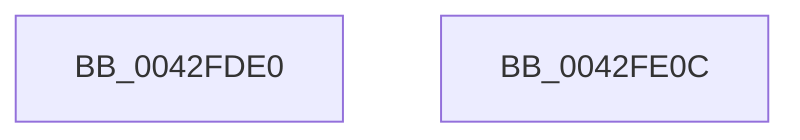

# PopGetTransitionsToOnCount

- RVA: `0x0042FDE0`–`0x0042FE0D` (길이 `45` bytes)
- VA: `0x000000014042FDE0`
- 실행 섹션: `.text`
- PDB 이름 있음: `예`; PDB Function 태그: `아니요`
- unwind 정보 RVA: `0x0005CF00`
- 디코드: `12`개 명령, `45/45` bytes 표시
- 미해석 바이트: `0` (있으면 어셈블리에 `.byte`로 보존)

> 이 문서는 커널 이미지의 기계어와 PDB 기호를 분석해 생성했습니다. 4번과 5번은 함수 원형과 자료형을 바이너리 사용 방식에서 추정한 C 해석이며 원본 소스 복구 결과는 아닙니다.

## 1. Dependencies

- 직접 호출 지점: **2**; 고유 호출 대상: **2**
- 직접 호출자로 확인된 함수: **1**
- RIP 상대 이미지 참조: **2**

### Outgoing calls
- `0x0042FDED` → [PopAcquireRwLockExclusive](../43/PopAcquireRwLockExclusive_function_00430B44.md) (function, `0x00430B44`)
- `0x0042FDFF` → [PopReleaseRwLock](../2D/PopReleaseRwLock_function_002DFBBC.md) (function, `0x002DFBBC`)

### Direct callers
- [PopSetSleepMarker](../../page/AA/PopSetSleepMarker_function_00AA86FC.md) at `0x00AA8708`
- [PopSetSleepMarker](../../page/AA/PopSetSleepMarker_function_00AA86FC.md) at `0x00AA8779`

### Static image references
- `0x0042FDE6` → RVA `0x00F0B480` (`.data`; read)
- `0x0042FDF2` → RVA `0x00F0B4C8` (`.data`; read)

## 2. Other-region calls and transfers

- 다른 실행 섹션으로 향하는 call: **0**
- 별도 외부 분기/꼬리 이동을 확인하지 못했습니다.

## 3. Assembly (complete function range)

```asm
0042FDE0  40 53                           push rbx
0042FDE2  48 83 EC 20                     sub rsp, 0x20
0042FDE6  48 8D 0D 93 B6 AD 00            lea rcx, [rip + 0xadb693]
0042FDED  E8 52 0D 00 00                  call 0x140430b44
0042FDF2  8B 1D D0 B6 AD 00               mov ebx, dword ptr [rip + 0xadb6d0]
0042FDF8  48 8D 0D 81 B6 AD 00            lea rcx, [rip + 0xadb681]
0042FDFF  E8 B8 FD EA FF                  call 0x1402dfbbc
0042FE04  8B C3                           mov eax, ebx
0042FE06  48 83 C4 20                     add rsp, 0x20
0042FE0A  5B                              pop rbx
0042FE0B  C3                              ret
0042FE0C  CC                              int3
```

## 4. C-style interpretation (structured pseudocode)

```c
__int64 __fastcall PopGetTransitionsToOnCount(void)
{
    __int64 result;
    __int64 v_rsp;

    v_rsp = (v_rsp) - (32);
    result = PopAcquireRwLockExclusive(v_rip + 11384467, a2, a3, a4);
    result = PopReleaseRwLock(v_rip + 11384449, a2, a3, a4);
    v_rsp = (v_rsp) + (32);
    return (unsigned int)((unsigned int)((unsigned int)(*(unsigned int *)(v_rip + 11384528))));
}
```

## 5. (Beta) C Style

```c
void PopGetTransitionsToOnCount(void)
{
    int64_t result;
    int64_t local_rsp;

    local_rsp = (local_rsp) - (32);
    result = PopAcquireRwLockExclusive(v_rip + 11384467, a2, a3, a4);
    result = PopReleaseRwLock(v_rip + 11384449, a2, a3, a4);
    local_rsp = (local_rsp) + (32);
    return (uint32_t)((uint32_t)((uint32_t)(*(uint32_t *)(v_rip + 0xADB6D0))));
}
```

## 6. Execution-region graph

[열기: 2D/3D 그래프와 함수 탐색 컨트롤 패널](../../../control-panel.html?section=text&rva=0x0042FDE0&view=graph)

- 2D 그래프는 위에서 아래로 흐르고, 3D 그래프는 빈 공간을 드래그해 회전합니다. Shift+드래그는 이동, 휠은 확대·축소, 함수 노드 선택은 대상 보고서 이동입니다.

### Static fallback


