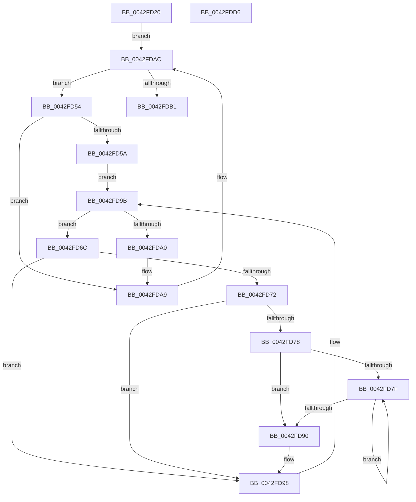

# PopPowerLimitTelemetryWorker

- RVA: `0x0042FD20`–`0x0042FDD7` (길이 `183` bytes)
- VA: `0x000000014042FD20`
- 실행 섹션: `.text`
- PDB 이름 있음: `예`; PDB Function 태그: `아니요`
- unwind 정보 RVA: `0x000A1FF8`
- 디코드: `53`개 명령, `183/183` bytes 표시
- 미해석 바이트: `0` (있으면 어셈블리에 `.byte`로 보존)

> 이 문서는 커널 이미지의 기계어와 PDB 기호를 분석해 생성했습니다. 4번과 5번은 함수 원형과 자료형을 바이너리 사용 방식에서 추정한 C 해석이며 원본 소스 복구 결과는 아닙니다.

## 1. Dependencies

- 직접 호출 지점: **6**; 고유 호출 대상: **4**
- 직접 호출자로 확인된 함수: **1**
- RIP 상대 이미지 참조: **2**

### Outgoing calls
- `0x0042FD3F` → [PopAcquireRwLockExclusive](../43/PopAcquireRwLockExclusive_function_00430B44.md) (function, `0x00430B44`)
- `0x0042FD5E` → [PopAcquireRwLockExclusive](../43/PopAcquireRwLockExclusive_function_00430B44.md) (function, `0x00430B44`)
- `0x0042FD84` → [PopUpdatePowerLimitTimeTracking](../5D/PopUpdatePowerLimitTimeTracking_function_005D0F6C.md) (function, `0x005D0F6C`)
- `0x0042FD93` → [PopTracePowerLimitHistogram](../5D/PopTracePowerLimitHistogram_function_005D7B10.md) (function, `0x005D7B10`)
- `0x0042FDA4` → [PopReleaseRwLock](../2D/PopReleaseRwLock_function_002DFBBC.md) (function, `0x002DFBBC`)
- `0x0042FDB8` → [PopReleaseRwLock](../2D/PopReleaseRwLock_function_002DFBBC.md) (function, `0x002DFBBC`)

### Direct callers
- [PopThermalTelemetryWorker](../5D/PopThermalTelemetryWorker_function_005D57F0.md) at `0x005D5896`

### Static image references
- `0x0042FD38` → RVA `0x00F0BB50` (`.data`; read)
- `0x0042FD44` → RVA `0x00F0BB60` (`.data`; read)

## 2. Other-region calls and transfers

- 다른 실행 섹션으로 향하는 call: **0**
- 별도 외부 분기/꼬리 이동을 확인하지 못했습니다.

## 3. Assembly (complete function range)

```asm
0042FD20  48 89 5C 24 08                  mov qword ptr [rsp + 8], rbx
0042FD25  48 89 6C 24 10                  mov qword ptr [rsp + 0x10], rbp
0042FD2A  48 89 74 24 18                  mov qword ptr [rsp + 0x18], rsi
0042FD2F  57                              push rdi
0042FD30  41 54                           push r12
0042FD32  41 56                           push r14
0042FD34  48 83 EC 20                     sub rsp, 0x20
0042FD38  48 8D 0D 11 BE AD 00            lea rcx, [rip + 0xadbe11]
0042FD3F  E8 00 0E 00 00                  call 0x140430b44
0042FD44  48 8B 3D 15 BE AD 00            mov rdi, qword ptr [rip + 0xadbe15]
0042FD4B  4C 8D 25 0E BE AD 00            lea r12, [rip + 0xadbe0e]
0042FD52  EB 58                           jmp 0x14042fdac
0042FD54  80 7F 30 00                     cmp byte ptr [rdi + 0x30], 0
0042FD58  74 4F                           je 0x14042fda9
0042FD5A  48 8D 4F 20                     lea rcx, [rdi + 0x20]
0042FD5E  E8 E1 0D 00 00                  call 0x140430b44
0042FD63  4C 8D 77 10                     lea r14, [rdi + 0x10]
0042FD67  49 8B 1E                        mov rbx, qword ptr [r14]
0042FD6A  EB 2F                           jmp 0x14042fd9b
0042FD6C  80 7B 10 00                     cmp byte ptr [rbx + 0x10], 0
0042FD70  74 26                           je 0x14042fd98
0042FD72  80 7B 30 00                     cmp byte ptr [rbx + 0x30], 0
0042FD76  74 20                           je 0x14042fd98
0042FD78  33 F6                           xor esi, esi
0042FD7A  39 73 20                        cmp dword ptr [rbx + 0x20], esi
0042FD7D  76 11                           jbe 0x14042fd90
0042FD7F  8B D6                           mov edx, esi
0042FD81  48 8B CB                        mov rcx, rbx
0042FD84  E8 E3 11 1A 00                  call 0x1405d0f6c
0042FD89  FF C6                           inc esi
0042FD8B  3B 73 20                        cmp esi, dword ptr [rbx + 0x20]
0042FD8E  72 EF                           jb 0x14042fd7f
0042FD90  48 8B CB                        mov rcx, rbx
0042FD93  E8 78 7D 1A 00                  call 0x1405d7b10
0042FD98  48 8B 1B                        mov rbx, qword ptr [rbx]
0042FD9B  49 3B DE                        cmp rbx, r14
0042FD9E  75 CC                           jne 0x14042fd6c
0042FDA0  48 8D 4F 20                     lea rcx, [rdi + 0x20]
0042FDA4  E8 13 FE EA FF                  call 0x1402dfbbc
0042FDA9  48 8B 3F                        mov rdi, qword ptr [rdi]
0042FDAC  49 3B FC                        cmp rdi, r12
0042FDAF  75 A3                           jne 0x14042fd54
0042FDB1  48 8D 0D 98 BD AD 00            lea rcx, [rip + 0xadbd98]
0042FDB8  E8 FF FD EA FF                  call 0x1402dfbbc
0042FDBD  48 8B 5C 24 40                  mov rbx, qword ptr [rsp + 0x40]
0042FDC2  48 8B 6C 24 48                  mov rbp, qword ptr [rsp + 0x48]
0042FDC7  48 8B 74 24 50                  mov rsi, qword ptr [rsp + 0x50]
0042FDCC  48 83 C4 20                     add rsp, 0x20
0042FDD0  41 5E                           pop r14
0042FDD2  41 5C                           pop r12
0042FDD4  5F                              pop rdi
0042FDD5  C3                              ret
0042FDD6  CC                              int3
```

## 4. C-style interpretation (structured pseudocode)

```c
__int64 __fastcall PopPowerLimitTelemetryWorker(void)
{
    __int64 result;
    __int64 v_rsi;
    __int64 v_rsp;
    unsigned __int64 v_stack_p10;
    unsigned __int64 v_stack_p18;
    unsigned __int64 v_stack_p8;

    v_stack_p8 = v_rbx;
    v_stack_p10 = v_rbp;
    v_stack_p18 = v_rsi;
    v_rsp = (v_rsp) - (32);
    result = PopAcquireRwLockExclusive(v_rip + 11386385, a2, a3, a4);
    goto loc_0042FDAC;
loc_0042FD54:
    if ((*(unsigned __int8 *)(*(unsigned __int64 *)(v_rip + 11386389) + 48)) == 0) goto loc_0042FDA9;
    result = PopAcquireRwLockExclusive(*(unsigned __int64 *)(v_rip + 11386389) + 32, a2, a3, a4);
    goto loc_0042FD9B;
loc_0042FD6C:
    if ((*(unsigned __int8 *)(*(unsigned __int64 *)(*(unsigned __int64 *)(v_rip + 11386389) + 16) + 16)) == 0) goto loc_0042FD98;
    if ((*(unsigned __int8 *)(*(unsigned __int64 *)(*(unsigned __int64 *)(v_rip + 11386389) + 16) + 48)) == 0) goto loc_0042FD98;
    v_rsi = 0;
    if ((*(unsigned int *)(*(unsigned __int64 *)(*(unsigned __int64 *)(v_rip + 11386389) + 16) + 32)) <= 0) goto loc_0042FD90;
loc_0042FD7F:
    result = PopUpdatePowerLimitTimeTracking(*(unsigned __int64 *)(*(unsigned __int64 *)(v_rip + 11386389) + 16), 0, a3, a4);
    v_rsi = (unsigned int)((v_rsi) + 1);
    if (((unsigned int)(v_rsi)) < (*(unsigned int *)(*(unsigned __int64 *)(*(unsigned __int64 *)(v_rip + 11386389) + 16) + 32))) goto loc_0042FD7F;
loc_0042FD90:
    result = PopTracePowerLimitHistogram(*(unsigned __int64 *)(*(unsigned __int64 *)(v_rip + 11386389) + 16), 0, a3, a4);
loc_0042FD98:
loc_0042FD9B:
    if ((*(unsigned __int64 *)(*(unsigned __int64 *)(*(unsigned __int64 *)(v_rip + 11386389) + 16))) != (*(unsigned __int64 *)(v_rip + 11386389) + 16)) goto loc_0042FD6C;
    result = PopReleaseRwLock(*(unsigned __int64 *)(v_rip + 11386389) + 32, 0, a3, a4);
loc_0042FDA9:
loc_0042FDAC:
    if ((*(unsigned __int64 *)(*(unsigned __int64 *)(v_rip + 11386389))) != (v_rip + 11386382)) goto loc_0042FD54;
    result = PopReleaseRwLock(v_rip + 11386264, 0, a3, a4);
    v_rsp = (v_rsp) + (32);
    return result;
}
```

## 5. (Beta) C Style

```c
void PopPowerLimitTelemetryWorker(void)
{
    int64_t result;
    int64_t local_rsi;
    int64_t local_rsp;
    uint64_t v_stack_p10;
    uint64_t v_stack_p18;
    uint64_t v_stack_p8;

    v_stack_p8 = local_rbx;
    v_stack_p10 = local_rbp;
    v_stack_p18 = local_rsi;
    local_rsp = (local_rsp) - (32);
    result = PopAcquireRwLockExclusive(v_rip + 11386385, a2, a3, a4);
    goto loc_0042FDAC;
loc_0042FD54:
    if ((*(uint8_t *)(*(uint64_t *)(v_rip + 0xADBE15) + 0x30)) == 0) goto loc_0042FDA9;
    result = PopAcquireRwLockExclusive(*(uint64_t *)(v_rip + 0xADBE15) + 32, a2, a3, a4);
    goto loc_0042FD9B;
loc_0042FD6C:
    if ((*(uint8_t *)(*(uint64_t *)(*(uint64_t *)(v_rip + 0xADBE15) + 0x10) + 0x10)) == 0) goto loc_0042FD98;
    if ((*(uint8_t *)(*(uint64_t *)(*(uint64_t *)(v_rip + 0xADBE15) + 0x10) + 0x30)) == 0) goto loc_0042FD98;
    local_rsi = 0;
    if ((*(uint32_t *)(*(uint64_t *)(*(uint64_t *)(v_rip + 0xADBE15) + 0x10) + 0x20)) <= 0) goto loc_0042FD90;
loc_0042FD7F:
    result = PopUpdatePowerLimitTimeTracking(*(uint64_t *)(*(uint64_t *)(v_rip + 0xADBE15) + 0x10), 0, a3, a4);
    local_rsi = (uint32_t)((local_rsi) + 1);
    if (((uint32_t)(local_rsi)) < (*(uint32_t *)(*(uint64_t *)(*(uint64_t *)(v_rip + 0xADBE15) + 0x10) + 0x20))) goto loc_0042FD7F;
loc_0042FD90:
    result = PopTracePowerLimitHistogram(*(uint64_t *)(*(uint64_t *)(v_rip + 0xADBE15) + 0x10), 0, a3, a4);
loc_0042FD98:
loc_0042FD9B:
    if ((*(uint64_t *)(*(uint64_t *)(*(uint64_t *)(v_rip + 0xADBE15) + 0x10))) != (*(uint64_t *)(v_rip + 0xADBE15) + 16)) goto loc_0042FD6C;
    result = PopReleaseRwLock(*(uint64_t *)(v_rip + 0xADBE15) + 32, 0, a3, a4);
loc_0042FDA9:
loc_0042FDAC:
    if ((*(uint64_t *)(*(uint64_t *)(v_rip + 0xADBE15))) != (v_rip + 11386382)) goto loc_0042FD54;
    result = PopReleaseRwLock(v_rip + 11386264, 0, a3, a4);
    local_rsp = (local_rsp) + (32);
    return result;
}
```

## 6. Execution-region graph

[열기: 2D/3D 그래프와 함수 탐색 컨트롤 패널](../../../control-panel.html?section=text&rva=0x0042FD20&view=graph)

- 2D 그래프는 위에서 아래로 흐르고, 3D 그래프는 빈 공간을 드래그해 회전합니다. Shift+드래그는 이동, 휠은 확대·축소, 함수 노드 선택은 대상 보고서 이동입니다.

### Static fallback


