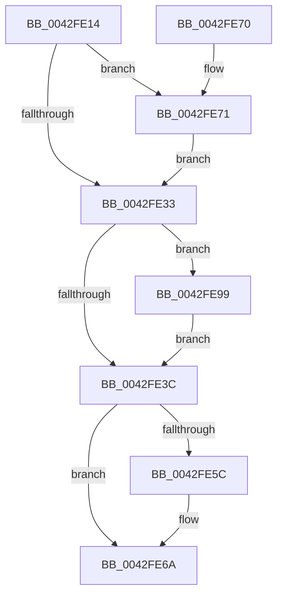

# PopThermalCsEntry

- RVA: `0x0042FE14`–`0x0042FEA2` (길이 `142` bytes)
- VA: `0x000000014042FE14`
- 실행 섹션: `.text`
- PDB 이름 있음: `예`; PDB Function 태그: `아니요`
- unwind 정보 RVA: `0x0008E1E4`
- 디코드: `34`개 명령, `142/142` bytes 표시
- 미해석 바이트: `0` (있으면 어셈블리에 `.byte`로 보존)

> 이 문서는 커널 이미지의 기계어와 PDB 기호를 분석해 생성했습니다. 4번과 5번은 함수 원형과 자료형을 바이너리 사용 방식에서 추정한 C 해석이며 원본 소스 복구 결과는 아닙니다.

## 1. Dependencies

- 직접 호출 지점: **5**; 고유 호출 대상: **5**
- 직접 호출자로 확인된 함수: **1**
- RIP 상대 이미지 참조: **8**

### Outgoing calls
- `0x0042FE23` → [PopAcquireRwLockExclusive](../43/PopAcquireRwLockExclusive_function_00430B44.md) (function, `0x00430B44`)
- `0x0042FE43` → [PopReleaseRwLock](../2D/PopReleaseRwLock_function_002DFBBC.md) (function, `0x002DFBBC`)
- `0x0042FE65` → [ExQueueWorkItem](../2F/ExQueueWorkItem_function_002F9520.md) (function, `0x002F9520`)
- `0x0042FE92` → [PopTraceThermalStandbyInitiated](../5D/PopTraceThermalStandbyInitiated_function_005D7F44.md) (function, `0x005D7F44`)
- `0x0042FE9B` → [PopThermalStandbyEndTracking](../4D/PopThermalStandbyEndTracking_function_004D1B2C.md) (function, `0x004D1B2C`)

### Direct callers
- [PopSleepstudyStartNextSession](../../page/AC/PopSleepstudyStartNextSession_function_00AC4720.md) at `0x00AC4BF0`

### Static image references
- `0x0042FE1C` → RVA `0x00F0BB00` (`.data`; read)
- `0x0042FE28` → RVA `0x00F0BB10` (`.data`; write)
- `0x0042FE33` → RVA `0x00F0BB14` (`.data`; read)
- `0x0042FE4D` → RVA `0x00F0BAE8` (`.data`; read/write)
- `0x0042FE5E` → RVA `0x00F0BAC8` (`.data`; read)
- `0x0042FE71` → RVA `0x00F0BB1D` (`.data`; write)
- `0x0042FE85` → RVA `0x00F0BB1C` (`.data`; read)
- `0x0042FE8B` → RVA `0x00F0BB20` (`.data`; write)

## 2. Other-region calls and transfers

- 다른 실행 섹션으로 향하는 call: **0**
- 별도 외부 분기/꼬리 이동을 확인하지 못했습니다.

## 3. Assembly (complete function range)

```asm
0042FE14  40 53                           push rbx
0042FE16  48 83 EC 20                     sub rsp, 0x20
0042FE1A  8A D9                           mov bl, cl
0042FE1C  48 8D 0D DD BC AD 00            lea rcx, [rip + 0xadbcdd]
0042FE23  E8 1C 0D 00 00                  call 0x140430b44
0042FE28  C6 05 E1 BC AD 00 00            mov byte ptr [rip + 0xadbce1], 0
0042FE2F  84 DB                           test bl, bl
0042FE31  75 3E                           jne 0x14042fe71
0042FE33  83 3D DA BC AD 00 00            cmp dword ptr [rip + 0xadbcda], 0
0042FE3A  74 5D                           je 0x14042fe99
0042FE3C  48 8D 0D BD BC AD 00            lea rcx, [rip + 0xadbcbd]
0042FE43  E8 74 FD EA FF                  call 0x1402dfbbc
0042FE48  B8 01 00 00 00                  mov eax, 1
0042FE4D  F0 0F C1 05 93 BC AD 00         lock xadd dword ptr [rip + 0xadbc93], eax
0042FE55  FF C0                           inc eax
0042FE57  83 F8 01                        cmp eax, 1
0042FE5A  75 0E                           jne 0x14042fe6a
0042FE5C  8B D0                           mov edx, eax
0042FE5E  48 8D 0D 63 BC AD 00            lea rcx, [rip + 0xadbc63]
0042FE65  E8 B6 96 EC FF                  call 0x1402f9520
0042FE6A  48 83 C4 20                     add rsp, 0x20
0042FE6E  5B                              pop rbx
0042FE6F  C3                              ret
0042FE70  CC                              int3
0042FE71  C6 05 A5 BC AD 00 01            mov byte ptr [rip + 0xadbca5], 1
0042FE78  48 B8 08 00 00 00 80 F7 FF FF   movabs rax, 0xfffff78000000008
0042FE82  48 8B 00                        mov rax, qword ptr [rax]
0042FE85  8A 0D 91 BC AD 00               mov cl, byte ptr [rip + 0xadbc91]
0042FE8B  48 89 05 8E BC AD 00            mov qword ptr [rip + 0xadbc8e], rax
0042FE92  E8 AD 80 1A 00                  call 0x1405d7f44
0042FE97  EB 9A                           jmp 0x14042fe33
0042FE99  33 C9                           xor ecx, ecx
0042FE9B  E8 8C 1C 0A 00                  call 0x1404d1b2c
0042FEA0  EB 9A                           jmp 0x14042fe3c
```

## 4. C-style interpretation (structured pseudocode)

```c
__int64 __fastcall PopThermalCsEntry(unsigned __int8 a1)
{
    __int64 result;
    __int64 v_rsp;

    v_rsp = (v_rsp) - (32);
    result = PopAcquireRwLockExclusive(v_rip + 11386077, a2, a3, a4);
    *(unsigned __int8 *)(v_rip + 11386081) = 0;
    if (a1 != 0) goto loc_0042FE71;
loc_0042FE33:
    if ((*(unsigned int *)(v_rip + 11386074)) == 0) goto loc_0042FE99;
loc_0042FE3C:
    result = PopReleaseRwLock(v_rip + 11386045, a2, a3, a4);
    result = (unsigned int)((1) + 1);
    if (((unsigned int)(result)) == 1) {
        a2 = (unsigned int)(result);
        a1 = v_rip + 11385955;
        result = ExQueueWorkItem(a1, a2, a3, a4);
    }
    v_rsp = (v_rsp) + (32);
    return result;
loc_0042FE71:
    *(unsigned __int8 *)(v_rip + 11386021) = 1;
    *(unsigned __int64 *)(v_rip + 11385998) = *(unsigned __int64 *)(result);
    result = PopTraceThermalStandbyInitiated(*(unsigned __int8 *)(v_rip + 11386001), a2, a3, a4);
    goto loc_0042FE33;
loc_0042FE99:
    a1 = 0;
    result = PopThermalStandbyEndTracking(a1, a2, a3, a4);
    goto loc_0042FE3C;
}
```

## 5. (Beta) C Style

```c
int64_t PopThermalCsEntry(uint8_t Arg1)
{
    int64_t result;
    int64_t local_rsp;

    local_rsp = (local_rsp) - (32);
    result = PopAcquireRwLockExclusive(v_rip + 11386077, a2, a3, a4);
    *(uint8_t *)(v_rip + 0xADBCE1) = 0;
    if (Arg1 != 0) goto loc_0042FE71;
loc_0042FE33:
    if ((*(uint32_t *)(v_rip + 0xADBCDA)) == 0) goto loc_0042FE99;
loc_0042FE3C:
    result = PopReleaseRwLock(v_rip + 11386045, a2, a3, a4);
    result = (uint32_t)((1) + 1);
    if (((uint32_t)(result)) == 1) {
        a2 = (uint32_t)(result);
        Arg1 = v_rip + 11385955;
        result = ExQueueWorkItem(Arg1, a2, a3, a4);
    }
    local_rsp = (local_rsp) + (32);
    return result;
loc_0042FE71:
    *(uint8_t *)(v_rip + 0xADBCA5) = 1;
    *(uint64_t *)(v_rip + 0xADBC8E) = *(uint64_t *)(result);
    result = PopTraceThermalStandbyInitiated(*(uint8_t *)(v_rip + 0xADBC91), a2, a3, a4);
    goto loc_0042FE33;
loc_0042FE99:
    Arg1 = 0;
    result = PopThermalStandbyEndTracking(Arg1, a2, a3, a4);
    goto loc_0042FE3C;
}
```

## 6. Execution-region graph

[열기: 2D/3D 그래프와 함수 탐색 컨트롤 패널](../../../control-panel.html?section=text&rva=0x0042FE14&view=graph)

- 2D 그래프는 위에서 아래로 흐르고, 3D 그래프는 빈 공간을 드래그해 회전합니다. Shift+드래그는 이동, 휠은 확대·축소, 함수 노드 선택은 대상 보고서 이동입니다.

### Static fallback


