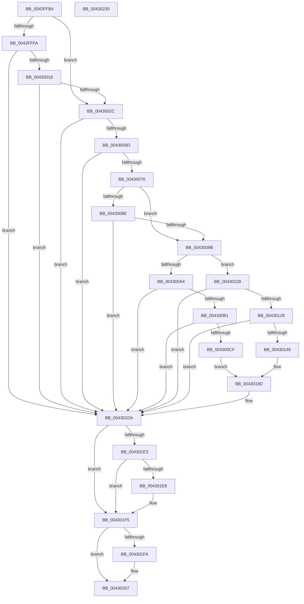

# PopTraceThermalRequestPassiveHistogram

- RVA: `0x0042FFB4`–`0x00430231` (길이 `637` bytes)
- VA: `0x000000014042FFB4`
- 실행 섹션: `.text`
- PDB 이름 있음: `예`; PDB Function 태그: `아니요`
- unwind 정보 RVA: `0x000A2030`
- 디코드: `143`개 명령, `637/637` bytes 표시
- 미해석 바이트: `0` (있으면 어셈블리에 `.byte`로 보존)

> 이 문서는 커널 이미지의 기계어와 PDB 기호를 분석해 생성했습니다. 4번과 5번은 함수 원형과 자료형을 바이너리 사용 방식에서 추정한 C 해석이며 원본 소스 복구 결과는 아닙니다.

## 1. Dependencies

- 직접 호출 지점: **16**; 고유 호출 대상: **11**
- 직접 호출자로 확인된 함수: **4**
- RIP 상대 이미지 참조: **6**

### Outgoing calls
- `0x0042FFF1` → [Feature_Servicing_CoolingFrameworkDeviceCleanupFix__private_IsEnabledDeviceUsageNoInline](../5D/Feature_Servicing_CoolingFrameworkDeviceCleanupFix__private_IsEnabledDeviceUsageNoInline_function_005D1004.md) (function, `0x005D1004`)
- `0x00430007` → [IoGetDeviceAttachmentBaseRefWithTag](../27/IoGetDeviceAttachmentBaseRefWithTag_function_00272788.md) (function, `0x00272788`)
- `0x00430037` → [PoStoreDiagnosticContext](../23/PoStoreDiagnosticContext_function_0023009C.md) (function, `0x0023009C`)
- `0x0043004C` → [ExAllocatePool2](../../poolcode/B8/ExAllocatePool2_function_00B820F0.md) (function, `0x00B820F0`)
- `0x00430069` → [PoStoreDiagnosticContext](../23/PoStoreDiagnosticContext_function_0023009C.md) (function, `0x0023009C`)
- `0x00430085` → [PopDiagSnapPassiveHistogram](../4B/PopDiagSnapPassiveHistogram_function_004BDA50.md) (function, `0x004BDA50`)
- `0x0043009B` → [Feature_Servicing_CoolingFrameworkDeviceCleanupFix__private_IsEnabledDeviceUsageNoInline](../5D/Feature_Servicing_CoolingFrameworkDeviceCleanupFix__private_IsEnabledDeviceUsageNoInline_function_005D1004.md) (function, `0x005D1004`)
- `0x004300C2` → [tlgKeywordOn](tlgKeywordOn_function_0042EAA0.md) (function, `0x0042EAA0`)
- `0x0043010D` → [tlgCreate1Sz_wchar_t](tlgCreate1Sz_wchar_t_function_00426198.md) (function, `0x00426198`)
- `0x00430139` → [tlgKeywordOn](tlgKeywordOn_function_0042EAA0.md) (function, `0x0042EAA0`)
- `0x00430181` → [tlgCreate1Sz_wchar_t](tlgCreate1Sz_wchar_t_function_00426198.md) (function, `0x00426198`)
- `0x004301D5` → [tlgWriteTransfer_EtwWriteTransfer](tlgWriteTransfer_EtwWriteTransfer_function_004260E0.md) (function, `0x004260E0`)
- `0x004301DA` → [Feature_Servicing_CoolingFrameworkDeviceCleanupFix__private_IsEnabledDeviceUsageNoInline](../5D/Feature_Servicing_CoolingFrameworkDeviceCleanupFix__private_IsEnabledDeviceUsageNoInline_function_005D1004.md) (function, `0x005D1004`)
- `0x004301F0` → [ObfDereferenceObjectWithTag](../2F/ObfDereferenceObjectWithTag_function_002F78E0.md) (function, `0x002F78E0`)
- `0x00430202` → [ExFreePoolWithTag](../../poolcode/B8/ExFreePoolWithTag_function_00B82870.md) (function, `0x00B82870`)
- `0x0043020E` → [_security_check_cookie](../6A/_security_check_cookie_function_006AC640.md) (function, `0x006AC640`)

### Direct callers
- [PopCoolingTelemetryWorker](PopCoolingTelemetryWorker_function_0042FC3C.md) at `0x0042FD12`
- [PopCoolingSxTransition](PopCoolingSxTransition_function_0042FEA8.md) at `0x0042FF22`
- [PopOrphanCoolingExtension](../../page/75/PopOrphanCoolingExtension_function_00757474.md) at `0x007574ED`
- [PopDeactiveThermalRequest](../../page/AD/PopDeactiveThermalRequest_function_00ADF634.md) at `0x00ADF690`

### Static image references
- `0x0042FFD3` → RVA `0x00E0A740` (`.data`; read)
- `0x0043008E` → RVA `0x00E0B564` (`.data`; read)
- `0x004300A4` → RVA `0x00E07748` (`.data`; read)
- `0x00430112` → RVA `0x0004AE20` (`.rdata`; read)
- `0x00430186` → RVA `0x0004AE9F` (`.rdata`; read)
- `0x00430191` → RVA `0x00F0C940` (`.data`; read)

## 2. Other-region calls and transfers

- 다른 실행 섹션으로 향하는 call: **2**
  - `0x0043004C` → [ExAllocatePool2](../../poolcode/B8/ExAllocatePool2_function_00B820F0.md) (`.text` → `POOLCODE`)
  - `0x00430202` → [ExFreePoolWithTag](../../poolcode/B8/ExFreePoolWithTag_function_00B82870.md) (`.text` → `POOLCODE`)
- 별도 외부 분기/꼬리 이동을 확인하지 못했습니다.

## 3. Assembly (complete function range)

```asm
0042FFB4  48 8B C4                        mov rax, rsp
0042FFB7  48 89 58 10                     mov qword ptr [rax + 0x10], rbx
0042FFBB  48 89 70 18                     mov qword ptr [rax + 0x18], rsi
0042FFBF  48 89 78 20                     mov qword ptr [rax + 0x20], rdi
0042FFC3  55                              push rbp
0042FFC4  41 56                           push r14
0042FFC6  41 57                           push r15
0042FFC8  48 8D 68 C8                     lea rbp, [rax - 0x38]
0042FFCC  48 81 EC 20 01 00 00            sub rsp, 0x120
0042FFD3  48 8B 05 66 A7 9D 00            mov rax, qword ptr [rip + 0x9da766]
0042FFDA  48 33 C4                        xor rax, rsp
0042FFDD  48 89 45 10                     mov qword ptr [rbp + 0x10], rax
0042FFE1  48 83 64 24 30 00               and qword ptr [rsp + 0x30], 0
0042FFE7  33 DB                           xor ebx, ebx
0042FFE9  33 FF                           xor edi, edi
0042FFEB  48 8B F1                        mov rsi, rcx
0042FFEE  45 33 F6                        xor r14d, r14d
0042FFF1  E8 0E 10 1A 00                  call 0x1405d1004
0042FFF6  85 C0                           test eax, eax
0042FFF8  75 32                           jne 0x14043002c
0042FFFA  48 8B 4E 20                     mov rcx, qword ptr [rsi + 0x20]
0042FFFE  BA 50 6F 44 67                  mov edx, 0x67446f50
00430003  48 8B 49 40                     mov rcx, qword ptr [rcx + 0x40]
00430007  E8 7C 27 E4 FF                  call 0x140272788
0043000C  48 8B F8                        mov rdi, rax
0043000F  48 85 C0                        test rax, rax
00430012  0F 84 C2 01 00 00               je 0x1404301da
00430018  48 8B 80 38 01 00 00            mov rax, qword ptr [rax + 0x138]
0043001F  4C 8B 70 28                     mov r14, qword ptr [rax + 0x28]
00430023  4D 85 F6                        test r14, r14
00430026  0F 84 AE 01 00 00               je 0x1404301da
0043002C  48 8B 4E 18                     mov rcx, qword ptr [rsi + 0x18]
00430030  4C 8D 44 24 30                  lea r8, [rsp + 0x30]
00430035  33 D2                           xor edx, edx
00430037  E8 60 00 E0 FF                  call 0x14023009c
0043003C  48 8B 54 24 30                  mov rdx, qword ptr [rsp + 0x30]
00430041  41 B8 54 56 45 50               mov r8d, 0x50455654
00430047  B9 00 01 00 00                  mov ecx, 0x100
0043004C  E8 9F 20 75 00                  call 0x140b820f0
00430051  48 8B D8                        mov rbx, rax
00430054  48 85 C0                        test rax, rax
00430057  0F 84 7D 01 00 00               je 0x1404301da
0043005D  48 8B 4E 18                     mov rcx, qword ptr [rsi + 0x18]
00430061  4C 8D 44 24 30                  lea r8, [rsp + 0x30]
00430066  48 8B D0                        mov rdx, rax
00430069  E8 2E 00 E0 FF                  call 0x14023009c
0043006E  85 C0                           test eax, eax
00430070  0F 88 64 01 00 00               js 0x1404301da
00430076  4C 8B 7B 10                     mov r15, qword ptr [rbx + 0x10]
0043007A  48 8D 4E 28                     lea rcx, [rsi + 0x28]
0043007E  48 8D 55 B0                     lea rdx, [rbp - 0x50]
00430082  4C 03 FB                        add r15, rbx
00430085  E8 C6 D9 08 00                  call 0x1404bda50
0043008A  84 C0                           test al, al
0043008C  75 0D                           jne 0x14043009b
0043008E  83 3D CF B4 9D 00 00            cmp dword ptr [rip + 0x9db4cf], 0
00430095  0F 84 3F 01 00 00               je 0x1404301da
0043009B  E8 64 0F 1A 00                  call 0x1405d1004
004300A0  85 C0                           test eax, eax
004300A2  74 77                           je 0x14043011b
004300A4  83 3D 9D 76 9D 00 05            cmp dword ptr [rip + 0x9d769d], 5
004300AB  0F 86 29 01 00 00               jbe 0x1404301da
004300B1  48 BA 00 00 00 00 00 40 00 00   movabs rdx, 0x400000000000
004300BB  48 8D 0D 86 76 9D 00            lea rcx, [rip + 0x9d7686]
004300C2  E8 D9 E9 FF FF                  call 0x14042eaa0
004300C7  84 C0                           test al, al
004300C9  0F 84 0B 01 00 00               je 0x1404301da
004300CF  48 8B 46 20                     mov rax, qword ptr [rsi + 0x20]
004300D3  0F B7 90 A0 00 00 00            movzx edx, word ptr [rax + 0xa0]
004300DA  48 8B 88 A8 00 00 00            mov rcx, qword ptr [rax + 0xa8]
004300E1  48 8D 44 24 78                  lea rax, [rsp + 0x78]
004300E6  83 64 24 6C 00                  and dword ptr [rsp + 0x6c], 0
004300EB  83 64 24 7C 00                  and dword ptr [rsp + 0x7c], 0
004300F0  48 89 4C 24 70                  mov qword ptr [rsp + 0x70], rcx
004300F5  48 8D 4D 80                     lea rcx, [rbp - 0x80]
004300F9  89 54 24 78                     mov dword ptr [rsp + 0x78], edx
004300FD  49 8B D7                        mov rdx, r15
00430100  48 89 44 24 60                  mov qword ptr [rsp + 0x60], rax
00430105  C7 44 24 68 02 00 00 00         mov dword ptr [rsp + 0x68], 2
0043010D  E8 86 60 FF FF                  call 0x140426198
00430112  48 8D 15 07 AD C1 FF            lea rdx, [rip - 0x3e52f9]
00430119  EB 72                           jmp 0x14043018d
0043011B  83 3D 26 76 9D 00 05            cmp dword ptr [rip + 0x9d7626], 5
00430122  0F 86 B2 00 00 00               jbe 0x1404301da
00430128  48 BA 00 00 00 00 00 40 00 00   movabs rdx, 0x400000000000
00430132  48 8D 0D 0F 76 9D 00            lea rcx, [rip + 0x9d760f]
00430139  E8 62 E9 FF FF                  call 0x14042eaa0
0043013E  84 C0                           test al, al
00430140  0F 84 94 00 00 00               je 0x1404301da
00430146  83 64 24 6C 00                  and dword ptr [rsp + 0x6c], 0
0043014B  48 8D 44 24 78                  lea rax, [rsp + 0x78]
00430150  83 64 24 7C 00                  and dword ptr [rsp + 0x7c], 0
00430155  48 8D 4D 80                     lea rcx, [rbp - 0x80]
00430159  48 89 44 24 60                  mov qword ptr [rsp + 0x60], rax
0043015E  49 8B D7                        mov rdx, r15
00430161  49 8B 86 88 00 00 00            mov rax, qword ptr [r14 + 0x88]
00430168  48 89 44 24 70                  mov qword ptr [rsp + 0x70], rax
0043016D  41 0F B7 86 80 00 00 00         movzx eax, word ptr [r14 + 0x80]
00430175  89 44 24 78                     mov dword ptr [rsp + 0x78], eax
00430179  C7 44 24 68 02 00 00 00         mov dword ptr [rsp + 0x68], 2
00430181  E8 12 60 FF FF                  call 0x140426198
00430186  48 8D 15 12 AD C1 FF            lea rdx, [rip - 0x3e52ee]
0043018D  83 65 9C 00                     and dword ptr [rbp - 0x64], 0
00430191  48 8D 05 A8 C7 AD 00            lea rax, [rip + 0xadc7a8]
00430198  83 65 AC 00                     and dword ptr [rbp - 0x54], 0
0043019C  48 8D 4D B0                     lea rcx, [rbp - 0x50]
004301A0  48 89 45 A0                     mov qword ptr [rbp - 0x60], rax
004301A4  45 33 C9                        xor r9d, r9d
004301A7  48 8D 44 24 40                  lea rax, [rsp + 0x40]
004301AC  48 89 4D 90                     mov qword ptr [rbp - 0x70], rcx
004301B0  48 89 44 24 28                  mov qword ptr [rsp + 0x28], rax
004301B5  48 8D 0D 8C 75 9D 00            lea rcx, [rip + 0x9d758c]
004301BC  45 33 C0                        xor r8d, r8d
004301BF  C7 44 24 20 07 00 00 00         mov dword ptr [rsp + 0x20], 7
004301C7  C7 45 98 54 00 00 00            mov dword ptr [rbp - 0x68], 0x54
004301CE  C7 45 A8 15 00 00 00            mov dword ptr [rbp - 0x58], 0x15
004301D5  E8 06 5F FF FF                  call 0x1404260e0
004301DA  E8 25 0E 1A 00                  call 0x1405d1004
004301DF  85 C0                           test eax, eax
004301E1  75 12                           jne 0x1404301f5
004301E3  48 85 FF                        test rdi, rdi
004301E6  74 0D                           je 0x1404301f5
004301E8  BA 50 6F 44 67                  mov edx, 0x67446f50
004301ED  48 8B CF                        mov rcx, rdi
004301F0  E8 EB 76 EC FF                  call 0x1402f78e0
004301F5  48 85 DB                        test rbx, rbx
004301F8  74 0D                           je 0x140430207
004301FA  BA 54 56 45 50                  mov edx, 0x50455654
004301FF  48 8B CB                        mov rcx, rbx
00430202  E8 69 26 75 00                  call 0x140b82870
00430207  48 8B 4D 10                     mov rcx, qword ptr [rbp + 0x10]
0043020B  48 33 CC                        xor rcx, rsp
0043020E  E8 2D C4 27 00                  call 0x1406ac640
00430213  4C 8D 9C 24 20 01 00 00         lea r11, [rsp + 0x120]
0043021B  49 8B 5B 28                     mov rbx, qword ptr [r11 + 0x28]
0043021F  49 8B 73 30                     mov rsi, qword ptr [r11 + 0x30]
00430223  49 8B 7B 38                     mov rdi, qword ptr [r11 + 0x38]
00430227  49 8B E3                        mov rsp, r11
0043022A  41 5F                           pop r15
0043022C  41 5E                           pop r14
0043022E  5D                              pop rbp
0043022F  C3                              ret
00430230  CC                              int3
```

## 4. C-style interpretation (structured pseudocode)

```c
__int64 __fastcall PopTraceThermalRequestPassiveHistogram(__int64 a1, __int64 a2, __int64 a3, int a4)
{
    __int64 result;
    __int64 v_r14;
    __int64 v_r15;
    __int64 v_rbx;
    __int64 v_rdi;
    __int64 v_rsp;
    unsigned __int64 v_stack_m108;
    unsigned __int64 v_stack_m110;
    unsigned int v_stack_m118;
    unsigned __int64 v_stack_m18;
    unsigned int v_stack_mBC;
    unsigned __int64 v_stack_mC0;
    unsigned __int64 v_stack_mC8;
    unsigned int v_stack_mCC;
    unsigned int v_stack_mD0;
    unsigned __int64 v_stack_mD8;
    unsigned __int64 v_stack_mF8;

    *(unsigned __int64 *)(v_rsp + 16) = v_rbx;
    *(unsigned __int64 *)(v_rsp + 24) = v_rsi;
    *(unsigned __int64 *)(v_rsp + 32) = v_rdi;
    v_rsp = (v_rsp) - (288);
    result = (*(unsigned __int64 *)(v_rip + 10332006)) ^ (v_rsp);
    *(unsigned __int64 *)(v_rsp - 56 + 16) = result;
    v_rbx = 0;
    v_rdi = 0;
    v_r14 = 0;
    result = Feature_Servicing_CoolingFrameworkDeviceCleanupFix__private_IsEnabledDeviceUsageNoInline(a1, a2, a3, a4);
    if ((unsigned int)(result) != 0) goto loc_0043002C;
    result = IoGetDeviceAttachmentBaseRefWithTag(*(unsigned __int64 *)(*(unsigned __int64 *)(a1 + 32) + 64), (unsigned int)(0x67446F50ULL), a3, a4);
    if (result == 0) goto loc_004301DA;
    if (*(unsigned __int64 *)(*(unsigned __int64 *)(result + 312) + 40) == 0) goto loc_004301DA;
loc_0043002C:
    a2 = 0;
    result = PoStoreDiagnosticContext(*(unsigned __int64 *)(a1 + 24), a2, v_stack_m108, a4);
    result = ExAllocatePool2(256, v_stack_m108, (unsigned int)(0x50455654ULL), a4);
    if (result == 0) goto loc_004301DA;
    result = PoStoreDiagnosticContext(*(unsigned __int64 *)(a1 + 24), result, v_stack_m108, a4);
    if (sign_flag) goto loc_004301DA;
    v_r15 = (*(unsigned __int64 *)(result + 16)) + (result);
    result = PopDiagSnapPassiveHistogram(a1 + 40, v_rsp - 56 - 80, v_stack_m108, a4);
    if ((unsigned __int8)(result) != 0) goto loc_0043009B;
    if ((*(unsigned int *)(v_rip + 10335439)) == 0) goto loc_004301DA;
loc_0043009B:
    result = Feature_Servicing_CoolingFrameworkDeviceCleanupFix__private_IsEnabledDeviceUsageNoInline(a1 + 40, v_rsp - 56 - 80, v_stack_m108, a4);
    if ((unsigned int)(result) == 0) goto loc_0043011B;
    if ((*(unsigned int *)(v_rip + 10319517)) <= 5) goto loc_004301DA;
    result = tlgKeywordOn(v_rip + 10319494, v_rsp - 56 - 80, v_stack_m108, a4);
    if ((unsigned __int8)(result) == 0) goto loc_004301DA;
    v_stack_mC8 = *(unsigned __int64 *)(*(unsigned __int64 *)(a1 + 32) + 168);
    v_stack_mC0 = (unsigned int)(*(unsigned __int16 *)(*(unsigned __int64 *)(a1 + 32) + 160));
    v_stack_mD8 = v_stack_mC0;
    v_stack_mD0 = 2;
    result = tlgCreate1Sz_wchar_t(v_rsp - 56 - 128, v_r15, v_stack_m108, a4);
    goto loc_0043018D;
loc_0043011B:
    if ((*(unsigned int *)(v_rip + 10319398)) <= 5) goto loc_004301DA;
    result = tlgKeywordOn(v_rip + 10319375, v_rip - 4084473, v_stack_m108, a4);
    if ((unsigned __int8)(result) == 0) goto loc_004301DA;
    v_stack_mD8 = v_stack_mC0;
    v_stack_mC8 = *(unsigned __int64 *)(*(unsigned __int64 *)(*(unsigned __int64 *)(result + 312) + 40) + 136);
    v_stack_mC0 = (unsigned int)(*(unsigned __int16 *)(*(unsigned __int64 *)(*(unsigned __int64 *)(result + 312) + 40) + 128));
    v_stack_mD0 = 2;
    result = tlgCreate1Sz_wchar_t(v_rsp - 56 - 128, v_r15, v_stack_m108, a4);
loc_0043018D:
    *(unsigned __int64 *)(v_rsp - 56 - 96) = v_rip + 11388840;
    a4 = 0;
    *(unsigned __int64 *)(v_rsp - 56 - 112) = v_rsp - 56 - 80;
    v_stack_m110 = v_stack_mF8;
    a3 = 0;
    v_stack_m118 = 7;
    *(unsigned int *)(v_rsp - 56 - 104) = 84;
    *(unsigned int *)(v_rsp - 56 - 88) = 21;
    result = tlgWriteTransfer_EtwWriteTransfer(v_rip + 10319244, v_rip - 4084462, a3, a4);
loc_004301DA:
    result = Feature_Servicing_CoolingFrameworkDeviceCleanupFix__private_IsEnabledDeviceUsageNoInline(v_rip + 10319244, v_rip - 4084462, a3, a4);
    if ((unsigned int)(result) != 0) goto loc_004301F5;
    if (result != 0) {
        a2 = 0x67446F50ULL;
        a1 = result;
        result = ObfDereferenceObjectWithTag(a1, a2, a3, a4);
    }
    if (result != 0) {
        a2 = 0x50455654ULL;
        a1 = result;
        result = ExFreePoolWithTag(a1, a2, a3, a4);
    }
    a1 = (*(unsigned __int64 *)(v_rsp - 56 + 16)) ^ (v_rsp);
    result = _security_check_cookie(a1, a2, a3, a4);
    return result;
}
```

## 5. (Beta) C Style

```c
int64_t PopTraceThermalRequestPassiveHistogram(void *Arg1, int64_t Arg2, int64_t Arg3, int32_t Arg4)
{
    uint8_t *arg1 = (uint8_t *)Arg1;

    int64_t result;
    int64_t local_r14;
    int64_t local_r15;
    int64_t local_rbx;
    int64_t local_rdi;
    int64_t local_rsp;
    uint64_t v_stack_m108;
    uint64_t v_stack_m110;
    uint32_t v_stack_m118;
    uint64_t v_stack_m18;
    uint32_t v_stack_mBC;
    uint64_t v_stack_mC0;
    uint64_t v_stack_mC8;
    uint32_t v_stack_mCC;
    uint32_t v_stack_mD0;
    uint64_t v_stack_mD8;
    uint64_t v_stack_mF8;

    *(uint64_t *)(local_rsp + 0x10) = local_rbx;
    *(uint64_t *)(local_rsp + 0x18) = local_rsi;
    *(uint64_t *)(local_rsp + 0x20) = local_rdi;
    local_rsp = (local_rsp) - (288);
    result = (*(uint64_t *)(v_rip + 0x9DA766)) ^ (local_rsp);
    *(uint64_t *)(local_rsp - 0x38 + 0x10) = result;
    local_rbx = 0;
    local_rdi = 0;
    local_r14 = 0;
    result = Feature_Servicing_CoolingFrameworkDeviceCleanupFix__private_IsEnabledDeviceUsageNoInline(Arg1, Arg2, Arg3, Arg4);
    if ((uint32_t)(result) != 0) goto loc_0043002C;
    result = IoGetDeviceAttachmentBaseRefWithTag(*(uint64_t *)(*(uint64_t *)(arg1 + 0x20) + 0x40), (uint32_t)(0x67446F50ULL), Arg3, Arg4);
    if (result == 0) goto loc_004301DA;
    if (*(uint64_t *)(*(uint64_t *)(result + 0x138) + 0x28) == 0) goto loc_004301DA;
loc_0043002C:
    Arg2 = 0;
    result = PoStoreDiagnosticContext(*(uint64_t *)(arg1 + 0x18), Arg2, v_stack_m108, Arg4);
    result = ExAllocatePool2(256, v_stack_m108, (uint32_t)(0x50455654ULL), Arg4);
    if (result == 0) goto loc_004301DA;
    result = PoStoreDiagnosticContext(*(uint64_t *)(arg1 + 0x18), result, v_stack_m108, Arg4);
    if (sign_flag) goto loc_004301DA;
    local_r15 = (*(uint64_t *)(result + 0x10)) + (result);
    result = PopDiagSnapPassiveHistogram(Arg1 + 40, local_rsp - 56 - 80, v_stack_m108, Arg4);
    if ((uint8_t)(result) != 0) goto loc_0043009B;
    if ((*(uint32_t *)(v_rip + 0x9DB4CF)) == 0) goto loc_004301DA;
loc_0043009B:
    result = Feature_Servicing_CoolingFrameworkDeviceCleanupFix__private_IsEnabledDeviceUsageNoInline(Arg1 + 40, local_rsp - 56 - 80, v_stack_m108, Arg4);
    if ((uint32_t)(result) == 0) goto loc_0043011B;
    if ((*(uint32_t *)(v_rip + 0x9D769D)) <= 5) goto loc_004301DA;
    result = tlgKeywordOn(v_rip + 10319494, local_rsp - 56 - 80, v_stack_m108, Arg4);
    if ((uint8_t)(result) == 0) goto loc_004301DA;
    v_stack_mC8 = *(uint64_t *)(*(uint64_t *)(arg1 + 0x20) + 0xA8);
    v_stack_mC0 = (uint32_t)(*(uint16_t *)(*(uint64_t *)(arg1 + 0x20) + 0xA0));
    v_stack_mD8 = v_stack_mC0;
    v_stack_mD0 = 2;
    result = tlgCreate1Sz_wchar_t(local_rsp - 56 - 128, local_r15, v_stack_m108, Arg4);
    goto loc_0043018D;
loc_0043011B:
    if ((*(uint32_t *)(v_rip + 0x9D7626)) <= 5) goto loc_004301DA;
    result = tlgKeywordOn(v_rip + 10319375, v_rip - 4084473, v_stack_m108, Arg4);
    if ((uint8_t)(result) == 0) goto loc_004301DA;
    v_stack_mD8 = v_stack_mC0;
    v_stack_mC8 = *(uint64_t *)(*(uint64_t *)(*(uint64_t *)(result + 0x138) + 0x28) + 0x88);
    v_stack_mC0 = (uint32_t)(*(uint16_t *)(*(uint64_t *)(*(uint64_t *)(result + 0x138) + 0x28) + 0x80));
    v_stack_mD0 = 2;
    result = tlgCreate1Sz_wchar_t(local_rsp - 56 - 128, local_r15, v_stack_m108, Arg4);
loc_0043018D:
    *(uint64_t *)(local_rsp - 0x38 - 0x60) = v_rip + 11388840;
    Arg4 = 0;
    *(uint64_t *)(local_rsp - 0x38 - 0x70) = local_rsp - 56 - 80;
    v_stack_m110 = v_stack_mF8;
    Arg3 = 0;
    v_stack_m118 = 7;
    *(uint32_t *)(local_rsp - 0x38 - 0x68) = 84;
    *(uint32_t *)(local_rsp - 0x38 - 0x58) = 21;
    result = tlgWriteTransfer_EtwWriteTransfer(v_rip + 10319244, v_rip - 4084462, Arg3, Arg4);
loc_004301DA:
    result = Feature_Servicing_CoolingFrameworkDeviceCleanupFix__private_IsEnabledDeviceUsageNoInline(v_rip + 10319244, v_rip - 4084462, Arg3, Arg4);
    if ((uint32_t)(result) != 0) goto loc_004301F5;
    if (result != 0) {
        Arg2 = 0x67446F50ULL;
        Arg1 = result;
        result = ObfDereferenceObjectWithTag(Arg1, Arg2, Arg3, Arg4);
    }
    if (result != 0) {
        Arg2 = 0x50455654ULL;
        Arg1 = result;
        result = ExFreePoolWithTag(Arg1, Arg2, Arg3, Arg4);
    }
    Arg1 = (*(uint64_t *)(local_rsp - 0x38 + 0x10)) ^ (local_rsp);
    result = _security_check_cookie(Arg1, Arg2, Arg3, Arg4);
    return result;
}
```

### 관측된 메모리 오프셋

구조체 형식이 확인되지 않은 접근은 인자 기준의 오프셋으로만 기록했습니다.

| 기준 인자 | 오프셋 표현 | 폭 (bit) | 접근 |
|---|---:|---:|---|
| `Arg1` | `+ 0x18` | `64` | `R` |
| `Arg1` | `+ 0x20` | `64` | `R` |
| `Arg1` | `+ 0x28` | `64` | `R` |

## 6. Execution-region graph

[열기: 2D/3D 그래프와 함수 탐색 컨트롤 패널](../../../control-panel.html?section=text&rva=0x0042FFB4&view=graph)

- 2D 그래프는 위에서 아래로 흐르고, 3D 그래프는 빈 공간을 드래그해 회전합니다. Shift+드래그는 이동, 휠은 확대·축소, 함수 노드 선택은 대상 보고서 이동입니다.

### Static fallback


