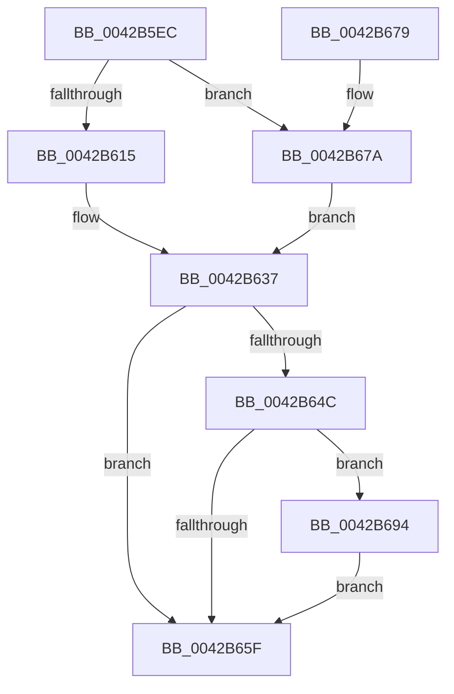

# PpmEventBiosCapChange

- RVA: `0x0042B5EC`–`0x0042B6DB` (길이 `239` bytes)
- VA: `0x000000014042B5EC`
- 실행 섹션: `.text`
- PDB 이름 있음: `예`; PDB Function 태그: `아니요`
- unwind 정보 RVA: `0x000A17F8`
- 디코드: `56`개 명령, `239/239` bytes 표시
- 미해석 바이트: `0` (있으면 어셈블리에 `.byte`로 보존)

> 이 문서는 커널 이미지의 기계어와 PDB 기호를 분석해 생성했습니다. 4번과 5번은 함수 원형과 자료형을 바이너리 사용 방식에서 추정한 C 해석이며 원본 소스 복구 결과는 아닙니다.

## 1. Dependencies

- 직접 호출 지점: **3**; 고유 호출 대상: **3**
- 직접 호출자로 확인된 함수: **1**
- RIP 상대 이미지 참조: **5**

### Outgoing calls
- `0x0042B656` → [EtwEventEnabled](../39/EtwEventEnabled_function_00392450.md) (function, `0x00392450`)
- `0x0042B666` → [_security_check_cookie](../6A/_security_check_cookie_function_006AC640.md) (function, `0x006AC640`)
- `0x0042B6D4` → [EtwWriteEx](../25/EtwWriteEx_function_0025F0D0.md) (function, `0x0025F0D0`)

### Direct callers
- [PpmRegisterPerfCap](PpmRegisterPerfCap_function_0042B0D0.md) at `0x0042B17D`

### Static image references
- `0x0042B5FD` → RVA `0x00E0A740` (`.data`; read)
- `0x0042B61C` → RVA `0x00014498` (`.rdata`; read)
- `0x0042B63F` → RVA `0x00E67A39` (`.data`; read)
- `0x0042B64C` → RVA `0x00F083E8` (`.data`; read)
- `0x0042B67E` → RVA `0x000144C8` (`.rdata`; read)

## 2. Other-region calls and transfers

- 다른 실행 섹션으로 향하는 call: **0**
- 별도 외부 분기/꼬리 이동을 확인하지 못했습니다.

## 3. Assembly (complete function range)

```asm
0042B5EC  48 89 5C 24 08                  mov qword ptr [rsp + 8], rbx
0042B5F1  89 54 24 10                     mov dword ptr [rsp + 0x10], edx
0042B5F5  55                              push rbp
0042B5F6  48 8B EC                        mov rbp, rsp
0042B5F9  48 83 EC 70                     sub rsp, 0x70
0042B5FD  48 8B 05 3C F1 9D 00            mov rax, qword ptr [rip + 0x9df13c]
0042B604  48 33 C4                        xor rax, rsp
0042B607  48 89 45 F8                     mov qword ptr [rbp - 8], rax
0042B60B  83 65 D0 00                     and dword ptr [rbp - 0x30], 0
0042B60F  80 79 44 00                     cmp byte ptr [rcx + 0x44], 0
0042B613  74 65                           je 0x14042b67a
0042B615  0F B6 81 20 77 FF FF            movzx eax, byte ptr [rcx - 0x88e0]
0042B61C  48 8D 1D 75 8E BE FF            lea rbx, [rip - 0x41718b]
0042B623  66 89 45 D0                     mov word ptr [rbp - 0x30], ax
0042B627  8A 81 21 77 FF FF               mov al, byte ptr [rcx - 0x88df]
0042B62D  88 45 D2                        mov byte ptr [rbp - 0x2e], al
0042B630  C7 45 E0 03 00 00 00            mov dword ptr [rbp - 0x20], 3
0042B637  83 65 E4 00                     and dword ptr [rbp - 0x1c], 0
0042B63B  48 8D 45 D0                     lea rax, [rbp - 0x30]
0042B63F  80 3D F3 C3 A3 00 00            cmp byte ptr [rip + 0xa3c3f3], 0
0042B646  48 89 45 D8                     mov qword ptr [rbp - 0x28], rax
0042B64A  74 13                           je 0x14042b65f
0042B64C  48 8B 0D 95 CD AD 00            mov rcx, qword ptr [rip + 0xadcd95]
0042B653  48 8B D3                        mov rdx, rbx
0042B656  E8 F5 6D F6 FF                  call 0x140392450
0042B65B  84 C0                           test al, al
0042B65D  75 35                           jne 0x14042b694
0042B65F  48 8B 4D F8                     mov rcx, qword ptr [rbp - 8]
0042B663  48 33 CC                        xor rcx, rsp
0042B666  E8 D5 0F 28 00                  call 0x1406ac640
0042B66B  48 8B 9C 24 80 00 00 00         mov rbx, qword ptr [rsp + 0x80]
0042B673  48 83 C4 70                     add rsp, 0x70
0042B677  5D                              pop rbp
0042B678  C3                              ret
0042B679  CC                              int3
0042B67A  48 8B 41 08                     mov rax, qword ptr [rcx + 8]
0042B67E  48 8D 1D 43 8E BE FF            lea rbx, [rip - 0x4171bd]
0042B685  8B 48 14                        mov ecx, dword ptr [rax + 0x14]
0042B688  89 4D D0                        mov dword ptr [rbp - 0x30], ecx
0042B68B  C7 45 E0 04 00 00 00            mov dword ptr [rbp - 0x20], 4
0042B692  EB A3                           jmp 0x14042b637
0042B694  83 65 F4 00                     and dword ptr [rbp - 0xc], 0
0042B698  48 8D 45 18                     lea rax, [rbp + 0x18]
0042B69C  48 8B 0D 45 CD AD 00            mov rcx, qword ptr [rip + 0xadcd45]
0042B6A3  45 33 C9                        xor r9d, r9d
0042B6A6  48 89 45 E8                     mov qword ptr [rbp - 0x18], rax
0042B6AA  45 33 C0                        xor r8d, r8d
0042B6AD  48 8D 45 D8                     lea rax, [rbp - 0x28]
0042B6B1  C7 45 F0 04 00 00 00            mov dword ptr [rbp - 0x10], 4
0042B6B8  48 89 44 24 38                  mov qword ptr [rsp + 0x38], rax
0042B6BD  48 8B D3                        mov rdx, rbx
0042B6C0  C7 44 24 30 02 00 00 00         mov dword ptr [rsp + 0x30], 2
0042B6C8  48 83 64 24 28 00               and qword ptr [rsp + 0x28], 0
0042B6CE  48 83 64 24 20 00               and qword ptr [rsp + 0x20], 0
0042B6D4  E8 F7 39 E3 FF                  call 0x14025f0d0
0042B6D9  EB 84                           jmp 0x14042b65f
```

## 4. C-style interpretation (structured pseudocode)

```c
__int64 __fastcall PpmEventBiosCapChange(__int64 a1, int a2, int a3, int a4)
{
    __int64 result;
    __int64 v_rsp;
    unsigned __int64 v_stack_m10;
    unsigned int v_stack_m14;
    unsigned int v_stack_m18;
    unsigned __int64 v_stack_m20;
    unsigned int v_stack_m24;
    unsigned int v_stack_m28;
    unsigned __int64 v_stack_m30;
    unsigned __int8 v_stack_m36;
    unsigned int v_stack_m38;
    unsigned int v_stack_p10;
    unsigned __int64 v_stack_p20;
    unsigned __int64 v_stack_p28;
    unsigned int v_stack_p30;
    unsigned __int64 v_stack_p38;
    unsigned __int64 v_stack_p8;

    v_stack_p8 = v_rbx;
    v_stack_p10 = a2;
    v_rsp = (v_rsp) - (112);
    result = (*(unsigned __int64 *)(v_rip + 10350908)) ^ (v_rsp);
    v_stack_m10 = result;
    if ((*(unsigned __int8 *)(a1 + 68)) == 0) goto loc_0042B67A;
    v_stack_m38 = (unsigned __int16)(*(unsigned __int8 *)(a1 - 35040));
    v_stack_m36 = (unsigned __int8)(*(unsigned __int8 *)(a1 - 35039));
    v_stack_m28 = 3;
loc_0042B637:
    v_stack_m30 = v_stack_m38;
    if ((*(unsigned __int8 *)(v_rip + 10732531)) == 0) goto loc_0042B65F;
    result = EtwEventEnabled(*(unsigned __int64 *)(v_rip + 11390357), v_rip - 4288907, a3, a4);
    if ((unsigned __int8)(result) != 0) goto loc_0042B694;
loc_0042B65F:
    a1 = (v_stack_m10) ^ (v_rsp);
    result = _security_check_cookie(a1, v_rip - 4288907, a3, a4);
    v_rsp = (v_rsp) + (112);
    return result;
loc_0042B67A:
    v_stack_m38 = (unsigned int)((unsigned int)(*(unsigned int *)(*(unsigned __int64 *)(a1 + 8) + 20)));
    v_stack_m28 = 4;
    goto loc_0042B637;
loc_0042B694:
    a4 = 0;
    v_stack_m20 = v_stack_p10;
    a3 = 0;
    v_stack_m18 = 4;
    v_stack_p38 = v_stack_m30;
    v_stack_p30 = 2;
    result = EtwWriteEx(*(unsigned __int64 *)(v_rip + 11390277), v_rip - 4288957, a3, a4);
    goto loc_0042B65F;
}
```

## 5. (Beta) C Style

```c
int64_t PpmEventBiosCapChange(void *Arg1, int32_t Arg2, int32_t Arg3, int32_t Arg4)
{
    uint8_t *arg1 = (uint8_t *)Arg1;

    int64_t result;
    int64_t local_rsp;
    uint64_t v_stack_m10;
    uint32_t v_stack_m14;
    uint32_t v_stack_m18;
    uint64_t v_stack_m20;
    uint32_t v_stack_m24;
    uint32_t v_stack_m28;
    uint64_t v_stack_m30;
    uint8_t v_stack_m36;
    uint32_t v_stack_m38;
    uint32_t v_stack_p10;
    uint64_t v_stack_p20;
    uint64_t v_stack_p28;
    uint32_t v_stack_p30;
    uint64_t v_stack_p38;
    uint64_t v_stack_p8;

    v_stack_p8 = local_rbx;
    v_stack_p10 = Arg2;
    local_rsp = (local_rsp) - (112);
    result = (*(uint64_t *)(v_rip + 0x9DF13C)) ^ (local_rsp);
    v_stack_m10 = result;
    if ((*(uint8_t *)(arg1 + 0x44)) == 0) goto loc_0042B67A;
    v_stack_m38 = (uint16_t)(*(uint8_t *)(arg1 - 0x88E0));
    v_stack_m36 = (uint8_t)(*(uint8_t *)(arg1 - 0x88DF));
    v_stack_m28 = 3;
loc_0042B637:
    v_stack_m30 = v_stack_m38;
    if ((*(uint8_t *)(v_rip + 0xA3C3F3)) == 0) goto loc_0042B65F;
    result = EtwEventEnabled(*(uint64_t *)(v_rip + 0xADCD95), v_rip - 4288907, Arg3, Arg4);
    if ((uint8_t)(result) != 0) goto loc_0042B694;
loc_0042B65F:
    Arg1 = (v_stack_m10) ^ (local_rsp);
    result = _security_check_cookie(Arg1, v_rip - 4288907, Arg3, Arg4);
    local_rsp = (local_rsp) + (112);
    return result;
loc_0042B67A:
    v_stack_m38 = (uint32_t)((uint32_t)(*(uint32_t *)(*(uint64_t *)(arg1 + 0x8) + 0x14)));
    v_stack_m28 = 4;
    goto loc_0042B637;
loc_0042B694:
    Arg4 = 0;
    v_stack_m20 = v_stack_p10;
    Arg3 = 0;
    v_stack_m18 = 4;
    v_stack_p38 = v_stack_m30;
    v_stack_p30 = 2;
    result = EtwWriteEx(*(uint64_t *)(v_rip + 0xADCD45), v_rip - 4288957, Arg3, Arg4);
    goto loc_0042B65F;
}
```

### 관측된 메모리 오프셋

구조체 형식이 확인되지 않은 접근은 인자 기준의 오프셋으로만 기록했습니다.

| 기준 인자 | 오프셋 표현 | 폭 (bit) | 접근 |
|---|---:|---:|---|
| `Arg1` | `- 0x88E0` | `8` | `R` |
| `Arg1` | `- 0x88DF` | `8` | `R` |
| `Arg1` | `+ 0x8` | `64` | `R` |
| `Arg1` | `+ 0x44` | `8` | `R` |

## 6. Execution-region graph

[열기: 2D/3D 그래프와 함수 탐색 컨트롤 패널](../../../control-panel.html?section=text&rva=0x0042B5EC&view=graph)

- 2D 그래프는 위에서 아래로 흐르고, 3D 그래프는 빈 공간을 드래그해 회전합니다. Shift+드래그는 이동, 휠은 확대·축소, 함수 노드 선택은 대상 보고서 이동입니다.

### Static fallback


