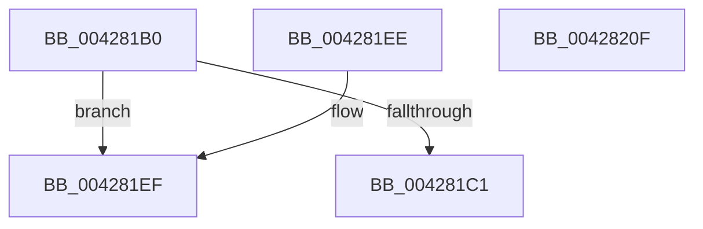

# PpmEventGetEventDescriptorAndProcessorId

- RVA: `0x004281B0`–`0x00428210` (길이 `96` bytes)
- VA: `0x00000001404281B0`
- 실행 섹션: `.text`
- PDB 이름 있음: `예`; PDB Function 태그: `아니요`
- unwind 정보 RVA: `0x000DB714`
- 디코드: `26`개 명령, `96/96` bytes 표시
- 미해석 바이트: `0` (있으면 어셈블리에 `.byte`로 보존)

> 이 문서는 커널 이미지의 기계어와 PDB 기호를 분석해 생성했습니다. 4번과 5번은 함수 원형과 자료형을 바이너리 사용 방식에서 추정한 C 해석이며 원본 소스 복구 결과는 아닙니다.

## 1. Dependencies

- 직접 호출 지점: **0**; 고유 호출 대상: **0**
- 직접 호출자로 확인된 함수: **1**
- RIP 상대 이미지 참조: **0**

### Outgoing calls
- 직접 디코드된 call 명령이 없습니다.

### Direct callers
- [PpmEventAutonomousModeChange](../5D/PpmEventAutonomousModeChange_function_005DA684.md) at `0x005DA6BE`

### Static image references
- 디코드된 RIP-relative 메모리 참조가 없습니다.

## 2. Other-region calls and transfers

- 다른 실행 섹션으로 향하는 call: **0**
- 별도 외부 분기/꼬리 이동을 확인하지 못했습니다.

## 3. Assembly (complete function range)

```asm
004281B0  80 79 44 00                     cmp byte ptr [rcx + 0x44], 0
004281B4  4D 8B D0                        mov r10, r8
004281B7  48 8B 44 24 28                  mov rax, qword ptr [rsp + 0x28]
004281BC  4C 8B C1                        mov r8, rcx
004281BF  74 2E                           je 0x1404281ef
004281C1  0F B6 89 20 77 FF FF            movzx ecx, byte ptr [rcx - 0x88e0]
004281C8  66 41 89 09                     mov word ptr [r9], cx
004281CC  41 0F B6 88 21 77 FF FF         movzx ecx, byte ptr [r8 - 0x88df]
004281D4  41 88 49 02                     mov byte ptr [r9 + 2], cl
004281D8  B9 03 00 00 00                  mov ecx, 3
004281DD  4C 89 08                        mov qword ptr [rax], r9
004281E0  89 48 08                        mov dword ptr [rax + 8], ecx
004281E3  C7 40 0C 00 00 00 00            mov dword ptr [rax + 0xc], 0
004281EA  48 8B C2                        mov rax, rdx
004281ED  C3                              ret
004281EE  CC                              int3
004281EF  48 8B 49 08                     mov rcx, qword ptr [rcx + 8]
004281F3  8B 51 14                        mov edx, dword ptr [rcx + 0x14]
004281F6  B9 04 00 00 00                  mov ecx, 4
004281FB  41 89 11                        mov dword ptr [r9], edx
004281FE  4C 89 08                        mov qword ptr [rax], r9
00428201  89 48 08                        mov dword ptr [rax + 8], ecx
00428204  C7 40 0C 00 00 00 00            mov dword ptr [rax + 0xc], 0
0042820B  49 8B C2                        mov rax, r10
0042820E  C3                              ret
0042820F  CC                              int3
```

## 4. C-style interpretation (structured pseudocode)

```c
__int64 __fastcall PpmEventGetEventDescriptorAndProcessorId(__int64 a1, __int64 a2, __int64 a3, __int64 a4, __int64 a5)
{
    if ((*(unsigned __int8 *)(a1 + 68)) == 0) goto loc_004281EF;
    *(unsigned __int16 *)(a4) = (unsigned __int16)(*(unsigned __int8 *)(a1 - 35040));
    *(unsigned __int8 *)(a4 + 2) = (unsigned __int8)(*(unsigned __int8 *)(a1 - 35039));
    *(unsigned __int64 *)(a5) = a4;
    *(unsigned int *)(a5 + 8) = 3;
    *(unsigned int *)(a5 + 12) = 0;
    return a2;
loc_004281EF:
    *(unsigned int *)(a4) = (unsigned int)((unsigned int)(*(unsigned int *)(*(unsigned __int64 *)(3 + 8) + 20)));
    *(unsigned __int64 *)(a2) = a4;
    *(unsigned int *)(a2 + 8) = 4;
    *(unsigned int *)(a2 + 12) = 0;
    return a3;
}
```

## 5. (Beta) C Style

```c
int64_t PpmEventGetEventDescriptorAndProcessorId(void *Arg1, int64_t Arg2, int64_t Arg3, void *Arg4, void *Arg5)
{
    uint8_t *arg1 = (uint8_t *)Arg1;
    uint8_t *arg4 = (uint8_t *)Arg4;
    uint8_t *arg5 = (uint8_t *)Arg5;

    if ((*(uint8_t *)(arg1 + 0x44)) == 0) goto loc_004281EF;
    *(uint16_t *)(arg4) = (uint16_t)(*(uint8_t *)(arg1 - 0x88E0));
    *(uint8_t *)(arg4 + 0x2) = (uint8_t)(*(uint8_t *)(arg1 - 0x88DF));
    *(void **)(arg5) = Arg4;
    *(uint32_t *)(arg5 + 0x8) = 3;
    *(uint32_t *)(arg5 + 0xC) = 0;
    return Arg2;
loc_004281EF:
    *(uint32_t *)(arg4) = (uint32_t)((uint32_t)(*(uint32_t *)(*(uint64_t *)(3 + 0x8) + 0x14)));
    *(void **)(Arg2) = Arg4;
    *(uint32_t *)(Arg2 + 0x8) = 4;
    *(uint32_t *)(Arg2 + 0xC) = 0;
    return Arg3;
}
```

### 관측된 메모리 오프셋

구조체 형식이 확인되지 않은 접근은 인자 기준의 오프셋으로만 기록했습니다.

| 기준 인자 | 오프셋 표현 | 폭 (bit) | 접근 |
|---|---:|---:|---|
| `Arg1` | `- 0x88E0` | `8` | `R` |
| `Arg1` | `- 0x88DF` | `8` | `R` |
| `Arg1` | `+ 0x8` | `64` | `R` |
| `Arg1` | `+ 0x44` | `8` | `R` |
| `Arg4` | `+ 0x0` | `16` | `W` |
| `Arg4` | `+ 0x0` | `32` | `W` |
| `Arg4` | `+ 0x2` | `8` | `W` |
| `Arg5` | `+ 0x0` | `64` | `W` |
| `Arg5` | `+ 0x8` | `32` | `W` |
| `Arg5` | `+ 0xC` | `32` | `W` |

## 6. Execution-region graph

[열기: 2D/3D 그래프와 함수 탐색 컨트롤 패널](../../../control-panel.html?section=text&rva=0x004281B0&view=graph)

- 2D 그래프는 위에서 아래로 흐르고, 3D 그래프는 빈 공간을 드래그해 회전합니다. Shift+드래그는 이동, 휠은 확대·축소, 함수 노드 선택은 대상 보고서 이동입니다.

### Static fallback


