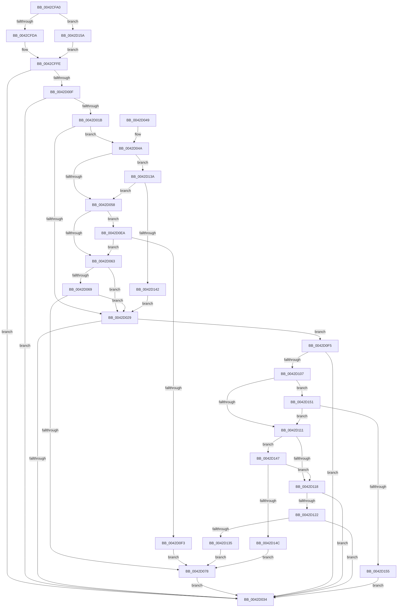

# PpmEventPerfSelectProcessorState

- RVA: `0x0042CFA0`–`0x0042D178` (길이 `472` bytes)
- VA: `0x000000014042CFA0`
- 실행 섹션: `.text`
- PDB 이름 있음: `예`; PDB Function 태그: `아니요`
- unwind 정보 RVA: `0x000A1A00`
- 디코드: `110`개 명령, `472/472` bytes 표시
- 미해석 바이트: `0` (있으면 어셈블리에 `.byte`로 보존)

> 이 문서는 커널 이미지의 기계어와 PDB 기호를 분석해 생성했습니다. 4번과 5번은 함수 원형과 자료형을 바이너리 사용 방식에서 추정한 C 해석이며 원본 소스 복구 결과는 아닙니다.

## 1. Dependencies

- 직접 호출 지점: **2**; 고유 호출 대상: **2**
- 직접 호출자로 확인된 함수: **1**
- RIP 상대 이미지 참조: **5**

### Outgoing calls
- `0x0042D03B` → [_security_check_cookie](../6A/_security_check_cookie_function_006AC640.md) (function, `0x006AC640`)
- `0x0042D0E0` → [EtwWriteEx](../25/EtwWriteEx_function_0025F0D0.md) (function, `0x0025F0D0`)

### Direct callers
- [PpmPerfSelectProcessorState](PpmPerfSelectProcessorState_function_0042CA78.md) at `0x0042CC2A`

### Static image references
- `0x0042CFBB` → RVA `0x00E0A740` (`.data`; read)
- `0x0042CFE1` → RVA `0x00014538` (`.rdata`; read)
- `0x0042CFFE` → RVA `0x00E67A39` (`.data`; read)
- `0x0042D00F` → RVA `0x00F083E8` (`.data`; read)
- `0x0042D15E` → RVA `0x00014548` (`.rdata`; read)

## 2. Other-region calls and transfers

- 다른 실행 섹션으로 향하는 call: **0**
- 별도 외부 분기/꼬리 이동을 확인하지 못했습니다.

## 3. Assembly (complete function range)

```asm
0042CFA0  44 89 4C 24 20                  mov dword ptr [rsp + 0x20], r9d
0042CFA5  44 89 44 24 18                  mov dword ptr [rsp + 0x18], r8d
0042CFAA  89 54 24 10                     mov dword ptr [rsp + 0x10], edx
0042CFAE  55                              push rbp
0042CFAF  48 8D 6C 24 B1                  lea rbp, [rsp - 0x4f]
0042CFB4  48 81 EC B0 00 00 00            sub rsp, 0xb0
0042CFBB  48 8B 05 7E D7 9D 00            mov rax, qword ptr [rip + 0x9dd77e]
0042CFC2  48 33 C4                        xor rax, rsp
0042CFC5  48 89 45 3F                     mov qword ptr [rbp + 0x3f], rax
0042CFC9  45 33 C9                        xor r9d, r9d
0042CFCC  44 89 4D DF                     mov dword ptr [rbp - 0x21], r9d
0042CFD0  44 38 49 44                     cmp byte ptr [rcx + 0x44], r9b
0042CFD4  0F 84 80 01 00 00               je 0x14042d15a
0042CFDA  0F B6 81 20 77 FF FF            movzx eax, byte ptr [rcx - 0x88e0]
0042CFE1  4C 8D 15 50 75 BE FF            lea r10, [rip - 0x418ab0]
0042CFE8  66 89 45 DF                     mov word ptr [rbp - 0x21], ax
0042CFEC  0F B6 81 21 77 FF FF            movzx eax, byte ptr [rcx - 0x88df]
0042CFF3  88 45 E1                        mov byte ptr [rbp - 0x1f], al
0042CFF6  48 C7 45 F7 03 00 00 00         mov qword ptr [rbp - 9], 3
0042CFFE  44 38 0D 34 AA A3 00            cmp byte ptr [rip + 0xa3aa34], r9b
0042D005  48 8D 45 DF                     lea rax, [rbp - 0x21]
0042D009  48 89 45 EF                     mov qword ptr [rbp - 0x11], rax
0042D00D  74 25                           je 0x14042d034
0042D00F  48 8B 15 D2 B3 AD 00            mov rdx, qword ptr [rip + 0xadb3d2]
0042D016  48 85 D2                        test rdx, rdx
0042D019  74 19                           je 0x14042d034
0042D01B  48 8B 4A 20                     mov rcx, qword ptr [rdx + 0x20]
0042D01F  4D 8B 42 08                     mov r8, qword ptr [r10 + 8]
0042D023  44 39 49 60                     cmp dword ptr [rcx + 0x60], r9d
0042D027  75 21                           jne 0x14042d04a
0042D029  66 44 39 4A 66                  cmp word ptr [rdx + 0x66], r9w
0042D02E  0F 85 C1 00 00 00               jne 0x14042d0f5
0042D034  48 8B 4D 3F                     mov rcx, qword ptr [rbp + 0x3f]
0042D038  48 33 CC                        xor rcx, rsp
0042D03B  E8 00 F6 27 00                  call 0x1406ac640
0042D040  48 81 C4 B0 00 00 00            add rsp, 0xb0
0042D047  5D                              pop rbp
0042D048  C3                              ret
0042D049  CC                              int3
0042D04A  0F B6 41 64                     movzx eax, byte ptr [rcx + 0x64]
0042D04E  41 38 42 04                     cmp byte ptr [r10 + 4], al
0042D052  0F 87 E2 00 00 00               ja 0x14042d13a
0042D058  8B 41 68                        mov eax, dword ptr [rcx + 0x68]
0042D05B  A8 40                           test al, 0x40
0042D05D  0F 85 87 00 00 00               jne 0x14042d0ea
0042D063  4C 85 41 70                     test qword ptr [rcx + 0x70], r8
0042D067  74 C0                           je 0x14042d029
0042D069  48 8B 49 78                     mov rcx, qword ptr [rcx + 0x78]
0042D06D  48 8B C1                        mov rax, rcx
0042D070  49 23 C0                        and rax, r8
0042D073  48 3B C1                        cmp rax, rcx
0042D076  75 B1                           jne 0x14042d029
0042D078  48 8B 0D 69 B3 AD 00            mov rcx, qword ptr [rip + 0xadb369]
0042D07F  48 8D 45 67                     lea rax, [rbp + 0x67]
0042D083  48 89 45 FF                     mov qword ptr [rbp - 1], rax
0042D087  45 33 C0                        xor r8d, r8d
0042D08A  48 8D 45 6F                     lea rax, [rbp + 0x6f]
0042D08E  48 C7 45 07 04 00 00 00         mov qword ptr [rbp + 7], 4
0042D096  48 89 45 0F                     mov qword ptr [rbp + 0xf], rax
0042D09A  49 8B D2                        mov rdx, r10
0042D09D  48 8D 45 77                     lea rax, [rbp + 0x77]
0042D0A1  48 C7 45 17 04 00 00 00         mov qword ptr [rbp + 0x17], 4
0042D0A9  48 89 45 1F                     mov qword ptr [rbp + 0x1f], rax
0042D0AD  48 8D 45 7F                     lea rax, [rbp + 0x7f]
0042D0B1  48 89 45 2F                     mov qword ptr [rbp + 0x2f], rax
0042D0B5  48 8D 45 EF                     lea rax, [rbp - 0x11]
0042D0B9  48 89 44 24 38                  mov qword ptr [rsp + 0x38], rax
0042D0BE  C7 44 24 30 05 00 00 00         mov dword ptr [rsp + 0x30], 5
0042D0C6  4C 89 4C 24 28                  mov qword ptr [rsp + 0x28], r9
0042D0CB  4C 89 4C 24 20                  mov qword ptr [rsp + 0x20], r9
0042D0D0  48 C7 45 27 04 00 00 00         mov qword ptr [rbp + 0x27], 4
0042D0D8  48 C7 45 37 04 00 00 00         mov qword ptr [rbp + 0x37], 4
0042D0E0  E8 EB 1F E3 FF                  call 0x14025f0d0
0042D0E5  E9 4A FF FF FF                  jmp 0x14042d034
0042D0EA  4D 85 C0                        test r8, r8
0042D0ED  0F 85 70 FF FF FF               jne 0x14042d063
0042D0F3  EB 83                           jmp 0x14042d078
0042D0F5  48 8B 4A 28                     mov rcx, qword ptr [rdx + 0x28]
0042D0F9  4D 8B 42 08                     mov r8, qword ptr [r10 + 8]
0042D0FD  44 39 49 60                     cmp dword ptr [rcx + 0x60], r9d
0042D101  0F 84 2D FF FF FF               je 0x14042d034
0042D107  0F B6 41 64                     movzx eax, byte ptr [rcx + 0x64]
0042D10B  41 38 42 04                     cmp byte ptr [r10 + 4], al
0042D10F  77 40                           ja 0x14042d151
0042D111  8B 41 68                        mov eax, dword ptr [rcx + 0x68]
0042D114  A8 40                           test al, 0x40
0042D116  75 2F                           jne 0x14042d147
0042D118  4C 85 41 70                     test qword ptr [rcx + 0x70], r8
0042D11C  0F 84 12 FF FF FF               je 0x14042d034
0042D122  48 8B 49 78                     mov rcx, qword ptr [rcx + 0x78]
0042D126  48 8B C1                        mov rax, rcx
0042D129  49 23 C0                        and rax, r8
0042D12C  48 3B C1                        cmp rax, rcx
0042D12F  0F 85 FF FE FF FF               jne 0x14042d034
0042D135  E9 3E FF FF FF                  jmp 0x14042d078
0042D13A  84 C0                           test al, al
0042D13C  0F 84 16 FF FF FF               je 0x14042d058
0042D142  E9 E2 FE FF FF                  jmp 0x14042d029
0042D147  4D 85 C0                        test r8, r8
0042D14A  75 CC                           jne 0x14042d118
0042D14C  E9 27 FF FF FF                  jmp 0x14042d078
0042D151  84 C0                           test al, al
0042D153  74 BC                           je 0x14042d111
0042D155  E9 DA FE FF FF                  jmp 0x14042d034
0042D15A  48 8B 41 08                     mov rax, qword ptr [rcx + 8]
0042D15E  4C 8D 15 E3 73 BE FF            lea r10, [rip - 0x418c1d]
0042D165  8B 48 14                        mov ecx, dword ptr [rax + 0x14]
0042D168  89 4D DF                        mov dword ptr [rbp - 0x21], ecx
0042D16B  48 C7 45 F7 04 00 00 00         mov qword ptr [rbp - 9], 4
0042D173  E9 86 FE FF FF                  jmp 0x14042cffe
```

## 4. C-style interpretation (structured pseudocode)

```c
__int64 __fastcall PpmEventPerfSelectProcessorState(__int64 a1, int a2, int a3, int a4, __int64 a5)
{
    __int64 result;
    __int64 v_rsp;
    unsigned __int64 v_stack_m18;
    unsigned __int64 v_stack_m20;
    unsigned __int64 v_stack_m28;
    unsigned __int64 v_stack_m30;
    unsigned __int64 v_stack_m38;
    unsigned __int64 v_stack_m40;
    unsigned __int64 v_stack_m48;
    unsigned __int64 v_stack_m50;
    unsigned __int64 v_stack_m57;
    unsigned __int64 v_stack_m58;
    unsigned __int64 v_stack_m60;
    unsigned __int64 v_stack_m68;
    unsigned __int8 v_stack_m76;
    unsigned int v_stack_m78;
    unsigned int v_stack_p10;
    unsigned int v_stack_p18;
    unsigned int v_stack_p20;
    unsigned __int64 v_stack_p28;
    unsigned int v_stack_p30;
    unsigned __int64 v_stack_p38;

    v_stack_p20 = a4;
    v_stack_p18 = a3;
    v_stack_p10 = a2;
    v_rsp = (v_rsp) - (176);
    result = (*(unsigned __int64 *)(v_rip + 10344318)) ^ (v_rsp);
    v_stack_m18 = result;
    a4 = 0;
    v_stack_m78 = 0;
    if ((*(unsigned __int8 *)(a1 + 68)) == 0) goto loc_0042D15A;
    v_stack_m78 = (unsigned __int16)(*(unsigned __int8 *)(a1 - 35040));
    v_stack_m76 = (unsigned __int8)(*(unsigned __int8 *)(a1 - 35039));
    v_stack_m60 = 3;
loc_0042CFFE:
    v_stack_m68 = v_stack_m78;
    if ((*(unsigned __int8 *)(v_rip + 10725940)) == 0) goto loc_0042D034;
    if (*(unsigned __int64 *)(v_rip + 11383762) == 0) goto loc_0042D034;
    if ((*(unsigned int *)(*(unsigned __int64 *)(*(unsigned __int64 *)(v_rip + 11383762) + 32) + 96)) != 0) goto loc_0042D04A;
loc_0042D029:
    if ((*(unsigned __int16 *)(*(unsigned __int64 *)(v_rip + 11383762) + 102)) != 0) goto loc_0042D0F5;
loc_0042D034:
    a1 = (v_stack_m18) ^ (v_rsp);
    result = _security_check_cookie(a1, *(unsigned __int64 *)(v_rip + 11383762), *(unsigned __int64 *)(v_rip - 4295344 + 8), a4);
    v_rsp = (v_rsp) + (176);
    return result;
loc_0042D04A:
    if ((*(unsigned __int8 *)(v_rip - 4295344 + 4)) > ((unsigned __int8)(*(unsigned __int8 *)(a1 + 100)))) goto loc_0042D13A;
loc_0042D058:
    if ((((unsigned __int8)((unsigned int)(*(unsigned int *)(a1 + 104)))) & (64)) != 0) goto loc_0042D0EA;
loc_0042D063:
    if (((*(unsigned __int64 *)(a1 + 112)) & (*(unsigned __int64 *)(v_rip - 4295344 + 8))) == 0) goto loc_0042D029;
    result = (*(unsigned __int64 *)(a1 + 120)) & (*(unsigned __int64 *)(v_rip - 4295344 + 8));
    if (result != (*(unsigned __int64 *)(a1 + 120))) goto loc_0042D029;
loc_0042D078:
    v_stack_m58 = v_stack_p10;
    a3 = 0;
    v_stack_m50 = 4;
    v_stack_m48 = v_stack_p18;
    v_stack_m40 = 4;
    v_stack_m38 = v_stack_p20;
    v_stack_m28 = a5;
    v_stack_p38 = v_stack_m68;
    v_stack_p30 = 5;
    v_stack_p28 = 0;
    v_stack_p20 = 0;
    v_stack_m30 = 4;
    v_stack_m20 = 4;
    result = EtwWriteEx(*(unsigned __int64 *)(v_rip + 11383657), v_rip - 4295344, a3, a4);
    goto loc_0042D034;
loc_0042D0EA:
    if (0 != 0) goto loc_0042D063;
    goto loc_0042D078;
loc_0042D0F5:
    if ((*(unsigned int *)(*(unsigned __int64 *)(v_rip - 4295344 + 40) + 96)) == 0) goto loc_0042D034;
    if ((*(unsigned __int8 *)(v_rip - 4295344 + 4)) > ((unsigned __int8)(*(unsigned __int8 *)(*(unsigned __int64 *)(v_rip - 4295344 + 40) + 100)))) goto loc_0042D151;
loc_0042D111:
    if ((((unsigned __int8)((unsigned int)(*(unsigned int *)(*(unsigned __int64 *)(v_rip - 4295344 + 40) + 104)))) & (64)) != 0) goto loc_0042D147;
loc_0042D118:
    if (((*(unsigned __int64 *)(*(unsigned __int64 *)(v_rip - 4295344 + 40) + 112)) & (*(unsigned __int64 *)(v_rip - 4295344 + 8))) == 0) goto loc_0042D034;
    result = (*(unsigned __int64 *)(*(unsigned __int64 *)(v_rip - 4295344 + 40) + 120)) & (*(unsigned __int64 *)(v_rip - 4295344 + 8));
    if (result != (*(unsigned __int64 *)(*(unsigned __int64 *)(v_rip - 4295344 + 40) + 120))) goto loc_0042D034;
    goto loc_0042D078;
loc_0042D13A:
    if ((unsigned __int8)(result) == 0) goto loc_0042D058;
    goto loc_0042D029;
loc_0042D147:
    if (*(unsigned __int64 *)(v_rip - 4295344 + 8) != 0) goto loc_0042D118;
    goto loc_0042D078;
loc_0042D151:
    if ((unsigned __int8)(result) == 0) goto loc_0042D111;
    goto loc_0042D034;
loc_0042D15A:
    v_stack_m78 = (unsigned int)((unsigned int)(*(unsigned int *)(*(unsigned __int64 *)(*(unsigned __int64 *)(*(unsigned __int64 *)(v_rip - 4295344 + 40) + 120) + 8) + 20)));
    v_stack_m60 = 4;
    goto loc_0042CFFE;
}
```

## 5. (Beta) C Style

```c
int64_t PpmEventPerfSelectProcessorState(void *Arg1, int32_t Arg2, int32_t Arg3, int32_t Arg4, int64_t Arg5)
{
    uint8_t *arg1 = (uint8_t *)Arg1;

    int64_t result;
    int64_t local_rsp;
    uint64_t v_stack_m18;
    uint64_t v_stack_m20;
    uint64_t v_stack_m28;
    uint64_t v_stack_m30;
    uint64_t v_stack_m38;
    uint64_t v_stack_m40;
    uint64_t v_stack_m48;
    uint64_t v_stack_m50;
    uint64_t v_stack_m57;
    uint64_t v_stack_m58;
    uint64_t v_stack_m60;
    uint64_t v_stack_m68;
    uint8_t v_stack_m76;
    uint32_t v_stack_m78;
    uint32_t v_stack_p10;
    uint32_t v_stack_p18;
    uint32_t v_stack_p20;
    uint64_t v_stack_p28;
    uint32_t v_stack_p30;
    uint64_t v_stack_p38;

    v_stack_p20 = Arg4;
    v_stack_p18 = Arg3;
    v_stack_p10 = Arg2;
    local_rsp = (local_rsp) - (176);
    result = (*(uint64_t *)(v_rip + 0x9DD77E)) ^ (local_rsp);
    v_stack_m18 = result;
    Arg4 = 0;
    v_stack_m78 = 0;
    if ((*(uint8_t *)(arg1 + 0x44)) == 0) goto loc_0042D15A;
    v_stack_m78 = (uint16_t)(*(uint8_t *)(arg1 - 0x88E0));
    v_stack_m76 = (uint8_t)(*(uint8_t *)(arg1 - 0x88DF));
    v_stack_m60 = 3;
loc_0042CFFE:
    v_stack_m68 = v_stack_m78;
    if ((*(uint8_t *)(v_rip + 0xA3AA34)) == 0) goto loc_0042D034;
    if (*(uint64_t *)(v_rip + 0xADB3D2) == 0) goto loc_0042D034;
    if ((*(uint32_t *)(*(uint64_t *)(*(uint64_t *)(v_rip + 0xADB3D2) + 0x20) + 0x60)) != 0) goto loc_0042D04A;
loc_0042D029:
    if ((*(uint16_t *)(*(uint64_t *)(v_rip + 0xADB3D2) + 0x66)) != 0) goto loc_0042D0F5;
loc_0042D034:
    Arg1 = (v_stack_m18) ^ (local_rsp);
    result = _security_check_cookie(Arg1, *(uint64_t *)(v_rip + 0xADB3D2), *(uint64_t *)(v_rip - 0x418AB0 + 0x8), Arg4);
    local_rsp = (local_rsp) + (176);
    return result;
loc_0042D04A:
    if ((*(uint8_t *)(v_rip - 0x418AB0 + 0x4)) > ((uint8_t)(*(uint8_t *)(arg1 + 0x64)))) goto loc_0042D13A;
loc_0042D058:
    if ((((uint8_t)((uint32_t)(*(uint32_t *)(arg1 + 0x68)))) & (64)) != 0) goto loc_0042D0EA;
loc_0042D063:
    if (((*(uint64_t *)(arg1 + 0x70)) & (*(uint64_t *)(v_rip - 0x418AB0 + 0x8))) == 0) goto loc_0042D029;
    result = (*(uint64_t *)(arg1 + 0x78)) & (*(uint64_t *)(v_rip - 0x418AB0 + 0x8));
    if (result != (*(uint64_t *)(arg1 + 0x78))) goto loc_0042D029;
loc_0042D078:
    v_stack_m58 = v_stack_p10;
    Arg3 = 0;
    v_stack_m50 = 4;
    v_stack_m48 = v_stack_p18;
    v_stack_m40 = 4;
    v_stack_m38 = v_stack_p20;
    v_stack_m28 = Arg5;
    v_stack_p38 = v_stack_m68;
    v_stack_p30 = 5;
    v_stack_p28 = 0;
    v_stack_p20 = 0;
    v_stack_m30 = 4;
    v_stack_m20 = 4;
    result = EtwWriteEx(*(uint64_t *)(v_rip + 0xADB369), v_rip - 4295344, Arg3, Arg4);
    goto loc_0042D034;
loc_0042D0EA:
    if (0 != 0) goto loc_0042D063;
    goto loc_0042D078;
loc_0042D0F5:
    if ((*(uint32_t *)(*(uint64_t *)(v_rip - 0x418AB0 + 0x28) + 0x60)) == 0) goto loc_0042D034;
    if ((*(uint8_t *)(v_rip - 0x418AB0 + 0x4)) > ((uint8_t)(*(uint8_t *)(*(uint64_t *)(v_rip - 0x418AB0 + 0x28) + 0x64)))) goto loc_0042D151;
loc_0042D111:
    if ((((uint8_t)((uint32_t)(*(uint32_t *)(*(uint64_t *)(v_rip - 0x418AB0 + 0x28) + 0x68)))) & (64)) != 0) goto loc_0042D147;
loc_0042D118:
    if (((*(uint64_t *)(*(uint64_t *)(v_rip - 0x418AB0 + 0x28) + 0x70)) & (*(uint64_t *)(v_rip - 0x418AB0 + 0x8))) == 0) goto loc_0042D034;
    result = (*(uint64_t *)(*(uint64_t *)(v_rip - 0x418AB0 + 0x28) + 0x78)) & (*(uint64_t *)(v_rip - 0x418AB0 + 0x8));
    if (result != (*(uint64_t *)(*(uint64_t *)(v_rip - 0x418AB0 + 0x28) + 0x78))) goto loc_0042D034;
    goto loc_0042D078;
loc_0042D13A:
    if ((uint8_t)(result) == 0) goto loc_0042D058;
    goto loc_0042D029;
loc_0042D147:
    if (*(uint64_t *)(v_rip - 0x418AB0 + 0x8) != 0) goto loc_0042D118;
    goto loc_0042D078;
loc_0042D151:
    if ((uint8_t)(result) == 0) goto loc_0042D111;
    goto loc_0042D034;
loc_0042D15A:
    v_stack_m78 = (uint32_t)((uint32_t)(*(uint32_t *)(*(uint64_t *)(*(uint64_t *)(*(uint64_t *)(v_rip - 0x418AB0 + 0x28) + 0x78) + 0x8) + 0x14)));
    v_stack_m60 = 4;
    goto loc_0042CFFE;
}
```

### 관측된 메모리 오프셋

구조체 형식이 확인되지 않은 접근은 인자 기준의 오프셋으로만 기록했습니다.

| 기준 인자 | 오프셋 표현 | 폭 (bit) | 접근 |
|---|---:|---:|---|
| `Arg1` | `- 0x88E0` | `8` | `R` |
| `Arg1` | `- 0x88DF` | `8` | `R` |
| `Arg1` | `+ 0x8` | `64` | `R` |
| `Arg1` | `+ 0x44` | `8` | `R` |

## 6. Execution-region graph

[열기: 2D/3D 그래프와 함수 탐색 컨트롤 패널](../../../control-panel.html?section=text&rva=0x0042CFA0&view=graph)

- 2D 그래프는 위에서 아래로 흐르고, 3D 그래프는 빈 공간을 드래그해 회전합니다. Shift+드래그는 이동, 휠은 확대·축소, 함수 노드 선택은 대상 보고서 이동입니다.

### Static fallback


