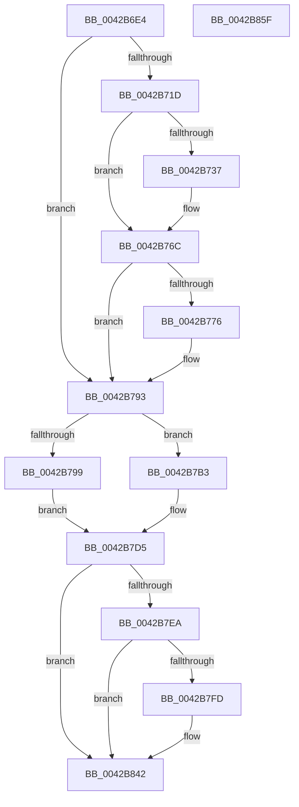

# PpmEventThermalCapChange

- RVA: `0x0042B6E4`–`0x0042B860` (길이 `380` bytes)
- VA: `0x000000014042B6E4`
- 실행 섹션: `.text`
- PDB 이름 있음: `예`; PDB Function 태그: `아니요`
- unwind 정보 RVA: `0x000A1810`
- 디코드: `84`개 명령, `380/380` bytes 표시
- 미해석 바이트: `0` (있으면 어셈블리에 `.byte`로 보존)

> 이 문서는 커널 이미지의 기계어와 PDB 기호를 분석해 생성했습니다. 4번과 5번은 함수 원형과 자료형을 바이너리 사용 방식에서 추정한 C 해석이며 원본 소스 복구 결과는 아닙니다.

## 1. Dependencies

- 직접 호출 지점: **5**; 고유 호출 대상: **5**
- 직접 호출자로 확인된 함수: **1**
- RIP 상대 이미지 참조: **8**

### Outgoing calls
- `0x0042B767` → [EtwTraceKernelEvent](../23/EtwTraceKernelEvent_function_00235350.md) (function, `0x00235350`)
- `0x0042B78E` → [PpmFireWmiEvent](../5D/PpmFireWmiEvent_function_005D9678.md) (function, `0x005D9678`)
- `0x0042B7F4` → [EtwEventEnabled](../39/EtwEventEnabled_function_00392450.md) (function, `0x00392450`)
- `0x0042B83D` → [EtwWriteEx](../25/EtwWriteEx_function_0025F0D0.md) (function, `0x0025F0D0`)
- `0x0042B849` → [_security_check_cookie](../6A/_security_check_cookie_function_006AC640.md) (function, `0x006AC640`)

### Direct callers
- [PpmRegisterPerfCap](PpmRegisterPerfCap_function_0042B0D0.md) at `0x0042B1D7`

### Static image references
- `0x0042B6F6` → RVA `0x00E0A740` (`.data`; read)
- `0x0042B71D` → RVA `0x00FC6B10` (`ALMOSTRO`; read)
- `0x0042B76C` → RVA `0x00E678C8` (`.data`; read)
- `0x0042B787` → RVA `0x00024B08` (`.rdata`; read)
- `0x0042B79D` → RVA `0x000144B8` (`.rdata`; read)
- `0x0042B7C4` → RVA `0x000144A8` (`.rdata`; read)
- `0x0042B7DD` → RVA `0x00E67A39` (`.data`; read)
- `0x0042B7EA` → RVA `0x00F083E8` (`.data`; read)

## 2. Other-region calls and transfers

- 다른 실행 섹션으로 향하는 call: **0**
- 별도 외부 분기/꼬리 이동을 확인하지 못했습니다.

## 3. Assembly (complete function range)

```asm
0042B6E4  48 89 5C 24 18                  mov qword ptr [rsp + 0x18], rbx
0042B6E9  55                              push rbp
0042B6EA  48 8D 6C 24 A9                  lea rbp, [rsp - 0x57]
0042B6EF  48 81 EC A0 00 00 00            sub rsp, 0xa0
0042B6F6  48 8B 05 43 F0 9D 00            mov rax, qword ptr [rip + 0x9df043]
0042B6FD  48 33 C4                        xor rax, rsp
0042B700  48 89 45 47                     mov qword ptr [rbp + 0x47], rax
0042B704  83 65 F7 00                     and dword ptr [rbp - 9], 0
0042B708  33 C0                           xor eax, eax
0042B70A  48 8B D9                        mov rbx, rcx
0042B70D  48 89 45 0B                     mov qword ptr [rbp + 0xb], rax
0042B711  48 89 45 07                     mov qword ptr [rbp + 7], rax
0042B715  89 55 FF                        mov dword ptr [rbp - 1], edx
0042B718  38 41 44                        cmp byte ptr [rcx + 0x44], al
0042B71B  74 76                           je 0x14042b793
0042B71D  F7 05 E9 B3 B9 00 00 80 00 00   test dword ptr [rip + 0xb9b3e9], 0x8000
0042B727  48 8B 81 18 77 FF FF            mov rax, qword ptr [rcx - 0x88e8]
0042B72E  48 89 45 0F                     mov qword ptr [rbp + 0xf], rax
0042B732  89 55 07                        mov dword ptr [rbp + 7], edx
0042B735  74 35                           je 0x14042b76c
0042B737  83 65 23 00                     and dword ptr [rbp + 0x23], 0
0042B73B  48 8D 45 07                     lea rax, [rbp + 7]
0042B73F  41 B9 36 12 00 00               mov r9d, 0x1236
0042B745  48 89 45 17                     mov qword ptr [rbp + 0x17], rax
0042B749  BA 01 00 00 00                  mov edx, 1
0042B74E  C7 45 1F 10 00 00 00            mov dword ptr [rbp + 0x1f], 0x10
0042B755  41 B8 00 80 00 80               mov r8d, 0x80008000
0042B75B  C7 44 24 20 02 18 50 00         mov dword ptr [rsp + 0x20], 0x501802
0042B763  48 8D 4D 17                     lea rcx, [rbp + 0x17]
0042B767  E8 E4 9B E0 FF                  call 0x140235350
0042B76C  8B 05 56 C1 A3 00               mov eax, dword ptr [rip + 0xa3c156]
0042B772  85 C0                           test eax, eax
0042B774  74 1D                           je 0x14042b793
0042B776  48 8D 8B 78 FF FF FF            lea rcx, [rbx - 0x88]
0042B77D  41 B8 10 00 00 00               mov r8d, 0x10
0042B783  4C 8D 4D 07                     lea r9, [rbp + 7]
0042B787  48 8D 15 7A 93 BF FF            lea rdx, [rip - 0x406c86]
0042B78E  E8 E5 DE 1A 00                  call 0x1405d9678
0042B793  80 7B 44 00                     cmp byte ptr [rbx + 0x44], 0
0042B797  75 1A                           jne 0x14042b7b3
0042B799  48 8B 43 08                     mov rax, qword ptr [rbx + 8]
0042B79D  48 8D 1D 14 8D BE FF            lea rbx, [rip - 0x4172ec]
0042B7A4  8B 48 14                        mov ecx, dword ptr [rax + 0x14]
0042B7A7  89 4D F7                        mov dword ptr [rbp - 9], ecx
0042B7AA  C7 45 2F 04 00 00 00            mov dword ptr [rbp + 0x2f], 4
0042B7B1  EB 22                           jmp 0x14042b7d5
0042B7B3  0F B6 83 20 77 FF FF            movzx eax, byte ptr [rbx - 0x88e0]
0042B7BA  66 89 45 F7                     mov word ptr [rbp - 9], ax
0042B7BE  8A 83 21 77 FF FF               mov al, byte ptr [rbx - 0x88df]
0042B7C4  48 8D 1D DD 8C BE FF            lea rbx, [rip - 0x417323]
0042B7CB  88 45 F9                        mov byte ptr [rbp - 7], al
0042B7CE  C7 45 2F 03 00 00 00            mov dword ptr [rbp + 0x2f], 3
0042B7D5  83 65 33 00                     and dword ptr [rbp + 0x33], 0
0042B7D9  48 8D 45 F7                     lea rax, [rbp - 9]
0042B7DD  80 3D 55 C2 A3 00 00            cmp byte ptr [rip + 0xa3c255], 0
0042B7E4  48 89 45 27                     mov qword ptr [rbp + 0x27], rax
0042B7E8  74 58                           je 0x14042b842
0042B7EA  48 8B 0D F7 CB AD 00            mov rcx, qword ptr [rip + 0xadcbf7]
0042B7F1  48 8B D3                        mov rdx, rbx
0042B7F4  E8 57 6C F6 FF                  call 0x140392450
0042B7F9  84 C0                           test al, al
0042B7FB  74 45                           je 0x14042b842
0042B7FD  83 65 43 00                     and dword ptr [rbp + 0x43], 0
0042B801  48 8D 45 FF                     lea rax, [rbp - 1]
0042B805  48 8B 0D DC CB AD 00            mov rcx, qword ptr [rip + 0xadcbdc]
0042B80C  45 33 C9                        xor r9d, r9d
0042B80F  48 89 45 37                     mov qword ptr [rbp + 0x37], rax
0042B813  45 33 C0                        xor r8d, r8d
0042B816  48 8D 45 27                     lea rax, [rbp + 0x27]
0042B81A  C7 45 3F 04 00 00 00            mov dword ptr [rbp + 0x3f], 4
0042B821  48 89 44 24 38                  mov qword ptr [rsp + 0x38], rax
0042B826  48 8B D3                        mov rdx, rbx
0042B829  C7 44 24 30 02 00 00 00         mov dword ptr [rsp + 0x30], 2
0042B831  48 83 64 24 28 00               and qword ptr [rsp + 0x28], 0
0042B837  48 83 64 24 20 00               and qword ptr [rsp + 0x20], 0
0042B83D  E8 8E 38 E3 FF                  call 0x14025f0d0
0042B842  48 8B 4D 47                     mov rcx, qword ptr [rbp + 0x47]
0042B846  48 33 CC                        xor rcx, rsp
0042B849  E8 F2 0D 28 00                  call 0x1406ac640
0042B84E  48 8B 9C 24 C0 00 00 00         mov rbx, qword ptr [rsp + 0xc0]
0042B856  48 81 C4 A0 00 00 00            add rsp, 0xa0
0042B85D  5D                              pop rbp
0042B85E  C3                              ret
0042B85F  CC                              int3
```

## 4. C-style interpretation (structured pseudocode)

```c
__int64 __fastcall PpmEventThermalCapChange(__int64 a1, int a2)
{
    __int64 result;
    __int64 v_rsp;
    unsigned __int64 v_stack_m18;
    unsigned int v_stack_m1C;
    unsigned int v_stack_m20;
    unsigned __int64 v_stack_m28;
    unsigned int v_stack_m2C;
    unsigned int v_stack_m30;
    unsigned __int64 v_stack_m38;
    unsigned int v_stack_m3C;
    unsigned int v_stack_m40;
    unsigned __int64 v_stack_m48;
    unsigned __int64 v_stack_m50;
    unsigned __int64 v_stack_m54;
    unsigned __int64 v_stack_m58;
    unsigned __int64 v_stack_m5F;
    unsigned int v_stack_m60;
    unsigned __int8 v_stack_m66;
    unsigned int v_stack_m68;
    unsigned __int64 v_stack_m70;
    unsigned int v_stack_m78;
    unsigned __int64 v_stack_m80;
    unsigned int v_stack_m88;
    unsigned __int64 v_stack_p18;

    v_stack_p18 = v_rbx;
    v_rsp = (v_rsp) - (160);
    result = (*(unsigned __int64 *)(v_rip + 10350659)) ^ (v_rsp);
    v_stack_m18 = result;
    result = 0;
    v_stack_m54 = 0;
    v_stack_m58 = 0;
    v_stack_m60 = a2;
    if ((*(unsigned __int8 *)(a1 + 68)) == 0) goto loc_0042B793;
    v_stack_m50 = *(unsigned __int64 *)(a1 - 35048);
    v_stack_m58 = a2;
    result = *(unsigned __int64 *)(a1 - 35048);
    if (((*(unsigned int *)(v_rip + 12170217)) & (0x8000ULL)) != 0) {
        result = v_stack_m58;
        a4 = 0x1236ULL;
        v_stack_m48 = result;
        a2 = 1;
        v_stack_m40 = 16;
        a3 = 0x80008000ULL;
        v_stack_m88 = 0x501802ULL;
        a1 = v_stack_m48;
        result = EtwTraceKernelEvent(a1, a2, a3, a4);
    }
    result = (unsigned int)(*(unsigned int *)(v_rip + 10731862));
    if ((unsigned int)((unsigned int)(*(unsigned int *)(v_rip + 10731862))) != 0) {
        a1 = a1 - 136;
        a3 = 16;
        a4 = v_stack_m58;
        a2 = v_rip - 4222086;
        result = PpmFireWmiEvent(a1, a2, a3, a4);
    }
    if ((*(unsigned __int8 *)(a1 + 68)) != 0) goto loc_0042B7B3;
    v_stack_m68 = (unsigned int)((unsigned int)(*(unsigned int *)(*(unsigned __int64 *)(a1 + 8) + 20)));
    v_stack_m30 = 4;
    goto loc_0042B7D5;
loc_0042B7B3:
    v_stack_m68 = (unsigned __int16)(*(unsigned __int8 *)(v_rip - 4289260 - 35040));
    v_stack_m66 = (unsigned __int8)(*(unsigned __int8 *)(v_rip - 4289260 - 35039));
    v_stack_m30 = 3;
loc_0042B7D5:
    v_stack_m38 = v_stack_m68;
    if ((*(unsigned __int8 *)(v_rip + 10732117)) == 0) goto loc_0042B842;
    result = EtwEventEnabled(*(unsigned __int64 *)(v_rip + 11389943), v_rip - 4289315, a3, a4);
    if ((unsigned __int8)(result) != 0) {
        result = v_stack_m60;
        a1 = *(unsigned __int64 *)(v_rip + 11389916);
        a4 = 0;
        v_stack_m28 = result;
        a3 = 0;
        result = v_stack_m38;
        v_stack_m20 = 4;
        v_stack_m70 = result;
        a2 = v_rip - 4289315;
        v_stack_m78 = 2;
        result = EtwWriteEx(a1, a2, a3, a4);
    }
    a1 = (v_stack_m18) ^ (v_rsp);
    result = _security_check_cookie(a1, a2, a3, a4);
    v_rsp = (v_rsp) + (160);
    return result;
}
```

## 5. (Beta) C Style

```c
int64_t PpmEventThermalCapChange(void *Arg1, int32_t Arg2)
{
    uint8_t *arg1 = (uint8_t *)Arg1;

    int64_t result;
    int64_t local_rsp;
    uint64_t v_stack_m18;
    uint32_t v_stack_m1C;
    uint32_t v_stack_m20;
    uint64_t v_stack_m28;
    uint32_t v_stack_m2C;
    uint32_t v_stack_m30;
    uint64_t v_stack_m38;
    uint32_t v_stack_m3C;
    uint32_t v_stack_m40;
    uint64_t v_stack_m48;
    uint64_t v_stack_m50;
    uint64_t v_stack_m54;
    uint64_t v_stack_m58;
    uint64_t v_stack_m5F;
    uint32_t v_stack_m60;
    uint8_t v_stack_m66;
    uint32_t v_stack_m68;
    uint64_t v_stack_m70;
    uint32_t v_stack_m78;
    uint64_t v_stack_m80;
    uint32_t v_stack_m88;
    uint64_t v_stack_p18;

    v_stack_p18 = local_rbx;
    local_rsp = (local_rsp) - (160);
    result = (*(uint64_t *)(v_rip + 0x9DF043)) ^ (local_rsp);
    v_stack_m18 = result;
    result = 0;
    v_stack_m54 = 0;
    v_stack_m58 = 0;
    v_stack_m60 = Arg2;
    if ((*(uint8_t *)(arg1 + 0x44)) == 0) goto loc_0042B793;
    v_stack_m50 = *(uint64_t *)(arg1 - 0x88E8);
    v_stack_m58 = Arg2;
    result = *(uint64_t *)(arg1 - 0x88E8);
    if (((*(uint32_t *)(v_rip + 0xB9B3E9)) & (0x8000ULL)) != 0) {
        result = v_stack_m58;
        a4 = 0x1236ULL;
        v_stack_m48 = result;
        Arg2 = 1;
        v_stack_m40 = 16;
        a3 = 0x80008000ULL;
        v_stack_m88 = 0x501802ULL;
        Arg1 = v_stack_m48;
        result = EtwTraceKernelEvent(Arg1, Arg2, a3, a4);
    }
    result = (uint32_t)(*(uint32_t *)(v_rip + 0xA3C156));
    if ((uint32_t)((uint32_t)(*(uint32_t *)(v_rip + 0xA3C156))) != 0) {
        Arg1 = Arg1 - 136;
        a3 = 16;
        a4 = v_stack_m58;
        Arg2 = v_rip - 4222086;
        result = PpmFireWmiEvent(Arg1, Arg2, a3, a4);
    }
    if ((*(uint8_t *)(arg1 + 0x44)) != 0) goto loc_0042B7B3;
    v_stack_m68 = (uint32_t)((uint32_t)(*(uint32_t *)(*(uint64_t *)(arg1 + 0x8) + 0x14)));
    v_stack_m30 = 4;
    goto loc_0042B7D5;
loc_0042B7B3:
    v_stack_m68 = (uint16_t)(*(uint8_t *)(v_rip - 0x4172EC - 0x88E0));
    v_stack_m66 = (uint8_t)(*(uint8_t *)(v_rip - 0x4172EC - 0x88DF));
    v_stack_m30 = 3;
loc_0042B7D5:
    v_stack_m38 = v_stack_m68;
    if ((*(uint8_t *)(v_rip + 0xA3C255)) == 0) goto loc_0042B842;
    result = EtwEventEnabled(*(uint64_t *)(v_rip + 0xADCBF7), v_rip - 4289315, a3, a4);
    if ((uint8_t)(result) != 0) {
        result = v_stack_m60;
        Arg1 = *(uint64_t *)(v_rip + 0xADCBDC);
        a4 = 0;
        v_stack_m28 = result;
        a3 = 0;
        result = v_stack_m38;
        v_stack_m20 = 4;
        v_stack_m70 = result;
        Arg2 = v_rip - 4289315;
        v_stack_m78 = 2;
        result = EtwWriteEx(Arg1, Arg2, a3, a4);
    }
    Arg1 = (v_stack_m18) ^ (local_rsp);
    result = _security_check_cookie(Arg1, Arg2, a3, a4);
    local_rsp = (local_rsp) + (160);
    return result;
}
```

### 관측된 메모리 오프셋

구조체 형식이 확인되지 않은 접근은 인자 기준의 오프셋으로만 기록했습니다.

| 기준 인자 | 오프셋 표현 | 폭 (bit) | 접근 |
|---|---:|---:|---|
| `Arg1` | `- 0x88E8` | `64` | `R` |
| `Arg1` | `- 0x88E0` | `8` | `R` |
| `Arg1` | `- 0x88DF` | `8` | `R` |
| `Arg1` | `- 0x88` | `64` | `R` |
| `Arg1` | `+ 0x8` | `64` | `R` |
| `Arg1` | `+ 0x44` | `8` | `R` |

## 6. Execution-region graph

[열기: 2D/3D 그래프와 함수 탐색 컨트롤 패널](../../../control-panel.html?section=text&rva=0x0042B6E4&view=graph)

- 2D 그래프는 위에서 아래로 흐르고, 3D 그래프는 빈 공간을 드래그해 회전합니다. Shift+드래그는 이동, 휠은 확대·축소, 함수 노드 선택은 대상 보고서 이동입니다.

### Static fallback


