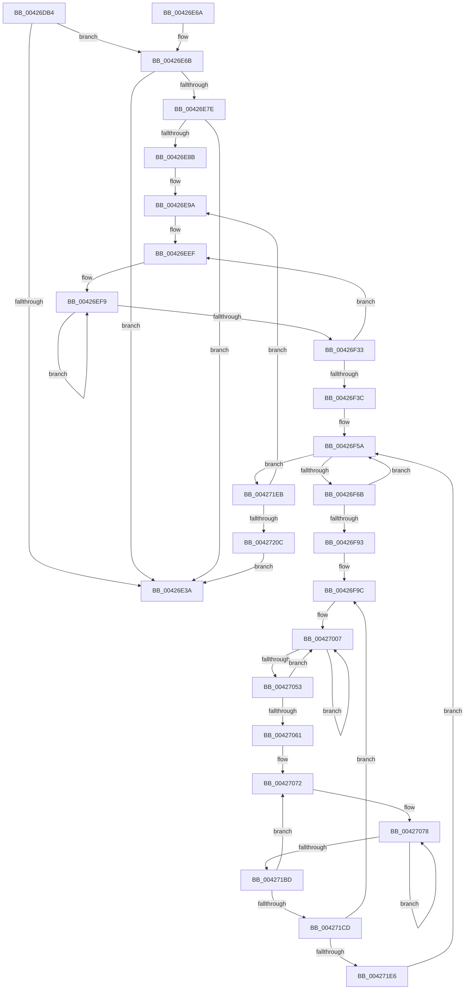

# PpmEventTraceHeteroSets

- RVA: `0x00426DB4`–`0x00427211` (길이 `1,117` bytes)
- VA: `0x0000000140426DB4`
- 실행 섹션: `.text`
- PDB 이름 있음: `예`; PDB Function 태그: `아니요`
- unwind 정보 RVA: `0x000A061C`
- 디코드: `254`개 명령, `1,117/1,117` bytes 표시
- 미해석 바이트: `0` (있으면 어셈블리에 `.byte`로 보존)

> 이 문서는 커널 이미지의 기계어와 PDB 기호를 분석해 생성했습니다. 4번과 5번은 함수 원형과 자료형을 바이너리 사용 방식에서 추정한 C 해석이며 원본 소스 복구 결과는 아닙니다.

## 1. Dependencies

- 직접 호출 지점: **12**; 고유 호출 대상: **9**
- 직접 호출자로 확인된 함수: **3**
- RIP 상대 이미지 참조: **9**

### Outgoing calls
- `0x00426E44` → [_security_check_cookie](../6A/_security_check_cookie_function_006AC640.md) (function, `0x006AC640`)
- `0x00426E75` → [EtwEventEnabled](../39/EtwEventEnabled_function_00392450.md) (function, `0x00392450`)
- `0x00426F55` → [RtlCopyVolatileMemory](../6B/RtlCopyVolatileMemory_function_006BC9D0.md) (function, `0x006BC9D0`)
- `0x00426F5E` → [KeIsEmptyGroupMask](../25/KeIsEmptyGroupMask_function_002553B0.md) (function, `0x002553B0`)
- `0x00426F6F` → [KeFindFirstSetRightGroupMask](../25/KeFindFirstSetRightGroupMask_function_00256BE4.md) (function, `0x00256BE4`)
- `0x00426FBB` → [memset](../6C/memset_function_006C6C40.md) (function, `0x006C6C40`)
- `0x00426FC9` → [memset](../6C/memset_function_006C6C40.md) (function, `0x006C6C40`)
- `0x00426FDA` → [memset](../6C/memset_function_006C6C40.md) (function, `0x006C6C40`)
- `0x00426FEB` → [memset](../6C/memset_function_006C6C40.md) (function, `0x006C6C40`)
- `0x00426FFF` → [KiQueryRestrictionAffinity](KiQueryRestrictionAffinity_function_00427288.md) (function, `0x00427288`)
- `0x0042701D` → [KiQueryHeteroSetFromSubNode](KiQueryHeteroSetFromSubNode_function_00427220.md) (function, `0x00427220`)
- `0x0042719E` → [EtwWriteEx](../25/EtwWriteEx_function_0025F0D0.md) (function, `0x0025F0D0`)

### Direct callers
- [sub_006FAB12](../6F/Unknown_function_006FAB12.md) at `0x006FAB44`
- [PpmEventTraceControlCallback](../../page/A5/PpmEventTraceControlCallback_function_00A51F60.md) at `0x00A520F8`
- [PopInitializeHeteroProcessors](../../page/A5/PopInitializeHeteroProcessors_function_00A53570.md) at `0x00A538F2`

### Static image references
- `0x00426DDA` → RVA `0x00E0A740` (`.data`; read)
- `0x00426DEB` → RVA `0x00FC6BC8` (`ALMOSTRO`; read)
- `0x00426DF2` → RVA `0x00013FB8` (`.rdata`; read)
- `0x00426E10` → RVA `0x00013FC8` (`.rdata`; read)
- `0x00426E1F` → RVA `0x00E67A39` (`.data`; read)
- `0x00426E6B` → RVA `0x00F083E8` (`.data`; read)
- `0x00426E7E` → RVA `0x00FC5000` (`ALMOSTRO`; read)
- `0x00426E8D` → RVA `0x00000000` (`image boundary/outside`; read)
- `0x00426E9C` → RVA `0x00FC5460` (`ALMOSTRO`; read)

## 2. Other-region calls and transfers

- 다른 실행 섹션으로 향하는 call: **0**
- 별도 외부 분기/꼬리 이동을 확인하지 못했습니다.

## 3. Assembly (complete function range)

```asm
00426DB4  48 8B C4                        mov rax, rsp
00426DB7  48 89 58 08                     mov qword ptr [rax + 8], rbx
00426DBB  48 89 70 10                     mov qword ptr [rax + 0x10], rsi
00426DBF  48 89 78 18                     mov qword ptr [rax + 0x18], rdi
00426DC3  55                              push rbp
00426DC4  41 54                           push r12
00426DC6  41 55                           push r13
00426DC8  41 56                           push r14
00426DCA  41 57                           push r15
00426DCC  48 8D A8 78 FD FF FF            lea rbp, [rax - 0x288]
00426DD3  48 81 EC 60 03 00 00            sub rsp, 0x360
00426DDA  48 8B 05 5F 39 9E 00            mov rax, qword ptr [rip + 0x9e395f]
00426DE1  48 33 C4                        xor rax, rsp
00426DE4  48 89 85 50 02 00 00            mov qword ptr [rbp + 0x250], rax
00426DEB  48 8B 05 D6 FD B9 00            mov rax, qword ptr [rip + 0xb9fdd6]
00426DF2  48 8D 35 BF D1 BE FF            lea rsi, [rip - 0x412e41]
00426DF9  33 FF                           xor edi, edi
00426DFB  89 4C 24 58                     mov dword ptr [rsp + 0x58], ecx
00426DFF  85 C9                           test ecx, ecx
00426E01  89 7C 24 50                     mov dword ptr [rsp + 0x50], edi
00426E05  0F 57 C0                        xorps xmm0, xmm0
00426E08  89 7C 24 44                     mov dword ptr [rsp + 0x44], edi
00426E0C  44 8B 60 04                     mov r12d, dword ptr [rax + 4]
00426E10  48 8D 05 B1 D1 BE FF            lea rax, [rip - 0x412e4f]
00426E17  48 0F 45 F0                     cmovne rsi, rax
00426E1B  89 7C 24 40                     mov dword ptr [rsp + 0x40], edi
00426E1F  40 38 3D 13 0C A4 00            cmp byte ptr [rip + 0xa40c13], dil
00426E26  F3 0F 7F 45 80                  movdqu xmmword ptr [rbp - 0x80], xmm0
00426E2B  89 7C 24 54                     mov dword ptr [rsp + 0x54], edi
00426E2F  89 7C 24 48                     mov dword ptr [rsp + 0x48], edi
00426E33  44 89 64 24 5C                  mov dword ptr [rsp + 0x5c], r12d
00426E38  75 31                           jne 0x140426e6b
00426E3A  48 8B 8D 50 02 00 00            mov rcx, qword ptr [rbp + 0x250]
00426E41  48 33 CC                        xor rcx, rsp
00426E44  E8 F7 57 28 00                  call 0x1406ac640
00426E49  4C 8D 9C 24 60 03 00 00         lea r11, [rsp + 0x360]
00426E51  49 8B 5B 30                     mov rbx, qword ptr [r11 + 0x30]
00426E55  49 8B 73 38                     mov rsi, qword ptr [r11 + 0x38]
00426E59  49 8B 7B 40                     mov rdi, qword ptr [r11 + 0x40]
00426E5D  49 8B E3                        mov rsp, r11
00426E60  41 5F                           pop r15
00426E62  41 5E                           pop r14
00426E64  41 5D                           pop r13
00426E66  41 5C                           pop r12
00426E68  5D                              pop rbp
00426E69  C3                              ret
00426E6A  CC                              int3
00426E6B  48 8B 0D 76 15 AE 00            mov rcx, qword ptr [rip + 0xae1576]
00426E72  48 8B D6                        mov rdx, rsi
00426E75  E8 D6 B5 F6 FF                  call 0x140392450
00426E7A  84 C0                           test al, al
00426E7C  74 BC                           je 0x140426e3a
00426E7E  66 3B 3D 7B E1 B9 00            cmp di, word ptr [rip + 0xb9e17b]
00426E85  89 7C 24 4C                     mov dword ptr [rsp + 0x4c], edi
00426E89  73 AF                           jae 0x140426e3a
00426E8B  8B CF                           mov ecx, edi
00426E8D  4C 8D 3D 6C 91 BD FF            lea r15, [rip - 0x426e94]
00426E94  41 BE 01 00 00 00               mov r14d, 1
00426E9A  8B C1                           mov eax, ecx
00426E9C  4C 8D 05 BD E5 B9 00            lea r8, [rip + 0xb9e5bd]
00426EA3  44 8B CF                        mov r9d, edi
00426EA6  48 8B D7                        mov rdx, rdi
00426EA9  49 8B 9C C7 C0 F6 FC 00         mov rbx, qword ptr [r15 + rax*8 + 0xfcf6c0]
00426EB1  33 C0                           xor eax, eax
00426EB3  48 89 85 20 02 00 00            mov qword ptr [rbp + 0x220], rax
00426EBA  89 85 28 02 00 00               mov dword ptr [rbp + 0x228], eax
00426EC0  66 89 85 2C 02 00 00            mov word ptr [rbp + 0x22c], ax
00426EC7  48 89 85 30 02 00 00            mov qword ptr [rbp + 0x230], rax
00426ECE  89 85 38 02 00 00               mov dword ptr [rbp + 0x238], eax
00426ED4  66 89 85 3C 02 00 00            mov word ptr [rbp + 0x23c], ax
00426EDB  48 89 85 40 02 00 00            mov qword ptr [rbp + 0x240], rax
00426EE2  89 85 48 02 00 00               mov dword ptr [rbp + 0x248], eax
00426EE8  66 89 85 4C 02 00 00            mov word ptr [rbp + 0x24c], ax
00426EEF  47 8D 14 09                     lea r10d, [r9 + r9]
00426EF3  41 BB 02 00 00 00               mov r11d, 2
00426EF9  41 8A 00                        mov al, byte ptr [r8]
00426EFC  49 83 C0 04                     add r8, 4
00426F00  42 88 84 15 20 02 00 00         mov byte ptr [rbp + r10 + 0x220], al
00426F08  42 8A 84 3A F8 70 FC 00         mov al, byte ptr [rdx + r15 + 0xfc70f8]
00426F10  42 88 84 15 30 02 00 00         mov byte ptr [rbp + r10 + 0x230], al
00426F18  42 8A 84 3A E8 70 FC 00         mov al, byte ptr [rdx + r15 + 0xfc70e8]
00426F20  49 03 D6                        add rdx, r14
00426F23  42 88 84 15 40 02 00 00         mov byte ptr [rbp + r10 + 0x240], al
00426F2B  45 03 D6                        add r10d, r14d
00426F2E  4D 2B DE                        sub r11, r14
00426F31  75 C6                           jne 0x140426ef9
00426F33  45 03 CE                        add r9d, r14d
00426F36  41 83 F9 07                     cmp r9d, 7
00426F3A  7C B3                           jl 0x140426eef
00426F3C  0F 57 C0                        xorps xmm0, xmm0
00426F3F  48 89 5C 24 78                  mov qword ptr [rsp + 0x78], rbx
00426F44  48 8D 53 10                     lea rdx, [rbx + 0x10]
00426F48  45 8D 43 10                     lea r8d, [r11 + 0x10]
00426F4C  48 8D 4D 80                     lea rcx, [rbp - 0x80]
00426F50  F3 0F 7F 45 80                  movdqu xmmword ptr [rbp - 0x80], xmm0
00426F55  E8 76 5A 29 00                  call 0x1406bc9d0
00426F5A  48 8D 4D 80                     lea rcx, [rbp - 0x80]
00426F5E  E8 4D E4 E2 FF                  call 0x1402553b0
00426F63  85 C0                           test eax, eax
00426F65  0F 85 80 02 00 00               jne 0x1404271eb
00426F6B  48 8D 4D 80                     lea rcx, [rbp - 0x80]
00426F6F  E8 70 FC E2 FF                  call 0x140256be4
00426F74  44 0F B7 D8                     movzx r11d, ax
00426F78  48 8D 45 80                     lea rax, [rbp - 0x80]
00426F7C  4C 0F B3 18                     btr qword ptr [rax], r11
00426F80  48 8B 44 24 78                  mov rax, qword ptr [rsp + 0x78]
00426F85  4E 8B 7C D8 20                  mov r15, qword ptr [rax + r11*8 + 0x20]
00426F8A  89 7C 24 48                     mov dword ptr [rsp + 0x48], edi
00426F8E  45 85 E4                        test r12d, r12d
00426F91  74 C7                           je 0x140426f5a
00426F93  8B DF                           mov ebx, edi
00426F95  4D 8D AF 88 00 00 00            lea r13, [r15 + 0x88]
00426F9C  33 C0                           xor eax, eax
00426F9E  48 8D 8D 40 01 00 00            lea rcx, [rbp + 0x140]
00426FA5  0F 57 C0                        xorps xmm0, xmm0
00426FA8  48 89 44 24 70                  mov qword ptr [rsp + 0x70], rax
00426FAD  33 D2                           xor edx, edx
00426FAF  0F 11 44 24 60                  movups xmmword ptr [rsp + 0x60], xmm0
00426FB4  44 8D 70 70                     lea r14d, [rax + 0x70]
00426FB8  45 8B C6                        mov r8d, r14d
00426FBB  E8 80 FC 29 00                  call 0x1406c6c40
00426FC0  45 8B C6                        mov r8d, r14d
00426FC3  48 8D 4D 60                     lea rcx, [rbp + 0x60]
00426FC7  33 D2                           xor edx, edx
00426FC9  E8 72 FC 29 00                  call 0x1406c6c40
00426FCE  45 8B C6                        mov r8d, r14d
00426FD1  48 8D 8D D0 00 00 00            lea rcx, [rbp + 0xd0]
00426FD8  33 D2                           xor edx, edx
00426FDA  E8 61 FC 29 00                  call 0x1406c6c40
00426FDF  45 8B C6                        mov r8d, r14d
00426FE2  48 8D 8D B0 01 00 00            lea rcx, [rbp + 0x1b0]
00426FE9  33 D2                           xor edx, edx
00426FEB  E8 50 FC 29 00                  call 0x1406c6c40
00426FF0  4C 8D 85 B0 01 00 00            lea r8, [rbp + 0x1b0]
00426FF7  8B D3                           mov edx, ebx
00426FF9  49 8B CF                        mov rcx, r15
00426FFC  44 8B F7                        mov r14d, edi
00426FFF  E8 84 02 00 00                  call 0x140427288
00427004  44 8B DF                        mov r11d, edi
00427007  48 8D 44 24 60                  lea rax, [rsp + 0x60]
0042700C  44 8B CB                        mov r9d, ebx
0042700F  44 8B C7                        mov r8d, edi
00427012  48 89 44 24 20                  mov qword ptr [rsp + 0x20], rax
00427017  41 8B D3                        mov edx, r11d
0042701A  49 8B CF                        mov rcx, r15
0042701D  E8 FE 01 00 00                  call 0x140427220
00427022  48 8B 44 24 70                  mov rax, qword ptr [rsp + 0x70]
00427027  FF C7                           inc edi
00427029  45 8B CE                        mov r9d, r14d
0042702C  41 FF C6                        inc r14d
0042702F  4A 89 84 CD 40 01 00 00         mov qword ptr [rbp + r9*8 + 0x140], rax
00427037  48 8B 44 24 60                  mov rax, qword ptr [rsp + 0x60]
0042703C  4A 89 44 CD 60                  mov qword ptr [rbp + r9*8 + 0x60], rax
00427041  48 8B 44 24 68                  mov rax, qword ptr [rsp + 0x68]
00427046  4A 89 84 CD D0 00 00 00         mov qword ptr [rbp + r9*8 + 0xd0], rax
0042704E  83 FF 02                        cmp edi, 2
00427051  7C B4                           jl 0x140427007
00427053  41 FF C3                        inc r11d
00427056  BF 00 00 00 00                  mov edi, 0
0042705B  41 83 FB 07                     cmp r11d, 7
0042705F  7C A6                           jl 0x140427007
00427061  44 8B 64 24 58                  mov r12d, dword ptr [rsp + 0x58]
00427066  44 8D 77 01                     lea r14d, [rdi + 1]
0042706A  8B C7                           mov eax, edi
0042706C  8B DF                           mov ebx, edi
0042706E  89 44 24 40                     mov dword ptr [rsp + 0x40], eax
00427072  89 7C 24 44                     mov dword ptr [rsp + 0x44], edi
00427076  8B CF                           mov ecx, edi
00427078  8D 04 41                        lea eax, [rcx + rax*2]
0042707B  48 C7 45 98 04 00 00 00         mov qword ptr [rbp - 0x68], 4
00427083  8B C8                           mov ecx, eax
00427085  45 33 C9                        xor r9d, r9d
00427088  0F B6 84 05 20 02 00 00         movzx eax, byte ptr [rbp + rax + 0x220]
00427090  45 33 C0                        xor r8d, r8d
00427093  89 44 24 50                     mov dword ptr [rsp + 0x50], eax
00427097  48 8B D6                        mov rdx, rsi
0042709A  48 8D 44 24 4C                  lea rax, [rsp + 0x4c]
0042709F  4C 89 6D A0                     mov qword ptr [rbp - 0x60], r13
004270A3  48 89 45 90                     mov qword ptr [rbp - 0x70], rax
004270A7  48 8D 44 24 48                  lea rax, [rsp + 0x48]
004270AC  48 89 45 B0                     mov qword ptr [rbp - 0x50], rax
004270B0  48 8D 44 24 40                  lea rax, [rsp + 0x40]
004270B5  48 89 45 C0                     mov qword ptr [rbp - 0x40], rax
004270B9  48 8D 44 24 44                  lea rax, [rsp + 0x44]
004270BE  48 89 45 D0                     mov qword ptr [rbp - 0x30], rax
004270C2  48 8D 44 24 50                  lea rax, [rsp + 0x50]
004270C7  48 89 45 E0                     mov qword ptr [rbp - 0x20], rax
004270CB  48 8D 85 30 02 00 00            lea rax, [rbp + 0x230]
004270D2  48 03 C1                        add rax, rcx
004270D5  48 C7 45 A8 02 00 00 00         mov qword ptr [rbp - 0x58], 2
004270DD  48 89 45 F0                     mov qword ptr [rbp - 0x10], rax
004270E1  48 8D 85 40 02 00 00            lea rax, [rbp + 0x240]
004270E8  48 03 C1                        add rax, rcx
004270EB  48 C7 45 B8 04 00 00 00         mov qword ptr [rbp - 0x48], 4
004270F3  48 89 45 00                     mov qword ptr [rbp], rax
004270F7  48 8D 45 60                     lea rax, [rbp + 0x60]
004270FB  8B CB                           mov ecx, ebx
004270FD  4C 89 75 C8                     mov qword ptr [rbp - 0x38], r14
00427101  4C 89 75 D8                     mov qword ptr [rbp - 0x28], r14
00427105  4C 89 75 E8                     mov qword ptr [rbp - 0x18], r14
00427109  48 8D 04 C8                     lea rax, [rax + rcx*8]
0042710D  4C 89 75 F8                     mov qword ptr [rbp - 8], r14
00427111  48 89 45 10                     mov qword ptr [rbp + 0x10], rax
00427115  48 8D 85 D0 00 00 00            lea rax, [rbp + 0xd0]
0042711C  48 8D 04 C8                     lea rax, [rax + rcx*8]
00427120  4C 89 75 08                     mov qword ptr [rbp + 8], r14
00427124  48 89 45 20                     mov qword ptr [rbp + 0x20], rax
00427128  48 8D 85 40 01 00 00            lea rax, [rbp + 0x140]
0042712F  48 8D 04 C8                     lea rax, [rax + rcx*8]
00427133  48 C7 45 18 08 00 00 00         mov qword ptr [rbp + 0x18], 8
0042713B  48 89 45 30                     mov qword ptr [rbp + 0x30], rax
0042713F  48 8D 85 B0 01 00 00            lea rax, [rbp + 0x1b0]
00427146  48 8D 04 C8                     lea rax, [rax + rcx*8]
0042714A  48 C7 45 28 08 00 00 00         mov qword ptr [rbp + 0x28], 8
00427152  48 8B 0D 8F 12 AE 00            mov rcx, qword ptr [rip + 0xae128f]
00427159  48 89 45 40                     mov qword ptr [rbp + 0x40], rax
0042715D  48 8D 44 24 54                  lea rax, [rsp + 0x54]
00427162  48 89 45 50                     mov qword ptr [rbp + 0x50], rax
00427166  48 8D 45 90                     lea rax, [rbp - 0x70]
0042716A  48 89 44 24 38                  mov qword ptr [rsp + 0x38], rax
0042716F  C7 44 24 30 0D 00 00 00         mov dword ptr [rsp + 0x30], 0xd
00427177  48 89 7C 24 28                  mov qword ptr [rsp + 0x28], rdi
0042717C  48 89 7C 24 20                  mov qword ptr [rsp + 0x20], rdi
00427181  48 C7 45 38 08 00 00 00         mov qword ptr [rbp + 0x38], 8
00427189  48 C7 45 48 08 00 00 00         mov qword ptr [rbp + 0x48], 8
00427191  44 89 64 24 54                  mov dword ptr [rsp + 0x54], r12d
00427196  48 C7 45 58 04 00 00 00         mov qword ptr [rbp + 0x58], 4
0042719E  E8 2D 7F E3 FF                  call 0x14025f0d0
004271A3  8B 4C 24 44                     mov ecx, dword ptr [rsp + 0x44]
004271A7  41 03 DE                        add ebx, r14d
004271AA  8B 44 24 40                     mov eax, dword ptr [rsp + 0x40]
004271AE  FF C1                           inc ecx
004271B0  89 4C 24 44                     mov dword ptr [rsp + 0x44], ecx
004271B4  83 F9 02                        cmp ecx, 2
004271B7  0F 8C BB FE FF FF               jl 0x140427078
004271BD  41 03 C6                        add eax, r14d
004271C0  89 44 24 40                     mov dword ptr [rsp + 0x40], eax
004271C4  83 F8 07                        cmp eax, 7
004271C7  0F 8C A5 FE FF FF               jl 0x140427072
004271CD  8B 5C 24 48                     mov ebx, dword ptr [rsp + 0x48]
004271D1  44 8B 64 24 5C                  mov r12d, dword ptr [rsp + 0x5c]
004271D6  41 03 DE                        add ebx, r14d
004271D9  89 5C 24 48                     mov dword ptr [rsp + 0x48], ebx
004271DD  41 3B DC                        cmp ebx, r12d
004271E0  0F 82 B6 FD FF FF               jb 0x140426f9c
004271E6  E9 6F FD FF FF                  jmp 0x140426f5a
004271EB  8B 4C 24 4C                     mov ecx, dword ptr [rsp + 0x4c]
004271EF  4C 8D 3D 0A 8E BD FF            lea r15, [rip - 0x4271f6]
004271F6  0F B7 05 03 DE B9 00            movzx eax, word ptr [rip + 0xb9de03]
004271FD  41 03 CE                        add ecx, r14d
00427200  89 4C 24 4C                     mov dword ptr [rsp + 0x4c], ecx
00427204  3B C8                           cmp ecx, eax
00427206  0F 82 8E FC FF FF               jb 0x140426e9a
0042720C  E9 29 FC FF FF                  jmp 0x140426e3a
```

## 4. C-style interpretation (structured pseudocode)

```c
__int64 __fastcall PpmEventTraceHeteroSets(int a1)
{
    __int64 result;
    __int64 v_r10;
    __int64 v_r11;
    __int64 v_r14;
    __int64 v_rbx;
    __int64 v_rdi;
    __int64 v_rsi;
    __int64 v_rsp;
    unsigned __int64 v_stack_m28;
    unsigned __int64 v_stack_m2E8;
    unsigned __int64 v_stack_m2F0;
    unsigned __int64 v_stack_m2F8;
    unsigned __int64 v_stack_m300;
    unsigned int v_stack_m304;
    unsigned int v_stack_m308;
    unsigned __int64 v_stack_m30C;
    unsigned int v_stack_m310;
    unsigned int v_stack_m314;
    unsigned int v_stack_m318;
    unsigned int v_stack_m31C;
    unsigned int v_stack_m320;
    unsigned __int64 v_stack_m328;
    unsigned int v_stack_m32C;
    unsigned int v_stack_m330;
    unsigned int v_stack_m334;
    unsigned int v_stack_m338;
    unsigned int v_stack_m340;
    unsigned int v_stack_m344;
    unsigned int v_stack_m348;

    *(unsigned __int64 *)(v_rsp + 8) = v_rbx;
    *(unsigned __int64 *)(v_rsp + 16) = v_rsi;
    *(unsigned __int64 *)(v_rsp + 24) = v_rdi;
    v_rsp = (v_rsp) - (864);
    result = (*(unsigned __int64 *)(v_rip + 10369375)) ^ (v_rsp);
    *(unsigned __int64 *)(v_rsp - 648 + 592) = result;
    v_rdi = 0;
    v_stack_m330 = a1;
    v_stack_m338 = 0;
    v_stack_m344 = 0;
    v_rsi = v_rip - 4271681;
    if (a1 != 0) { v_rsi = v_rip - 4271695; }
    v_stack_m348 = 0;
    *(unsigned __int64 *)(v_rsp - 648 - 128) = v_xmm0;
    v_stack_m334 = 0;
    v_stack_m340 = 0;
    v_stack_m32C = (unsigned int)((unsigned int)(*(unsigned int *)(*(unsigned __int64 *)(v_rip + 12189142) + 4)));
    if ((*(unsigned __int8 *)(v_rip + 10750995)) != 0) goto loc_00426E6B;
loc_00426E3A:
    a1 = (*(unsigned __int64 *)(v_rsp - 648 + 592)) ^ (v_rsp);
    result = _security_check_cookie(a1, a2, a3, a4);
    return result;
loc_00426E6B:
    result = EtwEventEnabled(*(unsigned __int64 *)(v_rip + 11408758), *(unsigned __int64 *)(v_stack_m28 + 56), a3, a4);
    if ((unsigned __int8)(result) == 0) goto loc_00426E3A;
    v_stack_m314 = (unsigned int)(*(unsigned __int64 *)(v_stack_m28 + 64));
    if (((unsigned __int16)(*(unsigned __int64 *)(v_stack_m28 + 64))) >= (*(unsigned __int16 *)(v_rip + 12181883))) goto loc_00426E3A;
loc_00426E9A:
    result = 0;
    *(unsigned __int64 *)(v_rsp - 648 + 544) = 0;
    *(unsigned int *)(v_rsp - 648 + 552) = 0;
    *(unsigned __int16 *)(v_rsp - 648 + 556) = 0;
    *(unsigned __int64 *)(v_rsp - 648 + 560) = 0;
    *(unsigned int *)(v_rsp - 648 + 568) = 0;
    *(unsigned __int16 *)(v_rsp - 648 + 572) = 0;
    *(unsigned __int64 *)(v_rsp - 648 + 576) = 0;
    *(unsigned int *)(v_rsp - 648 + 584) = 0;
    *(unsigned __int16 *)(v_rsp - 648 + 588) = 0;
loc_00426EEF:
loc_00426EF9:
    a3 = (v_rip + 12182973) + (4);
    *(unsigned __int8 *)(v_rsp - 648 + (unsigned int)((unsigned int)(*(unsigned __int64 *)(v_stack_m28 + 64))) + (unsigned int)((unsigned int)(*(unsigned __int64 *)(v_stack_m28 + 64))) * 1 * 1 + 544) = (unsigned __int8)(*(unsigned __int8 *)(v_rip + 12182973));
    *(unsigned __int8 *)(v_rsp - 648 + (unsigned int)((unsigned int)(*(unsigned __int64 *)(v_stack_m28 + 64))) + (unsigned int)((unsigned int)(*(unsigned __int64 *)(v_stack_m28 + 64))) * 1 * 1 + 560) = (unsigned __int8)(*(unsigned __int8 *)(*(unsigned __int64 *)(v_stack_m28 + 64) + v_rip - 4353684 * 1 + 16543992));
    a2 = (*(unsigned __int64 *)(v_stack_m28 + 64)) + (1);
    *(unsigned __int8 *)(v_rsp - 648 + (unsigned int)((unsigned int)(*(unsigned __int64 *)(v_stack_m28 + 64))) + (unsigned int)((unsigned int)(*(unsigned __int64 *)(v_stack_m28 + 64))) * 1 * 1 + 576) = (unsigned __int8)(*(unsigned __int8 *)(*(unsigned __int64 *)(v_stack_m28 + 64) + v_rip - 4353684 * 1 + 16543976));
    v_r10 = (unsigned int)(((unsigned int)((unsigned int)(*(unsigned __int64 *)(v_stack_m28 + 64))) + (unsigned int)((unsigned int)(*(unsigned __int64 *)(v_stack_m28 + 64))) * 1) + (1));
    v_r11 = (2) - (1);
    if (condition_is_not_equal) goto loc_00426EF9;
    a4 = (unsigned int)(((unsigned int)((unsigned int)(*(unsigned __int64 *)(v_stack_m28 + 64)))) + (1));
    if (((unsigned int)(a4)) < 7) goto loc_00426EEF;
    v_stack_m2E8 = *(unsigned __int64 *)(v_rip - 4353684 + (unsigned int)((unsigned int)((unsigned int)((unsigned int)(*(unsigned __int64 *)(v_stack_m28 + 64))))) * 8 + 16578240);
    *(unsigned __int64 *)(v_rsp - 648 - 128) = v_xmm0;
    result = RtlCopyVolatileMemory(v_rsp - 648 - 128, *(unsigned __int64 *)(v_rip - 4353684 + (unsigned int)((unsigned int)((unsigned int)((unsigned int)(*(unsigned __int64 *)(v_stack_m28 + 64))))) * 8 + 16578240) + 16, v_r11 + 16, a4);
loc_00426F5A:
    result = KeIsEmptyGroupMask(v_rsp - 648 - 128, *(unsigned __int64 *)(v_rip - 4353684 + (unsigned int)((unsigned int)((unsigned int)((unsigned int)(*(unsigned __int64 *)(v_stack_m28 + 64))))) * 8 + 16578240) + 16, v_r11 + 16, a4);
    if ((unsigned int)(result) != 0) goto loc_004271EB;
    result = KeFindFirstSetRightGroupMask(v_rsp - 648 - 128, *(unsigned __int64 *)(v_rip - 4353684 + (unsigned int)((unsigned int)((unsigned int)((unsigned int)(*(unsigned __int64 *)(v_stack_m28 + 64))))) * 8 + 16578240) + 16, v_r11 + 16, a4);
    v_stack_m318 = (unsigned int)(*(unsigned __int64 *)(v_stack_m28 + 64));
    if ((unsigned int)((unsigned int)(*(unsigned int *)(*(unsigned __int64 *)(v_rip + 12189142) + 4))) == 0) goto loc_00426F5A;
loc_00426F9C:
    result = 0;
    v_stack_m2F0 = 0;
    a2 = 0;
    v_stack_m300 = v_xmm0;
    result = memset(v_rsp - 648 + 320, a2, (unsigned int)((unsigned int)(result + 112)), a4);
    a2 = 0;
    result = memset(v_rsp - 648 + 96, a2, (unsigned int)((unsigned int)(result + 112)), a4);
    a2 = 0;
    result = memset(v_rsp - 648 + 208, a2, (unsigned int)((unsigned int)(result + 112)), a4);
    a2 = 0;
    result = memset(v_rsp - 648 + 432, a2, (unsigned int)((unsigned int)(result + 112)), a4);
    result = KiQueryRestrictionAffinity(*(unsigned __int64 *)(v_stack_m2E8 + (unsigned __int16)(result) * 8 + 32), (unsigned int)((unsigned int)((unsigned int)((unsigned int)(*(unsigned __int64 *)(v_stack_m28 + 64))))), v_rsp - 648 + 432, a4);
loc_00427007:
    v_stack_m340 = v_stack_m300;
    result = KiQueryHeteroSetFromSubNode(*(unsigned __int64 *)(v_stack_m2E8 + (unsigned __int16)(result) * 8 + 32), (unsigned int)((unsigned int)((unsigned int)((unsigned int)(*(unsigned __int64 *)(v_stack_m28 + 64))))), (unsigned int)((unsigned int)(*(unsigned __int64 *)(v_stack_m28 + 64))), (unsigned int)((unsigned int)((unsigned int)((unsigned int)(*(unsigned __int64 *)(v_stack_m28 + 64))))));
    v_rdi = (unsigned int)((*(unsigned __int64 *)(v_stack_m28 + 64)) + 1);
    v_r14 = (unsigned int)(((unsigned int)((unsigned int)(*(unsigned __int64 *)(v_stack_m28 + 64)))) + 1);
    *(unsigned __int64 *)(v_rsp - 648 + (unsigned int)((unsigned int)((unsigned int)((unsigned int)(*(unsigned __int64 *)(v_stack_m28 + 64))))) * 8 + 320) = v_stack_m2F0;
    *(unsigned __int64 *)(v_rsp - 648 + (unsigned int)((unsigned int)((unsigned int)((unsigned int)(*(unsigned __int64 *)(v_stack_m28 + 64))))) * 8 + 96) = v_stack_m300;
    *(unsigned __int64 *)(v_rsp - 648 + (unsigned int)((unsigned int)((unsigned int)((unsigned int)(*(unsigned __int64 *)(v_stack_m28 + 64))))) * 8 + 208) = v_stack_m2F8;
    if (((unsigned int)(v_rdi)) < 2) goto loc_00427007;
    v_r11 = (unsigned int)(((unsigned int)((unsigned int)(*(unsigned __int64 *)(v_stack_m28 + 64)))) + 1);
    if (((unsigned int)(v_r11)) < 7) goto loc_00427007;
    v_stack_m320 = 0;
loc_00427072:
    v_stack_m31C = 0;
loc_00427078:
    *(unsigned __int64 *)(v_rsp - 648 - 104) = 4;
    a4 = 0;
    a3 = 0;
    v_stack_m310 = (unsigned int)(*(unsigned __int8 *)(v_rsp - 648 + 0 + 0 * 2 * 1 + 544));
    *(unsigned __int64 *)(v_rsp - 648 - 96) = *(unsigned __int64 *)(v_stack_m2E8 + (unsigned __int16)(result) * 8 + 32) + 136;
    *(unsigned __int64 *)(v_rsp - 648 - 112) = v_stack_m314;
    *(unsigned __int64 *)(v_rsp - 648 - 80) = v_stack_m318;
    *(unsigned __int64 *)(v_rsp - 648 - 64) = v_stack_m320;
    *(unsigned __int64 *)(v_rsp - 648 - 48) = v_stack_m31C;
    *(unsigned __int64 *)(v_rsp - 648 - 32) = v_stack_m310;
    result = (v_rsp - 648 + 560) + ((unsigned int)((unsigned int)(0 + 0 * 2)));
    *(unsigned __int64 *)(v_rsp - 648 - 88) = 2;
    *(unsigned __int64 *)(v_rsp - 648 - 16) = result;
    result = (v_rsp - 648 + 576) + ((unsigned int)((unsigned int)(0 + 0 * 2)));
    *(unsigned __int64 *)(v_rsp - 648 - 72) = 4;
    *(unsigned __int64 *)(v_rsp - 648) = result;
    *(unsigned __int64 *)(v_rsp - 648 - 56) = 0 + 1;
    *(unsigned __int64 *)(v_rsp - 648 - 40) = 0 + 1;
    *(unsigned __int64 *)(v_rsp - 648 - 24) = 0 + 1;
    *(unsigned __int64 *)(v_rsp - 648 - 8) = 0 + 1;
    *(unsigned __int64 *)(v_rsp - 648 + 16) = v_rsp - 648 + 96 + 0 * 8;
    *(unsigned __int64 *)(v_rsp - 648 + 8) = 0 + 1;
    *(unsigned __int64 *)(v_rsp - 648 + 32) = v_rsp - 648 + 208 + 0 * 8;
    *(unsigned __int64 *)(v_rsp - 648 + 24) = 8;
    *(unsigned __int64 *)(v_rsp - 648 + 48) = v_rsp - 648 + 320 + 0 * 8;
    *(unsigned __int64 *)(v_rsp - 648 + 40) = 8;
    *(unsigned __int64 *)(v_rsp - 648 + 64) = v_rsp - 648 + 432 + 0 * 8;
    *(unsigned __int64 *)(v_rsp - 648 + 80) = v_stack_m30C;
    v_stack_m328 = v_rsp - 648 - 112;
    v_stack_m330 = 13;
    v_stack_m338 = 0;
    v_stack_m340 = 0;
    *(unsigned __int64 *)(v_rsp - 648 + 56) = 8;
    *(unsigned __int64 *)(v_rsp - 648 + 72) = 8;
    v_stack_m30C = (unsigned int)((unsigned int)(v_stack_m308));
    *(unsigned __int64 *)(v_rsp - 648 + 88) = 4;
    result = EtwWriteEx(*(unsigned __int64 *)(v_rip + 11408015), *(unsigned __int64 *)(v_stack_m28 + 56), a3, a4);
    v_rbx = (unsigned int)((0) + ((unsigned int)(0 + 1)));
    a1 = (unsigned int)(((unsigned int)(v_stack_m31C)) + 1);
    v_stack_m31C = a1;
    if (a1 < 2) goto loc_00427078;
    result = (unsigned int)(((unsigned int)(v_stack_m320)) + ((unsigned int)(0 + 1)));
    v_stack_m320 = (unsigned int)(result);
    if (((unsigned int)(result)) < 7) goto loc_00427072;
    v_rbx = (unsigned int)(((unsigned int)(v_stack_m318)) + ((unsigned int)(0 + 1)));
    v_stack_m318 = (unsigned int)(v_rbx);
    if (((unsigned int)(v_rbx)) < ((unsigned int)((unsigned int)(v_stack_m304)))) goto loc_00426F9C;
    goto loc_00426F5A;
loc_004271EB:
    a1 = (unsigned int)(((unsigned int)(v_stack_m314)) + ((unsigned int)(0 + 1)));
    v_stack_m314 = a1;
    if (a1 < ((unsigned int)(*(unsigned __int16 *)(v_rip + 12180995)))) goto loc_00426E9A;
    goto loc_00426E3A;
}
```

## 5. (Beta) C Style

```c
int64_t PpmEventTraceHeteroSets(int32_t Arg1)
{
    int64_t result;
    int64_t local_r10;
    int64_t local_r11;
    int64_t local_r14;
    int64_t local_rbx;
    int64_t local_rdi;
    int64_t local_rsi;
    int64_t local_rsp;
    uint64_t v_stack_m28;
    uint64_t v_stack_m2E8;
    uint64_t v_stack_m2F0;
    uint64_t v_stack_m2F8;
    uint64_t v_stack_m300;
    uint32_t v_stack_m304;
    uint32_t v_stack_m308;
    uint64_t v_stack_m30C;
    uint32_t v_stack_m310;
    uint32_t v_stack_m314;
    uint32_t v_stack_m318;
    uint32_t v_stack_m31C;
    uint32_t v_stack_m320;
    uint64_t v_stack_m328;
    uint32_t v_stack_m32C;
    uint32_t v_stack_m330;
    uint32_t v_stack_m334;
    uint32_t v_stack_m338;
    uint32_t v_stack_m340;
    uint32_t v_stack_m344;
    uint32_t v_stack_m348;

    *(uint64_t *)(local_rsp + 0x8) = local_rbx;
    *(uint64_t *)(local_rsp + 0x10) = local_rsi;
    *(uint64_t *)(local_rsp + 0x18) = local_rdi;
    local_rsp = (local_rsp) - (864);
    result = (*(uint64_t *)(v_rip + 0x9E395F)) ^ (local_rsp);
    *(uint64_t *)(local_rsp - 0x288 + 0x250) = result;
    local_rdi = 0;
    v_stack_m330 = Arg1;
    v_stack_m338 = 0;
    v_stack_m344 = 0;
    local_rsi = v_rip - 4271681;
    if (Arg1 != 0) { local_rsi = v_rip - 4271695; }
    v_stack_m348 = 0;
    *(uint64_t *)(local_rsp - 0x288 - 0x80) = v_xmm0;
    v_stack_m334 = 0;
    v_stack_m340 = 0;
    v_stack_m32C = (uint32_t)((uint32_t)(*(uint32_t *)(*(uint64_t *)(v_rip + 0xB9FDD6) + 0x4)));
    if ((*(uint8_t *)(v_rip + 0xA40C13)) != 0) goto loc_00426E6B;
loc_00426E3A:
    Arg1 = (*(uint64_t *)(local_rsp - 0x288 + 0x250)) ^ (local_rsp);
    result = _security_check_cookie(Arg1, a2, a3, a4);
    return result;
loc_00426E6B:
    result = EtwEventEnabled(*(uint64_t *)(v_rip + 0xAE1576), *(uint64_t *)(v_stack_m28 + 0x38), a3, a4);
    if ((uint8_t)(result) == 0) goto loc_00426E3A;
    v_stack_m314 = (uint32_t)(*(uint64_t *)(v_stack_m28 + 0x40));
    if (((uint16_t)(*(uint64_t *)(v_stack_m28 + 0x40))) >= (*(uint16_t *)(v_rip + 0xB9E17B))) goto loc_00426E3A;
loc_00426E9A:
    result = 0;
    *(uint64_t *)(local_rsp - 0x288 + 0x220) = 0;
    *(uint32_t *)(local_rsp - 0x288 + 0x228) = 0;
    *(uint16_t *)(local_rsp - 0x288 + 0x22C) = 0;
    *(uint64_t *)(local_rsp - 0x288 + 0x230) = 0;
    *(uint32_t *)(local_rsp - 0x288 + 0x238) = 0;
    *(uint16_t *)(local_rsp - 0x288 + 0x23C) = 0;
    *(uint64_t *)(local_rsp - 0x288 + 0x240) = 0;
    *(uint32_t *)(local_rsp - 0x288 + 0x248) = 0;
    *(uint16_t *)(local_rsp - 0x288 + 0x24C) = 0;
loc_00426EEF:
loc_00426EF9:
    a3 = (v_rip + 12182973) + (4);
    *(uint8_t *)(local_rsp - 0x288 + (uint32_t)((uint32_t)(*(uint64_t *)(v_stack_m28 + 0x40))) + (uint32_t)((uint32_t)(*(uint64_t *)(v_stack_m28 + 0x40))) * 1 * 1 + 0x220) = (uint8_t)(*(uint8_t *)(v_rip + 0xB9E5BD));
    *(uint8_t *)(local_rsp - 0x288 + (uint32_t)((uint32_t)(*(uint64_t *)(v_stack_m28 + 0x40))) + (uint32_t)((uint32_t)(*(uint64_t *)(v_stack_m28 + 0x40))) * 1 * 1 + 0x230) = (uint8_t)(*(uint8_t *)(*(uint64_t *)(v_stack_m28 + 0x40) + v_rip - 0x426E94 * 1 + 0xFC70F8));
    a2 = (*(uint64_t *)(v_stack_m28 + 0x40)) + (1);
    *(uint8_t *)(local_rsp - 0x288 + (uint32_t)((uint32_t)(*(uint64_t *)(v_stack_m28 + 0x40))) + (uint32_t)((uint32_t)(*(uint64_t *)(v_stack_m28 + 0x40))) * 1 * 1 + 0x240) = (uint8_t)(*(uint8_t *)(*(uint64_t *)(v_stack_m28 + 0x40) + v_rip - 0x426E94 * 1 + 0xFC70E8));
    local_r10 = (uint32_t)(((uint32_t)((uint32_t)(*(uint64_t *)(v_stack_m28 + 0x40))) + (uint32_t)((uint32_t)(*(uint64_t *)(v_stack_m28 + 0x40))) * 1) + (1));
    local_r11 = (2) - (1);
    if (condition_is_not_equal) goto loc_00426EF9;
    a4 = (uint32_t)(((uint32_t)((uint32_t)(*(uint64_t *)(v_stack_m28 + 0x40)))) + (1));
    if (((uint32_t)(a4)) < 7) goto loc_00426EEF;
    v_stack_m2E8 = *(uint64_t *)(v_rip - 0x426E94 + (uint32_t)((uint32_t)((uint32_t)((uint32_t)(*(uint64_t *)(v_stack_m28 + 0x40))))) * 8 + 0xFCF6C0);
    *(uint64_t *)(local_rsp - 0x288 - 0x80) = v_xmm0;
    result = RtlCopyVolatileMemory(local_rsp - 648 - 128, *(uint64_t *)(v_rip - 0x426E94 + (uint32_t)((uint32_t)((uint32_t)((uint32_t)(*(uint64_t *)(v_stack_m28 + 0x40))))) * 8 + 0xFCF6C0) + 16, local_r11 + 16, a4);
loc_00426F5A:
    result = KeIsEmptyGroupMask(local_rsp - 648 - 128, *(uint64_t *)(v_rip - 0x426E94 + (uint32_t)((uint32_t)((uint32_t)((uint32_t)(*(uint64_t *)(v_stack_m28 + 0x40))))) * 8 + 0xFCF6C0) + 16, local_r11 + 16, a4);
    if ((uint32_t)(result) != 0) goto loc_004271EB;
    result = KeFindFirstSetRightGroupMask(local_rsp - 648 - 128, *(uint64_t *)(v_rip - 0x426E94 + (uint32_t)((uint32_t)((uint32_t)((uint32_t)(*(uint64_t *)(v_stack_m28 + 0x40))))) * 8 + 0xFCF6C0) + 16, local_r11 + 16, a4);
    v_stack_m318 = (uint32_t)(*(uint64_t *)(v_stack_m28 + 0x40));
    if ((uint32_t)((uint32_t)(*(uint32_t *)(*(uint64_t *)(v_rip + 0xB9FDD6) + 0x4))) == 0) goto loc_00426F5A;
loc_00426F9C:
    result = 0;
    v_stack_m2F0 = 0;
    a2 = 0;
    v_stack_m300 = v_xmm0;
    result = memset(local_rsp - 648 + 320, a2, (uint32_t)((uint32_t)(result + 112)), a4);
    a2 = 0;
    result = memset(local_rsp - 648 + 96, a2, (uint32_t)((uint32_t)(result + 112)), a4);
    a2 = 0;
    result = memset(local_rsp - 648 + 208, a2, (uint32_t)((uint32_t)(result + 112)), a4);
    a2 = 0;
    result = memset(local_rsp - 648 + 432, a2, (uint32_t)((uint32_t)(result + 112)), a4);
    result = KiQueryRestrictionAffinity(*(uint64_t *)(v_stack_m2E8 + (uint16_t)(result) * 8 + 0x20), (uint32_t)((uint32_t)((uint32_t)((uint32_t)(*(uint64_t *)(v_stack_m28 + 0x40))))), local_rsp - 648 + 432, a4);
loc_00427007:
    v_stack_m340 = v_stack_m300;
    result = KiQueryHeteroSetFromSubNode(*(uint64_t *)(v_stack_m2E8 + (uint16_t)(result) * 8 + 0x20), (uint32_t)((uint32_t)((uint32_t)((uint32_t)(*(uint64_t *)(v_stack_m28 + 0x40))))), (uint32_t)((uint32_t)(*(uint64_t *)(v_stack_m28 + 0x40))), (uint32_t)((uint32_t)((uint32_t)((uint32_t)(*(uint64_t *)(v_stack_m28 + 0x40))))));
    local_rdi = (uint32_t)((*(uint64_t *)(v_stack_m28 + 0x40)) + 1);
    local_r14 = (uint32_t)(((uint32_t)((uint32_t)(*(uint64_t *)(v_stack_m28 + 0x40)))) + 1);
    *(uint64_t *)(local_rsp - 0x288 + (uint32_t)((uint32_t)((uint32_t)((uint32_t)(*(uint64_t *)(v_stack_m28 + 0x40))))) * 8 + 0x140) = v_stack_m2F0;
    *(uint64_t *)(local_rsp - 0x288 + (uint32_t)((uint32_t)((uint32_t)((uint32_t)(*(uint64_t *)(v_stack_m28 + 0x40))))) * 8 + 0x60) = v_stack_m300;
    *(uint64_t *)(local_rsp - 0x288 + (uint32_t)((uint32_t)((uint32_t)((uint32_t)(*(uint64_t *)(v_stack_m28 + 0x40))))) * 8 + 0xD0) = v_stack_m2F8;
    if (((uint32_t)(local_rdi)) < 2) goto loc_00427007;
    local_r11 = (uint32_t)(((uint32_t)((uint32_t)(*(uint64_t *)(v_stack_m28 + 0x40)))) + 1);
    if (((uint32_t)(local_r11)) < 7) goto loc_00427007;
    v_stack_m320 = 0;
loc_00427072:
    v_stack_m31C = 0;
loc_00427078:
    *(uint64_t *)(local_rsp - 0x288 - 0x68) = 4;
    a4 = 0;
    a3 = 0;
    v_stack_m310 = (uint32_t)(*(uint8_t *)(local_rsp - 0x288 + 0x0 + 0x0 * 2 * 1 + 0x220));
    *(uint64_t *)(local_rsp - 0x288 - 0x60) = *(uint64_t *)(v_stack_m2E8 + (uint16_t)(result) * 8 + 0x20) + 136;
    *(uint64_t *)(local_rsp - 0x288 - 0x70) = v_stack_m314;
    *(uint64_t *)(local_rsp - 0x288 - 0x50) = v_stack_m318;
    *(uint64_t *)(local_rsp - 0x288 - 0x40) = v_stack_m320;
    *(uint64_t *)(local_rsp - 0x288 - 0x30) = v_stack_m31C;
    *(uint64_t *)(local_rsp - 0x288 - 0x20) = v_stack_m310;
    result = (local_rsp - 648 + 560) + ((uint32_t)((uint32_t)(0 + 0 * 2)));
    *(uint64_t *)(local_rsp - 0x288 - 0x58) = 2;
    *(uint64_t *)(local_rsp - 0x288 - 0x10) = result;
    result = (local_rsp - 648 + 576) + ((uint32_t)((uint32_t)(0 + 0 * 2)));
    *(uint64_t *)(local_rsp - 0x288 - 0x48) = 4;
    *(uint64_t *)(local_rsp - 0x288) = result;
    *(uint64_t *)(local_rsp - 0x288 - 0x38) = 0 + 1;
    *(uint64_t *)(local_rsp - 0x288 - 0x28) = 0 + 1;
    *(uint64_t *)(local_rsp - 0x288 - 0x18) = 0 + 1;
    *(uint64_t *)(local_rsp - 0x288 - 0x8) = 0 + 1;
    *(uint64_t *)(local_rsp - 0x288 + 0x10) = local_rsp - 648 + 96 + 0 * 8;
    *(uint64_t *)(local_rsp - 0x288 + 0x8) = 0 + 1;
    *(uint64_t *)(local_rsp - 0x288 + 0x20) = local_rsp - 648 + 208 + 0 * 8;
    *(uint64_t *)(local_rsp - 0x288 + 0x18) = 8;
    *(uint64_t *)(local_rsp - 0x288 + 0x30) = local_rsp - 648 + 320 + 0 * 8;
    *(uint64_t *)(local_rsp - 0x288 + 0x28) = 8;
    *(uint64_t *)(local_rsp - 0x288 + 0x40) = local_rsp - 648 + 432 + 0 * 8;
    *(uint64_t *)(local_rsp - 0x288 + 0x50) = v_stack_m30C;
    v_stack_m328 = local_rsp - 648 - 112;
    v_stack_m330 = 13;
    v_stack_m338 = 0;
    v_stack_m340 = 0;
    *(uint64_t *)(local_rsp - 0x288 + 0x38) = 8;
    *(uint64_t *)(local_rsp - 0x288 + 0x48) = 8;
    v_stack_m30C = (uint32_t)((uint32_t)(v_stack_m308));
    *(uint64_t *)(local_rsp - 0x288 + 0x58) = 4;
    result = EtwWriteEx(*(uint64_t *)(v_rip + 0xAE128F), *(uint64_t *)(v_stack_m28 + 0x38), a3, a4);
    local_rbx = (uint32_t)((0) + ((uint32_t)(0 + 1)));
    Arg1 = (uint32_t)(((uint32_t)(v_stack_m31C)) + 1);
    v_stack_m31C = Arg1;
    if (Arg1 < 2) goto loc_00427078;
    result = (uint32_t)(((uint32_t)(v_stack_m320)) + ((uint32_t)(0 + 1)));
    v_stack_m320 = (uint32_t)(result);
    if (((uint32_t)(result)) < 7) goto loc_00427072;
    local_rbx = (uint32_t)(((uint32_t)(v_stack_m318)) + ((uint32_t)(0 + 1)));
    v_stack_m318 = (uint32_t)(local_rbx);
    if (((uint32_t)(local_rbx)) < ((uint32_t)((uint32_t)(v_stack_m304)))) goto loc_00426F9C;
    goto loc_00426F5A;
loc_004271EB:
    Arg1 = (uint32_t)(((uint32_t)(v_stack_m314)) + ((uint32_t)(0 + 1)));
    v_stack_m314 = Arg1;
    if (Arg1 < ((uint32_t)(*(uint16_t *)(v_rip + 0xB9DE03)))) goto loc_00426E9A;
    goto loc_00426E3A;
}
```

## 6. Execution-region graph

[열기: 2D/3D 그래프와 함수 탐색 컨트롤 패널](../../../control-panel.html?section=text&rva=0x00426DB4&view=graph)

- 2D 그래프는 위에서 아래로 흐르고, 3D 그래프는 빈 공간을 드래그해 회전합니다. Shift+드래그는 이동, 휠은 확대·축소, 함수 노드 선택은 대상 보고서 이동입니다.

### Static fallback


