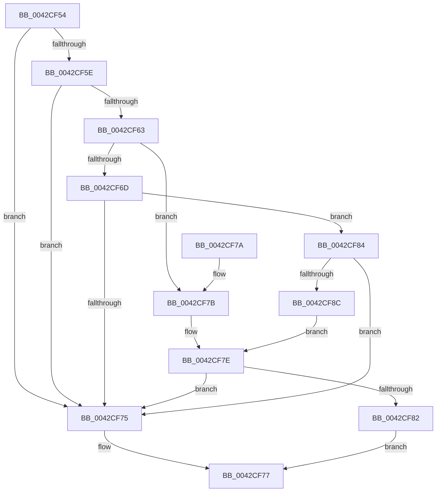

# PpmGetPerfPolicyClass

- RVA: `0x0042CF54`–`0x0042CF95` (길이 `65` bytes)
- VA: `0x000000014042CF54`
- 실행 섹션: `.text`
- PDB 이름 있음: `예`; PDB Function 태그: `아니요`
- unwind 정보 RVA: `0x000DB714`
- 디코드: `24`개 명령, `65/65` bytes 표시
- 미해석 바이트: `0` (있으면 어셈블리에 `.byte`로 보존)

> 이 문서는 커널 이미지의 기계어와 PDB 기호를 분석해 생성했습니다. 4번과 5번은 함수 원형과 자료형을 바이너리 사용 방식에서 추정한 C 해석이며 원본 소스 복구 결과는 아닙니다.

## 1. Dependencies

- 직접 호출 지점: **0**; 고유 호출 대상: **0**
- 직접 호출자로 확인된 함수: **5**
- RIP 상대 이미지 참조: **2**

### Outgoing calls
- 직접 디코드된 call 명령이 없습니다.

### Direct callers
- [PpmPerfApplyDomainState](../2C/PpmPerfApplyDomainState_function_002CD470.md) at `0x002CD502`
- [PpmPerfCalculateQosClassPolicies](PpmPerfCalculateQosClassPolicies_function_0042BFC8.md) at `0x0042C007`
- [PpmPerfApplyLatencyHint](PpmPerfApplyLatencyHint_function_0042C8EC.md) at `0x0042C922`
- [PpmPerfSelectProcessorState](PpmPerfSelectProcessorState_function_0042CA78.md) at `0x0042CB04`
- [PpmPerfResizeHistory](../../page/AA/PpmPerfResizeHistory_function_00AAF9C8.md) at `0x00AAF9E1`

### Static image references
- `0x0042CF65` → RVA `0x00E0B800` (`.data`; read)
- `0x0042CF6D` → RVA `0x00FC6B6E` (`ALMOSTRO`; read)

## 2. Other-region calls and transfers

- 다른 실행 섹션으로 향하는 call: **0**
- 별도 외부 분기/꼬리 이동을 확인하지 못했습니다.

## 3. Assembly (complete function range)

```asm
0042CF54  33 C0                           xor eax, eax
0042CF56  48 8B D1                        mov rdx, rcx
0042CF59  48 85 C9                        test rcx, rcx
0042CF5C  74 17                           je 0x14042cf75
0042CF5E  38 41 44                        cmp byte ptr [rcx + 0x44], al
0042CF61  74 12                           je 0x14042cf75
0042CF63  B1 01                           mov cl, 1
0042CF65  38 0D 95 E8 9D 00               cmp byte ptr [rip + 0x9de895], cl
0042CF6B  77 0E                           ja 0x14042cf7b
0042CF6D  38 0D FB 9B B9 00               cmp byte ptr [rip + 0xb99bfb], cl
0042CF73  77 0F                           ja 0x14042cf84
0042CF75  8A C8                           mov cl, al
0042CF77  8A C1                           mov al, cl
0042CF79  C3                              ret
0042CF7A  CC                              int3
0042CF7B  8A 42 58                        mov al, byte ptr [rdx + 0x58]
0042CF7E  3A C1                           cmp al, cl
0042CF80  72 F3                           jb 0x14042cf75
0042CF82  EB F3                           jmp 0x14042cf77
0042CF84  4C 8B 02                        mov r8, qword ptr [rdx]
0042CF87  4D 85 C0                        test r8, r8
0042CF8A  74 E9                           je 0x14042cf75
0042CF8C  41 8A 80 2D 01 00 00            mov al, byte ptr [r8 + 0x12d]
0042CF93  EB E9                           jmp 0x14042cf7e
```

## 4. C-style interpretation (structured pseudocode)

```c
__int64 __fastcall PpmGetPerfPolicyClass(__int64 a1)
{
    __int64 result;

    result = 0;
    if (a1 == 0) goto loc_0042CF75;
    if ((*(unsigned __int8 *)(a1 + 68)) == 0) goto loc_0042CF75;
    if ((*(unsigned __int8 *)(v_rip + 10348693)) > 1) goto loc_0042CF7B;
    if ((*(unsigned __int8 *)(v_rip + 12164091)) > 1) goto loc_0042CF84;
loc_0042CF75:
loc_0042CF77:
    return 0;
loc_0042CF7B:
loc_0042CF7E:
    if (((unsigned __int8)(*(unsigned __int8 *)(a1 + 88))) < 0) goto loc_0042CF75;
    goto loc_0042CF77;
loc_0042CF84:
    if (*(unsigned __int64 *)(a1) == 0) goto loc_0042CF75;
    goto loc_0042CF7E;
}
```

## 5. (Beta) C Style

```c
int64_t PpmGetPerfPolicyClass(void *Arg1)
{
    uint8_t *arg1 = (uint8_t *)Arg1;

    int64_t result;

    result = 0;
    if (Arg1 == NULL) goto loc_0042CF75;
    if ((*(uint8_t *)(arg1 + 0x44)) == 0) goto loc_0042CF75;
    if ((*(uint8_t *)(v_rip + 0x9DE895)) > 1) goto loc_0042CF7B;
    if ((*(uint8_t *)(v_rip + 0xB99BFB)) > 1) goto loc_0042CF84;
loc_0042CF75:
loc_0042CF77:
    return 0;
loc_0042CF7B:
loc_0042CF7E:
    if (((uint8_t)(*(uint8_t *)(arg1 + 0x58))) < 0) goto loc_0042CF75;
    goto loc_0042CF77;
loc_0042CF84:
    if (*(uint64_t *)(arg1) == 0) goto loc_0042CF75;
    goto loc_0042CF7E;
}
```

### 관측된 메모리 오프셋

구조체 형식이 확인되지 않은 접근은 인자 기준의 오프셋으로만 기록했습니다.

| 기준 인자 | 오프셋 표현 | 폭 (bit) | 접근 |
|---|---:|---:|---|
| `Arg1` | `+ 0x0` | `64` | `R` |
| `Arg1` | `+ 0x58` | `8` | `R` |

## 6. Execution-region graph

[열기: 2D/3D 그래프와 함수 탐색 컨트롤 패널](../../../control-panel.html?section=text&rva=0x0042CF54&view=graph)

- 2D 그래프는 위에서 아래로 흐르고, 3D 그래프는 빈 공간을 드래그해 회전합니다. Shift+드래그는 이동, 휠은 확대·축소, 함수 노드 선택은 대상 보고서 이동입니다.

### Static fallback


