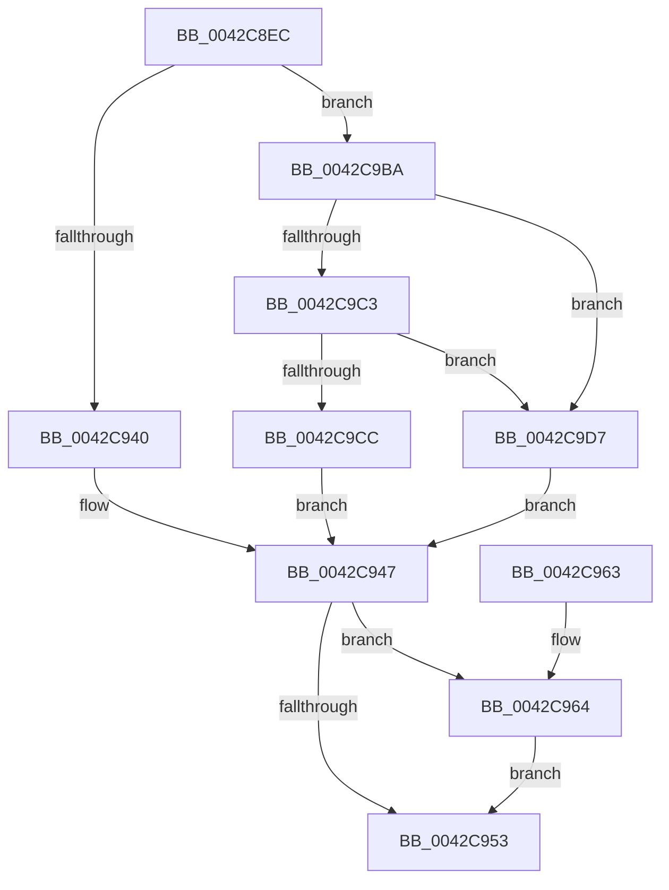

# PpmPerfApplyLatencyHint

- RVA: `0x0042C8EC`–`0x0042C9E0` (길이 `244` bytes)
- VA: `0x000000014042C8EC`
- 실행 섹션: `.text`
- PDB 이름 있음: `예`; PDB Function 태그: `아니요`
- unwind 정보 RVA: `0x000A198C`
- 디코드: `55`개 명령, `244/244` bytes 표시
- 미해석 바이트: `0` (있으면 어셈블리에 `.byte`로 보존)

> 이 문서는 커널 이미지의 기계어와 PDB 기호를 분석해 생성했습니다. 4번과 5번은 함수 원형과 자료형을 바이너리 사용 방식에서 추정한 C 해석이며 원본 소스 복구 결과는 아닙니다.

## 1. Dependencies

- 직접 호출 지점: **2**; 고유 호출 대상: **2**
- 직접 호출자로 확인된 함수: **1**
- RIP 상대 이미지 참조: **3**

### Outgoing calls
- `0x0042C922` → [PpmGetPerfPolicyClass](PpmGetPerfPolicyClass_function_0042CF54.md) (function, `0x0042CF54`)
- `0x0042C9B0` → [guard_dispatch_icall](../6B/guard_dispatch_icall_function_006BAAD0.md) (function, `0x006BAAD0`)

### Direct callers
- [PpmPerfApplyLatencyHints](PpmPerfApplyLatencyHints_function_0042C870.md) at `0x0042C8D1`

### Static image references
- `0x0042C8FB` → RVA `0x00E08380` (`.data`; read)
- `0x0042C902` → RVA `0x00F0CE0C` (`.data`; read)
- `0x0042C9C3` → RVA `0x00FC6CC8` (`ALMOSTRO`; read)

## 2. Other-region calls and transfers

- 다른 실행 섹션으로 향하는 call: **0**
- 별도 외부 분기/꼬리 이동을 확인하지 못했습니다.

## 3. Assembly (complete function range)

```asm
0042C8EC  48 89 5C 24 08                  mov qword ptr [rsp + 8], rbx
0042C8F1  48 89 74 24 10                  mov qword ptr [rsp + 0x10], rsi
0042C8F6  57                              push rdi
0042C8F7  48 83 EC 60                     sub rsp, 0x60
0042C8FB  4C 8B 05 7E BA 9D 00            mov r8, qword ptr [rip + 0x9dba7e]
0042C902  48 63 05 03 05 AE 00            movsxd rax, dword ptr [rip + 0xae0503]
0042C909  48 8B 59 08                     mov rbx, qword ptr [rcx + 8]
0042C90D  4C 8B 19                        mov r11, qword ptr [rcx]
0042C910  48 69 F8 E8 01 00 00            imul rdi, rax, 0x1e8
0042C917  48 8B 73 08                     mov rsi, qword ptr [rbx + 8]
0042C91B  49 03 F8                        add rdi, r8
0042C91E  44 8B 4F 70                     mov r9d, dword ptr [rdi + 0x70]
0042C922  E8 2D 06 00 00                  call 0x14042cf54
0042C927  0F B6 C8                        movzx ecx, al
0042C92A  45 33 C0                        xor r8d, r8d
0042C92D  41 8D 41 FF                     lea eax, [r9 - 1]
0042C931  0F B6 94 39 85 00 00 00         movzx edx, byte ptr [rcx + rdi + 0x85]
0042C939  A9 FD FF FF FF                  test eax, 0xfffffffd
0042C93E  75 7A                           jne 0x14042c9ba
0042C940  45 8B 8B C4 01 00 00            mov r9d, dword ptr [r11 + 0x1c4]
0042C947  41 3B D1                        cmp edx, r9d
0042C94A  41 0F 43 D1                     cmovae edx, r9d
0042C94E  3B 53 38                        cmp edx, dword ptr [rbx + 0x38]
0042C951  77 11                           ja 0x14042c964
0042C953  48 8B 5C 24 70                  mov rbx, qword ptr [rsp + 0x70]
0042C958  48 8B 74 24 78                  mov rsi, qword ptr [rsp + 0x78]
0042C95D  48 83 C4 60                     add rsp, 0x60
0042C961  5F                              pop rdi
0042C962  C3                              ret
0042C963  CC                              int3
0042C964  44 0F B6 94 39 D7 00 00 00      movzx r10d, byte ptr [rcx + rdi + 0xd7]
0042C96D  49 8B 83 78 01 00 00            mov rax, qword ptr [r11 + 0x178]
0042C974  4C 89 44 24 50                  mov qword ptr [rsp + 0x50], r8
0042C979  4C 89 44 24 48                  mov qword ptr [rsp + 0x48], r8
0042C97E  4C 89 44 24 40                  mov qword ptr [rsp + 0x40], r8
0042C983  45 8B 83 CC 01 00 00            mov r8d, dword ptr [r11 + 0x1cc]
0042C98A  C7 44 24 38 01 00 00 00         mov dword ptr [rsp + 0x38], 1
0042C992  44 89 54 24 30                  mov dword ptr [rsp + 0x30], r10d
0042C997  44 8B 97 80 00 00 00            mov r10d, dword ptr [rdi + 0x80]
0042C99E  44 89 54 24 28                  mov dword ptr [rsp + 0x28], r10d
0042C9A3  44 8B 54 8F 78                  mov r10d, dword ptr [rdi + rcx*4 + 0x78]
0042C9A8  48 8B CE                        mov rcx, rsi
0042C9AB  44 89 54 24 20                  mov dword ptr [rsp + 0x20], r10d
0042C9B0  E8 1B E1 28 00                  call 0x1406baad0
0042C9B5  89 43 38                        mov dword ptr [rbx + 0x38], eax
0042C9B8  EB 99                           jmp 0x14042c953
0042C9BA  41 8D 41 FB                     lea eax, [r9 - 5]
0042C9BE  83 F8 01                        cmp eax, 1
0042C9C1  76 14                           jbe 0x14042c9d7
0042C9C3  44 39 05 FE A2 B9 00            cmp dword ptr [rip + 0xb9a2fe], r8d
0042C9CA  75 0B                           jne 0x14042c9d7
0042C9CC  41 B9 64 00 00 00               mov r9d, 0x64
0042C9D2  E9 70 FF FF FF                  jmp 0x14042c947
0042C9D7  44 8B 4B 18                     mov r9d, dword ptr [rbx + 0x18]
0042C9DB  E9 67 FF FF FF                  jmp 0x14042c947
```

## 4. C-style interpretation (structured pseudocode)

```c
__int64 __fastcall PpmPerfApplyLatencyHint(__int64 a1)
{
    __int64 result;
    __int64 v_rdi;
    __int64 v_rsp;
    unsigned __int64 v_stack_p10;
    unsigned int v_stack_p20;
    unsigned int v_stack_p28;
    unsigned int v_stack_p30;
    unsigned int v_stack_p38;
    unsigned __int64 v_stack_p40;
    unsigned __int64 v_stack_p48;
    unsigned __int64 v_stack_p50;
    unsigned __int64 v_stack_p8;

    v_stack_p8 = v_rbx;
    v_stack_p10 = v_rsi;
    v_rsp = (v_rsp) - (96);
    v_rdi = (v_rdi) * ((int)(*(unsigned int *)(v_rip + 11404547)));
    v_rdi = (v_rdi) + (*(unsigned __int64 *)(v_rip + 10336894));
    result = PpmGetPerfPolicyClass(a1, a2, *(unsigned __int64 *)(v_rip + 10336894), (unsigned int)(*(unsigned int *)(v_rdi + 112)));
    a3 = 0;
    if ((((unsigned int)((unsigned int)(*(unsigned int *)(v_rdi + 112)) - 1)) & (0xFFFFFFFDULL)) != 0) goto loc_0042C9BA;
loc_0042C947:
    a2 = *(unsigned __int8 *)((unsigned __int8)(result) + v_rdi * 1 + 133);
    if (((unsigned int)(*(unsigned __int8 *)((unsigned __int8)(result) + v_rdi * 1 + 133))) >= ((unsigned int)((unsigned int)(*(unsigned int *)(*(unsigned __int64 *)(a1) + 452))))) { a2 = (unsigned int)((unsigned int)(*(unsigned int *)(*(unsigned __int64 *)(a1) + 452))); }
    if (((unsigned int)(a2)) > (*(unsigned int *)(*(unsigned __int64 *)(a1 + 8) + 56))) goto loc_0042C964;
loc_0042C953:
    v_rsp = (v_rsp) + (96);
    return (unsigned int)(*(unsigned int *)(v_rdi + 112)) - 1;
loc_0042C964:
    v_stack_p50 = 0;
    v_stack_p48 = 0;
    v_stack_p40 = 0;
    v_stack_p38 = 1;
    v_stack_p30 = (unsigned int)(*(unsigned __int8 *)((unsigned __int8)(result) + v_rdi * 1 + 215));
    v_stack_p28 = (unsigned int)((unsigned int)(*(unsigned int *)(v_rdi + 128)));
    v_stack_p20 = (unsigned int)((unsigned int)(*(unsigned int *)(v_rdi + (unsigned __int8)(result) * 4 + 120)));
    result = guard_dispatch_icall(v_stack_p10, a2, (unsigned int)(*(unsigned int *)(*(unsigned __int64 *)(a1) + 460)), (unsigned int)(*(unsigned int *)(*(unsigned __int64 *)(a1) + 452)));
    *(unsigned int *)(v_stack_p8 + 56) = (unsigned int)(result);
    goto loc_0042C953;
loc_0042C9BA:
    if (((unsigned int)((unsigned int)(*(unsigned int *)(*(unsigned __int64 *)(a1) + 452)) - 5)) <= 1) goto loc_0042C9D7;
    if ((*(unsigned int *)(v_rip + 12165886)) != ((unsigned int)((unsigned int)(*(unsigned int *)(*(unsigned __int64 *)(a1) + 460))))) goto loc_0042C9D7;
    goto loc_0042C947;
loc_0042C9D7:
    goto loc_0042C947;
}
```

## 5. (Beta) C Style

```c
int64_t PpmPerfApplyLatencyHint(void *Arg1)
{
    uint8_t *arg1 = (uint8_t *)Arg1;

    int64_t result;
    int64_t local_rdi;
    int64_t local_rsp;
    uint64_t v_stack_p10;
    uint32_t v_stack_p20;
    uint32_t v_stack_p28;
    uint32_t v_stack_p30;
    uint32_t v_stack_p38;
    uint64_t v_stack_p40;
    uint64_t v_stack_p48;
    uint64_t v_stack_p50;
    uint64_t v_stack_p8;

    v_stack_p8 = local_rbx;
    v_stack_p10 = local_rsi;
    local_rsp = (local_rsp) - (96);
    local_rdi = (local_rdi) * ((int32_t)(*(uint32_t *)(v_rip + 0xAE0503)));
    local_rdi = (local_rdi) + (*(uint64_t *)(v_rip + 0x9DBA7E));
    result = PpmGetPerfPolicyClass(Arg1, a2, *(uint64_t *)(v_rip + 0x9DBA7E), (uint32_t)(*(uint32_t *)(local_rdi + 0x70)));
    a3 = 0;
    if ((((uint32_t)((uint32_t)(*(uint32_t *)(local_rdi + 0x70)) - 1)) & (0xFFFFFFFDULL)) != 0) goto loc_0042C9BA;
loc_0042C947:
    a2 = *(uint8_t *)((uint8_t)(result) + local_rdi * 1 + 0x85);
    if (((uint32_t)(*(uint8_t *)((uint8_t)(result) + local_rdi * 1 + 0x85))) >= ((uint32_t)((uint32_t)(*(uint32_t *)(*(uint64_t *)(arg1) + 0x1C4))))) { a2 = (uint32_t)((uint32_t)(*(uint32_t *)(*(uint64_t *)(arg1) + 0x1C4))); }
    if (((uint32_t)(a2)) > (*(uint32_t *)(*(uint64_t *)(arg1 + 0x8) + 0x38))) goto loc_0042C964;
loc_0042C953:
    local_rsp = (local_rsp) + (96);
    return (uint32_t)(*(uint32_t *)(local_rdi + 0x70)) - 1;
loc_0042C964:
    v_stack_p50 = 0;
    v_stack_p48 = 0;
    v_stack_p40 = 0;
    v_stack_p38 = 1;
    v_stack_p30 = (uint32_t)(*(uint8_t *)((uint8_t)(result) + local_rdi * 1 + 0xD7));
    v_stack_p28 = (uint32_t)((uint32_t)(*(uint32_t *)(local_rdi + 0x80)));
    v_stack_p20 = (uint32_t)((uint32_t)(*(uint32_t *)(local_rdi + (uint8_t)(result) * 4 + 0x78)));
    result = guard_dispatch_icall(v_stack_p10, a2, (uint32_t)(*(uint32_t *)(*(uint64_t *)(arg1) + 0x1CC)), (uint32_t)(*(uint32_t *)(*(uint64_t *)(arg1) + 0x1C4)));
    *(uint32_t *)(v_stack_p8 + 0x38) = (uint32_t)(result);
    goto loc_0042C953;
loc_0042C9BA:
    if (((uint32_t)((uint32_t)(*(uint32_t *)(*(uint64_t *)(arg1) + 0x1C4)) - 5)) <= 1) goto loc_0042C9D7;
    if ((*(uint32_t *)(v_rip + 0xB9A2FE)) != ((uint32_t)((uint32_t)(*(uint32_t *)(*(uint64_t *)(arg1) + 0x1CC))))) goto loc_0042C9D7;
    goto loc_0042C947;
loc_0042C9D7:
    goto loc_0042C947;
}
```

### 관측된 메모리 오프셋

구조체 형식이 확인되지 않은 접근은 인자 기준의 오프셋으로만 기록했습니다.

| 기준 인자 | 오프셋 표현 | 폭 (bit) | 접근 |
|---|---:|---:|---|
| `Arg1` | `+ 0x0` | `64` | `R` |
| `Arg1` | `+ 0x8` | `64` | `R` |

## 6. Execution-region graph

[열기: 2D/3D 그래프와 함수 탐색 컨트롤 패널](../../../control-panel.html?section=text&rva=0x0042C8EC&view=graph)

- 2D 그래프는 위에서 아래로 흐르고, 3D 그래프는 빈 공간을 드래그해 회전합니다. Shift+드래그는 이동, 휠은 확대·축소, 함수 노드 선택은 대상 보고서 이동입니다.

### Static fallback


