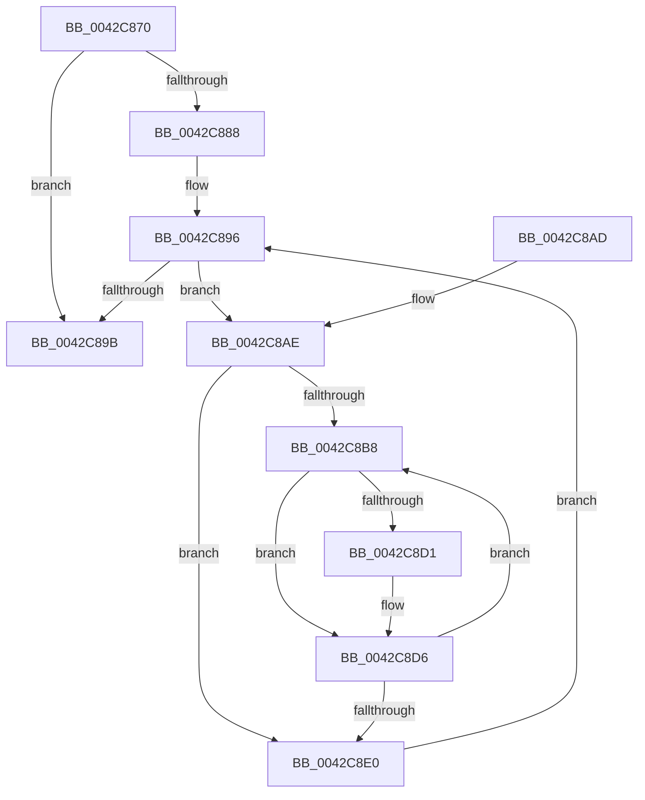

# PpmPerfApplyLatencyHints

- RVA: `0x0042C870`–`0x0042C8E5` (길이 `117` bytes)
- VA: `0x000000014042C870`
- 실행 섹션: `.text`
- PDB 이름 있음: `예`; PDB Function 태그: `아니요`
- unwind 정보 RVA: `0x00064CD0`
- 디코드: `32`개 명령, `117/117` bytes 표시
- 미해석 바이트: `0` (있으면 어셈블리에 `.byte`로 보존)

> 이 문서는 커널 이미지의 기계어와 PDB 기호를 분석해 생성했습니다. 4번과 5번은 함수 원형과 자료형을 바이너리 사용 방식에서 추정한 C 해석이며 원본 소스 복구 결과는 아닙니다.

## 1. Dependencies

- 직접 호출 지점: **1**; 고유 호출 대상: **1**
- 직접 호출자로 확인된 함수: **0**
- RIP 상대 이미지 참조: **2**

### Outgoing calls
- `0x0042C8D1` → [PpmPerfApplyLatencyHint](PpmPerfApplyLatencyHint_function_0042C8EC.md) (function, `0x0042C8EC`)

### Direct callers
- 이 함수 시작 RVA로 연결되는 직접 call은 확인되지 않았습니다. 간접 호출은 완전히 역산할 수 없습니다.

### Static image references
- `0x0042C87F` → RVA `0x00F0B24C` (`.data`; read)
- `0x0042C888` → RVA `0x00FC6BA8` (`ALMOSTRO`; read)

## 2. Other-region calls and transfers

- 다른 실행 섹션으로 향하는 call: **0**
- 별도 외부 분기/꼬리 이동을 확인하지 못했습니다.

## 3. Assembly (complete function range)

```asm
0042C870  48 89 5C 24 08                  mov qword ptr [rsp + 8], rbx
0042C875  48 89 74 24 10                  mov qword ptr [rsp + 0x10], rsi
0042C87A  57                              push rdi
0042C87B  48 83 EC 20                     sub rsp, 0x20
0042C87F  83 3D C6 E9 AD 00 00            cmp dword ptr [rip + 0xade9c6], 0
0042C886  74 13                           je 0x14042c89b
0042C888  48 8B 1D 19 A3 B9 00            mov rbx, qword ptr [rip + 0xb9a319]
0042C88F  48 8D 35 12 A3 B9 00            lea rsi, [rip + 0xb9a312]
0042C896  48 3B DE                        cmp rbx, rsi
0042C899  75 13                           jne 0x14042c8ae
0042C89B  48 8B 5C 24 30                  mov rbx, qword ptr [rsp + 0x30]
0042C8A0  B0 01                           mov al, 1
0042C8A2  48 8B 74 24 38                  mov rsi, qword ptr [rsp + 0x38]
0042C8A7  48 83 C4 20                     add rsp, 0x20
0042C8AB  5F                              pop rdi
0042C8AC  C3                              ret
0042C8AD  CC                              int3
0042C8AE  33 FF                           xor edi, edi
0042C8B0  39 BB 28 01 00 00               cmp dword ptr [rbx + 0x128], edi
0042C8B6  76 28                           jbe 0x14042c8e0
0042C8B8  8B C7                           mov eax, edi
0042C8BA  48 69 C8 A8 04 00 00            imul rcx, rax, 0x4a8
0042C8C1  48 8B 83 38 01 00 00            mov rax, qword ptr [rbx + 0x138]
0042C8C8  48 8B 0C 01                     mov rcx, qword ptr [rcx + rax]
0042C8CC  48 85 C9                        test rcx, rcx
0042C8CF  74 05                           je 0x14042c8d6
0042C8D1  E8 16 00 00 00                  call 0x14042c8ec
0042C8D6  FF C7                           inc edi
0042C8D8  3B BB 28 01 00 00               cmp edi, dword ptr [rbx + 0x128]
0042C8DE  72 D8                           jb 0x14042c8b8
0042C8E0  48 8B 1B                        mov rbx, qword ptr [rbx]
0042C8E3  EB B1                           jmp 0x14042c896
```

## 4. C-style interpretation (structured pseudocode)

```c
__int64 __fastcall PpmPerfApplyLatencyHints(void)
{
    __int64 result;
    __int64 v_rdi;
    __int64 v_rsp;
    unsigned __int64 v_stack_p10;
    unsigned __int64 v_stack_p8;

    v_stack_p8 = v_rbx;
    v_stack_p10 = v_rsi;
    v_rsp = (v_rsp) - (32);
    if ((*(unsigned int *)(v_rip + 11397574)) == 0) goto loc_0042C89B;
loc_0042C896:
    if ((*(unsigned __int64 *)(v_rip + 12165913)) != (v_rip + 12165906)) goto loc_0042C8AE;
loc_0042C89B:
    v_rsp = (v_rsp) + (32);
    return 1;
loc_0042C8AE:
    v_rdi = 0;
    if ((*(unsigned int *)(v_stack_p8 + 296)) <= 0) goto loc_0042C8E0;
loc_0042C8B8:
    a1 = (a1) * (0);
    result = *(unsigned __int64 *)(v_stack_p8 + 312);
    if (*(unsigned __int64 *)(a1 + *(unsigned __int64 *)(v_stack_p8 + 312) * 1) != 0) {
        result = PpmPerfApplyLatencyHint(*(unsigned __int64 *)(a1 + *(unsigned __int64 *)(v_stack_p8 + 312) * 1), a2, a3, a4);
    }
    v_rdi = (unsigned int)((v_rdi) + 1);
    if (((unsigned int)(v_rdi)) < (*(unsigned int *)(v_stack_p8 + 296))) goto loc_0042C8B8;
loc_0042C8E0:
    goto loc_0042C896;
}
```

## 5. (Beta) C Style

```c
void PpmPerfApplyLatencyHints(void)
{
    int64_t result;
    int64_t local_rdi;
    int64_t local_rsp;
    uint64_t v_stack_p10;
    uint64_t v_stack_p8;

    v_stack_p8 = local_rbx;
    v_stack_p10 = local_rsi;
    local_rsp = (local_rsp) - (32);
    if ((*(uint32_t *)(v_rip + 0xADE9C6)) == 0) goto loc_0042C89B;
loc_0042C896:
    if ((*(uint64_t *)(v_rip + 0xB9A319)) != (v_rip + 12165906)) goto loc_0042C8AE;
loc_0042C89B:
    local_rsp = (local_rsp) + (32);
    return 1;
loc_0042C8AE:
    local_rdi = 0;
    if ((*(uint32_t *)(v_stack_p8 + 0x128)) <= 0) goto loc_0042C8E0;
loc_0042C8B8:
    a1 = (a1) * (0);
    result = *(uint64_t *)(v_stack_p8 + 0x138);
    if (*(uint64_t *)(a1 + *(uint64_t *)(v_stack_p8 + 0x138) * 1) != 0) {
        result = PpmPerfApplyLatencyHint(*(uint64_t *)(a1 + *(uint64_t *)(v_stack_p8 + 0x138) * 1), a2, a3, a4);
    }
    local_rdi = (uint32_t)((local_rdi) + 1);
    if (((uint32_t)(local_rdi)) < (*(uint32_t *)(v_stack_p8 + 0x128))) goto loc_0042C8B8;
loc_0042C8E0:
    goto loc_0042C896;
}
```

## 6. Execution-region graph

[열기: 2D/3D 그래프와 함수 탐색 컨트롤 패널](../../../control-panel.html?section=text&rva=0x0042C870&view=graph)

- 2D 그래프는 위에서 아래로 흐르고, 3D 그래프는 빈 공간을 드래그해 회전합니다. Shift+드래그는 이동, 휠은 확대·축소, 함수 노드 선택은 대상 보고서 이동입니다.

### Static fallback


