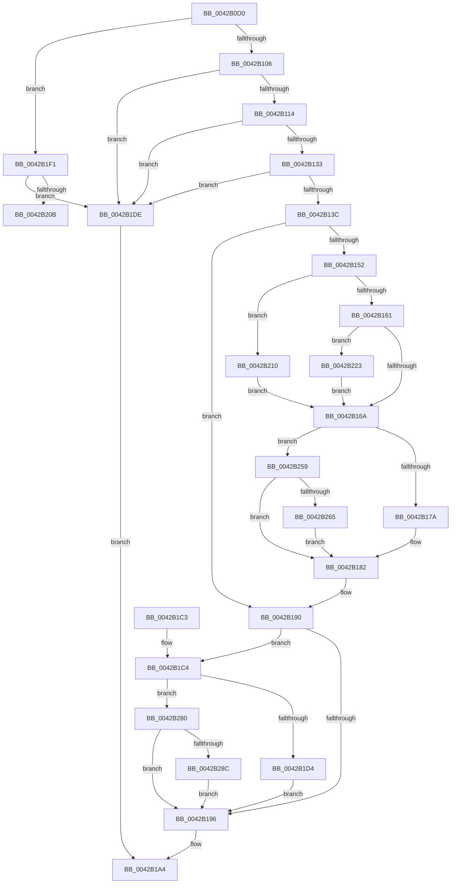

# PpmRegisterPerfCap

- RVA: `0x0042B0D0`–`0x0042B2A7` (길이 `471` bytes)
- VA: `0x000000014042B0D0`
- 실행 섹션: `.text`
- PDB 이름 있음: `예`; PDB Function 태그: `예`
- unwind 정보 RVA: `0x000A1678`
- 디코드: `113`개 명령, `471/471` bytes 표시
- 미해석 바이트: `0` (있으면 어셈블리에 `.byte`로 보존)

> 이 문서는 커널 이미지의 기계어와 PDB 기호를 분석해 생성했습니다. 4번과 5번은 함수 원형과 자료형을 바이너리 사용 방식에서 추정한 C 해석이며 원본 소스 복구 결과는 아닙니다.

## 1. Dependencies

- 직접 호출 지점: **10**; 고유 호출 대상: **10**
- 직접 호출자로 확인된 함수: **0**
- RIP 상대 이미지 참조: **2**

### Outgoing calls
- `0x0042B0F6` → [PpmAcquireLock](../2D/PpmAcquireLock_function_002D9AA4.md) (function, `0x002D9AA4`)
- `0x0042B117` → [KeGetPrcb](../2D/KeGetPrcb_function_002D85D0.md) (function, `0x002D85D0`)
- `0x0042B17D` → [PpmEventBiosCapChange](PpmEventBiosCapChange_function_0042B5EC.md) (function, `0x0042B5EC`)
- `0x0042B18B` → [PopDiagTraceProcessorThrottlePerfTrack](PopDiagTraceProcessorThrottlePerfTrack_function_0042B2B0.md) (function, `0x0042B2B0`)
- `0x0042B19F` → [PpmCheckApplyPerfConstraints](../../page/A9/PpmCheckApplyPerfConstraints_function_00A971EC.md) (function, `0x00A971EC`)
- `0x0042B1D7` → [PpmEventThermalCapChange](PpmEventThermalCapChange_function_0042B6E4.md) (function, `0x0042B6E4`)
- `0x0042B1EA` → [PpmReleaseLock](../2D/PpmReleaseLock_function_002DA428.md) (function, `0x002DA428`)
- `0x0042B24B` → [PopDiagTraceProcessorThrottleDurationPerfTrack](../5D/PopDiagTraceProcessorThrottleDurationPerfTrack_function_005D6DB8.md) (function, `0x005D6DB8`)
- `0x0042B276` → [PpmEventHiddenProcessorBiosCapChange](../5D/PpmEventHiddenProcessorBiosCapChange_function_005DAC1C.md) (function, `0x005DAC1C`)
- `0x0042B29D` → [PpmEventHiddenProcessorThermalCapChange](../5D/PpmEventHiddenProcessorThermalCapChange_function_005DAD1C.md) (function, `0x005DAD1C`)

### Direct callers
- 이 함수 시작 RVA로 연결되는 직접 call은 확인되지 않았습니다. 간접 호출은 완전히 역산할 수 없습니다.

### Static image references
- `0x0042B0EF` → RVA `0x00F0CC00` (`.data`; read)
- `0x0042B1F1` → RVA `0x00FC6BA8` (`ALMOSTRO`; read)

## 2. Other-region calls and transfers

- 다른 실행 섹션으로 향하는 call: **1**
  - `0x0042B19F` → [PpmCheckApplyPerfConstraints](../../page/A9/PpmCheckApplyPerfConstraints_function_00A971EC.md) (`.text` → `PAGE`)
- call이 아닌 외부 분기/꼬리 이동: **1**
  - `0x0042B20B` → [sub_006EE318](../6E/Unknown_function_006EE318.md) (`tail-transfer`)

## 3. Assembly (complete function range)

```asm
0042B0D0  48 89 5C 24 08                  mov qword ptr [rsp + 8], rbx
0042B0D5  48 89 6C 24 10                  mov qword ptr [rsp + 0x10], rbp
0042B0DA  48 89 74 24 18                  mov qword ptr [rsp + 0x18], rsi
0042B0DF  57                              push rdi
0042B0E0  41 54                           push r12
0042B0E2  41 55                           push r13
0042B0E4  41 56                           push r14
0042B0E6  41 57                           push r15
0042B0E8  48 83 EC 20                     sub rsp, 0x20
0042B0EC  48 8B E9                        mov rbp, rcx
0042B0EF  48 8D 0D 0A 1B AE 00            lea rcx, [rip + 0xae1b0a]
0042B0F6  E8 A9 E9 EA FF                  call 0x1402d9aa4
0042B0FB  33 DB                           xor ebx, ebx
0042B0FD  39 5D 14                        cmp dword ptr [rbp + 0x14], ebx
0042B100  0F 85 EB 00 00 00               jne 0x14042b1f1
0042B106  44 8B 6D 04                     mov r13d, dword ptr [rbp + 4]
0042B10A  41 83 FD FF                     cmp r13d, -1
0042B10E  0F 84 CA 00 00 00               je 0x14042b1de
0042B114  41 8B CD                        mov ecx, r13d
0042B117  E8 B4 D4 EA FF                  call 0x1402d85d0
0042B11C  48 8B B8 B8 89 00 00            mov rdi, qword ptr [rax + 0x89b8]
0042B123  48 8B B0 B0 89 00 00            mov rsi, qword ptr [rax + 0x89b0]
0042B12A  48 85 F6                        test rsi, rsi
0042B12D  0F 84 AB 00 00 00               je 0x14042b1de
0042B133  48 85 FF                        test rdi, rdi
0042B136  0F 84 A2 00 00 00               je 0x14042b1de
0042B13C  44 8B 75 08                     mov r14d, dword ptr [rbp + 8]
0042B140  8B 45 10                        mov eax, dword ptr [rbp + 0x10]
0042B143  44 8B 65 0C                     mov r12d, dword ptr [rbp + 0xc]
0042B147  89 47 20                        mov dword ptr [rdi + 0x20], eax
0042B14A  8B 47 18                        mov eax, dword ptr [rdi + 0x18]
0042B14D  41 3B C6                        cmp eax, r14d
0042B150  74 3E                           je 0x14042b190
0042B152  41 BF 64 00 00 00               mov r15d, 0x64
0042B158  41 3B C7                        cmp eax, r15d
0042B15B  0F 84 AF 00 00 00               je 0x14042b210
0042B161  45 3B F7                        cmp r14d, r15d
0042B164  0F 84 B9 00 00 00               je 0x14042b223
0042B16A  48 8B 0F                        mov rcx, qword ptr [rdi]
0042B16D  44 89 77 18                     mov dword ptr [rdi + 0x18], r14d
0042B171  48 85 C9                        test rcx, rcx
0042B174  0F 84 DF 00 00 00               je 0x14042b259
0042B17A  41 8B D6                        mov edx, r14d
0042B17D  E8 6A 04 00 00                  call 0x14042b5ec
0042B182  45 2B FE                        sub r15d, r14d
0042B185  41 8B D5                        mov edx, r13d
0042B188  41 8B CF                        mov ecx, r15d
0042B18B  E8 20 01 00 00                  call 0x14042b2b0
0042B190  44 39 67 1C                     cmp dword ptr [rdi + 0x1c], r12d
0042B194  75 2E                           jne 0x14042b1c4
0042B196  33 C9                           xor ecx, ecx
0042B198  C6 86 BD 04 00 00 01            mov byte ptr [rsi + 0x4bd], 1
0042B19F  E8 48 C0 66 00                  call 0x140a971ec
0042B1A4  48 8B 6C 24 58                  mov rbp, qword ptr [rsp + 0x58]
0042B1A9  8B C3                           mov eax, ebx
0042B1AB  48 8B 5C 24 50                  mov rbx, qword ptr [rsp + 0x50]
0042B1B0  48 8B 74 24 60                  mov rsi, qword ptr [rsp + 0x60]
0042B1B5  48 83 C4 20                     add rsp, 0x20
0042B1B9  41 5F                           pop r15
0042B1BB  41 5E                           pop r14
0042B1BD  41 5D                           pop r13
0042B1BF  41 5C                           pop r12
0042B1C1  5F                              pop rdi
0042B1C2  C3                              ret
0042B1C3  CC                              int3
0042B1C4  48 8B 0F                        mov rcx, qword ptr [rdi]
0042B1C7  44 89 67 1C                     mov dword ptr [rdi + 0x1c], r12d
0042B1CB  48 85 C9                        test rcx, rcx
0042B1CE  0F 84 AC 00 00 00               je 0x14042b280
0042B1D4  41 8B D4                        mov edx, r12d
0042B1D7  E8 08 05 00 00                  call 0x14042b6e4
0042B1DC  EB B8                           jmp 0x14042b196
0042B1DE  BB 0D 00 00 C0                  mov ebx, 0xc000000d
0042B1E3  48 8D 0D 16 1A AE 00            lea rcx, [rip + 0xae1a16]
0042B1EA  E8 39 F2 EA FF                  call 0x1402da428
0042B1EF  EB B3                           jmp 0x14042b1a4
0042B1F1  48 8B 15 B0 B9 B9 00            mov rdx, qword ptr [rip + 0xb9b9b0]
0042B1F8  4C 8D 1D A9 B9 B9 00            lea r11, [rip + 0xb9b9a9]
0042B1FF  41 83 CD FF                     or r13d, 0xffffffff
0042B203  48 8B FB                        mov rdi, rbx
0042B206  49 3B D3                        cmp rdx, r11
0042B209  74 D3                           je 0x14042b1de
0042B20B  E9 08 31 2C 00                  jmp 0x1406ee318
0042B210  48 A1 08 00 00 00 80 F7 FF FF   movabs rax, qword ptr [0xfffff78000000008]
0042B21A  48 89 47 28                     mov qword ptr [rdi + 0x28], rax
0042B21E  E9 47 FF FF FF                  jmp 0x14042b16a
0042B223  48 A1 08 00 00 00 80 F7 FF FF   movabs rax, qword ptr [0xfffff78000000008]
0042B22D  48 8B C8                        mov rcx, rax
0042B230  48 B8 4B 59 86 38 D6 C5 6D 34   movabs rax, 0x346dc5d63886594b
0042B23A  48 2B 4F 28                     sub rcx, qword ptr [rdi + 0x28]
0042B23E  48 F7 E1                        mul rcx
0042B241  48 8B CA                        mov rcx, rdx
0042B244  41 8B D5                        mov edx, r13d
0042B247  48 C1 E9 0B                     shr rcx, 0xb
0042B24B  E8 68 BB 1A 00                  call 0x1405d6db8
0042B250  48 89 5F 28                     mov qword ptr [rdi + 0x28], rbx
0042B254  E9 11 FF FF FF                  jmp 0x14042b16a
0042B259  39 9E 30 01 00 00               cmp dword ptr [rsi + 0x130], ebx
0042B25F  0F 85 1D FF FF FF               jne 0x14042b182
0042B265  48 8B 4E 10                     mov rcx, qword ptr [rsi + 0x10]
0042B269  45 8B C6                        mov r8d, r14d
0042B26C  8B 55 04                        mov edx, dword ptr [rbp + 4]
0042B26F  48 81 E9 B0 89 00 00            sub rcx, 0x89b0
0042B276  E8 A1 F9 1A 00                  call 0x1405dac1c
0042B27B  E9 02 FF FF FF                  jmp 0x14042b182
0042B280  39 9E 30 01 00 00               cmp dword ptr [rsi + 0x130], ebx
0042B286  0F 85 0A FF FF FF               jne 0x14042b196
0042B28C  48 8B 4E 10                     mov rcx, qword ptr [rsi + 0x10]
0042B290  45 8B C4                        mov r8d, r12d
0042B293  8B 55 04                        mov edx, dword ptr [rbp + 4]
0042B296  48 81 E9 B0 89 00 00            sub rcx, 0x89b0
0042B29D  E8 7A FA 1A 00                  call 0x1405dad1c
0042B2A2  E9 EF FE FF FF                  jmp 0x14042b196
```

## 4. C-style interpretation (structured pseudocode)

```c
__int64 __fastcall PpmRegisterPerfCap(__int64 a1)
{
    __int64 result;
    __int64 v_r13;
    __int64 v_r15;
    __int64 v_rbx;
    __int64 v_rsp;
    unsigned __int64 v_stack_p10;
    unsigned __int64 v_stack_p18;
    unsigned __int64 v_stack_p8;

    v_stack_p8 = v_rbx;
    v_stack_p10 = v_rbp;
    v_stack_p18 = v_rsi;
    v_rsp = (v_rsp) - (32);
    result = PpmAcquireLock(v_rip + 11410186, a2, a3, a4);
    v_rbx = 0;
    if ((*(unsigned int *)(a1 + 20)) != 0) goto loc_0042B1F1;
    if (((unsigned int)((unsigned int)(*(unsigned int *)(a1 + 4)))) == -1) goto loc_0042B1DE;
    result = KeGetPrcb((unsigned int)((unsigned int)((unsigned int)(*(unsigned int *)(a1 + 4)))), a2, a3, a4);
    if (*(unsigned __int64 *)(result + 35248) == 0) goto loc_0042B1DE;
    if (*(unsigned __int64 *)(result + 35256) == 0) goto loc_0042B1DE;
    *(unsigned int *)(*(unsigned __int64 *)(result + 35256) + 32) = (unsigned int)((unsigned int)(*(unsigned int *)(a1 + 16)));
    if (((unsigned int)((unsigned int)(*(unsigned int *)(*(unsigned __int64 *)(result + 35256) + 24)))) == ((unsigned int)((unsigned int)(*(unsigned int *)(a1 + 8))))) goto loc_0042B190;
    if (((unsigned int)((unsigned int)(*(unsigned int *)(*(unsigned __int64 *)(result + 35256) + 24)))) == 100) goto loc_0042B210;
    if (((unsigned int)((unsigned int)(*(unsigned int *)(a1 + 8)))) == 100) goto loc_0042B223;
loc_0042B16A:
    *(unsigned int *)(*(unsigned __int64 *)(result + 35256) + 24) = (unsigned int)((unsigned int)(*(unsigned int *)(a1 + 8)));
    if (*(unsigned __int64 *)(*(unsigned __int64 *)(result + 35256)) == 0) goto loc_0042B259;
    result = PpmEventBiosCapChange(*(unsigned __int64 *)(*(unsigned __int64 *)(result + 35256)), (unsigned int)((unsigned int)((unsigned int)(*(unsigned int *)(a1 + 8)))), a3, a4);
loc_0042B182:
    v_r15 = (unsigned int)((100) - ((unsigned int)((unsigned int)(*(unsigned int *)(a1 + 8)))));
    result = PopDiagTraceProcessorThrottlePerfTrack((unsigned int)((unsigned int)(v_r15)), (unsigned int)((unsigned int)((unsigned int)(*(unsigned int *)(a1 + 4)))), a3, a4);
loc_0042B190:
    if ((*(unsigned int *)(*(unsigned __int64 *)(result + 35256) + 28)) != ((unsigned int)((unsigned int)(*(unsigned int *)(a1 + 12))))) goto loc_0042B1C4;
loc_0042B196:
    a1 = 0;
    *(unsigned __int8 *)(*(unsigned __int64 *)(result + 35248) + 1213) = 1;
    result = PpmCheckApplyPerfConstraints(a1, (unsigned int)((unsigned int)((unsigned int)(*(unsigned int *)(a1 + 4)))), a3, a4);
loc_0042B1A4:
    v_rsp = (v_rsp) + (32);
    return 0;
loc_0042B1C4:
    *(unsigned int *)(*(unsigned __int64 *)(result + 35256) + 28) = (unsigned int)((unsigned int)(*(unsigned int *)(a1 + 12)));
    if (*(unsigned __int64 *)(*(unsigned __int64 *)(result + 35256)) == 0) goto loc_0042B280;
    result = PpmEventThermalCapChange(*(unsigned __int64 *)(*(unsigned __int64 *)(result + 35256)), (unsigned int)((unsigned int)((unsigned int)(*(unsigned int *)(a1 + 12)))), a3, a4);
    goto loc_0042B196;
loc_0042B1DE:
    result = PpmReleaseLock(v_rip + 11409942, (unsigned int)((unsigned int)((unsigned int)(*(unsigned int *)(a1 + 12)))), a3, a4);
    goto loc_0042B1A4;
loc_0042B1F1:
    v_r13 = (unsigned int)(((unsigned int)(*(unsigned int *)(a1 + 4))) | (0xFFFFFFFFULL));
    if ((*(unsigned __int64 *)(v_rip + 12171696)) == (v_rip + 12171689)) goto loc_0042B1DE;
loc_0042B210:
    *(unsigned __int64 *)((unsigned int)(0xC000000DULL) + 40) = result;
    goto loc_0042B16A;
loc_0042B223:
    a1 = (result) - (*(unsigned __int64 *)((unsigned int)(0xC000000DULL) + 40));
    a1 = (*(unsigned __int64 *)(v_rip + 12171696)) >> (11);
    result = PopDiagTraceProcessorThrottleDurationPerfTrack(a1, (unsigned int)((unsigned int)(v_r13)), a3, a4);
    *(unsigned __int64 *)((unsigned int)(0xC000000DULL) + 40) = (unsigned int)(0xC000000DULL);
    goto loc_0042B16A;
loc_0042B259:
    if ((*(unsigned int *)(v_stack_p18 + 304)) != ((unsigned int)((unsigned int)(0xC000000DULL)))) goto loc_0042B182;
    a1 = (*(unsigned __int64 *)(v_stack_p18 + 16)) - (0x89B0ULL);
    result = PpmEventHiddenProcessorBiosCapChange(a1, (unsigned int)(*(unsigned int *)(v_stack_p10 + 4)), (unsigned int)((unsigned int)((unsigned int)(*(unsigned int *)(a1 + 8)))), a4);
    goto loc_0042B182;
loc_0042B280:
    if ((*(unsigned int *)(v_stack_p18 + 304)) != ((unsigned int)((unsigned int)(0xC000000DULL)))) goto loc_0042B196;
    a1 = (*(unsigned __int64 *)(v_stack_p18 + 16)) - (0x89B0ULL);
    result = PpmEventHiddenProcessorThermalCapChange(a1, (unsigned int)(*(unsigned int *)(v_stack_p10 + 4)), (unsigned int)((unsigned int)((unsigned int)(*(unsigned int *)(a1 + 12)))), a4);
    goto loc_0042B196;
}
```

## 5. (Beta) C Style

```c
int64_t PpmRegisterPerfCap(void *Arg1)
{
    uint8_t *arg1 = (uint8_t *)Arg1;

    int64_t result;
    int64_t local_r13;
    int64_t local_r15;
    int64_t local_rbx;
    int64_t local_rsp;
    uint64_t v_stack_p10;
    uint64_t v_stack_p18;
    uint64_t v_stack_p8;

    v_stack_p8 = local_rbx;
    v_stack_p10 = local_rbp;
    v_stack_p18 = local_rsi;
    local_rsp = (local_rsp) - (32);
    result = PpmAcquireLock(v_rip + 11410186, a2, a3, a4);
    local_rbx = 0;
    if ((*(uint32_t *)(arg1 + 0x14)) != 0) goto loc_0042B1F1;
    if (((uint32_t)((uint32_t)(*(uint32_t *)(arg1 + 0x4)))) == -1) goto loc_0042B1DE;
    result = KeGetPrcb((uint32_t)((uint32_t)((uint32_t)(*(uint32_t *)(arg1 + 0x4)))), a2, a3, a4);
    if (*(uint64_t *)(result + 0x89B0) == 0) goto loc_0042B1DE;
    if (*(uint64_t *)(result + 0x89B8) == 0) goto loc_0042B1DE;
    *(uint32_t *)(*(uint64_t *)(result + 0x89B8) + 0x20) = (uint32_t)((uint32_t)(*(uint32_t *)(arg1 + 0x10)));
    if (((uint32_t)((uint32_t)(*(uint32_t *)(*(uint64_t *)(result + 0x89B8) + 0x18)))) == ((uint32_t)((uint32_t)(*(uint32_t *)(arg1 + 0x8))))) goto loc_0042B190;
    if (((uint32_t)((uint32_t)(*(uint32_t *)(*(uint64_t *)(result + 0x89B8) + 0x18)))) == 100) goto loc_0042B210;
    if (((uint32_t)((uint32_t)(*(uint32_t *)(arg1 + 0x8)))) == 100) goto loc_0042B223;
loc_0042B16A:
    *(uint32_t *)(*(uint64_t *)(result + 0x89B8) + 0x18) = (uint32_t)((uint32_t)(*(uint32_t *)(arg1 + 0x8)));
    if (*(uint64_t *)(*(uint64_t *)(result + 0x89B8)) == 0) goto loc_0042B259;
    result = PpmEventBiosCapChange(*(uint64_t *)(*(uint64_t *)(result + 0x89B8)), (uint32_t)((uint32_t)((uint32_t)(*(uint32_t *)(arg1 + 0x8)))), a3, a4);
loc_0042B182:
    local_r15 = (uint32_t)((100) - ((uint32_t)((uint32_t)(*(uint32_t *)(arg1 + 0x8)))));
    result = PopDiagTraceProcessorThrottlePerfTrack((uint32_t)((uint32_t)(local_r15)), (uint32_t)((uint32_t)((uint32_t)(*(uint32_t *)(arg1 + 0x4)))), a3, a4);
loc_0042B190:
    if ((*(uint32_t *)(*(uint64_t *)(result + 0x89B8) + 0x1C)) != ((uint32_t)((uint32_t)(*(uint32_t *)(arg1 + 0xC))))) goto loc_0042B1C4;
loc_0042B196:
    Arg1 = 0;
    *(uint8_t *)(*(uint64_t *)(result + 0x89B0) + 0x4BD) = 1;
    result = PpmCheckApplyPerfConstraints(Arg1, (uint32_t)((uint32_t)((uint32_t)(*(uint32_t *)(arg1 + 0x4)))), a3, a4);
loc_0042B1A4:
    local_rsp = (local_rsp) + (32);
    return 0;
loc_0042B1C4:
    *(uint32_t *)(*(uint64_t *)(result + 0x89B8) + 0x1C) = (uint32_t)((uint32_t)(*(uint32_t *)(arg1 + 0xC)));
    if (*(uint64_t *)(*(uint64_t *)(result + 0x89B8)) == 0) goto loc_0042B280;
    result = PpmEventThermalCapChange(*(uint64_t *)(*(uint64_t *)(result + 0x89B8)), (uint32_t)((uint32_t)((uint32_t)(*(uint32_t *)(arg1 + 0xC)))), a3, a4);
    goto loc_0042B196;
loc_0042B1DE:
    result = PpmReleaseLock(v_rip + 11409942, (uint32_t)((uint32_t)((uint32_t)(*(uint32_t *)(arg1 + 0xC)))), a3, a4);
    goto loc_0042B1A4;
loc_0042B1F1:
    local_r13 = (uint32_t)(((uint32_t)(*(uint32_t *)(arg1 + 0x4))) | (0xFFFFFFFFULL));
    if ((*(uint64_t *)(v_rip + 0xB9B9B0)) == (v_rip + 12171689)) goto loc_0042B1DE;
loc_0042B210:
    *(uint64_t *)((uint32_t)(0xC000000DULL) + 0x28) = result;
    goto loc_0042B16A;
loc_0042B223:
    Arg1 = (result) - (*(uint64_t *)((uint32_t)(0xC000000DULL) + 0x28));
    Arg1 = (*(uint64_t *)(v_rip + 0xB9B9B0)) >> (11);
    result = PopDiagTraceProcessorThrottleDurationPerfTrack(Arg1, (uint32_t)((uint32_t)(local_r13)), a3, a4);
    *(uint64_t *)((uint32_t)(0xC000000DULL) + 0x28) = (uint32_t)(0xC000000DULL);
    goto loc_0042B16A;
loc_0042B259:
    if ((*(uint32_t *)(v_stack_p18 + 0x130)) != ((uint32_t)((uint32_t)(0xC000000DULL)))) goto loc_0042B182;
    Arg1 = (*(uint64_t *)(v_stack_p18 + 0x10)) - (0x89B0ULL);
    result = PpmEventHiddenProcessorBiosCapChange(Arg1, (uint32_t)(*(uint32_t *)(v_stack_p10 + 0x4)), (uint32_t)((uint32_t)((uint32_t)(*(uint32_t *)(arg1 + 0x8)))), a4);
    goto loc_0042B182;
loc_0042B280:
    if ((*(uint32_t *)(v_stack_p18 + 0x130)) != ((uint32_t)((uint32_t)(0xC000000DULL)))) goto loc_0042B196;
    Arg1 = (*(uint64_t *)(v_stack_p18 + 0x10)) - (0x89B0ULL);
    result = PpmEventHiddenProcessorThermalCapChange(Arg1, (uint32_t)(*(uint32_t *)(v_stack_p10 + 0x4)), (uint32_t)((uint32_t)((uint32_t)(*(uint32_t *)(arg1 + 0xC)))), a4);
    goto loc_0042B196;
}
```

### 관측된 메모리 오프셋

구조체 형식이 확인되지 않은 접근은 인자 기준의 오프셋으로만 기록했습니다.

| 기준 인자 | 오프셋 표현 | 폭 (bit) | 접근 |
|---|---:|---:|---|
| `Arg1` | `+ 0x4` | `32` | `R` |
| `Arg1` | `+ 0x8` | `32` | `R` |
| `Arg1` | `+ 0xC` | `32` | `R` |
| `Arg1` | `+ 0x10` | `32` | `R` |
| `Arg1` | `+ 0x14` | `32` | `R` |

## 6. Execution-region graph

[열기: 2D/3D 그래프와 함수 탐색 컨트롤 패널](../../../control-panel.html?section=text&rva=0x0042B0D0&view=graph)

- 2D 그래프는 위에서 아래로 흐르고, 3D 그래프는 빈 공간을 드래그해 회전합니다. Shift+드래그는 이동, 휠은 확대·축소, 함수 노드 선택은 대상 보고서 이동입니다.

### Static fallback


