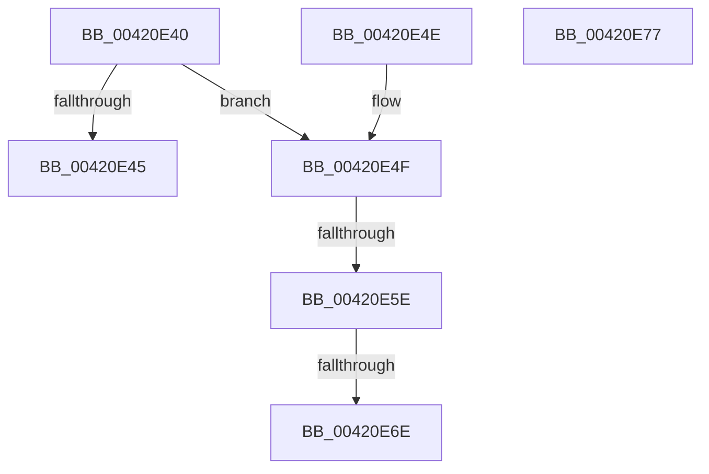

# PspGetStorageArrayIfPossible

- RVA: `0x00420E40`–`0x00420E78` (길이 `56` bytes)
- VA: `0x0000000140420E40`
- 실행 섹션: `.text`
- PDB 이름 있음: `예`; PDB Function 태그: `예`
- unwind 정보 RVA: `0x000DB714`
- 디코드: `18`개 명령, `56/56` bytes 표시
- 미해석 바이트: `0` (있으면 어셈블리에 `.byte`로 보존)

> 이 문서는 커널 이미지의 기계어와 PDB 기호를 분석해 생성했습니다. 4번과 5번은 함수 원형과 자료형을 바이너리 사용 방식에서 추정한 C 해석이며 원본 소스 복구 결과는 아닙니다.

## 1. Dependencies

- 직접 호출 지점: **0**; 고유 호출 대상: **0**
- 직접 호출자로 확인된 함수: **3**
- RIP 상대 이미지 참조: **0**

### Outgoing calls
- 직접 디코드된 call 명령이 없습니다.

### Direct callers
- [PspStorageRemoveObject](../../page/78/PspStorageRemoveObject_function_00789D68.md) at `0x00789D97`
- [PspGetStorageArray](../../page/9E/PspGetStorageArray_function_009E8538.md) at `0x009E8557`
- [PspGetStorageArray](../../page/9E/PspGetStorageArray_function_009E8538.md) at `0x009E85BC`
- [PspStorageGetObject](../../page/9F/PspStorageGetObject_function_009FC6F4.md) at `0x009FC71B`

### Static image references
- 디코드된 RIP-relative 메모리 참조가 없습니다.

## 2. Other-region calls and transfers

- 다른 실행 섹션으로 향하는 call: **0**
- call이 아닌 외부 분기/꼬리 이동: **2**
  - `0x00420E58` → `0x006EDB7D` (`tail-transfer`)
  - `0x00420E68` → `0x006EDB76` (`tail-transfer`)

## 3. Assembly (complete function range)

```asm
00420E40  83 FA 20                        cmp edx, 0x20
00420E43  73 0A                           jae 0x140420e4f
00420E45  41 89 10                        mov dword ptr [r8], edx
00420E48  33 C0                           xor eax, eax
00420E4A  49 89 09                        mov qword ptr [r9], rcx
00420E4D  C3                              ret
00420E4E  CC                              int3
00420E4F  83 C2 E0                        add edx, -0x20
00420E52  81 FA 00 01 00 00               cmp edx, 0x100
00420E58  0F 83 1F CD 2C 00               jae 0x1406edb7d
00420E5E  48 8B 81 00 02 00 00            mov rax, qword ptr [rcx + 0x200]
00420E65  48 85 C0                        test rax, rax
00420E68  0F 84 08 CD 2C 00               je 0x1406edb76
00420E6E  49 89 01                        mov qword ptr [r9], rax
00420E71  33 C0                           xor eax, eax
00420E73  41 89 10                        mov dword ptr [r8], edx
00420E76  C3                              ret
00420E77  CC                              int3
```

## 4. C-style interpretation (structured pseudocode)

```c
__int64 __fastcall PspGetStorageArrayIfPossible(__int64 a1, int a2, __int64 a3, __int64 a4)
{
    __int64 result;

    if (a2 >= 32) goto loc_00420E4F;
    *(unsigned int *)(a3) = a2;
    result = 0;
    *(unsigned __int64 *)(a4) = a1;
    return result;
loc_00420E4F:
    a2 = (unsigned int)((a2) + (-32));
    *(unsigned __int64 *)(a4) = *(unsigned __int64 *)(a1 + 512);
    result = 0;
    *(unsigned int *)(a3) = a2;
    return result;
}
```

## 5. (Beta) C Style

```c
int64_t PspGetStorageArrayIfPossible(void *Arg1, int32_t Arg2, void *Arg3, void *Arg4)
{
    uint8_t *arg1 = (uint8_t *)Arg1;
    uint8_t *arg3 = (uint8_t *)Arg3;
    uint8_t *arg4 = (uint8_t *)Arg4;

    int64_t result;

    if (Arg2 >= 32) goto loc_00420E4F;
    *(uint32_t *)(arg3) = Arg2;
    result = 0;
    *(void **)(arg4) = Arg1;
    return result;
loc_00420E4F:
    Arg2 = (uint32_t)((Arg2) + (-32));
    *(uint64_t *)(arg4) = *(uint64_t *)(arg1 + 0x200);
    result = 0;
    *(uint32_t *)(arg3) = Arg2;
    return result;
}
```

### 관측된 메모리 오프셋

구조체 형식이 확인되지 않은 접근은 인자 기준의 오프셋으로만 기록했습니다.

| 기준 인자 | 오프셋 표현 | 폭 (bit) | 접근 |
|---|---:|---:|---|
| `Arg1` | `+ 0x200` | `64` | `R` |
| `Arg3` | `+ 0x0` | `32` | `W` |
| `Arg4` | `+ 0x0` | `64` | `W` |

## 6. Execution-region graph

[열기: 2D/3D 그래프와 함수 탐색 컨트롤 패널](../../../control-panel.html?section=text&rva=0x00420E40&view=graph)

- 2D 그래프는 위에서 아래로 흐르고, 3D 그래프는 빈 공간을 드래그해 회전합니다. Shift+드래그는 이동, 휠은 확대·축소, 함수 노드 선택은 대상 보고서 이동입니다.

### Static fallback


