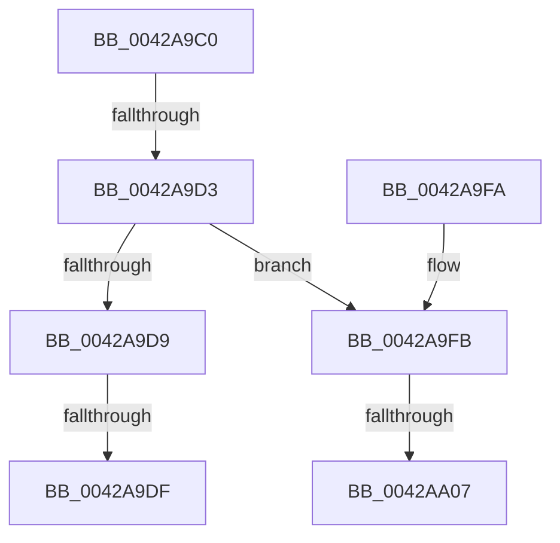

# RtlAreBitsSetEx

- RVA: `0x0042A9C0`–`0x0042AA1A` (길이 `90` bytes)
- VA: `0x000000014042A9C0`
- 실행 섹션: `.text`
- PDB 이름 있음: `예`; PDB Function 태그: `아니요`
- unwind 정보 RVA: `0x000A1208`
- 디코드: `25`개 명령, `90/90` bytes 표시
- 미해석 바이트: `0` (있으면 어셈블리에 `.byte`로 보존)

> 이 문서는 커널 이미지의 기계어와 PDB 기호를 분석해 생성했습니다. 4번과 5번은 함수 원형과 자료형을 바이너리 사용 방식에서 추정한 C 해석이며 원본 소스 복구 결과는 아닙니다.

## 1. Dependencies

- 직접 호출 지점: **0**; 고유 호출 대상: **0**
- 직접 호출자로 확인된 함수: **1**
- RIP 상대 이미지 참조: **0**

### Outgoing calls
- 직접 디코드된 call 명령이 없습니다.

### Direct callers
- [MiPatchDataPagesCallback](../../page/80/MiPatchDataPagesCallback_function_00806610.md) at `0x00806668`
- [MiPatchDataPagesCallback](../../page/80/MiPatchDataPagesCallback_function_00806610.md) at `0x0080667E`

### Static image references
- 디코드된 RIP-relative 메모리 참조가 없습니다.

## 2. Other-region calls and transfers

- 다른 실행 섹션으로 향하는 call: **0**
- call이 아닌 외부 분기/꼬리 이동: **3**
  - `0x0042A9CD` → [sub_0042AAA4](Unknown_function_0042AAA4.md) (`tail-transfer`)
  - `0x0042A9D9` → [sub_0042AAA4](Unknown_function_0042AAA4.md) (`tail-transfer`)
  - `0x0042AA01` → [sub_0042AAA4](Unknown_function_0042AAA4.md) (`tail-transfer`)

## 3. Assembly (complete function range)

```asm
0042A9C0  48 83 EC 08                     sub rsp, 8
0042A9C4  48 8B 01                        mov rax, qword ptr [rcx]
0042A9C7  4C 8B C9                        mov r9, rcx
0042A9CA  48 3B D0                        cmp rdx, rax
0042A9CD  0F 83 D1 00 00 00               jae 0x14042aaa4
0042A9D3  49 83 F8 01                     cmp r8, 1
0042A9D7  77 22                           ja 0x14042a9fb
0042A9D9  0F 85 C5 00 00 00               jne 0x14042aaa4
0042A9DF  49 8B 41 08                     mov rax, qword ptr [r9 + 8]
0042A9E3  48 8B CA                        mov rcx, rdx
0042A9E6  48 C1 EA 06                     shr rdx, 6
0042A9EA  83 E1 3F                        and ecx, 0x3f
0042A9ED  48 0F A3 0C D0                  bt qword ptr [rax + rdx*8], rcx
0042A9F2  0F 92 C0                        setb al
0042A9F5  48 83 C4 08                     add rsp, 8
0042A9F9  C3                              ret
0042A9FA  CC                              int3
0042A9FB  48 2B C2                        sub rax, rdx
0042A9FE  49 3B C0                        cmp rax, r8
0042AA01  0F 82 9D 00 00 00               jb 0x14042aaa4
0042AA07  48 8B 49 08                     mov rcx, qword ptr [rcx + 8]
0042AA0B  48 8B C2                        mov rax, rdx
0042AA0E  48 C1 E8 06                     shr rax, 6
0042AA12  4C 8B 14 C1                     mov r10, qword ptr [rcx + rax*8]
0042AA16  4C 8D 0C C1                     lea r9, [rcx + rax*8]
```

## 4. C-style interpretation (structured pseudocode)

```c
__int64 __fastcall RtlAreBitsSetEx(__int64 a1, __int64 a2, __int64 a3)
{
    __int64 result;
    __int64 v_rsp;

    v_rsp = (v_rsp) - (8);
    if (a3 > 1) goto loc_0042A9FB;
    a2 = (a2) >> (6);
    a1 = (unsigned int)((a2) & (63));
    result = (condition_is_below) ? 1 : 0;
    v_rsp = (v_rsp) + (8);
    return result;
loc_0042A9FB:
    result = (result) - (a2);
    result = (a2) >> (6);
    return result;
}
```

## 5. (Beta) C Style

```c
int64_t RtlAreBitsSetEx(void *Arg1, int64_t Arg2, int64_t Arg3)
{
    uint8_t *arg1 = (uint8_t *)Arg1;

    int64_t result;
    int64_t local_rsp;

    local_rsp = (local_rsp) - (8);
    if (Arg3 > 1) goto loc_0042A9FB;
    Arg2 = (Arg2) >> (6);
    Arg1 = (uint32_t)((Arg2) & (63));
    result = (condition_is_below) ? 1 : 0;
    local_rsp = (local_rsp) + (8);
    return result;
loc_0042A9FB:
    result = (result) - (Arg2);
    result = (Arg2) >> (6);
    return result;
}
```

### 관측된 메모리 오프셋

구조체 형식이 확인되지 않은 접근은 인자 기준의 오프셋으로만 기록했습니다.

| 기준 인자 | 오프셋 표현 | 폭 (bit) | 접근 |
|---|---:|---:|---|
| `Arg1` | `+ 0x0` | `64` | `R` |
| `Arg1` | `+ 0x8` | `64` | `R` |

## 6. Execution-region graph

[열기: 2D/3D 그래프와 함수 탐색 컨트롤 패널](../../../control-panel.html?section=text&rva=0x0042A9C0&view=graph)

- 2D 그래프는 위에서 아래로 흐르고, 3D 그래프는 빈 공간을 드래그해 회전합니다. Shift+드래그는 이동, 휠은 확대·축소, 함수 노드 선택은 대상 보고서 이동입니다.

### Static fallback


