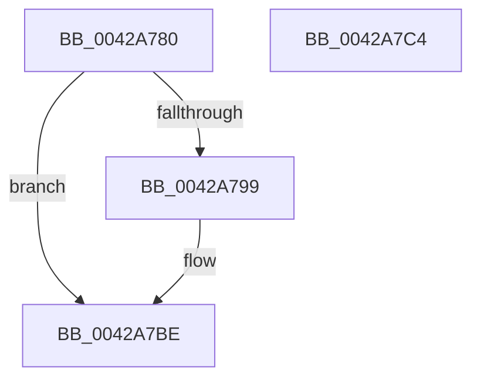

# RtlInitUnicodeString

- RVA: `0x0042A780`–`0x0042A7C5` (길이 `69` bytes)
- VA: `0x000000014042A780`
- 실행 섹션: `.text`
- PDB 이름 있음: `예`; PDB Function 태그: `아니요`
- unwind 정보 RVA: `0x0005CF00`
- 디코드: `20`개 명령, `69/69` bytes 표시
- 미해석 바이트: `0` (있으면 어셈블리에 `.byte`로 보존)

> 이 문서는 커널 이미지의 기계어와 PDB 기호를 분석해 생성했습니다. 4번과 5번은 함수 원형과 자료형을 바이너리 사용 방식에서 추정한 C 해석이며 원본 소스 복구 결과는 아닙니다.

## 1. Dependencies

- 직접 호출 지점: **1**; 고유 호출 대상: **1**
- 직접 호출자로 확인된 함수: **720**
- RIP 상대 이미지 참조: **0**

### Outgoing calls
- `0x0042A79C` → [wcslen](../50/wcslen_function_00501BA0.md) (function, `0x00501BA0`)

### Direct callers
- [PiDevCfgParseVariableName](PiDevCfgParseVariableName_function_0042A6CC.md) at `0x0042A722`
- [PopDiagTraceIrpStart](../47/PopDiagTraceIrpStart_function_0047CBBC.md) at `0x0047CD9C`
- [BapdWriteEtwEvents](../4A/BapdWriteEtwEvents_function_004AE884.md) at `0x004AEB7A`
- [BapdWriteEtwEvents](../4A/BapdWriteEtwEvents_function_004AE884.md) at `0x004AEB97`
- [BapdWriteEtwEvents](../4A/BapdWriteEtwEvents_function_004AE884.md) at `0x004AECC1`
- [SeSetLearningModeObjectInformation](../4C/SeSetLearningModeObjectInformation_function_004C7098.md) at `0x004C728D`
- [RtlpMuiRegLoadLicInformation](../4C/RtlpMuiRegLoadLicInformation_function_004CB26C.md) at `0x004CB3C0`
- [RtlpMuiRegLoadLicInformation](../4C/RtlpMuiRegLoadLicInformation_function_004CB26C.md) at `0x004CB40F`
- [RtlpMuiRegLoadLicInformation](../4C/RtlpMuiRegLoadLicInformation_function_004CB26C.md) at `0x004CB4E7`
- [RtlpMuiRegLoadLicInformation](../4C/RtlpMuiRegLoadLicInformation_function_004CB26C.md) at `0x004CB537`
- [RtlpMuiRegLoadLicInformation](../4C/RtlpMuiRegLoadLicInformation_function_004CB26C.md) at `0x004CB690`
- [PrpWriteLogsToRegistry](../4C/PrpWriteLogsToRegistry_function_004CC288.md) at `0x004CC303`
- [PopThermalWriteShutdownToRegistry](../4C/PopThermalWriteShutdownToRegistry_function_004CDA6C.md) at `0x004CDAC0`
- [PopThermalWriteShutdownToRegistry](../4C/PopThermalWriteShutdownToRegistry_function_004CDA6C.md) at `0x004CDAD0`
- [PopThermalWriteShutdownToRegistry](../4C/PopThermalWriteShutdownToRegistry_function_004CDA6C.md) at `0x004CDAE0`
- [PopThermalWriteShutdownToRegistry](../4C/PopThermalWriteShutdownToRegistry_function_004CDA6C.md) at `0x004CDAF0`
- [PopOpenThermalLoggingKey](../4C/PopOpenThermalLoggingKey_function_004CDBFC.md) at `0x004CDC9B`
- [EtwpGetDriverDataDosPath](../4D/EtwpGetDriverDataDosPath_function_004DDF10.md) at `0x004DDF69`
- [PoDiagTraceIRTimerSleepStudyRundown](../4E/PoDiagTraceIRTimerSleepStudyRundown_function_004E05A8.md) at `0x004E0605`
- [HalpCmciLoadThresholdConfiguration](../4E/HalpCmciLoadThresholdConfiguration_function_004E06A0.md) at `0x004E07AC`
- [IoCaptureLiveDump](../4E/IoCaptureLiveDump_function_004E085C.md) at `0x004E0A21`
- [IoCaptureLiveDump](../4E/IoCaptureLiveDump_function_004E085C.md) at `0x004E0A42`
- [IoCaptureLiveDump](../4E/IoCaptureLiveDump_function_004E085C.md) at `0x004E0A63`
- [IopLoadCrashdumpDriver](../4E/IopLoadCrashdumpDriver_function_004E2F70.md) at `0x004E2FAE`
- [HalpMcaExtendedLogGetL1DirectoryBase](../54/HalpMcaExtendedLogGetL1DirectoryBase_function_00541520.md) at `0x00541576`
- [HalpMcaExtendedLogGetL1DirectoryBase](../54/HalpMcaExtendedLogGetL1DirectoryBase_function_00541520.md) at `0x005415BF`
- [HalpQueryMaximumRegisteredProcessorCount](../54/HalpQueryMaximumRegisteredProcessorCount_function_00543BE8.md) at `0x00543C3F`
- [HalpExtRegisterResourceDescriptor](../54/HalpExtRegisterResourceDescriptor_function_0054E640.md) at `0x0054E7A5`
- [HalpExtRegisterResourceDescriptor](../54/HalpExtRegisterResourceDescriptor_function_0054E640.md) at `0x0054E7FC`
- [HalpDmaInitializeObjectType](../55/HalpDmaInitializeObjectType_function_00552480.md) at `0x005524F9`
- [HalpRegisterDmaController](../55/HalpRegisterDmaController_function_00554638.md) at `0x005546D3`
- [HalpMcEnumerateAndSetPatchConfig](../55/HalpMcEnumerateAndSetPatchConfig_function_0055AB38.md) at `0x0055AD5A`
- [HalpMcEnumerateAndSetPatchConfig](../55/HalpMcEnumerateAndSetPatchConfig_function_0055AB38.md) at `0x0055AE59`
- [HalpMcGetLoadConfiguration](../55/HalpMcGetLoadConfiguration_function_0055AF34.md) at `0x0055AF8F`
- [HalpMcGetRollbackRequest](../55/HalpMcGetRollbackRequest_function_0055AFEC.md) at `0x0055B040`
- [HalpTimerRegister](../56/HalpTimerRegister_function_005616BC.md) at `0x005617E1`
- [HalpArtDiscover](../56/HalpArtDiscover_function_00561DB4.md) at `0x00561E5E`
- [HalpTscDiscover](../56/HalpTscDiscover_function_00562728.md) at `0x00562841`
- [HalpInterruptRegisterController](../56/HalpInterruptRegisterController_function_005640F0.md) at `0x0056433D`
- [HaliInitializePlatformDebugTriggers](../56/HaliInitializePlatformDebugTriggers_function_0056AC00.md) at `0x0056AC1E`
- [CcSetupWatchForRegistryChanges](../57/CcSetupWatchForRegistryChanges_function_0057CE10.md) at `0x0057CE76`
- [FsRtlpGetMaxVirtualDiskNestingLevel](../58/FsRtlpGetMaxVirtualDiskNestingLevel_function_00582FDC.md) at `0x00583033`
- [FsRtlpGetMaxVirtualDiskNestingLevel](../58/FsRtlpGetMaxVirtualDiskNestingLevel_function_00582FDC.md) at `0x00583043`
- [FsRtlpGetMaxVirtualDiskNestingLevel](../58/FsRtlpGetMaxVirtualDiskNestingLevel_function_00582FDC.md) at `0x0058309B`
- [HvlPhase2Initialize](../58/HvlPhase2Initialize_function_00583EA0.md) at `0x005840AB`
- [IoConfigureCrashDump](../59/IoConfigureCrashDump_function_00591CB4.md) at `0x00591DA9`
- [IopIsBitlockerOn](../59/IopIsBitlockerOn_function_00595C3C.md) at `0x00595C65`
- [IopLiveDumpOpenVMMemoryPartition](../59/IopLiveDumpOpenVMMemoryPartition_function_0059D508.md) at `0x0059D551`
- [IopLiveDumpPolicyChangeWnfCallback](../59/IopLiveDumpPolicyChangeWnfCallback_function_0059D6E0.md) at `0x0059D772`
- [IopLiveDumpPolicyChangeWnfCallback](../59/IopLiveDumpPolicyChangeWnfCallback_function_0059D6E0.md) at `0x0059D7D4`
- [IopInitializeSystemVariableService](../5A/IopInitializeSystemVariableService_function_005A0310.md) at `0x005A0362`
- [IopInitializeSystemVariableService](../5A/IopInitializeSystemVariableService_function_005A0310.md) at `0x005A03AB`
- [SecureDump_ProvisionCrashDumpKey](../5A/SecureDump_ProvisionCrashDumpKey_function_005A33C8.md) at `0x005A3424`
- [KiLogSingleDpcSoftTimeoutEvent](../5B/KiLogSingleDpcSoftTimeoutEvent_function_005B5D50.md) at `0x005B5DCC`
- [KiInitializeNormalPriorityAntiStarvationPolicies](../5B/KiInitializeNormalPriorityAntiStarvationPolicies_function_005B8178.md) at `0x005B81A7`
- [KseDsCallbackHookAddDevice](../5C/KseDsCallbackHookAddDevice_function_005CBEB0.md) at `0x005CBF40`
- [PpmInitIllegalThrottleLogging](../5C/PpmInitIllegalThrottleLogging_function_005CE39C.md) at `0x005CE3E2`
- [PopReadShutdownPolicy](../5C/PopReadShutdownPolicy_function_005CEA64.md) at `0x005CEAAB`
- [PopReadShutdownPolicy](../5C/PopReadShutdownPolicy_function_005CEA64.md) at `0x005CEAF4`
- [PopLidReliabilityInit](../5D/PopLidReliabilityInit_function_005D5308.md) at `0x005D535A`
- [RtlpGetBootStatusPathFromRegistry](../5E/RtlpGetBootStatusPathFromRegistry_function_005E7A68.md) at `0x005E7AA2`
- [RtlpGetBootStatusPathFromRegistry](../5E/RtlpGetBootStatusPathFromRegistry_function_005E7A68.md) at `0x005E7AF1`
- [RtlpGetNameFromLangInfoNode](../5E/RtlpGetNameFromLangInfoNode_function_005EBCCC.md) at `0x005EBD2A`
- [RtlRaiseCustomSystemEventTrigger](../5E/RtlRaiseCustomSystemEventTrigger_function_005EE300.md) at `0x005EE366`
- [SepGetLearningModeObjectInformation](../60/SepGetLearningModeObjectInformation_function_00608F74.md) at `0x0060924B`
- [SepGetLearningModeObjectInformation](../60/SepGetLearningModeObjectInformation_function_00608F74.md) at `0x00609266`
- [SepSetTokenAllApplicationPackagesPolicy](../60/SepSetTokenAllApplicationPackagesPolicy_function_00609A90.md) at `0x00609AC2`
- [VfClearVerifierSettings](../61/VfClearVerifierSettings_function_00611DB0.md) at `0x00611E55`
- [VfClearVerifierSettings](../61/VfClearVerifierSettings_function_00611DB0.md) at `0x00611E91`
- [VfClearVerifierSettings](../61/VfClearVerifierSettings_function_00611DB0.md) at `0x00611ED1`
- [VfClearVerifierSettings](../61/VfClearVerifierSettings_function_00611DB0.md) at `0x00611F07`
- [VfClearVerifierSettings](../61/VfClearVerifierSettings_function_00611DB0.md) at `0x00611F3D`
- [VfClearVerifierSettings](../61/VfClearVerifierSettings_function_00611DB0.md) at `0x00611F7C`
- [VfClearVerifierSettings](../61/VfClearVerifierSettings_function_00611DB0.md) at `0x00611FB2`
- [VfClearVerifierSettings](../61/VfClearVerifierSettings_function_00611DB0.md) at `0x00611FE8`
- [VfClearVerifierSettings](../61/VfClearVerifierSettings_function_00611DB0.md) at `0x00612027`
- [VfClearVerifierSettings](../61/VfClearVerifierSettings_function_00611DB0.md) at `0x0061205D`
- [VfClearVerifierSettings](../61/VfClearVerifierSettings_function_00611DB0.md) at `0x00612093`
- [VfClearVerifierSettings](../61/VfClearVerifierSettings_function_00611DB0.md) at `0x006120C9`
- [VfClearVerifierSettings](../61/VfClearVerifierSettings_function_00611DB0.md) at `0x006120FF`
- [VfClearVerifierSettings](../61/VfClearVerifierSettings_function_00611DB0.md) at `0x00612135`
- [CarLiveDumpCallBack](../61/CarLiveDumpCallBack_function_0061BC20.md) at `0x0061BCBD`
- [EtwpGetCurrentSiloMaxLoggers](../64/EtwpGetCurrentSiloMaxLoggers_function_0064E86C.md) at `0x0064E8A3`
- [EtwpQueryPartitionRegistryInformation](../64/EtwpQueryPartitionRegistryInformation_function_0064ECCC.md) at `0x0064ED4E`
- [EtwpQuerySiloRegistrySettings](../64/EtwpQuerySiloRegistrySettings_function_0064EF78.md) at `0x0064EFBC`
- [EtwpCreateKey](../65/EtwpCreateKey_function_006527D4.md) at `0x00652802`
- [BapdpMarshallBootDataToRegistry](../65/BapdpMarshallBootDataToRegistry_function_006548A8.md) at `0x006549DB`
- [BapdpMarshallBootDataToRegistry](../65/BapdpMarshallBootDataToRegistry_function_006548A8.md) at `0x00654A3D`
- [ExpRecordShutdownTime](../65/ExpRecordShutdownTime_function_006555FC.md) at `0x0065563F`
- [ExpRecordShutdownTime](../65/ExpRecordShutdownTime_function_006555FC.md) at `0x00655688`
- [MigrateOOBELanguageToInstallationLanguage](../65/MigrateOOBELanguageToInstallationLanguage_function_0065CEA8.md) at `0x0065CF21`
- [MigrateOOBELanguageToInstallationLanguage](../65/MigrateOOBELanguageToInstallationLanguage_function_0065CEA8.md) at `0x0065CF76`
- [MigrateOOBELanguageToInstallationLanguage](../65/MigrateOOBELanguageToInstallationLanguage_function_0065CEA8.md) at `0x0065CFE8`
- [OpenGlobalizationUserSettingsKey_ForSingleUserModel](../65/OpenGlobalizationUserSettingsKey_ForSingleUserModel_function_0065D368.md) at `0x0065D399`
- [OpenGlobalizationUserSettingsKey_ForSingleUserModel](../65/OpenGlobalizationUserSettingsKey_ForSingleUserModel_function_0065D368.md) at `0x0065D3C5`
- [OpenGlobalizationUserSettingsKey_ForSingleUserModel](../65/OpenGlobalizationUserSettingsKey_ForSingleUserModel_function_0065D368.md) at `0x0065D3F7`
- [OpenGlobalizationUserSettingsKey_ForSingleUserModel](../65/OpenGlobalizationUserSettingsKey_ForSingleUserModel_function_0065D368.md) at `0x0065D4A0`
- [WheaPersistBadPageToRegistry](../65/WheaPersistBadPageToRegistry_function_0065F58C.md) at `0x0065F5EC`
- [WheaPersistBadPageToRegistry](../65/WheaPersistBadPageToRegistry_function_0065F58C.md) at `0x0065F64C`
- [MicrocodeLogRegistry](../66/MicrocodeLogRegistry_function_00667340.md) at `0x00667389`
- [AdtpDbInitializePrivilegeObject](../69/AdtpDbInitializePrivilegeObject_function_0069DDE8.md) at `0x0069DE3C`
- [RtlpMuiRegAddAlternateCodePage](../6A/RtlpMuiRegAddAlternateCodePage_function_006A8EE4.md) at `0x006A8F25`
- [RtlpMuiRegAddAlternateCodePage](../6A/RtlpMuiRegAddAlternateCodePage_function_006A8EE4.md) at `0x006A900E`
- [RtlpMuiRegLoadInstalledFromKey](../6A/RtlpMuiRegLoadInstalledFromKey_function_006A9450.md) at `0x006A94B1`
- [RtlpMuiRegLoadInstalledFromKey](../6A/RtlpMuiRegLoadInstalledFromKey_function_006A9450.md) at `0x006A952F`
- [RtlpMuiRegLoadInstalledFromKey](../6A/RtlpMuiRegLoadInstalledFromKey_function_006A9450.md) at `0x006A9558`
- [RtlpRemovePendingDeleteLanguages](../6A/RtlpRemovePendingDeleteLanguages_function_006A9684.md) at `0x006A96F3`
- [sub_006EF3AA](../6E/Unknown_function_006EF3AA.md) at `0x006EF3B5`
- [sub_006EF3AA](../6E/Unknown_function_006EF3AA.md) at `0x006EF40A`
- [sub_006FBC78](../6F/Unknown_function_006FBC78.md) at `0x006FBC7F`
- [PopSetHiberPersistedRegValue](../../page/6F/PopSetHiberPersistedRegValue_function_006FE9F0.md) at `0x006FEA45`
- [PopSetHiberPersistedRegValue](../../page/6F/PopSetHiberPersistedRegValue_function_006FE9F0.md) at `0x006FEAB4`
- [ExpWatchProductTypeWork](../../page/6F/ExpWatchProductTypeWork_function_006FFCA0.md) at `0x006FFD23`
- [ExpWatchProductTypeWork](../../page/6F/ExpWatchProductTypeWork_function_006FFCA0.md) at `0x006FFE34`
- [ExpWatchProductTypeWork](../../page/6F/ExpWatchProductTypeWork_function_006FFCA0.md) at `0x007000D7`
- [ExpWatchProductTypeWork](../../page/6F/ExpWatchProductTypeWork_function_006FFCA0.md) at `0x0070017C`
- [PopOpenHiberPersistedKey](../../page/70/PopOpenHiberPersistedKey_function_007024E0.md) at `0x00702531`
- [RtlpGetWindowsPolicy](../../page/70/RtlpGetWindowsPolicy_function_00703DCC.md) at `0x00703E1D`
- [PiDrvDbUnmountNode](../../page/70/PiDrvDbUnmountNode_function_00704D48.md) at `0x00704D62`
- [MiApplyRequiredDriverHotPatches](../../page/70/MiApplyRequiredDriverHotPatches_function_007053D4.md) at `0x0070540B`
- [HalpPmuArbiterQueryRegistryQuantum](../../page/70/HalpPmuArbiterQueryRegistryQuantum_function_00707D04.md) at `0x00707D58`
- [HaliInitPowerManagement](../../page/70/HaliInitPowerManagement_function_0070BAE0.md) at `0x0070BB1A`
- [HalpMiscInitializeKsr](../../page/70/HalpMiscInitializeKsr_function_0070C618.md) at `0x0070C65C`
- [HalpStartPccCommand](../../page/70/HalpStartPccCommand_function_0070D8D4.md) at `0x0070D901`
- [ArbpGetRegistryValue](../../page/71/ArbpGetRegistryValue_function_00710124.md) at `0x00710149`
- [FsRtlpOpenDev](../../page/71/FsRtlpOpenDev_function_0071430C.md) at `0x00714342`
- [FsRtlpOplockGetAckTimeoutOverride](../../page/71/FsRtlpOplockGetAckTimeoutOverride_function_00714F54.md) at `0x00714FA7`
- [FsRtlpOplockGetAckTimeoutOverride](../../page/71/FsRtlpOplockGetAckTimeoutOverride_function_00714F54.md) at `0x00714FF2`
- [IopCrashDumpPolicyChangeWnfCallback](../../page/71/IopCrashDumpPolicyChangeWnfCallback_function_00719E40.md) at `0x00719ECF`
- [IopCrashDumpPolicyChangeWnfCallback](../../page/71/IopCrashDumpPolicyChangeWnfCallback_function_00719E40.md) at `0x00719F2E`
- [IopInitializeDumpPolicySettings](../../page/71/IopInitializeDumpPolicySettings_function_0071A444.md) at `0x0071A4AA`
- [IopInitializeDumpPolicySettings](../../page/71/IopInitializeDumpPolicySettings_function_0071A444.md) at `0x0071A4F5`
- [IopInitializeDumpPolicySettings](../../page/71/IopInitializeDumpPolicySettings_function_0071A444.md) at `0x0071A576`
- [IopInitializeDumpPolicySettings](../../page/71/IopInitializeDumpPolicySettings_function_0071A444.md) at `0x0071A5BB`
- [IopBootLogToFile](../../page/71/IopBootLogToFile_function_0071AD54.md) at `0x0071ADDE`
- [IopConnectLinkTrackingPort](../../page/71/IopConnectLinkTrackingPort_function_0071B050.md) at `0x0071B0C7`
- [IopCopyBootLogRegistryToFile](../../page/71/IopCopyBootLogRegistryToFile_function_0071B19C.md) at `0x0071B3A0`
- [IopValidateJunctionTarget](../../page/71/IopValidateJunctionTarget_function_0071C808.md) at `0x0071C8D5`
- [IoSetSystemPartition](../../page/71/IoSetSystemPartition_function_0071DF90.md) at `0x0071DFE6`
- [IoIsValidNameGraftingBuffer](../../page/71/IoIsValidNameGraftingBuffer_function_0071EBA0.md) at `0x0071ED04`
- [IopSymlinkQueryEnabledClasses](../../page/71/IopSymlinkQueryEnabledClasses_function_0071EF6C.md) at `0x0071EFB9`
- [IopSymlinkQueryEnabledClasses](../../page/71/IopSymlinkQueryEnabledClasses_function_0071EF6C.md) at `0x0071EFED`
- [IopSymlinkQueryEnabledClasses](../../page/71/IopSymlinkQueryEnabledClasses_function_0071EF6C.md) at `0x0071F005`
- [IopSymlinkQueryEnabledClasses](../../page/71/IopSymlinkQueryEnabledClasses_function_0071EF6C.md) at `0x0071F01C`
- [IopSymlinkQueryEnabledClasses](../../page/71/IopSymlinkQueryEnabledClasses_function_0071EF6C.md) at `0x0071F033`
- [IopRegistryInitializeCallbacks](../../page/72/IopRegistryInitializeCallbacks_function_00722E58.md) at `0x00722EB8`
- [PipCheckComputerSupported](../../page/72/PipCheckComputerSupported_function_007232B0.md) at `0x0072333F`
- [IoReportDetectedDevice](../../page/72/IoReportDetectedDevice_function_00725CD0.md) at `0x00726581`
- [IoReportDetectedDevice](../../page/72/IoReportDetectedDevice_function_00725CD0.md) at `0x007265D1`
- [PiGetDeviceRegistryProperty](../../page/72/PiGetDeviceRegistryProperty_function_007280A8.md) at `0x0072815E`
- [IoGetDeviceDirectory](../../page/72/IoGetDeviceDirectory_function_00728370.md) at `0x007283E6`
- [IoGetDeviceDirectory](../../page/72/IoGetDeviceDirectory_function_00728370.md) at `0x007283F1`
- [IoGetDeviceDirectory](../../page/72/IoGetDeviceDirectory_function_00728370.md) at `0x007283FC`
- [IoGetDeviceDirectory](../../page/72/IoGetDeviceDirectory_function_00728370.md) at `0x00728407`
- [PiBuildAndOpenDeviceDirectoryPath](../../page/72/PiBuildAndOpenDeviceDirectoryPath_function_00728724.md) at `0x0072875E`
- [PiCreateDirectoryPath](../../page/72/PiCreateDirectoryPath_function_0072885C.md) at `0x007288B1`
- [PiCreateRegistryPath](../../page/72/PiCreateRegistryPath_function_00728B58.md) at `0x00728BA8`
- [PiCreateServiceKeyUnderPath](../../page/72/PiCreateServiceKeyUnderPath_function_00728DEC.md) at `0x00728E41`
- [PiGetDriverMutableStateDirectory](../../page/72/PiGetDriverMutableStateDirectory_function_00729038.md) at `0x00729081`
- [PiGetDriverMutableStateDirectory](../../page/72/PiGetDriverMutableStateDirectory_function_00729038.md) at `0x0072908C`
- [PiOpenDriverRedirectedStateRootKey](../../page/72/PiOpenDriverRedirectedStateRootKey_function_0072935C.md) at `0x00729393`
- [IoRegisterBootDriverCallback](../../page/72/IoRegisterBootDriverCallback_function_00729980.md) at `0x007299C6`
- [PnpRequestDeviceEjectExWorker](../../page/72/PnpRequestDeviceEjectExWorker_function_0072A6D0.md) at `0x0072A6EA`
- [PnpSetRegistryDword](../../page/72/PnpSetRegistryDword_function_0072C2AC.md) at `0x0072C2CA`
- [PnpOpenFirstMatchingSubKey](../../page/72/PnpOpenFirstMatchingSubKey_function_0072CA20.md) at `0x0072CA6C`
- [PnpLogDuplicateDevice](../../page/72/PnpLogDuplicateDevice_function_0072D8B4.md) at `0x0072D8D9`
- [PnpLogDuplicateDevice](../../page/72/PnpLogDuplicateDevice_function_0072D8B4.md) at `0x0072D8E5`
- [PpBootDDBHelper](../../page/72/PpBootDDBHelper_function_0072E1CC.md) at `0x0072E249`
- [PpBootDDBHelper](../../page/72/PpBootDDBHelper_function_0072E1CC.md) at `0x0072E2BF`
- [PiPnpRtlGatherDeviceDeleteInfo](../../page/72/PiPnpRtlGatherDeviceDeleteInfo_function_0072FC04.md) at `0x0072FC68`
- [PipDmgGetDeviceDmarRegistryValue](../../page/73/PipDmgGetDeviceDmarRegistryValue_function_007307F0.md) at `0x0073084A`
- [PiDcInitUpdateProperties](../../page/73/PiDcInitUpdateProperties_function_00730B3C.md) at `0x00730BC4`
- [PiDevCfgCheckDeviceNeedsUpdate](../../page/73/PiDevCfgCheckDeviceNeedsUpdate_function_00731DDC.md) at `0x00731FB9`
- [PiDevCfgCheckDeviceNeedsUpdate](../../page/73/PiDevCfgCheckDeviceNeedsUpdate_function_00731DDC.md) at `0x00731FD5`
- [PiDevCfgCheckDeviceNeedsUpdate](../../page/73/PiDevCfgCheckDeviceNeedsUpdate_function_00731DDC.md) at `0x00731FE6`
- [PiDevCfgFindDeviceMigrationNode](../../page/73/PiDevCfgFindDeviceMigrationNode_function_00732920.md) at `0x00732D86`
- [PiDevCfgFindDeviceMigrationNode](../../page/73/PiDevCfgFindDeviceMigrationNode_function_00732920.md) at `0x00732E82`
- [PiDevCfgFindDeviceMigrationNode](../../page/73/PiDevCfgFindDeviceMigrationNode_function_00732920.md) at `0x00732FC3`
- [PiDevCfgGetDeviceClassDriverConfigurable](../../page/73/PiDevCfgGetDeviceClassDriverConfigurable_function_00733504.md) at `0x007335E5`
- [PiDevCfgGetDeviceClassDriverConfigurable](../../page/73/PiDevCfgGetDeviceClassDriverConfigurable_function_00733504.md) at `0x00733653`
- [PiDevCfgGetDeviceClassDriverConfigurable](../../page/73/PiDevCfgGetDeviceClassDriverConfigurable_function_00733504.md) at `0x00733674`
- [PiDevCfgMakeServiceBootStart](../../page/73/PiDevCfgMakeServiceBootStart_function_00733BC8.md) at `0x00733C09`
- [PiDevCfgMakeServiceBootStart](../../page/73/PiDevCfgMakeServiceBootStart_function_00733BC8.md) at `0x00733D1B`
- [PiDevCfgOpenDeviceMigrationKey](../../page/73/PiDevCfgOpenDeviceMigrationKey_function_00733EE4.md) at `0x00733F63`
- [PiDevCfgQueryPolicyStringList](../../page/73/PiDevCfgQueryPolicyStringList_function_00735358.md) at `0x007353FC`
- [PpDevCfgProcessDeviceExtensions](../../page/73/PpDevCfgProcessDeviceExtensions_function_00736C2C.md) at `0x00736D9A`
- [PpDevCfgProcessDeviceExtensions](../../page/73/PpDevCfgProcessDeviceExtensions_function_00736C2C.md) at `0x00737057`
- [PnprGetPluginDriverImagePath](../../page/73/PnprGetPluginDriverImagePath_function_007398E8.md) at `0x00739954`
- [PnprGetPluginDriverImagePath](../../page/73/PnprGetPluginDriverImagePath_function_007398E8.md) at `0x007399A6`
- [PnprGetPluginDriverImagePath](../../page/73/PnprGetPluginDriverImagePath_function_007398E8.md) at `0x00739ABE`
- [PnprLoadPluginDriver](../../page/73/PnprLoadPluginDriver_function_00739FC4.md) at `0x00739FEB`
- [PiSwIrpCleanup](../../page/73/PiSwIrpCleanup_function_0073AC10.md) at `0x0073ACAE`
- [PiCMSetProblem](../../page/73/PiCMSetProblem_function_0073B9E4.md) at `0x0073BA6F`
- [IopFileUtilWalkDirectoryTreeHelper](../../page/73/IopFileUtilWalkDirectoryTreeHelper_function_0073FD40.md) at `0x0073FE72`
- [PiDrvDbEnumDriverStoreNodes](../../page/74/PiDrvDbEnumDriverStoreNodes_function_00740EF8.md) at `0x00740F3C`
- [PiDrvDbQueryHiveFileName](../../page/74/PiDrvDbQueryHiveFileName_function_00741DDC.md) at `0x00741E15`
- [PiDrvDbQueryHiveFileName](../../page/74/PiDrvDbQueryHiveFileName_function_00741DDC.md) at `0x00741F2A`
- [PiDrvDbQuerySystemPathWin32](../../page/74/PiDrvDbQuerySystemPathWin32_function_007421F4.md) at `0x00742263`
- [PiDrvDbQuerySystemPathWin32](../../page/74/PiDrvDbQuerySystemPathWin32_function_007421F4.md) at `0x0074226F`
- [PiDrvDbQuerySystemPathWin32](../../page/74/PiDrvDbQuerySystemPathWin32_function_007421F4.md) at `0x0074227B`
- [PiDrvDbQuerySystemPathWin32](../../page/74/PiDrvDbQuerySystemPathWin32_function_007421F4.md) at `0x0074236E`
- [PiDrvDbQuerySystemPathWin32](../../page/74/PiDrvDbQuerySystemPathWin32_function_007421F4.md) at `0x00742442`
- [PiDrvDbQuerySystemPathWin32](../../page/74/PiDrvDbQuerySystemPathWin32_function_007421F4.md) at `0x00742482`
- [PiDrvDbQuerySystemPathWin32](../../page/74/PiDrvDbQuerySystemPathWin32_function_007421F4.md) at `0x007425EA`
- [PiDrvDbRegisterNode](../../page/74/PiDrvDbRegisterNode_function_00742658.md) at `0x007426D2`
- [PiDrvDbRegisterNode](../../page/74/PiDrvDbRegisterNode_function_00742658.md) at `0x0074282B`
- [PiDrvDbRegisterNode](../../page/74/PiDrvDbRegisterNode_function_00742658.md) at `0x007428C3`
- [PiDrvDbResolveFilePathKeyValues](../../page/74/PiDrvDbResolveFilePathKeyValues_function_00742C00.md) at `0x00742C7E`
- [PiDrvDbResolveFilePathKeyValues](../../page/74/PiDrvDbResolveFilePathKeyValues_function_00742C00.md) at `0x00742C89`
- [PiDrvDbResolveFilePathKeyValues](../../page/74/PiDrvDbResolveFilePathKeyValues_function_00742C00.md) at `0x00742C94`
- [PiDrvDbResolveFilePathKeyValues](../../page/74/PiDrvDbResolveFilePathKeyValues_function_00742C00.md) at `0x00742D2B`
- [PiDrvDbResolveFilePathKeyValues](../../page/74/PiDrvDbResolveFilePathKeyValues_function_00742C00.md) at `0x0074305D`
- [PiDrvDbResolveFilePathKeyValues](../../page/74/PiDrvDbResolveFilePathKeyValues_function_00742C00.md) at `0x0074316C`
- [PiDrvDbResolveKeyFilePaths](../../page/74/PiDrvDbResolveKeyFilePaths_function_0074326C.md) at `0x0074329F`
- [PiDrvDbResolveKeyFilePaths](../../page/74/PiDrvDbResolveKeyFilePaths_function_0074326C.md) at `0x00743325`
- [PiDrvDbResolveNodeFilePaths](../../page/74/PiDrvDbResolveNodeFilePaths_function_007433A4.md) at `0x007433D5`
- [PiDrvDbSetupNodeHive](../../page/74/PiDrvDbSetupNodeHive_function_00743884.md) at `0x007438E2`
- [PiDrvDbSetupNodeHive](../../page/74/PiDrvDbSetupNodeHive_function_00743884.md) at `0x007438ED`
- [PiDrvDbSetupNodeHive](../../page/74/PiDrvDbSetupNodeHive_function_00743884.md) at `0x007438F8`
- [PiDrvDbSetupNodeHive](../../page/74/PiDrvDbSetupNodeHive_function_00743884.md) at `0x00743B1B`
- [PiDrvDbSetupNodeHive](../../page/74/PiDrvDbSetupNodeHive_function_00743884.md) at `0x00743B6C`
- [PiDrvDbUnregisterNode](../../page/74/PiDrvDbUnregisterNode_function_00743EF8.md) at `0x00743F32`
- [IopExecuteHardwareProfileChange](../../page/74/IopExecuteHardwareProfileChange_function_00744024.md) at `0x00744095`
- [PipSendQueryRemoveIrpAndCheckOpenHandles](../../page/74/PipSendQueryRemoveIrpAndCheckOpenHandles_function_007443E8.md) at `0x00744563`
- [KeRegisterProcessorChangeCallback](../../page/74/KeRegisterProcessorChangeCallback_function_00746520.md) at `0x0074658B`
- [KseSetDeviceFlags](../../page/74/KseSetDeviceFlags_function_00748B20.md) at `0x00748BFA`
- [KsepDbCacheInsertDevice](../../page/74/KsepDbCacheInsertDevice_function_00748C64.md) at `0x00748CA8`
- [KsepDbCacheQueryDeviceData](../../page/74/KsepDbCacheQueryDeviceData_function_00748CFC.md) at `0x00748D38`
- [KseLookupHardwareId](../../page/74/KseLookupHardwareId_function_0074A62C.md) at `0x0074A6E5`
- [KsepDeletePatchSdb](../../page/74/KsepDeletePatchSdb_function_0074A738.md) at `0x0074A75E`
- [KsepGetModuleInfoByName](../../page/74/KsepGetModuleInfoByName_function_0074AA04.md) at `0x0074AA52`
- [KsepRegistryQueryDWORD](../../page/74/KsepRegistryQueryDWORD_function_0074B348.md) at `0x0074B42C`
- [KsepRegistryQuerySZ](../../page/74/KsepRegistryQuerySZ_function_0074B58C.md) at `0x0074B6C8`
- [KsepRegistryQueryValue](../../page/74/KsepRegistryQueryValue_function_0074B7F8.md) at `0x0074B934`
- [Win7PsGetVersion](../../page/74/Win7PsGetVersion_function_0074BA60.md) at `0x0074BABC`
- [Win81PsGetVersion](../../page/74/Win81PsGetVersion_function_0074BB40.md) at `0x0074BB9C`
- [Win8PsGetVersion](../../page/74/Win8PsGetVersion_function_0074BC20.md) at `0x0074BC7C`
- [AlpcpInitSystem](../../page/74/AlpcpInitSystem_function_0074CB9C.md) at `0x0074CC43`
- [ObShutdownSystem](../../page/74/ObShutdownSystem_function_0074DBB0.md) at `0x0074DC0F`
- [ObShutdownSystem](../../page/74/ObShutdownSystem_function_0074DBB0.md) at `0x0074DC69`
- [ObShutdownSystem](../../page/74/ObShutdownSystem_function_0074DBB0.md) at `0x0074DCBF`
- [ObpCreateDosDevicesDirectory](../../page/74/ObpCreateDosDevicesDirectory_function_0074E03C.md) at `0x0074E15F`
- [PfpScenCtxStart](../../page/75/PfpScenCtxStart_function_00750FD4.md) at `0x00750FF1`
- [PfpGetParameter](../../page/75/PfpGetParameter_function_00752E80.md) at `0x00752EC7`
- [PfpParametersWatcher](../../page/75/PfpParametersWatcher_function_00753140.md) at `0x007531F5`
- [PfpSetParameter](../../page/75/PfpSetParameter_function_007533FC.md) at `0x00753419`
- [PoInitHiberServices](../../page/75/PoInitHiberServices_function_007537C4.md) at `0x007537E6`
- [PoGetLightestSystemStateForEject](../../page/75/PoGetLightestSystemStateForEject_function_00753E30.md) at `0x00753ECC`
- [PopOpenPersistedRegistryKey](../../page/75/PopOpenPersistedRegistryKey_function_00754260.md) at `0x007542E7`
- [PopUpdateDeviceFamily](../../page/75/PopUpdateDeviceFamily_function_007546D0.md) at `0x00754737`
- [PopUpdateDeviceFamily](../../page/75/PopUpdateDeviceFamily_function_007546D0.md) at `0x00754783`
- [PopUpdateUpgradeInProgress](../../page/75/PopUpdateUpgradeInProgress_function_00754880.md) at `0x007548DA`
- [PopUpdateUpgradeInProgress](../../page/75/PopUpdateUpgradeInProgress_function_00754880.md) at `0x00754926`
- [PpmIdleAllocateVetoReasons](../../page/75/PpmIdleAllocateVetoReasons_function_00754D08.md) at `0x00754E43`
- [PpmIdleRegisterDefaultStates](../../page/75/PpmIdleRegisterDefaultStates_function_00755110.md) at `0x00755199`
- [PpmIdleRegisterDefaultStates](../../page/75/PpmIdleRegisterDefaultStates_function_00755110.md) at `0x0075522E`
- [PopRegisterTargetDeviceProtection](../../page/75/PopRegisterTargetDeviceProtection_function_00756A94.md) at `0x00756B57`
- [PopRegisterCoolingExtensionProtection](../../page/75/PopRegisterCoolingExtensionProtection_function_007575D0.md) at `0x007576BC`
- [PopRegisterCoolingExtensionProtection](../../page/75/PopRegisterCoolingExtensionProtection_function_007575D0.md) at `0x0075771B`
- [PopRegisterCoolingExtensionProtection](../../page/75/PopRegisterCoolingExtensionProtection_function_007575D0.md) at `0x00757741`
- [PopDirectedDripsQueryRegistryValues](../../page/75/PopDirectedDripsQueryRegistryValues_function_00757B40.md) at `0x00757BF5`
- [PopDirectedDripsQueryRegistryValues](../../page/75/PopDirectedDripsQueryRegistryValues_function_00757B40.md) at `0x00757C57`
- [PopCreateHiberFile](../../page/75/PopCreateHiberFile_function_0075CE70.md) at `0x0075CF11`
- [PopQueryHiberPersistedRegValue](../../page/75/PopQueryHiberPersistedRegValue_function_0075DDFC.md) at `0x0075DE89`
- [PopValidateWinresume](../../page/75/PopValidateWinresume_function_0075DFF4.md) at `0x0075E0C2`
- [PopSaveLidReliabilityState](../../page/75/PopSaveLidReliabilityState_function_0075F1E8.md) at `0x0075F214`
- [PopThermalHandlePreviousShutdown](../../page/75/PopThermalHandlePreviousShutdown_function_0075F400.md) at `0x0075F484`
- [PopThermalHandlePreviousShutdown](../../page/75/PopThermalHandlePreviousShutdown_function_0075F400.md) at `0x0075F495`
- [PopThermalHandlePreviousShutdown](../../page/75/PopThermalHandlePreviousShutdown_function_0075F400.md) at `0x0075F4A6`
- [PopThermalHandlePreviousShutdown](../../page/75/PopThermalHandlePreviousShutdown_function_0075F400.md) at `0x0075F4B6`
- [PopBatteryTestExemptPolicyRegKeyAccess](../../page/76/PopBatteryTestExemptPolicyRegKeyAccess_function_00766E04.md) at `0x00766E5B`
- [PopEtDeferredInitDxgContext](../../page/76/PopEtDeferredInitDxgContext_function_00769B40.md) at `0x00769B8D`
- [PopCadTriggerDriverLoad](../../page/76/PopCadTriggerDriverLoad_function_0076FFC0.md) at `0x0076FFD8`
- [TtmpGetConfigOverride](../../page/77/TtmpGetConfigOverride_function_007765F8.md) at `0x00776652`
- [TtmpGetConfigOverride](../../page/77/TtmpGetConfigOverride_function_007765F8.md) at `0x00776697`
- [PspShutdownCsrProcess](../../page/78/PspShutdownCsrProcess_function_00780214.md) at `0x0078029E`
- [PspShutdownCsrProcess](../../page/78/PspShutdownCsrProcess_function_00780214.md) at `0x00780303`
- [PspSessionObjectCreate](../../page/78/PspSessionObjectCreate_function_007892A8.md) at `0x00789443`
- [RtlpQueryNlsSystemCodePages](../../page/78/RtlpQueryNlsSystemCodePages_function_0078C33C.md) at `0x0078C39B`
- [RtlpQueryNlsSystemCodePages](../../page/78/RtlpQueryNlsSystemCodePages_function_0078C33C.md) at `0x0078C3F5`
- [RtlpQueryNlsSystemCodePages](../../page/78/RtlpQueryNlsSystemCodePages_function_0078C33C.md) at `0x0078C43D`
- [RtlpQueryNlsSystemCodePages](../../page/78/RtlpQueryNlsSystemCodePages_function_0078C33C.md) at `0x0078C463`
- [RtlpQueryNlsSystemCodePages](../../page/78/RtlpQueryNlsSystemCodePages_function_0078C33C.md) at `0x0078C4A9`
- [RtlpGetTokenNamedObjectPath](../../page/78/RtlpGetTokenNamedObjectPath_function_0078ED40.md) at `0x0078F0D4`
- [RtlpGetTokenNamedObjectPath](../../page/78/RtlpGetTokenNamedObjectPath_function_0078ED40.md) at `0x0078F212`
- [RtlOpenCurrentUser](../../page/78/RtlOpenCurrentUser_function_0078F940.md) at `0x0078F9D2`
- [RtlpUpdateDynamicTimeZones](../../page/79/RtlpUpdateDynamicTimeZones_function_0079019C.md) at `0x00790300`
- [RtlCreateSystemVolumeInformationFolder](../../page/79/RtlCreateSystemVolumeInformationFolder_function_00791010.md) at `0x0079105F`
- [RtlOsDeploymentState](../../page/79/RtlOsDeploymentState_function_00794770.md) at `0x007947D0`
- [RtlOsDeploymentState](../../page/79/RtlOsDeploymentState_function_00794770.md) at `0x00794825`
- [SepSetSystemPaths](../../page/79/SepSetSystemPaths_function_0079C040.md) at `0x0079C129`
- [SepSetSystemPaths](../../page/79/SepSetSystemPaths_function_0079C040.md) at `0x0079C15A`
- [SepSetSystemPaths](../../page/79/SepSetSystemPaths_function_0079C040.md) at `0x0079C1E7`
- [SepRmVerifyLsaProtectionLevel](../../page/79/SepRmVerifyLsaProtectionLevel_function_0079C2E8.md) at `0x0079C33F`
- [SeAdtRegistryValueChangedAuditAlarm](../../page/79/SeAdtRegistryValueChangedAuditAlarm_function_0079DDD4.md) at `0x0079DF2A`
- [SeAdtRegistryValueChangedAuditAlarm](../../page/79/SeAdtRegistryValueChangedAuditAlarm_function_0079DDD4.md) at `0x0079E039`
- [SeAdtRegistryValueChangedAuditAlarm](../../page/79/SeAdtRegistryValueChangedAuditAlarm_function_0079DDD4.md) at `0x0079E04A`
- [SeAdtRegistryValueChangedAuditAlarm](../../page/79/SeAdtRegistryValueChangedAuditAlarm_function_0079DDD4.md) at `0x0079E05C`
- [SeAdtRegistryValueChangedAuditAlarm](../../page/79/SeAdtRegistryValueChangedAuditAlarm_function_0079DDD4.md) at `0x0079E06D`
- [SeAuditBootConfiguration](../../page/79/SeAuditBootConfiguration_function_0079E374.md) at `0x0079E4CC`
- [SeAuditBootConfiguration](../../page/79/SeAuditBootConfiguration_function_0079E374.md) at `0x0079E70E`
- [SeAuditTransactionStateChange](../../page/79/SeAuditTransactionStateChange_function_0079ED50.md) at `0x0079EE75`
- [SeAuditingFileOrGlobalEvents](../../page/79/SeAuditingFileOrGlobalEvents_function_0079FAD0.md) at `0x0079FB05`
- [SepAddAgentIdClaimToToken](../../page/7A/SepAddAgentIdClaimToToken_function_007A0B30.md) at `0x007A0B7B`
- [SepGetAgentIdClaimValue](../../page/7A/SepGetAgentIdClaimValue_function_007A0FDC.md) at `0x007A1031`
- [SepGetAgentIdFromOriginClaim](../../page/7A/SepGetAgentIdFromOriginClaim_function_007A10C0.md) at `0x007A10F9`
- [SepUserClaimsContainAgentId](../../page/7A/SepUserClaimsContainAgentId_function_007A1148.md) at `0x007A116D`
- [SddlpUuidFromString](../../page/7A/SddlpUuidFromString_function_007A5300.md) at `0x007A53B0`
- [GetFlags](../../page/7A/GetFlags_function_007A56D4.md) at `0x007A5708`
- [SmKmStoreFileCreateForIoType](../../page/7A/SmKmStoreFileCreateForIoType_function_007A93C8.md) at `0x007A9467`
- [SmpUtilsGetControlDevice](../../page/7A/SmpUtilsGetControlDevice_function_007ACBE0.md) at `0x007ACC23`
- [VmpLogCreateMemoryProcess](../../page/7A/VmpLogCreateMemoryProcess_function_007AE668.md) at `0x007AE6B7`
- [PerfDiagpInitializeLoggerInfo](../../page/7A/PerfDiagpInitializeLoggerInfo_function_007AEE3C.md) at `0x007AEEB1`
- [WdipSemLoadConfigInfo](../../page/7A/WdipSemLoadConfigInfo_function_007AF700.md) at `0x007AF7EF`
- [WdipSemLoadNextContextProvider](../../page/7A/WdipSemLoadNextContextProvider_function_007AF820.md) at `0x007AF8EF`
- [WdipSemLoadNextEndEvent](../../page/7A/WdipSemLoadNextEndEvent_function_007AFAD0.md) at `0x007AFC5F`
- [WdipSemLoadNextEndEvent](../../page/7A/WdipSemLoadNextEndEvent_function_007AFAD0.md) at `0x007AFC83`
- [WdipSemLoadNextScenario](../../page/7A/WdipSemLoadNextScenario_function_007AFDE0.md) at `0x007AFFDA`
- [WdipSemLoadNextScenario](../../page/7A/WdipSemLoadNextScenario_function_007AFDE0.md) at `0x007B0007`
- [WdipSemLoadScenarioTable](../../page/7B/WdipSemLoadScenarioTable_function_007B02D8.md) at `0x007B0435`
- [WdipSemLoadLocalGroupPolicy](../../page/7B/WdipSemLoadLocalGroupPolicy_function_007B11CC.md) at `0x007B129B`
- [WdipSemOpenRegistryKey](../../page/7B/WdipSemOpenRegistryKey_function_007B17C8.md) at `0x007B180A`
- [WdipSemQueryValueFromRegistry](../../page/7B/WdipSemQueryValueFromRegistry_function_007B185C.md) at `0x007B18CA`
- [EtwpAddMicroarchitecturalPmcToPmcGroup](../../page/7B/EtwpAddMicroarchitecturalPmcToPmcGroup_function_007B5228.md) at `0x007B52D5`
- [EtwpAddMicroarchitecturalPmcToPmcGroup](../../page/7B/EtwpAddMicroarchitecturalPmcToPmcGroup_function_007B5228.md) at `0x007B5335`
- [EtwpAddMicroarchitecturalPmcToPmcGroup](../../page/7B/EtwpAddMicroarchitecturalPmcToPmcGroup_function_007B5228.md) at `0x007B5396`
- [EtwpAddMicroarchitecturalPmcToPmcGroup](../../page/7B/EtwpAddMicroarchitecturalPmcToPmcGroup_function_007B5228.md) at `0x007B53ED`
- [EtwpAddMicroarchitecturalPmcToPmcGroup](../../page/7B/EtwpAddMicroarchitecturalPmcToPmcGroup_function_007B5228.md) at `0x007B5438`
- [EtwpAddMicroarchitecturalPmcToPmcGroup](../../page/7B/EtwpAddMicroarchitecturalPmcToPmcGroup_function_007B5228.md) at `0x007B547A`
- [EtwpAddMicroarchitecturalPmcToPmcGroup](../../page/7B/EtwpAddMicroarchitecturalPmcToPmcGroup_function_007B5228.md) at `0x007B54B8`
- [EtwpAddMicroarchitecturalPmcToPmcGroup](../../page/7B/EtwpAddMicroarchitecturalPmcToPmcGroup_function_007B5228.md) at `0x007B54F6`
- [EtwpAddMicroarchitecturalPmcToRegistry](../../page/7B/EtwpAddMicroarchitecturalPmcToRegistry_function_007B5558.md) at `0x007B56A1`
- [EtwpAddMicroarchitecturalPmcToRegistry](../../page/7B/EtwpAddMicroarchitecturalPmcToRegistry_function_007B5558.md) at `0x007B5702`
- [EtwpAddMicroarchitecturalPmcToRegistry](../../page/7B/EtwpAddMicroarchitecturalPmcToRegistry_function_007B5558.md) at `0x007B5742`
- [EtwpFindMatchingPmcRegistryGroup](../../page/7B/EtwpFindMatchingPmcRegistryGroup_function_007B644C.md) at `0x007B64DB`
- [EtwpFindMatchingPmcRegistryGroup](../../page/7B/EtwpFindMatchingPmcRegistryGroup_function_007B644C.md) at `0x007B659D`
- [EtwpLoadMicroarchitecturalPmcs](../../page/7B/EtwpLoadMicroarchitecturalPmcs_function_007B6D48.md) at `0x007B6DF4`
- [EtwpLoadMicroarchitecturalPmcs](../../page/7B/EtwpLoadMicroarchitecturalPmcs_function_007B6D48.md) at `0x007B6EAE`
- [EtwpLoadMicroarchitecturalProfileGroup](../../page/7B/EtwpLoadMicroarchitecturalProfileGroup_function_007B6F74.md) at `0x007B71DA`
- [EtwpRemoveMicroarchitecturalPmcFromPmcGroup](../../page/7B/EtwpRemoveMicroarchitecturalPmcFromPmcGroup_function_007B7844.md) at `0x007B7908`
- [EtwpRemoveMicroarchitecturalPmcFromPmcGroup](../../page/7B/EtwpRemoveMicroarchitecturalPmcFromPmcGroup_function_007B7844.md) at `0x007B79D6`
- [EtwpUpdateFileInfoDriverRegistration](../../page/7B/EtwpUpdateFileInfoDriverRegistration_function_007B8B1C.md) at `0x007B8B6F`
- [EtwpInitializePrivateSessionDemuxObject](../../page/7B/EtwpInitializePrivateSessionDemuxObject_function_007BC7E4.md) at `0x007BC868`
- [EtwStartAutoLogger](../../page/7B/EtwStartAutoLogger_function_007BD2F8.md) at `0x007BD3D7`
- [EtwStartAutoLogger](../../page/7B/EtwStartAutoLogger_function_007BD2F8.md) at `0x007BD47C`
- [EtwStartAutoLogger](../../page/7B/EtwStartAutoLogger_function_007BD2F8.md) at `0x007BD585`
- [EtwpEnumerateAutologgerPath](../../page/7B/EtwpEnumerateAutologgerPath_function_007BE398.md) at `0x007BE44C`
- [EtwpSavePersistedLogger](../../page/7B/EtwpSavePersistedLogger_function_007BF374.md) at `0x007BF3FA`
- [ExpQueryLegacyDriverInformation](../../page/7C/ExpQueryLegacyDriverInformation_function_007C4948.md) at `0x007C498E`
- [ExpGetNtProductTypeFromLicenseValue](../../page/7C/ExpGetNtProductTypeFromLicenseValue_function_007C699C.md) at `0x007C69CA`
- [ExpWatchLicenseInfoWork](../../page/7C/ExpWatchLicenseInfoWork_function_007C6DB0.md) at `0x007C6E2E`
- [ExpWatchLicenseInfoWork](../../page/7C/ExpWatchLicenseInfoWork_function_007C6DB0.md) at `0x007C6FA8`
- [ExGetExpirationDate](../../page/7C/ExGetExpirationDate_function_007C78C8.md) at `0x007C7928`
- [SpRegOpenRedirectedKey](../../page/7C/SpRegOpenRedirectedKey_function_007CAB44.md) at `0x007CAC02`
- [ExpFindArcName](../../page/7C/ExpFindArcName_function_007CB5CC.md) at `0x007CB657`
- [ExpFindArcName](../../page/7C/ExpFindArcName_function_007CB5CC.md) at `0x007CB6BB`
- [ExpTranslateNtPath](../../page/7C/ExpTranslateNtPath_function_007CCEF4.md) at `0x007CCF7B`
- [ExpUuidLoadSequenceNumber](../../page/7D/ExpUuidLoadSequenceNumber_function_007D0B18.md) at `0x007D0BB3`
- [ExpUuidSaveSequenceNumber](../../page/7D/ExpUuidSaveSequenceNumber_function_007D0C84.md) at `0x007D0D21`
- [CMFFlushHitsFile](../../page/7D/CMFFlushHitsFile_function_007D3140.md) at `0x007D3253`
- [CMFRegisterEventTime](../../page/7D/CMFRegisterEventTime_function_007D382C.md) at `0x007D387A`
- [CMFRegisterEventTime](../../page/7D/CMFRegisterEventTime_function_007D382C.md) at `0x007D3915`
- [CMFRegisterEventTime](../../page/7D/CMFRegisterEventTime_function_007D382C.md) at `0x007D392A`
- [CMFRegisterEventTime](../../page/7D/CMFRegisterEventTime_function_007D382C.md) at `0x007D3972`
- [CMFRegisterEventTime](../../page/7D/CMFRegisterEventTime_function_007D382C.md) at `0x007D39A6`
- [CMFRegisterEventTime](../../page/7D/CMFRegisterEventTime_function_007D382C.md) at `0x007D39EE`
- [CMFSystemThreadRoutine](../../page/7D/CMFSystemThreadRoutine_function_007D3A70.md) at `0x007D3BE1`
- [ExpGetOriginalImageVersionRegistryValue](../../page/7D/ExpGetOriginalImageVersionRegistryValue_function_007D58B8.md) at `0x007D5911`
- [ExpGetOriginalImageVersionRegistryValue](../../page/7D/ExpGetOriginalImageVersionRegistryValue_function_007D58B8.md) at `0x007D595B`
- [ExpWnfGetPermanentDataStoreHandleByScopeId](../../page/7D/ExpWnfGetPermanentDataStoreHandleByScopeId_function_007D65F8.md) at `0x007D666D`
- [WheapScanRegistryForPolicyChanges](../../page/7D/WheapScanRegistryForPolicyChanges_function_007D8D58.md) at `0x007D8DA2`
- [CmpCreatePredefined](../../page/7D/CmpCreatePredefined_function_007DA0CC.md) at `0x007DA152`
- [CmpInterlockedFunction](../../page/7D/CmpInterlockedFunction_function_007DAD70.md) at `0x007DAE45`
- [CmpLinkKeyToHive](../../page/7D/CmpLinkKeyToHive_function_007DAF30.md) at `0x007DAF6C`
- [CmpLinkKeyToHive](../../page/7D/CmpLinkKeyToHive_function_007DAF30.md) at `0x007DAFED`
- [CmpLoadHiveVolatile](../../page/7D/CmpLoadHiveVolatile_function_007DE5F0.md) at `0x007DE674`
- [CmpInitCallbacks](../../page/7E/CmpInitCallbacks_function_007E19A0.md) at `0x007E19E6`
- [CmDeleteKeyRecursive](../../page/7E/CmDeleteKeyRecursive_function_007E23F8.md) at `0x007E243E`
- [CmSetAcpiHwProfile](../../page/7E/CmSetAcpiHwProfile_function_007E2584.md) at `0x007E2719`
- [CmSetAcpiHwProfile](../../page/7E/CmSetAcpiHwProfile_function_007E2584.md) at `0x007E2773`
- [CmSetAcpiHwProfile](../../page/7E/CmSetAcpiHwProfile_function_007E2584.md) at `0x007E27C9`
- [CmSetAcpiHwProfile](../../page/7E/CmSetAcpiHwProfile_function_007E2584.md) at `0x007E2843`
- [CmSetAcpiHwProfile](../../page/7E/CmSetAcpiHwProfile_function_007E2584.md) at `0x007E2A24`
- [CmSetAcpiHwProfile](../../page/7E/CmSetAcpiHwProfile_function_007E2584.md) at `0x007E2A76`
- [CmSetAcpiHwProfile](../../page/7E/CmSetAcpiHwProfile_function_007E2584.md) at `0x007E2AEC`
- [CmSetAcpiHwProfile](../../page/7E/CmSetAcpiHwProfile_function_007E2584.md) at `0x007E2C5B`
- [CmSetAcpiHwProfile](../../page/7E/CmSetAcpiHwProfile_function_007E2584.md) at `0x007E2C8F`
- [CmpAddAcpiAliasEntry](../../page/7E/CmpAddAcpiAliasEntry_function_007E2DC4.md) at `0x007E2E1C`
- [CmpAddAcpiAliasEntry](../../page/7E/CmpAddAcpiAliasEntry_function_007E2DC4.md) at `0x007E2EC1`
- [CmpAddAcpiAliasEntry](../../page/7E/CmpAddAcpiAliasEntry_function_007E2DC4.md) at `0x007E2F63`
- [CmpAddAcpiAliasEntry](../../page/7E/CmpAddAcpiAliasEntry_function_007E2DC4.md) at `0x007E2F98`
- [CmpAddAcpiAliasEntry](../../page/7E/CmpAddAcpiAliasEntry_function_007E2DC4.md) at `0x007E2FD2`
- [CmpCloneHwProfile](../../page/7E/CmpCloneHwProfile_function_007E303C.md) at `0x007E312D`
- [CmpCloneHwProfile](../../page/7E/CmpCloneHwProfile_function_007E303C.md) at `0x007E328E`
- [CmpCloneHwProfile](../../page/7E/CmpCloneHwProfile_function_007E303C.md) at `0x007E32FD`
- [CmpCloneHwProfile](../../page/7E/CmpCloneHwProfile_function_007E303C.md) at `0x007E3447`
- [CmpCloneHwProfile](../../page/7E/CmpCloneHwProfile_function_007E303C.md) at `0x007E34CD`
- [CmpCloneHwProfile](../../page/7E/CmpCloneHwProfile_function_007E303C.md) at `0x007E3520`
- [CmpCloneHwProfile](../../page/7E/CmpCloneHwProfile_function_007E303C.md) at `0x007E3574`
- [CmpCloneHwProfile](../../page/7E/CmpCloneHwProfile_function_007E303C.md) at `0x007E35AD`
- [CmpCloneHwProfile](../../page/7E/CmpCloneHwProfile_function_007E303C.md) at `0x007E3602`
- [CmpCreateHwProfileFriendlyName](../../page/7E/CmpCreateHwProfileFriendlyName_function_007E3840.md) at `0x007E390E`
- [CmpCreateHwProfileFriendlyName](../../page/7E/CmpCreateHwProfileFriendlyName_function_007E3840.md) at `0x007E3991`
- [CmpGetAcpiProfileInformation](../../page/7E/CmpGetAcpiProfileInformation_function_007E3D7C.md) at `0x007E3DF7`
- [CmpGetAcpiProfileInformation](../../page/7E/CmpGetAcpiProfileInformation_function_007E3D7C.md) at `0x007E3F79`
- [CmpGetAcpiProfileInformation](../../page/7E/CmpGetAcpiProfileInformation_function_007E3D7C.md) at `0x007E3FC8`
- [CmpGetAcpiProfileInformation](../../page/7E/CmpGetAcpiProfileInformation_function_007E3D7C.md) at `0x007E4084`
- [CmpGetAcpiProfileInformation](../../page/7E/CmpGetAcpiProfileInformation_function_007E3D7C.md) at `0x007E40D7`
- [CmpGetAcpiProfileInformation](../../page/7E/CmpGetAcpiProfileInformation_function_007E3D7C.md) at `0x007E41CF`
- [CmpGetAcpiProfileInformation](../../page/7E/CmpGetAcpiProfileInformation_function_007E3D7C.md) at `0x007E4335`
- [CmpGetAcpiProfileInformation](../../page/7E/CmpGetAcpiProfileInformation_function_007E3D7C.md) at `0x007E439A`
- [CmpGetAcpiProfileInformation](../../page/7E/CmpGetAcpiProfileInformation_function_007E3D7C.md) at `0x007E43F2`
- [CmpMoveBiosAliasTable](../../page/7E/CmpMoveBiosAliasTable_function_007E4578.md) at `0x007E45FD`
- [CmpMoveBiosAliasTable](../../page/7E/CmpMoveBiosAliasTable_function_007E4578.md) at `0x007E464F`
- [CmpMoveBiosAliasTable](../../page/7E/CmpMoveBiosAliasTable_function_007E4578.md) at `0x007E46A1`
- [CmpMoveBiosAliasTable](../../page/7E/CmpMoveBiosAliasTable_function_007E4578.md) at `0x007E47D1`
- [CmpMoveBiosAliasTable](../../page/7E/CmpMoveBiosAliasTable_function_007E4578.md) at `0x007E483E`
- [CmpMoveBiosAliasTable](../../page/7E/CmpMoveBiosAliasTable_function_007E4578.md) at `0x007E4896`
- [CmpMoveBiosAliasTable](../../page/7E/CmpMoveBiosAliasTable_function_007E4578.md) at `0x007E48F2`
- [CmpMoveBiosAliasTable](../../page/7E/CmpMoveBiosAliasTable_function_007E4578.md) at `0x007E493B`
- [CmpMoveBiosAliasTable](../../page/7E/CmpMoveBiosAliasTable_function_007E4578.md) at `0x007E49A3`
- [CmpMoveBiosAliasTable](../../page/7E/CmpMoveBiosAliasTable_function_007E4578.md) at `0x007E49F9`
- [CmpAddProcessorConfigurationEntry](../../page/7E/CmpAddProcessorConfigurationEntry_function_007E4CF8.md) at `0x007E4F59`
- [CmpAddProcessorConfigurationEntry](../../page/7E/CmpAddProcessorConfigurationEntry_function_007E4CF8.md) at `0x007E4FED`
- [CmpAddProcessorConfigurationEntry](../../page/7E/CmpAddProcessorConfigurationEntry_function_007E4CF8.md) at `0x007E507F`
- [CmpAddProcessorConfigurationEntry](../../page/7E/CmpAddProcessorConfigurationEntry_function_007E4CF8.md) at `0x007E50C5`
- [CmpAddProcessorConfigurationEntry](../../page/7E/CmpAddProcessorConfigurationEntry_function_007E4CF8.md) at `0x007E5106`
- [CmpReadBuildVersion](../../page/7E/CmpReadBuildVersion_function_007E52F4.md) at `0x007E5359`
- [CmpReadBuildVersion](../../page/7E/CmpReadBuildVersion_function_007E52F4.md) at `0x007E53A7`
- [CmpReadBuildVersion](../../page/7E/CmpReadBuildVersion_function_007E52F4.md) at `0x007E5469`
- [CmpRecordShutdownStopTime](../../page/7E/CmpRecordShutdownStopTime_function_007E551C.md) at `0x007E55BD`
- [CmpRecordShutdownStopTime](../../page/7E/CmpRecordShutdownStopTime_function_007E551C.md) at `0x007E5629`
- [CmpRecordShutdownStopTime](../../page/7E/CmpRecordShutdownStopTime_function_007E551C.md) at `0x007E566A`
- [CmpRecordShutdownStopTime](../../page/7E/CmpRecordShutdownStopTime_function_007E551C.md) at `0x007E56C2`
- [CmpRecordShutdownStopTime](../../page/7E/CmpRecordShutdownStopTime_function_007E551C.md) at `0x007E56FE`
- [CmpQueryLayerVersionString](../../page/7E/CmpQueryLayerVersionString_function_007E7480.md) at `0x007E74EA`
- [CmpQueryLayerVersionString](../../page/7E/CmpQueryLayerVersionString_function_007E7480.md) at `0x007E7581`
- [CmpQueryLayerVersionUlong](../../page/7E/CmpQueryLayerVersionUlong_function_007E75B4.md) at `0x007E7609`
- [CmpSetVersionData](../../page/7E/CmpSetVersionData_function_007E7854.md) at `0x007E7901`
- [CmpSetVersionData](../../page/7E/CmpSetVersionData_function_007E7854.md) at `0x007E796B`
- [CmpSetVersionData](../../page/7E/CmpSetVersionData_function_007E7854.md) at `0x007E7C45`
- [CmpSetVersionData](../../page/7E/CmpSetVersionData_function_007E7854.md) at `0x007E7D4E`
- [CmpVolumeContextStart](../../page/7E/CmpVolumeContextStart_function_007E88A4.md) at `0x007E88F4`
- [CmpUpdateReorganizeRegistryValues](../../page/7E/CmpUpdateReorganizeRegistryValues_function_007EA7D4.md) at `0x007EA83C`
- [CmpUpdateReorganizeRegistryValues](../../page/7E/CmpUpdateReorganizeRegistryValues_function_007EA7D4.md) at `0x007EA901`
- [CmpUpdateReorganizeRegistryValues](../../page/7E/CmpUpdateReorganizeRegistryValues_function_007EA7D4.md) at `0x007EA947`
- [CmpGetVirtualStoreRoot](../../page/7E/CmpGetVirtualStoreRoot_function_007EB974.md) at `0x007EB9A6`
- [CmpReparseToVirtualPath](../../page/7E/CmpReparseToVirtualPath_function_007EBA48.md) at `0x007EBA6E`
- [CmpReparseToVirtualPath](../../page/7E/CmpReparseToVirtualPath_function_007EBA48.md) at `0x007EBAB9`
- [CmpReplicateKeyToVirtual](../../page/7E/CmpReplicateKeyToVirtual_function_007EBAEC.md) at `0x007EBB65`
- [CmpFlushBackupHive](../../page/7E/CmpFlushBackupHive_function_007EC1A8.md) at `0x007EC268`
- [CmpFlushBackupHive](../../page/7E/CmpFlushBackupHive_function_007EC1A8.md) at `0x007EC283`
- [CmpInitBackupHive](../../page/7E/CmpInitBackupHive_function_007EC594.md) at `0x007EC5FF`
- [CmpInitBackupHive](../../page/7E/CmpInitBackupHive_function_007EC594.md) at `0x007EC61B`
- [CmpExamineSaclForAuditEvent](../../page/7E/CmpExamineSaclForAuditEvent_function_007ECDB0.md) at `0x007ECE44`
- [CmpReportAuditVirtualizationEvent](../../page/7E/CmpReportAuditVirtualizationEvent_function_007ED758.md) at `0x007ED7CF`
- [CmpReportAuditVirtualizationEvent](../../page/7E/CmpReportAuditVirtualizationEvent_function_007ED758.md) at `0x007ED896`
- [CmpInitializeRegistryNode](../../page/7E/CmpInitializeRegistryNode_function_007EE81C.md) at `0x007EE9D5`
- [CmpInitializeRegistryNode](../../page/7E/CmpInitializeRegistryNode_function_007EE81C.md) at `0x007EEA2D`
- [CmpInitializeRegistryNode](../../page/7E/CmpInitializeRegistryNode_function_007EE81C.md) at `0x007EEAA0`
- [CmpFindControlSet](../../page/7F/CmpFindControlSet_function_007F1A34.md) at `0x007F1AE6`
- [CmpFindControlSet](../../page/7F/CmpFindControlSet_function_007F1A34.md) at `0x007F1B65`
- [CmpFindControlSet](../../page/7F/CmpFindControlSet_function_007F1A34.md) at `0x007F1E41`
- [CmpPreserveSystemHiveData](../../page/7F/CmpPreserveSystemHiveData_function_007F2518.md) at `0x007F29D8`
- [CmpPreserveSystemHiveData](../../page/7F/CmpPreserveSystemHiveData_function_007F2518.md) at `0x007F2C12`
- [CmpWalkPath](../../page/7F/CmpWalkPath_function_007F36BC.md) at `0x007F36DB`
- [CmpAddRemoveContainerToCLFSLog](../../page/7F/CmpAddRemoveContainerToCLFSLog_function_007F69FC.md) at `0x007F6A6D`
- [CmpDeleteCorruptedLogfile](../../page/7F/CmpDeleteCorruptedLogfile_function_007F6C80.md) at `0x007F6CFC`
- [CmpDeleteCorruptedLogfile](../../page/7F/CmpDeleteCorruptedLogfile_function_007F6C80.md) at `0x007F6D0C`
- [CmpDeleteCorruptedLogfile](../../page/7F/CmpDeleteCorruptedLogfile_function_007F6C80.md) at `0x007F6D1C`
- [CmpDeleteCorruptedLogfile](../../page/7F/CmpDeleteCorruptedLogfile_function_007F6C80.md) at `0x007F6D28`
- [CmpDeleteCorruptedLogfile](../../page/7F/CmpDeleteCorruptedLogfile_function_007F6C80.md) at `0x007F6D33`
- [CmpDeleteCorruptedLogfile](../../page/7F/CmpDeleteCorruptedLogfile_function_007F6C80.md) at `0x007F6D3F`
- [MiCreatePagefile](../../page/7F/MiCreatePagefile_function_007FEC30.md) at `0x007FED51`
- [MiApplyImageHotPatchRequest](../../page/80/MiApplyImageHotPatchRequest_function_008025AC.md) at `0x00802637`
- [MiApplyImageHotPatchRequest](../../page/80/MiApplyImageHotPatchRequest_function_008025AC.md) at `0x00802B80`
- [MiCreatePatchSectionRequest](../../page/80/MiCreatePatchSectionRequest_function_008031E0.md) at `0x0080321E`
- [MiGetAllRegisteredPatches](../../page/80/MiGetAllRegisteredPatches_function_0080367C.md) at `0x008036CD`
- [MiGetAllRegisteredPatches](../../page/80/MiGetAllRegisteredPatches_function_0080367C.md) at `0x0080379C`
- [MiGetAllRegisteredPatches](../../page/80/MiGetAllRegisteredPatches_function_0080367C.md) at `0x008038DC`
- [MiLogHotPatchOperationStatus](../../page/80/MiLogHotPatchOperationStatus_function_00804E84.md) at `0x00804EF0`
- [MmInsertSecureImageActivePatch](../../page/80/MmInsertSecureImageActivePatch_function_008073E4.md) at `0x00807418`
- [MiCreatePartitionNamespace](../../page/81/MiCreatePartitionNamespace_function_00811118.md) at `0x0081115D`
- [SdbpGetFileTimestamp](../../page/81/SdbpGetFileTimestamp_function_00812558.md) at `0x008125CE`
- [SdbpCheckMatchingRegistryEntry](../../page/81/SdbpCheckMatchingRegistryEntry_function_0081444C.md) at `0x00814503`
- [SdbpCheckMatchingRegistryValue](../../page/81/SdbpCheckMatchingRegistryValue_function_0081462C.md) at `0x008146B2`
- [AslDoesDirectoryExistNtPath](../../page/81/AslDoesDirectoryExistNtPath_function_00819B38.md) at `0x00819B69`
- [AslDoesFileExistNtPath](../../page/81/AslDoesFileExistNtPath_function_00819BF4.md) at `0x00819C2D`
- [AslRegistryBuildMachinePath](../../page/81/AslRegistryBuildMachinePath_function_00819CCC.md) at `0x00819CF8`
- [AslRegistryGetString](../../page/81/AslRegistryGetString_function_0081A084.md) at `0x0081A0B3`
- [AslPathWildcardFindFirst](../../page/81/AslPathWildcardFindFirst_function_0081B534.md) at `0x0081B88E`
- [AslPathWildcardFindNext](../../page/81/AslPathWildcardFindNext_function_0081BB2C.md) at `0x0081BE86`
- [AslpPathWildcardMakeLeaves](../../page/81/AslpPathWildcardMakeLeaves_function_0081C960.md) at `0x0081C99E`
- [AdtpBuildRegistryValueString](../../page/82/AdtpBuildRegistryValueString_function_00822194.md) at `0x00822320`
- [AdtpBuildRegistryValueString](../../page/82/AdtpBuildRegistryValueString_function_00822194.md) at `0x008223F6`
- [AdtpAppendZString](../../page/82/AdtpAppendZString_function_0082282C.md) at `0x00822853`
- [AdtpBuildUserAccountControlString](../../page/82/AdtpBuildUserAccountControlString_function_00822920.md) at `0x00822A4F`
- [AdtpObjsInitialize](../../page/82/AdtpObjsInitialize_function_00822B30.md) at `0x00822C60`
- [AdtpObjsInitialize](../../page/82/AdtpObjsInitialize_function_00822B30.md) at `0x00822E13`
- [AdtpInitializeDriveLetters](../../page/82/AdtpInitializeDriveLetters_function_00823058.md) at `0x008230BF`
- [AdtpInitializeDriveLetters](../../page/82/AdtpInitializeDriveLetters_function_00823058.md) at `0x0082318F`
- [AdtpInitializeDriveLetters](../../page/82/AdtpInitializeDriveLetters_function_00823058.md) at `0x00823267`
- [BcdEnumerateObjects](../../page/82/BcdEnumerateObjects_function_00823594.md) at `0x008237AA`
- [BiCreatePartitionDevice](../../page/82/BiCreatePartitionDevice_function_00824D10.md) at `0x00824F6F`
- [BiCreateVhdRamdiskBootDevice](../../page/82/BiCreateVhdRamdiskBootDevice_function_0082518C.md) at `0x008251EF`
- [BiGetNtPartitionPath](../../page/82/BiGetNtPartitionPath_function_0082546C.md) at `0x00825591`
- [BiGetNtPartitionPath](../../page/82/BiGetNtPartitionPath_function_0082546C.md) at `0x00825768`
- [BiIsBootRamdisk](../../page/82/BiIsBootRamdisk_function_00825AF4.md) at `0x00825B48`
- [BiDeleteRegistryValue](../../page/82/BiDeleteRegistryValue_function_00826078.md) at `0x00826099`
- [BiUpdateObjectReferenceInEfiEntry](../../page/82/BiUpdateObjectReferenceInEfiEntry_function_0082745C.md) at `0x00827548`
- [SiGetEfiSystemDevice](../../page/82/SiGetEfiSystemDevice_function_00827C68.md) at `0x00827D55`
- [SiGetBiosSystemDisk](../../page/82/SiGetBiosSystemDisk_function_00828590.md) at `0x00828600`
- [SiOpenArcNameObject](../../page/82/SiOpenArcNameObject_function_00828958.md) at `0x00828985`
- [PnpCtxFindNode](../../page/82/PnpCtxFindNode_function_00828E50.md) at `0x00828E7C`
- [CmDevicePanelEnumSubkeyCallback](../../page/82/CmDevicePanelEnumSubkeyCallback_function_0082E9B0.md) at `0x0082EA60`
- [VRegSetup](../../page/83/VRegSetup_function_0083AE90.md) at `0x0083AEFD`
- [VRegSetup](../../page/83/VRegSetup_function_0083AE90.md) at `0x0083AFD6`
- [VhdiMountVhdFile](../../page/83/VhdiMountVhdFile_function_0083BED0.md) at `0x0083BFDA`
- [VhdiMountVhdFile](../../page/83/VhdiMountVhdFile_function_0083BED0.md) at `0x0083C18E`
- [NtEnableLastKnownGood](../../page/83/NtEnableLastKnownGood_function_0083C680.md) at `0x0083C7DB`
- [NtEnableLastKnownGood](../../page/83/NtEnableLastKnownGood_function_0083C680.md) at `0x0083C82F`
- [NtEnableLastKnownGood](../../page/83/NtEnableLastKnownGood_function_0083C680.md) at `0x0083C879`
- [NtEnableLastKnownGood](../../page/83/NtEnableLastKnownGood_function_0083C680.md) at `0x0083C8BB`
- [RtlpLoadInstallLanguageFallback](../../page/83/RtlpLoadInstallLanguageFallback_function_0083D278.md) at `0x0083D30C`
- [RtlpLoadInstallLanguageFallback](../../page/83/RtlpLoadInstallLanguageFallback_function_0083D278.md) at `0x0083D335`
- [RtlpLoadInstallLanguageFallback](../../page/83/RtlpLoadInstallLanguageFallback_function_0083D278.md) at `0x0083D3B3`
- [RtlpLoadInstallLanguageFallback](../../page/83/RtlpLoadInstallLanguageFallback_function_0083D278.md) at `0x0083D3DE`
- [RtlpLoadLanguageConfigList](../../page/83/RtlpLoadLanguageConfigList_function_0083D450.md) at `0x0083D4A7`
- [RtlpLoadLanguageConfigList](../../page/83/RtlpLoadLanguageConfigList_function_0083D450.md) at `0x0083D4F1`
- [RtlpLoadPolicyLanguageSpec](../../page/83/RtlpLoadPolicyLanguageSpec_function_0083D594.md) at `0x0083D600`
- [RtlpLoadPolicyLanguageSpec](../../page/83/RtlpLoadPolicyLanguageSpec_function_0083D594.md) at `0x0083D694`
- [RtlpMuiRegConfigMatchesInstalled](../../page/83/RtlpMuiRegConfigMatchesInstalled_function_0083DA08.md) at `0x0083DBA5`
- [RtlpMuiRegGetInstalledLanguageIndex](../../page/83/RtlpMuiRegGetInstalledLanguageIndex_function_0083E1CC.md) at `0x0083E295`
- [RtlpMuiRegGetLanguageSpec](../../page/83/RtlpMuiRegGetLanguageSpec_function_0083E680.md) at `0x0083E6BC`
- [RtlpMuiRegLangInfoMatchesSpec](../../page/83/RtlpMuiRegLangInfoMatchesSpec_function_0083EBD0.md) at `0x0083EC65`
- [RtlpMuiRegLangInfoMatchesSpec](../../page/83/RtlpMuiRegLangInfoMatchesSpec_function_0083EBD0.md) at `0x0083ECDE`
- [RtlMuiRegAddLIPParent](../../page/83/RtlMuiRegAddLIPParent_function_0083F2BC.md) at `0x0083F327`
- [RtlpMuiRegAddBaseLanguage](../../page/83/RtlpMuiRegAddBaseLanguage_function_0083F494.md) at `0x0083F55A`
- [RtlpMuiRegInitAnyLanguage](../../page/83/RtlpMuiRegInitAnyLanguage_function_0083F7FC.md) at `0x0083F83F`
- [RtlpMuiRegInitLIPLanguage](../../page/83/RtlpMuiRegInitLIPLanguage_function_0083F8D8.md) at `0x0083F966`
- [RtlpMuiRegInitLIPLanguage](../../page/83/RtlpMuiRegInitLIPLanguage_function_0083F8D8.md) at `0x0083F9A8`
- [RtlpMuiRegInitLIPLanguage](../../page/83/RtlpMuiRegInitLIPLanguage_function_0083F8D8.md) at `0x0083FA97`
- [RtlpMuiRegPopulateBaseLanguages](../../page/83/RtlpMuiRegPopulateBaseLanguages_function_0083FC4C.md) at `0x0083FE48`
- [RtlpMuiRegPopulateBaseLanguages](../../page/83/RtlpMuiRegPopulateBaseLanguages_function_0083FC4C.md) at `0x0083FEBE`
- [CmKeyBodyReplicateToVirtual](../../page/84/CmKeyBodyReplicateToVirtual_function_00843FE4.md) at `0x008440B7`
- [NtSetValueKey](../../page/84/NtSetValueKey_function_00844EA0.md) at `0x00844FA0`
- [CmSetValueKey](../../page/84/CmSetValueKey_function_008457C0.md) at `0x00845AA8`
- [CmpRemoveSubKeyFromList](../../page/84/CmpRemoveSubKeyFromList_function_0084A030.md) at `0x0084A084`
- [CmpFindPathByNameEx](../../page/84/CmpFindPathByNameEx_function_0084BAAC.md) at `0x0084BAFB`
- [CmpVEExecuteRealStoreParseLogic](../../page/84/CmpVEExecuteRealStoreParseLogic_function_0084CCD4.md) at `0x0084CD28`
- [CmpVEExecuteRealStoreParseLogic](../../page/84/CmpVEExecuteRealStoreParseLogic_function_0084CCD4.md) at `0x0084CF26`
- [sub_00854D98](../../page/85/Unknown_function_00854D98.md) at `0x00854DD5`
- [CmpGetSymbolicLinkTarget](../../page/85/CmpGetSymbolicLinkTarget_function_008570A0.md) at `0x00857156`
- [CmpGetSymbolicLinkTarget](../../page/85/CmpGetSymbolicLinkTarget_function_008570A0.md) at `0x008574E3`
- [sub_00857CAB](../../page/85/Unknown_function_00857CAB.md) at `0x00857D57`
- [CmpDoParseKey](../../page/85/CmpDoParseKey_function_0085F750.md) at `0x0085FAE6`
- [SepAuditFailed](../../page/86/SepAuditFailed_function_0086EE20.md) at `0x0086EE67`
- [CmLoadDifferencingKey](../../page/87/CmLoadDifferencingKey_function_00875670.md) at `0x00875785`
- [CmLoadDifferencingKey](../../page/87/CmLoadDifferencingKey_function_00875670.md) at `0x00875799`
- [CmLoadDifferencingKey](../../page/87/CmLoadDifferencingKey_function_00875670.md) at `0x0087598E`
- [CmpOpenHiveFile](../../page/87/CmpOpenHiveFile_function_0087A71C.md) at `0x0087A802`
- [IopParseDevice](../../page/89/IopParseDevice_function_0089E510.md) at `0x0089E634`
- [IopParseDevice](../../page/89/IopParseDevice_function_0089E510.md) at `0x0089F545`
- [EtwpPsProvTraceProcess](../../page/8A/EtwpPsProvTraceProcess_function_008A3954.md) at `0x008A3FEF`
- [IoVolumeDeviceToDosName](../../page/8A/IoVolumeDeviceToDosName_function_008A63F0.md) at `0x008A6500`
- [sub_008A8E86](../../page/8A/Unknown_function_008A8E86.md) at `0x008A9085`
- [PfSnIsVolumeMounted](../../page/8A/PfSnIsVolumeMounted_function_008AAACC.md) at `0x008AAB11`
- [PfSnQueryVolumeInfo](../../page/8A/PfSnQueryVolumeInfo_function_008AD38C.md) at `0x008AD3F1`
- [PfSnGetPrefetchInstructions](../../page/8A/PfSnGetPrefetchInstructions_function_008AEBE4.md) at `0x008AECDD`
- [CmpValueEnumStackMatchingValueInUpperLayer](../../page/8B/CmpValueEnumStackMatchingValueInUpperLayer_function_008B26E0.md) at `0x008B2711`
- [NtQueryValueKey](../../page/8B/NtQueryValueKey_function_008B2A00.md) at `0x008B2AEB`
- [sub_008B46E6](../../page/8B/Unknown_function_008B46E6.md) at `0x008B474D`
- [EtwpAccessCheckFromState](../../page/8C/EtwpAccessCheckFromState_function_008C0350.md) at `0x008C040C`
- [EtwpGetSecurityDescriptorByGuid](../../page/8C/EtwpGetSecurityDescriptorByGuid_function_008C04C0.md) at `0x008C057A`
- [WmipCreateGuidObject](../../page/8C/WmipCreateGuidObject_function_008C7930.md) at `0x008C79B7`
- [RtlGetPersistedStateLocation](../../page/8C/RtlGetPersistedStateLocation_function_008C8DE0.md) at `0x008C8F33`
- [RtlpQueryRegistryValues](../../page/8C/RtlpQueryRegistryValues_function_008C9050.md) at `0x008C90D3`
- [RtlpQueryRegistryValues](../../page/8C/RtlpQueryRegistryValues_function_008C9050.md) at `0x008C9177`
- [RtlpQueryRegistryValues](../../page/8C/RtlpQueryRegistryValues_function_008C9050.md) at `0x008C9280`
- [PiSwCompleteCreate](../../page/8D/PiSwCompleteCreate_function_008DAB90.md) at `0x008DACA2`
- [sub_008E314B](../../page/8E/Unknown_function_008E314B.md) at `0x008E3458`
- [sub_008E4C9A](../../page/8E/Unknown_function_008E4C9A.md) at `0x008E4DB7`
- [PiDmCacheDataDecode](../../page/8F/PiDmCacheDataDecode_function_008F17A0.md) at `0x008F188E`
- [sub_008F3634](../../page/8F/Unknown_function_008F3634.md) at `0x008F36A5`
- [SepValidateReferencedCachedHandles](../../page/8F/SepValidateReferencedCachedHandles_function_008F4BB0.md) at `0x008F4EFC`
- [SepValidateReferencedCachedHandles](../../page/8F/SepValidateReferencedCachedHandles_function_008F4BB0.md) at `0x008F4F10`
- [PiSwStopDestroy](../../page/8F/PiSwStopDestroy_function_008FCA68.md) at `0x008FCAA5`
- [PiDmObjectUpdateCachedCmProperty](../../page/8F/PiDmObjectUpdateCachedCmProperty_function_008FFCF0.md) at `0x008FFD90`
- [PopEnableHiberFile](../../page/90/PopEnableHiberFile_function_0090F850.md) at `0x0090FA7D`
- [PopEnableHiberFile](../../page/90/PopEnableHiberFile_function_0090F850.md) at `0x0090FAE2`
- [PopEnableHiberFile](../../page/90/PopEnableHiberFile_function_0090F850.md) at `0x0090FB3E`
- [PopResetCurrentPolicies](../../page/90/PopResetCurrentPolicies_function_0090FF64.md) at `0x0090FFC5`
- [PopApplyPolicy](../../page/91/PopApplyPolicy_function_009107B0.md) at `0x00910A1C`
- [VrpPreOpenOrCreate](../../page/93/VrpPreOpenOrCreate_function_00932B84.md) at `0x00932DFD`
- [VrpPreOpenOrCreate](../../page/93/VrpPreOpenOrCreate_function_00932B84.md) at `0x00932E39`
- [VrpPreOpenOrCreate](../../page/93/VrpPreOpenOrCreate_function_00932B84.md) at `0x00932F39`
- [VrpPreOpenOrCreate](../../page/93/VrpPreOpenOrCreate_function_00932B84.md) at `0x00933009`
- [sub_0093345B](../../page/93/Unknown_function_0093345B.md) at `0x009335DE`
- [sub_0093345B](../../page/93/Unknown_function_0093345B.md) at `0x009337A9`
- [VrpCountPathComponents](../../page/93/VrpCountPathComponents_function_009358F0.md) at `0x00935916`
- [PfSnPrefetchMetadata](../../page/93/PfSnPrefetchMetadata_function_0093B9B4.md) at `0x0093BB6F`
- [SeAuditProcessCreation](../../page/94/SeAuditProcessCreation_function_00947624.md) at `0x00947A1D`
- [sub_0094AC7C](../../page/94/Unknown_function_0094AC7C.md) at `0x0094ACAA`
- [sub_0094AD50](../../page/94/Unknown_function_0094AD50.md) at `0x0094AEAC`
- [PiSwDeviceInterfacesUpdateState](../../page/94/PiSwDeviceInterfacesUpdateState_function_0094E744.md) at `0x0094E7D2`
- [PiSwDeviceInterfaceSetState](../../page/94/PiSwDeviceInterfaceSetState_function_0094ED48.md) at `0x0094EDFF`
- [PipCheckForDenyExecute](../../page/94/PipCheckForDenyExecute_function_0094F880.md) at `0x0094F909`
- [IopProcessSetInterfaceState](../../page/95/IopProcessSetInterfaceState_function_00950964.md) at `0x00950C1C`
- [IopOpenSystemVariableDevice](../../page/95/IopOpenSystemVariableDevice_function_00952910.md) at `0x00952982`
- [IopOpenSystemVariableDevice](../../page/95/IopOpenSystemVariableDevice_function_00952910.md) at `0x009529FD`
- [IopOpenSystemVariableDevice](../../page/95/IopOpenSystemVariableDevice_function_00952910.md) at `0x00952A35`
- [IoVolumeDeviceNameToGuidPath](../../page/95/IoVolumeDeviceNameToGuidPath_function_00952CC0.md) at `0x00952D8B`
- [IoRegisterPlugPlayNotification](../../page/95/IoRegisterPlugPlayNotification_function_009535A0.md) at `0x00953882`
- [PnpDeviceEventWorker](../../page/95/PnpDeviceEventWorker_function_009556B0.md) at `0x0095596F`
- [AslFileMappingCreate](../../page/95/AslFileMappingCreate_function_00958448.md) at `0x009584D5`
- [KseShimDriverIoCallbacks](../../page/95/KseShimDriverIoCallbacks_function_00958BFC.md) at `0x00958CDA`
- [KseAddHardwareId](../../page/95/KseAddHardwareId_function_00959254.md) at `0x009592B0`
- [KseQueryDeviceDataList](../../page/95/KseQueryDeviceDataList_function_00959390.md) at `0x00959437`
- [AslStringUpcaseToMultiByteN](../../page/95/AslStringUpcaseToMultiByteN_function_0095965C.md) at `0x0095968F`
- [KsepDbCacheQueryDevice](../../page/95/KsepDbCacheQueryDevice_function_00959D20.md) at `0x00959D6A`
- [KsepSdbMapToMemory](../../page/95/KsepSdbMapToMemory_function_0095B81C.md) at `0x0095B862`
- [SdbMakeIndexKeyFromStringEx](../../page/95/SdbMakeIndexKeyFromStringEx_function_0095E9F4.md) at `0x0095EA61`
- [PfSnParsePrefetchParam](../../page/96/PfSnParsePrefetchParam_function_0096092C.md) at `0x00960966`
- [PiPnpRtlSetDeviceRegProperty](../../page/96/PiPnpRtlSetDeviceRegProperty_function_0096360C.md) at `0x00963747`
- [PiDevCfgConfigureDeviceInterface](../../page/96/PiDevCfgConfigureDeviceInterface_function_00963C18.md) at `0x00963C52`
- [PiDevCfgConfigureDeviceInterface](../../page/96/PiDevCfgConfigureDeviceInterface_function_00963C18.md) at `0x00963CA9`
- [PiDevCfgEnumDeviceKeys](../../page/96/PiDevCfgEnumDeviceKeys_function_00964EE8.md) at `0x00964F90`
- [PipHardwareConfigActivateService](../../page/96/PipHardwareConfigActivateService_function_00965BFC.md) at `0x00965C30`
- [PiOpenDriverRedirectedStateKey](../../page/96/PiOpenDriverRedirectedStateKey_function_00965D04.md) at `0x00965D4B`
- [PiOpenDriverRedirectedStateKey](../../page/96/PiOpenDriverRedirectedStateKey_function_00965D04.md) at `0x00965D56`
- [PiDevCfgResetDeviceDriverSettings](../../page/96/PiDevCfgResetDeviceDriverSettings_function_00966168.md) at `0x00966365`
- [SPCallServerHandleQueryPolicy](../../page/96/SPCallServerHandleQueryPolicy_function_0096AF24.md) at `0x0096B201`
- [SPCallServerHandleQueryPolicy](../../page/96/SPCallServerHandleQueryPolicy_function_0096AF24.md) at `0x0096B3B1`
- [sub_0096C058](../../page/96/Unknown_function_0096C058.md) at `0x0096C105`
- [PiDevCfgQueryDriverConfiguration](../../page/97/PiDevCfgQueryDriverConfiguration_function_0097584C.md) at `0x00975D7C`
- [PiDevCfgQueryDriverConfiguration](../../page/97/PiDevCfgQueryDriverConfiguration_function_0097584C.md) at `0x00975DAD`
- [PiDevCfgVerifyService](../../page/97/PiDevCfgVerifyService_function_00975EA0.md) at `0x00975EEA`
- [PiDevCfgProcessDevice](../../page/97/PiDevCfgProcessDevice_function_00976D34.md) at `0x00977239`
- [PiDevCfgProcessDevice](../../page/97/PiDevCfgProcessDevice_function_00976D34.md) at `0x00977366`
- [PiDevCfgInitDeviceContext](../../page/97/PiDevCfgInitDeviceContext_function_00977518.md) at `0x00977647`
- [PiDevCfgQueryObjectProperties](../../page/97/PiDevCfgQueryObjectProperties_function_0097776C.md) at `0x00977B8C`
- [PiDevCfgConfigureDevice](../../page/97/PiDevCfgConfigureDevice_function_00977BB4.md) at `0x009784EF`
- [PiDevCfgConfigureDevice](../../page/97/PiDevCfgConfigureDevice_function_00977BB4.md) at `0x009786CD`
- [PiDevCfgConfigureDevice](../../page/97/PiDevCfgConfigureDevice_function_00977BB4.md) at `0x00978770`
- [PiDevCfgBuildIndirectString](../../page/97/PiDevCfgBuildIndirectString_function_0097A890.md) at `0x0097AB0F`
- [EtwpRegTraceEnableCallback](../../page/97/EtwpRegTraceEnableCallback_function_0097D4A0.md) at `0x0097D4D4`
- [PipCallDriverAddDeviceQueryRoutine](../../page/99/PipCallDriverAddDeviceQueryRoutine_function_00996604.md) at `0x0099666E`
- [PipCallDriverAddDeviceQueryRoutine](../../page/99/PipCallDriverAddDeviceQueryRoutine_function_00996604.md) at `0x0099668F`
- [IopLoadDriver](../../page/99/IopLoadDriver_function_00997B54.md) at `0x00997BDE`
- [IopLoadDriver](../../page/99/IopLoadDriver_function_00997B54.md) at `0x00997BE9`
- [IopLoadDriver](../../page/99/IopLoadDriver_function_00997B54.md) at `0x00997BF4`
- [IopLoadDriver](../../page/99/IopLoadDriver_function_00997B54.md) at `0x00997BFF`
- [IopLoadDriver](../../page/99/IopLoadDriver_function_00997B54.md) at `0x00997D05`
- [PiGetServiceNameInfo](../../page/99/PiGetServiceNameInfo_function_00998AA8.md) at `0x00998AE4`
- [IoOpenDriverRegistryKey](../../page/99/IoOpenDriverRegistryKey_function_00998BB0.md) at `0x00998C0F`
- [PiCreateDriverRedirectedStateKey](../../page/99/PiCreateDriverRedirectedStateKey_function_0099957C.md) at `0x009995AC`
- [IopBuildFullDriverPath](../../page/99/IopBuildFullDriverPath_function_009998E4.md) at `0x00999955`
- [IopBuildFullDriverPath](../../page/99/IopBuildFullDriverPath_function_009998E4.md) at `0x00999960`
- [IopBuildFullDriverPath](../../page/99/IopBuildFullDriverPath_function_009998E4.md) at `0x0099996B`
- [IopBuildFullDriverPath](../../page/99/IopBuildFullDriverPath_function_009998E4.md) at `0x00999976`
- [IopBuildFullDriverPath](../../page/99/IopBuildFullDriverPath_function_009998E4.md) at `0x00999981`
- [IopBuildFullDriverPath](../../page/99/IopBuildFullDriverPath_function_009998E4.md) at `0x0099998C`
- [IopBuildFullDriverPath](../../page/99/IopBuildFullDriverPath_function_009998E4.md) at `0x00999A6A`
- [IopBuildFullDriverPath](../../page/99/IopBuildFullDriverPath_function_009998E4.md) at `0x00999B6C`
- [IopQueryRegistryKeySystemPath](../../page/99/IopQueryRegistryKeySystemPath_function_0099A1CC.md) at `0x0099A258`
- [IopQueryRegistryKeySystemPath](../../page/99/IopQueryRegistryKeySystemPath_function_0099A1CC.md) at `0x0099A263`
- [IopQueryRegistryKeySystemPath](../../page/99/IopQueryRegistryKeySystemPath_function_0099A1CC.md) at `0x0099A26E`
- [IopQueryRegistryKeySystemPath](../../page/99/IopQueryRegistryKeySystemPath_function_0099A1CC.md) at `0x0099A3F2`
- [PiNormalizeDeviceText](../../page/99/PiNormalizeDeviceText_function_0099A43C.md) at `0x0099A4A5`
- [PiNormalizeDeviceText](../../page/99/PiNormalizeDeviceText_function_0099A43C.md) at `0x0099A583`
- [PiGetDefaultMessageString](../../page/99/PiGetDefaultMessageString_function_0099A87C.md) at `0x0099A8BC`
- [PiGetDefaultMessageString](../../page/99/PiGetDefaultMessageString_function_0099A87C.md) at `0x0099A8C7`
- [PpCheckInDriverDatabase](../../page/99/PpCheckInDriverDatabase_function_0099A9E4.md) at `0x0099AB21`
- [PiInitializeDDB](../../page/99/PiInitializeDDB_function_0099ADE4.md) at `0x0099AE3A`
- [PiIsDriverBlocked](../../page/99/PiIsDriverBlocked_function_0099C254.md) at `0x0099C3E3`
- [PiIsDriverBlocked](../../page/99/PiIsDriverBlocked_function_0099C254.md) at `0x0099C440`
- [NtQueryDirectoryObject](../../page/99/NtQueryDirectoryObject_function_0099EA20.md) at `0x0099EEF0`
- [IopUpdateSecureDeviceClassState](../../page/9A/IopUpdateSecureDeviceClassState_function_009A2CE8.md) at `0x009A2E81`
- [IopUpdateSecureDeviceClassState](../../page/9A/IopUpdateSecureDeviceClassState_function_009A2CE8.md) at `0x009A2EEE`
- [IopCreateSecureDeviceClassSettings](../../page/9A/IopCreateSecureDeviceClassSettings_function_009A30D8.md) at `0x009A3142`
- [AstLogDeviceSDDLUpdated](../../page/9A/AstLogDeviceSDDLUpdated_function_009A36A8.md) at `0x009A378E`
- [IoCreateDevice](../../page/9A/IoCreateDevice_function_009A4B00.md) at `0x009A4BCE`
- [AstLogDeviceCreated](../../page/9A/AstLogDeviceCreated_function_009A5398.md) at `0x009A558C`
- [CmpLogTransactionAbortedWithChildName](../../page/9A/CmpLogTransactionAbortedWithChildName_function_009AED70.md) at `0x009AEDA6`
- [CmUnloadKey](../../page/9A/CmUnloadKey_function_009AF2FC.md) at `0x009AF35B`
- [CmUnloadKey](../../page/9A/CmUnloadKey_function_009AF2FC.md) at `0x009AF471`
- [EtwpCaptureString](../../page/9B/EtwpCaptureString_function_009BD754.md) at `0x009BD785`
- [EtwpRealtimeCreateLogfile](../../page/9B/EtwpRealtimeCreateLogfile_function_009BE96C.md) at `0x009BE9BF`
- [EtwpRealtimeCreateLogfile](../../page/9B/EtwpRealtimeCreateLogfile_function_009BE96C.md) at `0x009BEAF0`
- [EtwpCreateLogFile](../../page/9C/EtwpCreateLogFile_function_009C035C.md) at `0x009C03C9`
- [EtwpCreateLogFile](../../page/9C/EtwpCreateLogFile_function_009C035C.md) at `0x009C05CF`
- [EtwpDelayCreate](../../page/9C/EtwpDelayCreate_function_009C1188.md) at `0x009C1260`
- [EtwpExpandFileName](../../page/9C/EtwpExpandFileName_function_009C147C.md) at `0x009C1622`
- [PiUEventProcessBroadcastNotifications](../../page/9C/PiUEventProcessBroadcastNotifications_function_009C370C.md) at `0x009C39B8`
- [ObGetObjectInformation](../../page/9D/ObGetObjectInformation_function_009DADE0.md) at `0x009DB3C0`
- [ObGetObjectInformation](../../page/9D/ObGetObjectInformation_function_009DADE0.md) at `0x009DB3F4`
- [IoWMIOpenBlock](../../page/9D/IoWMIOpenBlock_function_009DFF20.md) at `0x009E002A`
- [ExProcessorCounterSetCallback](../../page/9E/ExProcessorCounterSetCallback_function_009E4880.md) at `0x009E4BC6`
- [ExProcessorCounterSetCallback](../../page/9E/ExProcessorCounterSetCallback_function_009E4880.md) at `0x009E504F`
- [ExProcessorCounterSetCallback](../../page/9E/ExProcessorCounterSetCallback_function_009E4880.md) at `0x009E51E9`
- [NtQuerySymbolicLinkObject](../../page/9E/NtQuerySymbolicLinkObject_function_009EBA20.md) at `0x009EBCDD`
- [VrpDecommissionKeyContext](../../page/9F/VrpDecommissionKeyContext_function_009FEF0C.md) at `0x009FEF2E`
- [PiForEachDriverQueryRoutine](../../page/A0/PiForEachDriverQueryRoutine_function_00A08278.md) at `0x00A082BA`
- [PiBuildDeviceNodeInstancePath](../../page/A0/PiBuildDeviceNodeInstancePath_function_00A08DEC.md) at `0x00A08EFC`
- [RtlpInitNlsSectionName](../../page/A1/RtlpInitNlsSectionName_function_00A19AD0.md) at `0x00A19B7D`
- [RtlpInitNlsFileName](../../page/A1/RtlpInitNlsFileName_function_00A19B9C.md) at `0x00A19C26`
- [RtlpInitNlsFileName](../../page/A1/RtlpInitNlsFileName_function_00A19B9C.md) at `0x00A19D00`
- [RtlCapabilityCheck](../../page/A2/RtlCapabilityCheck_function_00A20340.md) at `0x00A2041E`
- [CmpVEExecuteCreateLogic](../../page/A2/CmpVEExecuteCreateLogic_function_00A26F28.md) at `0x00A26F6F`
- [PiProcessNewDeviceNode](../../page/A2/PiProcessNewDeviceNode_function_00A28F20.md) at `0x00A29CDE`
- [PiProcessNewDeviceNode](../../page/A2/PiProcessNewDeviceNode_function_00A28F20.md) at `0x00A29DA6`
- [PipFindDeviceOverrideEntry](../../page/A2/PipFindDeviceOverrideEntry_function_00A2A694.md) at `0x00A2A78C`
- [PopPowerRequestStatsGetIdForRequest](../../page/A2/PopPowerRequestStatsGetIdForRequest_function_00A2D784.md) at `0x00A2D866`
- [PopPowerRequestStatsGetIdForRequest](../../page/A2/PopPowerRequestStatsGetIdForRequest_function_00A2D784.md) at `0x00A2D904`
- [PopPowerRequestStatsGetIdForRequest](../../page/A2/PopPowerRequestStatsGetIdForRequest_function_00A2D784.md) at `0x00A2D962`
- [PopPowerRequestStatsGetIdForRequest](../../page/A2/PopPowerRequestStatsGetIdForRequest_function_00A2D784.md) at `0x00A2D983`
- [NtCreateSymbolicLinkObject](../../page/A3/NtCreateSymbolicLinkObject_function_00A33870.md) at `0x00A338BC`
- [NtCreateSymbolicLinkObject](../../page/A3/NtCreateSymbolicLinkObject_function_00A33870.md) at `0x00A338C8`
- [PopConfigureHeteroPolicies](../../page/A3/PopConfigureHeteroPolicies_function_00A35B30.md) at `0x00A360AE`
- [PopConfigureHeteroPolicies](../../page/A3/PopConfigureHeteroPolicies_function_00A35B30.md) at `0x00A36118`
- [PopConfigureHeteroPolicies](../../page/A3/PopConfigureHeteroPolicies_function_00A35B30.md) at `0x00A3613C`
- [SiTranslateSymbolicLink](../../page/A3/SiTranslateSymbolicLink_function_00A37BE4.md) at `0x00A37C21`
- [SiTranslateSymbolicLink](../../page/A3/SiTranslateSymbolicLink_function_00A37BE4.md) at `0x00A37C67`
- [SiGetRegistryValue](../../page/A3/SiGetRegistryValue_function_00A37D8C.md) at `0x00A37DD5`
- [SiOpenRegistryKey](../../page/A3/SiOpenRegistryKey_function_00A37F00.md) at `0x00A37F34`
- [PopGetCallerContextFromBuffer](../../page/A3/PopGetCallerContextFromBuffer_function_00A39AAC.md) at `0x00A39B39`
- [SepRegOpenKey](../../page/A3/SepRegOpenKey_function_00A3A6B4.md) at `0x00A3A6DB`
- [SepRegQueryValue](../../page/A3/SepRegQueryValue_function_00A3A730.md) at `0x00A3A775`
- [BiLoadSystemStore](../../page/A3/BiLoadSystemStore_function_00A3C198.md) at `0x00A3C280`
- [PopBcdSetupResumeObject](../../page/A3/PopBcdSetupResumeObject_function_00A3D158.md) at `0x00A3D1FC`
- [BiDeleteEfiVariable](../../page/A3/BiDeleteEfiVariable_function_00A3D2A8.md) at `0x00A3D312`
- [BiSetRegistryValue](../../page/A3/BiSetRegistryValue_function_00A3E3B0.md) at `0x00A3E3E9`
- [BiBuildIdentifierList](../../page/A3/BiBuildIdentifierList_function_00A3E584.md) at `0x00A3E679`
- [BcdGetElementDataWithFlags](../../page/A3/BcdGetElementDataWithFlags_function_00A3EBE4.md) at `0x00A3EC77`
- [BiGetObjectIdentifier](../../page/A3/BiGetObjectIdentifier_function_00A3EEA0.md) at `0x00A3EECF`
- [BiGetRegistryValue](../../page/A3/BiGetRegistryValue_function_00A3F3CC.md) at `0x00A3F430`
- [BiOpenKey](../../page/A3/BiOpenKey_function_00A3F60C.md) at `0x00A3F66A`
- [BiConvertRegistryDataToElement](../../page/A3/BiConvertRegistryDataToElement_function_00A3F804.md) at `0x00A3F920`
- [BiConvertRegistryDataToElement](../../page/A3/BiConvertRegistryDataToElement_function_00A3F804.md) at `0x00A3F96E`
- [BiConvertElementToRegistryData](../../page/A4/BiConvertElementToRegistryData_function_00A400A8.md) at `0x00A4022A`
- [BiCreateKey](../../page/A4/BiCreateKey_function_00A404DC.md) at `0x00A40542`
- [BiOpenKeyNonBcd](../../page/A4/BiOpenKeyNonBcd_function_00A40B48.md) at `0x00A40B99`
- [BiLoadHive](../../page/A4/BiLoadHive_function_00A412F4.md) at `0x00A413DB`
- [BiLoadHive](../../page/A4/BiLoadHive_function_00A412F4.md) at `0x00A41419`
- [BiDoesHiveExist](../../page/A4/BiDoesHiveExist_function_00A415DC.md) at `0x00A4161E`
- [MiQuerySingleLoadedPatch](../../page/A4/MiQuerySingleLoadedPatch_function_00A41EB0.md) at `0x00A41EFD`
- [SepSetProcessUniqueAttribute](../../page/A4/SepSetProcessUniqueAttribute_function_00A424C8.md) at `0x00A4254B`
- [EtwTimLogProhibitChildProcessCreation](../../page/A4/EtwTimLogProhibitChildProcessCreation_function_00A43694.md) at `0x00A43C30`
- [EtwTimLogProhibitChildProcessCreation](../../page/A4/EtwTimLogProhibitChildProcessCreation_function_00A43694.md) at `0x00A43C4D`
- [EtwTimLogProhibitChildProcessCreation](../../page/A4/EtwTimLogProhibitChildProcessCreation_function_00A43694.md) at `0x00A43C66`
- [MiLogPinDriverAddress](../../page/A4/MiLogPinDriverAddress_function_00A442B4.md) at `0x00A4451F`
- [NtLockProductActivationKeys](../../page/A4/NtLockProductActivationKeys_function_00A492E0.md) at `0x00A4945F`
- [NtLockProductActivationKeys](../../page/A4/NtLockProductActivationKeys_function_00A492E0.md) at `0x00A495F0`
- [PopDiagTraceThermalCoolingMode](../../page/A4/PopDiagTraceThermalCoolingMode_function_00A4E96C.md) at `0x00A4EA6C`
- [WmipGetRegistryHideMachine](../../page/A4/WmipGetRegistryHideMachine_function_00A4F174.md) at `0x00A4F1AC`
- [EtwpDisableKernelTrace](../../page/A4/EtwpDisableKernelTrace_function_00A4F7D8.md) at `0x00A4FBA8`
- [EtwpUpdateFileInfoDriverState](../../page/A5/EtwpUpdateFileInfoDriverState_function_00A501BC.md) at `0x00A50209`
- [EtwpUpdateFileInfoDriverState](../../page/A5/EtwpUpdateFileInfoDriverState_function_00A501BC.md) at `0x00A50261`
- [EtwpUpdateFileInfoDriverState](../../page/A5/EtwpUpdateFileInfoDriverState_function_00A501BC.md) at `0x00A5029E`
- [EtwpSetSoftRestartInformation](../../page/A5/EtwpSetSoftRestartInformation_function_00A53DB8.md) at `0x00A53E17`
- [PopDiagTraceDeviceVerboseRundown](../../page/A5/PopDiagTraceDeviceVerboseRundown_function_00A559E4.md) at `0x00A55C91`
- [AdtpBuildLogonIdStrings](../../page/A5/AdtpBuildLogonIdStrings_function_00A56DC8.md) at `0x00A56E71`
- [AdtpBuildLogonIdStrings](../../page/A5/AdtpBuildLogonIdStrings_function_00A56DC8.md) at `0x00A56E80`
- [AdtpBuildLogonIdStrings](../../page/A5/AdtpBuildLogonIdStrings_function_00A56DC8.md) at `0x00A56EBB`
- [AdtpBuildLogonIdStrings](../../page/A5/AdtpBuildLogonIdStrings_function_00A56DC8.md) at `0x00A56ECF`
- [AdtpBuildLogonIdStrings](../../page/A5/AdtpBuildLogonIdStrings_function_00A56DC8.md) at `0x00A56EE9`
- [AdtpBuildLogonIdStrings](../../page/A5/AdtpBuildLogonIdStrings_function_00A56DC8.md) at `0x00A56EF8`
- [WdipSemGetLoggerIds](../../page/A5/WdipSemGetLoggerIds_function_00A5CBB4.md) at `0x00A5CBDF`
- [WdipSemGetLoggerIds](../../page/A5/WdipSemGetLoggerIds_function_00A5CBB4.md) at `0x00A5CC3D`
- [IopErrorLogThread](../../page/A5/IopErrorLogThread_function_00A5DC80.md) at `0x00A5DD16`
- [IopErrorLogThread](../../page/A5/IopErrorLogThread_function_00A5DC80.md) at `0x00A5DD8B`
- [IopErrorLogThread](../../page/A5/IopErrorLogThread_function_00A5DC80.md) at `0x00A5DDC8`
- [IopErrorLogConnectSession](../../page/A5/IopErrorLogConnectSession_function_00A5E3E0.md) at `0x00A5E409`
- [KiSynchCounterSetCallback](../../page/A5/KiSynchCounterSetCallback_function_00A5F5B0.md) at `0x00A5F642`
- [FsRtlDiskIOCounterSetCallback](../../page/A6/FsRtlDiskIOCounterSetCallback_function_00A61540.md) at `0x00A6157B`
- [FsRtlAddDiskIOCounterInstance](../../page/A6/FsRtlAddDiskIOCounterInstance_function_00A615C0.md) at `0x00A61639`
- [AdtpBuildPrivilegeAuditString](../../page/A6/AdtpBuildPrivilegeAuditString_function_00A62AE8.md) at `0x00A62B4E`
- [AdtpBuildPrivilegeAuditString](../../page/A6/AdtpBuildPrivilegeAuditString_function_00A62AE8.md) at `0x00A62B5E`
- [IopRaiseHardError](../../page/A6/IopRaiseHardError_function_00A64260.md) at `0x00A64318`
- [SiOpenDevice](../../page/A6/SiOpenDevice_function_00A68B48.md) at `0x00A68B77`
- [SepRmLsaConnectRequest](../../page/A6/SepRmLsaConnectRequest_function_00A6AB54.md) at `0x00A6AD6F`
- [RtlWriteRegistryValue](../../page/A6/RtlWriteRegistryValue_function_00A6C620.md) at `0x00A6C65C`
- [IoGetDriverDirectory](../../page/A6/IoGetDriverDirectory_function_00A6F180.md) at `0x00A6F1BF`
- [PiGetDriverImageDirectory](../../page/A6/PiGetDriverImageDirectory_function_00A6F2C4.md) at `0x00A6F30F`
- [PiControlGetDeviceStack](../../page/A6/PiControlGetDeviceStack_function_00A6FE34.md) at `0x00A70034`
- [PiControlGetDeviceStack](../../page/A6/PiControlGetDeviceStack_function_00A6FE34.md) at `0x00A70126`
- [EtwpCreateDirectoryFile](../../page/A7/EtwpCreateDirectoryFile_function_00A705E0.md) at `0x00A70631`
- [ObpIsUnsecureName](../../page/A7/ObpIsUnsecureName_function_00A714C0.md) at `0x00A714F6`
- [EtwpInitLoggerContext](../../page/A7/EtwpInitLoggerContext_function_00A7154C.md) at `0x00A71607`
- [PopDiagTraceHiberStats](../../page/A7/PopDiagTraceHiberStats_function_00A72FB4.md) at `0x00A7312A`
- [PopDiagTraceHiberStats](../../page/A7/PopDiagTraceHiberStats_function_00A72FB4.md) at `0x00A7324B`
- [PopDiagTraceHiberStats](../../page/A7/PopDiagTraceHiberStats_function_00A72FB4.md) at `0x00A73284`
- [PopDiagTraceHiberStats](../../page/A7/PopDiagTraceHiberStats_function_00A72FB4.md) at `0x00A732EC`
- [PopDiagTraceHiberStats](../../page/A7/PopDiagTraceHiberStats_function_00A72FB4.md) at `0x00A73351`
- [PopDiagTraceFxComponentAccounting](../../page/A7/PopDiagTraceFxComponentAccounting_function_00A758D4.md) at `0x00A7592F`
- [PopDiagTraceFxComponentAccounting](../../page/A7/PopDiagTraceFxComponentAccounting_function_00A758D4.md) at `0x00A75940`
- [CmpVEExecuteVirtualStoreParseLogic](../../page/A7/CmpVEExecuteVirtualStoreParseLogic_function_00A76A20.md) at `0x00A76A6C`
- [CmpVEExecuteVirtualStoreParseLogic](../../page/A7/CmpVEExecuteVirtualStoreParseLogic_function_00A76A20.md) at `0x00A76A77`
- [CmpVEExecuteVirtualStoreParseLogic](../../page/A7/CmpVEExecuteVirtualStoreParseLogic_function_00A76A20.md) at `0x00A76B68`
- [KiSynchNumaCounterSetCallback](../../page/A7/KiSynchNumaCounterSetCallback_function_00A77BE0.md) at `0x00A77D4B`
- [KiSynchNumaCounterSetCallback](../../page/A7/KiSynchNumaCounterSetCallback_function_00A77BE0.md) at `0x00A780E6`
- [KsepShimDatabaseTime](../../page/A7/KsepShimDatabaseTime_function_00A79684.md) at `0x00A796DF`
- [ExpTranslateEfiPath](../../page/A7/ExpTranslateEfiPath_function_00A7AF84.md) at `0x00A7B00A`
- [ExpTranslateSymbolicLink](../../page/A7/ExpTranslateSymbolicLink_function_00A7B38C.md) at `0x00A7B3D7`
- [ExpTranslateSymbolicLink](../../page/A7/ExpTranslateSymbolicLink_function_00A7B38C.md) at `0x00A7B4BB`
- [ExpGetPartitionTableInfo](../../page/A7/ExpGetPartitionTableInfo_function_00A7B7D4.md) at `0x00A7B812`
- [CmpAddToHiveFileList](../../page/A8/CmpAddToHiveFileList_function_00A81914.md) at `0x00A81A20`
- [PiDevCfgResolveVariable](../../page/A8/PiDevCfgResolveVariable_function_00A81AB8.md) at `0x00A81B15`
- [PopIdleWakeSendDripsWakeSourceTelemetry](../../page/A8/PopIdleWakeSendDripsWakeSourceTelemetry_function_00A83644.md) at `0x00A836CC`
- [CmEtwRunDown](../../page/A8/CmEtwRunDown_function_00A85AC0.md) at `0x00A85C85`
- [PiAuditDeviceOperation](../../page/A8/PiAuditDeviceOperation_function_00A864DC.md) at `0x00A8688F`
- [PiAuditDeviceOperation](../../page/A8/PiAuditDeviceOperation_function_00A864DC.md) at `0x00A86991`
- [ExpSetPendingUILanguage](../../page/A8/ExpSetPendingUILanguage_function_00A87E70.md) at `0x00A87F1E`
- [ExpSetPendingUILanguage](../../page/A8/ExpSetPendingUILanguage_function_00A87E70.md) at `0x00A87F78`
- [ExpSetPendingUILanguage](../../page/A8/ExpSetPendingUILanguage_function_00A87E70.md) at `0x00A87FBF`
- [ExpSetPendingUILanguage](../../page/A8/ExpSetPendingUILanguage_function_00A87E70.md) at `0x00A88000`
- [ExpSetPendingUILanguage](../../page/A8/ExpSetPendingUILanguage_function_00A87E70.md) at `0x00A88045`
- [ExpSetPendingUILanguage](../../page/A8/ExpSetPendingUILanguage_function_00A87E70.md) at `0x00A880A9`
- [ExpSetPendingUILanguage](../../page/A8/ExpSetPendingUILanguage_function_00A87E70.md) at `0x00A880F6`
- [ExpSetPendingUILanguage](../../page/A8/ExpSetPendingUILanguage_function_00A87E70.md) at `0x00A8813F`
- [ExpSetPendingUILanguage](../../page/A8/ExpSetPendingUILanguage_function_00A87E70.md) at `0x00A88215`
- [AdtpBuildAccessesString](../../page/A8/AdtpBuildAccessesString_function_00A8898C.md) at `0x00A88D0B`
- [AdtpBuildAccessesString](../../page/A8/AdtpBuildAccessesString_function_00A8898C.md) at `0x00A88D36`
- [AdtpBuildAccessesString](../../page/A8/AdtpBuildAccessesString_function_00A8898C.md) at `0x00A88D9B`
- [PoFxSetTargetDripsDevicePowerState](../../page/A8/PoFxSetTargetDripsDevicePowerState_function_00A88EB0.md) at `0x00A88FA8`
- [PspIdentityBasedJobBreakaway](../../page/A8/PspIdentityBasedJobBreakaway_function_00A899CC.md) at `0x00A89B57`
- [PspIdentityBasedJobBreakaway](../../page/A8/PspIdentityBasedJobBreakaway_function_00A899CC.md) at `0x00A89B64`
- [PspIdentityBasedJobBreakaway](../../page/A8/PspIdentityBasedJobBreakaway_function_00A899CC.md) at `0x00A89B75`
- [PspIdentityBasedJobBreakaway](../../page/A8/PspIdentityBasedJobBreakaway_function_00A899CC.md) at `0x00A89B82`
- [EtwpEnableAutoLoggerProvider](../../page/A9/EtwpEnableAutoLoggerProvider_function_00A92B00.md) at `0x00A92BA4`
- [EtwpEnableAutoLoggerProvider](../../page/A9/EtwpEnableAutoLoggerProvider_function_00A92B00.md) at `0x00A92C4F`
- [EtwpEnableAutoLoggerProvider](../../page/A9/EtwpEnableAutoLoggerProvider_function_00A92B00.md) at `0x00A92D03`
- [EtwpGetAutoLoggerProviderFilter](../../page/A9/EtwpGetAutoLoggerProviderFilter_function_00A93248.md) at `0x00A9339A`
- [EtwpGetAutoLoggerProviderFilter](../../page/A9/EtwpGetAutoLoggerProviderFilter_function_00A93248.md) at `0x00A934FC`
- [EtwpGetAutoLoggerLevelKwFilter](../../page/A9/EtwpGetAutoLoggerLevelKwFilter_function_00A93AA8.md) at `0x00A93B6D`
- [EtwpGetAutoLoggerLevelKwFilter](../../page/A9/EtwpGetAutoLoggerLevelKwFilter_function_00A93AA8.md) at `0x00A93C17`
- [EtwpGetAutoLoggerEventNameFilter](../../page/A9/EtwpGetAutoLoggerEventNameFilter_function_00A93E78.md) at `0x00A93F71`
- [EtwpGetAutoLoggerEventNameFilter](../../page/A9/EtwpGetAutoLoggerEventNameFilter_function_00A93E78.md) at `0x00A94036`
- [PopReadHiberbootGroupPolicy](../../page/A9/PopReadHiberbootGroupPolicy_function_00A95204.md) at `0x00A95254`
- [EtwpApplyContainerFilter](../../page/A9/EtwpApplyContainerFilter_function_00A95454.md) at `0x00A954F0`
- [IopRegistryCallback](../../page/A9/IopRegistryCallback_function_00A95FD0.md) at `0x00A9600C`
- [EtwpGenerateFileName](../../page/A9/EtwpGenerateFileName_function_00A962C8.md) at `0x00A963CC`
- [CmFcpConnectToAlpcServer](../../page/A9/CmFcpConnectToAlpcServer_function_00A969A8.md) at `0x00A96A0A`
- [PopIdleWakeGenerateInterruptDescriptionString](../../page/A9/PopIdleWakeGenerateInterruptDescriptionString_function_00A98748.md) at `0x00A987FD`
- [SepCleanupLUIDDeviceMapDirectory](../../page/A9/SepCleanupLUIDDeviceMapDirectory_function_00A98F24.md) at `0x00A99006`
- [PiDevCfgOpenDriverConfiguration](../../page/A9/PiDevCfgOpenDriverConfiguration_function_00A995F0.md) at `0x00A99694`
- [EtwpStartLogger](../../page/A9/EtwpStartLogger_function_00A99D80.md) at `0x00A99DEB`
- [EtwpStartLogger](../../page/A9/EtwpStartLogger_function_00A99D80.md) at `0x00A99DF7`
- [EtwpStartLogger](../../page/A9/EtwpStartLogger_function_00A99D80.md) at `0x00A9A959`
- [EtwpStartLogger](../../page/A9/EtwpStartLogger_function_00A99D80.md) at `0x00A9A97E`
- [BiTranslateSymbolicLink](../../page/A9/BiTranslateSymbolicLink_function_00A9BA0C.md) at `0x00A9BA49`
- [BiTranslateSymbolicLink](../../page/A9/BiTranslateSymbolicLink_function_00A9BA0C.md) at `0x00A9BA8F`
- [PopReadSystemAwayModePolicy](../../page/A9/PopReadSystemAwayModePolicy_function_00A9D368.md) at `0x00A9D3DE`
- [PopInitializePowerPolicySimulate](../../page/A9/PopInitializePowerPolicySimulate_function_00A9DA28.md) at `0x00A9DACB`
- [PopInitializePowerPolicySimulate](../../page/A9/PopInitializePowerPolicySimulate_function_00A9DA28.md) at `0x00A9DB53`
- [PopInitializePowerPolicySimulate](../../page/A9/PopInitializePowerPolicySimulate_function_00A9DA28.md) at `0x00A9DB8E`
- [BiGetPartitionVhdFilePath](../../page/A9/BiGetPartitionVhdFilePath_function_00A9E5F4.md) at `0x00A9E608`
- [PerfDiagpSaveActiveDCLLogFileName](../../page/A9/PerfDiagpSaveActiveDCLLogFileName_function_00A9EB80.md) at `0x00A9EC07`
- [PerfDiagpSaveActiveDCLLogFileName](../../page/A9/PerfDiagpSaveActiveDCLLogFileName_function_00A9EB80.md) at `0x00A9ED10`
- [BiGetDriveLayoutInformation](../../page/AA/BiGetDriveLayoutInformation_function_00AA1174.md) at `0x00AA11A9`
- [CmpVEAddHiveToSIDMappingTable](../../page/AA/CmpVEAddHiveToSIDMappingTable_function_00AA2190.md) at `0x00AA21AF`
- [PnpUnloadAttachedDriver](../../page/AA/PnpUnloadAttachedDriver_function_00AA80E8.md) at `0x00AA8181`
- [NtSetDefaultLocale](../../page/AA/NtSetDefaultLocale_function_00AAE850.md) at `0x00AAE91B`
- [NtSetDefaultLocale](../../page/AA/NtSetDefaultLocale_function_00AAE850.md) at `0x00AAE926`
- [EtwpEnumerateKeyProviders](../../page/AB/EtwpEnumerateKeyProviders_function_00AB029C.md) at `0x00AB02F4`
- [BcdEnumerateDisks](../../page/AB/BcdEnumerateDisks_function_00AB04CC.md) at `0x00AB0517`
- [PiDevCfgResolveVariableKeyHandle](../../page/AB/PiDevCfgResolveVariableKeyHandle_function_00AB2A24.md) at `0x00AB2BF3`
- [PiDevCfgResolveMultiSzValue](../../page/AB/PiDevCfgResolveMultiSzValue_function_00AB6894.md) at `0x00AB6AAE`
- [PiDevCfgResolveMultiSzValue](../../page/AB/PiDevCfgResolveMultiSzValue_function_00AB6894.md) at `0x00AB6AD5`
- [PnpLogVetoInformation](../../page/AB/PnpLogVetoInformation_function_00AB6BE8.md) at `0x00AB6C20`
- [EtwTimLogRedirectionTrustPolicy](../../page/AB/EtwTimLogRedirectionTrustPolicy_function_00ABA7E0.md) at `0x00ABA979`
- [EtwTimLogRedirectionTrustPolicy](../../page/AB/EtwTimLogRedirectionTrustPolicy_function_00ABA7E0.md) at `0x00ABAA73`
- [EtwTimLogRedirectionTrustPolicy](../../page/AB/EtwTimLogRedirectionTrustPolicy_function_00ABA7E0.md) at `0x00ABAB23`
- [EtwTimLogRedirectionTrustPolicy](../../page/AB/EtwTimLogRedirectionTrustPolicy_function_00ABA7E0.md) at `0x00ABAB6C`
- [PiCreateDriverSwDeviceCallback](../../page/AB/PiCreateDriverSwDeviceCallback_function_00ABB420.md) at `0x00ABB768`
- [PiCreateDriverSwDeviceCallback](../../page/AB/PiCreateDriverSwDeviceCallback_function_00ABB420.md) at `0x00ABB79A`
- [PiCreateDriverSwDeviceCallback](../../page/AB/PiCreateDriverSwDeviceCallback_function_00ABB420.md) at `0x00ABB7AA`
- [PiCreateDriverSwDeviceCallback](../../page/AB/PiCreateDriverSwDeviceCallback_function_00ABB420.md) at `0x00ABB813`
- [PiCreateDriverSwDeviceCallback](../../page/AB/PiCreateDriverSwDeviceCallback_function_00ABB420.md) at `0x00ABB84A`
- [PiDevCfgLogDeviceStarted](../../page/AB/PiDevCfgLogDeviceStarted_function_00ABEC8C.md) at `0x00ABEDDA`
- [PiDevCfgLogDeviceStarted](../../page/AB/PiDevCfgLogDeviceStarted_function_00ABEC8C.md) at `0x00ABEDEA`
- [PiDevCfgLogDeviceStarted](../../page/AB/PiDevCfgLogDeviceStarted_function_00ABEC8C.md) at `0x00ABEDFB`
- [PiDevCfgLogDeviceStarted](../../page/AB/PiDevCfgLogDeviceStarted_function_00ABEC8C.md) at `0x00ABEE0C`
- [PopBootStatRestoreDefaults](../../page/AC/PopBootStatRestoreDefaults_function_00AC38E8.md) at `0x00AC39C4`
- [SepAdtOpenEtwReadyEvent](../../page/AC/SepAdtOpenEtwReadyEvent_function_00AC403C.md) at `0x00AC406E`
- [BiIsVolumePartitionInformationRetained](../../page/AC/BiIsVolumePartitionInformationRetained_function_00AC6CFC.md) at `0x00AC6D2B`
- [CmKeyBodyRemapToVirtual](../../page/AC/CmKeyBodyRemapToVirtual_function_00AC9494.md) at `0x00AC952A`
- [PnpGetDeviceInstancePropertyData](../../page/AC/PnpGetDeviceInstancePropertyData_function_00AC9730.md) at `0x00AC97EC`
- [ExpGetDriveGeometry](../../page/AC/ExpGetDriveGeometry_function_00ACA760.md) at `0x00ACA7D7`
- [BiGetPhysicalDriveName](../../page/AC/BiGetPhysicalDriveName_function_00ACD5BC.md) at `0x00ACD5F8`
- [CmSplitDevicePanelId](../../page/AC/CmSplitDevicePanelId_function_00ACEA18.md) at `0x00ACEACF`
- [PerfDiagpIsTracingAllowed](../../page/AD/PerfDiagpIsTracingAllowed_function_00AD06C0.md) at `0x00AD070D`
- [PerfDiagpIsTracingAllowed](../../page/AD/PerfDiagpIsTracingAllowed_function_00AD06C0.md) at `0x00AD071D`
- [AdtpBuildObjectTypeStrings](../../page/AD/AdtpBuildObjectTypeStrings_function_00AD0B38.md) at `0x00AD0B7C`
- [AdtpBuildObjectTypeStrings](../../page/AD/AdtpBuildObjectTypeStrings_function_00AD0B38.md) at `0x00AD0BE6`
- [PopLoadResumeContext](../../page/AD/PopLoadResumeContext_function_00AD1C0C.md) at `0x00AD1C59`
- [IopSafebootDriverLoad](../../page/AD/IopSafebootDriverLoad_function_00AD2880.md) at `0x00AD28E7`
- [RtlLCIDToCultureName](../../page/AD/RtlLCIDToCultureName_function_00AD3010.md) at `0x00AD3068`
- [PiDrvDbMountNode](../../page/AD/PiDrvDbMountNode_function_00AD4ECC.md) at `0x00AD4F03`
- [PiDrvDbMountNode](../../page/AD/PiDrvDbMountNode_function_00AD4ECC.md) at `0x00AD4F0E`
- [PiDrvDbMountNode](../../page/AD/PiDrvDbMountNode_function_00AD4ECC.md) at `0x00AD4F1A`
- [BiBindEfiEntryToBcdObject](../../page/AD/BiBindEfiEntryToBcdObject_function_00AD502C.md) at `0x00AD50BB`
- [PopIsRemoteDesktopEnabled](../../page/AD/PopIsRemoteDesktopEnabled_function_00AD6E64.md) at `0x00AD6EB8`
- [PopIsRemoteDesktopEnabled](../../page/AD/PopIsRemoteDesktopEnabled_function_00AD6E64.md) at `0x00AD6EC8`
- [MiCacheImageSymbols](../../page/AD/MiCacheImageSymbols_function_00AD9410.md) at `0x00AD9543`
- [RtlDeleteRegistryValue](../../page/AD/RtlDeleteRegistryValue_function_00ADA1B0.md) at `0x00ADA1E5`
- [PiDevCfgLogDeviceConfigured](../../page/AD/PiDevCfgLogDeviceConfigured_function_00ADCDD4.md) at `0x00ADCFC0`
- [PiDevCfgLogDeviceConfigured](../../page/AD/PiDevCfgLogDeviceConfigured_function_00ADCDD4.md) at `0x00ADCFD3`
- [PiDevCfgLogDeviceConfigured](../../page/AD/PiDevCfgLogDeviceConfigured_function_00ADCDD4.md) at `0x00ADD04F`
- [PiDevCfgLogDeviceConfigured](../../page/AD/PiDevCfgLogDeviceConfigured_function_00ADCDD4.md) at `0x00ADD062`
- [PiDevCfgLogDeviceConfigured](../../page/AD/PiDevCfgLogDeviceConfigured_function_00ADCDD4.md) at `0x00ADDA6D`
- [PiDevCfgLogDeviceConfigured](../../page/AD/PiDevCfgLogDeviceConfigured_function_00ADCDD4.md) at `0x00ADDA97`
- [PiDevCfgLogDeviceConfigured](../../page/AD/PiDevCfgLogDeviceConfigured_function_00ADCDD4.md) at `0x00ADDAAA`
- [PiDevCfgLogDeviceConfigured](../../page/AD/PiDevCfgLogDeviceConfigured_function_00ADCDD4.md) at `0x00ADDB25`
- [PiDevCfgLogDeviceConfigured](../../page/AD/PiDevCfgLogDeviceConfigured_function_00ADCDD4.md) at `0x00ADDB3B`
- [PiDevCfgLogDeviceConfigured](../../page/AD/PiDevCfgLogDeviceConfigured_function_00ADCDD4.md) at `0x00ADDEE0`
- [PiDevCfgLogDeviceConfigured](../../page/AD/PiDevCfgLogDeviceConfigured_function_00ADCDD4.md) at `0x00ADDF60`
- [NtQueryInformationToken](../../page/AE/NtQueryInformationToken_function_00AECDD0.md) at `0x00AEFEB6`
- [SepAddTokenOriginClaim](../../page/AF/SepAddTokenOriginClaim_function_00AF2130.md) at `0x00AF2267`
- [NtManageHotPatch](../../page/AF/NtManageHotPatch_function_00AF8660.md) at `0x00AF86E4`
- [sub_00B169F2](../../page/B1/Unknown_function_00B169F2.md) at `0x00B16AE8`
- [sub_00B17EE2](../../page/B1/Unknown_function_00B17EE2.md) at `0x00B17F02`
- [sub_00B1B202](../../page/B1/Unknown_function_00B1B202.md) at `0x00B1B217`
- [sub_00B1C3F8](../../page/B1/Unknown_function_00B1C3F8.md) at `0x00B1C44C`
- [sub_00B1C4F6](../../page/B1/Unknown_function_00B1C4F6.md) at `0x00B1C6D2`
- [sub_00B1DC0E](../../page/B1/Unknown_function_00B1DC0E.md) at `0x00B1DCD1`
- [sub_00B1DC0E](../../page/B1/Unknown_function_00B1DC0E.md) at `0x00B1DDC0`
- [sub_00B1E93A](../../page/B1/Unknown_function_00B1E93A.md) at `0x00B1E970`
- [sub_00B1E93A](../../page/B1/Unknown_function_00B1E93A.md) at `0x00B1E998`
- [sub_00B1E93A](../../page/B1/Unknown_function_00B1E93A.md) at `0x00B1EA2E`
- [sub_00B1EBE0](../../page/B1/Unknown_function_00B1EBE0.md) at `0x00B1EE70`
- [sub_00B1EBE0](../../page/B1/Unknown_function_00B1EBE0.md) at `0x00B1EEBC`
- [sub_00B1EF9C](../../page/B1/Unknown_function_00B1EF9C.md) at `0x00B1EFE8`
- [sub_00B1F622](../../page/B1/Unknown_function_00B1F622.md) at `0x00B1F8F6`
- [sub_00B277B0](../../page/B2/Unknown_function_00B277B0.md) at `0x00B277D9`
- [sub_00B277B0](../../page/B2/Unknown_function_00B277B0.md) at `0x00B277E5`
- [sub_00B286C8](../../page/B2/Unknown_function_00B286C8.md) at `0x00B2872F`
- [sub_00B2884E](../../page/B2/Unknown_function_00B2884E.md) at `0x00B288DC`
- [sub_00B2884E](../../page/B2/Unknown_function_00B2884E.md) at `0x00B28963`
- [sub_00B2884E](../../page/B2/Unknown_function_00B2884E.md) at `0x00B28974`
- [sub_00B29934](../../page/B2/Unknown_function_00B29934.md) at `0x00B29CB6`
- [sub_00B2B96C](../../page/B2/Unknown_function_00B2B96C.md) at `0x00B2B99D`
- [sub_00B2C5F4](../../page/B2/Unknown_function_00B2C5F4.md) at `0x00B2CA0A`
- [sub_00B2CB5C](../../page/B2/Unknown_function_00B2CB5C.md) at `0x00B2CB73`
- [sub_00B2CFB8](../../page/B2/Unknown_function_00B2CFB8.md) at `0x00B2CFD4`
- [sub_00B2D22A](../../page/B2/Unknown_function_00B2D22A.md) at `0x00B2D270`
- [sub_00B2D22A](../../page/B2/Unknown_function_00B2D22A.md) at `0x00B2D3BC`
- [sub_00B2D22A](../../page/B2/Unknown_function_00B2D22A.md) at `0x00B2D41E`
- [sub_00B2D22A](../../page/B2/Unknown_function_00B2D22A.md) at `0x00B2D461`
- [sub_00B2D22A](../../page/B2/Unknown_function_00B2D22A.md) at `0x00B2D4A5`
- [sub_00B2D638](../../page/B2/Unknown_function_00B2D638.md) at `0x00B2D711`
- [sub_00B2EB18](../../page/B2/Unknown_function_00B2EB18.md) at `0x00B2EBD1`
- [sub_00B2EDF4](../../page/B2/Unknown_function_00B2EDF4.md) at `0x00B2EEB6`
- [sub_00B2F242](../../page/B2/Unknown_function_00B2F242.md) at `0x00B2F339`
- [sub_00B2F42E](../../page/B2/Unknown_function_00B2F42E.md) at `0x00B2F440`
- [sub_00B2F42E](../../page/B2/Unknown_function_00B2F42E.md) at `0x00B2F44E`
- [sub_00B31590](../../page/B3/Unknown_function_00B31590.md) at `0x00B31594`
- [sub_00B33FE8](../../page/B3/Unknown_function_00B33FE8.md) at `0x00B340C2`
- [sub_00B34728](../../page/B3/Unknown_function_00B34728.md) at `0x00B3475F`
- [sub_00B37F04](../../page/B3/Unknown_function_00B37F04.md) at `0x00B37F28`
- [sub_00B37F04](../../page/B3/Unknown_function_00B37F04.md) at `0x00B38060`
- [sub_00B3807C](../../page/B3/Unknown_function_00B3807C.md) at `0x00B381FC`
- [sub_00B3921C](../../page/B3/Unknown_function_00B3921C.md) at `0x00B39230`
- [sub_00B3921C](../../page/B3/Unknown_function_00B3921C.md) at `0x00B39253`
- [sub_00B3A7EA](../../page/B3/Unknown_function_00B3A7EA.md) at `0x00B3A864`
- [sub_00B3AB32](../../page/B3/Unknown_function_00B3AB32.md) at `0x00B3AB5A`
- [sub_00B3B9F4](../../page/B3/Unknown_function_00B3B9F4.md) at `0x00B3BAAD`
- [sub_00B3BB7A](../../page/B3/Unknown_function_00B3BB7A.md) at `0x00B3BC3E`
- [sub_00B3C4A0](../../page/B3/Unknown_function_00B3C4A0.md) at `0x00B3C4AB`
- [sub_00B3E370](../../page/B3/Unknown_function_00B3E370.md) at `0x00B3E383`
- [sub_00B3FE90](../../page/B3/Unknown_function_00B3FE90.md) at `0x00B3FF46`
- [sub_00B40124](../../page/B4/Unknown_function_00B40124.md) at `0x00B40174`
- [sub_00B4160E](../../page/B4/Unknown_function_00B4160E.md) at `0x00B41685`
- [sub_00B41970](../../page/B4/Unknown_function_00B41970.md) at `0x00B41994`
- [sub_00B4442A](../../page/B4/Unknown_function_00B4442A.md) at `0x00B44435`
- [sub_00B44C1A](../../page/B4/Unknown_function_00B44C1A.md) at `0x00B44C3F`
- [sub_00B44C1A](../../page/B4/Unknown_function_00B44C1A.md) at `0x00B44CAB`
- [sub_00B44C1A](../../page/B4/Unknown_function_00B44C1A.md) at `0x00B44CCE`
- [sub_00B44C1A](../../page/B4/Unknown_function_00B44C1A.md) at `0x00B44CDE`
- [sub_00B44C1A](../../page/B4/Unknown_function_00B44C1A.md) at `0x00B44D67`
- [sub_00B44C1A](../../page/B4/Unknown_function_00B44C1A.md) at `0x00B44E55`
- [sub_00B44C1A](../../page/B4/Unknown_function_00B44C1A.md) at `0x00B44EFD`
- [sub_00B44C1A](../../page/B4/Unknown_function_00B44C1A.md) at `0x00B4500A`
- [sub_00B44C1A](../../page/B4/Unknown_function_00B44C1A.md) at `0x00B45026`
- [sub_00B46364](../../page/B4/Unknown_function_00B46364.md) at `0x00B463BB`
- [sub_00B46364](../../page/B4/Unknown_function_00B46364.md) at `0x00B464B8`
- [sub_00B467A6](../../page/B4/Unknown_function_00B467A6.md) at `0x00B468B1`
- [sub_00B46996](../../page/B4/Unknown_function_00B46996.md) at `0x00B469A7`
- [sub_00B46996](../../page/B4/Unknown_function_00B46996.md) at `0x00B469D4`
- [sub_00B46996](../../page/B4/Unknown_function_00B46996.md) at `0x00B46A44`
- [sub_00B46996](../../page/B4/Unknown_function_00B46996.md) at `0x00B46A55`
- [sub_00B47492](../../page/B4/Unknown_function_00B47492.md) at `0x00B474AA`
- [sub_00B47552](../../page/B4/Unknown_function_00B47552.md) at `0x00B4755D`
- [sub_00B475B2](../../page/B4/Unknown_function_00B475B2.md) at `0x00B475BD`
- [BapdRemoveWbclData](../../pagelk/B5/BapdRemoveWbclData_function_00B5B2EC.md) at `0x00B5B319`
- [BapdRemoveWbclData](../../pagelk/B5/BapdRemoveWbclData_function_00B5B2EC.md) at `0x00B5B336`
- [BapdRemoveWbclData](../../pagelk/B5/BapdRemoveWbclData_function_00B5B2EC.md) at `0x00B5B353`
- [PopGetBitlockerKeyLocation](../../pagelk/B6/PopGetBitlockerKeyLocation_function_00B6BBFC.md) at `0x00B6BC5B`
- [PopGetBitlockerKeyLocation](../../pagelk/B6/PopGetBitlockerKeyLocation_function_00B6BBFC.md) at `0x00B6BCAA`
- [PopDiagTraceDriverVeto](../../pagelk/B7/PopDiagTraceDriverVeto_function_00B70F48.md) at `0x00B70FC2`
- [PopDiagTraceDriverVeto](../../pagelk/B7/PopDiagTraceDriverVeto_function_00B70F48.md) at `0x00B70FDB`
- [BapdRecordFirmwareBootStats](../../pagelk/B7/BapdRecordFirmwareBootStats_function_00B72474.md) at `0x00B72887`
- [ExpSystemErrorHandler2](../../pagelk/B7/ExpSystemErrorHandler2_function_00B72C30.md) at `0x00B72E86`
- [BapdRegisterSiData](../../pagelk/B7/BapdRegisterSiData_function_00B7B5B8.md) at `0x00B7B64A`
- [BapdRegisterSiData](../../pagelk/B7/BapdRegisterSiData_function_00B7B5B8.md) at `0x00B7B686`
- [BapdRegisterSiData](../../pagelk/B7/BapdRegisterSiData_function_00B7B5B8.md) at `0x00B7B6BC`
- [BapdRegisterSiData](../../pagelk/B7/BapdRegisterSiData_function_00B7B5B8.md) at `0x00B7B739`
- [BapdRegisterSiData](../../pagelk/B7/BapdRegisterSiData_function_00B7B5B8.md) at `0x00B7B770`
- [BapdRegisterSiData](../../pagelk/B7/BapdRegisterSiData_function_00B7B5B8.md) at `0x00B7B7A8`
- [BapdRegisterSiData](../../pagelk/B7/BapdRegisterSiData_function_00B7B5B8.md) at `0x00B7B7FC`
- [BapdGetISRegistryKey](../../pagelk/B7/BapdGetISRegistryKey_function_00B7B838.md) at `0x00B7B871`
- [BapdGetISRegistryKey](../../pagelk/B7/BapdGetISRegistryKey_function_00B7B838.md) at `0x00B7B8BC`
- [BapdpWriteEventDataToRegistry](../../pagelk/B7/BapdpWriteEventDataToRegistry_function_00B7C1E8.md) at `0x00B7C22E`
- [BapdpWriteEventDataToRegistry](../../pagelk/B7/BapdpWriteEventDataToRegistry_function_00B7C1E8.md) at `0x00B7C292`
- [PopTransitionSystemPowerStateEx](../../pagelk/B7/PopTransitionSystemPowerStateEx_function_00B7E8C0.md) at `0x00B7F7EF`
- [sub_00B80DDC](../../pagelk/B8/Unknown_function_00B80DDC.md) at `0x00B80DE7`
- [sub_00B80DDC](../../pagelk/B8/Unknown_function_00B80DDC.md) at `0x00B80E1B`
- [sub_00B80DDC](../../pagelk/B8/Unknown_function_00B80DDC.md) at `0x00B80E47`
- [sub_00B80E6E](../../pagelk/B8/Unknown_function_00B80E6E.md) at `0x00B80E79`
- [ViFaultsAddAppNoDuplicates](../../pagevrfy/BA/ViFaultsAddAppNoDuplicates_function_00BA69E8.md) at `0x00BA6A4D`
- [ViIrpLogExposeWmiCallback](../../pagevrfy/BA/ViIrpLogExposeWmiCallback_function_00BABC40.md) at `0x00BABC5F`
- [ViIrpLogExposeWmiCallback](../../pagevrfy/BA/ViIrpLogExposeWmiCallback_function_00BABC40.md) at `0x00BABC72`
- [ViIrpLogExposeWmiCallback](../../pagevrfy/BA/ViIrpLogExposeWmiCallback_function_00BABC40.md) at `0x00BABC83`
- [VfAddVerifierEntry](../../pagevrfy/BA/VfAddVerifierEntry_function_00BAC31C.md) at `0x00BAC3C2`
- [VfFilterAttach](../../pagevrfy/BA/VfFilterAttach_function_00BACD80.md) at `0x00BACDB5`
- [HdlspProcessDumpCommand](../../pagehdls/BB/HdlspProcessDumpCommand_function_00BBDFDC.md) at `0x00BBE0FB`
- [LogFwpRegisterWorker](../../pagebgfx/BC/LogFwpRegisterWorker_function_00BC4B90.md) at `0x00BC4BCB`
- [LogFwpRegisterWorker](../../pagebgfx/BC/LogFwpRegisterWorker_function_00BC4B90.md) at `0x00BC4C19`
- [LogFwpRegisterWorker](../../pagebgfx/BC/LogFwpRegisterWorker_function_00BC4B90.md) at `0x00BC4C8E`
- [LogFwpRegisterWorker](../../pagebgfx/BC/LogFwpRegisterWorker_function_00BC4B90.md) at `0x00BC4CD4`
- [LogFwpRegisterWorker](../../pagebgfx/BC/LogFwpRegisterWorker_function_00BC4B90.md) at `0x00BC4D0D`
- [LogFwpRegisterWorker](../../pagebgfx/BC/LogFwpRegisterWorker_function_00BC4B90.md) at `0x00BC4D46`
- [LogFwpRegisterWorker](../../pagebgfx/BC/LogFwpRegisterWorker_function_00BC4B90.md) at `0x00BC4D7F`
- [LogFwpRegisterWorker](../../pagebgfx/BC/LogFwpRegisterWorker_function_00BC4B90.md) at `0x00BC4DB8`
- [LogFwpRegisterWorker](../../pagebgfx/BC/LogFwpRegisterWorker_function_00BC4B90.md) at `0x00BC4DF1`
- [LogFwpRegisterWorker](../../pagebgfx/BC/LogFwpRegisterWorker_function_00BC4B90.md) at `0x00BC4E2A`
- [LogFwpRegisterWorker](../../pagebgfx/BC/LogFwpRegisterWorker_function_00BC4B90.md) at `0x00BC4E71`
- [LogFwpRegisterWorker](../../pagebgfx/BC/LogFwpRegisterWorker_function_00BC4B90.md) at `0x00BC4EB8`
- [LogFwpRegisterWorker](../../pagebgfx/BC/LogFwpRegisterWorker_function_00BC4B90.md) at `0x00BC4F09`
- [LogFwpRegisterWorker](../../pagebgfx/BC/LogFwpRegisterWorker_function_00BC4B90.md) at `0x00BC4F45`
- [LogFwpRegisterWorker](../../pagebgfx/BC/LogFwpRegisterWorker_function_00BC4B90.md) at `0x00BC4F8C`
- [LogFwpRegisterWorker](../../pagebgfx/BC/LogFwpRegisterWorker_function_00BC4B90.md) at `0x00BC4FD3`
- [LogFwpRegisterWorker](../../pagebgfx/BC/LogFwpRegisterWorker_function_00BC4B90.md) at `0x00BC501A`
- [LogFwpRegisterWorker](../../pagebgfx/BC/LogFwpRegisterWorker_function_00BC4B90.md) at `0x00BC5053`
- [LogFwpRegisterWorker](../../pagebgfx/BC/LogFwpRegisterWorker_function_00BC4B90.md) at `0x00BC508C`
- [LogFwpRegisterWorker](../../pagebgfx/BC/LogFwpRegisterWorker_function_00BC4B90.md) at `0x00BC50C5`
- [LogFwpRegisterWorker](../../pagebgfx/BC/LogFwpRegisterWorker_function_00BC4B90.md) at `0x00BC50FE`
- [LogFwpRegisterWorker](../../pagebgfx/BC/LogFwpRegisterWorker_function_00BC4B90.md) at `0x00BC5137`
- [LogFwpRegisterWorker](../../pagebgfx/BC/LogFwpRegisterWorker_function_00BC4B90.md) at `0x00BC517E`
- [LogFwpRegisterWorker](../../pagebgfx/BC/LogFwpRegisterWorker_function_00BC4B90.md) at `0x00BC51C5`
- [LogFwpRegisterWorker](../../pagebgfx/BC/LogFwpRegisterWorker_function_00BC4B90.md) at `0x00BC520C`
- [LogFwpRegisterWorker](../../pagebgfx/BC/LogFwpRegisterWorker_function_00BC4B90.md) at `0x00BC5253`
- [CreateMiniNtBootKey](../../init/C1/CreateMiniNtBootKey_function_00C1A840.md) at `0x00C1A8C1`
- [CreateMiniNtBootKey](../../init/C1/CreateMiniNtBootKey_function_00C1A840.md) at `0x00C1A90F`
- [CreateSystemRootLink](../../init/C1/CreateSystemRootLink_function_00C1AA18.md) at `0x00C1AA8A`
- [CreateSystemRootLink](../../init/C1/CreateSystemRootLink_function_00C1AA18.md) at `0x00C1AAFA`
- [CreateSystemRootLink](../../init/C1/CreateSystemRootLink_function_00C1AA18.md) at `0x00C1AB6D`
- [CreateSystemRootLink](../../init/C1/CreateSystemRootLink_function_00C1AA18.md) at `0x00C1ABE0`
- [CreateSystemRootLink](../../init/C1/CreateSystemRootLink_function_00C1AA18.md) at `0x00C1AC30`
- [CreateSystemRootLink](../../init/C1/CreateSystemRootLink_function_00C1AA18.md) at `0x00C1ACA9`
- [CreateSystemRootLink](../../init/C1/CreateSystemRootLink_function_00C1AA18.md) at `0x00C1AD03`
- [CreateSystemRootLink](../../init/C1/CreateSystemRootLink_function_00C1AA18.md) at `0x00C1AD7C`
- [CreateSystemRootLink](../../init/C1/CreateSystemRootLink_function_00C1AA18.md) at `0x00C1ADCC`
- [CreateSystemRootLink](../../init/C1/CreateSystemRootLink_function_00C1AA18.md) at `0x00C1AE05`
- [InitSafeBoot](../../init/C1/InitSafeBoot_function_00C1BFE0.md) at `0x00C1C088`
- [InitSafeBoot](../../init/C1/InitSafeBoot_function_00C1BFE0.md) at `0x00C1C0C3`
- [InitSafeBoot](../../init/C1/InitSafeBoot_function_00C1BFE0.md) at `0x00C1C12F`
- [InitSafeBoot](../../init/C1/InitSafeBoot_function_00C1BFE0.md) at `0x00C1C16D`
- [InitializeDynamicPartitioningPolicy](../../init/C1/InitializeDynamicPartitioningPolicy_function_00C1C2E8.md) at `0x00C1C333`
- [Phase1InitializationDiscard](../../init/C1/Phase1InitializationDiscard_function_00C1C728.md) at `0x00C1CEB1`
- [RegistryOverwriteCentralProcessor](../../init/C1/RegistryOverwriteCentralProcessor_function_00C1DB4C.md) at `0x00C1DBBF`
- [RegistryOverwriteCentralProcessor](../../init/C1/RegistryOverwriteCentralProcessor_function_00C1DB4C.md) at `0x00C1DC29`
- [RegistryOverwriteCentralProcessor](../../init/C1/RegistryOverwriteCentralProcessor_function_00C1DB4C.md) at `0x00C1DC79`
- [RegistryOverwriteCentralProcessor](../../init/C1/RegistryOverwriteCentralProcessor_function_00C1DB4C.md) at `0x00C1DC89`
- [RegistryOverwriteCentralProcessor](../../init/C1/RegistryOverwriteCentralProcessor_function_00C1DB4C.md) at `0x00C1DCC3`
- [RegistryOverwriteCentralProcessor](../../init/C1/RegistryOverwriteCentralProcessor_function_00C1DB4C.md) at `0x00C1DCF2`
- [HalReportResourceUsage](../../init/C1/HalReportResourceUsage_function_00C1DDC0.md) at `0x00C1DDF9`
- [HalpDmaCvmQueryRegistryKeys](../../init/C2/HalpDmaCvmQueryRegistryKeys_function_00C20BD0.md) at `0x00C20C7D`
- [ExtEnvRegisterIommu](../../init/C2/ExtEnvRegisterIommu_function_00C213EC.md) at `0x00C21567`
- [EmpMapPhysicalAddress](../../init/C2/EmpMapPhysicalAddress_function_00C27FA4.md) at `0x00C27FE0`
- [IoCreateObjectTypes](../../init/C2/IoCreateObjectTypes_function_00C2A854.md) at `0x00C2A8CF`
- [IoCreateObjectTypes](../../init/C2/IoCreateObjectTypes_function_00C2A854.md) at `0x00C2A900`
- [IoCreateObjectTypes](../../init/C2/IoCreateObjectTypes_function_00C2A854.md) at `0x00C2A936`
- [IoCreateObjectTypes](../../init/C2/IoCreateObjectTypes_function_00C2A854.md) at `0x00C2A99A`
- [IoCreateObjectTypes](../../init/C2/IoCreateObjectTypes_function_00C2A854.md) at `0x00C2A9F8`
- [IoCreateObjectTypes](../../init/C2/IoCreateObjectTypes_function_00C2A854.md) at `0x00C2AA6B`
- [IoCreateObjectTypes](../../init/C2/IoCreateObjectTypes_function_00C2A854.md) at `0x00C2AAD4`
- [IoInitSystemPreDrivers](../../init/C2/IoInitSystemPreDrivers_function_00C2AC3C.md) at `0x00C2B145`
- [IoInitSystemPreDrivers](../../init/C2/IoInitSystemPreDrivers_function_00C2AC3C.md) at `0x00C2B32D`
- [IopCreateArcNamesCd](../../init/C2/IopCreateArcNamesCd_function_00C2C060.md) at `0x00C2C1E1`
- [IopCreateArcNamesDisk](../../init/C2/IopCreateArcNamesDisk_function_00C2C594.md) at `0x00C2C64C`
- [IopCreateArcNamesDisk](../../init/C2/IopCreateArcNamesDisk_function_00C2C594.md) at `0x00C2C69A`
- [IopCreateRootDirectories](../../init/C2/IopCreateRootDirectories_function_00C2C728.md) at `0x00C2C758`
- [IopCreateRootDirectories](../../init/C2/IopCreateRootDirectories_function_00C2C728.md) at `0x00C2C7A5`
- [IopCreateRootDirectories](../../init/C2/IopCreateRootDirectories_function_00C2C728.md) at `0x00C2C7D6`
- [IopCreateUmdfDirectory](../../init/C2/IopCreateUmdfDirectory_function_00C2C818.md) at `0x00C2C9A2`
- [IopReassignSystemRoot](../../init/C2/IopReassignSystemRoot_function_00C2D1D0.md) at `0x00C2D247`
- [IopReassignSystemRoot](../../init/C2/IopReassignSystemRoot_function_00C2D1D0.md) at `0x00C2D30B`
- [IopStoreBootDriveLetter](../../init/C2/IopStoreBootDriveLetter_function_00C2D5CC.md) at `0x00C2D615`
- [IopStoreSystemPartitionInformation](../../init/C2/IopStoreSystemPartitionInformation_function_00C2D780.md) at `0x00C2D8CE`
- [IopStoreSystemPartitionInformation](../../init/C2/IopStoreSystemPartitionInformation_function_00C2D780.md) at `0x00C2D929`
- [IopStoreSystemPartitionInformation](../../init/C2/IopStoreSystemPartitionInformation_function_00C2D780.md) at `0x00C2D964`
- [IopInitializeSessionNotifications](../../init/C2/IopInitializeSessionNotifications_function_00C2E248.md) at `0x00C2E290`
- [IopCreateIoRingObjectType](../../init/C2/IopCreateIoRingObjectType_function_00C2E2D4.md) at `0x00C2E319`
- [IopProtectSystemPartition](../../init/C2/IopProtectSystemPartition_function_00C2E5EC.md) at `0x00C2E63B`
- [IopProtectSystemPartition](../../init/C2/IopProtectSystemPartition_function_00C2E5EC.md) at `0x00C2E684`
- [IopInitializeBootDrivers](../../init/C2/IopInitializeBootDrivers_function_00C2E6F4.md) at `0x00C2E9A8`
- [IopInitializeBootDrivers](../../init/C2/IopInitializeBootDrivers_function_00C2E6F4.md) at `0x00C2E9B8`
- [IopInitializePlugPlayServices](../../init/C2/IopInitializePlugPlayServices_function_00C2F298.md) at `0x00C2F40F`
- [IopInitializePlugPlayServices](../../init/C2/IopInitializePlugPlayServices_function_00C2F298.md) at `0x00C2F41E`
- [PipCreateComputerId](../../init/C3/PipCreateComputerId_function_00C305F4.md) at `0x00C30735`
- [PipCreateComputerId](../../init/C3/PipCreateComputerId_function_00C305F4.md) at `0x00C307B9`
- [PipUnloadEarlyLaunchDrivers](../../init/C3/PipUnloadEarlyLaunchDrivers_function_00C326D8.md) at `0x00C3272F`
- [PiCreateDriverDataDirectoryRoot](../../init/C3/PiCreateDriverDataDirectoryRoot_function_00C329A8.md) at `0x00C32ADF`
- [IoReportHalResourceUsage](../../init/C3/IoReportHalResourceUsage_function_00C32FB0.md) at `0x00C33007`
- [IoReportHalResourceUsage](../../init/C3/IoReportHalResourceUsage_function_00C32FB0.md) at `0x00C33046`
- [IoReportHalResourceUsage](../../init/C3/IoReportHalResourceUsage_function_00C32FB0.md) at `0x00C330B1`
- [IopInitializeResourceMap](../../init/C3/IopInitializeResourceMap_function_00C33198.md) at `0x00C331F2`
- [IopInitializeResourceMap](../../init/C3/IopInitializeResourceMap_function_00C33198.md) at `0x00C3323D`
- [IopInitializeResourceMap](../../init/C3/IopInitializeResourceMap_function_00C33198.md) at `0x00C3324D`
- [IopInitializeResourceMap](../../init/C3/IopInitializeResourceMap_function_00C33198.md) at `0x00C332A9`
- [IopInitializeResourceMap](../../init/C3/IopInitializeResourceMap_function_00C33198.md) at `0x00C332B9`
- [IopInitializeResourceMap](../../init/C3/IopInitializeResourceMap_function_00C33198.md) at `0x00C332F7`
- [IopInitializeResourceMap](../../init/C3/IopInitializeResourceMap_function_00C33198.md) at `0x00C33307`
- [PpLastGoodDoBootProcessing](../../init/C3/PpLastGoodDoBootProcessing_function_00C33BC4.md) at `0x00C33BEE`
- [PpLastGoodDoBootProcessing](../../init/C3/PpLastGoodDoBootProcessing_function_00C33BC4.md) at `0x00C33BFE`
- [PpLastGoodDoBootProcessing](../../init/C3/PpLastGoodDoBootProcessing_function_00C33BC4.md) at `0x00C33C0E`
- [PpLastGoodDoBootProcessing](../../init/C3/PpLastGoodDoBootProcessing_function_00C33BC4.md) at `0x00C33C1E`
- [PiCslInitialize](../../init/C3/PiCslInitialize_function_00C362B8.md) at `0x00C362F1`
- [PiKsrNotifyInitialize](../../init/C3/PiKsrNotifyInitialize_function_00C36540.md) at `0x00C365C5`
- [PfSnInitializePrefetcher](../../init/C3/PfSnInitializePrefetcher_function_00C3CC8C.md) at `0x00C3CD21`
- [PfpParametersInitialize](../../init/C3/PfpParametersInitialize_function_00C3CEF0.md) at `0x00C3CF8C`
- [PfpParametersInitialize](../../init/C3/PfpParametersInitialize_function_00C3CEF0.md) at `0x00C3CFAC`
- [PopInitializeHighPerfPowerRequest](../../init/C3/PopInitializeHighPerfPowerRequest_function_00C3D718.md) at `0x00C3D7E6`
- [PpmInitIdlePolicy](../../init/C3/PpmInitIdlePolicy_function_00C3D8F4.md) at `0x00C3D9FD`
- [PopPowerRequestInitialize](../../init/C3/PopPowerRequestInitialize_function_00C3E2AC.md) at `0x00C3E2F1`
- [PopUserShutdownInitializeSleepstudyDiagnostics](../../init/C3/PopUserShutdownInitializeSleepstudyDiagnostics_function_00C3EF88.md) at `0x00C3EFFC`
- [PopUserShutdownInitializeSleepstudyDiagnostics](../../init/C3/PopUserShutdownInitializeSleepstudyDiagnostics_function_00C3EF88.md) at `0x00C3F023`
- [PopSetupKsrCallbacks](../../init/C3/PopSetupKsrCallbacks_function_00C3F21C.md) at `0x00C3F260`
- [PopInitializePowerButtonHold](../../init/C4/PopInitializePowerButtonHold_function_00C425A8.md) at `0x00C42702`
- [PopInitializePowerButtonHold](../../init/C4/PopInitializePowerButtonHold_function_00C425A8.md) at `0x00C42782`
- [PopUmpoInitializeChannel](../../init/C4/PopUmpoInitializeChannel_function_00C428F0.md) at `0x00C42A3D`
- [PopUmpoInitializeMonitorChannel](../../init/C4/PopUmpoInitializeMonitorChannel_function_00C42B6C.md) at `0x00C42BCC`
- [PopEtInit](../../init/C4/PopEtInit_function_00C43018.md) at `0x00C4325F`
- [PoFxRegisterDebugger](../../init/C4/PoFxRegisterDebugger_function_00C434E0.md) at `0x00C43680`
- [PopPowerRequestStatsInitialize](../../init/C4/PopPowerRequestStatsInitialize_function_00C43D34.md) at `0x00C43DD4`
- [PopDirectedDripsDiagInitialize](../../init/C4/PopDirectedDripsDiagInitialize_function_00C43E34.md) at `0x00C43E4C`
- [SshpAlpcInitialize](../../init/C4/SshpAlpcInitialize_function_00C448B4.md) at `0x00C44A68`
- [PsInitializeBootCpuPartitions](../../init/C4/PsInitializeBootCpuPartitions_function_00C44D94.md) at `0x00C44F21`
- [RawInitialize](../../init/C4/RawInitialize_function_00C47090.md) at `0x00C470B1`
- [RawInitialize](../../init/C4/RawInitialize_function_00C47090.md) at `0x00C47100`
- [RawInitialize](../../init/C4/RawInitialize_function_00C47090.md) at `0x00C47155`
- [SepTokenInitialization](../../init/C4/SepTokenInitialization_function_00C4B34C.md) at `0x00C4B370`
- [WMIInitialize](../../init/C4/WMIInitialize_function_00C4D264.md) at `0x00C4D294`
- [WmipDriverEntry](../../init/C4/WmipDriverEntry_function_00C4D490.md) at `0x00C4D53D`
- [WmipDriverEntry](../../init/C4/WmipDriverEntry_function_00C4D490.md) at `0x00C4D584`
- [WmipInitializeSecurity](../../init/C4/WmipInitializeSecurity_function_00C4D840.md) at `0x00C4DA91`
- [EtwpReadConfigParameters](../../init/C4/EtwpReadConfigParameters_function_00C4E32C.md) at `0x00C4E37C`
- [EtwpInitializeRegistration](../../init/C4/EtwpInitializeRegistration_function_00C4ECEC.md) at `0x00C4EDAF`
- [EtwpInitializeSecurity](../../init/C4/EtwpInitializeSecurity_function_00C4EDF0.md) at `0x00C4EE3F`
- [EtwpInitializeSecurity](../../init/C4/EtwpInitializeSecurity_function_00C4EDF0.md) at `0x00C4EECC`
- [EtwpInitializeSecurity](../../init/C4/EtwpInitializeSecurity_function_00C4EDF0.md) at `0x00C4EF35`
- [EtwpEnableBootLoggerRegistryProviders](../../init/C4/EtwpEnableBootLoggerRegistryProviders_function_00C4EF8C.md) at `0x00C4F01F`
- [EtwpStartBootLogger](../../init/C4/EtwpStartBootLogger_function_00C4F274.md) at `0x00C4F2F7`
- [EtwpStartBootLogger](../../init/C4/EtwpStartBootLogger_function_00C4F274.md) at `0x00C4F30C`
- [EtwpInitializeKsrSupport](../../init/C4/EtwpInitializeKsrSupport_function_00C4F458.md) at `0x00C4F497`
- [EtwpInitializeRealTimeConnection](../../init/C4/EtwpInitializeRealTimeConnection_function_00C4F4FC.md) at `0x00C4F592`
- [EtwpInitializeCoverageSampler](../../init/C4/EtwpInitializeCoverageSampler_function_00C4F5D4.md) at `0x00C4F63F`
- [BapdpProcessVsmKeyBlobs](../../init/C4/BapdpProcessVsmKeyBlobs_function_00C4FD60.md) at `0x00C4FF24`
- [BapdpProcessVsmKeyBlobs](../../init/C4/BapdpProcessVsmKeyBlobs_function_00C4FD60.md) at `0x00C4FF76`
- [BapdpRegisterBitlockerStatus](../../init/C5/BapdpRegisterBitlockerStatus_function_00C50528.md) at `0x00C50576`
- [BapdpRegisterBitlockerStatus](../../init/C5/BapdpRegisterBitlockerStatus_function_00C50528.md) at `0x00C505C3`
- [BapdpRegisterBitlockerStatus](../../init/C5/BapdpRegisterBitlockerStatus_function_00C50528.md) at `0x00C50632`
- [BapdpRegisterEDrvHintInfo](../../init/C5/BapdpRegisterEDrvHintInfo_function_00C5067C.md) at `0x00C506D1`
- [BapdpRegisterEDrvHintInfo](../../init/C5/BapdpRegisterEDrvHintInfo_function_00C5067C.md) at `0x00C5071E`
- [BapdpRegisterEDrvHintInfo](../../init/C5/BapdpRegisterEDrvHintInfo_function_00C5067C.md) at `0x00C5078F`
- [BapdpRegisterFwUpdateResults](../../init/C5/BapdpRegisterFwUpdateResults_function_00C507E4.md) at `0x00C5085B`
- [BapdpRegisterFwUpdateResults](../../init/C5/BapdpRegisterFwUpdateResults_function_00C507E4.md) at `0x00C508C9`
- [BapdpRegisterFwUpdateResults](../../init/C5/BapdpRegisterFwUpdateResults_function_00C507E4.md) at `0x00C5093B`
- [BapdpRegisterFwUpdateResults](../../init/C5/BapdpRegisterFwUpdateResults_function_00C507E4.md) at `0x00C50972`
- [BapdpRegisterResumeInformation](../../init/C5/BapdpRegisterResumeInformation_function_00C509F4.md) at `0x00C50A41`
- [BapdpRegisterResumeInformation](../../init/C5/BapdpRegisterResumeInformation_function_00C509F4.md) at `0x00C50A8E`
- [BapdpRegisterResumeInformation](../../init/C5/BapdpRegisterResumeInformation_function_00C509F4.md) at `0x00C50AFD`
- [BapdpRegisterWmdResult](../../init/C5/BapdpRegisterWmdResult_function_00C50C58.md) at `0x00C50C9C`
- [BapdpRegisterWmdResult](../../init/C5/BapdpRegisterWmdResult_function_00C50C58.md) at `0x00C50CE9`
- [BapdpRegisterWmdResult](../../init/C5/BapdpRegisterWmdResult_function_00C50C58.md) at `0x00C50D55`
- [BapdpRegisterWmdResult](../../init/C5/BapdpRegisterWmdResult_function_00C50C58.md) at `0x00C50D92`
- [ExpInitializeMemoryMirroring](../../init/C5/ExpInitializeMemoryMirroring_function_00C50F9C.md) at `0x00C50FE6`
- [ExpSingleStringCheck](../../init/C5/ExpSingleStringCheck_function_00C5189C.md) at `0x00C518B0`
- [ExpUpdateProductSuiteTypeInRegistry](../../init/C5/ExpUpdateProductSuiteTypeInRegistry_function_00C51BC0.md) at `0x00C51C3E`
- [ExpUpdateProductSuiteTypeInRegistry](../../init/C5/ExpUpdateProductSuiteTypeInRegistry_function_00C51BC0.md) at `0x00C51C69`
- [ExpUpdateProductSuiteTypeInRegistry](../../init/C5/ExpUpdateProductSuiteTypeInRegistry_function_00C51BC0.md) at `0x00C51CA0`
- [ExpUpdateProductSuiteTypeInRegistry](../../init/C5/ExpUpdateProductSuiteTypeInRegistry_function_00C51BC0.md) at `0x00C51CFA`
- [ExpWatchProductTypeInitialization](../../init/C5/ExpWatchProductTypeInitialization_function_00C52170.md) at `0x00C5220C`
- [ExpWatchProductTypeInitialization](../../init/C5/ExpWatchProductTypeInitialization_function_00C52170.md) at `0x00C522AE`
- [ExpWatchProductTypeInitialization](../../init/C5/ExpWatchProductTypeInitialization_function_00C52170.md) at `0x00C52329`
- [ExpWatchProductTypeInitialization](../../init/C5/ExpWatchProductTypeInitialization_function_00C52170.md) at `0x00C523D7`
- [ExpWatchProductTypeInitialization](../../init/C5/ExpWatchProductTypeInitialization_function_00C52170.md) at `0x00C524B4`
- [ExpWatchProductTypeInitialization](../../init/C5/ExpWatchProductTypeInitialization_function_00C52170.md) at `0x00C5253F`
- [ExpWatchProductTypeInitialization](../../init/C5/ExpWatchProductTypeInitialization_function_00C52170.md) at `0x00C526E4`
- [ExpWatchProductTypeInitialization](../../init/C5/ExpWatchProductTypeInitialization_function_00C52170.md) at `0x00C528DA`
- [ExpInitializeCallbacks](../../init/C5/ExpInitializeCallbacks_function_00C532CC.md) at `0x00C53334`
- [ExpInitializeCallbacks](../../init/C5/ExpInitializeCallbacks_function_00C532CC.md) at `0x00C533AC`
- [ExpInitializeCallbacks](../../init/C5/ExpInitializeCallbacks_function_00C532CC.md) at `0x00C5344A`
- [ExpWin32Initialization](../../init/C5/ExpWin32Initialization_function_00C534C0.md) at `0x00C534F2`
- [ExpWin32Initialization](../../init/C5/ExpWin32Initialization_function_00C534C0.md) at `0x00C5359C`
- [ExpWin32Initialization](../../init/C5/ExpWin32Initialization_function_00C534C0.md) at `0x00C535DF`
- [ExpWin32Initialization](../../init/C5/ExpWin32Initialization_function_00C534C0.md) at `0x00C53632`
- [ExpWin32Initialization](../../init/C5/ExpWin32Initialization_function_00C534C0.md) at `0x00C5367B`
- [ExpWin32Initialization](../../init/C5/ExpWin32Initialization_function_00C534C0.md) at `0x00C536C0`
- [ExpTimerInitialization](../../init/C5/ExpTimerInitialization_function_00C5372C.md) at `0x00C53781`
- [ExpTimerInitialization](../../init/C5/ExpTimerInitialization_function_00C5372C.md) at `0x00C537FA`
- [ExpEventInitialization](../../init/C5/ExpEventInitialization_function_00C538E4.md) at `0x00C53916`
- [ExpSemaphoreInitialization](../../init/C5/ExpSemaphoreInitialization_function_00C53DBC.md) at `0x00C53DEE`
- [ExpProfileInitialization](../../init/C5/ExpProfileInitialization_function_00C54448.md) at `0x00C5448E`
- [ExpMutantInitialization](../../init/C5/ExpMutantInitialization_function_00C54520.md) at `0x00C54552`
- [ExpKeyedEventInitialization](../../init/C5/ExpKeyedEventInitialization_function_00C5460C.md) at `0x00C54682`
- [ExpKeyedEventInitialization](../../init/C5/ExpKeyedEventInitialization_function_00C5460C.md) at `0x00C5488A`
- [WheapLoadPolicy](../../init/C5/WheapLoadPolicy_function_00C5574C.md) at `0x00C557BB`
- [WheapOpenPolicyRegistryKey](../../init/C5/WheapOpenPolicyRegistryKey_function_00C55840.md) at `0x00C558D3`
- [CmInitSystem1](../../init/C5/CmInitSystem1_function_00C559CC.md) at `0x00C55C87`
- [CmpCreateRegistryRoot](../../init/C5/CmpCreateRegistryRoot_function_00C57880.md) at `0x00C57941`
- [CmpCreateRootNode](../../init/C5/CmpCreateRootNode_function_00C57A6C.md) at `0x00C57ABF`
- [CmpInitializeDriverStores](../../init/C5/CmpInitializeDriverStores_function_00C57CF0.md) at `0x00C57D41`
- [CmpInitializeDriverStores](../../init/C5/CmpInitializeDriverStores_function_00C57CF0.md) at `0x00C57D9C`
- [CmpInitializeDriverStores](../../init/C5/CmpInitializeDriverStores_function_00C57CF0.md) at `0x00C57DEC`
- [CmpInitializeDriverStores](../../init/C5/CmpInitializeDriverStores_function_00C57CF0.md) at `0x00C57E1F`
- [CmpInitializeDriverStores](../../init/C5/CmpInitializeDriverStores_function_00C57CF0.md) at `0x00C57E99`
- [CmpInitializeDriverStores](../../init/C5/CmpInitializeDriverStores_function_00C57CF0.md) at `0x00C57FBB`
- [CmpInitializePreloadedHive](../../init/C5/CmpInitializePreloadedHive_function_00C58070.md) at `0x00C582C6`
- [CmSelectQualifiedInstallLanguage](../../init/C5/CmSelectQualifiedInstallLanguage_function_00C58F58.md) at `0x00C590C6`
- [CmSelectQualifiedInstallLanguage](../../init/C5/CmSelectQualifiedInstallLanguage_function_00C58F58.md) at `0x00C59268`
- [CmpGetSystemControlValues](../../init/C5/CmpGetSystemControlValues_function_00C5959C.md) at `0x00C59719`
- [CmpGetSystemControlValues](../../init/C5/CmpGetSystemControlValues_function_00C5959C.md) at `0x00C59762`
- [CmpGetSystemControlValues](../../init/C5/CmpGetSystemControlValues_function_00C5959C.md) at `0x00C597D2`
- [CmpGetSystemControlValues](../../init/C5/CmpGetSystemControlValues_function_00C5959C.md) at `0x00C5987B`
- [CmpInitializeMachineDependentConfiguration](../../init/C5/CmpInitializeMachineDependentConfiguration_function_00C5A02C.md) at `0x00C5A15B`
- [CmpInitializeMachineDependentConfiguration](../../init/C5/CmpInitializeMachineDependentConfiguration_function_00C5A02C.md) at `0x00C5A1FE`
- [CmpInitializeMachineDependentConfiguration](../../init/C5/CmpInitializeMachineDependentConfiguration_function_00C5A02C.md) at `0x00C5A3F3`
- [CmpInitializeMachineDependentConfiguration](../../init/C5/CmpInitializeMachineDependentConfiguration_function_00C5A02C.md) at `0x00C5A4C5`
- [CmpInitializeMachineDependentConfiguration](../../init/C5/CmpInitializeMachineDependentConfiguration_function_00C5A02C.md) at `0x00C5A503`
- [CmpInitializeMachineDependentConfiguration](../../init/C5/CmpInitializeMachineDependentConfiguration_function_00C5A02C.md) at `0x00C5A541`
- [CmpSetSystemBiosInformation](../../init/C5/CmpSetSystemBiosInformation_function_00C5A5D0.md) at `0x00C5A6FF`
- [CmpSetSystemBiosInformation](../../init/C5/CmpSetSystemBiosInformation_function_00C5A5D0.md) at `0x00C5A75B`
- [CmpSetSystemBiosInformation](../../init/C5/CmpSetSystemBiosInformation_function_00C5A5D0.md) at `0x00C5A7C2`
- [CmpSetSystemBiosInformation](../../init/C5/CmpSetSystemBiosInformation_function_00C5A5D0.md) at `0x00C5A8FD`
- [CmpSetVideoBiosInformation](../../init/C5/CmpSetVideoBiosInformation_function_00C5A970.md) at `0x00C5AADF`
- [CmpSetVideoBiosInformation](../../init/C5/CmpSetVideoBiosInformation_function_00C5A970.md) at `0x00C5ABEC`
- [CmpInitializeRegistryNames](../../init/C5/CmpInitializeRegistryNames_function_00C5AEC8.md) at `0x00C5AEE5`
- [CmpInitializeRegistryNames](../../init/C5/CmpInitializeRegistryNames_function_00C5AEC8.md) at `0x00C5AEF8`
- [CmpInitializeRegistryNames](../../init/C5/CmpInitializeRegistryNames_function_00C5AEC8.md) at `0x00C5AF0B`
- [CmpInitializeRegistryNames](../../init/C5/CmpInitializeRegistryNames_function_00C5AEC8.md) at `0x00C5AF1E`
- [CmpInitializeRegistryNames](../../init/C5/CmpInitializeRegistryNames_function_00C5AEC8.md) at `0x00C5AF31`
- [CmpInitializeRegistryNames](../../init/C5/CmpInitializeRegistryNames_function_00C5AEC8.md) at `0x00C5AF44`
- [CmpInitializeRegistryNames](../../init/C5/CmpInitializeRegistryNames_function_00C5AEC8.md) at `0x00C5AF57`
- [CmpInitializeRegistryNames](../../init/C5/CmpInitializeRegistryNames_function_00C5AEC8.md) at `0x00C5AF6A`
- [CmpInitializeRegistryNames](../../init/C5/CmpInitializeRegistryNames_function_00C5AEC8.md) at `0x00C5AF7D`
- [CmpInitializeRegistryNames](../../init/C5/CmpInitializeRegistryNames_function_00C5AEC8.md) at `0x00C5AF90`
- [CmpInitializeRegistryNames](../../init/C5/CmpInitializeRegistryNames_function_00C5AEC8.md) at `0x00C5AFA3`
- [CmpInitializeRegistryNames](../../init/C5/CmpInitializeRegistryNames_function_00C5AEC8.md) at `0x00C5AFB6`
- [CmpInitializeRegistryNames](../../init/C5/CmpInitializeRegistryNames_function_00C5AEC8.md) at `0x00C5AFC9`
- [CmpInitializeRegistryNames](../../init/C5/CmpInitializeRegistryNames_function_00C5AEC8.md) at `0x00C5AFDC`
- [CmpInitializeRegistryNames](../../init/C5/CmpInitializeRegistryNames_function_00C5AEC8.md) at `0x00C5AFEF`
- [CmpInitializeRegistryNames](../../init/C5/CmpInitializeRegistryNames_function_00C5AEC8.md) at `0x00C5B002`
- [CmpInitializeRegistryNames](../../init/C5/CmpInitializeRegistryNames_function_00C5AEC8.md) at `0x00C5B015`
- [CmpInitializeRegistryNames](../../init/C5/CmpInitializeRegistryNames_function_00C5AEC8.md) at `0x00C5B028`
- [CmpInitializeRegistryNames](../../init/C5/CmpInitializeRegistryNames_function_00C5AEC8.md) at `0x00C5B03B`
- [CmpInitializeRegistryNames](../../init/C5/CmpInitializeRegistryNames_function_00C5AEC8.md) at `0x00C5B04E`
- [CmpInitializeRegistryNames](../../init/C5/CmpInitializeRegistryNames_function_00C5AEC8.md) at `0x00C5B061`
- [CmpInitializeRegistryNames](../../init/C5/CmpInitializeRegistryNames_function_00C5AEC8.md) at `0x00C5B074`
- [CmpInitializeRegistryNames](../../init/C5/CmpInitializeRegistryNames_function_00C5AEC8.md) at `0x00C5B087`
- [CmpInitializeRegistryNames](../../init/C5/CmpInitializeRegistryNames_function_00C5AEC8.md) at `0x00C5B09A`
- [CmpInitializeRegistryNames](../../init/C5/CmpInitializeRegistryNames_function_00C5AEC8.md) at `0x00C5B0AD`
- [CmpInitializeRegistryNames](../../init/C5/CmpInitializeRegistryNames_function_00C5AEC8.md) at `0x00C5B0C0`
- [CmpInitializeRegistryNames](../../init/C5/CmpInitializeRegistryNames_function_00C5AEC8.md) at `0x00C5B0DE`
- [CmpGetRegistryValue](../../init/C5/CmpGetRegistryValue_function_00C5D860.md) at `0x00C5D885`
- [CmFcManagerStartRuntimePhase](../../init/C5/CmFcManagerStartRuntimePhase_function_00C5DC70.md) at `0x00C5E02C`
- [VhdAutoAttachVirtualDisks](../../init/C6/VhdAutoAttachVirtualDisks_function_00C6D934.md) at `0x00C6D997`
- [CimfsInitialize](../../init/C6/CimfsInitialize_function_00C6E64C.md) at `0x00C6E83B`
- [CimfsInitialize](../../init/C6/CimfsInitialize_function_00C6E64C.md) at `0x00C6E93C`
- [CimfsInitialize](../../init/C6/CimfsInitialize_function_00C6E64C.md) at `0x00C6E94D`
- [RamdiskCreateSymbolicLink](../../init/C6/RamdiskCreateSymbolicLink_function_00C6EDB8.md) at `0x00C6EE92`
- [CompositefsBootIsEnabled](../../init/C6/CompositefsBootIsEnabled_function_00C6F254.md) at `0x00C6F285`
- [QueryRegistryHideMachine](../../init/C6/QueryRegistryHideMachine_function_00C6FC84.md) at `0x00C6FD24`
- [SaveNodeDistanceInformation](../../init/C6/SaveNodeDistanceInformation_function_00C6FE60.md) at `0x00C701CC`
- [SaveNodeDistanceInformation](../../init/C6/SaveNodeDistanceInformation_function_00C6FE60.md) at `0x00C701DC`
- [SaveNodeDistanceInformation](../../init/C6/SaveNodeDistanceInformation_function_00C6FE60.md) at `0x00C70326`
- [EmInitSystem](../../init/C7/EmInitSystem_function_00C71150.md) at `0x00C7136E`
- [EmInitSystem](../../init/C7/EmInitSystem_function_00C71150.md) at `0x00C714C9`
- [EmInitSystem](../../init/C7/EmInitSystem_function_00C71150.md) at `0x00C714EC`
- [ObInitSystem](../../init/C7/ObInitSystem_function_00C71C7C.md) at `0x00C71EBD`
- [ObInitSystem](../../init/C7/ObInitSystem_function_00C71C7C.md) at `0x00C71F0D`
- [ObInitSystem](../../init/C7/ObInitSystem_function_00C71C7C.md) at `0x00C71F8B`
- [CmGetSystemDriverList](../../init/C7/CmGetSystemDriverList_function_00C7380C.md) at `0x00C73951`
- [PipInitComputerIds](../../init/C7/PipInitComputerIds_function_00C74734.md) at `0x00C74D28`
- [PipInitComputerIds](../../init/C7/PipInitComputerIds_function_00C74734.md) at `0x00C74E42`
- [PipInitComputerIds](../../init/C7/PipInitComputerIds_function_00C74734.md) at `0x00C754A7`
- [PipInitComputerIds](../../init/C7/PipInitComputerIds_function_00C74734.md) at `0x00C75899`
- [PipCheckDependencies](../../init/C7/PipCheckDependencies_function_00C77AE0.md) at `0x00C77B3C`
- [PspInitPhase0](../../init/C7/PspInitPhase0_function_00C77E2C.md) at `0x00C781CC`
- [PspInitPhase0](../../init/C7/PspInitPhase0_function_00C77E2C.md) at `0x00C7822A`
- [PspInitPhase0](../../init/C7/PspInitPhase0_function_00C77E2C.md) at `0x00C782AC`
- [PspInitPhase0](../../init/C7/PspInitPhase0_function_00C77E2C.md) at `0x00C78354`
- [PspInitPhase0](../../init/C7/PspInitPhase0_function_00C77E2C.md) at `0x00C783ED`
- [PspInitPhase0](../../init/C7/PspInitPhase0_function_00C77E2C.md) at `0x00C78515`
- [PspInitPhase0](../../init/C7/PspInitPhase0_function_00C77E2C.md) at `0x00C78594`
- [PspInitPhase0](../../init/C7/PspInitPhase0_function_00C77E2C.md) at `0x00C7861D`
- [PspInitPhase0](../../init/C7/PspInitPhase0_function_00C77E2C.md) at `0x00C7869C`
- [PspInitPhase0](../../init/C7/PspInitPhase0_function_00C77E2C.md) at `0x00C7871E`
- [BgpBcInitializeCriticalMode](../../init/C8/BgpBcInitializeCriticalMode_function_00C81454.md) at `0x00C814E4`
- [BgpBcInitializeCriticalMode](../../init/C8/BgpBcInitializeCriticalMode_function_00C81454.md) at `0x00C814FD`
- [BgpBcInitializeCriticalMode](../../init/C8/BgpBcInitializeCriticalMode_function_00C81454.md) at `0x00C81516`
- [BgpBcInitializeCriticalMode](../../init/C8/BgpBcInitializeCriticalMode_function_00C81454.md) at `0x00C8152F`
- [BgpBcInitializeCriticalMode](../../init/C8/BgpBcInitializeCriticalMode_function_00C81454.md) at `0x00C81548`
- [BgpBcInitializeCriticalMode](../../init/C8/BgpBcInitializeCriticalMode_function_00C81454.md) at `0x00C815DC`
- [BgpBcInitializeCriticalMode](../../init/C8/BgpBcInitializeCriticalMode_function_00C81454.md) at `0x00C815F5`
- [BgpBcInitializeCriticalMode](../../init/C8/BgpBcInitializeCriticalMode_function_00C81454.md) at `0x00C8160E`
- [BgpBcInitializeCriticalMode](../../init/C8/BgpBcInitializeCriticalMode_function_00C81454.md) at `0x00C81627`
- [BgpBcInitializeCriticalMode](../../init/C8/BgpBcInitializeCriticalMode_function_00C81454.md) at `0x00C81640`
- [BgpBcInitializeCriticalMode](../../init/C8/BgpBcInitializeCriticalMode_function_00C81454.md) at `0x00C81659`
- [BgpBcInitializeCriticalMode](../../init/C8/BgpBcInitializeCriticalMode_function_00C81454.md) at `0x00C81672`
- [BgpBcInitializeCriticalMode](../../init/C8/BgpBcInitializeCriticalMode_function_00C81454.md) at `0x00C8168B`
- [BgpBcInitializeCriticalMode](../../init/C8/BgpBcInitializeCriticalMode_function_00C81454.md) at `0x00C81703`
- [BgpBcInitializeCriticalMode](../../init/C8/BgpBcInitializeCriticalMode_function_00C81454.md) at `0x00C8172D`
- [BgpBcInitializeCriticalMode](../../init/C8/BgpBcInitializeCriticalMode_function_00C81454.md) at `0x00C8173D`
- [BgpBcInitializeCriticalMode](../../init/C8/BgpBcInitializeCriticalMode_function_00C81454.md) at `0x00C8176A`
- [BgpBcInitializeCriticalMode](../../init/C8/BgpBcInitializeCriticalMode_function_00C81454.md) at `0x00C8177A`

### Static image references
- 디코드된 RIP-relative 메모리 참조가 없습니다.

## 2. Other-region calls and transfers

- 다른 실행 섹션으로 향하는 call: **0**
- 별도 외부 분기/꼬리 이동을 확인하지 못했습니다.

## 3. Assembly (complete function range)

```asm
0042A780  40 53                           push rbx
0042A782  48 83 EC 20                     sub rsp, 0x20
0042A786  48 C7 01 00 00 00 00            mov qword ptr [rcx], 0
0042A78D  48 8B D9                        mov rbx, rcx
0042A790  48 89 51 08                     mov qword ptr [rcx + 8], rdx
0042A794  48 85 D2                        test rdx, rdx
0042A797  74 25                           je 0x14042a7be
0042A799  48 8B CA                        mov rcx, rdx
0042A79C  E8 FF 73 0D 00                  call 0x140501ba0
0042A7A1  48 03 C0                        add rax, rax
0042A7A4  B9 FC FF 00 00                  mov ecx, 0xfffc
0042A7A9  48 3D FE FF 00 00               cmp rax, 0xfffe
0042A7AF  48 0F 43 C1                     cmovae rax, rcx
0042A7B3  66 89 03                        mov word ptr [rbx], ax
0042A7B6  66 83 C0 02                     add ax, 2
0042A7BA  66 89 43 02                     mov word ptr [rbx + 2], ax
0042A7BE  48 83 C4 20                     add rsp, 0x20
0042A7C2  5B                              pop rbx
0042A7C3  C3                              ret
0042A7C4  CC                              int3
```

## 4. C-style interpretation (structured pseudocode)

```c
__int64 __fastcall RtlInitUnicodeString(__int64 a1, __int64 a2)
{
    __int64 result;
    __int64 v_rsp;

    v_rsp = (v_rsp) - (32);
    *(unsigned __int64 *)(a1) = 0;
    *(unsigned __int64 *)(a1 + 8) = a2;
    if (a2 != 0) {
        a1 = a2;
        result = wcslen(a1, a2, a3, a4);
        result = (result) + (result);
        a1 = 0xFFFCULL;
        if (result >= 0xFFFEULL) { result = a1; }
        *(unsigned __int16 *)(a1) = (unsigned __int16)(result);
        result = (unsigned __int16)((result) + (2));
        *(unsigned __int16 *)(a1 + 2) = (unsigned __int16)(result);
    }
    v_rsp = (v_rsp) + (32);
    return result;
}
```

## 5. (Beta) C Style

```c
int64_t RtlInitUnicodeString(void *Arg1, int64_t Arg2)
{
    uint8_t *arg1 = (uint8_t *)Arg1;

    int64_t result;
    int64_t local_rsp;

    local_rsp = (local_rsp) - (32);
    *(uint64_t *)(arg1) = 0;
    *(uint64_t *)(arg1 + 0x8) = Arg2;
    if (Arg2 != 0) {
        Arg1 = Arg2;
        result = wcslen(Arg1, Arg2, a3, a4);
        result = (result) + (result);
        Arg1 = 0xFFFCULL;
        if (result >= 0xFFFEULL) { result = Arg1; }
        *(uint16_t *)(arg1) = (uint16_t)(result);
        result = (uint16_t)((result) + (2));
        *(uint16_t *)(arg1 + 0x2) = (uint16_t)(result);
    }
    local_rsp = (local_rsp) + (32);
    return result;
}
```

### 관측된 메모리 오프셋

구조체 형식이 확인되지 않은 접근은 인자 기준의 오프셋으로만 기록했습니다.

| 기준 인자 | 오프셋 표현 | 폭 (bit) | 접근 |
|---|---:|---:|---|
| `Arg1` | `+ 0x0` | `16` | `W` |
| `Arg1` | `+ 0x0` | `64` | `W` |
| `Arg1` | `+ 0x2` | `16` | `W` |
| `Arg1` | `+ 0x8` | `64` | `W` |

## 6. Execution-region graph

[열기: 2D/3D 그래프와 함수 탐색 컨트롤 패널](../../../control-panel.html?section=text&rva=0x0042A780&view=graph)

- 2D 그래프는 위에서 아래로 흐르고, 3D 그래프는 빈 공간을 드래그해 회전합니다. Shift+드래그는 이동, 휠은 확대·축소, 함수 노드 선택은 대상 보고서 이동입니다.

### Static fallback


