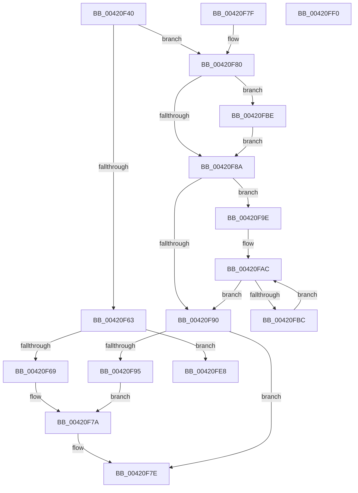

# RtlInterlockedSetBitRunEx

- RVA: `0x00420F40`–`0x00420FF1` (길이 `177` bytes)
- VA: `0x0000000140420F40`
- 실행 섹션: `.text`
- PDB 이름 있음: `예`; PDB Function 태그: `아니요`
- unwind 정보 RVA: `0x000DB714`
- 디코드: `58`개 명령, `177/177` bytes 표시
- 미해석 바이트: `0` (있으면 어셈블리에 `.byte`로 보존)

> 이 문서는 커널 이미지의 기계어와 PDB 기호를 분석해 생성했습니다. 4번과 5번은 함수 원형과 자료형을 바이너리 사용 방식에서 추정한 C 해석이며 원본 소스 복구 결과는 아닙니다.

## 1. Dependencies

- 직접 호출 지점: **0**; 고유 호출 대상: **0**
- 직접 호출자로 확인된 함수: **0**
- RIP 상대 이미지 참조: **0**

### Outgoing calls
- 직접 디코드된 call 명령이 없습니다.

### Direct callers
- 이 함수 시작 RVA로 연결되는 직접 call은 확인되지 않았습니다. 간접 호출은 완전히 역산할 수 없습니다.

### Static image references
- 디코드된 RIP-relative 메모리 참조가 없습니다.

## 2. Other-region calls and transfers

- 다른 실행 섹션으로 향하는 call: **0**
- 별도 외부 분기/꼬리 이동을 확인하지 못했습니다.

## 3. Assembly (complete function range)

```asm
00420F40  48 8B 41 08                     mov rax, qword ptr [rcx + 8]
00420F44  4D 8B C8                        mov r9, r8
00420F47  4C 8B D2                        mov r10, rdx
00420F4A  4C 8B C2                        mov r8, rdx
00420F4D  49 C1 E8 05                     shr r8, 5
00420F51  41 83 E2 1F                     and r10d, 0x1f
00420F55  4E 8D 1C 80                     lea r11, [rax + r8*4]
00420F59  4B 8D 04 0A                     lea rax, [r10 + r9]
00420F5D  48 83 F8 20                     cmp rax, 0x20
00420F61  77 1D                           ja 0x140420f80
00420F63  49 83 F9 20                     cmp r9, 0x20
00420F67  74 7F                           je 0x140420fe8
00420F69  49 8B C9                        mov rcx, r9
00420F6C  B8 01 00 00 00                  mov eax, 1
00420F71  D3 E0                           shl eax, cl
00420F73  41 8B CA                        mov ecx, r10d
00420F76  FF C8                           dec eax
00420F78  D3 E0                           shl eax, cl
00420F7A  F0 41 09 03                     lock or dword ptr [r11], eax
00420F7E  C3                              ret
00420F7F  CC                              int3
00420F80  B8 01 00 00 00                  mov eax, 1
00420F85  4D 85 D2                        test r10, r10
00420F88  75 34                           jne 0x140420fbe
00420F8A  49 83 F9 20                     cmp r9, 0x20
00420F8E  73 0E                           jae 0x140420f9e
00420F90  4D 85 C9                        test r9, r9
00420F93  74 E9                           je 0x140420f7e
00420F95  49 8B C9                        mov rcx, r9
00420F98  D3 E0                           shl eax, cl
00420F9A  FF C8                           dec eax
00420F9C  EB DC                           jmp 0x140420f7a
00420F9E  49 8B D1                        mov rdx, r9
00420FA1  48 C1 EA 05                     shr rdx, 5
00420FA5  48 6B CA E0                     imul rcx, rdx, -0x20
00420FA9  4C 03 C9                        add r9, rcx
00420FAC  41 C7 03 FF FF FF FF            mov dword ptr [r11], 0xffffffff
00420FB3  49 83 C3 04                     add r11, 4
00420FB7  48 2B D0                        sub rdx, rax
00420FBA  74 D4                           je 0x140420f90
00420FBC  EB EE                           jmp 0x140420fac
00420FBE  83 E2 1F                        and edx, 0x1f
00420FC1  41 B8 20 00 00 00               mov r8d, 0x20
00420FC7  44 2B C2                        sub r8d, edx
00420FCA  8B D0                           mov edx, eax
00420FCC  41 8B C8                        mov ecx, r8d
00420FCF  D3 E2                           shl edx, cl
00420FD1  49 8B CA                        mov rcx, r10
00420FD4  FF CA                           dec edx
00420FD6  D3 E2                           shl edx, cl
00420FD8  F0 41 09 13                     lock or dword ptr [r11], edx
00420FDC  41 8B C8                        mov ecx, r8d
00420FDF  4C 2B C9                        sub r9, rcx
00420FE2  49 83 C3 04                     add r11, 4
00420FE6  EB A2                           jmp 0x140420f8a
00420FE8  41 C7 03 FF FF FF FF            mov dword ptr [r11], 0xffffffff
00420FEF  C3                              ret
00420FF0  CC                              int3
```

## 4. C-style interpretation (structured pseudocode)

```c
__int64 __fastcall RtlInterlockedSetBitRunEx(__int64 a1, __int64 a2, __int64 a3)
{
    __int64 result;
    __int64 v_r10;
    __int64 v_r11;

    a3 = (a2) >> (5);
    v_r10 = (unsigned int)((a2) & (31));
    if ((v_r10 + a3 * 1) > 32) goto loc_00420F80;
    if (a3 == 32) goto loc_00420FE8;
    result = (unsigned int)((1) << ((unsigned __int8)(a3)));
    result = (unsigned int)((result) - 1);
    result = (unsigned int)((result) << ((unsigned __int8)((unsigned int)((unsigned int)(v_r10)))));
loc_00420F7A:
loc_00420F7E:
    return result;
loc_00420F80:
    if (v_r10 != 0) goto loc_00420FBE;
loc_00420F8A:
    if (a3 >= 32) goto loc_00420F9E;
loc_00420F90:
    if (a3 == 0) goto loc_00420F7E;
    result = (unsigned int)((1) << ((unsigned __int8)(a3)));
    result = (unsigned int)((result) - 1);
    goto loc_00420F7A;
loc_00420F9E:
    a2 = (a3) >> (5);
    a1 = (a3) * (a2);
    a4 = (a3) + (a1);
loc_00420FAC:
    *(unsigned int *)(*(unsigned __int64 *)(a1 + 8) + a3 * 4) = 0xFFFFFFFFULL;
    v_r11 = (*(unsigned __int64 *)(a1 + 8) + a3 * 4) + (4);
    a2 = (a2) - (result);
    if (condition_is_equal) goto loc_00420F90;
    goto loc_00420FAC;
loc_00420FBE:
    a2 = (unsigned int)((a2) & (31));
    a3 = (unsigned int)((32) - ((unsigned int)(a2)));
    a2 = (unsigned int)(((unsigned int)((unsigned int)(result))) << ((unsigned __int8)((unsigned int)((unsigned int)(a3)))));
    a2 = (unsigned int)((a2) - 1);
    a2 = (unsigned int)((a2) << ((unsigned __int8)(v_r10)));
    a4 = (a4) - ((unsigned int)((unsigned int)(a3)));
    v_r11 = (v_r11) + (4);
    goto loc_00420F8A;
loc_00420FE8:
    *(unsigned int *)(v_r11) = 0xFFFFFFFFULL;
    return result;
}
```

## 5. (Beta) C Style

```c
int64_t RtlInterlockedSetBitRunEx(void *Arg1, void *Arg2, int64_t Arg3)
{
    uint8_t *arg1 = (uint8_t *)Arg1;
    uint8_t *arg2 = (uint8_t *)Arg2;

    int64_t result;
    int64_t local_r10;
    int64_t local_r11;

    Arg3 = (Arg2) >> (5);
    local_r10 = (uint32_t)((Arg2) & (31));
    if ((local_r10 + Arg3 * 1) > 32) goto loc_00420F80;
    if (Arg3 == 32) goto loc_00420FE8;
    result = (uint32_t)((1) << ((uint8_t)(Arg3)));
    result = (uint32_t)((result) - 1);
    result = (uint32_t)((result) << ((uint8_t)((uint32_t)((uint32_t)(local_r10)))));
loc_00420F7A:
loc_00420F7E:
    return result;
loc_00420F80:
    if (local_r10 != 0) goto loc_00420FBE;
loc_00420F8A:
    if (Arg3 >= 32) goto loc_00420F9E;
loc_00420F90:
    if (Arg3 == 0) goto loc_00420F7E;
    result = (uint32_t)((1) << ((uint8_t)(Arg3)));
    result = (uint32_t)((result) - 1);
    goto loc_00420F7A;
loc_00420F9E:
    Arg2 = (Arg3) >> (5);
    Arg1 = (Arg3) * (Arg2);
    a4 = (Arg3) + (Arg1);
loc_00420FAC:
    *(uint32_t *)(*(uint64_t *)(arg1 + 0x8) + Arg3 * 4) = 0xFFFFFFFFULL;
    local_r11 = (*(uint64_t *)(arg1 + 0x8) + Arg3 * 4) + (4);
    Arg2 = (Arg2) - (result);
    if (condition_is_equal) goto loc_00420F90;
    goto loc_00420FAC;
loc_00420FBE:
    Arg2 = (uint32_t)((Arg2) & (31));
    Arg3 = (uint32_t)((32) - ((uint32_t)(Arg2)));
    Arg2 = (uint32_t)(((uint32_t)((uint32_t)(result))) << ((uint8_t)((uint32_t)((uint32_t)(Arg3)))));
    Arg2 = (uint32_t)((Arg2) - 1);
    Arg2 = (uint32_t)((Arg2) << ((uint8_t)(local_r10)));
    a4 = (a4) - ((uint32_t)((uint32_t)(Arg3)));
    local_r11 = (local_r11) + (4);
    goto loc_00420F8A;
loc_00420FE8:
    *(uint32_t *)(local_r11) = 0xFFFFFFFFULL;
    return result;
}
```

### 관측된 메모리 오프셋

구조체 형식이 확인되지 않은 접근은 인자 기준의 오프셋으로만 기록했습니다.

| 기준 인자 | 오프셋 표현 | 폭 (bit) | 접근 |
|---|---:|---:|---|
| `Arg1` | `+ 0x8` | `64` | `R` |
| `Arg2` | `+ 0x0 + r9*1` | `64` | `R` |

## 6. Execution-region graph

[열기: 2D/3D 그래프와 함수 탐색 컨트롤 패널](../../../control-panel.html?section=text&rva=0x00420F40&view=graph)

- 2D 그래프는 위에서 아래로 흐르고, 3D 그래프는 빈 공간을 드래그해 회전합니다. Shift+드래그는 이동, 휠은 확대·축소, 함수 노드 선택은 대상 보고서 이동입니다.

### Static fallback


