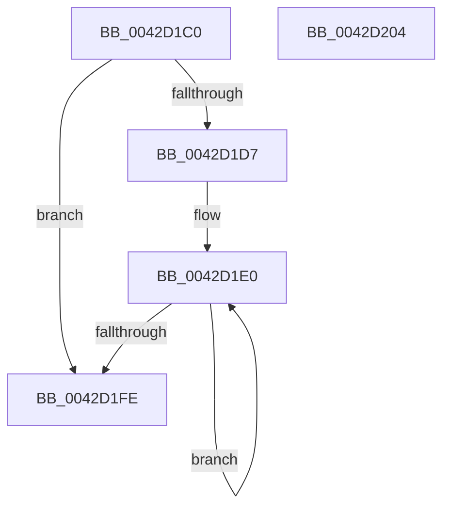

# RtlStackTraceHashFunction

- RVA: `0x0042D1C0`–`0x0042D205` (길이 `69` bytes)
- VA: `0x000000014042D1C0`
- 실행 섹션: `.text`
- PDB 이름 있음: `예`; PDB Function 태그: `아니요`
- unwind 정보 RVA: `0x00071750`
- 디코드: `22`개 명령, `69/69` bytes 표시
- 미해석 바이트: `0` (있으면 어셈블리에 `.byte`로 보존)

> 이 문서는 커널 이미지의 기계어와 PDB 기호를 분석해 생성했습니다. 4번과 5번은 함수 원형과 자료형을 바이너리 사용 방식에서 추정한 C 해석이며 원본 소스 복구 결과는 아닙니다.

## 1. Dependencies

- 직접 호출 지점: **0**; 고유 호출 대상: **0**
- 직접 호출자로 확인된 함수: **0**
- RIP 상대 이미지 참조: **0**

### Outgoing calls
- 직접 디코드된 call 명령이 없습니다.

### Direct callers
- 이 함수 시작 RVA로 연결되는 직접 call은 확인되지 않았습니다. 간접 호출은 완전히 역산할 수 없습니다.

### Static image references
- 디코드된 RIP-relative 메모리 참조가 없습니다.

## 2. Other-region calls and transfers

- 다른 실행 섹션으로 향하는 call: **0**
- 별도 외부 분기/꼬리 이동을 확인하지 못했습니다.

## 3. Assembly (complete function range)

```asm
0042D1C0  48 89 5C 24 08                  mov qword ptr [rsp + 8], rbx
0042D1C5  8B D9                           mov ebx, ecx
0042D1C7  33 C0                           xor eax, eax
0042D1C9  48 C1 E3 02                     shl rbx, 2
0042D1CD  4C 8B DA                        mov r11, rdx
0042D1D0  8B C8                           mov ecx, eax
0042D1D2  48 85 DB                        test rbx, rbx
0042D1D5  74 27                           je 0x14042d1fe
0042D1D7  44 8B D0                        mov r10d, eax
0042D1DA  66 0F 1F 44 00 00               nop word ptr [rax + rax]
0042D1E0  8D 51 01                        lea edx, [rcx + 1]
0042D1E3  83 C1 02                        add ecx, 2
0042D1E6  45 0F B7 0C 53                  movzx r9d, word ptr [r11 + rdx*2]
0042D1EB  43 0F B7 14 53                  movzx edx, word ptr [r11 + r10*2]
0042D1F0  4C 33 CA                        xor r9, rdx
0042D1F3  44 8B D1                        mov r10d, ecx
0042D1F6  49 03 C1                        add rax, r9
0042D1F9  4C 3B D3                        cmp r10, rbx
0042D1FC  72 E2                           jb 0x14042d1e0
0042D1FE  48 8B 5C 24 08                  mov rbx, qword ptr [rsp + 8]
0042D203  C3                              ret
0042D204  CC                              int3
```

## 4. C-style interpretation (structured pseudocode)

```c
__int64 __fastcall RtlStackTraceHashFunction(int a1, __int64 a2)
{
    __int64 result;
    __int64 v_rbx;
    unsigned __int64 v_stack_p8;

    v_stack_p8 = v_rbx;
    result = 0;
    v_rbx = ((unsigned int)(a1)) << (2);
    if (v_rbx == 0) goto loc_0042D1FE;
loc_0042D1E0:
    a1 = (unsigned int)((0) + (2));
    a4 = (*(unsigned __int16 *)(a2 + 0 + 1 * 2)) ^ (*(unsigned __int16 *)(a2 + 0 * 2));
    result = (result) + (a4);
    if (((unsigned int)(a1)) < v_rbx) goto loc_0042D1E0;
loc_0042D1FE:
    return result;
}
```

## 5. (Beta) C Style

```c
int64_t RtlStackTraceHashFunction(int32_t Arg1, void *Arg2)
{
    uint8_t *arg2 = (uint8_t *)Arg2;

    int64_t result;
    int64_t local_rbx;
    uint64_t v_stack_p8;

    v_stack_p8 = local_rbx;
    result = 0;
    local_rbx = ((uint32_t)(Arg1)) << (2);
    if (local_rbx == 0) goto loc_0042D1FE;
loc_0042D1E0:
    Arg1 = (uint32_t)((0) + (2));
    a4 = (*(uint16_t *)(arg2 + 0x0 + 0x1 * 2)) ^ (*(uint16_t *)(arg2 + 0x0 * 2));
    result = (result) + (a4);
    if (((uint32_t)(Arg1)) < local_rbx) goto loc_0042D1E0;
loc_0042D1FE:
    return result;
}
```

### 관측된 메모리 오프셋

구조체 형식이 확인되지 않은 접근은 인자 기준의 오프셋으로만 기록했습니다.

| 기준 인자 | 오프셋 표현 | 폭 (bit) | 접근 |
|---|---:|---:|---|
| `Arg2` | `+ 0x0 + r10*2` | `16` | `R` |
| `Arg2` | `+ 0x0 + rdx*2` | `16` | `R` |

## 6. Execution-region graph

[열기: 2D/3D 그래프와 함수 탐색 컨트롤 패널](../../../control-panel.html?section=text&rva=0x0042D1C0&view=graph)

- 2D 그래프는 위에서 아래로 흐르고, 3D 그래프는 빈 공간을 드래그해 회전합니다. Shift+드래그는 이동, 휠은 확대·축소, 함수 노드 선택은 대상 보고서 이동입니다.

### Static fallback


