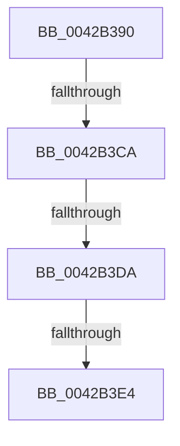

# RtlStringCchPrintfExW

- RVA: `0x0042B390`–`0x0042B3EC` (길이 `92` bytes)
- VA: `0x000000014042B390`
- 실행 섹션: `.text`
- PDB 이름 있음: `예`; PDB Function 태그: `예`
- unwind 정보 RVA: `0x000A16D4`
- 디코드: `23`개 명령, `92/92` bytes 표시
- 미해석 바이트: `0` (있으면 어셈블리에 `.byte`로 보존)

> 이 문서는 커널 이미지의 기계어와 PDB 기호를 분석해 생성했습니다. 4번과 5번은 함수 원형과 자료형을 바이너리 사용 방식에서 추정한 C 해석이며 원본 소스 복구 결과는 아닙니다.

## 1. Dependencies

- 직접 호출 지점: **0**; 고유 호출 대상: **0**
- 직접 호출자로 확인된 함수: **44**
- RIP 상대 이미지 참조: **0**

### Outgoing calls
- 직접 디코드된 call 명령이 없습니다.

### Direct callers
- [PopDiagTraceProcessorThrottlePerfTrack](PopDiagTraceProcessorThrottlePerfTrack_function_0042B2B0.md) at `0x0042B350`
- [PopDiagTraceProcessorThrottleDurationPerfTrack](../5D/PopDiagTraceProcessorThrottleDurationPerfTrack_function_005D6DB8.md) at `0x005D6E60`
- [PipHardwareConfigClearStartOverrideCallback](../../page/72/PipHardwareConfigClearStartOverrideCallback_function_007233D0.md) at `0x00723431`
- [PipHardwareConfigClearStartOverrides](../../page/72/PipHardwareConfigClearStartOverrides_function_007234A4.md) at `0x0072354B`
- [IoReportDetectedDevice](../../page/72/IoReportDetectedDevice_function_00725CD0.md) at `0x00725F2C`
- [IoReportRootDevice](../../page/72/IoReportRootDevice_function_00726780.md) at `0x007268DD`
- [PiCMGenerateDeviceInstance](../../page/73/PiCMGenerateDeviceInstance_function_0073B69C.md) at `0x0073B82C`
- [IopCreateLegacyDeviceIds](../../page/73/IopCreateLegacyDeviceIds_function_0073D3E4.md) at `0x0073D4E1`
- [CmGetDevicePanelRegKeyPath](../../page/82/CmGetDevicePanelRegKeyPath_function_0082EE7C.md) at `0x0082EF0B`
- [DrvDbCreateDatabaseNode](../../page/83/DrvDbCreateDatabaseNode_function_0083533C.md) at `0x0083549C`
- [PnpGetObjectPropertyWorker](../../page/8E/PnpGetObjectPropertyWorker_function_008E1810.md) at `0x008E1A4C`
- [PnpGetObjectPropertyWorker](../../page/8E/PnpGetObjectPropertyWorker_function_008E1810.md) at `0x008E1AD4`
- [PnpGetObjectProperty](../../page/8E/PnpGetObjectProperty_function_008E2180.md) at `0x008E2506`
- [PnpGetObjectProperty](../../page/8E/PnpGetObjectProperty_function_008E2180.md) at `0x008E258B`
- [sub_008EE966](../../page/8E/Unknown_function_008EE966.md) at `0x008EEAC0`
- [sub_008EE966](../../page/8E/Unknown_function_008EE966.md) at `0x008EEE20`
- [sub_008EE966](../../page/8E/Unknown_function_008EE966.md) at `0x008EF054`
- [sub_008EFC77](../../page/8E/Unknown_function_008EFC77.md) at `0x008EFCCB`
- [sub_008EFC77](../../page/8E/Unknown_function_008EFC77.md) at `0x008EFD54`
- [sub_008F1E09](../../page/8F/Unknown_function_008F1E09.md) at `0x008F1E51`
- [sub_008F1EA2](../../page/8F/Unknown_function_008F1EA2.md) at `0x008F1ED8`
- [sub_008F246A](../../page/8F/Unknown_function_008F246A.md) at `0x008F26A3`
- [sub_008F286E](../../page/8F/Unknown_function_008F286E.md) at `0x008F28BD`
- [CmGetDeviceContainerRegKeyPath](../../page/8F/CmGetDeviceContainerRegKeyPath_function_008F4804.md) at `0x008F489D`
- [PnpStringFromGuid](../../page/8F/PnpStringFromGuid_function_008F5A2C.md) at `0x008F5ACE`
- [PnpDeletePropertyWorker](../../page/8F/PnpDeletePropertyWorker_function_008FE754.md) at `0x008FE84C`
- [sub_008FEF97](../../page/8F/Unknown_function_008FEF97.md) at `0x008FEFD5`
- [CmGetDeviceRegKeyPath](../../page/99/CmGetDeviceRegKeyPath_function_00990CC0.md) at `0x00990DFE`
- [CmGetDeviceRegKeyPath](../../page/99/CmGetDeviceRegKeyPath_function_00990CC0.md) at `0x00990FC8`
- [CmGetDeviceRegKeyPath](../../page/99/CmGetDeviceRegKeyPath_function_00990CC0.md) at `0x0099106C`
- [_CmGetDeviceSoftwareKeyPath](../../page/99/_CmGetDeviceSoftwareKeyPath_function_00991090.md) at `0x009911F7`
- [CmGetDeviceLogConfKeyPath](../../page/99/CmGetDeviceLogConfKeyPath_function_009913B8.md) at `0x00991453`
- [CmGetDeviceControlKeyPath](../../page/99/CmGetDeviceControlKeyPath_function_00991470.md) at `0x0099150B`
- [_CmGetDeviceHardwareKeyPath](../../page/99/_CmGetDeviceHardwareKeyPath_function_00991528.md) at `0x009915C7`
- [PnpSetPropertyWorker](../../page/99/PnpSetPropertyWorker_function_00991C08.md) at `0x00991D0F`
- [_PnpOpenPropertiesKey](../../page/99/_PnpOpenPropertiesKey_function_009938A0.md) at `0x00993966`
- [DrvDbBuildDeviceIdDriverInfMatch](../../page/99/DrvDbBuildDeviceIdDriverInfMatch_function_009944C0.md) at `0x00994532`
- [DrvDbBuildDeviceIdDriverInfMatch](../../page/99/DrvDbBuildDeviceIdDriverInfMatch_function_009944C0.md) at `0x0099456C`
- [DrvDbBuildDeviceIdDriverInfMatch](../../page/99/DrvDbBuildDeviceIdDriverInfMatch_function_009944C0.md) at `0x009945C7`
- [PnpGetGenericStorePropertyLocales](../../page/99/PnpGetGenericStorePropertyLocales_function_00994DBC.md) at `0x00994EAB`
- [PiProcessDriverInstance](../../page/99/PiProcessDriverInstance_function_00998530.md) at `0x00998634`
- [PiFindDevInstMatch](../../page/99/PiFindDevInstMatch_function_009996A0.md) at `0x009997A3`
- [PiRearrangeDeviceInstances](../../page/99/PiRearrangeDeviceInstances_function_0099AF9C.md) at `0x0099B02A`
- [PiRearrangeDeviceInstances](../../page/99/PiRearrangeDeviceInstances_function_0099AF9C.md) at `0x0099B0D1`
- [CmBuildDevicePanelId](../../page/A0/CmBuildDevicePanelId_function_00A0B008.md) at `0x00A0B06E`
- [PnpDriverLoadingFailed](../../page/AB/PnpDriverLoadingFailed_function_00AB8928.md) at `0x00AB8C00`
- [PnpDriverLoadingFailed](../../page/AB/PnpDriverLoadingFailed_function_00AB8928.md) at `0x00AB8C8F`
- [sub_00B1E6D4](../../page/B1/Unknown_function_00B1E6D4.md) at `0x00B1E7F9`
- [sub_00B1E6D4](../../page/B1/Unknown_function_00B1E6D4.md) at `0x00B1E82D`
- [sub_00B1E83A](../../page/B1/Unknown_function_00B1E83A.md) at `0x00B1E8CA`
- [sub_00B2BA82](../../page/B2/Unknown_function_00B2BA82.md) at `0x00B2BB2D`
- [sub_00B2BA82](../../page/B2/Unknown_function_00B2BA82.md) at `0x00B2BBC8`
- [sub_00B2BA82](../../page/B2/Unknown_function_00B2BA82.md) at `0x00B2BC72`
- [sub_00B2BA82](../../page/B2/Unknown_function_00B2BA82.md) at `0x00B2BCFB`
- [sub_00B2BE00](../../page/B2/Unknown_function_00B2BE00.md) at `0x00B2BEE4`
- [sub_00B2BE00](../../page/B2/Unknown_function_00B2BE00.md) at `0x00B2BF40`
- [sub_00B3FE90](../../page/B3/Unknown_function_00B3FE90.md) at `0x00B40016`
- [sub_00B444BA](../../page/B4/Unknown_function_00B444BA.md) at `0x00B44676`
- [sub_00B444BA](../../page/B4/Unknown_function_00B444BA.md) at `0x00B446A7`
- [sub_00B444BA](../../page/B4/Unknown_function_00B444BA.md) at `0x00B44879`
- [IopInitializeBootDrivers](../../init/C2/IopInitializeBootDrivers_function_00C2E6F4.md) at `0x00C2EFF2`
- [PipInitComputerIds](../../init/C7/PipInitComputerIds_function_00C74734.md) at `0x00C758CA`
- [PipInitComputerIds](../../init/C7/PipInitComputerIds_function_00C74734.md) at `0x00C75940`
- [PipInitComputerIds](../../init/C7/PipInitComputerIds_function_00C74734.md) at `0x00C759B6`
- [PipInitComputerIds](../../init/C7/PipInitComputerIds_function_00C74734.md) at `0x00C75A33`

### Static image references
- 디코드된 RIP-relative 메모리 참조가 없습니다.

## 2. Other-region calls and transfers

- 다른 실행 섹션으로 향하는 call: **0**
- call이 아닌 외부 분기/꼬리 이동: **3**
  - `0x0042B3C4` → [sub_0042B587](Unknown_function_0042B587.md) (`tail-transfer`)
  - `0x0042B3D4` → [sub_0042B587 + 0x17](Unknown_function_0042B587.md) (`tail-transfer`)
  - `0x0042B3DE` → [sub_0042B52B](Unknown_function_0042B52B.md) (`tail-transfer`)

## 3. Assembly (complete function range)

```asm
0042B390  4C 89 44 24 18                  mov qword ptr [rsp + 0x18], r8
0042B395  53                              push rbx
0042B396  41 54                           push r12
0042B398  41 55                           push r13
0042B39A  41 57                           push r15
0042B39C  48 83 EC 68                     sub rsp, 0x68
0042B3A0  44 8B A4 24 B0 00 00 00         mov r12d, dword ptr [rsp + 0xb0]
0042B3A8  33 C0                           xor eax, eax
0042B3AA  45 8B D4                        mov r10d, r12d
0042B3AD  48 8B DA                        mov rbx, rdx
0042B3B0  4C 8B F9                        mov r15, rcx
0042B3B3  4D 8B E9                        mov r13, r9
0042B3B6  8B D0                           mov edx, eax
0042B3B8  B9 0D 00 00 C0                  mov ecx, 0xc000000d
0042B3BD  41 81 E2 00 01 00 00            and r10d, 0x100
0042B3C4  0F 85 BD 01 00 00               jne 0x14042b587
0042B3CA  48 8D 43 FF                     lea rax, [rbx - 1]
0042B3CE  48 3D FE FF FF 7F               cmp rax, 0x7ffffffe
0042B3D4  0F 87 C4 01 00 00               ja 0x14042b59e
0042B3DA  33 C0                           xor eax, eax
0042B3DC  85 D2                           test edx, edx
0042B3DE  0F 88 47 01 00 00               js 0x14042b52b
0042B3E4  4C 8B 84 24 B8 00 00 00         mov r8, qword ptr [rsp + 0xb8]
```

## 4. C-style interpretation (structured pseudocode)

```c
__int64 __fastcall RtlStringCchPrintfExW(__int64 a1, __int64 a2, __int64 a3, __int64 a4, unsigned int a5, __int64 a6)
{
    __int64 result;
    __int64 v_r10;
    __int64 v_rsp;
    unsigned __int64 v_stack_p18;

    v_stack_p18 = a3;
    v_rsp = (v_rsp) - (104);
    result = 0;
    v_r10 = (unsigned int)(((unsigned int)((unsigned int)((unsigned int)(a5)))) & (256));
    result = 0;
    return result;
}
```

## 5. (Beta) C Style

```c
int64_t RtlStringCchPrintfExW(int64_t Arg1, void *Arg2, int64_t Arg3, int64_t Arg4, uint32_t Arg5, int64_t Arg6)
{
    uint8_t *arg2 = (uint8_t *)Arg2;

    int64_t result;
    int64_t local_r10;
    int64_t local_rsp;
    uint64_t v_stack_p18;

    v_stack_p18 = Arg3;
    local_rsp = (local_rsp) - (104);
    result = 0;
    local_r10 = (uint32_t)(((uint32_t)((uint32_t)((uint32_t)(Arg5)))) & (256));
    result = 0;
    return result;
}
```

### 관측된 메모리 오프셋

구조체 형식이 확인되지 않은 접근은 인자 기준의 오프셋으로만 기록했습니다.

| 기준 인자 | 오프셋 표현 | 폭 (bit) | 접근 |
|---|---:|---:|---|
| `Arg2` | `- 0x1` | `64` | `R` |

## 6. Execution-region graph

[열기: 2D/3D 그래프와 함수 탐색 컨트롤 패널](../../../control-panel.html?section=text&rva=0x0042B390&view=graph)

- 2D 그래프는 위에서 아래로 흐르고, 3D 그래프는 빈 공간을 드래그해 회전합니다. Shift+드래그는 이동, 휠은 확대·축소, 함수 노드 선택은 대상 보고서 이동입니다.

### Static fallback


