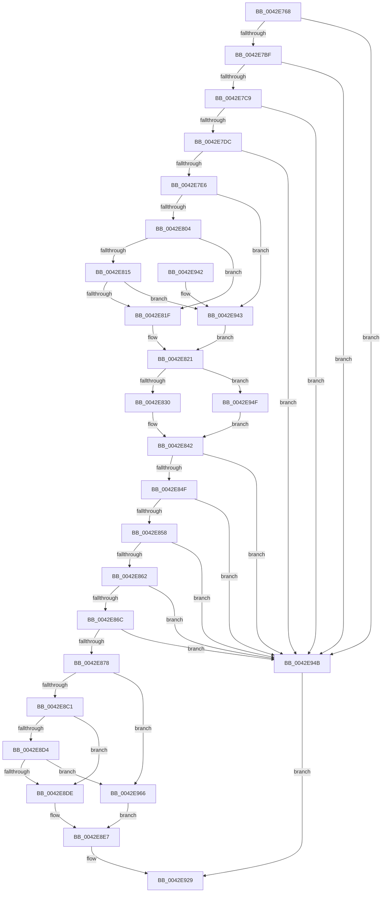

# RtlpTimeFieldsToTimeNoLeapSeconds

- RVA: `0x0042E768`–`0x0042E974` (길이 `524` bytes)
- VA: `0x000000014042E768`
- 실행 섹션: `.text`
- PDB 이름 있음: `예`; PDB Function 태그: `아니요`
- unwind 정보 RVA: `0x000A1C2C`
- 디코드: `128`개 명령, `524/524` bytes 표시
- 미해석 바이트: `0` (있으면 어셈블리에 `.byte`로 보존)

> 이 문서는 커널 이미지의 기계어와 PDB 기호를 분석해 생성했습니다. 4번과 5번은 함수 원형과 자료형을 바이너리 사용 방식에서 추정한 C 해석이며 원본 소스 복구 결과는 아닙니다.

## 1. Dependencies

- 직접 호출 지점: **0**; 고유 호출 대상: **0**
- 직접 호출자로 확인된 함수: **2**
- RIP 상대 이미지 참조: **1**

### Outgoing calls
- 직접 디코드된 call 명령이 없습니다.

### Direct callers
- [RtlpTimeFieldsToTime](RtlpTimeFieldsToTime_function_0042E6C8.md) at `0x0042E701`
- [RtlpTimeFieldsToTime](RtlpTimeFieldsToTime_function_0042E6C8.md) at `0x0042E731`
- [RtlParseLeapSecondData](../../page/83/RtlParseLeapSecondData_function_0083D0A4.md) at `0x0083D120`

### Static image references
- `0x0042E821` → RVA `0x00000000` (`image boundary/outside`; read)

## 2. Other-region calls and transfers

- 다른 실행 섹션으로 향하는 call: **0**
- 별도 외부 분기/꼬리 이동을 확인하지 못했습니다.

## 3. Assembly (complete function range)

```asm
0042E768  48 89 5C 24 10                  mov qword ptr [rsp + 0x10], rbx
0042E76D  48 89 6C 24 18                  mov qword ptr [rsp + 0x18], rbp
0042E772  48 89 74 24 20                  mov qword ptr [rsp + 0x20], rsi
0042E777  57                              push rdi
0042E778  41 54                           push r12
0042E77A  41 55                           push r13
0042E77C  41 56                           push r14
0042E77E  41 57                           push r15
0042E780  0F BF 41 02                     movsx eax, word ptr [rcx + 2]
0042E784  41 BD 01 00 00 00               mov r13d, 1
0042E78A  44 0F BF 49 04                  movsx r9d, word ptr [rcx + 4]
0042E78F  4C 8B E2                        mov r12, rdx
0042E792  44 0F BF 01                     movsx r8d, word ptr [rcx]
0042E796  41 8B D9                        mov ebx, r9d
0042E799  0F BF 71 06                     movsx esi, word ptr [rcx + 6]
0042E79D  41 2B DD                        sub ebx, r13d
0042E7A0  44 0F BF 71 08                  movsx r14d, word ptr [rcx + 8]
0042E7A5  44 8B D8                        mov r11d, eax
0042E7A8  44 0F BF 79 0A                  movsx r15d, word ptr [rcx + 0xa]
0042E7AD  44 8D 50 FF                     lea r10d, [rax - 1]
0042E7B1  0F BF 69 0C                     movsx ebp, word ptr [rcx + 0xc]
0042E7B5  66 41 3B C5                     cmp ax, r13w
0042E7B9  0F 8C 8C 01 00 00               jl 0x14042e94b
0042E7BF  66 45 3B CD                     cmp r9w, r13w
0042E7C3  0F 8C 82 01 00 00               jl 0x14042e94b
0042E7C9  41 8D B8 BF F9 FF FF            lea edi, [r8 - 0x641]
0042E7D0  81 FF 2A 72 00 00               cmp edi, 0x722a
0042E7D6  0F 87 6F 01 00 00               ja 0x14042e94b
0042E7DC  41 83 FA 0B                     cmp r10d, 0xb
0042E7E0  0F 87 65 01 00 00               ja 0x14042e94b
0042E7E6  41 B9 1F 85 EB 51               mov r9d, 0x51eb851f
0042E7EC  41 8B C1                        mov eax, r9d
0042E7EF  41 F7 E0                        mul r8d
0042E7F2  C1 EA 07                        shr edx, 7
0042E7F5  69 CA 90 01 00 00               imul ecx, edx, 0x190
0042E7FB  44 3B C1                        cmp r8d, ecx
0042E7FE  0F 84 3F 01 00 00               je 0x14042e943
0042E804  41 8B C1                        mov eax, r9d
0042E807  41 F7 E0                        mul r8d
0042E80A  C1 EA 05                        shr edx, 5
0042E80D  6B CA 64                        imul ecx, edx, 0x64
0042E810  44 3B C1                        cmp r8d, ecx
0042E813  74 0A                           je 0x14042e81f
0042E815  41 F6 C0 03                     test r8b, 3
0042E819  0F 84 24 01 00 00               je 0x14042e943
0042E81F  33 C0                           xor eax, eax
0042E821  4C 8D 0D D8 17 BD FF            lea r9, [rip - 0x42e828]
0042E828  85 C0                           test eax, eax
0042E82A  0F 85 1F 01 00 00               jne 0x14042e94f
0042E830  43 0F BF 84 51 E0 C5 02 00      movsx eax, word ptr [r9 + r10*2 + 0x2c5e0]
0042E839  43 0F BF 8C 59 E0 C5 02 00      movsx ecx, word ptr [r9 + r11*2 + 0x2c5e0]
0042E842  2B C8                           sub ecx, eax
0042E844  0F BF C3                        movsx eax, bx
0042E847  3B C1                           cmp eax, ecx
0042E849  0F 8D FC 00 00 00               jge 0x14042e94b
0042E84F  83 FE 17                        cmp esi, 0x17
0042E852  0F 87 F3 00 00 00               ja 0x14042e94b
0042E858  41 83 FE 3B                     cmp r14d, 0x3b
0042E85C  0F 87 E9 00 00 00               ja 0x14042e94b
0042E862  41 83 FF 3B                     cmp r15d, 0x3b
0042E866  0F 87 DF 00 00 00               ja 0x14042e94b
0042E86C  81 FD E7 03 00 00               cmp ebp, 0x3e7
0042E872  0F 87 D3 00 00 00               ja 0x14042e94b
0042E878  41 BB 1F 85 EB 51               mov r11d, 0x51eb851f
0042E87E  69 CF 6D 01 00 00               imul ecx, edi, 0x16d
0042E884  41 8B C3                        mov eax, r11d
0042E887  F7 E7                           mul edi
0042E889  8B C7                           mov eax, edi
0042E88B  C1 EA 05                        shr edx, 5
0042E88E  2B CA                           sub ecx, edx
0042E890  C1 E8 02                        shr eax, 2
0042E893  03 C8                           add ecx, eax
0042E895  41 8B C3                        mov eax, r11d
0042E898  F7 E7                           mul edi
0042E89A  45 8D 98 C0 F9 FF FF            lea r11d, [r8 - 0x640]
0042E8A1  B8 1F 85 EB 51                  mov eax, 0x51eb851f
0042E8A6  C1 EA 07                        shr edx, 7
0042E8A9  8D 3C 11                        lea edi, [rcx + rdx]
0042E8AC  41 F7 E3                        mul r11d
0042E8AF  C1 EA 07                        shr edx, 7
0042E8B2  69 CA 90 01 00 00               imul ecx, edx, 0x190
0042E8B8  44 3B D9                        cmp r11d, ecx
0042E8BB  0F 84 A5 00 00 00               je 0x14042e966
0042E8C1  B8 1F 85 EB 51                  mov eax, 0x51eb851f
0042E8C6  41 F7 E3                        mul r11d
0042E8C9  C1 EA 05                        shr edx, 5
0042E8CC  6B C2 64                        imul eax, edx, 0x64
0042E8CF  44 3B D8                        cmp r11d, eax
0042E8D2  74 0A                           je 0x14042e8de
0042E8D4  41 F6 C0 03                     test r8b, 3
0042E8D8  0F 84 88 00 00 00               je 0x14042e966
0042E8DE  47 0F B7 84 51 E0 C5 02 00      movzx r8d, word ptr [r9 + r10*2 + 0x2c5e0]
0042E8E7  83 64 24 34 00                  and dword ptr [rsp + 0x34], 0
0042E8EC  6B C6 3C                        imul eax, esi, 0x3c
0042E8EF  41 03 C6                        add eax, r14d
0042E8F2  6B C8 3C                        imul ecx, eax, 0x3c
0042E8F5  41 8A C5                        mov al, r13b
0042E8F8  41 03 CF                        add ecx, r15d
0042E8FB  69 D1 E8 03 00 00               imul edx, ecx, 0x3e8
0042E901  41 0F BF C8                     movsx ecx, r8w
0042E905  03 CF                           add ecx, edi
0042E907  03 CB                           add ecx, ebx
0042E909  48 63 C9                        movsxd rcx, ecx
0042E90C  03 D5                           add edx, ebp
0042E90E  89 54 24 30                     mov dword ptr [rsp + 0x30], edx
0042E912  48 69 D1 00 5C 26 05            imul rdx, rcx, 0x5265c00
0042E919  48 03 54 24 30                  add rdx, qword ptr [rsp + 0x30]
0042E91E  48 69 CA 10 27 00 00            imul rcx, rdx, 0x2710
0042E925  49 89 0C 24                     mov qword ptr [r12], rcx
0042E929  48 8B 5C 24 38                  mov rbx, qword ptr [rsp + 0x38]
0042E92E  48 8B 6C 24 40                  mov rbp, qword ptr [rsp + 0x40]
0042E933  48 8B 74 24 48                  mov rsi, qword ptr [rsp + 0x48]
0042E938  41 5F                           pop r15
0042E93A  41 5E                           pop r14
0042E93C  41 5D                           pop r13
0042E93E  41 5C                           pop r12
0042E940  5F                              pop rdi
0042E941  C3                              ret
0042E942  CC                              int3
0042E943  41 8B C5                        mov eax, r13d
0042E946  E9 D6 FE FF FF                  jmp 0x14042e821
0042E94B  32 C0                           xor al, al
0042E94D  EB DA                           jmp 0x14042e929
0042E94F  43 0F BF 84 51 70 C7 02 00      movsx eax, word ptr [r9 + r10*2 + 0x2c770]
0042E958  43 0F BF 8C 59 70 C7 02 00      movsx ecx, word ptr [r9 + r11*2 + 0x2c770]
0042E961  E9 DC FE FF FF                  jmp 0x14042e842
0042E966  47 0F B7 84 51 70 C7 02 00      movzx r8d, word ptr [r9 + r10*2 + 0x2c770]
0042E96F  E9 73 FF FF FF                  jmp 0x14042e8e7
```

## 4. C-style interpretation (structured pseudocode)

```c
__int64 __fastcall RtlpTimeFieldsToTimeNoLeapSeconds(__int64 a1, __int64 a2)
{
    __int64 result;
    __int64 v_rbx;
    unsigned __int64 v_stack_p10;
    unsigned __int64 v_stack_p18;
    unsigned __int64 v_stack_p20;
    unsigned int v_stack_p8;
    unsigned int v_stack_pC;

    v_stack_p10 = v_rbx;
    v_stack_p18 = v_rbp;
    v_stack_p20 = v_rsi;
    v_rbx = (unsigned int)(((unsigned int)((unsigned int)((__int16)(*(unsigned __int16 *)(a1 + 4))))) - (1));
    if (((unsigned __int16)((__int16)(*(unsigned __int16 *)(a1 + 2)))) < 1) goto loc_0042E94B;
    if (((unsigned __int16)((__int16)(*(unsigned __int16 *)(a1 + 4)))) < 1) goto loc_0042E94B;
    if (((unsigned int)((__int16)(*(unsigned __int16 *)(a1)) - 1601)) > 0x722AULL) goto loc_0042E94B;
    if (((unsigned int)((__int16)(*(unsigned __int16 *)(a1 + 2)) - 1)) > 11) goto loc_0042E94B;
    a2 = (unsigned int)((a2) >> (7));
    a1 = (unsigned int)((a1) * ((unsigned int)(a2)));
    if (((unsigned int)((__int16)(*(unsigned __int16 *)(a1)))) == ((unsigned int)(a1))) goto loc_0042E943;
    a2 = (unsigned int)((a2) >> (5));
    a1 = (unsigned int)((a1) * ((unsigned int)(a2)));
    if (((unsigned int)((__int16)(*(unsigned __int16 *)(a1)))) == ((unsigned int)(a1))) goto loc_0042E81F;
    if ((((unsigned __int8)((__int16)(*(unsigned __int16 *)(a1)))) & (3)) == 0) goto loc_0042E943;
loc_0042E81F:
    result = 0;
loc_0042E821:
    if (0 != 0) goto loc_0042E94F;
loc_0042E842:
    a1 = (unsigned int)(((__int16)(*(unsigned __int16 *)(v_rip - 4384808 + (unsigned int)((unsigned int)((__int16)(*(unsigned __int16 *)(a1 + 2)))) * 2 + 181728))) - ((unsigned int)((__int16)(*(unsigned __int16 *)(v_rip - 4384808 + (__int16)(*(unsigned __int16 *)(a1 + 2)) - 1 * 2 + 181728)))));
    if (((unsigned int)((__int16)((unsigned __int16)(v_rbx)))) >= ((unsigned int)(a1))) goto loc_0042E94B;
    if (((unsigned int)((__int16)(*(unsigned __int16 *)(a1 + 6)))) > 23) goto loc_0042E94B;
    if (((unsigned int)((__int16)(*(unsigned __int16 *)(a1 + 8)))) > 59) goto loc_0042E94B;
    if (((unsigned int)((__int16)(*(unsigned __int16 *)(a1 + 10)))) > 59) goto loc_0042E94B;
    if (((unsigned int)((__int16)(*(unsigned __int16 *)(a1 + 12)))) > 999) goto loc_0042E94B;
    a1 = (unsigned int)((a1) * ((unsigned int)((__int16)(*(unsigned __int16 *)(a1)) - 1601)));
    a2 = (unsigned int)((a2) >> (5));
    a1 = (unsigned int)((a1) - ((unsigned int)(a2)));
    result = (unsigned int)(((unsigned int)((unsigned int)((__int16)(*(unsigned __int16 *)(a1)) - 1601))) >> (2));
    a1 = (unsigned int)((a1) + ((unsigned int)(result)));
    a2 = (unsigned int)((a2) >> (7));
    a2 = (unsigned int)((a2) >> (7));
    a1 = (unsigned int)((a1) * ((unsigned int)(a2)));
    if (((unsigned int)((__int16)(*(unsigned __int16 *)(a1)) - 1600)) == ((unsigned int)(a1))) goto loc_0042E966;
    a2 = (unsigned int)((a2) >> (5));
    result = (unsigned int)(((unsigned int)(0x51EB851FULL)) * ((unsigned int)(a2)));
    if (((unsigned int)((__int16)(*(unsigned __int16 *)(a1)) - 1600)) == ((unsigned int)(result))) goto loc_0042E8DE;
    if ((((unsigned __int8)((__int16)(*(unsigned __int16 *)(a1)))) & (3)) == 0) goto loc_0042E966;
loc_0042E8DE:
loc_0042E8E7:
    result = (unsigned int)((result) * ((unsigned int)((__int16)(*(unsigned __int16 *)(a1 + 6)))));
    result = (unsigned int)((result) + ((unsigned int)((__int16)(*(unsigned __int16 *)(a1 + 8)))));
    a1 = (unsigned int)((a1) * ((unsigned int)(result)));
    a1 = (unsigned int)((a1) + ((unsigned int)((__int16)(*(unsigned __int16 *)(a1 + 10)))));
    a2 = (unsigned int)((a2) * ((unsigned int)(a1)));
    a1 = (unsigned int)(((__int16)((unsigned __int16)(*(unsigned __int16 *)(v_rip - 4384808 + (__int16)(*(unsigned __int16 *)(a1 + 2)) - 1 * 2 + 181728)))) + ((unsigned int)(a1 + a2 * 1)));
    a1 = (unsigned int)((a1) + ((unsigned int)(v_rbx)));
    a2 = (unsigned int)((a2) + ((unsigned int)((__int16)(*(unsigned __int16 *)(a1 + 12)))));
    v_stack_p8 = (unsigned int)(a2);
    a2 = (a2) * ((int)((unsigned int)(a1)));
    a2 = (a2) + (v_stack_p8);
    a1 = ((int)((unsigned int)(a1))) * (a2);
    *(unsigned __int64 *)(a2) = a1;
loc_0042E929:
    return 1;
loc_0042E943:
    goto loc_0042E821;
loc_0042E94B:
    result = 0;
    goto loc_0042E929;
loc_0042E94F:
    goto loc_0042E842;
loc_0042E966:
    goto loc_0042E8E7;
}
```

## 5. (Beta) C Style

```c
int64_t RtlpTimeFieldsToTimeNoLeapSeconds(void *Arg1, void *Arg2)
{
    uint8_t *arg1 = (uint8_t *)Arg1;
    uint8_t *arg2 = (uint8_t *)Arg2;

    int64_t result;
    int64_t local_rbx;
    uint64_t v_stack_p10;
    uint64_t v_stack_p18;
    uint64_t v_stack_p20;
    uint32_t v_stack_p8;
    uint32_t v_stack_pC;

    v_stack_p10 = local_rbx;
    v_stack_p18 = local_rbp;
    v_stack_p20 = local_rsi;
    local_rbx = (uint32_t)(((uint32_t)((uint32_t)((int16_t)(*(uint16_t *)(arg1 + 0x4))))) - (1));
    if (((uint16_t)((int16_t)(*(uint16_t *)(arg1 + 0x2)))) < 1) goto loc_0042E94B;
    if (((uint16_t)((int16_t)(*(uint16_t *)(arg1 + 0x4)))) < 1) goto loc_0042E94B;
    if (((uint32_t)((int16_t)(*(uint16_t *)(arg1)) - 1601)) > 0x722AULL) goto loc_0042E94B;
    if (((uint32_t)((int16_t)(*(uint16_t *)(arg1 + 0x2)) - 1)) > 11) goto loc_0042E94B;
    Arg2 = (uint32_t)((Arg2) >> (7));
    Arg1 = (uint32_t)((Arg1) * ((uint32_t)(Arg2)));
    if (((uint32_t)((int16_t)(*(uint16_t *)(arg1)))) == ((uint32_t)(Arg1))) goto loc_0042E943;
    Arg2 = (uint32_t)((Arg2) >> (5));
    Arg1 = (uint32_t)((Arg1) * ((uint32_t)(Arg2)));
    if (((uint32_t)((int16_t)(*(uint16_t *)(arg1)))) == ((uint32_t)(Arg1))) goto loc_0042E81F;
    if ((((uint8_t)((int16_t)(*(uint16_t *)(arg1)))) & (3)) == 0) goto loc_0042E943;
loc_0042E81F:
    result = 0;
loc_0042E821:
    if (0 != 0) goto loc_0042E94F;
loc_0042E842:
    Arg1 = (uint32_t)(((int16_t)(*(uint16_t *)(v_rip - 0x42E828 + (uint32_t)((uint32_t)((int16_t)(*(uint16_t *)(arg1 + 0x2)))) * 2 + 0x2C5E0))) - ((uint32_t)((int16_t)(*(uint16_t *)(v_rip - 0x42E828 + (int16_t)(*(uint16_t *)(arg1 + 0x2)) - 0x1 * 2 + 0x2C5E0)))));
    if (((uint32_t)((int16_t)((uint16_t)(local_rbx)))) >= ((uint32_t)(Arg1))) goto loc_0042E94B;
    if (((uint32_t)((int16_t)(*(uint16_t *)(arg1 + 0x6)))) > 23) goto loc_0042E94B;
    if (((uint32_t)((int16_t)(*(uint16_t *)(arg1 + 0x8)))) > 59) goto loc_0042E94B;
    if (((uint32_t)((int16_t)(*(uint16_t *)(arg1 + 0xA)))) > 59) goto loc_0042E94B;
    if (((uint32_t)((int16_t)(*(uint16_t *)(arg1 + 0xC)))) > 999) goto loc_0042E94B;
    Arg1 = (uint32_t)((Arg1) * ((uint32_t)((int16_t)(*(uint16_t *)(arg1)) - 1601)));
    Arg2 = (uint32_t)((Arg2) >> (5));
    Arg1 = (uint32_t)((Arg1) - ((uint32_t)(Arg2)));
    result = (uint32_t)(((uint32_t)((uint32_t)((int16_t)(*(uint16_t *)(arg1)) - 1601))) >> (2));
    Arg1 = (uint32_t)((Arg1) + ((uint32_t)(result)));
    Arg2 = (uint32_t)((Arg2) >> (7));
    Arg2 = (uint32_t)((Arg2) >> (7));
    Arg1 = (uint32_t)((Arg1) * ((uint32_t)(Arg2)));
    if (((uint32_t)((int16_t)(*(uint16_t *)(arg1)) - 1600)) == ((uint32_t)(Arg1))) goto loc_0042E966;
    Arg2 = (uint32_t)((Arg2) >> (5));
    result = (uint32_t)(((uint32_t)(0x51EB851FULL)) * ((uint32_t)(Arg2)));
    if (((uint32_t)((int16_t)(*(uint16_t *)(arg1)) - 1600)) == ((uint32_t)(result))) goto loc_0042E8DE;
    if ((((uint8_t)((int16_t)(*(uint16_t *)(arg1)))) & (3)) == 0) goto loc_0042E966;
loc_0042E8DE:
loc_0042E8E7:
    result = (uint32_t)((result) * ((uint32_t)((int16_t)(*(uint16_t *)(arg1 + 0x6)))));
    result = (uint32_t)((result) + ((uint32_t)((int16_t)(*(uint16_t *)(arg1 + 0x8)))));
    Arg1 = (uint32_t)((Arg1) * ((uint32_t)(result)));
    Arg1 = (uint32_t)((Arg1) + ((uint32_t)((int16_t)(*(uint16_t *)(arg1 + 0xA)))));
    Arg2 = (uint32_t)((Arg2) * ((uint32_t)(Arg1)));
    Arg1 = (uint32_t)(((int16_t)((uint16_t)(*(uint16_t *)(v_rip - 0x42E828 + (int16_t)(*(uint16_t *)(arg1 + 0x2)) - 0x1 * 2 + 0x2C5E0)))) + ((uint32_t)(Arg1 + Arg2 * 1)));
    Arg1 = (uint32_t)((Arg1) + ((uint32_t)(local_rbx)));
    Arg2 = (uint32_t)((Arg2) + ((uint32_t)((int16_t)(*(uint16_t *)(arg1 + 0xC)))));
    v_stack_p8 = (uint32_t)(Arg2);
    Arg2 = (Arg2) * ((int32_t)((uint32_t)(Arg1)));
    Arg2 = (Arg2) + (v_stack_p8);
    Arg1 = ((int32_t)((uint32_t)(Arg1))) * (Arg2);
    *(void **)(arg2) = Arg1;
loc_0042E929:
    return 1;
loc_0042E943:
    goto loc_0042E821;
loc_0042E94B:
    result = 0;
    goto loc_0042E929;
loc_0042E94F:
    goto loc_0042E842;
loc_0042E966:
    goto loc_0042E8E7;
}
```

### 관측된 메모리 오프셋

구조체 형식이 확인되지 않은 접근은 인자 기준의 오프셋으로만 기록했습니다.

| 기준 인자 | 오프셋 표현 | 폭 (bit) | 접근 |
|---|---:|---:|---|
| `Arg1` | `+ 0x0` | `16` | `R` |
| `Arg1` | `+ 0x2` | `16` | `R` |
| `Arg1` | `+ 0x4` | `16` | `R` |
| `Arg1` | `+ 0x6` | `16` | `R` |
| `Arg1` | `+ 0x8` | `16` | `R` |
| `Arg1` | `+ 0xA` | `16` | `R` |
| `Arg1` | `+ 0xC` | `16` | `R` |
| `Arg2` | `+ 0x0` | `64` | `W` |

## 6. Execution-region graph

[열기: 2D/3D 그래프와 함수 탐색 컨트롤 패널](../../../control-panel.html?section=text&rva=0x0042E768&view=graph)

- 2D 그래프는 위에서 아래로 흐르고, 3D 그래프는 빈 공간을 드래그해 회전합니다. Shift+드래그는 이동, 휠은 확대·축소, 함수 노드 선택은 대상 보고서 이동입니다.

### Static fallback


